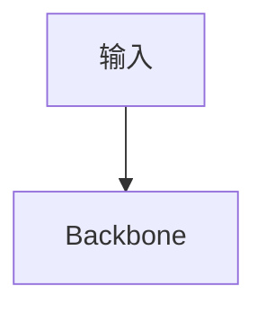

# 贡献者指南 · CONTRIBUTING

> 欢迎任何形式的贡献：修一个错字、补一行注释、写一个案例、开一个新页面，都值得一个 PR。

本站是 **agent-yolo** 的知识库，采用 VitePress + Vue 3 构建。所有贡献通过 GitHub PR 合入。

---

## 1. 贡献前必读

先花 5 分钟读完这一节，能避开 80% 的返工。

### 1.1 五类文档边界

本仓库所有文档归入以下 5 个顶层目录，先确认你要改的内容属于哪一类：

| 目录 | 内容 | 典型问题 |
|------|------|---------|
| `docs/cases/` | 深度案例，9 章结构 | "这个方案怎么落地" |
| `docs/tasks/` | 任务页，7 章结构 | "深度估计怎么做" |
| `docs/recipes/` | 训练/推理配方，8 章结构 | "怎么训练一个 YOLO" |
| `docs/solutions/` | 业务配方，不训模型直接用权重 | "怎么快速起一个业务" |
| `docs/versions/` | 版本页，10 章结构 | "v11 相对 v8 改了啥" |

**边界模糊怎么办**：在 issue 里描述清楚，先讨论再动手，比 PR 上来被打回快得多。

### 1.2 术语必须与 [glossary](/glossary) 一致

- 首次出现英文缩写必须给出中文全称，例如 `NMS（Non-Maximum Suppression，非极大值抑制）`
- 同一概念只用一个术语，不要在 A 页写「置信度阈值」在 B 页写「置信门」
- 拿不准的先搜 glossary；确实缺失的，在 PR 里顺便补一条

### 1.3 数字必须标注来源

- 官方数字（Ultralytics 官网 / 论文）→ 标注 "官方"
- 社区数字（Reddit / 知乎 / 第三方 benchmark）→ 标注 "社区"
- 你自己实测的数字 → 标注 "本地实测 YYYY-MM-DD"
- 未验证的 → 明确写 "待验证"，不要拿数字糊脸

### 1.4 COCO 必须写年份

`COCO 2017` 不要简写成 `COCO`。数据集每年更新，缺年份会让读者无法溯源。

---

## 2. 本地开发环境

### 2.1 依赖

- **Node.js 20+**（推荐 LTS）
- **npm 或 pnpm**（仓库里锁的是 npm，用 npm 即可）
- **Git 2.30+**

### 2.2 启动本地服务

```bash
# 1. 克隆
git clone https://github.com/.../agent-yolo.git
cd agent-yolo

# 2. 装依赖
npm install

# 3. 本地预览
npm run docs:dev
# 打开 http://localhost:5173/agent-yolo/
```

### 2.3 构建验证

```bash
# 4. 构建：这一步会跑 Mermaid 编译，任何语法错误都会在这里暴露
npm run docs:build
```

如果 build 报 Mermaid 错误，常见原因：

- **节点标签里有未转义的特殊字符**：`A[开始 (v1)]` → `A["开始 (v1)"]`
- **箭头连到子图而不是节点**：`A --> subgraph` 是错的，`A --> B` 才对
- **子图标题含空格**：`subgraph S["子图 标题"]`
- **同一 diagram 里多个方向混用**：`flowchart TB` 之后再 `LR` 会解析失败

### 2.4 常见 lint 错误

- **未闭合的 Mermaid code fence**：` ```mermaid ` 必须成对出现
- **表格列数不一致**：markdown lint MD013/MD055，用 VS Code 的 markdownlint 插件可实时提示
- **图片路径大小写错**：Windows 本地不报错，CI Linux 会 404；统一小写
- **锚点拼错**：VitePress 生成的锚点会去掉标点，`#模型 差异` 应该是 `#模型-差异`

---

## 3. 文档命名与目录约定

### 3.1 文件名

- **小写 + 连字符**：`mot.md` ✅ · `MOT.md` ❌ · `mot_MOT.md` ❌
- 英文全小写；中文标题写在 frontmatter 或首行 `#` 里
- 版本目录用 `v{N}/`：`docs/versions/v26/index.md`

### 3.2 图片

- 公共资产放 `docs/public/`：`docs/public/logo.svg`
- 页面就近图放 `docs/assets/` 或 `docs/<页所在目录>/assets/`
- 图片命名小写 + 连字符：`yolo-architecture.png`
- 尽量提供 alt 文本：``

### 3.3 Mermaid 图

Mermaid 代码块必须用 `::: figure` 容器包裹，方便加图注：

````markdown
::: figure

<br>
图 1 · YOLO 主干数据流
:::
````

VitePress 的 `figurePlugin`（见 `docs/.vitepress/config.mjs`）会自动把 `::: figure` 转成带图注的样式，同时给每个 figure 编号。

### 3.4 内部链接

- 相对链接优先：`[见基准](/benchmarks)` 而不是 `[见基准](../benchmarks.md)`
- 带锚点：`[MOT 案例](/cases/mot#mot20-精度基准)`
- 外链用 `target="_blank"`：`<a href="..." target="_blank">Ultralytics 官方文档</a>`

---

## 4. 章节结构约定

不同文档类型有固定章节结构，改动时保持对齐，方便读者跨页跳转。

### 4.1 案例页（cases/）· 9 章结构

参考 [mot.md](/cases/mot)：

1. 问题定义
2. 数据准备
3. 模型选型
4. 训练方案
5. 部署形态
6. 精度与成本
7. 演进故事与失败复盘
8. 反哺信号
9. 参考

### 4.2 任务页（tasks/）· 7 章结构

参考 [depth.md](/tasks/depth)：

1. 任务定义
2. 输入输出格式
3. 主流方法对比
4. 数据与标注
5. 训练要点
6. 部署考虑
7. 反哺信号

### 4.3 版本页（versions/vN/）· 10 章结构

参考 [v26/index.md](/versions/v26/index)：

1. 概览
2. 论文与出处
3. 架构变更
4. 层与模块
5. Loss 与梯度
6. Tricks
7. PainPoints
8. 代码走读
9. 基准对比
10. 演进脉络

### 4.4 Solutions 配方页 · 8 章结构

参考 [solutions/recipes.md](/solutions/recipes)：

1. 前置条件
2. 依赖安装
3. 配置参数
4. 核心代码
5. 运行方式
6. 输出与回调
7. 常见问题
8. 反哺信号

### 4.5 反哺信号章节

案例页 / 任务页 / 配方页末尾必须有「反哺信号」章节，格式如下：

```markdown
## 反哺信号

- **PainPoint 新增**：`pain-xxx`（说明）→ 挂到 [YAML PainPoints](/ontology/entity-types#painpoint)
- **Trick 新增**：`trick-xxx`（说明）
- **Metric 新增**：`metric-xxx`（说明）
```

命名前缀：`pain-` / `trick-` / `metric-`，全小写 + 连字符。

---

## 5. PR 提交 checklist

提交 PR 前请自查以下条目（可以复制到 PR 描述里勾选）：

- [ ] 术语与 [glossary](/glossary) 一致，缺失的已补充
- [ ] Mermaid 本地 build 无报错（`npm run docs:build`）
- [ ] 新页面已加入 `docs/.vitepress/config.mjs` 的 `nav` + `sidebar`
- [ ] 新案例已加入 [cases/compare.md](/cases/compare) 的横向对比表
- [ ] 新任务已加入 [compare-matrix.md](/compare-matrix) 的任务广度表
- [ ] 新版本已加入 [changelog.md](/versions/changelog) + [timeline.md](/global/timeline)
- [ ] 反哺信号章节已加（如适用），并运行 `node scripts/sync-feedback.js` 重新生成汇总
- [ ] 所有数字标注了来源（官方 / 社区 / 本地实测 / 待验证）
- [ ] COCO 都写了年份（COCO 2017）
- [ ] 无未闭合的 code fence、无 lint warning

---

## 6. 数据准确性规则

### 6.1 精度数字

- 官方基准必须来自 Ultralytics 官网或论文，标注出处链接
- 自测数字必须标注硬件（GPU 型号 / CPU / 显存）
- 不同数据集不要混着比（COCO vs VOC vs Cityscapes）

### 6.2 社区数字

社区 benchmark（Reddit / Medium / GitHub issue）只作为参考，不写进「典型性能数据」表格；如必须引用，明确标注 "社区基准，未独立复现"。

### 6.3 待验证内容

任何你不确定但对读者有价值的信息，用醒目样式标注：

```markdown
::: warning 待验证
以下数字来自 issue #1234，作者自测，尚未复现。
:::
```

不要写进正文；宁可先放脚注，也不要污染主内容。

---

## 7. 如何报告 Bug

在 GitHub 上提 issue，模板如下：

**标题**：`[类型] 简短描述`

类型可选：
- `[Bug]` 页面渲染错误 / 链接失效
- `[Doc]` 内容错误 / 过时
- `[Feature]` 新功能建议
- `[Question]` 使用咨询（会转为 discussion）

**正文**：

```
### 环境
- 浏览器：
- 系统：
- VitePress 版本：（可选）

### 复现步骤
1.
2.
3.

### 期望结果

### 实际结果

### 截图 / 日志
```

**不要**在 issue 里贴完整的终端输出，只贴关键 3-5 行。

---

## 8. 社区规则

本项目是开源知识库，请遵守以下最小公约：

### 8.1 不接受

- **政治内容**：本项目讨论技术，不涉及政治立场
- **广告 / 推广**：包括推广自己的博客、课程、服务（PR 会被直接关闭）
- **无意义 PR**：如"给所有标题加了空格"、"把 A 改成 A" 之类纯扰民的改动
- **AI 生成未审校内容**：可以用 AI 辅助写作，但必须人工审校后再提 PR

### 8.2 技术争议

- 走 issue 讨论，不在 PR 里争吵
- PR 里可以有 review 意见，但要求：具体、可执行、有依据
- 保持"对事不对人"，不要人身攻击

### 8.3 大改流程

以下情况必须**先开 issue 讨论方向**，别直接提 PR：

- 新增整个版本页（如 v27、v28）
- 重构某个章节结构
- 修改术语表的核心条目
- 删除已有内容

流程：

1. 开 issue 描述动机 + 影响范围 + 预期时间线
2. 至少 1 位维护者 review 方向
3. 开 PR 分批实施，每个 PR 聚焦一件事
4. 合入后更新 changelog

---

## 9. 快速贡献示例

如果你想贡献一个 typo fix，最快流程：

```bash
# 1. Fork & clone
git clone https://github.com/<you>/agent-yolo.git
cd agent-yolo

# 2. 建分支
git checkout -b fix/typo-in-mot

# 3. 改文件
vim docs/cases/mot.md

# 4. 本地验证
npm install
npm run docs:build

# 5. 提交
git add docs/cases/mot.md
git commit -m "docs(cases/mot): fix typo in chapter 3"

# 6. Push + 提 PR
git push origin fix/typo-in-mot
# 然后去 GitHub 网页提 PR
```

如果你要新增一页，别忘了在 `docs/.vitepress/config.mjs` 里加 `sidebar` 和 `nav` 条目（那部分由主线程管理，如果你不确定，先在 issue 里说明，我合入时会一并加）。

---

## 10. 联系方式

- **Issue**：GitHub Issues（首选，异步可追溯）
- **Discussion**：GitHub Discussions（问问题、聊方向）
- **邮箱**：维护者在 issue 里会自曝邮箱（不写死在文档里避免被爬虫）

回复时效：工作日 24-48 小时。周末可能延迟，但不会超过 72 小时。

---

**最后更新：2026-10-25**
