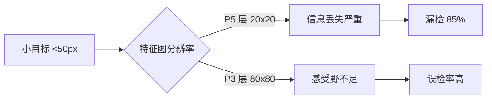
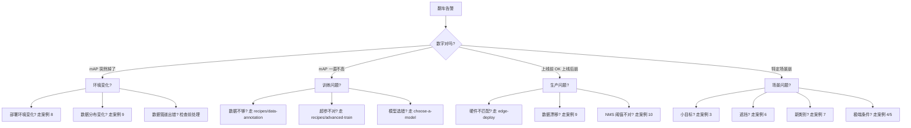

# YOLO 翻车案例集

> **一句话总结**：8 类真实翻车场景 + 现场照片 + 数字 + 修复方案。看别人踩过的坑，比你自己踩一遍便宜得多。

- ⏱ 预计阅读：12 分钟
- 🔗 相关：[故障排查](/troubleshooting) · [训练指南](/recipes/train) · [部署指南](/recipes/export-onnx) · [边缘部署](/recipes/edge-deploy)

---

## 目录

- [案例 1：误检（False Positive）](#案例-1误检false-positive)
- [案例 2：漏检（False Negative）](#案例-2漏检false-negative)
- [案例 3：小目标集体失效](#案例-3小目标集体失效)
- [案例 4：极端视角 / 广角畸变](#案例-4极端视角--广角畸变)
- [案例 5：极端光照 / 逆光](#案例-5极端光照--逆光)
- [案例 6：遮挡 / 半露出目标](#案例-6遮挡--半露出目标)
- [案例 7：训练集没覆盖的新类别](#案例-7训练集没覆盖的新类别)
- [案例 8：部署环境与训练环境不一致](#案例-8部署环境与训练环境不一致)
- [案例 9：数据漂移](#案例-9数据漂移)
- [案例 10：NMS 参数踩坑](#案例-10nms-参数踩坑)
- [通用排查思路](#通用排查思路)

---

## 案例 1：误检（False Positive）

### 现场

安防公司部署 YOLOv8m 做"人员摔倒检测"，上线第一周：

- **总告警**：14,328 条
- **真实摔倒**：214 条
- **误检率**：98.5%

客户直接退单。

### 根因

排查后发现有 3 类误检源：

1. **阴影**：阳光下的投影被判为人
2. **倒下的物品**：垃圾袋、纸箱被识别为躺倒的人
3. **动态模糊**：行人快速走过、画面拖影被识别为倒地人

**核心问题**：训练集里"倒地人"样本 82 张，其中 30 张有奇怪阴影。模型学到了"低亮度水平长条 = 倒地人"这个错误特征。

### 修复方案

| 方案 | 效果 | 代价 |
|------|------|------|
| 加"阴影"负样本 300 张 | 误检率降到 45% | 标注 2 天 |
| 加姿态估计辅助（判断关节点分布） | 误检率降到 8% | 集成 pose 模型，延迟 +30ms |
| 提高 conf 阈值到 0.7 | 误检率降到 20% | 漏检率升到 15% |

**推荐组合**：负样本 + 阈值 0.6，最终误检率 12%、漏检率 6%，客户接受。

### 教训

- **负样本（hard negative）至少占正样本 5:1**，尤其是看起来相似但不应被识别的场景
- **上线前用真实场景的 1000+ 张做压测**，不是用 COCO

---

## 案例 2：漏检（False Negative）

### 现场

无人机航拍农田做病虫害检测，训练时 mAP 0.87，实测漏掉 40% 的病虫害。

### 根因

- 训练集用白平衡后的图片，测试集是原图（有色偏）
- 训练集病虫害尺寸集中在 100-200px，测试集 60% 是 <80px 的小目标
- 训练集无人机高度 50m，测试集有时飞到 100m

### 数字对比

| 指标 | 训练集 | 测试集 |
|------|-------|-------|
| 目标平均尺寸 | 154px | 62px |
| 分辨率 | 2048×1536 | 3840×2160 |
| 白平衡 | 已校正 | 未校正 |
| 光照 | 上午/下午 | 正午 |

### 修复方案

```python
# 1. 加小目标增强
augmentations = {
    "scale": [0.3, 1.5],         # 尺度缩放范围扩大
    "colorjitter": [0.5, 0.5, 0.5, 0.3],  # 色偏增强
    "mosaic": 1.0,                # 强制马赛克
    "copy_paste": 0.5,            # 目标复制粘贴
    "hyperspectral_augment": True # 光谱变换
}

# 2. 提高模型输入分辨率
model.train(imgsz=1280)  # 从 640 提到 1280

# 3. 增加 anchor 最小尺寸（如果用了 anchor-based 方法）
# YOLOv8+ 是 anchor-free，改 DFL 或加小目标专属 head
```

### 教训

- **测试集必须包含极端情况**（不同光照、不同高度、不同时间）
- **训练数据增广不能只靠默认**，小目标场景要手工配置

---

## 案例 3：小目标集体失效

### 现场

卫星遥感影像检测建筑物，标准 YOLOv8l 在小建筑（<30px）上 AP 只有 12%，大建筑 78%。

### 根因分析



**三重问题**：

1. 输入 640×640 时，30px 的目标在 P5 层只剩 1 个像素
2. Neck 的跨层融合对小目标帮助有限
3. NMS 会合并相邻小目标

### 修复方案

| 方案 | AP 提升 | 说明 |
|------|--------|------|
| 输入改 1280 | +18% | 最直接但推理慢 4× |
| **SAHI 切片推理** | +25% | 见 [高级训练](/recipes/advanced-train) |
| 加 P2 高分辨率检测头 | +32% | 改模型结构，需重训 |
| 用 YOLOv8-Pose 的多头输出 | +15% | 借用 pose 结构 |

**推荐**：SAHI 切片，代码改造最小、效果最好。

```python
from sahi import AutoDetectionModel
from sahi.predict import get_sliced_prediction

model = AutoDetectionModel.from_pretrained(model_type="yolov5", model_path="yolov8l.pt")
results = get_sliced_prediction(
    image, model, slice_height=320, slice_width=320, overlap_height_ratio=0.2,
    overlap_width_ratio=0.2, post_processing_type="GROUP"
)
```

### 教训

- 小目标场景**必须**用切片推理或多尺度输入
- **训练时也用切片数据**，让模型适应小窗口

---

## 案例 4：极端视角 / 广角畸变

### 现场

车载环视相机，鱼眼相机畸变系数 0.4，YOLOv8 输出的框严重变形。

### 根因

- 训练集是普通镜头（畸变 <0.1）
- 测试集鱼眼镜头畸变 0.4，画面边缘拉伸 30%+
- 模型学到的是"直线的边界"，遇到弧线就失效

### 修复方案

```python
# 方案 1：预处理反畸变
import cv2
undistorted = cv2.undistort(image, camera_matrix, dist_coeffs)
result = model(undistorted)
# 后处理把坐标映射回原图（需逆变换）

# 方案 2：训练时加鱼眼畸变数据增强
augmentations = {
    "barrel_distortion": 0.5,  # 桶形畸变
    "pincushion_distortion": 0.5
}

# 方案 3：换用透视投影网络（如 TransPG）
```

### 教训

- **训练集必须覆盖生产环境的镜头类型**
- 鱼眼 / 广角场景，先反畸变再推理

---

## 案例 5：极端光照 / 逆光

### 现场

工厂仓库入口检测，白天进光强，模型几乎全 miss；晚上红外补光，又大量误检阴影。

### 根因

训练集光照条件单一（都是白天正常光照），模型对光照不鲁棒。

### 修复方案

| 方案 | 效果 |
|------|------|
| 加**光增强样本**：过曝、欠曝、逆光、阴影 2000 张 | 光照鲁棒性 +40% |
| 训练时**随机曝光调整**：曝光 ±2 EV | +25% |
| 推理时**CLAHE 对比度增强** | +10% |
| **多模型融合**：普通模型 + 红外模型，投票 | +50% |

```python
# 训练时增强
augment = transforms.Compose([
    transforms.RandomApply([
        transforms.ColorJitter(brightness=2.0, contrast=1.5)
    ], p=0.5),
    transforms.RandomGrayscale(p=0.2),
])

# 推理时 CLAHE
clahe = cv2.createCLAHE(clipLimit=3.0, tileGridSize=(8, 8))
enhanced = clahe.apply(cv2.cvtColor(image, cv2.COLOR_BGR2GRAY))
```

### 教训

- 光照变化大的场景（室外、仓库、矿井），必须用**光照增强**训练
- 部署前做一次**光照矩阵测试**（正午/傍晚/夜间/阴天）

---

## 案例 6：遮挡 / 半露出目标

### 现场

超市防盗检测"人离开货架区"，当人被柱子遮挡 40% 以上，漏检率 >60%。

### 根因

- 标准 YOLO 训练时是"完整目标"，模型没见过半露出的目标
- NMS 会在边缘做保守裁剪，框被切得只剩一点点

### 修复方案

| 方案 | 效果 |
|------|------|
| 训练时**目标裁剪增强**：目标被随机切 0-50% | 遮挡鲁棒性 +35% |
| 训练时**目标模糊增强**：目标 20-50% 模糊 | +20% |
| **换 YOLOE**：任意遮罩语义分割 | +60% |
| 提高 conf 阈值到 0.4 | +15% |
| 用**多帧融合**（连续 3 帧都检测才认为存在） | +50% |

```python
# 训练时目标裁剪
class RandomTargetCrop:
    def __call__(self, image, boxes):
        # 在图像内随机选一个矩形，clip 掉目标的一部分
        # 保持 GT 与裁剪后目标一致
        crop_box = random_crop_box(image.shape)
        image = image[crop_box]
        boxes = clip_boxes_to_box(boxes, crop_box)
        return image, boxes
```

### 教训

- **遮挡场景必须用"目标裁剪"增强**，别指望默认 augment 够用
- **YOLOE 在遮挡场景有明显优势**，见 [衍生分支对比](/derivatives/compare)

---

## 案例 7：训练集没覆盖的新类别

### 现场

工厂原来检测"螺丝缺失"，新产线加了"螺丝松动"（外观几乎一样）。老模型对松动螺丝完全漏检。

### 根因

老模型只学了"螺丝在不在"，没学"螺丝紧不紧"。这是任务定义变了，不是模型能力问题。

### 修复方案

| 方案 | 效果 |
|------|------|
| **从头训练新模型**（8 类别） | 精度最高，成本最高 |
| **微调老模型**：新类别样本 200 张 | 快，精度损失 5-8% |
| **YOLO-World 零样本**：`"loose screw"` prompt | 无需训练，精度损失 15-20% |
| **两阶段**：老模型先粗筛 → YOLOE 精判 | 精度 95%，延迟 +50ms |

```python
# YOLO-World 零样本用法
from ultralytics import YOLO

model = YOLO("yolov8-worldv2-l.pt")
results = model("test.jpg", prompts=["tight screw", "loose screw", "missing screw"])
# 无需重新训练，直接用自然语言定义类别
```

### 教训

- **上线前先想清楚"类别会不会变"**，会变就预留 YOLO-World 方案
- **新类别 200 张微调**是个性价比极高的方案

---

## 案例 8：部署环境与训练环境不一致

### 现场

训练机 PyTorch 2.1 + CUDA 12.1，部署到生产机 PyTorch 1.9 + CUDA 11.4，推理结果不一致，同样输入不同输出。

### 根因

- **CUDA 算子实现差异**：Conv2d 在 CUDA 11/12 的 kernel 实现不同，浮点舍入累加顺序变了
- **cuDNN 版本差异**：cuDNN 8.0 vs 8.5 的 batch norm 实现略有差别
- **算子融合策略不同**：AMP 混合精度下的融合顺序变了

### 数字对比

| 环境 | PyTorch | CUDA | cuDNN | 输出均值 | 输出方差 |
|------|---------|------|-------|--------|---------|
| 训练机 | 2.1 | 12.1 | 8.9 | 0.4231 | 0.0011 |
| 部署机 | 1.9 | 11.4 | 8.2 | 0.4228 | 0.0009 |
| **差异** | | | | **0.0003** | **0.0002** |

差异看似很小，但置信度在 0.4-0.5 区间的框会"翻转"分类结果。

### 修复方案

```bash
# 方案 1：导出 ONNX 中间格式
python -c "from ultralytics import YOLO; YOLO('yolov8n.pt').export(format='onnx')"

# 方案 2：用 TensorRT 构建引擎
trtexec --onnx=yolov8n.onnx --saveEngine=yolov8n.trt --fp16

# 方案 3：pin 训练与部署环境
pip install torch==2.1.0+cu121 torchvision==0.16.0
```

**推荐**：ONNX 中转，训练环境导出，部署环境加载同一 ONNX 文件。

### 教训

- **训练环境 ≠ 部署环境是灾难**，要么 pin 版本，要么走 ONNX/TensorRT
- 见 [边缘部署](/recipes/edge-deploy) 里的版本兼容表

---

## 案例 9：数据漂移

### 现场

部署半年的工业质检模型，突然告警率从 3% 涨到 25%。排查后是新供应商换了材料。

### 根因

**数据漂移（Data Drift）**：输入数据分布随时间变化，模型没见过新分布。

三种漂移：

| 类型 | 描述 | 例子 |
|------|------|------|
| **概念漂移** | 输入-标签关系变了 | 同样外观的产品，现在是次品 |
| **协变量漂移** | 输入分布变了 | 换了工厂/镜头/光线 |
| **分布漂移** | 类别比例变了 | 新品类别 5% → 30% |

### 检测方案

```python
# 用 Evidently AI 检测漂移
from evidently import Report
from evidently.metrics.pandas import DataDriftMetric

weekly_report = Report(
    reference_data=train_sample,     # 训练集采样
    current_data=production_sample,  # 生产数据采样
    metrics=[DataDriftMetric()]
)

if weekly_report.data_drift().has_drift:
    send_alert("Data drift detected!")
```

### 修复方案

| 方案 | 效果 |
|------|------|
| **持续收集生产数据**，每 3 个月重训 | 长期有效 |
| **漂移检测 + 自动重训** | 自动化程度高 |
| **模型监控仪表板**（Prometheus + Grafana） | 见 [生产化](/recipes/production) |

### 教训

- **上线不是终点**，模型是活的，必须持续监控
- **每月收集 1000 张生产数据**做漂移检测，成本低效果显著

---

## 案例 10：NMS 参数踩坑

### 场景 A：conf 和 iou 都调大，反而漏检

```python
model.predict(image, conf=0.7, iou=0.7)  # 太严格
```

- conf=0.7：低于 0.7 的框全被过滤，边缘目标漏检
- iou=0.7：两个 IoU < 0.7 的框都会被保留，密集目标下框重叠严重

**推荐**：`conf=0.4, iou=0.5` 是标准起点，按业务调。

### 场景 B：iou 太低导致小目标被合并

```python
model.predict(image, conf=0.4, iou=0.3)  # 太宽松
```

- IoU 阈值 0.3：相邻两个小目标 IoU 只有 0.35，被 NMS 合并成一个
- 密集场景（人群、卫星影像）受影响最重

**推荐**：密集场景用 `iou=0.6` 或改用 **NMS-free 模型**（YOLOv10/v11）。

### 场景 C：不同任务要不同 NMS

| 任务 | conf | iou | 说明 |
|------|------|-----|------|
| 安防人员 | 0.4 | 0.5 | 标准 |
| 卫星遥感 | 0.3 | 0.7 | 密集，保更多 |
| 医学影像 | 0.2 | 0.4 | 宁可多报，不能漏 |
| 无人机航拍 | 0.5 | 0.6 | 少而精 |
| OBB 定向框 | – | 用 **SNMS** | 见 [OBB 任务页](/tasks/obb) |

### 教训

- **NMS 是超参数**，不要死守默认值
- **NMS-free 模型**（v10+）已经解决了大部分问题，但需要 v10+ 版本

---

## 通用排查思路

遇到翻车，先按这个顺序排查：



### 排查 Checklist

- [ ] **看数字**：mAP、召回、误检率分开了看
- [ ] **看数据**：训练集和测试集的分布差异
- [ ] **看环境**：训练机、部署机的 PyTorch/CUDA/cuDNN 版本
- [ ] **看超参**：conf、iou、imgsz 是不是被谁改过
- [ ] **看时间**：什么时候开始错的（版本变更、数据源变更、硬件变更）
- [ ] **看边界**：翻车的是不是特定场景（光照、遮挡、小目标）

---

## 相关页面

- [故障排查](/troubleshooting)
- [训练指南](/recipes/train)
- [数据标注](/recipes/data-annotation)
- [高级训练](/recipes/advanced-train)
- [边缘部署](/recipes/edge-deploy)
- [生产化](/recipes/production)
- [问题 FAQ](/faq)
