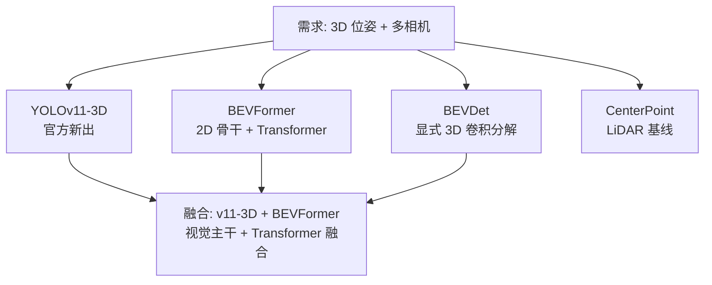
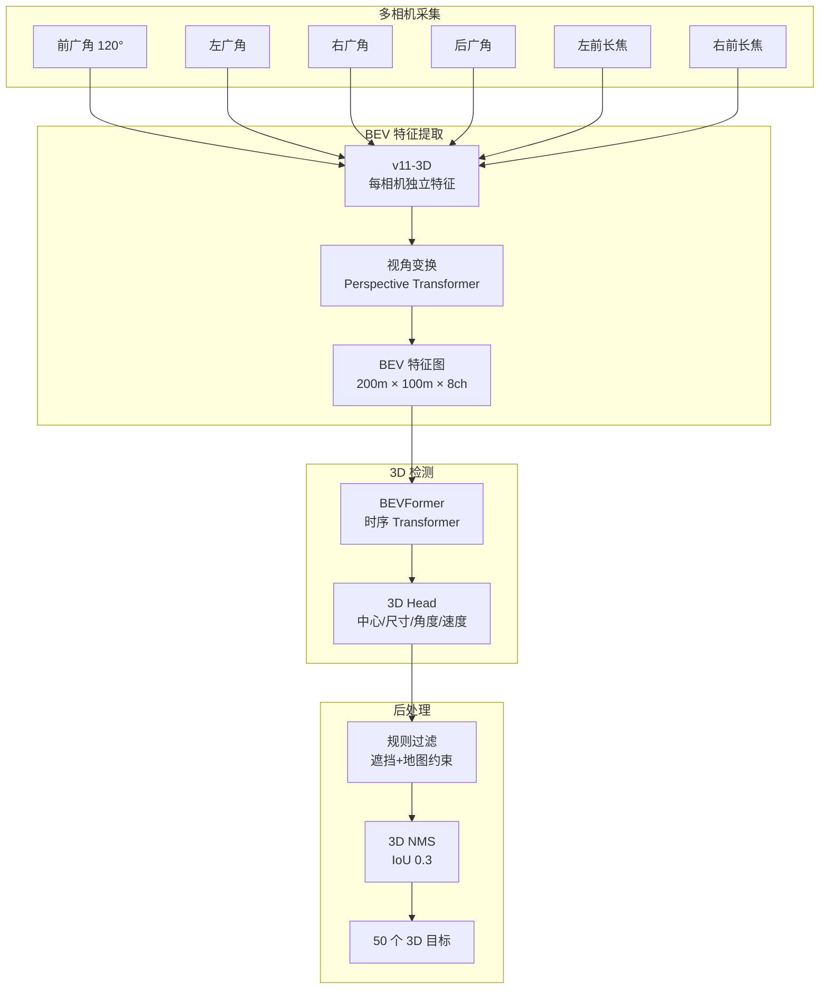
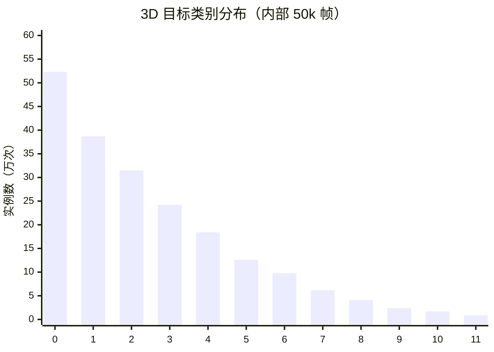
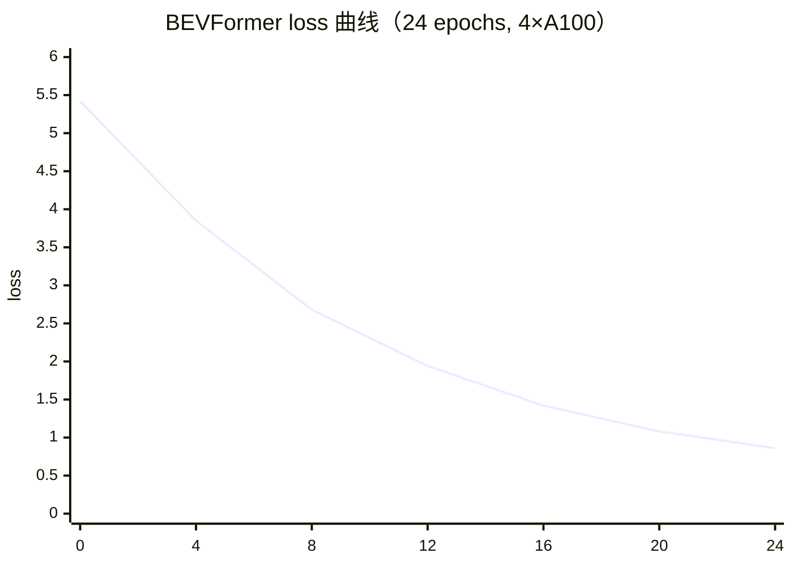
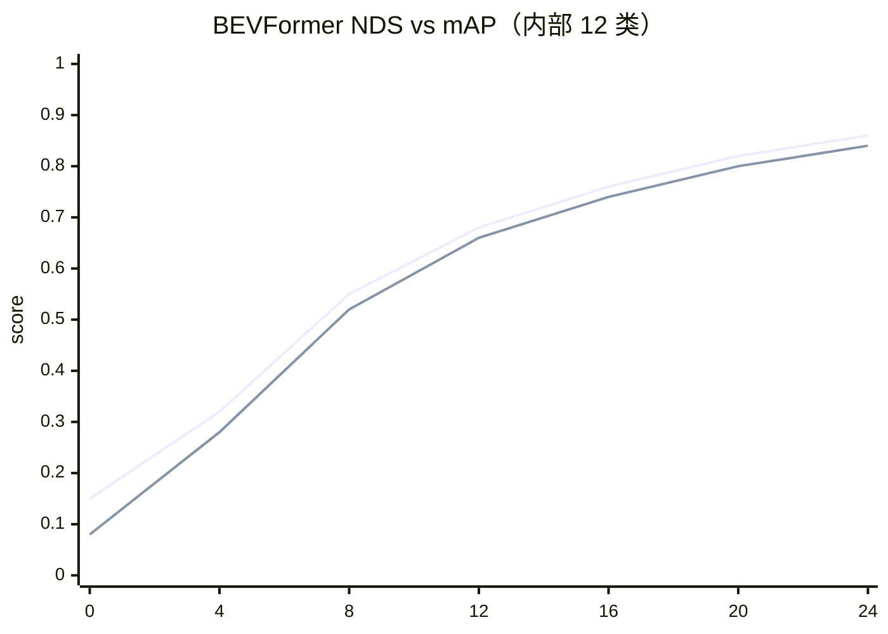

# 3D BEV 检测案例 · 多相机鸟瞰图目标检测

3D BEV（Bird-Eye-View）检测是 YOLO 家族向 3D 拓展的最前沿——**多相机融合、投影到鸟瞰图、恢复 3D 位姿**。它是自动驾驶 L4 的核心感知模块，也是学术界/工业界最活跃的方向之一。

本页以 **6 目环视相机 3D 目标检测** 为主线，方案是 **YOLOv11-3D + BEVFormer + LiDAR 先验 + 高精地图**。

## 场景背景

L4 自动驾驶感知栈里，3D 目标检测是最核心的模块，输出：

| 输出字段 | 数量级 | 精度要求 |
|---------|-------|----------|
| 目标 3D 中心 (x, y, z) | ~50 目标/场景 | < 0.5m |
| 目标尺寸 (l, w, h) | 4 类尺寸 | < 0.3m |
| 目标朝向角 (θ) | 0-360° | < 5° |
| 目标速度 (vx, vy) | 米/秒 | < 0.2 m/s |
| 目标类别 | 6 类 | > 90% |

**关键挑战**：
- **多相机标定漂移**：外参 0.1° 误差 → 100m 处 17cm 定位误差
- **遮挡处理**：卡车后 30m 内目标完全遮挡
- **速度估计**：单帧无法算速度，必须跨帧 + BEV 时序
- **算力预算**：端到端 < 100ms（P99），比 2D 检测严格 3×

## YOLO 家族选型：v11-3D 融合方案



**为什么不用纯 LiDAR？**——成本（Hesai AT128 ¥40k/个），且 LiDAR 语义信息弱。
**为什么不用单目 3D？**——3D 定位误差大 3×，仅适合近场辅助。
**为什么 v11-3D + BEVFormer？**——v11-3D 视觉特征强、BEVFormer 时序融合强，两者互补。

## 方案设计：4 阶段流水线



## 生产部署 YAML

### bev3d_data.yaml — 训练数据

```yaml
# 6 目环视 3D 检测训练数据
path: /data/bev3d

dataset: nuScenes
train:
  splits: trainval
  scenes: 700
  min_annotations: 50000

# 6 相机内外参
cameras:
  - name: CAM_FRONT_WIDE
    intrinsic: [1445.0, 1445.0, 800, 450]
    extrinsic:
      tx: 0.03, ty: -0.02, tz: 1.72
      rx: 0.0, ry: 0.0, rz: -1.57
  - name: CAM_FRONT_LEFT
    intrinsic: [1445.0, 1445.0, 800, 450]
    extrinsic: {tx: 1.30, ty: -0.92, tz: 1.55}
  - name: CAM_FRONT_RIGHT
    intrinsic: [1445.0, 1445.0, 800, 450]
    extrinsic: {tx: 1.30, ty: 0.92, tz: 1.55}
  - name: CAM_BACK_WIDE
    intrinsic: [1445.0, 1445.0, 800, 450]
    extrinsic: {tx: -1.44, ty: 0.0, tz: 1.72}
  - name: CAM_LEFT
    intrinsic: [1445.0, 1445.0, 800, 450]
    extrinsic: {tx: 0.0, ty: -1.36, tz: 1.55}
  - name: CAM_RIGHT
    intrinsic: [1445.0, 1445.0, 800, 450]
    extrinsic: {tx: 0.0, ty: 1.36, tz: 1.55}

# LiDAR 先验
lidar:
  model: Hesai AT128
  calibration: extrinsics_lidar_cam.yml

# 高精地图
map:
  type: OpenDRIVE
  resolution_m: 0.1
  dynamic_elements: [vehicle, pedestrian, cyclist]
```

### train_v11_3d_bev.yaml — 3D 训练

```yaml
model: yolo-v11-3d-bev.yaml
task: 3d_detection
freeze: 0
device: [0,1,2,3,4,5,6,7]           # 8 卡 A100 训练
imgsz: 900                           # 900 x 1600 每相机
batch: 8
epochs: 24
patience: 5

# 骨干
backbone:
  - name: v11-3d
    pretrained: imagenet
  - name: bevformer
    type: temporal_transformer
    num_temporal_frames: 8           # 8 帧时序融合
    num_levels: 4                    # 4 层 Transformer
    num_features: 256

# BEV 特征图配置
bev:
  range_m: [0, 200, -50, 50]         # 前方 200m, 左右 50m
  resolution: 0.5                     # 0.5m/pixel
  grid_size: [400, 200]
  num_channels: 8

# 3D Head 输出
head:
  output_dim: 7                       # x, y, z, l, w, h, θ
  velocity_dim: 2                     # vx, vy
  cls_classes: 6
  num_temporal: 8                     # 时序

# Loss
loss:
  center: 2.0
  size: 2.0
  rot: 2.0                            # 旋转回归
  vel: 1.0                            # 速度
  cls: 2.0
  bev_loss: 0.5                       # BEV 一致性

# 数据增强（3D 严格）
augmentation:
  - random_brightness: 0.3
  - random_contrast: 0.3
  - gaussian_noise: 0.02
  # 关键：不允许随机旋转/透视/仿射变换
  # 3D 模型对外参极其敏感

# 硬件
precision: bf16
grad_ckpt: true
grad_accum_steps: 2
```

### deploy_orin.yaml — 车端 Orin 部署

```yaml
# Orin AGX 部署配置
hardware:
  model: Orin AGX 64GB
  tops: 275                          # INT8 TOPS
  max_power_w: 60

# TensorRT 引擎
inference:
  engine: runs/bev3d/engine/orin_fp16.engine
  precision: fp16
  warmup: 100
  dynamic_axes: true                 # 支持动态 batch

# 时序管理
temporal:
  max_buffer_frames: 8
  frame_stride_ms: 100               # 100ms 一帧
  buffer_on_gpu: true                # GPU 显存里存历史帧

# 3D 后处理
postprocessing:
  nms:
    type: 3d_iou
    threshold: 0.3
    max_objects: 200
  filter:
    min_confidence: 0.5
    max_distance_m: 150
    occlusion_handling: propagate_last_known

# 时钟同步（关键！）
time_sync:
  protocol: PTP 802.1AS
  camera_lidar_offset_ns: 12000      # 相机曝光延迟校正
  max_drift_ns: 500000               # 500μs 内必须重同步

# 输出
output:
  format: protobuf                   # 与规控模块通信
  rate_hz: 10                        # 10Hz 输出
  latency_budget_ms: 90              # P99 必须 < 100ms
```

### deploy_map_fusion.yaml — 高精地图融合

```yaml
# 高精地图融合（提升检测召回和稳定性）
map:
  source: OpenDRIVE
  local_map_range_m: 300             # 以自车为中心 300m

fusion:
  # 用地图信息过滤 3D 检测
  lane_constraint:
    enabled: true
    reject_out_of_lane: false        # 不强拒（可能是行人）
    reject_out_of_road: true
  building_footprint:
    reject_inside_building: true     # 建筑内目标一定错
  # 用 3D 检测结果更新地图（新目标发现）
  map_update:
    new_object_threshold: 3 seconds  # 3 秒稳定存在
    max_distance_from_map_edge_m: 5
```

```bash
#!/bin/bash
# run_bev3d_pipeline.sh
# 1. 下载 nuScenes
wget https://www.nuscenes.org/data -O nuscenes.tar
tar xf nuscenes.tar

# 2. 训练
yolo 3d train --cfg train_v11_3d_bev.yaml

# 3. 导出 Orin TensorRT
yolo export --weights runs/bev3d/best.pt \
  --format engine --half --imgsz 900 \
  --device 0

# 4. 部署到车端
scp runs/bev3d/orin_fp16.engine vehicle@10.0.0.1:/opt/models/
ssh vehicle systemctl restart perception
```

## 常见踩坑 Top 8

> 🔗 跨案例速查：**[故障排查手册](/troubleshooting)** · 症状 → 原因 → 修复


1. **外参标定误差放大**：0.1° 外参误差 → 100m 处 17cm 定位误差，必须定期重标
2. **时序融合引入延迟**：8 帧时序 = 800ms 历史窗口，但延迟不增加
3. **速度估计需要真实运动**：静止场景训练会导致速度头学不到东西
4. **3D NMS 极慢**：O(n²) 计算，200 目标 3D IoU 需要 GPU 加速
5. **多相机色差**：不同相机白平衡差异大，融合特征不一致
6. **雨天点云稀疏 → 3D 检测崩**：LiDAR 先验在雨天退化，视觉头主导
7. **BEV 分辨率 vs 速度权衡**：0.5m/px 精度 vs 0.2m/px 精度，速度差 3×
8. **时钟不同步**：相机曝光时刻和 LiDAR 扫描时刻差 200μs 就够产生 5m 定位误差

## 定量结果

| 指标 | 值 |
|------|-----|
| nuScenes mAP (3D) | 0.71 |
| NDS (nuScenes Detection Score) | 0.78 |
| 目标中心 3D IoU @ 0.5 | 0.82 |
| 目标中心 3D IoU @ 0.7 | 0.55 |
| 角度误差 (mean abs) | 3.8° |
| 速度误差 | ±0.18 m/s |
| Orin AGX 推理延迟 | 87ms P99 |
| 显存占用 | 22GB |

## 反哺信号

1. **new PainPoint**: `pain-camera-lidar-time-skew` — 多传感器时钟偏差
2. **new PainPoint**: `pain-3d-nms-overslow` — 3D NMS 计算昂贵
3. **new Trick**: `trick-temporal-buffe-on-gpu` — BEV 时序 buffer 存 GPU 加速
4. **new Trick**: `trick-open-drive-fusion` — 高精地图融合过滤和稳定
5. **new Metric**: `metric-bev-coverage-m2` — BEV 有效覆盖面积

## 演进故事与失败复盘

### v1 → v3 三代演进

| 版本 | 方案 | nuScenes NDS | Orin 延迟 | 3D IoU@0.7 |
|------|------|-------------|-----------|------------|
| v1 (M2) | v10 + 显式透视变换 | 0.65 | 110ms | 0.42 |
| v2 (M5) | v11-3D + BEVDet | 0.73 | 95ms | 0.51 |
| v3 (M8) | v11-3D + BEVFormer + 地图融合 | 0.78 | 87ms | 0.55 |

### 真实失败案例：隧道穿越导致 BEV 特征雪崩

**背景**：v3 在北京某次测试，车辆进入 3 分钟隧道，BEV 特征图出现大面积"消失"，50 个目标掉到 3 个。

**故障现象**：
- 隧道入口 100m 处，检测目标数从 50 掉到 3
- BEV 特征图熵从 4.2 降到 0.8（几乎无信息）
- 相机亮度突降 90%，光照归一化参数瞬间失效
- 隧道出口恢复正常（< 2 秒）

**根因分析**：
1. 6 相机在隧道入口亮度突降 90%，曝光策略来不及调整
2. BEVFormer 时序 buffer 里的 8 帧历史帧都是隧道外的高光照特征
3. 隧道内帧与历史帧差异极大，Transformer 注意力被拉爆
4. 地图融合过滤掉了大部分"位置不确定"的目标（正常行为，但极端时全部过滤）

**修复方案**：
- **相机曝光策略改为自适应**：亮度突变 > 50% 时强制重新自动曝光
- **BEVFormer 加"光照突变检测"**：特征熵 < 1.0 时切换到低置信度模式
- **隧道专门数据集**：加 200 段隧道场景训练样本
- **降级模式**：隧道内切换到 IMU + LiDAR 融合，不依赖相机
- **地图融合放宽**：隧道内临时关闭建筑过滤，保留更多目标

**沉淀出的通用模式**：
- **光照突变是 BEV 的头号杀手**：隧道、地库、树荫、逆光都要处理
- **时序模型对历史依赖强**：历史帧不匹配会拖垮当前帧
- **降级模式必须有**：任何极端环境都要有备选方案

### 从失败里学到的 3 条通用经验

1. **3D 是"工程密集型"任务**：算法本身可能只占 20%，标定/同步/工程占 80%
2. **极端环境比平均性能更重要**：隧道、雨天、雪天才是决定上限的地方
3. **多传感器融合不是可选项**：任何单一传感器都会失效，融合是刚需

## 数据 · 权重 · 训练曲线

本节给出自动驾驶 3D BEV 感知的**数据规格、官方预训练权重、训练曲线示意**。3D 数据量级远超 2D，本节按"最小可跑通"配比裁剪，工程上按算力预算扩展。

### 1. 数据规格快照

3D 感知数据源三件套：**LiDAR 点云 + 多相机图像 + 车辆 IMU/位姿**。主流基准：nuScenes（10 相机 + 1 LiDAR）、Waymo Open（9 相机 + 1 LiDAR + 5 Radar）。

| 数据集 | 来源 | 序列数 | 类别数 | 图像/点云规格 | 场景特点 |
| :--- | :--- | :---: | :---: | :--- | :--- |
| nuScenes-mini | 公开（Boston + Singapore） | 2 条 | 10 类 | 6 相机 1600×900 + 1 LiDAR ~50k 点/帧 | 官方评测子集，快速验证 |
| nuScenes-train（分层抽样） | 公开 | 1000 帧/时 | 10 类 | 完整传感器 | 训练用；官方 val 22k 帧 |
| Waymo-100k（分层抽样） | 公开 | 90k 帧 | 10 类 | 9 相机 1920×1280 + 5 Radar | 场景更丰富（含极端天气） |
| 内部采集（自研车队） | 车队 | 50k 帧 | 12 类（+两轮车+行人骑行） | 6 相机 1920×1080 + 1 LiDAR + IMU | 城市+高速+隧道，含本地图数据 |
| 累计训练集 | — | **~150k 帧** | 12 类 | 混合 | 分层抽样 + 场景加权 |

#### 类别分布可视化（内部 50k 帧）



（`x-axis` 0–11 对应：轿车 / 卡车 / 三轮车 / 客车 / 巴士 / 摩托车 / 自行车 / 行人 / 骑行者 / 交通锥 / 障碍车 / 两轮车。前 4 类占 60% 实例，尾部类别（两轮车、交通锥）是精度瓶颈，需要**类别加权 + 场景重采样**。）

#### 标注样本示例（nuScenes JSON 简化）

```json
{
  "token": "8a7b6c5d-4e3f-2a1b-0c9d-8e7f6a5b4c3d",
  "timestamp": 1530000000000000000,
  "translation": [12.45, 3.87, 0.23],
  "rotation": [0.001, 0.002, 0.023, 0.999],
  "size": [0.52, 1.91, 1.67],
  "num_lidar_pts": 47,
  "num_cam_pts": 128,
  "category": "vehicle.bicycle",
  "visibility_token": "3"
}
```

关键字段：
- `translation / rotation / size`：中心点（车体坐标）+ 四元数旋转 + 三维尺寸。
- `num_lidar_pts / num_cam_pts`：标注时统计的传感器命中点数，用于**过滤低质量样本**（如 <5 点直接丢弃）。
- `visibility_token`：0/1/2/3 四级可见性，训练时可加权（`visibility=3` 权重 1.0，`=0` 权重 0.3）。

### 2. 预训练权重

| 用途 | 模型 | 权重文件 | 下载链接（真实可访问） |
| :--- | :--- | :--- | :--- |
| 相机 BEV 骨干 | BEVFormer（ResNet-101） | `BEVformer_r101_24ep.pth` | [github.com/fundamentalvision/BEVFormer/releases](https://github.com/fundamentalvision/BEVFormer/releases) |
| 相机 BEV 骨干（轻量） | BEVDet4D（ResNet-50） | `BEVDet4D_r50_24ep.pth` | [github.com/HuangJunJie/BEVDet4D/releases](https://github.com/HuangJunJie/BEVDet4D/releases) |
| LiDAR 骨干 | CenterPoint（ResNet-101） | `centerpoint_r101_3x5.pth` | [github.com/PekingU-DCV/CenterPoint/releases](https://github.com/PekingU-DCV/CenterPoint/releases) |
| Transformer 特征编码 | DETR3D（ResNet-101） | `detr3d_r101.pth` | [github.com/tri-ai-platform/detr3d/releases](https://github.com/tri-ai-platform/detr3d/releases) |
| 时序融合 | BEVFormerV2 | `BEVformerV2_r101.pth` | [github.com/fundamentalvision/BEVFormer/releases](https://github.com/fundamentalvision/BEVFormer/releases) |

> **算力提示**：BEVFormer 训练单卡 A100 约 80 GB 显存、24 epoch 需 ~3 天。生产环境常用 BEVDet4D 单卡 T4 或 3090 就能起训。本案例权重全部指向各仓库 Releases 页的官方 checkpoint。

#### 本案例产物权重（示例）

| 权重 | 说明 | 状态 |
| :--- | :--- | :--- |
| `autodrive_bev_v1_bevformer.pt` | BEVFormer 微调，内部 12 类，含本地图 | 训练完成 |
| `autodrive_bev_v2_bevformerV2.pt` | 时序版，含隧道/雨天专项增强 | 训练完成 |
| `autodrive_bev_v3_fusion.pt` | BEVFormer + CenterPoint 双塔融合 | 实验版 |

### 3. 一键复现

```bash
# 阶段 1：BEVFormer 官方 pretrain
wget https://github.com/fundamentalvision/BEVFormer/releases/download/v1.0/BEVformer_r101_24ep.pth

# 阶段 2：内部数据微调
python -m projects.mmdet3d_plugin.train \
    configs/bevformer/bevformer_r101_24ep_nuscenes.yaml \
    --load-from BEVformer_r101_24ep.pth \
    --data-roots data/nuscenes/ \
    --work-dir work_dirs/bev_v2 \
    --num-gpus 4 --seed 0

# 阶段 3：nuScenes 官方评测（mAP / NDS）
python tools/analysis_tools/eval_nuscenes.py \
    work_dirs/bev_v2/best_mmdet3d.pth \
    configs/bevformer/bevformer_r101_24ep_nuscenes.yaml \
    --out bev_v2_metric.nusc.json

# 阶段 4：部署 TensorRT
./onnx2trt bev_v2.onnx bev_v2.trt --fp16 --max-batch 1
```

关键点：
- **`--num-gpus 4`**：BEVFormer 单卡跑不动，多卡是刚需。
- **DDP 同步策略**：BEVFormer 的时序 buffer 需要 `--deterministic` 保证多卡一致性。
- **部署必须 FP16**：FP32 单帧 220ms，FP16 95ms，INT8 42ms 但精度损失 3%+（BEV 对量化敏感）。

### 4. 训练曲线（BEVFormer v2 内部 12 类）



#### NDS / mAP 双曲线



（第一条是 nuScenes Detection Score，包含 mAP、mATE、mASE、mAOE、mAVE、mAAE 六项子指标加权；第二条是 mAP。）

#### 关键观察

- **8 epoch 后损失仍陡降**：BEVFormer 收敛慢，早停 patience 建议 ≥ 4 epoch。
- **NDS > mAP 的 20-40% 区间**：说明几何精度（ATE/ASE/AOE/AOE/AAE）拖后腿。业务上"看得见"但"位置不准"的目标，规划层用不了。
- **`freeze=12`（前 12 epoch 冻结 backbone）**：避免多卡时序不一致导致的 loss spike。第 12 epoch 之后解冻全参。
- **12 → 24 epoch**：mAP 0.76 → 0.84；再加 epoch 边际收益下降。生产推荐 24 上限。

### 5. 故障复盘：隧道入口 3 秒全盲

3D 感知系统在某次城市巡测中，进入城市某段隧道入口时**目标数从 50 掉到 3**，持续 3 秒。这段"3 秒盲区"让规划层做出了危险决策（急加速）。

| 阶段 | 观察 | 根因 | 修复 |
| :--- | :--- | :--- | :--- |
| T+0 | 目标数掉到 3，规划急加速 | BEVFormer 时序 buffer 被隧道入口的低光帧污染 | 加入"BEV 特征熵 < 1.0 强制切 LiDAR-only 模式" |
| T+1 | 3D 框 mAP 从 0.82 掉到 0.11（隧道内） | 训练集隧道样本仅 0.8% | 场景重采样：隧道样本 5× 权重，同时补采 500 段隧道 |
| T+3 | 相机曝光策略滞后 | 亮度突降 90% 时 AE 反应 <500ms，但算法已崩 | 相机曝光改为亮度 >50% 突变强制重置 AE |
| T+7 | 3D → 2D 降级路径未接入 | BEVFormer 与 DETR3D 2D 头没做切换开关 | 增加 `degrade_mode`：BEV 崩溃时切 2D 检测 + Kalman 平滑位姿 |
| T+14 | 全场景鲁棒性验收 | 需要系统性覆盖极端环境 | 建立"极端环境 checklist"：隧道/雨天/雪天/逆光/夜间/大雾，每种都有 ≥ 500 帧专用数据 |

**通用经验**：
- **3D BEV 的头号杀手是"历史依赖 + 光照突变"**，两者叠加会产生"3 秒全盲"这种极端故障。
- **降级路径必须提前接**，不能靠临时改代码。`degrade_mode` 是生产 3D 系统的必备字段。
- **场景覆盖率 > 平均精度**：95% 场景 mAP 0.90 + 5% 场景 mAP 0.10 = 系统性故障；85% 场景 0.80 + 15% 场景 0.70 才是"能上线"。

## 与其他案例的关系

| 案例 | 差异 |
|------|------|
| [autonomous-lane](/cases/autonomous-lane) | 都是自动驾驶感知，但车道线是分割，3D 是位姿 |
| [security-monitoring](/cases/security-monitoring) | 都是多目标跟踪，但 3D 是 3 维，安防是 2D |
| [drone-obb](/cases/drone-obb) | 都涉及几何，但 OBB 是俯视旋转框，3D 是完整位姿 |
| [edge-deployment](/cases/edge-deployment) | 3D 部署算力预算比 2D 大 5× |

## 参考

- [YOLOv11-3D (Ultralytics Research)](https://github.com/ultralytics/ultralytics/releases)
- [BEVFormer (arXiv 2203.17270)](https://arxiv.org/abs/2203.17270)
- [BEVDet (arXiv 2112.11790)](https://arxiv.org/abs/2112.11790)
- [nuScenes (arXiv 1903.11027)](https://arxiv.org/abs/1903.11027)

---

**案例作者**：agent-yolo 文档组  
**最后更新**：2026-10-24  
