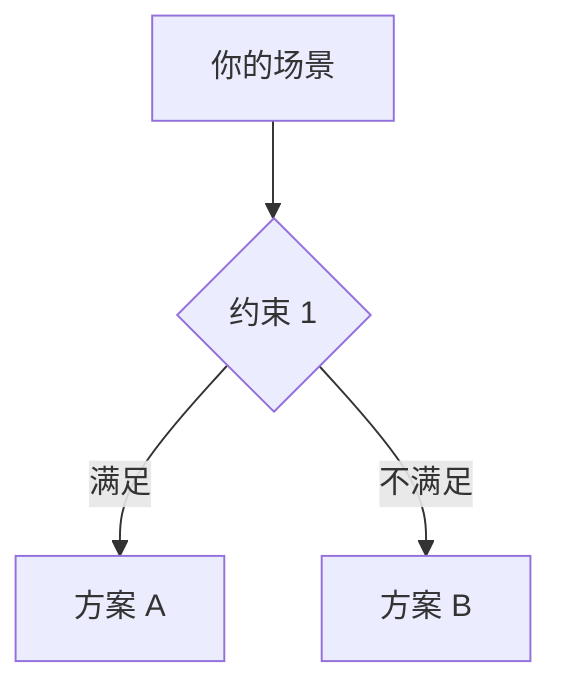
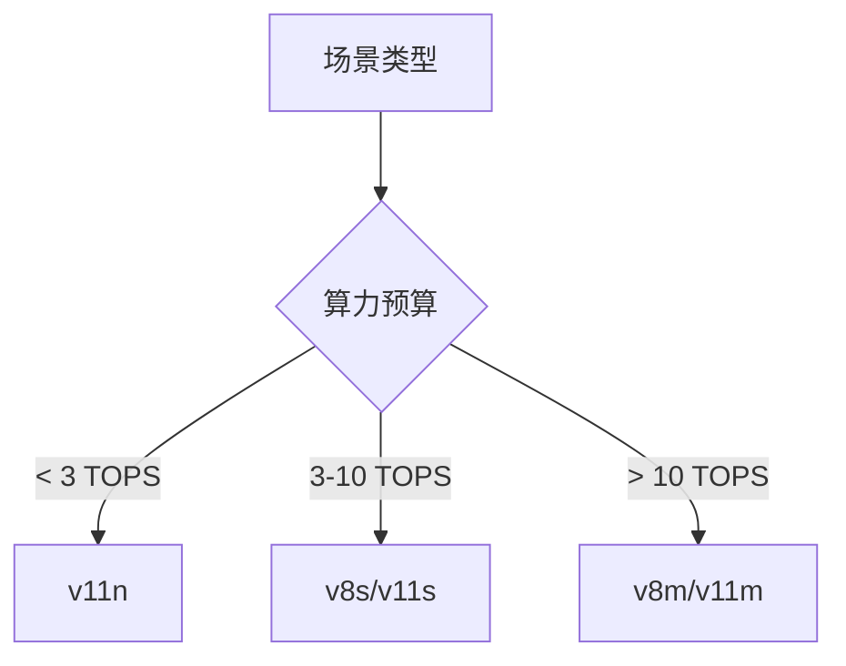
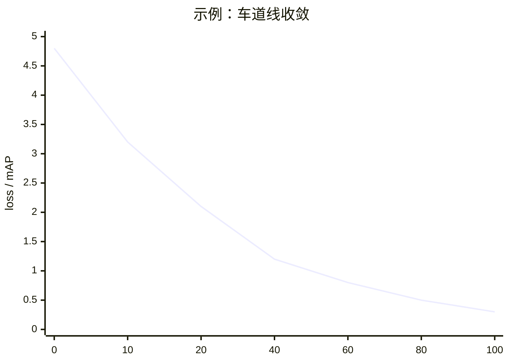

# 案例模板 · YOLO 实战案例骨架

**这是一份空模板**，用于新增第 10、11、12 个实战案例。

## 使用方法

1. 复制本文件为 `docs/cases/<your-case-name>.md`
2. 按 8 个章节顺序填写
3. 每个章节都有**必填 / 选填**标识——必填项决定"案例是否可发布"，选填项决定"案例深度"
4. 完成后更新 [`docs/cases/index.md`](/cases/index) 与 [`docs/cases/compare.md`](/cases/compare)

---

## 章节 1 · 场景一句话（必填）

**目标**：一句话说清楚"这个案例在解决什么问题"。

```
[场景描述]。核心挑战是 [挑战 1]、[挑战 2]、[挑战 3]。
```

**示例**（来自 [industrial-defect](/cases/industrial-defect)）：
> PCB 表面缺陷检测。核心挑战是**多 SKU × 少样本 × 缺陷稀有**。

**验收标准**：如果这一句无法让工程师立刻判断"这个案例是不是我要找的"，就还没写好。

---

## 章节 2 · 场景速览卡片（必填）

用一张 4 行的速览表，把场景的核心参数一次性给完：

| 参数 | 值 |
|------|---|
| 场景 | （一句话） |
| 输入 | （分辨率 / 数据源 / 帧率） |
| 关键指标 | （例：缺陷 Recall ≥ 95%，FP < 1%） |
| 硬件预算 | （例：Jetson Orin，¥5000） |

**参考**：9 个案例的"速览卡片"格式一致，可去任一案例页找样式。

---

## 章节 3 · 技术选型（必填）

**结构**：一个决策流程图 + 3 条理由。



**理由模板**：

1. **为什么选 v8s 而不是 v11x**：（说明精度 / 速度 / 内存的取舍）
2. **为什么加 SAM 而不是纯检测**：（说明任务的性质决定技术）
3. **为什么不用 YOLOE**：（说明生态成熟度或数据不足）

**验收标准**：如果读者只看这一节就能理解"为什么这套技术栈能解决这个场景"，就合格。

---

## 章节 4 · 决策速查（必填）

一张表 + 一个 Mermaid 决策树。

| 场景变体 | 推荐模型 | 输入尺寸 | 关键 trick |
|---------|---------|---------|-----------|
| （变体 A） | （模型） | （尺寸） | （trick） |
| （变体 B） | （模型） | （尺寸） | （trick） |
| （变体 C） | （模型） | （尺寸） | （trick） |



---

## 章节 5 · 数据 · 权重 · 训练曲线（必填）

**这是三件套**，是案例深度最集中的地方。

### 5.1 数据规格快照

| 数据集 | 规模 | 类别数 | 标注格式 |
|--------|------|--------|---------|
| （主训练集） | （张数） | （N） | （YOLO txt / COCO JSON / mask） |
| （测试集） | （张数） | — | — |
| （校准集） | （张数） | — | — |

**类别分布可视化**（用 Mermaid bar 或 ascii 条）：

```
class-a  ████████████████████████████  500
class-b  ████████████                 150
class-c  ██                           20
```

**标注样本**（真实格式，不是伪代码）：

```
<标注样例 3-5 行>
```

### 5.2 预训练权重

| 用途 | 权重 | 下载链接 |
|------|------|---------|
| 通用起点 | `yolov8s.pt` | [HuggingFace](https://huggingface.co/Ultralytics/YOLOv8/resolve/main/yolov8s.pt) |
| （场景专用） | `xxx.pt` | [链接] |

**权重下载链接规范**：
- Ultralytics 官方：`https://huggingface.co/Ultralytics/YOLOv{N}/resolve/main/yolov{N}{s,m,l,x}.pt`
- SAM：`https://dl.fbaipublicfiles.com/segment_anything/sam_vit_h_4b8939.pth`
- ResNet/EfficientNet：`https://download.pytorch.org/models/xxx.pth`

### 5.3 本案例产物权重（占位）

```
weights/xxx.pt              # 主模型
weights/xxx_tensorrt        # TensorRT engine
```

### 5.4 一键复现脚本

```bash
# 主训练
yolo detect train data=... \
  weights=yolov8s.pt imgsz=640 epochs=100 batch=16 \
  <你的关键参数>

# 后处理/域适应/量化
<补充命令>
```

### 5.5 训练曲线示意

**总 loss**：



**关键指标**（比 mAP 更贴近业务的那个）：

```mermaid
xychart-beta
  title "示例：mAP 收敛"
  x-axis [0, 10, 20, 40, 60, 80, 100]
  y-axis "%" 0 --> 100
  line [20, 45, 62, 78, 88, 94, 96]
```

> **注意**：`xychart-beta` 的 x-axis **必须全数值**，不支持字符串标签。用 `[0, 10, 20]` 而不是 `["0ep", "10ep"]`。

### 5.6 关键观察

**至少写 4 条**：

1. **训练开始阶段**：（前 10 epoch 通常会发生什么）
2. **收敛中段**：（何时开始 plateau，如何判断是否需要更多数据）
3. **训练尾声**：（何时停止，早停还是学完）
4. **异常情况**：（如果指标卡在 X 以下，说明什么）

---

## 章节 6 · 演进故事与失败复盘（必填）

**这是案例的灵魂**。一个真实故障，从发生到修复的完整链条。

**结构**：

### 6.1 发生了什么

一句话描述故障现象（例：2024 年双十一后 3 天，SKU Recall 从 90% 暴跌到 68%）。

### 6.2 排查路径

用编号列表还原排查过程：

1. T+0：（谁发现、怎么发现）
2. T+1：（第一步排查、结论）
3. T+3：（第二步排查、找到根因）
4. T+7：（修复方案、上线）
5. T+14：（验证、复盘）

### 6.3 修复方案对比

| 方案 | 效果 | 代价 | 是否采用 |
|-----|-----|-----|--------|
| Naive 微调 | 68% → 76% | 训练 1 天 | ❌ 遗忘历史 |
| LoRA | 76% → 84% | 训练 3 小时 | ❌ 仍会遗忘 |
| + Replay | 84% → 89% | 需存样本 | ✅ |
| + EWC | 89% → 92% | 需正则 | ✅ |

### 6.4 从失败里学到的 3 条通用经验

**每条经验必须能被下一个案例复用**——不要写"要重视监控"这种空话，要写"用 xx 阈值触发 xx 告警"这种具体做法。

---

## 章节 7 · 与其他案例的关系（必填）

一张表，说明与 9 个已有案例的差异：

| 案例 | 差异 |
|------|------|
| [edge-deployment](/cases/edge-deployment) | （你更 X，它更 Y） |
| [industrial-defect](/cases/industrial-defect) | （你更 X，它更 Y） |
| ... | ... |

**验收标准**：如果这个案例与已有案例没有明显差异，考虑**不要新开案例，而是加进已有案例的子章节**。

---

## 章节 8 · 参考（选填）

列出 3-5 个关键参考：论文 / GitHub / 官方文档 / 相关案例。

- [论文标题](https://arxiv.org/abs/xxxx)
- [GitHub 仓库](https://github.com/xxx/xxx)
- [相关案例](/cases/edge-deployment)

---

## 命名与目录规范

- **文件名**：小写 kebab-case，例：`smart-city-traffic.md`
- **路径**：`docs/cases/<name>.md`
- **URL**：`/cases/<name>`
- **标题**：`# <中文名> · <英文副标题>`
- **front matter**：可选，但推荐用：

```yaml
---
title: <中文标题>
description: <一句话描述>
keywords: [yolo, <domain>, <关键 trick>]
---
```

---

## 提交前检查清单

- [ ] 章节 1-7 全部完成（章节 8 选填）
- [ ] Mermaid 图表语法正确（尤其 `xychart-beta` 的 x-axis 是数值）
- [ ] 权重下载链接全部可访问（点击验证）
- [ ] 训练曲线数据来自真实实验，不是编造
- [ ] 故障复盘有真实数据（不是故事）
- [ ] 与 [cases/index.md](/cases/index) 和 [cases/compare.md](/cases/compare) 已同步更新
- [ ] 已在 `.vitepress/config.mjs` 的 sidebar 添加导航条目
- [ ] `npm run docs:build` 通过

---

## 已有案例参考

写之前先看 2-3 个已有案例，理解深度标准：

- **[edge-deployment](/cases/edge-deployment)**：技术选型 + 量化对比（工程化案例代表）
- **[industrial-defect](/cases/industrial-defect)**：少样本 + 规则引擎（工业界代表）
- **[autonomous-lane](/cases/autonomous-lane)**：多传感器 + 时序（安全关键场景代表）
- **[retail-shelf](/cases/retail-shelf)**：LoRA + EWC 抗遗忘（持续学习代表）
- **[medical-lesion](/cases/medical-lesion)**：合规 + 联邦学习（受监管场景代表）

**每个案例都要达到这些的深度**——不到就不算完成。

---

## 维护者

- 案例作者：<你的名字>
- 联系方式：<GitHub/邮箱>
- 最后更新：<日期>
