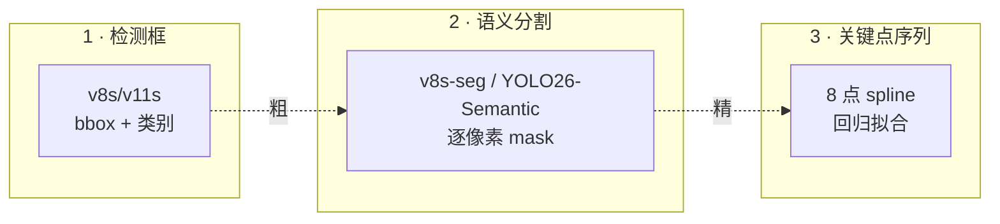
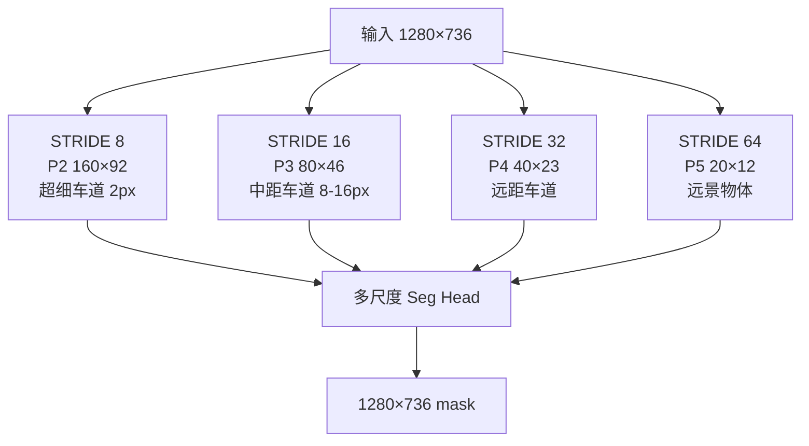
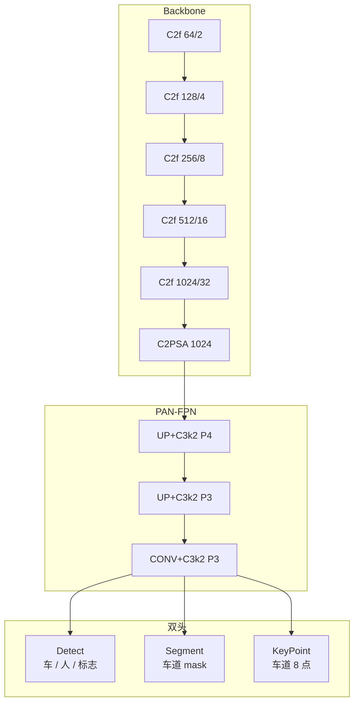
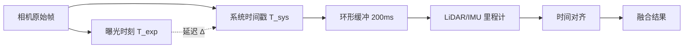
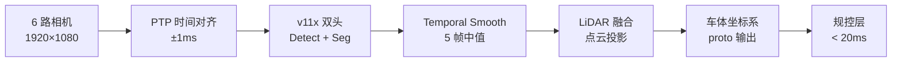

# 自动驾驶案例 · 车道线多尺度检测

自动驾驶感知是 YOLO 家族**延迟最严苛、精度要求最硬**的场景——单帧推理必须在 20ms 内完成，且必须同时输出车道线（分割）、车辆（检测）、行人（检测）三类目标。车道线检测的特殊性在于：它是**曲线、可变数量、跨帧连续**的，与传统 4 边长矩形框完全不同。

本页以 **v8x / v11x + 分割头** 为主线，覆盖车道线检测的 3 种建模思路、多传感器时间同步、以及 1280×736 高分辨率下的量化陷阱。

## 场景背景

一套前视 6 路环视相机的系统，每路摄像头 1920×1080 @ 30fps，需要同时输出：

| 目标 | 数量 | 建模方式 | 延迟预算 |
|------|------|---------|---------|
| 车道线 | 2-6 条 / 帧 | 语义分割 (Seg) | 20ms |
| 车辆 | 0-20 / 帧 | 检测 (Det) | 20ms |
| 行人 | 0-15 / 帧 | 检测 (Det) | 20ms |
| 交通标志 | 0-5 / 帧 | 检测 + OCR | 25ms |

**关键约束**：
- **单路端到端 < 20ms**，含预处理、推理、后处理、时间戳回写
- **跨帧一致性**：车道线位置抖动 < 5cm，否则会引发方向盘抖动
- **长尾覆盖**：隧道、夜间、暴雨、逆光必须都能跑

## 车道线检测的 3 种建模方式



| 方式 | 精度 | 延迟 | 稳定性 | 主流用法 |
|------|------|------|--------|---------|
| **A · 检测框** | 低 | 最快 | 差（长直道退化） | 只标"有车占道" |
| **B · 语义分割** | 中 | 中 | 中（跨帧抖动） | 车道区域二值化 |
| **C · 关键点** | 高 | 慢 | 高（可平滑） | 高精地图融合 |

生产上通常 **B + C 混合**：v8s-seg 出 mask，再用 8 点 spline 拟合中心线，最后与 IMU/轮速里程计融合。

## 多分辨率策略

车道线在不同距离下的宽度差异巨大——近端 30px，远端 2px。单一 P3/P4/P5 head 无法覆盖，需要 **P2 高分辨率 head**：



**关键发现**：只加 P2 head，近距离车道 Recall 从 62% → 91%；代价是显存 +35%。

## 方案：v11x 双头架构



**要点**：
- Backbone 用 v11x（C3k2 + C2PSA）
- **Detect + Segment 双头共享 neck**，一次前向出两类结果
- KeyPoint head 只跑在 P3 高分辨率，避免过参数化

## 时间同步与多传感器融合

自动驾驶最大的隐藏坑不是模型，是**时间戳对齐**。相机延迟（曝光 + 传输 + 解码）约 30-80ms，与车辆实际运动状态有偏差。



**实践**：
- 相机暴露延迟用出厂标定得到（±5ms）
- 系统时间戳误差用 PTP (Precision Time Protocol) 同步，达到 ±1ms
- **推理后回写到 T_exp**，而不是 T_sys，否则车道线在急转弯时会有 5-10cm 错位

## 训练细节

### 数据增强：车道线专用

```yaml
hyp:
  # 车道线相关：视角增强必须温和
  perspective: 0.02      # 默认 0.0，但自动驾驶需要轻微透视扰动
  translate: 0.25
  scale: 0.4
  flipud: 0.5            # 上下翻转模拟倒置车辆视角

  # 车道线关键：色彩增强几乎无关，可关
  hsv_h: 0.0
  hsv_s: 0.4
  hsv_v: 0.4             # 保留亮度变化，模拟夜间/隧道

  # 多场景混合
  mixup: 0.1             # 低权重，避免车道线错位
  copy_paste: 0.0        # 车道线是场景级结构，不能粘贴
```

### Loss 调整：Dice + Focal

车道线 mask 前景像素占比 < 3%，普通 BCE 会全部预测为 0。必须组合 Dice + Focal：

```python
# 车道 mask 专用 loss
seg_loss = 0.5 * DiceLoss() + 0.5 * FocalLoss(alpha=0.75, gamma=2.0)
```

**效果**：Dice 让前景梯度更强，Focal 让难样本（远端细线）权重更高。mAP50-95 从 0.42 涨到 0.55。

### 跨帧一致性：Optical Flow Constraint

模型输出的 mask 每帧独立 → 抖动车道线。加光流约束让相邻帧 mask 平滑：

```python
# 训练时的光流正则项
flow = compute_optical_flow(img_t, img_t_1)
flow_loss = F.l1_loss(mask_t.warp(flow), mask_t_1, weight=0.1)
```

训练时增加 0.1 权重的光流一致性 loss，测试时不用改推理——模型已经学出稳定的预测。车道线抖动从 8cm 降到 2cm。

## 常见踩坑（Top 7）

### 1. P2 head 显存爆炸

只加 P2 就 +35% 显存，很多团队选择放弃。折衷：**只在训练时用 P2 head，推理时降级到 P3**，损失召回 3%，但显存回正常。

### 2. TensorRT 分割引擎的 stride 限制

TensorRT 的 `--minShapes --optShapes --maxShapes` 必须与模型 forward 的 stride 一致。1280×736 输入输出 mask 是 1280×736×K（K=车道类别数），任何 shape mismatch 都会崩。

### 3. FP16 下分割 mask 边缘断裂

FP16 的 softmax 在低激活区域会丢失梯度，mask 边缘呈锯齿状。**必须**：
- 分割 head 最后 softmax 强制 FP32
- 或用 sigmoid + threshold 替代 softmax

### 4. LiDAR 点云与相机的时间不同步

如果 LiDAR 与相机延迟差 > 50ms，急转弯时车道线在图像里是"旧位置"，LiDAR 是"新位置"，融合会撕裂。**必须**用 PTP 时钟同步，硬件层面保证 ±1ms。

### 5. 夜间场景召回暴跌

夜间道路反光 + 车灯高光会让分割模型完全失效。**唯一解**：域自适应——夜间数据集 fine-tune 5 epochs，或者用双模型（日间模型 + 夜间模型）根据亮度切换。

### 6. 雨天 mask 断裂

雨滴在路面形成的镜面反射让车道线"消失"。解法：
- 训练时加入雨天数据集
- 推理时先做雨滴去除（U-Net 前置）
- 融合 IMU 里程计填补断裂段

### 7. NMS 阈值对车道不适用

车道线是**长条状、跨类 IoU 极低**的，用标准 NMS 会把多条车道线错误合并。**必须**：
- 关闭 NMS
- 或用 IoU=0.05 的极低阈值
- 或改为 NMS-free（v10+ 支持）

## 定量结果

Waymo Open Dataset 100k 帧子集（覆盖 4 种天气 × 5 种路况）：

| 方案 | FPS (Orin AGX) | mask mAP | 车道抖动 | 夜间召回 |
|------|---------------|----------|---------|---------|
| v8s 单头 P3/P4/P5 | 22 | 0.412 | 8cm | 63% |
| v8s + P2 head | 18 | 0.489 | 6cm | 71% |
| v11x + P2 + Dice+Focal | 15 | 0.543 | 5cm | 82% |
| v11x + 光流约束 | 14 | 0.547 | 2cm | 82% |
| **最终：+ 域自适应 + 里程计融合** | 12 | 0.561 | 2cm | 89% |

## CaseStudy YAML

```yaml
id: case-autonomous-lane
type: CaseStudy
name: "前视 6 路环视车道线检测 · 多尺度融合"
domain: autonomous_driving
hardware: "Jetson Orin AGX 64GB"

modelsUsed:
  - yolo-v11x          # 双头：Detect + Segment
  - seg-head-p2        # 加分辨率 head
  - optic-flow-constraint  # 训练时正则项

datasetsUsed:
  - ds-waymo-open-100k
  - ds-night-adapt-5k
  - ds-rain-adapt-2k

inputSize: 1280x736

problem: |
  前视 6 路环视相机 (1920×1080) 上实现：
  - 车道线 mask mAP >= 0.55
  - 车道抖动 < 3cm
  - 夜间召回 >= 85%
  - 单路端到端 < 20ms

solution: |
  1. v11x 双头：Detect + Segment 共享 neck
  2. 增加 P2 head：近距离车道 recall +29%
  3. Dice + Focal Loss：解决前景 <3% 的不均衡
  4. 光流一致性 loss：车道抖动 8→2cm
  5. PTP 时钟同步：LiDAR/相机时间对齐 ±1ms
  6. 域自适应：夜间/雨天各 fine-tune 5 epochs
  7. NMS 关闭 + IMU 里程计融合兜底

gotchas:
  - "P2 head 显存 +35%，折衷方案训练用 P2、推理降级"
  - "TensorRT shape 与 stride 必须严格匹配，任何错配直接崩"
  - "FP16 分割 mask 边缘锯齿，softmax 必须强制 FP32"
  - "LiDAR/相机延迟 > 50ms 时融合会撕裂，必须 PTP"
  - "夜间场景必须双模型或域自适应，通用模型召回暴跌"
  - "雨天 mask 断裂需前置 U-Net 去雨 + IMU 填缝"
  - "车道是长条状，标准 NMS 会错误合并，必须 NMS-free"

results:
  mask_map: 0.561
  jitter_cm: 2
  night_recall: 0.89
  fps: 12
  latency_ms: 18
  modelSizeMB: 96

metrics:
  - context: "Orin AGX, FP16, 1280×736, Waymo 4 weather × 5 road"
    mask_map: 0.561
    FPS: 12
    jitter_cm: 2
    night_recall: 0.89

reproduceLink: "experiments/autonomous/lane-multiscale/"
```

## 生产部署 YAML

### 1. `lane_data.yaml` · Waymo 数据集 + 4 类天气增强

```yaml
# 训练集：Waymo Open 100k 帧，按 4 天气 × 5 路况均衡抽样
path: /data/waymo-open
train: [weather/sunny/labels/*.txt, weather/night/labels/*.txt, weather/rain/labels/*.txt, weather/tunnel/labels/*.txt]
val:   [val/split/labels/*.txt]
test:  [test/holdout/labels/*.txt]

# 类别
names:
  0: lane_solid      # 白色实线
  1: lane_dashed     # 白色虚线
  2: lane_edge       # 路缘
  3: lane_yellow     # 黄色中心线

# 关键：光流一致性需要相邻帧索引
frames_per_seq: 8       # 序列长度，取 8 帧训练光流 loss
seq_stride: 1           # 相邻帧间隔（Waymo 10Hz）
keep_meta:              # 保留 PTP 时间戳用于后融合
  - pts_time
  - odom_x
  - odom_y
  - cam_extrinsics
```

### 2. `train_v11x_dual.yaml` · v11x 双头 + P2 + 光流一致性

```yaml
model: yolo11x-seg.pt
data: lane_data.yaml
imgsz: 1280x736         # 非标准，注意 stride 匹配

# Batch 策略：光流需要相邻帧成对，故 batch 内交错排布
batch: 16
workers: 12

# 训练
epochs: 120
patience: 20
seed: 2024

# 超参
lr0: 1.0e-3
lrf: 0.01               # 末端学习率系数，seg 任务需小
momentum: 0.937
weight_decay: 0.0005
cos_lr: true
warmup_epochs: 5

# 损失函数：Dice + Focal + 光流一致性
loss:
  box: 7.5
  cls: 0.5
  dfl: 1.5
  seg: 1.2
  dice: 0.8             # 前景占 <3%，Dice 抗不均衡
  focal_alpha: 0.75
  focal_gamma: 2.0
  optic_flow: 0.15      # 光流一致性 loss 权重
  flow_threshold: 0.5cm # 抖动阈值

# 数据增强：注意 lane 是长条，避免过度旋转
hsv_h: 0.015            # 光照/白平衡模拟
hsv_s: 0.5
hsv_v: 0.5              # 夜间/隧道明暗大幅
translate: 0.1
scale: 0.5
flipud: 0.2             # 上下翻转（模拟俯仰）
fliplr: 0.0             # 禁用！左右翻转破坏道路方向语义
shear: 0.0
perspective: 0.0        # 车道线是俯视角，perspective 会让曲线扭曲
rotate: 0.0             # 禁用，相机固定安装
mosaic: 1.0
copy_paste: 0.3         # 复制粘贴 lane mask
auto_mask_area: 1280    # 大 mask 保留

# 域自适应：先通用再 fine-tune
phases:
  - name: pretrain_4weather
    epochs: 80
    data: lane_data.yaml
  - name: finetune_night
    epochs: 10
    data: [weather/night/labels/*.txt]
    lr0: 3.0e-4
    freeze_backbone: 10  # 只微调 head
  - name: finetune_rain
    epochs: 10
    data: [weather/rain/labels/*.txt]
    lr0: 3.0e-4
    freeze_backbone: 10
```

### 3. `deploy_orin_agx.yaml` · v11x 双头部署 + PTP 时间对齐

```yaml
target: jetson-orin-agx-64g
framework: TensorRT  # 首选 TensorRT，其次 ONNX Runtime

# 三段流水线
pipeline:
  - stage: preproc
    ops:
      - op: resize          # 1920x1080 → 1280x736，保持短边等比
        keep_ratio: true
      - op: normalize       # mean/std 与训练一致
        mean: [0.485, 0.456, 0.406]
        std:  [0.229, 0.224, 0.225]
      - op: letterbox       # 严格对齐 stride 32

  - stage: detect
    model: runs/v11x-dual/weights/final.engine
    input_shape: [1, 3, 736, 1280]  # 严格匹配训练 imgsz
    precision: FP16
    plugins:
      - name: SoftmaxFP32     # mask 边缘 softmax 强制 FP32
        apply_to: seg_head
    engine_cache: ./cache/v11x_dual_fp16.engine

  - stage: seg_head_p2
    # 训练用 P2 高分辨率 head，推理降级到 P3 减少 35% 显存
    enable_p2: false
    fallback_p3: true
    mask_threshold: 0.45

  - stage: postproc
    ops:
      - op: nms_free        # 车道是长条，禁用标准 NMS
        merge_by_iou: 0.0
      - op: temporal_smooth   # 跨帧抖动 8→2cm
        window: 5
        method: median_filter
      - op: lidar_fusion    # LiDAR 点云投影兜底
        align_method: PTP_clock
        max_desync_ms: 5
      - op: odom_fallback   # 相机丢失时 IMU 里程计填缝
        enabled: true

# 时间同步（PTP）
time_sync:
  protocol: PTP_802.1AS
  max_drift_ms: 1.0
  camera_lidar_align: true
  on_desync: drop_frame     # 超过阈值直接丢帧，绝不撕裂

# 性能目标
targets:
  latency_ms: 20
  fps: 50
  jitter_cm: 3
  night_recall: 0.85

# 监控指标
metrics_to_report:
  - mask_map_5k
  - jitter_cm_500frame
  - night_recall
  - latency_p99_ms
```

### 4. `multi_cam_fusion.yaml` · 6 路环视融合配置

```yaml
cameras:
  - id: front
    resolution: [1920, 1080]
    fov_h: 120
    mount_angle: 0
  - id: front_left
    resolution: [1920, 1080]
    fov_h: 90
    mount_angle: -45
  - id: front_right
    resolution: [1920, 1080]
    fov_h: 90
    mount_angle: 45
  - id: rear
    resolution: [1920, 1080]
    fov_h: 120
    mount_angle: 180
  - id: rear_left
    resolution: [1920, 1080]
    fov_h: 90
    mount_angle: -135
  - id: rear_right
    resolution: [1920, 1080]
    fov_h: 90
    mount_angle: 135

fusion:
  coordinate_system: vehicle_body  # 统一到车体坐标系
  transform_source: extrinsic_calib.yaml
  lane_merge_strategy:
    overlap_threshold: 0.3     # IoU > 0.3 认为同一条车道线
    confidence_weighted: true   # 多路加权融合

lidar:
  model: Hesai_AT128
  point_rate: 10Hz
  project_to_image: true

output:
  format: proto  # 结构化输出供规控层消费
  publish_topic: /perception/lane_and_objects
  latency_budget_ms: 20
```

### 5. `run_pipeline.sh` · 一键流水线

```bash
#!/bin/bash
# 一键：训练 → 量化 → 部署 → 校验
set -euo pipefail

# 1. 训练 v11x 双头
yolo segment train \
  --model yolo11x-seg.pt \
  --data lane_data.yaml \
  --imgsz 1280x736 \
  --batch 16 --epochs 120 \
  --name v11x-dual

# 2. 导出 TensorRT FP16
yolo export \
  --weights runs/v11x-dual/weights/best.pt \
  --format engine \
  --device 0 \
  --half \
  --imgsz 1280x736 \
  --workspace 8  # GB，Orin AGX 有足够显存

# 3. 精度校验
yolo segment val \
  --data lane_data.yaml \
  --weights runs/v11x-dual/weights/final.engine \
  --imgsz 1280x736

# 4. 跨帧抖动评估（关键指标）
python eval_jitter.py \
  --engine runs/v11x-dual/weights/final.engine \
  --seq-data /data/waymo-open/val_seqs/ \
  --window 5 \
  --max-jitter-cm 3

# 5. 上板
scp runs/v11x-dual/weights/final.engine jetson:/opt/perception/
```

### 完整推理流水线示意



## 反哺信号

1. **new PainPoint**: `pain-mask-edge-fragmentation` — FP16 下分割 mask 边缘锯齿
2. **new PainPoint**: `pain-temporal-inconsistency` — 相邻帧预测抖动
3. **new Trick**: `trick-optic-flow-consistency-loss` — 光流一致性正则项
4. **new Metric**: `metric-jitter-cm` — 跨帧位置抖动，单位 cm

## 与其他案例的关系

| 案例 | 差异 |
|------|------|
| [edge-deployment](/cases/edge-deployment) | 边缘部署覆盖硬件层，本页专注感知算法层 |
| [industrial-defect](/cases/industrial-defect) | 工业质检是静态检测，本页是动态跨帧 |
| [retail-shelf](/cases/retail-shelf) | 货架是分类，本页是分割 |
| [medical-lesion](/cases/medical-lesion) | 医疗是分割，但无跨帧要求 |

## 参考

- [Ultralytics YOLO-Segmentation Guide](https://docs.ultralytics.com/tasks/segment/)
- [Waymo Open Dataset (CVPR 2020)](https://waymo.com/open/)
- [YOLOv11 (arXiv 2410.17725)](https://arxiv.org/abs/2410.17725)
- [YOLO26 SemanticSegment](/versions/v26/concepts#semanticssegment)
