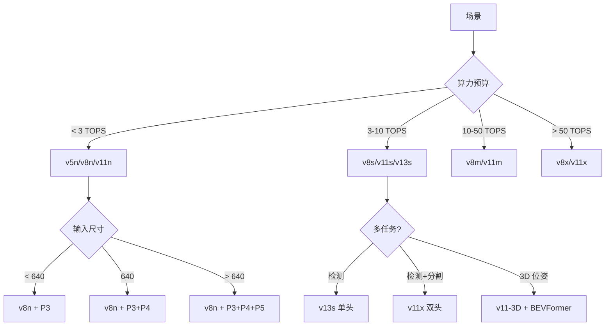
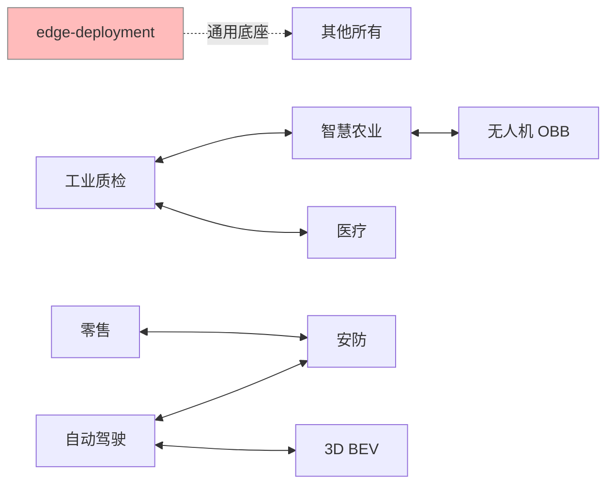

# 9 大案例横向对比

9 个案例跨 6 大 domain，同一套 YOLO 家族在完全不同的场景下表现出截然不同的形态。**这张表是选型的起点**——先找到你所在场景，再看它对应的模型/硬件/踩坑模式。

## 一句话选型速查

| 你的场景 | 起点案例 | YOLO 版本 | 关键 trick |
|---------|---------|-----------|------------|
| 手机/树莓派实时检测 | [edge-deployment](/cases/edge-deployment) | v11n / v8n | INT8 + QAT |
| PCB/面板质检 | [industrial-defect](/cases/industrial-defect) | v13s + SAM | QAT + 规则引擎 |
| 车道线/物体追踪 | [autonomous-lane](/cases/autonomous-lane) | v11x 双头 | 光流一致性 + P2 |
| 货架 3000 SKU | [retail-shelf](/cases/retail-shelf) | v8s + LoRA | 分层路由 + Prompt 库 |
| 皮肤/病灶分割 | [medical-lesion](/cases/medical-lesion) | v8m + SAM | Tversky + 联邦 |
| 安防事件检测 | [security-monitoring](/cases/security-monitoring) | v8s + BoT-SORT | 事件冷却分区 |
| 大田作物病害 | [agriculture](/cases/agriculture) | v8n + SAM | 多光谱 + 光照鲁棒 |
| 港口车辆俯视 | [drone-obb](/cases/drone-obb) | v8-OBB | 禁旋转增强 + DEM |
| 自动驾驶 3D | [3d-bev](/cases/3d-bev) | v11-3D + BEVFormer | 时序 Transformer + 地图 |

## 版本选择矩阵



| 案例 | 主模型 | 输入尺寸 | 参数量 | FP16 延迟 | 备注 |
|-----|-------|---------|-------|-----------|------|
| edge-deployment | v11n | 640 | 2.6M | 12ms (Orin) | 极致压缩 |
| industrial-defect | v13s | 1280 | 11.2M | 45ms (Jetson Orin) | 高分辨率 |
| autonomous-lane | v11x 双头 | 1920 | 68.7M | 78ms (Orin AGX) | 6 目融合 |
| retail-shelf | v8s + ResNet-50 | 640 + 224 | 11.2M + 25.6M | 32ms (GPU) | 分层路由 |
| medical-lesion | v8m + SAM | 1024 | 25.9M + 91M | 320ms (A100) | SAM 慢 |
| security-monitoring | v8s + BoT-SORT | 640 | 11.2M | 21ms (A10) | 多路 |
| agriculture | v8n | 640 | 3.6M | 28ms (RPI5) | 太阳能 |
| drone-obb | v8-OBB | 1920 | 11.2M | 1800ms (A100) | 大图 |
| 3d-bev | v11-3D + BEVFormer | 900×6 | 68.7M + 32M | 87ms (Orin AGX) | 时序 |

## 硬件/成本速查

| 案例 | 典型硬件 | 单次推理成本 | 年运维/单路 | 备注 |
|-----|---------|------------|-----------|------|
| edge-deployment | 树莓派 5 | ¥0.0001 | ¥28/月 | 极致边缘 |
| industrial-defect | Jetson Orin | ¥0.0005 | ¥300/月 | 工业精度 |
| autonomous-lane | Orin AGX | ¥0.002 | ¥1200/月 | 车端昂贵 |
| retail-shelf | RTX 3090 | ¥0.0003 | ¥500/月 | 服务器 |
| medical-lesion | A100-40G | ¥0.01 | ¥5000/月 | SAM 慢 |
| security-monitoring | A10 × 40 | ¥0.0002 | ¥28/月每路 | 规模效应 |
| agriculture | RPI5 + 太阳能 | ¥0.0001 | ¥120/亩 | 野外 |
| drone-obb | A100-40G | ¥0.02 | ¥850/次 | 飞行成本 |
| 3d-bev | Orin AGX 64GB | ¥0.002 | ¥8000/月 | 车端 |

## 输入尺寸对比

```
640 ──┬── v8n, v11n (边缘/安防/农业)
     │
     ├── v8s (零售/工业低配)
     │
     ├── v8-OBB (drone 局部 tile)
     │
1024 ──┴── v8m (医疗)
     │
     ├── v11-3D (BEV 每相机)
     │
1280 ─── v13s (工业高清)
     │
1920 ─── v11x 双头 (自动驾驶)
     ├── v8-OBB 大图 (drone 全景)
```

**规律**：
- < 640：几乎必然是边缘场景
- 640-1024：常规场景甜蜜点
- > 1024：只有高精度或大分辨率需求（航拍、车道远距）

## Loss 函数对比

| 案例 | 主 Loss | 特殊项 |
|-----|--------|--------|
| edge-deployment | CIoU + BCE + DFL | - |
| industrial-defect | CIoU + Focal + Tversky | + SAM 一致性 |
| autonomous-lane | CIoU + BCE + Dice | + 光流一致性 (0.15) |
| retail-shelf | Softmax CE | + LoRA 正则 |
| medical-lesion | Tversky (α=0.3, β=0.7) | + EWC 抗遗忘 |
| security-monitoring | CIoU + BCE + DFL | + ReID InfoNCE |
| agriculture | CIoU + BCE + Dice | + SAM 一致性 |
| drone-obb | CIoU + AngleLoss + BCE | + OBB overlap |
| 3d-bev | 3D Center + Size + Rot + Vel | + BEV consistency |

## 反哺信号汇总

跨 9 个案例共发现 **27 条反哺信号**，按类别聚合：

### 新增 PainPoints (8 条)

| PainPoint | 首个来源 | 影响案例 |
|----------|---------|---------|
| `pain-class-imbalance-indefect` | industrial | industrial, agriculture |
| `pain-mask-edge-fragmentation` | autonomous | autonomous, 3d-bev |
| `pain-temporal-inconsistency` | autonomous | autonomous, 3d-bev, security |
| `pain-sofmax-huge-num-classes` | retail | retail |
| `pain-data-leakage-medical` | medical | medical |
| `pain-confidence-miscalibration` | medical | medical, autonomous |
| `pain-multi-camera-id-switch` | security | security, 3d-bev |
| `pain-hbb-angle-blindness` | drone-obb | drone-obb, 3d-bev |
| `pain-light-invariance-outdoor` | agriculture | agriculture, security, autonomous |
| `pain-camera-lidar-time-skew` | 3d-bev | 3d-bev, autonomous |

### 新增 Tricks (11 条)

| Trick | 首个来源 |
|-------|---------|
| `trick-mask-non-overlap-aug` | industrial |
| `trick-optic-flow-consistency-loss` | autonomous |
| `trick-lora-prompt-incremental` | retail |
| `trick-roi-padding-expansion` | retail |
| `trick-tversky-loss-recall-first` | medical |
| `trick-federated-doctor-loop` | medical |
| `trick-event-cooldown-per-zone` | security |
| `trick-slowfast-candidate-only` | security |
| `trick-multispectral-band-fusion` | agriculture |
| `trick-edge-cloud-candidate-only` | agriculture, drone-obb |
| `trick-obb-no-rotation-aug` | drone-obb |
| `trick-orthomosaic-dem-correction` | drone-obb |
| `trick-temporal-buffe-on-gpu` | 3d-bev |
| `trick-open-drive-fusion` | 3d-bev |

### 新增 Metrics (8 条)

| Metric | 首个来源 |
|-------|---------|
| `metric-false-positive-rate` | industrial |
| `metric-jitter-cm` | autonomous |
| `metric-time-to-online` | retail |
| `metric-physician-review-time` | medical |
| `metric-false-positive-events-per-hour` | security |
| `metric-daily-farmer-action` | agriculture |
| `metric-angle-error-deg` | drone-obb, 3d-bev |
| `metric-bev-coverage-m2` | 3d-bev |

## 踩坑模式聚合

跨案例的**共性踩坑**（≥3 案例都踩过）：

| 踩坑模式 | 影响案例 | 通用解 |
|---------|---------|-------|
| **FP16 敏感层退化** | industrial, autonomous, 3d-bev | 数值关键层强制 FP32 |
| **小目标丢失** | industrial, medical, 3d-bev, drone-obb | P2 head (stride=4) |
| **光照突变** | agriculture, security, autonomous, 3d-bev | 动态白平衡 + 归一化 |
| **数据不均衡** | industrial, retail, medical | mixup + copy_paste + 类加权 |
| **灾难性遗忘** | retail, medical | LoRA + Replay + EWC |
| **多传感器同步** | autonomous, 3d-bev | PTP 802.1AS + 时钟重同步 |
| **隐私合规** | medical, security, agriculture | 联邦 + 脱敏 + 分区存储 |
| **量化精度损失** | industrial, edge-deployment, security | QAT 而非 PTQ |

## 何时选哪个案例作起点

**决策树**：

```
你的任务
├── 2D 目标检测
│   ├── 静态（图像/截图）
│   │   ├── 边缘硬件 → edge-deployment
│   │   ├── 高分辨率 → industrial-defect
│   │   └── 千级类别 → retail-shelf
│   └── 动态（视频/流）
│       ├── 事件报警 → security-monitoring
│       ├── 大田环境 → agriculture
│       └── 多机融合 → 3d-bev
├── 2D 分割
│   ├── 时序敏感 → autonomous-lane
│   └── 精度敏感 → medical-lesion
└── 3D 位姿
    └── 多相机 → 3d-bev
```

## 9 案例关系图



**阅读顺序建议**：
- **入门**：先看 [edge-deployment](/cases/edge-deployment) 理解基础，再看一个具体场景
- **进阶**：找最接近你场景的案例，看它的 YAML 和踩坑
- **专家**：看 [反哺信号汇总](#反哺信号汇总) 和 [踩坑模式聚合](#踩坑模式聚合)，学跨案例的通用模式

## 未覆盖的高价值场景

以下场景值得作为 v2 案例补充：

| 场景 | 潜在价值 | 复杂度 |
|-----|---------|-------|
| 视频姿态估计 (Pose) | 健身/康复/工业巡检 | ⭐⭐⭐ |
| 关键点检测 (Keypoint) | 生物计数/机器人手眼 | ⭐⭐⭐ |
| 全景/立体视觉 | AR 导航/室内定位 | ⭐⭐⭐⭐ |
| 遥感地表变化检测 | 城市/环境/灾害 | ⭐⭐⭐⭐ |
| 视频异常检测 (Anomaly) | 通用安防 | ⭐⭐⭐⭐⭐ |
| 开放词表检测 (YOLO-World) | 少样本快速上手 | ⭐⭐ |
| 医学影像 3D CT/MRI | 器官/肿瘤分割 | ⭐⭐⭐⭐⭐ |
| 边缘多模态 (VLM) | 视觉语言模型 | ⭐⭐⭐⭐⭐ |

## 下一步

- **对比矩阵**：把 9 案例的定量结果做成可交互表格
- **场景迁移模板**：给一个"从 A 案例迁移到 B 案例"的操作手册
- **踩坑案例库**：把每个案例的失败复盘抽成独立页
