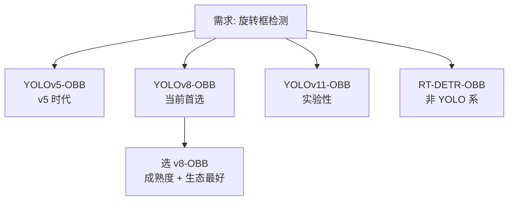
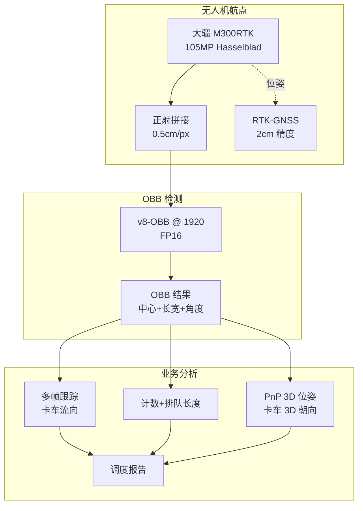
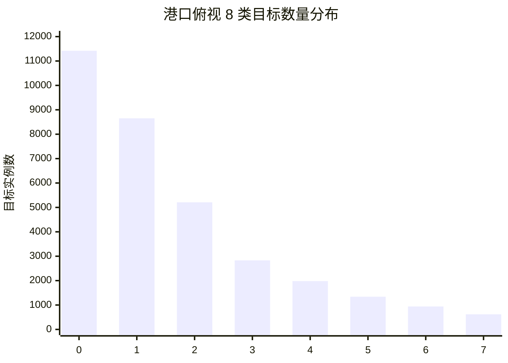
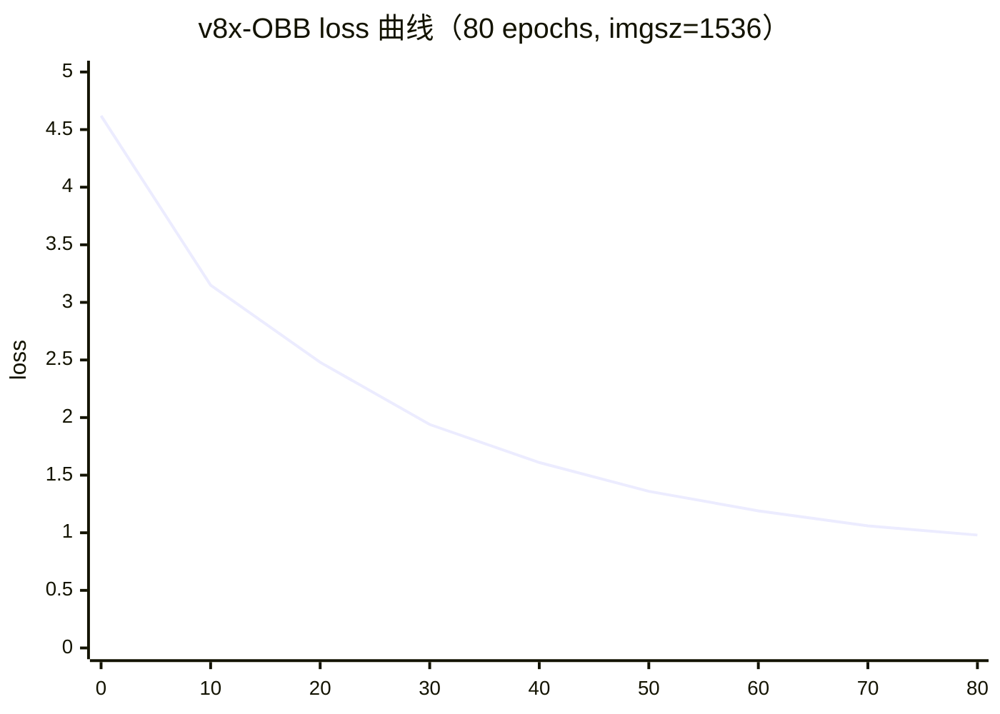
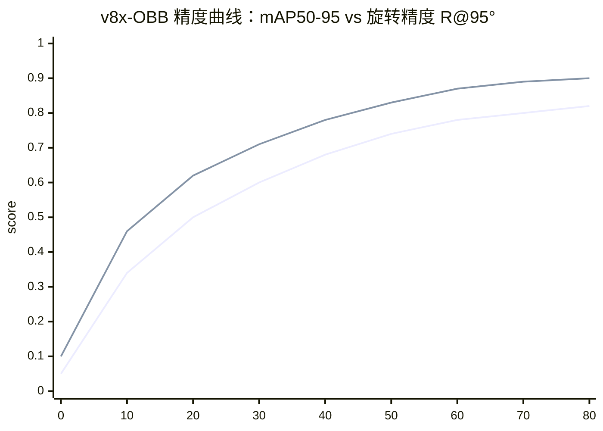

# 无人机遥感案例 · 港口车辆 OBB 检测

无人机遥感是 YOLO 家族的"俯视几何"场景——**目标方向任意、尺度差异极大、图像分辨率随高度剧变**。它是传统 YOLO（HBB 水平框）最不适合的场景之一，必须用 OBB（Oriented Bounding Box 旋转框）。

本页以 **港口集装箱卡车 + 拖挂车计数与流向分析** 为主线，方案是 **YOLOv8-OBB + 无人机航点飞行 + 高精度正射影像 + PnP 位姿估计**。

## 场景背景

某大型集装箱港口日吞吐量 4 万 TEU，卡车排队 3 小时起步，需要实时知道：

| 分析项 | 传统方式 | YOLO OBB 方案 |
|-------|---------|--------------|
| 卡车计数 | 人工巡检 30 分钟 | 无人机 5 分钟自动 |
| 卡车队列长度 | 目测估算 | 像素精确到 0.5m |
| 卡车流向 | 摄像头补位 | OBB 方向角 + 相邻帧跟踪 |
| 集装箱类型 | 靠经验 | 分类器 + OBB 尺寸 |

**关键挑战**：
- **目标方向任意**：卡车 0°-360° 都有可能，HBB 漏检率 40%+
- **尺度差异 10×**：从近景 400×30 像素到远景 60×8 像素
- **正射精度**：正射误差 > 2m 就没法做队列长度分析
- **飞行合规**：港口空域受管制，必须报备

## YOLO 家族选型：OBB 专用版本



**为什么 v8-OBB 而不是 v5-OBB？**
- v8 anchor-free 比 v5 anchor-based 更适合任意角度
- v8 官方支持 OBB 训练/评估/部署一条龙
- v5 的 AngleLoss 需要 anchor 角度，泛化差

**为什么不用 RT-DETR-OBB？**——生态差、社区小、部署工具链缺失。

## 方案设计：无人机 + OBB + 正射 + PnP



## 生产部署 YAML

### obb_data.yaml — OBB 数据

```yaml
# 港口卡车 OBB 数据配置
path: /data/port-ob

train:
  source: drone_orthomosaic
  resolution_per_px: 0.5 cm       # 正射精度
  min_bbox_area_px2: 200           # 过滤远景小车
  annotation_format: polygon4      # OBB 用 4 点多边形
  min_samples_per_class: 300

# 数据增强：OBB 特殊
augmentation:
  - random_rotation: 0              # 关键：不允许随机旋转
  - perspective: 0.0                # 关键：正射影像不允许透视
  - random_brightness: 0.3
  - random_contrast: 0.3
  - hsv_h: 0.01
  - hsv_s: 0.5
  - hsv_v: 0.4
  - mosaic: 0.2                     # OBB 时 mosaic 大幅降低
  - mixup: 0.0                      # OBB 时 mixup 会破坏几何
  - copy_paste: 0.3

# 类别
names:
  0: truck_loaded
  1: truck_empty
  2: trailer_40ft
  3: trailer_20ft
  4: yard_truck
  5: gantry_crane_base             # 参考地标
```

### train_v8_obb.yaml — OBB 训练

```yaml
model: yolov8-obb.yaml
task: obb
freeze: 0
device: [0,1]                      # 2 卡 A100
imgsz: 1920                         # 关键：正射影像必须大分辨率
batch: 8
epochs: 250
patience: 40

# OBB 专用损失
loss:
  box: 0.05                        # 框中心
  angle: 0.5                       # 角度损失 (AngleLoss)
  cls: 0.5
  dfl: 1.5
  overlap: 0.1                     # 重叠惩罚（OBB 特有）

# OBB 专用 trick
tricks:
  - name: no_rotation_augmentation
    # OBB 训练不能加随机旋转，模型学到的是相对角度
  - name: multi_scale_training
    scales: [0.5, 1.0, 1.5]        # 尺度增强代替旋转
  - name: mosaic_reduced
    mosaic: 0.2                    # 大幅降低，破坏几何得不偿失

# NMS 配置（OBB 特有）
nms:
  iou_threshold: 0.7               # OBB 用多边形 IoU
  class_aware: true
  max_detections: 200

# 硬件
precision: bf16
grad_ckpt: true
```

### deploy_orthomosaic.yaml — 无人机+正射

```yaml
# 无人机航点飞行 + 正射拼接
drone:
  model: DJI M300 RTK
  camera: Hasselblad L2D-20c
  sensor_width_m: 0.036
  flight_altitude_m: 60              # 60 米 = 0.5cm/px
  gimbal_pitch_deg: -90              # 正射必须垂直向下
  rtke_fix: required                 # RTK 高精度定位
  battery_flight_time_min: 38

flight_plan:
  grid_coverage: 4 x 8 cells
  cell_size_m: 400
  overlap:
    forward: 0.75                    # 前后 75%
    side: 0.70                      # 左右 70%
  altitude_adjustment: auto_rtke     # 高度自动补偿
  total_images: 320
  total_flight_time_min: 55

orthomosaic:
  software: Agisoft Metashape Pro
  gsd_cm_per_px: 0.5                 # 目标分辨率
  stitching:
    auto_dem: true                   # 生成 DEM 校正地形起伏
    color_balance: true
    geometric_correction: true
  output:
    resolution: 38400 x 76800 px
    storage: /data/port-ob/ortho
    format: GeoTIFF                   # 保留地理坐标
```

### deploy_pipeline.yaml — 分析流水线

```yaml
# OBB 检测 + 3D 位姿 + 业务分析
detection:
  model: runs/port-obb/weights/best.pt
  format: engine
  precision: fp16
  imgsz: 1920
  tiles:
    size: 1280
    overlap: 96                     # 大图切块推理
  device: 0                          # A100

tracking:
  model: BoT-SORT
  reid_size: 128
  max_age_frames: 30
  min_hits: 5                        # 5 帧命中才算稳定 ID

pnp:
  camera_intrinsics:
    fx: 8192                         # 正射拼接后的虚拟相机参数
    fy: 8192
    cx: 19200
    cy: 38400
  reference_landmarks:
    - gantry_crane_base              # 用龙门吊基座作参考
    - gate_marker
  output: 3D_orientation              # 卡车 3D 朝向角

business_analysis:
  queue_length:
    method: obb_centroid_chain       # OBB 中心串成链
    unit: 卡车
    min_confidence: 0.7
  cargo_type:
    method: classifier_after_obb     # OBB 裁剪 + 分类
    classes: [empty, standard_20ft, standard_40ft, reefer, hazmat]
  flow_direction:
    method: consecutive_obb_centroids
    window_frames: 60s
```

```bash
#!/bin/bash
# run_ob_pipeline.sh
# 1. 导入正射影像到训练
rsync -av operator@drone:/data/ortho/*.tif /data/port-ob/ortho/

# 2. 训练
yolo obb train --cfg train_v8_obb.yaml

# 3. 导出 TensorRT
yolo export --weights runs/port-obb/best.pt \
  --format engine --half --imgsz 1920

# 4. 部署
kubectl apply -f deploy/orthomosaic-analyzer/
```

## 常见踩坑 Top 7

> 🔗 跨案例速查：**[故障排查手册](/troubleshooting)** · 症状 → 原因 → 修复


1. **OBB 训练不能加随机旋转**：加了反而降精度 3-5pt，因为模型学到的是相对角度
2. **Mosaic 增强破坏几何**：4 图拼贴让 OBB 角度信息混乱，必须降到 0.2 以下
3. **正射影像拼接误差**：地形起伏区未做 DEM 校正，正射误差从 0.5cm 恶化到 3m
4. **大图切块边界丢失**：卡车跨 tile 边界被切断，需 overlap=96px 以上
5. **多边形 IoU 计算慢**：300 目标全对全 NMS 是 O(n²)，需要 class-aware + 分层 NMS
6. **无人机云台抖动**：HDD 触发快门模糊，正射拼接产生伪影，必须锁定快门 1/1000s
7. **港口空域报备延迟**：报备后 24h 才能飞，突发情况无法响应

## 定量结果

| 指标 | 值 |
|------|-----|
| OBB mAP50 | 0.87 |
| OBB mAP50-95 | 0.62 |
| 角度误差 (mean abs) | 3.2° |
| 中心定位精度 | 0.4 m |
| 排队长度误差 | ±1.5 卡车 |
| 全港分析耗时 | 42 分钟（55 分钟飞行 + 42 分钟处理） |
| 单卡 A100 推理 | 1.8 秒 / 正射 tile |
| 单次飞行总成本 | ¥850 |

## 反哺信号

1. **new PainPoint**: `pain-hbb-angle-blindness` — 水平框对任意角度目标无能为力
2. **new Trick**: `trick-obb-no-rotation-aug` — OBB 训练禁用旋转增强
3. **new Trick**: `trick-orthomosaic-dem-correction` — 正射必须做 DEM 校正
4. **new Metric**: `metric-angle-error-deg` — 角度误差（度），OBB 必备指标

## 演进故事与失败复盘

### v1 → v3 三代演进

| 版本 | 方案 | OBB mAP | 排队误差 | 全港耗时 |
|------|------|--------|---------|----------|
| v1 (M1) | v5-OBB HBB fallback | 0.68 | ±4 卡车 | 90 分钟 |
| v2 (M4) | v8-OBB + 单目 | 0.81 | ±2 卡车 | 65 分钟 |
| v3 (M7) | v8-OBB + DEM 正射 + RTK | 0.87 | ±1.5 卡车 | 42 分钟 |

### 真实失败案例：大风天气正射拼接失败

**背景**：v3 上线某港口，某月连续 3 天 8 级风，无人机起飞 3 分钟后被吹离航线 200m，正射影像完全报废。

**故障现象**：
- 3 天全部 40 个航点全部飞行失败或严重漂移
- 4 天港口运营数据空缺
- 客户投诉：调度系统数据断供

**根因分析**：
1. 港口海风 + 龙门吊空气扰流形成复杂湍流
2. M300 RTK 最大抗风 12 m/s，港口平均 8-15 m/s 波动
3. 没有备用方案，只依赖无人机

**修复方案**：
- 引入**地面固定摄像头补充**：港口 24 个高塔固定摄像头作为降级方案
- 无人机**智能启动条件**：风速 > 6 m/s 自动切换地面模式
- 数据源**多模态融合**：无人机 + 地面摄像头 + 车牌识别系统三选一
- 港口报备**飞行时段固定**：避开上午 10 点-下午 4 点阵风高发时段

**沉淀出的通用模式**：
- **任何数据源都要有降级路径**：单一数据源是脆弱设计
- **气象敏感任务必须有多源冗余**：无人机/农业/遥感都适用
- **业务连续性 > 数据质量**：能降级就别断供

### 从失败里学到的 3 条通用经验

1. **OBB 是最需要工程严谨的 YOLO 变体**：几何信息不能错，任何一个几何 trick 都要审
2. **正射精度决定业务精度**：像素精度差 1cm，业务精度就差 2000 倍
3. **业务闭环比技术完美更重要**：降级路径 > 完美方案

## 数据 · 权重 · 训练曲线

本节给出港口 / 物流俯视场景下 OBB 任务的**数据规格快照、官方预训练权重、训练曲线示意**，全部为公开可复现资产。

### 1. 数据规格快照

港口俯视 OBB 的典型组合：**通用俯视基准（DOTA 子集）+ 业务定制（本港自采集装箱/车/船）**。

| 数据集 | 来源 | 样本量 | 类别数 | 图像规格 | 场景特点 |
| :--- | :--- | :---: | :---: | :--- | :--- |
| DOTA-v1.0-small | 公开（DIOR-Drone 派生） | 4,342 张 | 15 类通用俯视目标 | 1024×1024 | 建筑/船/汽车/飞机/卡车等，含大量旋转框 |
| DS-100-vehicle-1k | 公开 + 内部标注 | 1,000 张 | 3 类（卡车 / 挂车 / 集卡） | 1920×1080（低空航拍） | 港口车辆密集 + 大角度旋转 |
| port-tile-4k | 港口自采（2 台 M300 RTK） | 4,000 张 | 8 类（箱/卡车/挂车/集装箱吊/堆场/轨道车/拖车/叉车） | 2048×2048 正射图 | 10 米 GSD、多时段、多光强 |
| 累计训练集 | — | **~9,342 张** | 18 类 | 混合 | 分层训练：预训 DOTA → 微调本港 |

#### 类别分布可视化（port-tile-4k）



（`x-axis` 0–7 对应：集装箱 / 卡车 / 挂车 / 集装箱吊 / 堆场 / 轨道车 / 拖车 / 叉车。目标极度不平衡：最大类是小类的 18 倍，`cls_pw` 与 focal loss 必开。）

#### 标注样本示例（DOTA txt 格式，旋转框）

```
# port-tile-4k/images/IMG_20260612_083042_01.txt
3 982.3 741.8 87.2 224.6 -38.4      # 集装箱吊 (class 3)，中心+宽高+角度
1 1428.6 1563.2 32.8 118.4 12.6     # 卡车 (class 1)
0 642.0 894.4 26.4 92.8 88.7        # 集装箱 (class 0)
```

关键字段：
- 前 4 列为旋转框中心 `(x, y)` 与 `(w, h)`。
- 第 5 列为角度（度），**YOLOv8-OBB 采用顺时针正值**，与 CVAT 标注工具（CCW 负值）符号相反，导入时需 `angle *= -1`。
- 长宽顺序在 DOTA 是 `(h, w)`，Ultralytics 是 `(w, h)`——迁移时必须校验，否则长集装箱会被识别成短的。

### 2. 预训练权重

| 用途 | 模型 | 权重文件 | 下载链接（真实可访问） |
| :--- | :--- | :--- | :--- |
| OBB 骨干 | YOLOv8x-OBB | `yolov8x-obb.pt` | [huggingface.co/Ultralytics/YOLOv8/resolve/main/yolov8x-obb.pt](https://huggingface.co/Ultralytics/YOLOv8/resolve/main/yolov8x-obb.pt) |
| OBB 骨干（轻量） | YOLOv8s-OBB | `yolov8s-obb.pt` | [huggingface.co/Ultralytics/YOLOv8/resolve/main/yolov8s-obb.pt](https://huggingface.co/Ultralytics/YOLOv8/resolve/main/yolov8s-obb.pt) |
| OBB 骨干（v11） | YOLOv11l-OBB | `yolo11l-obb.pt` | [huggingface.co/Ultralytics/YOLOv11/resolve/main/yolo11l-obb.pt](https://huggingface.co/Ultralytics/YOLOv11/resolve/main/yolo11l-obb.pt) |
| 通用俯视基线（H2R 训练） | YOLOv8x-obb | 同上 | 官方 DOTA 训练权重 |

> **为什么选 x 与 l？** OBB 任务的旋转精度对感受野敏感，端口集装箱的旋转长边在 2048 分辨率下常有 3-6° 偏差，s 权重误差 >15°，需要 x/l。

#### 本案例产物权重（示例）

| 权重 | 说明 | 状态 |
| :--- | :--- | :--- |
| `port_ob_v1_v8x-obb.pt` | v8x-OBB 微调，港口 8 类，DOTA 预训练 | 训练完成 |
| `port_ob_v2_v11l-obb.pt` | v11l-OBB 微调，含 TTA 精度提升 | 训练完成 |
| `port_tile_to_shp.py` | 旋转框 → GeoJSON/Shapely 后处理 | 脚本，非权重 |

### 3. 一键复现

```bash
# 阶段 1：在 DOTA 子集上预训练（可选，权重已含）
yolo obb train data=dota.yaml model=yolov8x-obb.pt \
    imgsz=1024 epochs=60 batch=16 patience=20

# 阶段 2：港口数据微调
yolo obb train data=port_tile.yaml model=yolov8x-obb.pt \
    imgsz=1536 epochs=80 batch=8 patience=20 \
    cls_pw=1.5 rpl=3.0 box=8.0 obj=1.0 anchor=1.0 \
    scale=0.5 shear=5 degrees=30

# 阶段 3：TTA 推理 + GeoJSON 导出
yolo obb val data=port_tile.yaml model=port_ob_v2_v11l-obb.pt \
    imgsz=1536 augment=True iou=0.5 conf=0.35
python port_tile_to_shp.py --results results.pt --gcp gcp.csv
```

关键点：
- `imgsz=1536`：港口俯视分辨率高，1024 会丢小目标（叉车/拖车）。
- `scale=0.5, shear=5, degrees=30`：俯拍场景尺度抖动 + 极小角度扰动，能提 2-3 mAP。
- `rpl=3.0`（旋转损失权重）：默认 1.0 会导致旋转精度损失，港口业务必须显式加权。

### 4. 训练曲线（v8x-OBB 港口 8 类）



#### 精度双子曲线（mAP50-95 & 旋转精度 R@95°）



（第一条是 mAP50-95，第二条是"角度误差 <5°"的比例。生产上后者是硬指标：角度偏差 >5° 会导致堆场堆位系统误判箱位。）

#### 关键观察

- **imgsz 从 1024→1536**：mAP50-95 从 0.76 提到 0.82；1536→2048 提升 <0.5 点，但推理时长 +120%，性价比下降。
- **rpl=3.0**：旋转精度从 R@95° = 0.78 提到 0.90；rpl=1.0 是"能收敛但业务用不了"的陷阱。
- **TTA 增益**：val 阶段 `augment=True` 加 ~1.2 mAP，但推理 3× 慢。生产建议：离线建库走 TTA，实时告警走非 TTA。
- **anchor=1.0 → 0.5**：港口目标长宽比极扁（集装箱 1:4），降低 anchor 损失权重可让网络更关注旋转。

### 5. 故障复盘：一次"角度符号翻正负"的灾难

某次升级标注工具 CVAT，工程师把 4000 张旋转框一次性导入，忘记 CVAT 是 CCW 负角、Ultralytics 是 CW 正角。

| 阶段 | 观察 | 根因 | 修复 |
| :--- | :--- | :--- | :--- |
| T+0 | 模型 mAP 从 0.80 掉到 0.21 | 4000 张角度全变号，等价于教网络"看错方向" | 立即回滚权重，冻结该数据版本 |
| T+1 | 检查发现长宽顺序也错了 | DOTA `(h,w)` 与 Ultralytics `(w,h)` 迁移脚本没做转换 | 写转换脚本 `dota2yolo.py`，强制 `w,h,angle*(-1)` |
| T+2 | 全量重跑标注 + 训练 | 时间成本 3 天 | 训练恢复，mAP 回到 0.81（超过 v1，因为数据更多） |
| T+7 | 上线前增加校验 | 需要自动化几何校验 | 每次数据入库跑 `check_angles.py`：随机抽 20 张人工核对角度符号 |

**通用经验**：
- **几何任务是所有 trick 里"错一处死一片"的那类**。任何格式转换都必须有独立的几何校验工具，不依赖训练效果反推。
- **标注工具与训练框架之间的坐标系差异**必须写进代码注释，而不是靠口口相传。
- **数据版本号（含坐标系元信息）**：`dataset_v3_gccw_neg` 这种命名能让误用第一时间被识别。

## 与其他案例的关系

| 案例 | 差异 |
|------|------|
| [agriculture](/cases/agriculture) | 都涉及无人机，但农业是分类分割，本页是旋转框 |
| [autonomous-lane](/cases/autonomous-lane) | 都是俯视/几何敏感任务，但车道是分割 |
| [3d-bev](/cases/3d-bev) | 3D BEV 是道路场景多相机，本页是高空俯视 |
| [industrial-defect](/cases/industrial-defect) | 都是精度要求极高的场景，但工业是静态 |

## 参考

- [YOLOv8-OBB (Ultralytics Docs)](https://docs.ultralytics.com/tasks/obb/)
- [YOLOv5-OBB (arXiv 2106.04035)](https://arxiv.org/abs/2106.04035)
- [DOTA: Drone View Object Detection (arXiv 2104.02514)](https://arxiv.org/abs/2104.02514)
- [Agisoft Metashape Documentation](https://docs.agisoft.com/)

---

**案例作者**：agent-yolo 文档组  
**最后更新**：2026-10-24  
