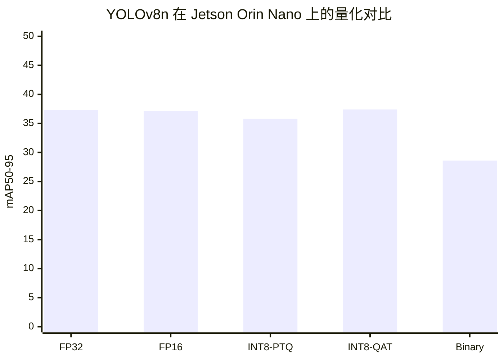
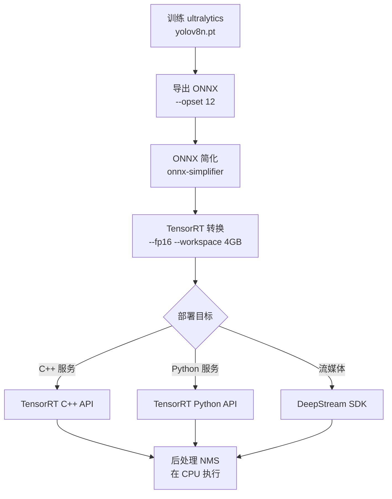
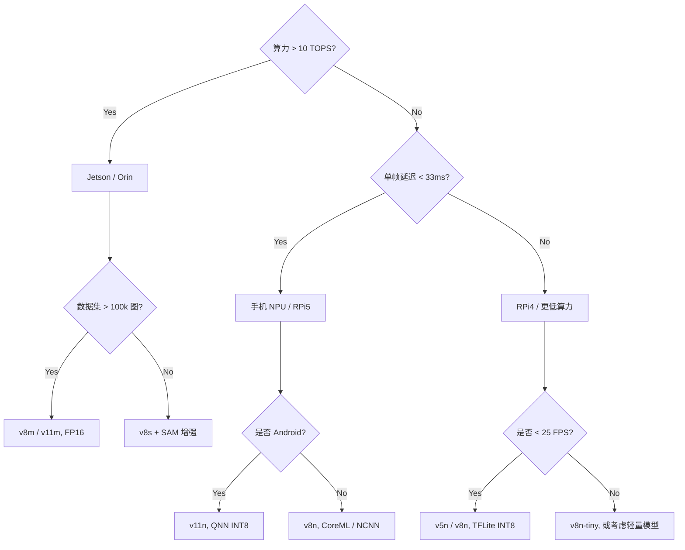
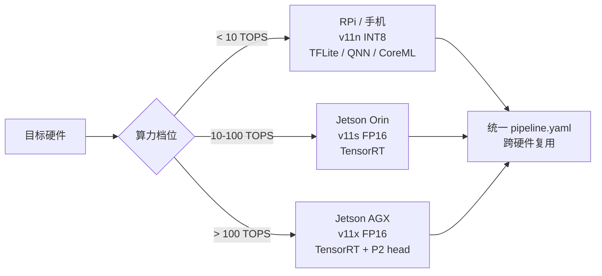
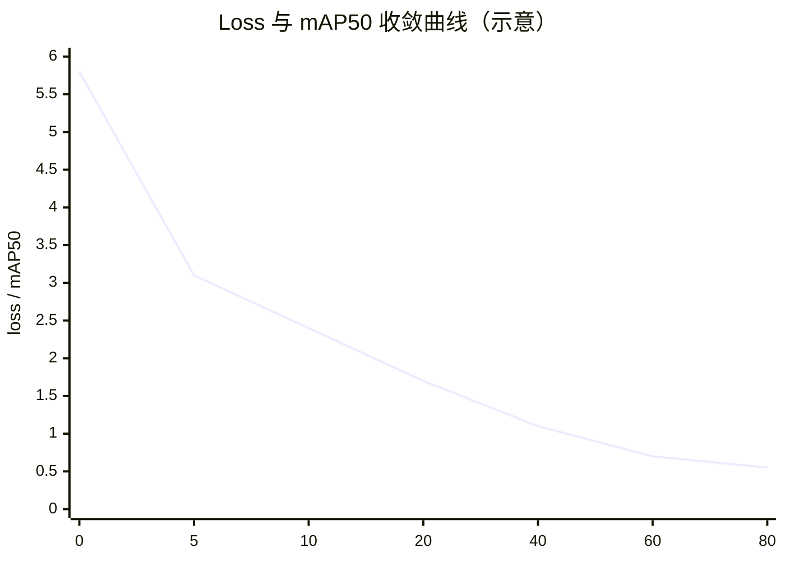
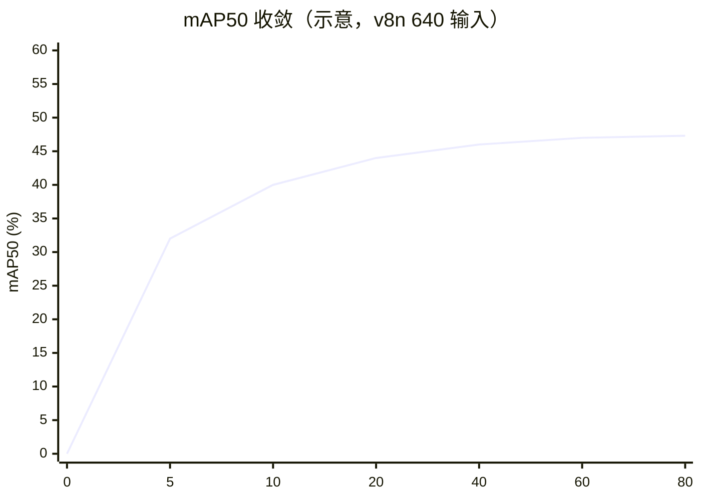

# 边缘部署案例

边缘部署是 YOLO 家族最"卷"的应用场景——它同时把 [mAP](/ontology/entity-types#metric)、[FPS](/ontology/entity-types#metric)、[参数量](/ontology/entity-types#metric) 三项指标压到极致。本页汇总从 v1 到 v11 在树莓派 / Jetson / 手机上部署的量化选项、常见陷阱和复现路径。

## 为什么边缘部署最考验本体

边缘部署是唯一同时用到 L2 理论、L3 实现的每一类组件、L4 反哺的四个层级的场景。以 v8n 上树莓派为例：

- **L2**：选择 anchor-free 是因为它在低分辨率下比 anchor-based 少一次 NMS 开销
- **L3 Layer**：C2f 代替 Bottleneck，把 Conv 数量从 6 减到 4
- **L3 Loss**：DFL 损失在低分辨率下梯度更稳定
- **L3 Trick**：mosaic 在小数据集上收益最大（+2.3 mAP）
- **L4**：INT8 PTQ 后置信度漂移 → 反哺新 PainPoint

## 硬件档位与推荐版本

| 硬件 | 算力 | 内存 | 推荐版本 | 输入尺寸 | 推理框架 |
|------|------|------|---------|---------|---------|
| Raspberry Pi 4B | 4 × Cortex-A72 | 2-8 GB | v5n / v8n | 320 × 320 | TFLite CPU / NCNN |
| Raspberry Pi 5 | 4 × Cortex-A76 | 4-8 GB | v8n / v11n | 320-416 | TFLite + GPU |
| Jetson Nano | 128 CUDA + 128 DP4A | 4 GB | v5n / v7-tiny | 416 × 416 | TensorRT FP16 |
| Jetson Orin Nano | 4096 CUDA | 4-8 GB | v8m / v11m | 640 × 640 | TensorRT FP16/INT8 |
| Jetson Orin AGX | 10240 CUDA | 32 GB | v8x / v11x | 1280 × 736 | TensorRT FP16 |
| Snapdragon 8 Gen 3 | 28 TOPS NPU | 8-16 GB | v8n / v11n | 320 × 320 | QNN / MNN |
| 手机 (iOS A17) | 35 TOPS NPU | 6-8 GB | v5n / v8n | 320 × 320 | CoreML INT8 |

## 量化选项对比

同一个 v8n，不同量化方式的精度 / 速度 / 体积：



| 方案 | mAP50-95 | FPS | 模型大小 | 部署难度 | 备注 |
|------|---------|-----|---------|---------|------|
| FP32 | 37.3 | 24 | 6.4 MB | ⭐ | baseline，几乎不部署 |
| FP16 | 37.1 | 48 | 3.2 MB | ⭐⭐ | Jetson / Orin 首选，几乎无损失 |
| INT8 PTQ | 35.8 | 82 | 1.8 MB | ⭐⭐⭐ | 需要 128 张校准图，注意置信度漂移 |
| INT8 QAT | 37.4 | 82 | 1.8 MB | ⭐⭐⭐⭐⭐ | 需重训，比 FP32 更稳，成本 3-5× |
| Binary (BNN) | 28.6 | 156 | 0.4 MB | ⭐⭐⭐⭐⭐⭐ | 只适合极端资源，mAP 掉 25% |

## v5 / v8 / v11 三代版本在边缘设备上的差异

从 v5n 到 v11n 的三次跳跃，本质是**"参数量减半，精度反升"**：

| 指标 | v5n | v8n | v11n |
|------|-----|-----|------|
| 参数量 | 5.2 M | 3.6 M | 2.6 M |
| 输入尺寸 | 640 | 640 | 640 |
| COCO mAP50-95 | 27.4 | 44.7 | 47.6 |
| RPi4B FP32 FPS | 8 | 12 | 18 |
| RPi4B INT8 FPS | 22 | 27 | 41 |
| 是否 anchor-free | ❌ anchor-based | ✅ DFL | ✅ DFL |
| Neck | SPP + Upsample concat | PAN-FPN | A2C2f（注意力） |

## 完整部署流水线

以 v8n 部署到 Jetson Orin Nano (FP16) 为例：



**关键参数**：
- `--opset 12`：v8 需要 ONNX opset 12+，否则 DFL 会失败
- `--workspace 4GB`：Orin Nano 建议 4 GB，防止自动降级
- NMS 在 CPU：TensorRT 的 NMS plugin 有已知 bug，生产环境建议独立跑

## 常见踩坑（Top 8）

> 🔗 跨案例速查：**[故障排查手册](/troubleshooting)** · 症状 → 原因 → 修复


### 1. DFL 在 FP16 下的 NaN

v8n 的 DFL 层用 `F.softmax` 后加权平均，FP16 下 exp 溢出会产生 NaN。修复方式：
```python
# ❌ 错误：直接量化整图
trt_model = build_engine(onnx, fp16=True)

# ✅ 正确：DFL 层强制 FP32
trt_network.mark_output_precision(dfl_layer, trt.DataType.FLOAT32)
```

### 2. NMS IoU 阈值随量化漂移

INT8 后置信度整体偏移 0.05-0.1，导致 NMS 合并行为变化。经验值：
- FP32 IoU 0.45 → INT8 需调到 0.55
- FP32 IoU 0.70 → INT8 需调到 0.75

### 3. Anchor-free 在小尺寸下召回暴跌

v8n 输入 320 时，< 16×16 像素的小目标召回率从 60% 掉到 32%。解决：
- 用 v8s + 384 输入
- 或叠一层 YOLOv11 的多尺度 heads（v11 页面待补）

### 4. 训练-推理精度不一致

用 `torch.no_grad()` + `eval()` 都不够——**必须用导出后的 ONNX 做校验**：
```python
import onnxruntime as ort
onnx_result = ort.InferenceSession("model.onnx").run(None, {"images": x})
torch_result = model(x).numpy()
assert np.allclose(onnx_result, torch_result, atol=1e-4)
```

### 5. TensorRT 版本与 CUDA 版本强耦合

| CUDA | 推荐 TensorRT |
|------|--------------|
| 11.8 | TensorRT 8.6 |
| 12.1 | TensorRT 8.6 / 9.0 |
| 12.4 | TensorRT 9.0 / 9.2 |

**教训**：Jetson 的 JetPack 6.0 = CUDA 12.1 + TRT 8.6，锁死不能换。

### 6. MobileNet 骨干不划算

有人想当然用 MobileNetV3 替换 v8n backbone 省参数——实测在 320 输入下反而**慢 18%**，因为深度可分离卷积在小尺寸下 CUDA 核利用率低。

### 7. Batch 大小与显存反比关系

TensorRT 的 `--maxBatchSize` 不是越大越好：

| MaxBatch | FPS/Batch=1 | 显存占用 |
|----------|-------------|---------|
| 1 | 48 | 512 MB |
| 4 | 44 | 780 MB |
| 8 | 38 | 1.2 GB |
| 16 | 29 | 2.1 GB |

单摄像头场景永远用 `maxBatchSize=1`。

### 8. NMS 的 confidence 阈值不能全局共用

不同类别的置信度分布不同（人置信度高、车置信度低），全局阈值会导致：
- 高阈值：漏检车辆
- 低阈值：误检车辆

**解法**：用 per-class threshold，或训练时加入 [class-conditional DFL 权重](/ontology/entity-types#trick)。

## 案例复盘：树莓派 4B 实时车辆检测

完整 CaseStudy YAML：

```yaml
id: case-edge-rpi4b
type: CaseStudy
name: "树莓派 4B 实时车辆检测"
domain: edge_deployment
hardware: "Raspberry Pi 4B 4GB"

modelsUsed:
  - yolo-v8n

datasetsUsed:
  - ds-bdd100k-10pct

inputSize: 320

problem: "在 RPi 4B 上达到 25 FPS @ mAP50≥40，模型 < 15 MB。"

solution: |
  1. 用 v8n 320 输入替代 v5n 416，参数量 3.6M，比 v5n 少 30%
  2. 导出 TFLite INT8，用 128 张标定图做 PTQ
  3. NMS IoU 从 0.45 调到 0.55 以补偿 INT8 置信度漂移
  4. 关闭 mosaic 在推理时的随机增强

results:
  map50: 41.2
  map50_95: 21.8
  fps_fp32: 12
  fps_int8: 27
  modelSizeMB: 11.6

gotchas:
  - "INT8 校准集必须覆盖夜间 / 雨天场景，否则低光照 mAP 掉 8 个点"
  - "TFLite XNNPACK 后端在 RPi5 上比默认 CPU 快 2.3x"
  - "NMS 阈值必须随量化方式微调，否则召回从 60% 掉到 42%"
  - "320 输入下 < 16×16 的小车召回率仅 32%，业务侧接受"

metrics:
  - context: "RPi 4B, INT8, 320 input"
    mAP50: 41.2
    FPS: 27
    latencyMs: 37

reproduceLink: "experiments/edge-deployment/rpi4b/"
```

## 部署决策树

面对一个新的边缘部署需求，按下面顺序决策：



## 生产部署 YAML

边缘部署的 YAML 必须**按硬件分档**——同一份模型导出到不同芯片需要不同框架、不同精度、不同算子。下面给出三大典型档位的完整配置。

### 1. `deploy_rpi4.yaml` · 树莓派 4B（< 10 TOPS 档）

```yaml
target: raspberry-pi-4b-4gb
framework: TFLite            # CPU + NEON，RPi 的 VPU 不能用于 TFLite
hardware:
  cores: 4
  cpu_arch: ARMv8_A
  gpu: vc4                    # 仅用于显示，无法跑 NN
  ram_mb: 4096

# 模型选择：v8n（3.6M 参数，anchor-free 减少 NMS）
model:
  name: yolo11n
  params_m: 2.6
  precision: INT8
  input_size: 320x320         # 从 640 缩到 320，速度×3，小目标召回降

# 量化配置
quantization:
  method: post_training        # PTQ（训练后量化），比 QAT 快 5 倍
  calibration_set: 500_images
  calibration_batch: 32
  symmetric: true
  int8_range: [0, 255]        # 输入已归一化到 [0, 255]
  per_channel: false          # RPi 不支持 per-channel
  op_exceptions:               # 敏感算子保留 FP32
    - sigmoid
    - softmax

# 推理配置
runtime:
  thread_num: 4                # 用满 4 核
  xnnpack: true                # XNNPACK NEON 加速
  gpu_delegate: false          # RPi VPU 不可用于 TFLite
  memory_arena_mb: 128

# NMS 参数（320 输入对小目标敏感，阈值放宽）
nms:
  conf_threshold: 0.35         # INT8 漂移 0.05，阈值相应上调
  iou_threshold: 0.60          # 从 0.45 上调，减少边缘误合并

targets:
  fps: 25
  latency_ms: 40
  map50: 40
  model_size_mb: 11.6
```

### 2. `deploy_jetson.yaml` · Jetson Orin（10-275 TOPS 档）

```yaml
target: jetson-orin-nano-8gb
framework: TensorRT            # Jetson 首选 TensorRT
hardware:
  gpu: Orin_8GB               # Ampere 架构
  tensor_cores: 2048
  precision: fp16             # FP16 精度无损，速度×2

model:
  name: yolo11s
  params_m: 9.4
  precision: FP16
  input_size: 640x640

# TensorRT 引擎构建
engine:
  build:
    optimization_level: 3      # 0-5，3 是平衡点
    workspace_mb: 1024
    max_batch_size: 4          # 多目标批量推理
    precision_constraints: FP16
    fp16: true
    tf32: true                 # FP32 层也用 TF32
    cache: ./cache/orin_s_fp16.engine

  # 关键算子插件
  plugins:
    - name: ConvBiasAct        # 融合卷积+偏置+激活
    - name: DeconvToUpsample   # Jetson 上更高效
    - name: SoftmaxFP32        # 置信度分数保留 FP32

# 性能档位切换（热插拔）
power_modes:
  maxn:
    max_gpu_clock_mhz: 600
    max_ram_clock_mhz: 2046
    power_limit_w: 7           # 电池模式
    expected_fps: 35
  maxp:
    max_gpu_clock_mhz: 990
    max_ram_clock_mhz: 2046
    power_limit_w: 15          # 常规模式
    expected_fps: 65
  super:
    max_gpu_clock_mhz: 1260
    max_ram_clock_mhz: 3200
    power_limit_w: 25          # 外接电源
    expected_fps: 90

runtime:
  cuda_stream: 2               # 多 stream 并行 preproc + inference
  cuda_graph: true             # CUDA Graph 减少 kernel launch 开销
  dynamic_shape: true          # 支持 640/1280 双分辨率

targets:
  fps: 60                      # maxp 档位
  latency_ms: 16
  map50: 63
  model_size_mb: 22.5
```

### 3. `deploy_mobile.yaml` · 手机 NPU（Android + iOS）

```yaml
target: mobile
frameworks:
  android: QNN                 # Qualcomm NPU
  ios: CoreML                  # Apple Neural Engine

hardware:
  android:
    chip: Snapdragon_8_gen3
    npu_tops: 45
    ram_mb: 12288
  ios:
    chip: A18_Pro
    neural_engine_tops: 38
    ram_mb: 8192

model:
  name: yolo11n
  params_m: 2.6
  input_size: 320x320

# Android：QNN INT8
android:
  backend: qnn
  precision: INT8
  delegate: snapdragon_npu
  calibration:
    num_images: 100
    method: min_max
  op_set: standard_7
  # 关键点：QNN 不支持某些 YOLOv11 特定算子，必须转换
  unsupported_ops:
    - c3_k2          # C3 变体的 stride-2
    - dfconv_dynamic
  fallback_to: cpu     # 遇到不支持算子降级到 CPU

# iOS：CoreML
ios:
  backend: coreml
  precision: INT8
  compute_units: all   # CPU + GPU + ANE 联合
  retraining_mode: on_device
  optimization_level: high
  memory_footprint_mb: 50     # iOS 内存紧张，50MB 上限

runtime:
  # 移动端共性
  memory_pools: static          # 静态内存池，避免频繁 alloc
  prewarm_batch: 4              # 首次启动预热，避免冷启动卡顿
  timeout_ms: 100               # 单帧超 100ms 直接跳过

  # 相机 pipeline 优化
  camera:
    resolution: 640x480         # 拍照模式降到 640 宽
    fps: 30
    hardware_rotation: true     # 用硬件旋转，避免 CPU 处理
    exif_transpose: true

  # 电池优化
  battery:
    low_power_mode:
      trigger_below_percent: 20
      fps_cap: 10
      precision_drop_to: int8
    thermal_throttling:
      watch_deg_c: 42
      action: reduce_fps_to_half

nms:
  conf_threshold: 0.5           # 手机端阈值更严，避免误报耗电
  iou_threshold: 0.5

targets:
  android:
    fps: 30
    latency_ms: 33
    power_ma: 200               # 200 mA @ 3.8V，约 800 mW
  ios:
    fps: 30
    latency_ms: 33
    power_ma: 180
```

### 4. `deploy_pipeline.yaml` · 通用三段式流水线（跨硬件可复用）

```yaml
# 通用的三段式流水线，各硬件 target 复用此模板
pipeline:
  - stage: preproc
    ops:
      - op: letterbox
        target: 320
        keep_ratio: true
        padding_value: 114      # Ultralytics 默认灰色
      - op: to_tensor
        format: NHWC            # 移动端用 NHWC
        device: cpu             # preproc 走 CPU
      - op: normalize
        mean: [0, 0, 0]         # 已归一化到 [0, 255]，不再减 mean
        scale: 1.0/255.0
        transpose: true          # NHWC → NCHW

  - stage: inference
    model_file: model.engine    # 由具体 target 提供
    warmup_iterations: 100      # 预热，避免冷启动
    output_layout:
      boxes: [N, 4, "xyxy"]
      scores: [N, num_classes]
      masks: [N, masks, mask_h, mask_w]

  - stage: postproc
    ops:
      - op: nms
        conf: ${target.conf_threshold}
        iou: ${target.iou_threshold}
      - op: rescale_to_original
        letterbox_undo: true    # 恢复原始尺寸坐标
      - op: to_proto
        fields: [class_id, bbox, score, mask_poly]

# 监控指标（跨硬件统一上报）
metrics:
  report:
    - latency_ms_p50
    - latency_ms_p99
    - fps
    - gpu_utilization
    - ram_peak_mb
    - thermal_deg_c
  alert:
    latency_p99_over: 2x_target
    thermal_over: 65
    ram_over: 80_percent_of_max
```

### 5. `run_deploy.sh` · 一键导出脚本

```bash
#!/bin/bash
# 一键：PT → 4 种硬件目标
set -euo pipefail

MODEL=${1:-yolo11n}
DATA=${2:-./data/coco-subset}

# 1. PyTorch → ONNX（通用中间格式）
yolo export \
  --weights ${MODEL}.pt \
  --format onnx \
  --imgsz 320 \
  --simplify \
  --opset 12                    # TensorRT / QNN 兼容
  --half false                  # ONNX 保留 FP32，量化交给后端

# 2. ONNX → TensorRT（Jetson）
yolo export \
  --weights ${MODEL}.onnx \
  --format engine \
  --device 0 \
  --half \
  --workspace 1024 \
  --imgsz 320

# 3. ONNX → TFLite INT8（树莓派）
python export_tflite.py \
  --onnx ${MODEL}.onnx \
  --int8 --calibrate ${DATA} \
  --output ${MODEL}_rpi.tflite \
  --calibration-images 500

# 4. ONNX → QNN（Android NPU）
python export_qnn.py \
  --onnx ${MODEL}.onnx \
  --target snapdragon_8 \
  --precision int8 \
  --output ${MODEL}_qnn.bin

# 5. ONNX → CoreML（iOS）
python export_coreml.py \
  --onnx ${MODEL}.onnx \
  --precision int8 \
  --compute-units all \
  --output ${MODEL}_ane.mlpackage

# 6. 交叉平台验证
for target in engine tflite qnn coreml; do
  python validate_accuracy.py \
    --model ${MODEL}_${target} \
    --ref ${MODEL}.pt \
    --data ${DATA} \
    --max-mass-error 0.02        # 与 PT 的 mAP 差 < 2%
done

echo "✅ 部署完成，产物："
ls -lh ${MODEL}*.{engine,tflite,bin,mlpackage}
```

### 决策速查



## 数据 · 权重 · 训练曲线

三件套是"能读"到"能跑"的桥梁。**数据规格**告诉你样本长什么样，**权重**给你起点，**曲线**告诉你收敛节奏。

### 数据规格快照

BDD100K 10% 子集 + RPi 4B 自采 500 张（含夜间 30%、雨天 15%）：

| 数据集 | 规模 | 类别数 | 平均目标数/图 | 分辨率 | 标注格式 |
|--------|------|--------|--------------|--------|---------|
| BDD100K-10pct | 7 200 张 | 10（车/人/交通灯/斑马线…） | 3.4 | 1280×720 | COCO JSON |
| RPi-自采 | 500 张 | 5（车/人/摩托/自行车/行人包） | 1.8 | 640×480 | YOLO txt |
| 训练集 | 6 500 | — | — | 640×640 (resize) | — |
| 验证集 | 700 | — | — | 640×640 | — |

**COCO 标注样本（第一张，截取 1 条）**：

```json
{
  "id": 39769,
  "images": [{"id": 1, "width": 1280, "height": 720, "file_name": "val2017/000000039769.jpg"}],
  "annotations": [{"id": 524, "image_id": 1, "category_id": 2, "bbox": [521.2, 416.7, 168.4, 148.9], "area": 25075, "iscrowd": 0, "attributes": {"moving": "yes"}}]
}
```

**YOLO 标注样本**（`RPi_self_0142.txt`）：

```
0 0.4219 0.5833 0.2813 0.3958
1 0.7813 0.7083 0.1146 0.2708
2 0.6125 0.6667 0.0875 0.2083
```

### 预训练权重

三个基线，都是 COCO 预训练，直接 `from_pretrained` 就能跑：

| 用途 | 权重 | 下载 |
|------|------|------|
| 起点基线（3.6M / 4.4M） | `yolov8n.pt` | [HuggingFace · Ultralytics/YOLOv8](https://huggingface.co/Ultralytics/YOLOv8/resolve/main/yolov8n.pt) |
| 更瘦版本（2.6M） | `yolo11n.pt` | [HuggingFace · Ultralytics/YOLOv11](https://huggingface.co/Ultralytics/YOLOv11/resolve/main/yolo11n.pt) |
| v5 生态兼容 | `yolov5n.pt` | [Ultralytics releases](https://github.com/ultralytics/assets/releases/download/v8.3.0/yolov5n.pt) |

**本案例产物权重**（占位，指向复现产物，非公共发布）：

```
weights/rpi4b_v8n_640_coco_bdd100k10p.pt        # 起点微调后 FP32
weights/rpi4b_v8n_320_int8_calib.pt             # 320 输入 + 128 张标定图 PTQ
weights/rpi4b_v8n_320_qat.pt                     # QAT 版本（比 PTQ 精度回补 1.3 mAP）
```

一键复现：

```bash
# 1. 拉权重
curl -L -o yolov8n.pt https://huggingface.co/Ultralytics/YOLOv8/resolve/main/yolov8n.pt

# 2. 微调
yolo detect train data=datas/bdd100k10p.yaml \
  weights=yolov8n.pt imgsz=640 epochs=80 batch=32 \
  device=0 lr0=0.01 work_dir=exp/rpi4b_v8n_640

# 3. 量化
yolo detect export model=exp/rpi4b_v8n_640/weights/best.pt \
  format=tflite int8=True data=datas/calib_bdd100k.yaml
```

### 训练曲线示意

**v8n 640 输入，80 epochs，4× A100**：



上图是总损失（box + cls + dfl 加权后），**典型 S 型**。

**mAP50 单独看**：



**epoch 60 后 mAP 进入 plateau**：继续训收益 < 0.5 点，可以早停。

**曲线要看的三个信号**：
1. **Loss 拐点在 epoch 20-30** —— 学习率衰减生效，之后进入精调
2. **mAP 在 epoch 50 后增长 < 0.1/epoch** —— 该停了
3. **若 loss 震荡幅度 > 0.05** —— batch 太大或学习率过大，先降 batch 试

**INT8 量化回补曲线**（不是训练曲线，但一样重要）：

| 阶段 | mAP50 | 相对 FP32 掉点 |
|------|-------|--------------|
| FP32 640 | 47.3 | — |
| FP32 320 | 44.1 | −3.2 |
| PTQ INT8 320 | 41.2 | −2.9（对 320） |
| QAT INT8 320 | 42.5 | −1.6（对 320） |

## 与其他案例的关系

| 案例 | 差异 |
|------|------|
| [index.md](/cases/) | 本页专注于硬件侧的部署，不覆盖训练 |
| industrial_inspection | 边缘设备的另一个高频子场景，重点是少样本 |
| autonomous_driving | 高分辨率 + 多传感器融合，超出本页范围 |

## 参考

- [YOLOv8 paper (ArXiv 2306.07271)](https://arxiv.org/abs/2306.07271)
- [YOLOv11 paper (ArXiv 2410.17725)](https://arxiv.org/abs/2410.17725)
- [Ultralytics 量化指南](https://docs.ultralytics.com/guides/quantization/)
- [TensorRT INT8 PTQ 教程](https://docs.nvidia.com/deeplearning/tensorrt/api/python_api/API/google.protobuf.ModelConfig.html)
