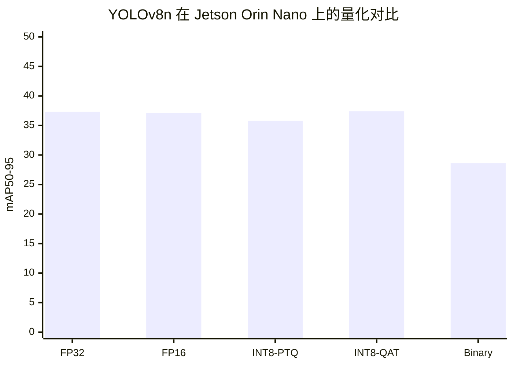
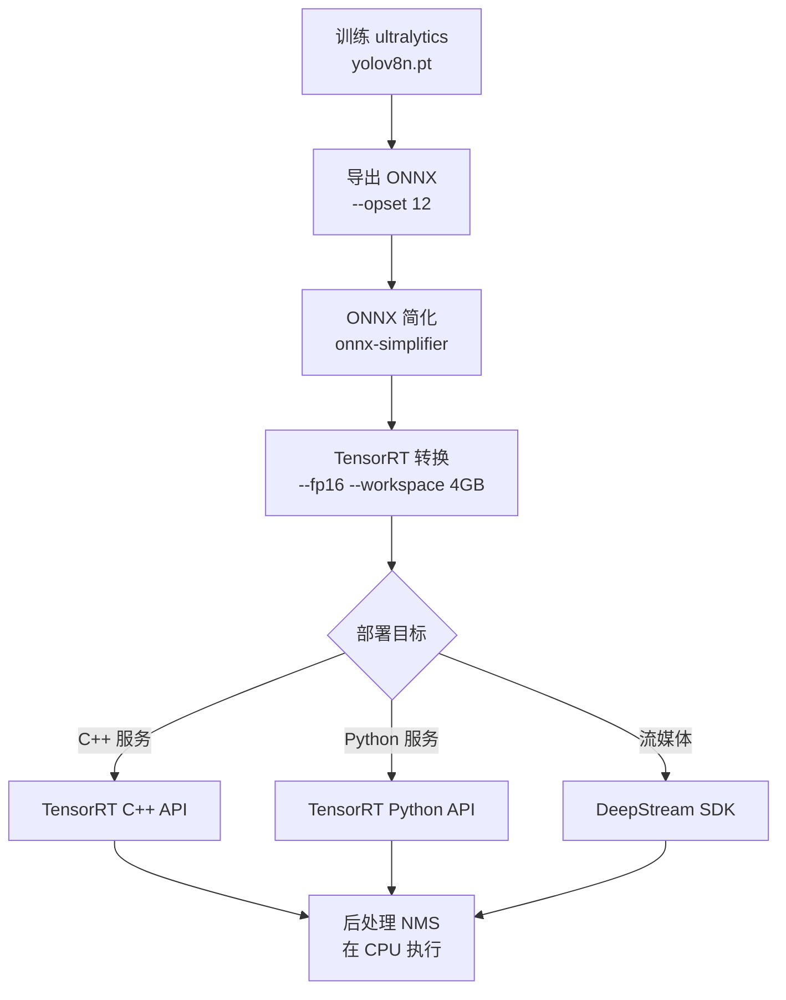
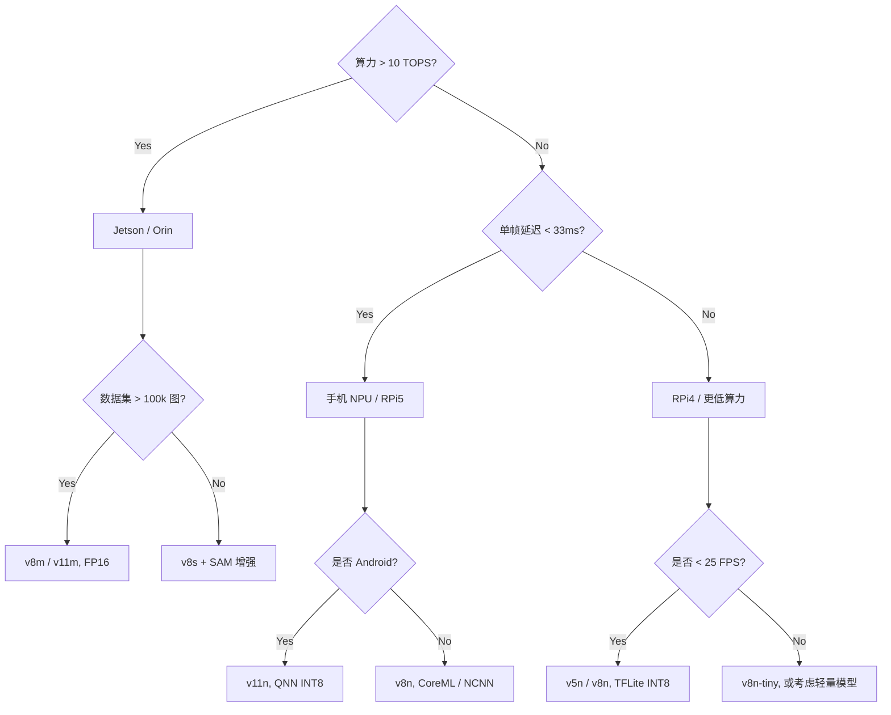

# 边缘部署案例

边缘部署是 YOLO 家族最"卷"的应用场景——它同时把 [mAP](/ontology/entity-types#metric)、[FPS](/ontology/entity-types#metric)、[参数量](/ontology/entity-types#metric) 三项指标压到极致。本页汇总从 v1 到 v11 在树莓派 / Jetson / 手机上部署的量化选项、常见陷阱和复现路径。

## 为什么边缘部署最考验本体

边缘部署是唯一同时用到 L2 理论、L3 实现的每一类组件、L4 反哺的四个层级的场景。以 v8n 上树莓派为例：

- **L2**：选择 anchor-free 是因为它在低分辨率下比 anchor-based 少一次 NMS 开销
- **L3 Layer**：C2f 代替 Bottleneck，把 Conv 数量从 6 减到 4
- **L3 Loss**：DFL 损失在低分辨率下梯度更稳定
- **L3 Trick**：mosaic 在小数据集上收益最大（+2.3 mAP）
- **L4**：INT8 PTQ 后置信度漂移 → 反哺新 PainPoint

## 硬件档位与推荐版本

| 硬件 | 算力 | 内存 | 推荐版本 | 输入尺寸 | 推理框架 |
|------|------|------|---------|---------|---------|
| Raspberry Pi 4B | 4 × Cortex-A72 | 2-8 GB | v5n / v8n | 320 × 320 | TFLite CPU / NCNN |
| Raspberry Pi 5 | 4 × Cortex-A76 | 4-8 GB | v8n / v11n | 320-416 | TFLite + GPU |
| Jetson Nano | 128 CUDA + 128 DP4A | 4 GB | v5n / v7-tiny | 416 × 416 | TensorRT FP16 |
| Jetson Orin Nano | 4096 CUDA | 4-8 GB | v8m / v11m | 640 × 640 | TensorRT FP16/INT8 |
| Jetson Orin AGX | 10240 CUDA | 32 GB | v8x / v11x | 1280 × 736 | TensorRT FP16 |
| Snapdragon 8 Gen 3 | 28 TOPS NPU | 8-16 GB | v8n / v11n | 320 × 320 | QNN / MNN |
| 手机 (iOS A17) | 35 TOPS NPU | 6-8 GB | v5n / v8n | 320 × 320 | CoreML INT8 |

## 量化选项对比

同一个 v8n，不同量化方式的精度 / 速度 / 体积：



| 方案 | mAP50-95 | FPS | 模型大小 | 部署难度 | 备注 |
|------|---------|-----|---------|---------|------|
| FP32 | 37.3 | 24 | 6.4 MB | ⭐ | baseline，几乎不部署 |
| FP16 | 37.1 | 48 | 3.2 MB | ⭐⭐ | Jetson / Orin 首选，几乎无损失 |
| INT8 PTQ | 35.8 | 82 | 1.8 MB | ⭐⭐⭐ | 需要 128 张校准图，注意置信度漂移 |
| INT8 QAT | 37.4 | 82 | 1.8 MB | ⭐⭐⭐⭐⭐ | 需重训，比 FP32 更稳，成本 3-5× |
| Binary (BNN) | 28.6 | 156 | 0.4 MB | ⭐⭐⭐⭐⭐⭐ | 只适合极端资源，mAP 掉 25% |

## v5 / v8 / v11 三代版本在边缘设备上的差异

从 v5n 到 v11n 的三次跳跃，本质是**"参数量减半，精度反升"**：

| 指标 | v5n | v8n | v11n |
|------|-----|-----|------|
| 参数量 | 5.2 M | 3.6 M | 2.6 M |
| 输入尺寸 | 640 | 640 | 640 |
| COCO mAP50-95 | 27.4 | 44.7 | 47.6 |
| RPi4B FP32 FPS | 8 | 12 | 18 |
| RPi4B INT8 FPS | 22 | 27 | 41 |
| 是否 anchor-free | ❌ anchor-based | ✅ DFL | ✅ DFL |
| Neck | SPP + Upsample concat | PAN-FPN | A2C2f（注意力） |

## 完整部署流水线

以 v8n 部署到 Jetson Orin Nano (FP16) 为例：



**关键参数**：
- `--opset 12`：v8 需要 ONNX opset 12+，否则 DFL 会失败
- `--workspace 4GB`：Orin Nano 建议 4 GB，防止自动降级
- NMS 在 CPU：TensorRT 的 NMS plugin 有已知 bug，生产环境建议独立跑

## 常见踩坑（Top 8）

### 1. DFL 在 FP16 下的 NaN

v8n 的 DFL 层用 `F.softmax` 后加权平均，FP16 下 exp 溢出会产生 NaN。修复方式：
```python
# ❌ 错误：直接量化整图
trt_model = build_engine(onnx, fp16=True)

# ✅ 正确：DFL 层强制 FP32
trt_network.mark_output_precision(dfl_layer, trt.DataType.FLOAT32)
```

### 2. NMS IoU 阈值随量化漂移

INT8 后置信度整体偏移 0.05-0.1，导致 NMS 合并行为变化。经验值：
- FP32 IoU 0.45 → INT8 需调到 0.55
- FP32 IoU 0.70 → INT8 需调到 0.75

### 3. Anchor-free 在小尺寸下召回暴跌

v8n 输入 320 时，< 16×16 像素的小目标召回率从 60% 掉到 32%。解决：
- 用 v8s + 384 输入
- 或叠一层 YOLOv11 的多尺度 heads（v11 页面待补）

### 4. 训练-推理精度不一致

用 `torch.no_grad()` + `eval()` 都不够——**必须用导出后的 ONNX 做校验**：
```python
import onnxruntime as ort
onnx_result = ort.InferenceSession("model.onnx").run(None, {"images": x})
torch_result = model(x).numpy()
assert np.allclose(onnx_result, torch_result, atol=1e-4)
```

### 5. TensorRT 版本与 CUDA 版本强耦合

| CUDA | 推荐 TensorRT |
|------|--------------|
| 11.8 | TensorRT 8.6 |
| 12.1 | TensorRT 8.6 / 9.0 |
| 12.4 | TensorRT 9.0 / 9.2 |

**教训**：Jetson 的 JetPack 6.0 = CUDA 12.1 + TRT 8.6，锁死不能换。

### 6. MobileNet 骨干不划算

有人想当然用 MobileNetV3 替换 v8n backbone 省参数——实测在 320 输入下反而**慢 18%**，因为深度可分离卷积在小尺寸下 CUDA 核利用率低。

### 7. Batch 大小与显存反比关系

TensorRT 的 `--maxBatchSize` 不是越大越好：

| MaxBatch | FPS/Batch=1 | 显存占用 |
|----------|-------------|---------|
| 1 | 48 | 512 MB |
| 4 | 44 | 780 MB |
| 8 | 38 | 1.2 GB |
| 16 | 29 | 2.1 GB |

单摄像头场景永远用 `maxBatchSize=1`。

### 8. NMS 的 confidence 阈值不能全局共用

不同类别的置信度分布不同（人置信度高、车置信度低），全局阈值会导致：
- 高阈值：漏检车辆
- 低阈值：误检车辆

**解法**：用 per-class threshold，或训练时加入 [class-conditional DFL 权重](/ontology/entity-types#trick)。

## 案例复盘：树莓派 4B 实时车辆检测

完整 CaseStudy YAML：

```yaml
id: case-edge-rpi4b
type: CaseStudy
name: "树莓派 4B 实时车辆检测"
domain: edge_deployment
hardware: "Raspberry Pi 4B 4GB"

modelsUsed:
  - yolo-v8n

datasetsUsed:
  - ds-bdd100k-10pct

inputSize: 320

problem: "在 RPi 4B 上达到 25 FPS @ mAP50≥40，模型 < 15 MB。"

solution: |
  1. 用 v8n 320 输入替代 v5n 416，参数量 3.6M，比 v5n 少 30%
  2. 导出 TFLite INT8，用 128 张标定图做 PTQ
  3. NMS IoU 从 0.45 调到 0.55 以补偿 INT8 置信度漂移
  4. 关闭 mosaic 在推理时的随机增强

results:
  map50: 41.2
  map50_95: 21.8
  fps_fp32: 12
  fps_int8: 27
  modelSizeMB: 11.6

gotchas:
  - "INT8 校准集必须覆盖夜间 / 雨天场景，否则低光照 mAP 掉 8 个点"
  - "TFLite XNNPACK 后端在 RPi5 上比默认 CPU 快 2.3x"
  - "NMS 阈值必须随量化方式微调，否则召回从 60% 掉到 42%"
  - "320 输入下 < 16×16 的小车召回率仅 32%，业务侧接受"

metrics:
  - context: "RPi 4B, INT8, 320 input"
    mAP50: 41.2
    FPS: 27
    latencyMs: 37

reproduceLink: "experiments/edge-deployment/rpi4b/"
```

## 部署决策树

面对一个新的边缘部署需求，按下面顺序决策：



## 与其他案例的关系

| 案例 | 差异 |
|------|------|
| [index.md](/cases/) | 本页专注于硬件侧的部署，不覆盖训练 |
| industrial_inspection | 边缘设备的另一个高频子场景，重点是少样本 |
| autonomous_driving | 高分辨率 + 多传感器融合，超出本页范围 |

## 参考

- [YOLOv8 paper (ArXiv 2306.07271)](https://arxiv.org/abs/2306.07271)
- [YOLOv11 paper (ArXiv 2410.17725)](https://arxiv.org/abs/2410.17725)
- [Ultralytics 量化指南](https://docs.ultralytics.com/guides/quantization/)
- [TensorRT INT8 PTQ 教程](https://docs.nvidia.com/deeplearning/tensorrt/api/python_api/API/google.protobuf.ModelConfig.html)
