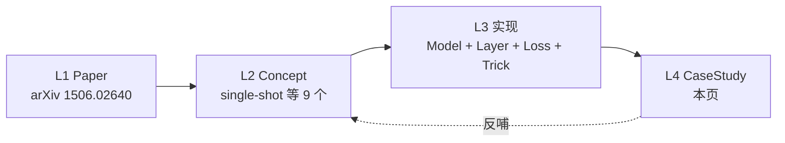
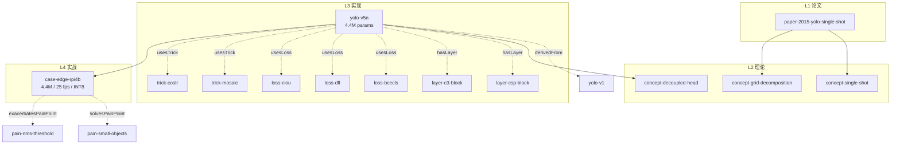

# 实战案例总览

案例是本体四层闭环的 **L4 落地层**——把 [Model](/ontology/entity-types#model) / [Layer](/ontology/entity-types#layer) / [Loss](/ontology/entity-types#loss) / [Trick](/ontology/entity-types#trick) 组合起来，在一个真实业务场景上验证。

每个 CaseStudy 实例（Schema 定义见 [entity-types L4 实战层](/ontology/entity-types#L4-实战层)）都遵循同一结构：**domain · task · problem · solution · gotchas · results · reproduceLink**。

## 四层闭环回顾



L4 不只是"用一次模型"——它必须产生两类**反哺信号**：
- **gotchas** → 回写到 [PainPoint](/ontology/entity-types#painpoint) 的 `attempts[]`
- **results** → 挂到 Model 的 `metrics[]` 上带 context（inputSize / hardware / dataset）

## 案例分类

当前覆盖 5 大 domain，每类都有可复用模板。

| Domain | 典型任务 | 代表版本 | 关键约束 |
|--------|---------|---------|---------|
| **edge_deployment** | 树莓派 / Jetson / 手机实时推理 | v5n / v8n / v11n | < 30 ms、INT8、模型 < 20 MB |
| **autonomous_driving** | 车道 / 车辆 / 行人多目标 | v8x / v11x | 高分辨率、多尺度、延迟 < 20 ms |
| **industrial_inspection** | 缺陷检测（划痕 / 少件） | v8s + SAM | 小样本、异常类别、多 SKU |
| **retail** | 货架识别 / 商品计数 | v5s / v8s | 视角畸变、类间相似 |
| **medical** | 病灶定位 / 器官分割 | v8m + SE | 隐私、少量标注、监管 |

## 从 Model 到 CaseStudy 的组装示例

以「边缘部署 · 树莓派 4B 目标检测」为例，看四层如何闭环：



## CaseStudy YAML 完整模板

一份合格的案例应包含以下 8 个必填 / 建议字段：

```yaml
id: case-edge-rpi4b
type: CaseStudy
name: "树莓派 4B 实时目标检测"
domain: edge_deployment
task: "实时车辆 / 行人检测"

# L1-L3 引用
modelsUsed:
  - yolo-v5n
  - yolo-v8n
datasetsUsed:
  - ds-coco-subset
  - ds-custom-rpi

# 业务问题定义
problem: "在 4GB 内存 / 单 GPU-less 平台上，达到 25 FPS @ mAP≥40 的实时检测。"
solution: |
  1. 选 yolo-v8n（3.6M）代替 v5n（4.4M）——C2f + anchor-free 减少 NMS 时间
  2. 输入尺寸从 640 缩到 320，用 TFLite INT8 动态量化
  3. NMS IoU 从 0.45 调到 0.60，减少边缘场景误合并

# 关键踩坑
gotchas:
  - "INT8 PTQ 时若不做校准集，置信度分数会整体漂移 0.05，NMS 阈值需要相应上调"
  - "Raspberry Pi 的 VPU 不可用于 TFLite，只能走 CPU + NEON 加速"
  - "320 输入对 < 16×16 的小目标召回从 60% 掉到 32%"

# 定量结果
results:
  hardware: "Raspberry Pi 4B 4GB"
  fps_fp32: 12
  fps_int8: 27
  map50: 41.2
  map50_95: 21.8
  modelSizeMB: 11.6

# 复现入口
reproduceLink: "experiments/edge-deployment/rpi4b/"
```

## 案例 → 反哺回路

案例不是终点，而是本体演化的输入源。以下 3 种反哺关系最常见：

1. **new PainPoint**：实战中发现 v8n 在低光照下置信度校准偏差 → 新增 `pain-low-light-calibration`
2. **new Trick**：为解决上面问题提出「logits 温度缩放」→ 新增 `trick-logit-temp`
3. **new Metric**：仅用 mAP 无法评估校准偏差 → 新增 `metric-ece` (Expected Calibration Error)

这三类反哺分别落到：
- `ontology/instances/yolov*/painpoints.yaml`
- `ontology/instances/yolov*/tricks.yaml`
- `ontology/instances/yolov*/metrics.yaml`

详见 [关系类型](/ontology/relations) 中的 `solvesPainPoint` / `exacerbatesPainPoint`。

## 当前案例索引

| ID | Domain | 简述 | 状态 |
|----|--------|------|------|
| `case-edge-rpi4b` | edge_deployment | 树莓派 4B 实时检测 | 📖 [见边缘部署页](/cases/edge-deployment) |
| `case-edge-jetson-orin` | edge_deployment | Jetson Orin Nano 自动驾驶 | ⏳ 待补 |
| `case-industrial-defect` | industrial_inspection | PCB 缺陷检测（少样本 + SAM） | ⏳ 待补 |
| `case-autonomous-lane` | autonomous_driving | 车道线多尺度检测 | ⏳ 待补 |
| `case-retail-shelf` | retail | 货架商品 SKU 识别 | ⏳ 待补 |

## 案例编写规范

写新案例时遵循以下 5 条硬性规则：

1. **problem 必须量化**：写"检测不准"❌，写"mAP50 < 40"✅
2. **solution 必须是可执行的步骤**：允许写"用 v8n"，不允许写"用更好的模型"
3. **gotchas 至少 3 条**：少于 3 条意味着没踩过坑
4. **results 必须带硬件**：脱离硬件的 mAP 无意义
5. **reproduceLink 必须能一键跑**：脚本 + 权重 + 数据集下载链接三者齐全

## 下一步

- [边缘部署案例](/cases/edge-deployment)：详细拆解 v5n / v8n / v11n 在 RPi / Jetson / 手机上的量化对比
- 工业质检案例：少样本 + SAM 组合方案（待补）
- 自动驾驶案例：高分辨率 + 多尺度 neck（待补）
