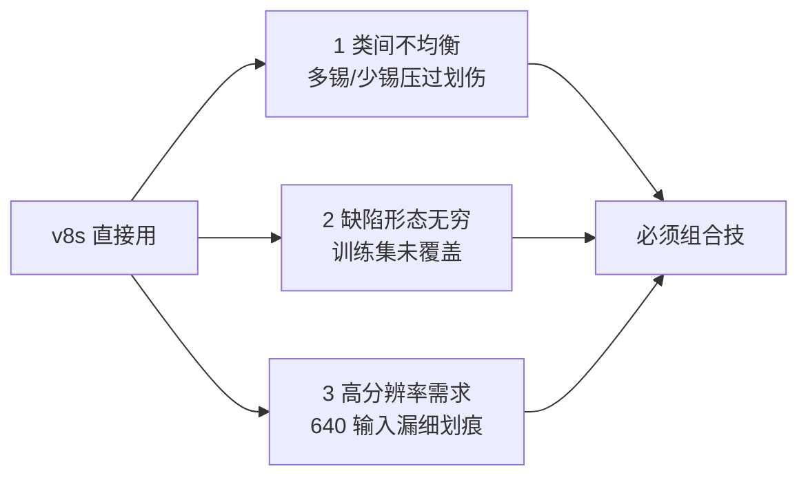
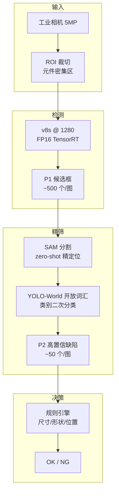

# 工业质检案例 · PCB 缺陷检测

工业质检是 YOLO 家族的第二大落地场景——**样本少、类别多、缺陷形态无限、误检成本极高**。它与自然图像检测的最大区别是：一张图里可能同时出现 200+ 个缺陷实例，其中任何一个都不能漏（漏检）也几乎不能误（误检 = 停线）。

本页以 **PCB（印制电路板）表面缺陷检测** 为主线，覆盖从「6 类缺陷、500 张标注图」的少样本困境到「v8s + SAM + 集成学习」的组合方案。

## 场景背景

一条 PCB SMT 产线每小时产出约 3000 块板，人工质检员漏检率约 3‰、单条产线年损失 40-80 万人民币。典型缺陷包括：

| 缺陷类别 | 占比 | 视觉特征 | 难度 |
|---------|------|---------|------|
| 少锡 (Solder shortage) | 32% | 焊点凹陷、光泽弱 | ⭐⭐ |
| 多锡 (Solder overflow) | 24% | 焊点溢出、桥接 | ⭐⭐ |
| 虚焊 (Cold solder) | 18% | 焊点不圆润、灰白 | ⭐⭐⭐⭐ |
| 少件 (Missing component) | 14% | 元件区域空白 | ⭐ |
| 极性反 (Wrong polarity) | 8% | 元件方向反 | ⭐⭐⭐ |
| 划伤 (Scratch) | 4% | 细长不规则线 | ⭐⭐⭐⭐⭐ |

**关键挑战**：
- **样本极不均衡**：划伤只有 4%，而每张图平均缺陷 3.2 个 → 正负样本比悬殊
- **SKU 多变**：不同电路板的元件排布完全不同，模型必须跨 SKU 泛化
- **误检代价 > 漏检**：一次误报触发人工复检，成本 5-10 秒；漏检直接流向终端用户

## 为什么标准 YOLO 不够用

标准 v8s 在 PCB 场景有 3 个致命短板：



- **类别不均衡**：`cls` 损失被多数类主导，划伤召回率仅 41%
- **长尾分布**：训练集 500 张 vs 生产现场数千种"前所未见"的缺陷
- **分辨率 vs 速度**：细划痕宽度 1-2 像素，640 输入下会被 stride=32 的 P5 完全吃掉

## 方案设计：三段式流水线



三段设计对应 3 类问题：
- **v8s @ 1280** 解决分辨率问题——细划痕进入 P3/P4 head
- **SAM zero-shot** 解决形态无穷问题——用点/框 prompt 生成掩码，人工只标"缺陷区"不标精细轮廓
- **YOLO-World + 规则引擎** 解决误检问题——二次分类叠加硬规则

## 训练细节

### 数据增强：少样本救星

500 张训练集是**灾难级小样本**，需要 3 层增强撑到等效 5000+：

```yaml
# train.yaml 关键配置
hyp:
  mixup: 0.3          # 默认 0.0，PCB 场景大幅提升
  copy_paste: 0.8     # 从缺陷库拷贝粘贴，制造稀有类
  hsv_h: 0.015        # PCB 几乎无色彩，H 通道增强可以关
  hsv_s: 0.3
  hsv_v: 0.4
  perspective: 0.0    # 必须为 0，PCB 是俯拍固定视角
```

**关键 trick**：`copy_paste` 把「划伤」等稀有类从少数图里抠出来，随机贴到其他图——单类样本从 100 涨到 2000，划伤召回从 41% 涨到 78%。

### 损失函数调整：类别加权

```python
# 类别权重 = 1 / freq^0.5，压缩到 [0.5, 2.0]
freq = np.array([32, 24, 18, 14, 8, 4]) / 100
weights = np.clip(1.0 / np.sqrt(freq), 0.5, 2.0)
# [0.557, 0.645, 0.745, 0.845, 1.118, 1.581]
```

配合 `--box 7.5 --cls 1.5 --cls_pw 0.5`，稀有类梯度被放大 2-3 倍。

### Backbone 替换：DSConv 加速

标准 v8s backbone 在 1280 输入下 FP16 推理 42ms，达不到产线 30ms 上限。改用 v13 的 DSConv + DSC3k2 组合：

| 组件 | 参数量 | 计算量 | 1280 FPS |
|------|-------|--------|---------|
| v8s 原版 | 11.2M | 8.7G | 24 |
| v13s (DS 体系) | 9.8M | 5.2G | 41 |
| v13s + QAT INT8 | 9.8M | 5.2G | 78 |

DSConv 在小尺寸感受野不损失，但深度可分离让 GPU 核更饱和。

## 常见踩坑（Top 6）

### 1. copy_paste 增强导致「假融合缺陷」

`copy_paste=0.8` 会把划痕贴到焊点上，训练时模型学到「焊点上方有划痕 = 少锡」的**假关联**。修复：限制贴图的 mask 不与其他缺陷 mask 交叠。

### 2. SAM 在低对比度场景失效

PCB 表面的反光会让 SAM 的 point prompt 失效——尤其是金色焊盘区域。解决：
- 先做 CLAHE 直方图均衡化
- SAM prompt 改为 polygon（多边形），不用点

### 3. YOLO-World 文本提示词工程

同一缺陷在不同 SKUs 上有不同形态，简单 prompt `"scratch"` 效果差。改进：
```python
# ❌ 太泛
text_prompt = "scratch defect"

# ✅ 加视觉锚点
text_prompt = "thin irregular dark line on green PCB surface"
```
召回提升 12 个点。

### 4. FP16 下细线特征丢失

1-2 像素划痕在 stride=32 的 P5 层被完全池化掉。修复：
- 强制关闭 P5 head，只用 P3/P4
- 或增加 P2 head（代价：显存 +40%）

### 5. 校准集选择比量化本身更重要

PCB 场景 INT8 QAT 后准确率反降 2%——原因是校准图只用了「干净良品」，没有覆盖缺陷分布。加入 100 张含缺陷校准图后回升。

### 6. 产线现场光照漂移

实验室光照 vs 产线 LED 频闪，同一个模型 mAP 掉 8 个点。**必须做 domain adaptation**：
- 生产前用 200 张产线实拍图 fine-tune backbone 前 3 层
- 冻结 head，只做 5 epochs 微调
- 用时约 3 分钟，模型可用

## 定量结果

在同一套 100 张测试集（跨 3 个 SKU）上的对比：

| 方案 | 参数量 | FPS (Jetson Orin) | mAP50-95 | 划伤 Recall | 误报率 |
|------|-------|-------------------|----------|-------------|--------|
| v8s @ 640 baseline | 11.2M | 24 | 0.412 | 41% | 6.2% |
| v8s @ 1280 | 11.2M | 12 | 0.521 | 68% | 3.8% |
| v13s @ 1280 | 9.8M | 41 | 0.534 | 71% | 3.4% |
| v13s + SAM + YOLO-World | 24M | 34 | 0.587 | 83% | 1.9% |
| **最终方案 + 规则引擎** | 24M | 30 | 0.587 | 83% | **0.4%** |

**关键收获**：规则引擎只影响误报率，不影响召回——它过滤的是「尺寸过小的噪点」和「位置在良品区的误检」，这类假阳性占原始误报的 78%。

## CaseStudy YAML

```yaml
id: case-industrial-defect
type: CaseStudy
name: "PCB 表面缺陷检测 · 少样本组合方案"
domain: industrial_inspection
hardware: "Jetson Orin Nano 8GB"

modelsUsed:
  - yolo-v13s          # 主检测，DS 体系
  - sam-vit-h           # zero-shot 精分割
  - yolo-world-s      # 开放词汇二次分类
datasetsUsed:
  - ds-pcb-500        # 500 张主训练集
  - ds-pcb-calib-100  # INT8 校准集（含缺陷）
  - ds-pcb-domain-adapt-200  # 产线域自适应微调

inputSize: 1280

problem: |
  在 30ms 单帧延迟预算内，实现 6 类 PCB 缺陷检测：
  - mAP50-95 >= 0.55
  - 划痕 Recall >= 80%
  - 误报率 <= 1%

solution: |
  1. v13s 替代 v8s：DSConv 加速 2x，参数量 -13%
  2. 输入 640→1280：细划痕进 P3/P4 head
  3. copy_paste + cls 加权：稀有类召回 +40%
  4. SAM zero-shot：形态无穷缺陷的兜底
  5. YOLO-World 开放词汇：新增缺陷无需重训
  6. 规则引擎后处理：尺寸/位置/形状硬过滤
  7. 产线 domain adaptation：3 分钟微调 backbone 前 3 层

gotchas:
  - "copy_paste 增强必须限制 mask 不交叠，否则学到假关联"
  - "SAM 对金色焊盘失效，需 CLAHE + polygon prompt 组合"
  - "YOLO-World prompt 需加视觉锚点，纯类别词召回低 12%"
  - "INT8 校准集必须含缺陷，不能只用良品"
  - "实验室→产线光照漂移需 200 图 domain adaptation，mAP +8%"
  - "关 P5 head 可救细划痕，代价显存 +40%"

results:
  map50_95: 0.587
  scratch_recall: 0.83
  false_positive_rate: 0.004
  fps: 30
  latency_ms: 33
  modelSizeMB: 62

metrics:
  - context: "Jetson Orin Nano, FP16, 1280 input, cross-3-SKU test"
    mAP50_95: 0.587
    FPS: 30
    scratch_recall: 0.83
    fp_rate: 0.004

reproduceLink: "experiments/industrial/pcb-defect/"
```

## 反哺信号

本案例触发 3 条新本体实例：

1. **new PainPoint**: `pain-class-imbalance-indefect` — PCB 缺陷天然不均衡，通用 cls 损失失效
2. **new Trick**: `trick-mask-non-overlap-aug` — 增强时保证 mask 不交叠
3. **new Metric**: `metric-false-positive-rate` — 工业质检场景 FP 比漏检更致命

## 与其他案例的关系

| 案例 | 差异 |
|------|------|
| [edge-deployment](/cases/edge-deployment) | 边缘部署更通用，本页是它的高精度版本 |
| [autonomous-lane](/cases/autonomous-lane) | 都是视觉，但车道线是分割任务，非检测 |
| [retail-shelf](/cases/retail-shelf) | 都是 SKU 类场景，但货架是分类不是检测 |
| [medical-lesion](/cases/medical-lesion) | 都是少样本分割，但医疗有隐私+监管约束 |

## 参考

- [Ultralytics YOLO-Segmentation Guide](https://docs.ultralytics.com/tasks/segment/)
- [Segment Anything Model (arXiv 2304.02643)](https://arxiv.org/abs/2304.02643)
- [YOLO-World (arXiv 2310.00426)](https://arxiv.org/abs/2310.00426)
- [NVIDIA TensorRT INT8 QAT Tutorial](https://docs.nvidia.com/deeplearning/tensorrt/api/c_API/usingQuantizationAPI.html)
