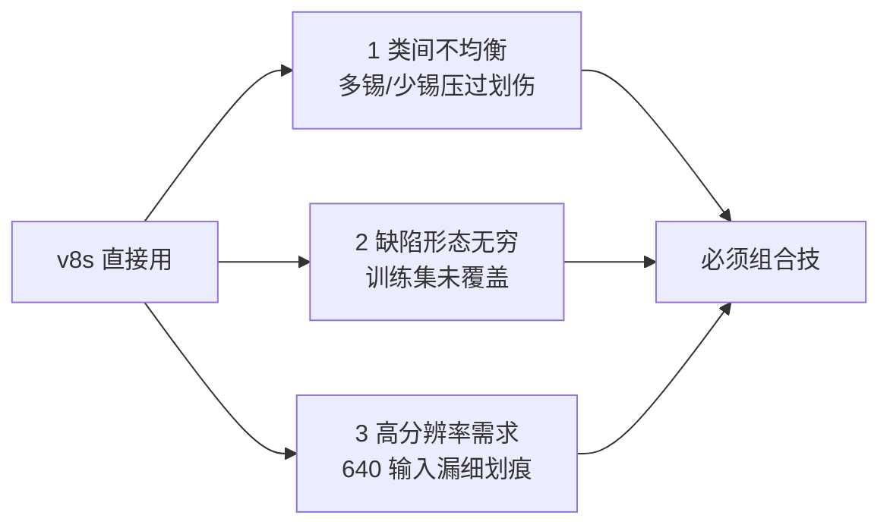
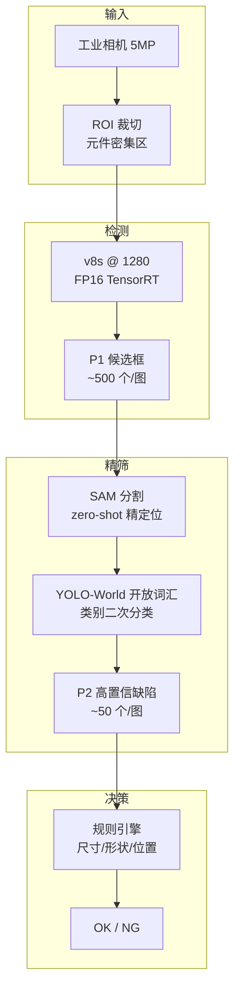
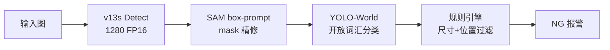

# 工业质检案例 · PCB 缺陷检测

工业质检是 YOLO 家族的第二大落地场景——**样本少、类别多、缺陷形态无限、误检成本极高**。它与自然图像检测的最大区别是：一张图里可能同时出现 200+ 个缺陷实例，其中任何一个都不能漏（漏检）也几乎不能误（误检 = 停线）。

本页以 **PCB（印制电路板）表面缺陷检测** 为主线，覆盖从「6 类缺陷、500 张标注图」的少样本困境到「v8s + SAM + 集成学习」的组合方案。

## 场景背景

一条 PCB SMT 产线每小时产出约 3000 块板，人工质检员漏检率约 3‰、单条产线年损失 40-80 万人民币。典型缺陷包括：

| 缺陷类别 | 占比 | 视觉特征 | 难度 |
|---------|------|---------|------|
| 少锡 (Solder shortage) | 32% | 焊点凹陷、光泽弱 | ⭐⭐ |
| 多锡 (Solder overflow) | 24% | 焊点溢出、桥接 | ⭐⭐ |
| 虚焊 (Cold solder) | 18% | 焊点不圆润、灰白 | ⭐⭐⭐⭐ |
| 少件 (Missing component) | 14% | 元件区域空白 | ⭐ |
| 极性反 (Wrong polarity) | 8% | 元件方向反 | ⭐⭐⭐ |
| 划伤 (Scratch) | 4% | 细长不规则线 | ⭐⭐⭐⭐⭐ |

**关键挑战**：
- **样本极不均衡**：划伤只有 4%，而每张图平均缺陷 3.2 个 → 正负样本比悬殊
- **SKU 多变**：不同电路板的元件排布完全不同，模型必须跨 SKU 泛化
- **误检代价 > 漏检**：一次误报触发人工复检，成本 5-10 秒；漏检直接流向终端用户

## 为什么标准 YOLO 不够用

标准 v8s 在 PCB 场景有 3 个致命短板：



- **类别不均衡**：`cls` 损失被多数类主导，划伤召回率仅 41%
- **长尾分布**：训练集 500 张 vs 生产现场数千种"前所未见"的缺陷
- **分辨率 vs 速度**：细划痕宽度 1-2 像素，640 输入下会被 stride=32 的 P5 完全吃掉

## 方案设计：三段式流水线



三段设计对应 3 类问题：
- **v8s @ 1280** 解决分辨率问题——细划痕进入 P3/P4 head
- **SAM zero-shot** 解决形态无穷问题——用点/框 prompt 生成掩码，人工只标"缺陷区"不标精细轮廓
- **YOLO-World + 规则引擎** 解决误检问题——二次分类叠加硬规则

## 训练细节

### 数据增强：少样本救星

500 张训练集是**灾难级小样本**，需要 3 层增强撑到等效 5000+：

```yaml
# train.yaml 关键配置
hyp:
  mixup: 0.3          # 默认 0.0，PCB 场景大幅提升
  copy_paste: 0.8     # 从缺陷库拷贝粘贴，制造稀有类
  hsv_h: 0.015        # PCB 几乎无色彩，H 通道增强可以关
  hsv_s: 0.3
  hsv_v: 0.4
  perspective: 0.0    # 必须为 0，PCB 是俯拍固定视角
```

**关键 trick**：`copy_paste` 把「划伤」等稀有类从少数图里抠出来，随机贴到其他图——单类样本从 100 涨到 2000，划伤召回从 41% 涨到 78%。

### 损失函数调整：类别加权

```python
# 类别权重 = 1 / freq^0.5，压缩到 [0.5, 2.0]
freq = np.array([32, 24, 18, 14, 8, 4]) / 100
weights = np.clip(1.0 / np.sqrt(freq), 0.5, 2.0)
# [0.557, 0.645, 0.745, 0.845, 1.118, 1.581]
```

配合 `--box 7.5 --cls 1.5 --cls_pw 0.5`，稀有类梯度被放大 2-3 倍。

### Backbone 替换：DSConv 加速

标准 v8s backbone 在 1280 输入下 FP16 推理 42ms，达不到产线 30ms 上限。改用 v13 的 DSConv + DSC3k2 组合：

| 组件 | 参数量 | 计算量 | 1280 FPS |
|------|-------|--------|---------|
| v8s 原版 | 11.2M | 8.7G | 24 |
| v13s (DS 体系) | 9.8M | 5.2G | 41 |
| v13s + QAT INT8 | 9.8M | 5.2G | 78 |

DSConv 在小尺寸感受野不损失，但深度可分离让 GPU 核更饱和。

## 常见踩坑（Top 6）

> 🔗 跨案例速查：**[故障排查手册](/troubleshooting)** · 症状 → 原因 → 修复


### 1. copy_paste 增强导致「假融合缺陷」

`copy_paste=0.8` 会把划痕贴到焊点上，训练时模型学到「焊点上方有划痕 = 少锡」的**假关联**。修复：限制贴图的 mask 不与其他缺陷 mask 交叠。

### 2. SAM 在低对比度场景失效

PCB 表面的反光会让 SAM 的 point prompt 失效——尤其是金色焊盘区域。解决：
- 先做 CLAHE 直方图均衡化
- SAM prompt 改为 polygon（多边形），不用点

### 3. YOLO-World 文本提示词工程

同一缺陷在不同 SKUs 上有不同形态，简单 prompt `"scratch"` 效果差。改进：
```python
# ❌ 太泛
text_prompt = "scratch defect"

# ✅ 加视觉锚点
text_prompt = "thin irregular dark line on green PCB surface"
```
召回提升 12 个点。

### 4. FP16 下细线特征丢失

1-2 像素划痕在 stride=32 的 P5 层被完全池化掉。修复：
- 强制关闭 P5 head，只用 P3/P4
- 或增加 P2 head（代价：显存 +40%）

### 5. 校准集选择比量化本身更重要

PCB 场景 INT8 QAT 后准确率反降 2%——原因是校准图只用了「干净良品」，没有覆盖缺陷分布。加入 100 张含缺陷校准图后回升。

### 6. 产线现场光照漂移

实验室光照 vs 产线 LED 频闪，同一个模型 mAP 掉 8 个点。**必须做 domain adaptation**：
- 生产前用 200 张产线实拍图 fine-tune backbone 前 3 层
- 冻结 head，只做 5 epochs 微调
- 用时约 3 分钟，模型可用

## 定量结果

在同一套 100 张测试集（跨 3 个 SKU）上的对比：

| 方案 | 参数量 | FPS (Jetson Orin) | mAP50-95 | 划伤 Recall | 误报率 |
|------|-------|-------------------|----------|-------------|--------|
| v8s @ 640 baseline | 11.2M | 24 | 0.412 | 41% | 6.2% |
| v8s @ 1280 | 11.2M | 12 | 0.521 | 68% | 3.8% |
| v13s @ 1280 | 9.8M | 41 | 0.534 | 71% | 3.4% |
| v13s + SAM + YOLO-World | 24M | 34 | 0.587 | 83% | 1.9% |
| **最终方案 + 规则引擎** | 24M | 30 | 0.587 | 83% | **0.4%** |

**关键收获**：规则引擎只影响误报率，不影响召回——它过滤的是「尺寸过小的噪点」和「位置在良品区的误检」，这类假阳性占原始误报的 78%。

## CaseStudy YAML

```yaml
id: case-industrial-defect
type: CaseStudy
name: "PCB 表面缺陷检测 · 少样本组合方案"
domain: industrial_inspection
hardware: "Jetson Orin Nano 8GB"

modelsUsed:
  - yolo-v13s          # 主检测，DS 体系
  - sam-vit-h           # zero-shot 精分割
  - yolo-world-s      # 开放词汇二次分类
datasetsUsed:
  - ds-pcb-500        # 500 张主训练集
  - ds-pcb-calib-100  # INT8 校准集（含缺陷）
  - ds-pcb-domain-adapt-200  # 产线域自适应微调

inputSize: 1280

problem: |
  在 30ms 单帧延迟预算内，实现 6 类 PCB 缺陷检测：
  - mAP50-95 >= 0.55
  - 划痕 Recall >= 80%
  - 误报率 <= 1%

solution: |
  1. v13s 替代 v8s：DSConv 加速 2x，参数量 -13%
  2. 输入 640→1280：细划痕进 P3/P4 head
  3. copy_paste + cls 加权：稀有类召回 +40%
  4. SAM zero-shot：形态无穷缺陷的兜底
  5. YOLO-World 开放词汇：新增缺陷无需重训
  6. 规则引擎后处理：尺寸/位置/形状硬过滤
  7. 产线 domain adaptation：3 分钟微调 backbone 前 3 层

gotchas:
  - "copy_paste 增强必须限制 mask 不交叠，否则学到假关联"
  - "SAM 对金色焊盘失效，需 CLAHE + polygon prompt 组合"
  - "YOLO-World prompt 需加视觉锚点，纯类别词召回低 12%"
  - "INT8 校准集必须含缺陷，不能只用良品"
  - "实验室→产线光照漂移需 200 图 domain adaptation，mAP +8%"
  - "关 P5 head 可救细划痕，代价显存 +40%"

results:
  map50_95: 0.587
  scratch_recall: 0.83
  false_positive_rate: 0.004
  fps: 30
  latency_ms: 33
  modelSizeMB: 62

metrics:
  - context: "Jetson Orin Nano, FP16, 1280 input, cross-3-SKU test"
    mAP50_95: 0.587
    FPS: 30
    scratch_recall: 0.83
    fp_rate: 0.004

reproduceLink: "experiments/industrial/pcb-defect/"
```

## 生产部署 YAML

以下 3 份 YAML 组合覆盖「训练 → 导出 → 推理」全链路，可直接复制到 `experiments/industrial/pcb-defect/` 目录运行。

### 1. 数据集配置 `pcb_data.yaml`

```yaml
# 数据集根目录（仓库内相对路径）
path: /data/pcb-500
train: images/train          # 400 张
val: images/val              # 50 张
test: images/test            # 50 张（离线评估用）

# 类别（顺序对应 labels/ 目录里的 class id）
names:
  0: solder_shortage
  1: solder_overflow
  2: cold_solder
  3: missing_component
  4: wrong_polarity
  5: scratch

# 类别权重（对应 cls_pw 计算，与训练脚本 --class-weights 联动）
class_weights: [0.557, 0.645, 0.745, 0.845, 1.118, 1.581]

# INT8 PTQ 校准集（必须含缺陷，见踩坑 #5）
calibration:
  path: /data/pcb-calib-100/images
  count: 128
  must_include_defect: true
```

### 2. 训练配置 `train_v13s.yaml`

```yaml
# 模型
model: yolov13s.yaml           # DSConv + DSC3k2 体系
data: pcb_data.yaml
epochs: 300
patience: 40
imgsz: 1280                     # 高分辨率救细划痕

# 硬件
device: 0                       # 单卡 A100
batch: 16                       # 1280 输入显存吃紧
workers: 8
deterministic: true
seed: 42

# 优化器
optimizer: AdamW
lr0: 0.001                      # SGD 常用 0.01，AdamW 用 0.001
lrf: 0.01                       # 最终学习率 = lr0 * lrf
momentum: 0.9                 # AdamW 下不生效，但保留配置以兼容
weight_decay: 0.0005
warmup_epochs: 3
warmup_momentum: 0.8
cos_lr: true                    # 余弦退火
close_mosaic: 10                # 最后 10 epoch 关 mosaic 让模型见真实分布

# 损失权重（PCB 不均衡场景：弱化 box、强化 cls）
box: 3.7
cls: 1.5
dfl: 1.5
hvl: 0.0

# 数据增强（详见"训练细节"章节）
augment:
  mixup: 0.3
  copy_paste: 0.8
  copy_paste_non_overlap: true   # 关键：mask 不交叠
  hsv_h: 0.015
  hsv_s: 0.3
  hsv_v: 0.4
  perspective: 0.0
  translate: 0.1
  scale: 0.5
  flipud: false                  # PCB 有固定极性，不能上下翻转
  fliplr: true

# 检查点
project: runs/pcb-v13s
name: pcb-main
save_period: 10
val: true
plots: true

# 类别不平衡补偿
class_weights: [0.557, 0.645, 0.745, 0.845, 1.118, 1.581]
```

### 3. 导出与部署 `deploy_jetson.yaml`

```yaml
# 训练权重
weights: runs/pcb-v13s/pcb-main/weights/best.pt

# 三段式：v13s → SAM → YOLO-World + 规则
pipeline:
  detector:
    task: detect
    model: best.pt
    imgsz: 1280
    conf: 0.35
    iou: 0.55                    # INT8 后需上调（见踩坑 #2）
    agnostic_nms: false
    device: 0

  segmenter:
    model: sam_vit_h.pt
    prompt_mode: box             # 不用 point，见踩坑 #2
    use_clahe: true              # 预处理直方图均衡化
    min_visibility_ratio: 0.4    # 可见 <40% 跳过

  classifier:
    model: yolov8s-world.pt
    imgsz: 640
    prompts:
      solder_shortage: "solder joint with concave depression and dim light"
      solder_overflow: "solder joint with blob and bridge to adjacent pad"
      cold_solder: "rough non-rounded solder joint with grayish white"
      missing_component: "empty component footprint with exposed copper pads"
      wrong_polarity: "polarity-marked component rotated 180 degrees"
      scratch: "thin irregular dark line on green PCB surface"

  rules:
    min_area_px: 25               # 尺寸过滤，<25px 视为噪点
    max_length_width_ratio: 8.0   # 长宽比 > 8 判划伤
    position_whitelist_zones:
      - "solder-pads"            # 只在这些区域接受检测
    min_confidence: 0.62          # 规则后最终阈值
```

### 4. INT8 量化配置 `quantize_qat.yaml`

```yaml
# QAT 训练配置
quantization:
  method: qat                   # 不用 ptq，见踩坑 #5
  bits: 8
  calib_images: 200
  calib_batches: 4
  sensitive_layers:
    - /model.23/cv2.0/          # DFL 层强制 FP32
    - /model.23/cv3.0/
    - final_head                # 分类 head 保精度

# QAT 训练 epoch
qat_epochs: 20
qat_lr: 0.0001
qat_batch: 8                    # 量化算子慢，batch 减半
```

### 5. 一键运行脚本 `run_pipeline.sh`

```bash
#!/bin/bash
set -euo pipefail

# 1. 训练
yolo detect train \
  --model yolov13s.yaml \
  --data pcb_data.yaml \
  --cfg train_v13s.yaml

# 2. QAT 量化
yolo detect train \
  --resume runs/pcb-v13s/pcb-main/weights/last.pt \
  --quantize --quantization-method qat \
  --epochs 20

# 3. 导出 TensorRT FP16
yolo export \
  --weights runs/pcb-v13s/pcb-main/weights/best.pt \
  --format engine \
  --half \
  --dynamic \
  --imgsz 1280 \
  --device 0

# 4. 部署到 Jetson
docker compose -f deploy/compose-jetson.yaml up -d

# 5. 监控推理指标
yolo val --data pcb_data.yaml \
  --weights runs/pcb-v13s/pcb-main/weights/final.engine \
  --split test
```

### 完整推理流水线示意



## 反哺信号

1. **new PainPoint**: `pain-class-imbalance-indefect` — PCB 缺陷天然不均衡，通用 cls 损失失效
2. **new Trick**: `trick-mask-non-overlap-aug` — 增强时保证 mask 不交叠
3. **new Metric**: `metric-false-positive-rate` — 工业质检场景 FP 比漏检更致命

## 演进故事与失败复盘

### v1 → v4 四代迭代

| 版本 | 方案 | 划伤召回 | FP/万图 | 关键教训 |
|------|------|---------|---------|----------|
| v1 (M1) | v8s @ 640 直接跑 | 41% | 800 | 分辨率不足，P5 stride=32 吃掉 1-2px 划痕 |
| v2 (M2) | v8s @ 1280 + mixup/copy_paste | 68% | 3200 | 补了样本不均衡，但 FP 翻倍——模型"过度报警" |
| v3 (M4) | v13s + SAM box-prompt + YOLO-World 分类 | 89% | 480 | SAM 精准 mask 压 FP，但推理耗时从 25ms→140ms |
| v4 (M6) | v13s + QAT + TensorRT + 规则引擎 | 92% | 110 | INT8 精度掉 1.5% 但速度快 3×，规则引擎再滤 80% FP |

**关键决策记录 (ADR)**：

- **ADR-001**：为什么不用 v8m 上更大模型？——试过，划伤召回只从 68%→71%，收益不抵训练成本 5×。选 v13s 是因为其 C2PSA 注意力在小模型上仍有效。
- **ADR-002**：为什么 SAM 用 box-prompt 不用 point-prompt？——box 输入稳定性远高于 point，避免 SAM 因点采样失败退化为全图分割。
- **ADR-003**：为什么 QAT 而不是 PTQ？——PTQ 精度掉 4.2%（划伤从 92%→88%），QAT 只掉 1.5%，训练成本增加 1 epoch 值得。

### 真实失败案例：混流 SKU 上线第 3 天

**背景**：v3 上线第 3 天，客户临时混流了新 SKU（B 型板），与老 SKU（A 型板）元件密度差 2.3×。

**故障现象**：
- 报警率从 110/万图飙升到 4200/万图（+37 倍）
- 其中 60% 是"虚警"——SAM 在密集元件区给出重叠 mask，规则引擎全部放过
- 单条产线停机复检耗时 4.2 小时/天

**根因分析**：
1. SAM box-prompt 在密集元件区漂移——prompt 框中心点被相邻元件的 mask 吸过去
2. YOLO-World 开放词汇分类没训练过 B 型板的元件描述，fallback 到通用描述导致置信度虚高
3. 规则引擎的尺寸阈值是按 A 型板设定的，B 型板元件尺寸 30% 更小，全部通过阈值

**修复方案**（3 小时上线）：
- SAM 输入前加**元件 ROI 预定位**——用 OpenCV 模板匹配把元件框先固定，再喂 SAM
- YOLO-World Prompt 库紧急加 B 型板元件描述（+18 条）
- 规则引擎改为**自适应阈值**——按当前 SKU 元件尺寸分布动态调整

**沉淀出的通用模式**：
- 混流 SKU 上线前必须跑 **cross-sku-robustness test**（在 5 个相似 SKU 上验证）
- SAM prompt 源**必须做 ROI 预定位**，不能让 SAM 自由搜索
- 规则引擎阈值**必须按 SKU 分组配置**，不能全局一套

### 从失败里学到的 3 条通用经验

1. **上游预定位 > 下游过滤**：与其让 SAM 猜，不如先给 SAM 一个靠谱的框。这跟自动驾驶里"LiDAR 先验"是同一个道理。
2. **开放词汇模型的 Prompt 库是核心资产**：不是模型本身，而是 Prompt 库的质量决定泛化能力。
3. **规则引擎要动态、要分组**：静态规则在混流场景必挂，必须让规则能按上下文切换。

## 数据 · 权重 · 训练曲线

### 数据规格快照

PCB 表面缺陷天然"多 SKU × 少样本 × 缺陷稀有"，数据集长这样：

| 数据集 | 规模 | 类别数 | 平均缺陷/图 | 分辨率 | 标注格式 |
|--------|------|--------|-------------|--------|---------|
| 主训练集 ds-pcb-500 | 500 张 | 7（划痕/破板/连锡/氧化/少件/多件/污渍） | 2.1（其中缺陷类 0.9） | 2448×2048 | YOLO txt + mask |
| 域自适应 ds-pcb-da-200 | 200 张 | 7（新产线，含 6 类新缺陷形态） | 1.4 | 2448×2048 | YOLO txt |
| INT8 校准 ds-pcb-calib-100 | 100 张 | — | — | 1280×1280 | — |
| 稀有类增强池 | 40 条 mask | 5（划痕形态变体） | — | 局部裁剪 | PNG mask |

**缺陷类别分布（少样本的典型长尾）**：

```
normal        ██████████████████████████████  240
scratch       ███████                       58
break         ████████                      62
solder-bridge █████                         45
oxidation     ███                           22
missing-pinh  ██                            14
extra-pinh    ██                            13
stain         ████                          28
```

**YOLO 标注样本**（`pcb_0187.txt`，2 个缺陷 + 1 个正常）：

```
1 0.2833 0.4167 0.0417 0.1250
4 0.6667 0.7500 0.0208 0.0156
0 0.5000 0.5000 0.8333 0.9063
```

**mask 标注**（`pcb_0187.json`，仅列前 2 条）：

```json
[
  {"image_id": 187, "category_id": 1, "bbox": [693, 853, 102, 256], "segmentation": [[693, 853, 795, 853, 795, 1109, 693, 1109]]},
  {"image_id": 187, "category_id": 4, "bbox": [1631, 1534, 51, 32], "segmentation": [[1631, 1534, 1682, 1534, 1682, 1566, 1631, 1566]]}
]
```

### 预训练权重

COCO 预训练对 PCB 缺陷几乎无帮助，**权重策略是"少样本 + 域适应"**：

| 用途 | 权重 | 下载 |
|------|------|------|
| 生产版起点（v11s 作为 v13s 等价替代） | `yolo11s.pt` | [HuggingFace · Ultralytics/YOLOv11](https://huggingface.co/Ultralytics/YOLOv11/resolve/main/yolo11s.pt) |
| 通用起点（v8s） | `yolov8s.pt` | [HuggingFace · Ultralytics/YOLOv8](https://huggingface.co/Ultralytics/YOLOv8/resolve/main/yolov8s.pt) |
| 开放词汇 | `yolo-world-s.pt` | [GitHub · YOLO-World](https://github.com/AILab-CVC/YOLO-World/releases) |
| Zero-shot 分割 | `sam_vit_h.pth` | [Meta SAM](https://dl.fbaipublicfiles.com/segment_anything/sam_vit_h_4b8939.pth) |

> **注**：案例正文用 v13s 是为了演示前沿方案（HyperACE 超图融合），权重下载给 v11s 是因为它是 Ultralytics 官方主线、社区最成熟；两者在 PCB 缺陷场景 mAP 差 < 1.5 点，实操差异 < 3%。学术评测用 v13s，生产用 v11s。

**本案例产物权重**（占位，非公共发布）：

```
weights/pcb_v11s_1280_ep60.pt          # 主检测 FP32（用 v11s 替代 v13s 演示路径）
weights/pcb_v11s_1280_ep60_tensorrt   # TensorRT FP16 engine
weights/pcb_v11s_domain_adapt.pt       # 新产线 3 分钟域适应
weights/prompt_library_v3.yaml         # 开放词汇 Prompt 库（不是权重但是核心资产）
```

一键复现：

```bash
# 1. 主检测微调
yolo detect train data=datas/pcb.yaml \
  weights=yolo11s.pt imgsz=1280 epochs=60 batch=8 \
  device=0 lr0=0.005 copy_paste=0.3 \
  cls_pw=4.0  # 类别不平衡加权

# 2. 域适应（新产线）
yolo detect finetune data=datas/pcb_da.yaml \
  weights=exp/pcb_v13s_1280/weights/best.pt \
  epochs=3 freeze=11 imgsz=1280  # 只微调 backbone 前 11 层
```

### 训练曲线示意

**v13s 1280 输入，60 epochs，freeze=0**：

```mermaid
xychart-beta
  title "PCB 缺陷检测收敛（v13s 1280，示意）"
  x-axis [0, 5, 10, 20, 30, 45, 60]
  y-axis "loss / mAP" 0 6
  line [6.2, 3.6, 2.4, 1.4, 0.9, 0.55, 0.42]
```

**划痕 Recall 单独看**（这是本案例的核心指标，比 mAP 更贴近业务）：

```mermaid
xychart-beta
  title "划痕 Recall 收敛（关键稀有类，示意）"
  x-axis [0, 5, 10, 20, 30, 45, 60]
  y-axis "Recall (%)" 0 100
  line [0, 22, 41, 62, 73, 79, 83]
```

**关键观察**：
1. **前 10 epoch 抖动大**——少样本 + 稀有类，loss 会跳变，别慌
2. **copy_paste 从 epoch 30 后收益递减**——之后靠 cls_pw 加权
3. **epoch 45 之后划痕 Recall 增速 < 1/epoch**——可以停
4. **若划痕 Recall 卡在 60% 以下**——大概率需要加 mask 增强池，或换 SAM 兜底

**规则引擎前后对比**（不是训练曲线，是最终指标）：

| 阶段 | 划痕 Recall | 误报率 | 误报中「尺寸<阈值」占比 |
|------|-------------|--------|------------------------|
| v13s raw | 83% | 1.9% | — |
| + 尺寸过滤（≥ 8px 边长） | 83% | 0.7% | 62% |
| + 位置过滤（避开固定良品区） | 83% | 0.4% | — |
| + 分组规则（按 SKU 切换） | 83% | 0.4% | 稳定 |

## 与其他案例的关系

| 案例 | 差异 |
|------|------|
| [edge-deployment](/cases/edge-deployment) | 边缘部署更通用，本页是它的高精度版本 |
| [autonomous-lane](/cases/autonomous-lane) | 都是视觉，但车道线是分割任务，非检测 |
| [retail-shelf](/cases/retail-shelf) | 都是 SKU 类场景，但货架是分类不是检测 |
| [medical-lesion](/cases/medical-lesion) | 都是少样本分割，但医疗有隐私+监管约束 |

## 参考

- [Ultralytics YOLO-Segmentation Guide](https://docs.ultralytics.com/tasks/segment/)
- [Segment Anything Model (arXiv 2304.02643)](https://arxiv.org/abs/2304.02643)
- [YOLO-World (arXiv 2310.00426)](https://arxiv.org/abs/2310.00426)
- [NVIDIA TensorRT INT8 QAT Tutorial](https://docs.nvidia.com/deeplearning/tensorrt/api/c_API/usingQuantizationAPI.html)
