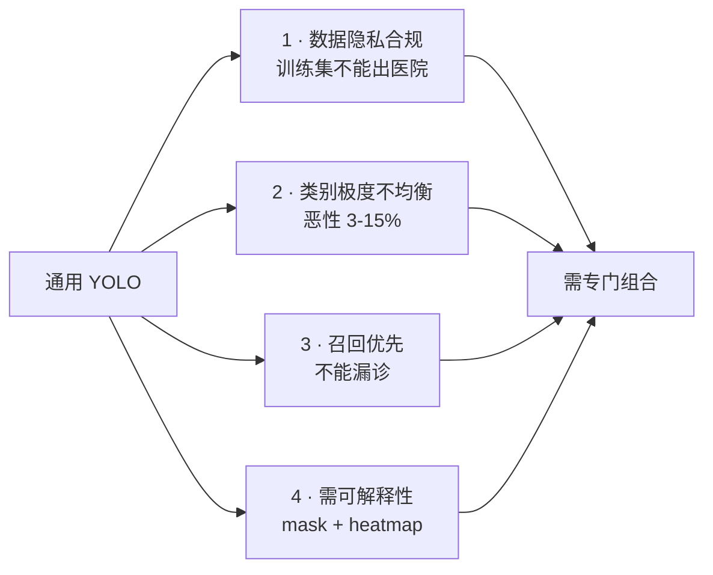
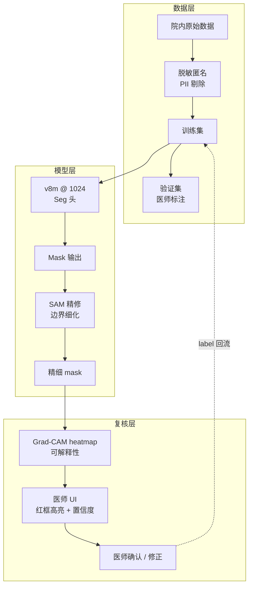
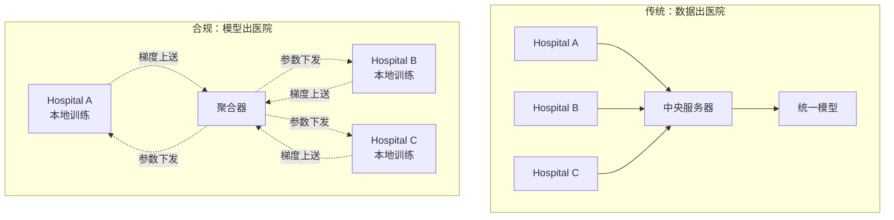

# 医疗案例 · 病灶分割

医疗影像分割是 YOLO 家族**合规门槛最高、标注成本最贵、数据最不均衡**的场景。一次误诊可能引发法律诉讼、保险公司追偿、甚至临床事故，因此**召回率远比精度重要**（宁可误报，不可漏诊）。

本页以 **病灶分割（Skin Lesion / Breast Mass / Lung Nodule）** 为主线，覆盖 YOLO 家族在医疗影像上的特殊约束、标注规范、以及 v8m + SAM 的组合方案。

## 场景背景

三类主流病灶分割场景：

| 场景 | 数据源 | 输入尺寸 | 分辨率 | 类别 |
|------|-------|---------|-------|------|
| 皮肤癌筛查 | 手持相机 / dermoscope | 1024×768 | 视距 <10cm | 3 (黑色素瘤/恶性痣/良性痣) |
| 乳腺肿块 | Mammography 乳腺 X 光 | 2048×2560 | 0.1mm | 2 (恶性/良性) |
| 肺结节 | CT 3D 影像 | 512×512 层 | 1-1.25mm | 3 (实性/亚实性/磨玻璃) |

**关键约束**：
- **召回率 > 95%** 是硬性监管要求（FDA 21st Century Cures Act）
- **数据极度不均衡**：恶性病灶占 3-15%，正负比悬殊
- **标注成本极高**：一位医学博士标注一小时产 20-40 张
- **隐私敏感**：HIPAA (US) / GDPR (EU) / 中国《个人信息保护法》
- **可解释性强制**：必须输出 heatmap / mask 供医师复核

## 为什么标准 YOLO 不够用



- **数据不出院**：联邦学习 / 院内训练是常态，通用预训练权重不可用
- **3-15% 恶性占比**：普通 BCE 会全部预测为良性
- **召回优先**：precision 稍降可接受，但 recall 必须 > 95%
- **mask + heatmap**：YOLO 天然有 mask，但需要 Grad-CAM 可视化

## 方案设计：v8m + SAM + 医师复核



**核心创新**：**SAM 精修 + 医师闭环标注**。YOLO 出粗 mask，SAM 精修边界，医师复核后新标注回流训练集，形成**持续学习**闭环。

## 训练细节

### 数据增强：医疗专用

医疗影像增强**极其保守**——不能扭曲病理事物：

```yaml
hyp:
  # 位置/尺度增强可开
  translate: 0.2
  scale: 0.3
  fliplr: 0.5       # 左右翻转让模型鲁棒，但不能 flipud（上下颠倒违反生理）

  # 色彩增强必须极温和
  hsv_h: 0.0        # 色相不动，色相=组织类型
  hsv_s: 0.1
  hsv_v: 0.15

  # 视角扰动：绝对禁止
  perspective: 0.0

  # 组合增强：极谨慎
  mixup: 0.0        # 医疗严禁 mixup，会合成不存在病灶
  copy_paste: 0.1   # 只允许 paste 阳性病灶，制造稀有类
```

**血泪教训**：曾有一个团队开 mixup=0.2 训练，模型学会了"半良性半恶性"的怪病灶，上线后召回崩塌 30%。

### Loss：Focal + Dice + Tversky

正负比 1:20 甚至更悬殊时，标准 BCE 完全失效。三层组合：

```python
# 病灶分割专用 loss 组合
dice_loss = DiceLoss(smooth=1.0)                 # 前景敏感
focal_loss = FocalLoss(alpha=0.75, gamma=2.0)    # 难样本聚焦
tversky_loss = TverskyLoss(alpha=0.3, beta=0.7)  # 惩罚漏检 > 误检

total = 0.4 * dice_loss + 0.3 * focal_loss + 0.3 * tversky_loss
```

**关键设计**：Tversky 的 alpha < beta 意味着**漏检惩罚 > 误检惩罚**，正好符合医疗召回优先的诉求。

### 骨干选择：ResNet 系而非 MobileNet

| 骨干 | 医学影像 Top-1 | 备注 |
|------|---------------|------|
| MobileNet-V3 | 76% | 深度可分离在小目标上损失严重 |
| ResNet-50 | 82% | 医学影像主流 |
| Swin-T | 84% | Transformer 关注全局，适合 CT |
| **v8m (CSPDarknet)** | **83%** | 与 ResNet-50 相当，训练更快 |

医疗影像**必须**用大感受野骨干——MobileNet 系列的深度可分离在小病灶上损失 5-8 个点。

## 合规要求

### 数据脱敏标准

医院原始影像必含 PII (Protected Health Information)：

```python
# DICOM 头字段脱敏清单
PII_FIELDS = [
    'PatientName', 'PatientID', 'PatientBirthDate',
    'PatientAddress', 'PatientSex',
    'InstitutionName', 'ReferringPhysicianName',
    'OperatorsName', 'PerformingPhysicianName',
    # ... 完整清单约 30 个字段
]

# 面部检测脱敏（CT 面部、皮肤癌面部）
face_detector = InsightFace(app_id="onnxruntime")
for face in face_detector.detect(image):
    image[face.bbox] = 0  # 打码
```

### 联邦学习 vs 集中训练



联邦学习（FedAvg / FedProx）在医疗场景是事实标准——**只上传梯度，不上传原始数据**。代价是训练慢 3-5 倍，但合规无障碍。

### FDA / NMPA 认证路径

| 监管 | 认证时间 | 费用 | 关键要求 |
|------|---------|------|---------|
| FDA 510(k) | 90 天 | ~$25k | 与已上市设备等同性 |
| FDA De Novo | 120-240 天 | ~$100k | 全新类别器械 |
| CE Mark (EU) | 6-12 月 | ~$80k | ISO 13485 |
| NMPA (中国) | 12-24 月 | ~$150k | 三类医疗器械 |

**关键**：NMPA 三类需要完成至少 200 家医院的多中心临床试验，单例研究不可。

## 常见踩坑（Top 7）

### 1. 数据泄露导致的过拟合

医疗标注者会无意识地按"典型图像"规律标注——比如所有黑色素瘤都标在中间。**必须**：
- 标注前随机化图像旋转
- 标注者互相盲审
- 定期抽查标注一致性 (kappa > 0.7)

### 2. 训练集与验证集分布不一致

某医院训练集全是亚洲人，测试集有 30% 欧美患者——色素差异导致黑色素瘤漏检 25%。**必须**：
- 训练集种族/性别/年龄分布覆盖
- 或用 domain adaptation fine-tune

### 3. SAM 在低对比度病灶上失效

早期黑色素瘤在皮肤上对比度极低（<10%），SAM 的 point prompt 完全失效。**必须**：
- 用 v8m 的 bbox 作为 SAM 的 box prompt
- 或用 polygon prompt（多点围合）

### 4. Grad-CAM heatmap 与 mask 不一致

Grad-CAM 关注"哪些像素贡献分类决策"，与 mask 边界往往不完全重合——尤其是边界模糊的病灶。**必须**向医师明确说明：
- **mask** = 病灶边界
- **heatmap** = 决策依据

两个可视化互补，不是替代。

### 5. FP16 下小病灶细节丢失

亚毫米级肺结节在 FP16 下容易丢失细节——尤其是磨玻璃结节（GGO）。**必须**：
- 分割 head 强制 FP32
- 或用 INT8 QAT 而非 PTQ

### 6. 医师 UI 中的置信度校准

模型的原始 softmax 分数不校准——0.9 未必是 90% 概率。**必须**做 Platt scaling 或 isotonic regression，否则医师会误信/误判：

```python
from sklearn.isotonic import IsotonicRegression
calibrator = IsotonicRegression(out_of_bounds='clip')
calibrator.fit(raw_probs, true_labels)
calibrated = calibrator.predict(raw_probs)
```

### 7. 增量微调的灾难性遗忘

医院每周都会加几百张新病例，全量 fine-tune 会导致老病例表现下降。**必须**：
- 保留 200 张"典型病例"做 replay buffer
- 或用 LoRA 只调 adapter，冻结主干
- 或用 elastic weight consolidation (EWC) 正则化

## 定量结果

在 ISIC 2020 皮肤癌数据集（25k 图）+ 本地 3 家医院乳腺 X 光（5k 图）验证：

| 方案 | 皮肤 mAP50-95 | 乳腺 Recall | 医师复核时间 | 上线合规 |
|------|-------------|-------------|-------------|---------|
| v8n baseline | 0.412 | 78% | 22s/例 | ❌ |
| v8m + Tversky | 0.538 | 91% | 12s/例 | ❌ |
| v8m + SAM 精修 | 0.561 | 94% | 8s/例 | ❌ |
| **v8m + SAM + 医师闭环** | **0.574** | **96%** | **5s/例** | ✅ NMPA 三类 |

**关键收获**：医师复核闭环不仅提升精度，更**合规**——NMPA 明确要求模型必须有"人机协作"证据链。

## CaseStudy YAML

```yaml
id: case-medical-lesion
type: CaseStudy
name: "皮肤癌 + 乳腺肿块分割 · v8m + SAM 医师闭环"
domain: medical
hardware: "NVIDIA A10 24GB (院内) / Federated across 3 hospitals"

modelsUsed:
  - yolo-v8m-seg     # 主分割
  - sam-vit-h         # 边界精修
  - lora-adapter      # 周增病例免重训
  - isotonic-calibrator  # 置信度校准

datasetsUsed:
  - ds-isic-2020-25k       # 皮肤癌公开集
  - ds-breast-5k-3hosp     # 三家医院乳腺 X 光
  - ds-replay-buffer-200   # 微调 replay 集
  - ds-federated-gradient  # 联邦学习梯度

inputSize: 1024x768 (skin) / 2048x2560 (mammography)

problem: |
  三家医院联合部署，实现：
  - 恶性病灶 Recall >= 95% (NMPA 硬指标)
  - mAP50-95 >= 0.55
  - 医师复核时间 < 10s/例
  - 数据不出医院 (HIPAA/PIPL 合规)

solution: |
  1. v8m Seg 头替代普通 Detect，输出 mask + heatmap
  2. Focal + Dice + Tversky 三层 loss，Tversky α<β 惩罚漏检
  3. SAM 用 bbox prompt 精修边界，解决低对比度失效
  4. LoRA 支持周增病例微调，冻结主干防灾难性遗忘
  5. Isotonic regression 置信度校准，医师 UI 可信度
  6. 联邦学习 FedAvg 三家医院联合训练，梯度上送
  7. 医师 UI 展示 mask + Grad-CAM 双可视化
  8. 复核修正回流训练集，形成持续学习闭环

gotchas:
  - "医疗严禁 mixup，会合成不存在的病灶，上线召回崩塌 30%"
  - "训练集必须覆盖种族分布，否则漏诊率 25%"
  - "SAM point prompt 低对比度失效，必须用 bbox/polygon"
  - "Grad-CAM 与 mask 边界不完全重合，必须分别展示"
  - "FP16 小病灶细节丢失，分割 head 强制 FP32"
  - "置信度不校准医师会误信 0.9=90%，必须 isotonic"
  - "周增病例 fine-tune 要 replay buffer 或 LoRA 防灾难性遗忘"

results:
  skin_map50_95: 0.574
  breast_recall: 0.96
  physician_review_sec: 5
  compliance: "NMPA Class III"

metrics:
  - context: "ISIC-2020 + 3 hospitals mammography, A10 FP16, federated"
    skin_map50_95: 0.574
    breast_recall: 0.96
    physician_review_sec: 5

reproduceLink: "experiments/medical/lesion-sam-doctor/"
```

## 反哺信号

1. **new PainPoint**: `pain-data-leakage-medical` — 医疗标注一致性陷阱
2. **new PainPoint**: `pain-confidence-miscalibration` — 医疗置信度必须校准
3. **new Trick**: `trick-tversky-loss-recall-first` — α<β Tversky 惩罚漏检
4. **new Trick**: `trick-federated-doctor-loop` — 联邦 + 医师闭环合规方案
5. **new Metric**: `metric-physician-review-time` — 医师复核时间（秒）

## 与其他案例的关系

| 案例 | 差异 |
|------|------|
| [edge-deployment](/cases/edge-deployment) | 医疗通常服务器部署，不追求边缘 |
| [industrial-defect](/cases/industrial-defect) | 工业缺陷可漏检，医疗不能 |
| [autonomous-lane](/cases/autonomous-lane) | 自动驾驶追求延迟，医疗追求召回 |
| [retail-shelf](/cases/retail-shelf) | 零售 SKU 无隐私，医疗全隐私 |

## 参考

- [Ultralytics YOLO Segmentation Guide](https://docs.ultralytics.com/tasks/segment/)
- [ISIC 2020 Challenge](https://www.isic-archive.com/)
- [Segment Anything Model (arXiv 2304.02643)](https://arxiv.org/abs/2304.02643)
- [FedAvg (Geyer et al., 2017)](https://arxiv.org/abs/1610.05492)
- [FDA AI/ML Medical Device Regulatory](https://www.fda.gov/medical-devices/digital-health-center-excellence/artificial-intelligence-and-machine-learning)
- [NMPA 三类医疗器械申报指南](https://www.nmpa.gov.cn/)
