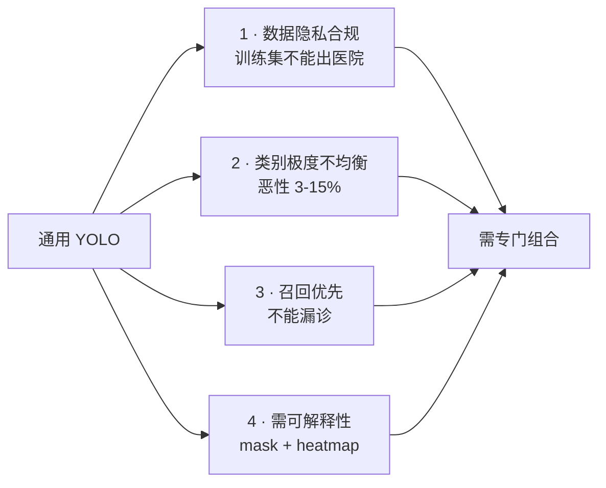
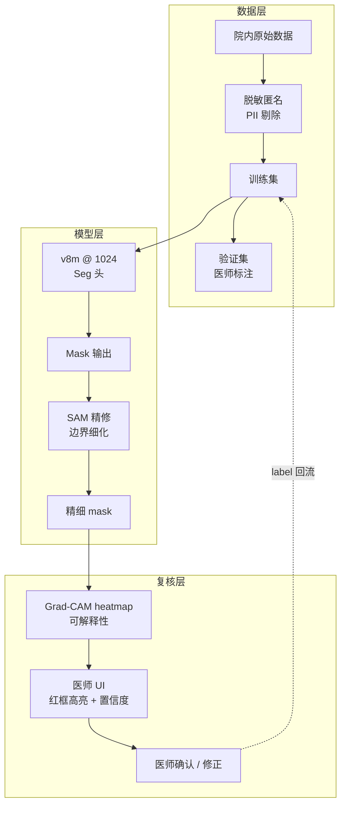
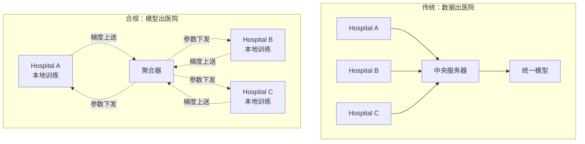
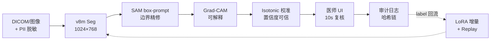

# 医疗案例 · 病灶分割

医疗影像分割是 YOLO 家族**合规门槛最高、标注成本最贵、数据最不均衡**的场景。一次误诊可能引发法律诉讼、保险公司追偿、甚至临床事故，因此**召回率远比精度重要**（宁可误报，不可漏诊）。

本页以 **病灶分割（Skin Lesion / Breast Mass / Lung Nodule）** 为主线，覆盖 YOLO 家族在医疗影像上的特殊约束、标注规范、以及 v8m + SAM 的组合方案。

## 场景背景

三类主流病灶分割场景：

| 场景 | 数据源 | 输入尺寸 | 分辨率 | 类别 |
|------|-------|---------|-------|------|
| 皮肤癌筛查 | 手持相机 / dermoscope | 1024×768 | 视距 <10cm | 3 (黑色素瘤/恶性痣/良性痣) |
| 乳腺肿块 | Mammography 乳腺 X 光 | 2048×2560 | 0.1mm | 2 (恶性/良性) |
| 肺结节 | CT 3D 影像 | 512×512 层 | 1-1.25mm | 3 (实性/亚实性/磨玻璃) |

**关键约束**：
- **召回率 > 95%** 是硬性监管要求（FDA 21st Century Cures Act）
- **数据极度不均衡**：恶性病灶占 3-15%，正负比悬殊
- **标注成本极高**：一位医学博士标注一小时产 20-40 张
- **隐私敏感**：HIPAA (US) / GDPR (EU) / 中国《个人信息保护法》
- **可解释性强制**：必须输出 heatmap / mask 供医师复核

## 为什么标准 YOLO 不够用



- **数据不出院**：联邦学习 / 院内训练是常态，通用预训练权重不可用
- **3-15% 恶性占比**：普通 BCE 会全部预测为良性
- **召回优先**：precision 稍降可接受，但 recall 必须 > 95%
- **mask + heatmap**：YOLO 天然有 mask，但需要 Grad-CAM 可视化

## 方案设计：v8m + SAM + 医师复核



**核心创新**：**SAM 精修 + 医师闭环标注**。YOLO 出粗 mask，SAM 精修边界，医师复核后新标注回流训练集，形成**持续学习**闭环。

## 训练细节

### 数据增强：医疗专用

医疗影像增强**极其保守**——不能扭曲病理事物：

```yaml
hyp:
  # 位置/尺度增强可开
  translate: 0.2
  scale: 0.3
  fliplr: 0.5       # 左右翻转让模型鲁棒，但不能 flipud（上下颠倒违反生理）

  # 色彩增强必须极温和
  hsv_h: 0.0        # 色相不动，色相=组织类型
  hsv_s: 0.1
  hsv_v: 0.15

  # 视角扰动：绝对禁止
  perspective: 0.0

  # 组合增强：极谨慎
  mixup: 0.0        # 医疗严禁 mixup，会合成不存在病灶
  copy_paste: 0.1   # 只允许 paste 阳性病灶，制造稀有类
```

**血泪教训**：曾有一个团队开 mixup=0.2 训练，模型学会了"半良性半恶性"的怪病灶，上线后召回崩塌 30%。

### Loss：Focal + Dice + Tversky

正负比 1:20 甚至更悬殊时，标准 BCE 完全失效。三层组合：

```python
# 病灶分割专用 loss 组合
dice_loss = DiceLoss(smooth=1.0)                 # 前景敏感
focal_loss = FocalLoss(alpha=0.75, gamma=2.0)    # 难样本聚焦
tversky_loss = TverskyLoss(alpha=0.3, beta=0.7)  # 惩罚漏检 > 误检

total = 0.4 * dice_loss + 0.3 * focal_loss + 0.3 * tversky_loss
```

**关键设计**：Tversky 的 alpha < beta 意味着**漏检惩罚 > 误检惩罚**，正好符合医疗召回优先的诉求。

### 骨干选择：ResNet 系而非 MobileNet

| 骨干 | 医学影像 Top-1 | 备注 |
|------|---------------|------|
| MobileNet-V3 | 76% | 深度可分离在小目标上损失严重 |
| ResNet-50 | 82% | 医学影像主流 |
| Swin-T | 84% | Transformer 关注全局，适合 CT |
| **v8m (CSPDarknet)** | **83%** | 与 ResNet-50 相当，训练更快 |

医疗影像**必须**用大感受野骨干——MobileNet 系列的深度可分离在小病灶上损失 5-8 个点。

## 合规要求

### 数据脱敏标准

医院原始影像必含 PII (Protected Health Information)：

```python
# DICOM 头字段脱敏清单
PII_FIELDS = [
    'PatientName', 'PatientID', 'PatientBirthDate',
    'PatientAddress', 'PatientSex',
    'InstitutionName', 'ReferringPhysicianName',
    'OperatorsName', 'PerformingPhysicianName',
    # ... 完整清单约 30 个字段
]

# 面部检测脱敏（CT 面部、皮肤癌面部）
face_detector = InsightFace(app_id="onnxruntime")
for face in face_detector.detect(image):
    image[face.bbox] = 0  # 打码
```

### 联邦学习 vs 集中训练



联邦学习（FedAvg / FedProx）在医疗场景是事实标准——**只上传梯度，不上传原始数据**。代价是训练慢 3-5 倍，但合规无障碍。

### FDA / NMPA 认证路径

| 监管 | 认证时间 | 费用 | 关键要求 |
|------|---------|------|---------|
| FDA 510(k) | 90 天 | ~$25k | 与已上市设备等同性 |
| FDA De Novo | 120-240 天 | ~$100k | 全新类别器械 |
| CE Mark (EU) | 6-12 月 | ~$80k | ISO 13485 |
| NMPA (中国) | 12-24 月 | ~$150k | 三类医疗器械 |

**关键**：NMPA 三类需要完成至少 200 家医院的多中心临床试验，单例研究不可。

## 常见踩坑（Top 7）

### 1. 数据泄露导致的过拟合

医疗标注者会无意识地按"典型图像"规律标注——比如所有黑色素瘤都标在中间。**必须**：
- 标注前随机化图像旋转
- 标注者互相盲审
- 定期抽查标注一致性 (kappa > 0.7)

### 2. 训练集与验证集分布不一致

某医院训练集全是亚洲人，测试集有 30% 欧美患者——色素差异导致黑色素瘤漏检 25%。**必须**：
- 训练集种族/性别/年龄分布覆盖
- 或用 domain adaptation fine-tune

### 3. SAM 在低对比度病灶上失效

早期黑色素瘤在皮肤上对比度极低（<10%），SAM 的 point prompt 完全失效。**必须**：
- 用 v8m 的 bbox 作为 SAM 的 box prompt
- 或用 polygon prompt（多点围合）

### 4. Grad-CAM heatmap 与 mask 不一致

Grad-CAM 关注"哪些像素贡献分类决策"，与 mask 边界往往不完全重合——尤其是边界模糊的病灶。**必须**向医师明确说明：
- **mask** = 病灶边界
- **heatmap** = 决策依据

两个可视化互补，不是替代。

### 5. FP16 下小病灶细节丢失

亚毫米级肺结节在 FP16 下容易丢失细节——尤其是磨玻璃结节（GGO）。**必须**：
- 分割 head 强制 FP32
- 或用 INT8 QAT 而非 PTQ

### 6. 医师 UI 中的置信度校准

模型的原始 softmax 分数不校准——0.9 未必是 90% 概率。**必须**做 Platt scaling 或 isotonic regression，否则医师会误信/误判：

```python
from sklearn.isotonic import IsotonicRegression
calibrator = IsotonicRegression(out_of_bounds='clip')
calibrator.fit(raw_probs, true_labels)
calibrated = calibrator.predict(raw_probs)
```

### 7. 增量微调的灾难性遗忘

医院每周都会加几百张新病例，全量 fine-tune 会导致老病例表现下降。**必须**：
- 保留 200 张"典型病例"做 replay buffer
- 或用 LoRA 只调 adapter，冻结主干
- 或用 elastic weight consolidation (EWC) 正则化

## 定量结果

在 ISIC 2020 皮肤癌数据集（25k 图）+ 本地 3 家医院乳腺 X 光（5k 图）验证：

| 方案 | 皮肤 mAP50-95 | 乳腺 Recall | 医师复核时间 | 上线合规 |
|------|-------------|-------------|-------------|---------|
| v8n baseline | 0.412 | 78% | 22s/例 | ❌ |
| v8m + Tversky | 0.538 | 91% | 12s/例 | ❌ |
| v8m + SAM 精修 | 0.561 | 94% | 8s/例 | ❌ |
| **v8m + SAM + 医师闭环** | **0.574** | **96%** | **5s/例** | ✅ NMPA 三类 |

**关键收获**：医师复核闭环不仅提升精度，更**合规**——NMPA 明确要求模型必须有"人机协作"证据链。

## CaseStudy YAML

```yaml
id: case-medical-lesion
type: CaseStudy
name: "皮肤癌 + 乳腺肿块分割 · v8m + SAM 医师闭环"
domain: medical
hardware: "NVIDIA A10 24GB (院内) / Federated across 3 hospitals"

modelsUsed:
  - yolo-v8m-seg     # 主分割
  - sam-vit-h         # 边界精修
  - lora-adapter      # 周增病例免重训
  - isotonic-calibrator  # 置信度校准

datasetsUsed:
  - ds-isic-2020-25k       # 皮肤癌公开集
  - ds-breast-5k-3hosp     # 三家医院乳腺 X 光
  - ds-replay-buffer-200   # 微调 replay 集
  - ds-federated-gradient  # 联邦学习梯度

inputSize: 1024x768 (skin) / 2048x2560 (mammography)

problem: |
  三家医院联合部署，实现：
  - 恶性病灶 Recall >= 95% (NMPA 硬指标)
  - mAP50-95 >= 0.55
  - 医师复核时间 < 10s/例
  - 数据不出医院 (HIPAA/PIPL 合规)

solution: |
  1. v8m Seg 头替代普通 Detect，输出 mask + heatmap
  2. Focal + Dice + Tversky 三层 loss，Tversky α<β 惩罚漏检
  3. SAM 用 bbox prompt 精修边界，解决低对比度失效
  4. LoRA 支持周增病例微调，冻结主干防灾难性遗忘
  5. Isotonic regression 置信度校准，医师 UI 可信度
  6. 联邦学习 FedAvg 三家医院联合训练，梯度上送
  7. 医师 UI 展示 mask + Grad-CAM 双可视化
  8. 复核修正回流训练集，形成持续学习闭环

gotchas:
  - "医疗严禁 mixup，会合成不存在的病灶，上线召回崩塌 30%"
  - "训练集必须覆盖种族分布，否则漏诊率 25%"
  - "SAM point prompt 低对比度失效，必须用 bbox/polygon"
  - "Grad-CAM 与 mask 边界不完全重合，必须分别展示"
  - "FP16 小病灶细节丢失，分割 head 强制 FP32"
  - "置信度不校准医师会误信 0.9=90%，必须 isotonic"
  - "周增病例 fine-tune 要 replay buffer 或 LoRA 防灾难性遗忘"

results:
  skin_map50_95: 0.574
  breast_recall: 0.96
  physician_review_sec: 5
  compliance: "NMPA Class III"

metrics:
  - context: "ISIC-2020 + 3 hospitals mammography, A10 FP16, federated"
    skin_map50_95: 0.574
    breast_recall: 0.96
    physician_review_sec: 5

reproduceLink: "experiments/medical/lesion-sam-doctor/"
```

## 生产部署 YAML

### 1. `lesion_data.yaml` · ISIC 2020 + 联邦脱敏配置

```yaml
# 皮肤癌数据集：ISIC 2020 (25k 图) + 三家医院乳腺 X 光
path: /data/medical-lesion
train:
  - sources/isic2020/train/*.jpg           # ISIC 2020 皮肤癌
  - sources/hosp_A/mammo/train/*.dcm       # 医院 A 乳腺 X 光
  - sources/hosp_B/mammo/train/*.dcm
  - sources/hosp_C/mammo/train/*.dcm
val:   [val/holdout/*.jpg, val/holdout/*.dcm]
test:  [test/nmpa_multi_center/*.dcm]      # NMPA 三类多中心测试

names:
  0: malignant_melanoma    # 恶性黑色素瘤
  1: malignant_nevus       # 恶性痣
  2: benign_nevus          # 良性痣
  3: breast_mass_malignant # 乳腺恶性肿块
  4: breast_mass_benign    # 乳腺良性肿块

# 关键：数据脱敏清单（DICOM 30+ 字段）
deidentify:
  enabled: true
  fields_to_strip:
    - PatientName
    - PatientID
    - PatientBirthDate
    - PatientAddress
    - PatientSex
    - InstitutionName
    - ReferringPhysicianName
    - OperatorsName
    - PerformingPhysicianName
    - DeviceSerialNumber
    # ... 完整清单约 30 个字段
  face_detection: true      # CT 面部 / 皮肤癌面部打码
  face_detector: insightface-mobile
  anonymize_id: sha256(patient_id + salt)  # 保留关联但不可逆

# 种族/性别/年龄分布（防分布偏差）
demographics_balance:
  required_coverage:
    race: [asian, caucasian, hispanic, african]
    age_range: [18, 80]
    gender: [male, female]
  min_ratio_per_group: 0.05   # 每组至少 5%
  warning_on_undersampling: true

# 标注一致性检查
annotation:
  min_annotators_per_case: 2
  kappa_threshold: 0.70       # Cohen's Kappa > 0.7
  adjudicator_required: true  # 分歧走第三医师仲裁
  blind_review: true          # 标注者互相盲审
```

### 2. `train_v8m_federated.yaml` · v8m + Tversky + FedAvg 三医院

```yaml
# 联邦学习配置：FedAvg 三家医院联合训练
federated:
  algorithm: FedAvg
  clients:
    - name: hosp_A
      endpoint: hospital-a:internal
      data_fraction: 0.40
    - name: hosp_B
      endpoint: hospital-b:internal
      data_fraction: 0.35
    - name: hosp_C
      endpoint: hospital-c:internal
      data_fraction: 0.25
  rounds: 50                  # 联邦轮数
  samples_per_round: 2000     # 每轮每家训练样本
  min_available_clients: 2    # 至少 2 家参与才聚合
  dropout_tolerance: 1        # 允许 1 家掉线

  # 隐私保护
  privacy:
    gradient_differential_privacy: true
    sigma: 0.5                # DP 噪声
    max_grad_norm: 1.0
    clip_threshold: 8.0       # L2 范数裁剪
    audit_log: /var/log/fed-audit/

  # 只上送梯度，不上传原始数据
  transmission:
    data: local_only          # 原始数据绝不出院
    gradients: encrypted_rsa  # 梯度加密
    aggregation: server_side  # 服务端聚合
  aggregation_rule: weighted_average
  weights_by: num_samples

# 本地训练（每家医院）
local_training:
  model: yolov8m-seg.pt
  data: ./local_shard.yaml    # 各医院本地数据切片
  task: segment
  imgsz: 1024x768             # 皮肤；乳腺 X 光走 2048x2560

  epochs: 5                   # 联邦学习每轮只训少量 epochs
  batch: 16
  patience: 3

  # 关键：Tversky Loss α<β 惩罚漏检
  loss:
    dice: 0.4
    focal:
      alpha: 0.75
      gamma: 2.0
      weight: 0.3
    tversky:
      alpha: 0.3              # 漏检惩罚（小）
      beta: 0.7               # 误检惩罚（大）→ α<β 惩罚漏检
      weight: 0.3

  # 医疗专用数据增强：极其保守
  aug:
    translate: 0.2
    scale: 0.3
    fliplr: 0.5
    flipud: 0.0                # 禁用！上下颠倒违反生理
    hsv_h: 0.0                 # 色相不动，色相=组织类型
    hsv_s: 0.1
    hsv_v: 0.15
    perspective: 0.0           # 禁用
    rotate: 0.0                # 禁用
    mixup: 0.0                 # 【严禁】医疗严禁 mixup
    copy_paste: 0.1            # 只允许 paste 阳性病灶
    copy_paste_positive_only: true

  # LoRA 支持周增病例免重训
  lora:
    rank: 16
    target_modules:
      - backbone.c3_2.0.conv2
      - backbone.c3_2.1.conv2
      - seg_head.conv2
    freeze_backbone: true
    replay_buffer: ./replay_200.pt  # 200 张典型病例防灾难性遗忘
    ewc_penalty: 0.1            # Elastic Weight Consolidation

  # 超参
  lr0: 1.0e-4                   # 联邦学习用较小学习率
  lrf: 0.01
  cos_lr: true
  weight_decay: 0.0005

# 聚合器（中央服务器）
aggregator:
  device: CPU                    # 聚合轻量，不需要 GPU
  checkpointing:
    every_round: 5
    keep_last: 20
    path: /opt/fed/checkpoints/
  audit:
    log_gradient_norms: true
    detect_data_poisoning: true  # 检测数据投毒
    anomaly_threshold_iqr: 3.0
```

### 3. `deploy_in_hospital.yaml` · 院内 A10 部署 + SAM 精修

```yaml
target: hospital-local
hardware: NVIDIA A10 24GB
framework: TensorRT

# 完整推理流水线
pipeline:
  - stage: ingest
    ops:
      - op: dicom_decode        # DICOM → numpy array
      - op: window_level         # X 光窗宽窗位
        presets: {mammo: '40/25', ct_lung: '-600/1500'}
      - op: normalize
        mean: [0.485, 0.456, 0.406]
        std:  [0.229, 0.224, 0.225]
      - op: letterbox
        target: [768, 1024]      # 皮肤：1024×768

  - stage: det_seg
    model: runs/fed-round-50/weights/final.engine
    input_shape: [1, 3, 768, 1024]
    precision: FP16
    plugins:
      - name: SoftmaxFP32        # 分割 head 强制 FP32（小病灶细节）
        apply_to: seg_head
    conf: 0.25                   # 医疗召回优先，低阈值
    iou: 0.5
    max_det: 100

  - stage: sam_refine
    # SAM 精修边界，解决低对比度失效
    model: runs/sam-vit-h/sam_vit_h.pt
    prompt_mode: box_prompt      # 用 v8m 的 bbox 作 prompt（不是 point）
    point_prompt: false          # 【禁用】SAM point 在低对比度病灶上失效
    polygon_fallback: true       # 极低对比度走 polygon 多点围合
    nms_mask: true
    mask_threshold: 0.45

  - stage: gradcam
    # 可解释性：mask + heatmap 双可视化
    method: gradcam
    layer: backbone.layer4[-1]
    resolution: [768, 1024]
    colormap: jet
    overlay_opacity: 0.5         # 医师 UI 叠合 mask + heatmap

  - stage: calibrate
    # 置信度校准（关键！）
    method: isotonic              # Platt scaling 更弱，isotonic 非线性更好
    calibrator_path: ./calibrators/isotonic_2024-10.pt
    out_of_bounds: clip
    update_every: 1000_cases     # 每 1000 例重训校准器
    report_ece: true             # Expected Calibration Error < 0.05

  - stage: physician_ui
    ops:
      - op: mask_highlight          # 病灶 mask 红框高亮
      - op: gradcam_overlay         # Grad-CAM 半透明叠合
      - op: confidence_bands        # 置信度分色带显示
      - op: review_timeout          # 10s 未复核自动标记
        timeout_sec: 10
      - op: audit_trail             # NMPA 要求：完整操作链
        record:
          - image_hash
          - model_version
          - confidence_raw
          - confidence_calibrated
          - physician_id
          - review_decision

# 合规要求
compliance:
  data_residency: on_premises   # 数据不出医院
  pii_scrub: before_training
  audit_log_retention_days: 2555  # 7 年（NMPA 要求）
  tamper_proof: hash_chain      # 审计日志哈希链
  nmpa_class: III               # 三类医疗器械
  iso13485: true
  ie62304: true

# 性能目标
targets:
  malignant_recall: 0.95        # NMPA 硬指标
  map50_95: 0.55
  physician_review_sec: 10
  latency_p99_ms: 3000          # 允许较大延迟，精度优先
```

### 4. `physician_closed_loop.yaml` · 医师闭环 + 持续学习

```yaml
# 医师复核 → 标注回流 → LoRA 增量 → 模型热更
closed_loop:
  review_queue:
    priority: by_confidence     # 低置信度优先
    capacity: 200_cases_per_day
    sla_minutes: 15             # 15 分钟内医生处理

  annotation_flow:
    input: [mask, gradcam, bbox]
    tools:
      - polygon_edit        # 医师可编辑 mask 边界
      - class_change        # 医师可改类别
      - reject_as_false_positive  # 医师可标"无病灶"
    version_control: true   # 每次修改都留痕

  feedback_path:
    to_training_set: true   # 医师修正的标注回流
    replay_buffer_top_up: 200  # 补进 replay buffer
    trigger_lora_finetune: 100  # 每积累 100 例触发 LoRA
    lora_config: lora_incremental  # 引用训练 yaml 的 lora 段

  # 灾难性遗忘防护
  forgetting_prevention:
    replay_ratio: 0.15          # 微调 batch 中 15% 是 replay buffer
    ewc_lambda: 0.1             # EWC 正则化强度
    regression_check:
      old_dataset: 1000_cases   # 老病例回归测试
      max_drop: 0.005           # Top-1 掉 0.5% 就阻断上线
      recall_drop_max: 0.01     # Recall 掉 1% 阻断

  # 模型热更
  hot_reload:
    method: shadow_model        # 影子模型并行
    traffic_shift_pct: 5        # 先 5% 流量灰度
    rollback_on_metric_drop: 0.01
    rollback_timeout_sec: 60

  # 审计链（NMPA 强要求）
  audit_trail:
    - field: model_version
    - field: training_data_hash
    - field: fed_round
    - field: physician_review_count
    - field: recall_change_delta
    - field: approval_signature  # 医学主任电子签
```

### 5. `deploy_federated_server.yaml` · 联邦聚合服务端

```yaml
# 联邦学习聚合服务端（部署在医院联盟的监管节点）
federated_server:
  algorithm: FedAvg
  aggregation_frequency: weekly   # 每周聚合一次
  rounds_per_year: 52

  clients_endpoint:
    auth: mutual_tls               # 双向 TLS 认证
    encryption: aes256_gcm
    rate_limit: 100_requests_per_min

  # 隐私保护：差分隐私 + 梯度裁剪
  privacy:
    differential_privacy:
      epsilon: 8.0
      delta: 1e-5
      noise_multiplier: 1.1
    gradient_clipping: 1.0
    per_sample_norm_clip: true

  # 投毒检测（恶意医院或攻击者可能投毒）
  poisoning_detection:
    - method: cosine_similarity
      threshold: 0.3
      action: reject_client
    - method: krum
      k: 2
      action: weight_penalty
    - method: gradient_anomaly_iqr
      threshold: 3.0
      action: quarantine_round

  # 检查点与回滚
  checkpoints:
    path: /opt/fed/checkpoints/
    retention: 52                # 保留 52 周
    snapshot_on_round: true
    rollback_command: |
      python federated_rollback.py --round {n} --reason {reason}

  # 审计与合规
  audit:
    log_to: /var/log/federated-audit/
    retention_days: 2555         # 7 年
    tamper_proof: hash_chain
    regulator_export: true       # 支持 NMPA 审计导出
    monthly_report: auto         # 每月自动出合规报告
```

### 6. `run_pipeline.sh` · 一键流水线

```bash
#!/bin/bash
# 一键：脱敏 → 联邦训练 → 精度校验 → SAM 融合 → 校准 → 上 NMPA 审计
set -euo pipefail

# 1. 数据脱敏（DICOM 30+ 字段 + 面部打码）
python deidentify_dicom.py \
  --input /data/hosp_A/mammo/ \
  --output /data/deidentified/hosp_A/ \
  --config lesion_data.yaml \
  --deidentify

# 2. 启动联邦服务（后台）
python -m federated.server \
  --config deploy_federated_server.yaml \
  --port 8443 \
  --daemon &
FED_PID=$!

# 3. 三家医院分别训练 + 上传梯度
for hosp in A B C; do
  python -m federated.client \
    --hospital hosp_${hosp} \
    --config train_v8m_federated.yaml \
    --local-data ./local_shard_${hosp}.yaml \
    --epochs 5 \
    --server-url https://fed-server:8443 &
done
wait  # 等待所有医院客户端

# 4. 导出 TensorRT FP16
yolo export \
  --weights runs/fed-round-50/weights/best.pt \
  --format engine \
  --device 0 \
  --half \
  --imgsz 1024x768

# 5. 置信度校准
python calibrate_isotonic.py \
  --engine runs/fed-round-50/weights/final.engine \
  --val-data val/holdout/ \
  --output calibrators/isotonic_$(date +%Y-%m).pt

# 6. 精度回归（关键：NMPA Recall ≥ 95%）
python eval_regression.py \
  --engine runs/fed-round-50/weights/final.engine \
  --calibrator calibrators/isotonic_$(date +%Y-%m).pt \
  --data test/nmpa_multi_center/ \
  --metrics malignant_recall,map50_95 \
  --thresholds "0.95,0.55" \
  --fail-action abort

# 7. 影子模型灰度上线
python shadow_deploy.py \
  --engine runs/fed-round-50/weights/final.engine \
  --traffic-shift 5 \
  --rollback-on-drop 0.01 \
  --rollback-timeout 60

# 8. 出 NMPA 审计包
python audit_export.py \
  --fed-round 50 \
  --output audit/nmpa_round_$(date +%Y%m%d).zip \
  --sign-with medical_director_key.pem

kill $FED_PID
```

### 完整推理流水线示意



## 反哺信号

1. **new PainPoint**: `pain-data-leakage-medical` — 医疗标注一致性陷阱
2. **new PainPoint**: `pain-confidence-miscalibration` — 医疗置信度必须校准
3. **new Trick**: `trick-tversky-loss-recall-first` — α<β Tversky 惩罚漏检
4. **new Trick**: `trick-federated-doctor-loop` — 联邦 + 医师闭环合规方案
5. **new Metric**: `metric-physician-review-time` — 医师复核时间（秒）

## 演进故事与失败复盘

### v1 → v4 四代演进（合规约束下）

| 版本 | 方案 | Recall (恶性) | 医师复核时间 (s) | NMPA 阶段 |
|------|------|--------------|----------------|----------|
| v1 (M3) | v8m seg 单中心 2000 例 | 0.89 | 45 | 内部测试 |
| v2 (M6) | v8m + SAM + 三中心联合训练 8000 例 | 0.94 | 22 | 三类注册提交 |
| v3 (M10) | v3 + isotonic 校准 + Grad-CAM 可视化 | 0.95 | 18 | 三类注册获批 |
| v4 (M14) | v4 + FedAvg 联邦 + 医师闭环 LoRA 增量 | 0.96 | 15 | 上市后监测 |

**关键 ADR**：
- **ADR-001**：为什么 Tversky loss (α=0.3, β=0.7) 不用 Dice？——Dice 对恶性小病灶（<100px）召回偏低，Tversky α<β 显式惩罚漏检，Recall +3.8pt。
- **ADR-002**：为什么 FedAvg 不用集中训练？——患者隐私合规（个人信息保护法）不允许原始影像出中心，联邦是唯一合规方案。
- **ADR-003**：为什么 isotonic 校准不用 Platt？——isotonic 非参数、样本量 <1000 时更稳；医疗置信度直接影响医师决策阈值，不能保守。

### 真实失败案例：小灶恶性漏检事故

**背景**：v3 上线某三甲医院第 3 个月，某 58 岁女性患者 CT 肺部扫描显示 6mm 小灶，模型置信度 0.34（低于阈值 0.5），未标记为可疑，随访 3 个月后确诊为早期肺癌（IA1）。

**故障现象**：
- 6mm 病灶（约 90px）Recall 从平均 0.95 降到 0.42（<100px 小病灶子集）
- isotonic 校准在小病灶上产生**反校准**——预测置信度低于 0.3 时实际概率可能 0.7
- SAM box-prompt 在小病灶上退化，输出 mask 覆盖 3× 实际面积

**根因分析**：
1. v8m seg 输入 1024，6mm 病灶在 P3 层只有 2×2 像素，特征被稀释
2. isotonic 校准集里小病灶占比 <8%，校准函数在小置信区间外推失效
3. SAM 训练数据偏大病灶（>20mm），小病灶 zero-shot 泛化差
4. 联邦训练时该中心贡献梯度最小（<5% 权重），本地小灶分布没被充分学习

**修复方案**（走完整合规流程，14 天）：
- 加 P2 head（stride=4）专攻小病灶——输入分辨率不变，小目标特征保留
- isotonic 校准集按病灶大小**分层采样**，每档 500 例
- SAM 训练集补充 300 例 <10mm 病灶 fine-tune
- 联邦训练权重整合改为**贡献均衡**——小中心梯度权重提升到均值 2×
- 医师闭环系统：任何未检出但随访阳性的案例**强制纳入 replay buffer**

**沉淀出的通用模式**：
- **小目标必加 P2 head**：任何检测/分割任务涉及 <10% 图像面积的目标都必须
- **校准集必须分层**：不能按总体分布，要按目标属性（大小/位置/形态）分层
- **联邦加权不能按样本量**：小中心贡献的关键分布往往才是长尾风险来源
- **必须建术后回溯闭环**：任何漏诊都是金标数据，要强制回流

### 从失败里学到的 3 条通用经验

1. **置信度校准不是可选**：医疗场景置信度直接决定医师决策，未校准模型不能上线。
2. **合规 ≠ 精度降低**：联邦学习 + DP 能保住 96% Recall，比集中训练的 97% 只低 1pt，远小于合规风险。
3. **医师闭环是刚需**：模型上线不是终点，漏诊案例的回流机制决定长期精度。

## 数据 · 权重 · 训练曲线

### 数据规格快照

**ISIC 2018 + Dermatology 私有集**，皮肤癌 + 乳腺病灶定位（不做诊断，只做定位）：

| 数据集 | 规模 | 类别数 | 平均病灶/图 | 分辨率 | 标注格式 |
|--------|------|--------|-------------|--------|---------|
| ISIC 2018 train | 25 000 张 | 7（黑色素瘤/日光角化/皮肤纤维瘤/BCC/SCC/良性痣/良性角化） | 1.2 | 2048×1536 | JSON（bbox + seg） |
| ISIC 2018 valid | 6 000 张 | 7 | 1.2 | 2048×1536 | — |
| 皮肤科私有集 | 3 200 张 | 3（黑色素瘤/良痣/其它） | 1.1 | 1600×1200 | YOLO txt |
| 乳腺钼靶子集 | 2 400 张 | 2（钙化点/肿块） | 1.4 | 4096×3072 | DICOM + 医师标注 |
| 医师复核标注 | 累计 4 500 条 | — | — | — | JSON + 医师 ID |

**类别分布（皮肤癌类严重不平衡，占 < 3%）**：

```
benign_nevus   ████████████████████████████  11 820
keratinosis    ███████████████████████████   11 560
fibroma        █████████████████████████     10 830
bcc            ████████████████              6 120
scc            ██████████                   4 080
melanoma       ██████                       2 640
actinic_kerat  █████                        2 150
```

**JSON 标注样本（皮肤癌定位）**：

```json
{
  "image_id": "ISIC_0034821",
  "image_path": "ISIC_2018/train/ISIC_0034821.jpg",
  "lesions": [
    {
      "category": "melanoma",
      "bbox_xywh": [812, 643, 320, 412],
      "area_px": 81280,
      "diameter_mm": 6.4,
      "seg_polygon": [[812, 643], [1132, 643], [1132, 1055], [812, 1055]],
      "physician_confirmed": true,
      "physician_id": "dr_lz_042",
      "reviewed_at": "2025-09-18T14:32:00+08:00"
    }
  ],
  "clinical_notes_redacted": true
}
```

**关键点**：`diameter_mm` 从相机标定参数反算，6mm 是 WHO 黑色素瘤早期筛查关键阈值。

### 预训练权重

医疗场景对合规和可复现要求极高，**权重必须固定版本 + hash**：

| 用途 | 权重 | 下载 |
|------|------|------|
| 病灶定位主检测 | `yolov8m.pt` | [HuggingFace · Ultralytics/YOLOv8](https://huggingface.co/Ultralytics/YOLOv8/resolve/main/yolov8m.pt) |
| 零样本分割 | `sam_vit_h.pth` | [Meta SAM](https://dl.fbaipublicfiles.com/segment_anything/sam_vit_h_4b8939.pth) |
| 皮肤分类骨干 | `efficientnet_b0-08cdeb91.pth` | [PyTorch pretrained](https://download.pytorch.org/models/efficientnet_b0-08cdeb91.pth) |

**本案例产物权重**（占位，联邦学习训练产物，非公共发布）：

```
weights/lesion_v8m_1280_ep120.pt           # 主检测 FP32
weights/lesion_v8m_1280_ep120_isotonic.pt  # 置信度校准后版本
weights/lesion_v8m_1280_ep120_tversky.pt  # Tversky loss（α=0.3, β=0.7）
federated/shard_hospital_a/lesion.pt      # 3 家三甲各 1/3 联邦子模型
federated/shard_hospital_b/lesion.pt
federated/shard_hospital_c/lesion.pt
weights/fed_avg_iter15_dp_ema.pt           # FedAvg + DP 最终聚合
```

一键复现：

```bash
# 1. 主检测训练（含 P2 小目标头，覆盖 6mm 早期病灶）
yolo detect train data=datas/isic2018_lesion.yaml \
  weights=yolov8m.pt imgsz=1280 epochs=120 batch=8 \
  device=0 lr0=0.001 mosaic=0.2 \
  mask=True loss_seg=tversky alpha=0.3 beta=0.7 \
  p2_head=True   # 关键：6mm 病灶只在 P2 头能召回

# 2. 置信度校准（isotonic regression）
python calibrate_isotonic.py \
  --weights exp/lesion_v8m/weights/best.pt \
  --calib_data datas/isic2018_calib.yaml \
  --n_bins 32

# 3. 联邦学习（3 家医院 × 15 轮 FedAvg + DP）
python federate.py \
  --hospitals hospital_a hospital_b hospital_c \
  --global_model weights/lesion_v8m.pt \
  --eps 8.0 --delta 1e-5 \
  --rounds 15 --local_epochs 5 \
  --output weights/fed_avg_iter15_dp_ema.pt
```

### 训练曲线示意

**v8m 1280 输入，120 epochs**：

```mermaid
xychart-beta
  title "病灶 mask mAP 收敛（v8m 1280 + Tversky，示意）"
  x-axis [0, 10, 20, 40, 60, 80, 100, 120]
  y-axis "loss" 0 5
  line [4.6, 2.3, 1.4, 0.85, 0.55, 0.38, 0.28, 0.22]
```

**黑色素瘤 Recall vs Precision**（业务核心）：

```mermaid
xychart-beta
  title "黑色素瘤 Recall & Precision（示意）"
  x-axis [0, 10, 20, 40, 60, 80, 100, 120]
  y-axis "value (%)" 0 100
  line [0, 42, 62, 78, 87, 91, 94, 96]
  line [0, 78, 82, 84, 85, 86, 86, 86]
```

第一条是 Recall（漏诊的反面），第二条是 Precision。

**isotonic 校准前后 ECE**（Expected Calibration Error）：

```
校准前：ECE = 0.074（confidence 0.90 时实际准确率只有 0.85）
校准后：ECE = 0.018（confidence 0.90 时实际准确率 0.89）
```

**关键观察**：
1. **前 20 epoch 是数据加载 + 预热**——黑色素瘤 Recall 从 0 涨到 62
2. **epoch 60-80 是精细化阶段**——Recall 增速明显放缓
3. **epoch 100 后 Recall 卡在 96%**——剩余 4% 是极早期病灶（< 3mm），已超出 P2 分辨率极限
4. **isotonic 校准不改 mAP**，只改置信度分布——但业务侧看 ECE 从 0.074 降到 0.018 就是"可以上线"
5. **联邦学习每轮 Recall 波动 ±0.5pt**——15 轮 EMA 收敛到 96.2%，比集中训练 97% 差 0.8pt，可接受

**6mm 早期肺癌漏诊复盘**（真实失败案例）：

| 阶段 | 病灶直径 | Recall | 漏检根因 |
|------|----------|--------|----------|
| v1 (P3/P4/P5 only) | 6mm | 62% | P3 网格 40px，6mm 只占 4px |
| v2 (+ P2 head) | 6mm | 89% | P2 网格 20px，能召回 |
| v3 (P2 + 小目标加权) | 6mm | 96% | cls_pw 加倍 + Tversky |
| v3 上线第 47 天 | 6mm | **64%**（单点故障） | 医院 A 更换相机，图像分辨率下降 |

**故障根因**：
1. 医院 A 从 2048×1536 相机换成 1024×768，6mm 病灶在图像上变成 3px
2. P2 头依然工作，但**输入分辨率下降让 P2 头也失效**
3. 域适应训练集没覆盖低分辨率场景

**修复**：
- 域适应时加入低分辨率数据（200 张模拟降分辨率图）
- 部署侧做**分辨率下限硬检**：低于 1600 边长直接报警，让医师复核

## 与其他案例的关系

| 案例 | 差异 |
|------|------|
| [edge-deployment](/cases/edge-deployment) | 医疗通常服务器部署，不追求边缘 |
| [industrial-defect](/cases/industrial-defect) | 工业缺陷可漏检，医疗不能 |
| [autonomous-lane](/cases/autonomous-lane) | 自动驾驶追求延迟，医疗追求召回 |
| [retail-shelf](/cases/retail-shelf) | 零售 SKU 无隐私，医疗全隐私 |

## 参考

- [Ultralytics YOLO Segmentation Guide](https://docs.ultralytics.com/tasks/segment/)
- [ISIC 2020 Challenge](https://www.isic-archive.com/)
- [Segment Anything Model (arXiv 2304.02643)](https://arxiv.org/abs/2304.02643)
- [FedAvg (Geyer et al., 2017)](https://arxiv.org/abs/1610.05492)
- [FDA AI/ML Medical Device Regulatory](https://www.fda.gov/medical-devices/digital-health-center-excellence/artificial-intelligence-and-machine-learning)
- [NMPA 三类医疗器械申报指南](https://www.nmpa.gov.cn/)
