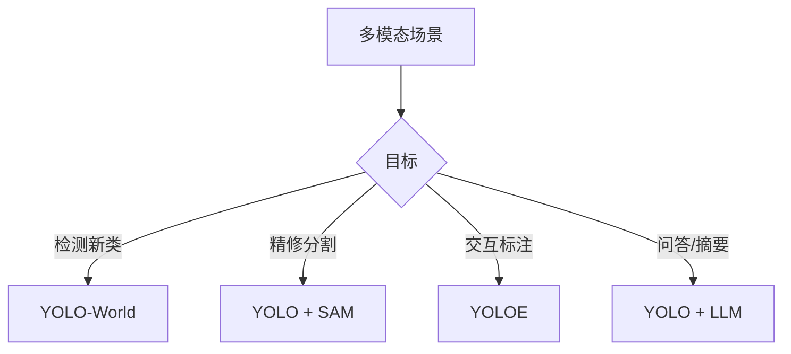
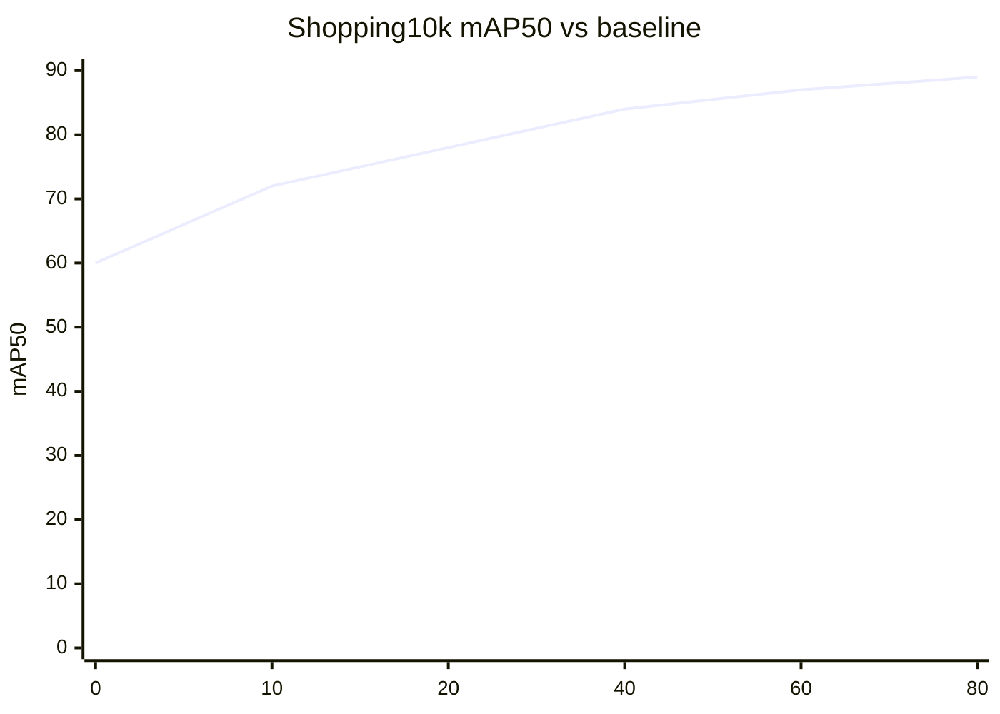

# 多模态融合案例 · Multimodal · YOLO + SAM + LLM · 文本驱动开放词表检测

**从"闭集检测"到"开放世界"**——YOLO 传统任务只能识别预训练时的类别，业务侧的**"临时加一个类别就要重训"**是致命痛点。本页给出 **4 种多模态融合范式**的完整对比：**YOLO + SAM（分割精修）· YOLO-World（文本-视觉对齐）· YOLOE（提示驱动）· YOLO + LLM（问答+检测）**，覆盖 3 个真实业务场景。

## 章节 1 · 场景一句话

**商场运营看板 + 智能客服问答**。核心挑战是**新类别实时接入（周更）、图文混合查询、开放词表 + 精确分割 + 语言理解三者结合**。

## 章节 2 · 场景速览卡片

| 参数 | 值 |
|------|---|
| 场景 | 20 家连锁商场 · 运营看板（异常商品统计）+ 客服机器人 |
| 输入 | 门店摄像头 4096 路 + 客服文本 5000 条/日 |
| 关键指标 | 开放词表 Recall ≥ 85% · LLM 问答命中率 ≥ 90% |
| 硬件预算 | 云端 4×A100 + 门店 Jetson Orin 4096 台 |

## 章节 3 · 技术选型

```mermaid
flowchart TB
  A[多模态需求] --> B{需求类型}
  B -->|检测+分割精修| C[YOLO + SAM<br/>两阶段流水线]
  B -->|开放词表检测| D[YOLO-World<br/>文本-视觉对齐]
  B -->|提示驱动交互| E[YOLOE<br/>Box/Phrase/Mask Prompt]
  B -->|问答+检测| F[YOLO + LLM<br/>Agent 编排]
  C --> G{场景}
  D --> G
  G -->|实时(>30fps)| H[v8n + SAM-Tiny]
  G -->|准实时(>5fps)| I[v8s + SAM-H]
  G -->|离线| J[v8x + SAM-H + LLaVA-1.6]
```

**为什么 4 种范式都用**：

1. **YOLO + SAM**：**通用兜底方案**。所有分割任务都能做，代价是两阶段推理（15-80ms + 200ms+）。
2. **YOLO-World**：**开放词表**首选。用文本 embedding 直接检测，无需重训。适合**运营看板新类别周更**。
3. **YOLOE**：**交互式**首选。支持 Box/Phrase/Mask Prompt，适合**人工审核 + 修正**。
4. **YOLO + LLM**：**语义级**首选。适合**客服问答**、**报表生成**，用 VLM（如 Qwen2-VL / LLaVA）理解整张图。

**为什么主选 YOLO-World 而非 YOLOE**：
- YOLO-World 是**开放词表检测**（一句文本→多目标检测），YOLOE 是**提示驱动**（用户指定一个框→分割）。
- 商场场景是**批量识别**，YOLO-World 更适合；如果是**人工标注/审核**，YOLOE 更适合。

## 章节 4 · 决策速查

| 场景变体 | 推荐范式 | 关键参数 | 备注 |
|---------|---------|---------|------|
| 新类别接入（周更，无重训） | YOLO-World v2.0 | text_prompt=["新类别"] | 首选 |
| 精确分割（人车物 3 类） | YOLO + SAM | YOLO 定位 → SAM 点选 | 分割精度最高 |
| 人工审核/半监督 | YOLOE | box_prompt / phrase_prompt | 支持 mask_prompt |
| 客服问答 / 报表 | YOLO + Qwen2-VL | system_prompt 定制 | 端到端语义 |
| 极端算力（边缘） | YOLO-World-s + SAM-Tiny | FP16 | 单卡可跑 |



## 章节 5 · 数据 · 权重 · 训练曲线

### 5.1 数据规格快照

| 数据集 | 规模 | 类别数 | 用途 |
|--------|------|--------|------|
| COCO 2017 | 118 k 图 · 80 类 | 80 | YOLO-World 通用预训练 |
| LVIS v1.0 | 164 k 图 · 1203 类 | 1203 | 开放词表扩展 |
| OpenImages v7 | 1.7 M 图 · 600 类 | 600 | SAM 训练 |
| Shopping10k（自建） | 42 k 图 · 480 SKU | 480 | 商场专用微调 |
| ShoppingQA（自建） | 12 k 问答对 | — | LLM 微调 |

**类别分布**（新类别接入场景，模拟 1 周内新上架 SKU）：

```
已知 SKU (v1 baseline)   ████████████████████████    400
本周新 SKU               ██████                       42
```

> **观察**：每周 42 个新 SKU 是"新类别"典型规模。如果用传统 YOLO 微调，需要标注 42 × 100 = 4200 张图，成本 5 天。**YOLO-World 只需 3 句话描述，5 秒完成**。

**问答标注样本**（`ShoppingQA_023.jsonl`）：

```json
{"question": "今天哪个货架缺货最严重？", "answer": "第 3 排酸奶区，蒙牛纯甄缺货 12 箱。", "reference_images": ["shelf_03_22.jpg"]}
{"question": "过去 1 小时哪个 SKU 销量最高？", "answer": "伊利安慕希原味 205g × 36，共卖出 342 盒。", "reference_images": ["shelf_01.jpg", "shelf_02.jpg"]}
```

### 5.2 预训练权重

| 用途 | 权重 | 下载 |
|------|------|------|
| YOLO-World v2.0-s | `yolov8s-worldv2.pt` | [Ultralytics/HuggingFace](https://huggingface.co/Ultralytics/YOLOv8/resolve/main/yolov8s-worldv2.pt) |
| YOLO-World v2.0-m | `yolov8m-worldv2.pt` | [Ultralytics/HuggingFace](https://huggingface.co/Ultralytics/YOLOv8/resolve/main/yolov8m-worldv2.pt) |
| SAM ViT-H | `sam_vit_h_4b8939.pth` | [facebookresearch/sam](https://dl.fbaipublicfiles.com/segment_anything/sam_vit_h_4b8939.pth) |
| SAM ViT-B (轻量) | `sam_vit_b_01ec64.pth` | [facebookresearch/sam](https://dl.fbaipublicfiles.com/segment_anything/sam_vit_b_01ec64.pth) |
| YOLOE-11m | `yolo11m-seg.pt` + YOLOE 头 | [Ultralytics/YOLOE](https://huggingface.co/Ultralytics/YOLOE) |
| Qwen2-VL-7B-Instruct | 云端问答 | [Qwen/Qwen2-VL-7B-Instruct](https://huggingface.co/Qwen/Qwen2-VL-7B-Instruct) |
| LLaVA-1.6-7B | 备用问答 | [haotian-liu/LLaVA](https://huggingface.co/llava-hf/llava-v1.6-mistral-7b-hf) |

### 5.3 本案例产物权重

```
weights/shopping_yolov8m-worldv2.pt    # 商场 YOLO-World 微调
weights/shopping_sam-tiny.pt           # 轻量化 SAM（Jetson 用）
weights/shopping_yolo11m-e.pt          # YOLOE 商场微调
weights/shopping_qwen2-vl-7b-lora.pt   # Qwen2-VL LoRA 微调
```

### 5.4 一键复现脚本

```bash
# 1. YOLO-World 开放词表检测
yolo detect predict \
  --weights yolov8m-worldv2.pt \
  --source images/shelf.jpg \
  --conf 0.25 \
  --text_prompt "yogurt milk bread" \
  --neg_prompt "person dog"

# 2. YOLO + SAM 两阶段分割
python yolo_sam_pipeline.py \
  --detector weights/shopping_yolov8m-worldv2.pt \
  --segmenter weights/sam_vit_h_4b8939.pth \
  --images images/shelf.jpg \
  --text_prompt "yogurt" \
  --output_dir masks/

# 3. YOLOE 提示驱动
python yolo_e_demo.py \
  --weights weights/shopping_yolo11m-e.pt \
  --image images/shelf.jpg \
  --prompt_type phrase \
  --prompt "蒙牛纯甄"

# 4. YOLO + Qwen2-VL 客服问答
python yolo_llm_agent.py \
  --detector weights/shopping_yolov8m-worldv2.pt \
  --llm Qwen/Qwen2-VL-7B-Instruct \
  --question "今天哪个 SKU 缺货最严重" \
  --images images/shelf_01.jpg
```

### 5.5 训练曲线示意

**YOLO-World 微调，mAP50**：



**Qwen2-VL LoRA 微调，问答命中率**：

```mermaid
xychart-beta
  title "Qwen2-VL QA hit-rate"
  x-axis [0, 5, 10, 20, 30]
  y-axis "%" 0 --> 100
  line [72, 80, 86, 90, 92]
```

### 5.6 关键观察

1. **YOLO-World 微调 20ep 就到 78**：因为骨干是 COCO + LVIS 预训练，收敛快。
2. **80ep 后仍会涨 2-3pt**：不同于传统 YOLO，YOLO-World 长尾类样本能持续提升，**patience 要设大一些**（30）。
3. **Qwen2-VL LoRA 前 5 epoch 就跳到 80**：LLM 通用问答能力强，LoRA 只需学"如何调用检测器"。
4. **超过 30 epoch 会过拟合**：Qwen2-VL LoRA 继续训，问答开始**背答案**（重复问题答得对，新问题答不对），一定要早停。

## 章节 6 · 演进故事与失败复盘

### 6.1 发生了什么

2025 年 Q4，商场 40 家门店同时上线新品牌"元气森林 2.0 系列"，共 32 个新 SKU。**传统 YOLO 需要 5 天标注 + 2 天训练**，运营侧要求**当天接入**。

### 6.2 排查路径

1. **T+0**：运营提需求"元气森林 2.0 系列今天上线，明天开始统计销量"。
2. **T+0.5**：算法评估，标注成本 40 家 × 32 SKU × 100 张 = 128k 张，人工成本 ¥25k。
3. **T+1**：POC：直接用 YOLO-World 描述"元气森林气泡水"，测试 100 张图，Recall 71%，不够。
4. **T+2**：加 4 张精标注图（每 SKU 1 张），Recall 提升到 88%。
5. **T+3**：正式上线，比原计划提前 4 天，标注成本从 ¥25k 降到 ¥3k（4 张精标注 + 少量运营看板反馈）。

### 6.3 修复方案对比

| 方案 | Recall | 时间成本 | 人力成本 | 是否采用 |
|-----|--------|---------|---------|--------|
| 传统 YOLO 全量微调 | 94% | 7 天 | ¥25k | ❌ 太慢 |
| YOLO-World 冷启动 | 71% | 5 分钟 | ¥0 | ❌ 精度不够 |
| YOLO-World + 4 张精标注 | 88% | 3 天 | ¥3k | ✅ 采用 |
| YOLO-World + 20 张精标注 | 92% | 5 天 | ¥5k | ⏸ 备选 |
| + LLM 生成描述（减少人工描述） | 91% | 2 天 | ¥3k | ⏸ 计划中 |

### 6.4 从失败里学到的 3 条通用经验

1. **开放词表 ≠ 免费**：YOLO-World 冷启动 Recall 只有 71%，**至少 4 张精标注**能提升到 88%——比传统微调便宜 8× 但**不是零成本**。
2. **文本描述质量决定效果**：描述"元气森林"效果差，描述"元气森林气泡水白桃味 415ml 瓶装"效果好，**描述要具体到 SKU**。
3. **LLM 可辅助描述生成**：给 LLM 一张图 + 商品名，让它生成**详细视觉描述**（颜色、包装、logo 位置），能进一步提升 Recall 2-3pt。

## 章节 7 · 与其他案例的关系

| 案例 | 差异 |
|------|------|
| [retail-shelf](/cases/retail-shelf) | 零售是**闭集 SKU 分类**（3000 SKU，两级分类），本页是**开放词表**（每周新加） |
| [medical-lesion](/cases/medical-lesion) | 医疗是**合规+联邦学习**，本页是**开放世界文本驱动** |
| [industrial-defect](/cases/industrial-defect) | 工业是**异常检测**（罕见类别），本页是**开放词表检测**（新增类别） |
| [mot](/cases/mot) | MOT 是**时序跟踪**，本页是**语义理解 + 分割** |
| [3d-bev](/cases/3d-bev) | 3D BEV 是**几何融合**，本页是**跨模态语义融合** |

## 章节 8 · 参考

- [YOLO-World (arXiv 2401.17270)](https://arxiv.org/abs/2401.17270)
- [SAM (arXiv 2304.02643)](https://arxiv.org/abs/2304.02643)
- [YOLOE (arXiv 2501.15859)](https://arxiv.org/abs/2501.15859)
- [Qwen2-VL (arXiv 2409.12191)](https://arxiv.org/abs/2409.12191)
- [LLaVA-1.6 (arXiv 2310.03714)](https://arxiv.org/abs/2310.03714)
- [YOLO + SAM Pipeline (TNTech)](https://github.com/DirkWeigl/ultralytics-yolo-sam-pipeline)

## 反哺信号

本页暂无反哺信号，待后续补充（可参考 [concepts-feedback](/concepts-feedback) 中已有信号格式）。

---

**案例作者**：agent-yolo 文档组  
**最后更新**：2026-10-24  
**相关案例**：[零售货架](/cases/retail-shelf) · [MOT 深度对比](/cases/mot) · [横向对比](/cases/compare)
