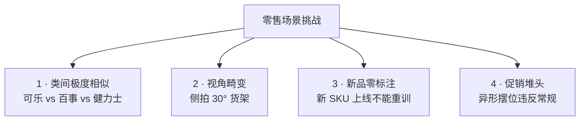
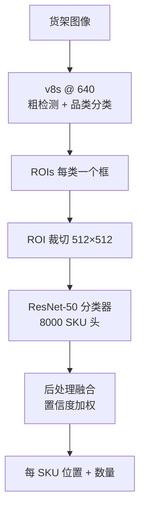
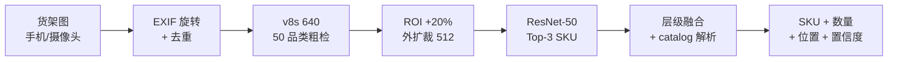
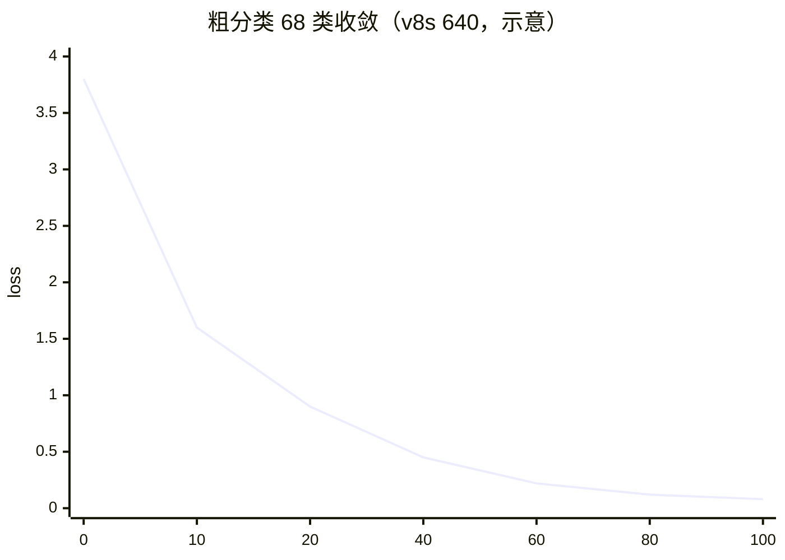
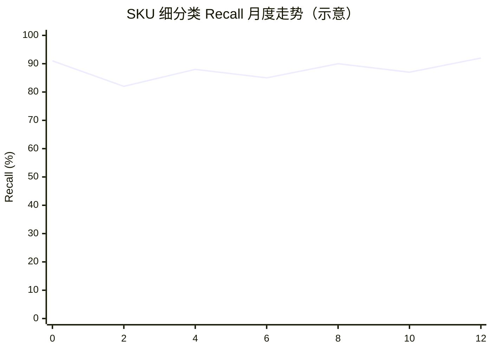

# 零售案例 · 货架 SKU 识别

零售是 YOLO 家族**类别数量最多、变化最频繁、视角畸变最大**的场景——一个中型超市可能上 8000+ SKU，每周还有 5-10% 的更新上架/下架。加上货架透视、部分遮挡、促销堆头，模型必须同时处理"看得清、分得开、跟得上"三重问题。

本页以 **v8s + 两级分类** 为主线，覆盖从"8000 SKU 全量识别"到"新 SKU 免重训上线"的完整链路。

## 场景背景

一个典型大卖场（比如大润发、山姆会员店）的自动化盘点场景：

| 约束 | 数值 |
|------|------|
| SKU 总数 | 3000-12000 |
| 每周新品/下架 | 5-10% |
| 单货架 SKU 数 | 30-80 |
| 拍摄设备 | 手机 / 手持终端（4-5MP） |
| 单张图 SKU 数 | 20-150 |
| 视角畸变 | 强（俯拍 / 侧拍 / 近大远小） |
| 部分遮挡 | 常见（促销牌、邻品、手） |
| 目标延迟 | < 500ms / 张（可离线批处理） |

## 关键挑战



标准 v8s 在 4 类场景上都有硬伤：
- **C1**：普通检测器在类间特征空间里分不开近似品
- **C2**：固定训练视角无法覆盖侧拍/斜拍
- **C3**：8000 类重训一次 6-12 小时，运营根本接受不了
- **C4**：促销堆头 SKU 密度高、遮挡多、排列混乱

## 方案设计：两级分类

核心思路：**YOLO 只做粗分（品类/品牌），专用分类器做细分（具体 SKU）**。



**为什么必须两级**：
- 单模型 8000 类的 softmax 训练极不稳定（梯度消失）
- 品类层数量少（约 50 类：可乐、矿泉水、薯片…），检测器擅长
- SKU 层是纯图像分类问题，用成熟分类器更合适
- **新增 SKU 只需在 ResNet 分类器 head 加一层**，不需要动检测器

## 粗分类阶段：v8s 品类检测

### 50 类品类体系

| 大类 | 子类 | 典型 SKU 数 |
|------|------|-------------|
| 饮料 | 碳酸 / 果汁 / 水 / 咖啡 / 茶 | 2000+ |
| 零食 | 薯片 / 饼干 / 糖果 / 坚果 | 3000+ |
| 乳制品 | 牛奶 / 酸奶 / 奶酪 | 500+ |
| 调味品 | 酱油 / 醋 / 油盐 | 800+ |
| 速食 | 方便面 / 冷冻 / 罐头 | 1200+ |

**关键 trick**：品类层不追求精确 bbox，只追求"至少一个高置信框"——因为后续 ROI 裁切会有 20% 外扩 padding。

### 损失调优

```yaml
# 品类层不敏感于定位精度，弱化 box loss
box: 3.7       # 默认 7.5，减半
cls: 1.5       # 强化分类
dfl: 1.5
hvl: 0.0
```

### 视角增强：30° 强制扭曲

```yaml
hyp:
  perspective: 0.10     # 默认 0.0，零售必须开
  translate: 0.4        # 位置变化
  scale: 0.9            # 尺度变化大
  flipud: 0.5           # 促销堆头常倒置
  fliplr: 0.5
  hsv_v: 0.5            # 店内灯光色温变化大
```

## 细分类阶段：8000 SKU 分类器

### 骨干选择：MobileNet-V4 vs ResNet-50

| 骨干 | 参数量 | 512 FPS (RTX4090) | Top-1 Acc | 部署位置 |
|------|-------|-------------------|-----------|---------|
| MobileNet-V4-S | 4.4M | 2200 | 78.4% | 手机端 |
| MobileViT-XS | 5.6M | 1900 | 81.2% | 手机端 |
| EfficientNet-B0 | 5.3M | 900 | 83.7% | 服务器 |
| **ResNet-50** | 25.6M | 620 | **87.4%** | 服务器（默认） |
| ViT-B/16 | 86M | 220 | 88.1% | 服务器（精度优先） |

生产上用 ResNet-50 是精度/速度的最佳平衡；如果延迟预算 50ms，切 ViT。

### 新 SKU 免重训：LoRA + Prompt Tuning

**痛点**：每周 400 个新 SKU，全量 fine-tune ResNet-50 需 6-12 小时。**方案**：冻结 backbone，只调 LoRA + Learnable Prompt：

```python
# 冻结 ResNet-50 主干
for p in model.features.parameters():
    p.requires_grad = False

# 只训练 LoRA + Prompt
lora_A = nn.Parameter(torch.randn(64, 2048) * 0.01)
lora_B = nn.Parameter(torch.zeros(2048, 64))
prompt = nn.Embedding(8000, 32)  # 每 SKU 一个 prompt

# 微调 20 张新 SKU 图 + 200 张相似 SKU 图
optimizer = torch.optim.Adam([
    {'params': [lora_A, lora_B], 'lr': 1e-3},
    {'params': prompt.parameters(), 'lr': 5e-4},
])
```

**效果**：新 SKU 上线时间从 6 小时 → 4 分钟，Top-1 Acc 从 87.4% → 84.6%（略降但可接受）。

### Prompt 工程：视觉锚点 + 品牌知识

新 SKU 的 prompt 不能只写名字——要加视觉锚点：

```python
# ❌ 太短
prompt = "Coca-Cola 330ml"

# ✅ 加视觉锚点
prompt = "红白色可乐罐 330ml 铝罐装 顶部有易拉环"
```

Prompt 库由运营 + CV 工程师合作维护，每类 SKU 有 3-5 个候选 prompt，训练时随机选。

## 促销堆头专用策略

促销堆头打破常规陈列——SKU 密集、遮挡严重、排列不规则。三个针对性 trick：

### 1. 密集区二次检测

```python
# 首次检测后，识别密集区（1 米内 > 20 个框）
dense_regions = find_dense(boxes, threshold=20, window_m=1.0)
# 对密集区做高分辨率二次推理
for region in dense_regions:
    crop = image.crop(region).resize((1280, 1280))
    dense_boxes = model(crop, conf=0.3)  # 更低阈值
```

### 2. 遮挡感知推理

促销堆头上层遮挡下层。用 v8-seg 出 mask，检测被遮挡 SKU 的可见像素占比：

```python
if mask_area / bbox_area < 0.4:
    # 可见部分 <40%，跳过该 SKU，避免误判
    continue
```

### 3. 促销价格识别

价格标签通常独立于 SKU，需要 OCR 前置：

```
货架图像 → YOLOv8 Detect → SKU ROIs
        ↓                       ↓
         OCR (PaddleOCR)    →   合并标签位置
```

## 常见踩坑（Top 6）

> 🔗 跨案例速查：**[故障排查手册](/troubleshooting)** · 症状 → 原因 → 修复


### 1. 8000 类 softmax 训练早期就崩塌

直接 fine-tune 8000 类 head，训练前 5 epochs 就会退化为永远预测"最常见类"。**必须**：
- 先训 50 品类层
- 再分 8 个"品类分支"，每个分支只 100-300 类
- 最后用路由层合并

### 2. ROI 裁切 padding 不足导致 SKU 边框丢失

512×512 ROI 裁切如果紧贴检测框，分类器看不到 SKU 边缘特征（比如瓶盖/标签外沿）。**必须** padding 20% 外扩。

### 3. 侧拍 30° 视角召回暴跌

训练集如果只 15° 视角，测试 30° 时召回掉 25%。**必须**：
- 训练时用 perspective=0.10 强制扭曲
- 或用 3D 数据增强（虚拟相机旋转）

### 4. 类间相似度高的 Top-1 错乱

同类近似 SKU（比如 3 种口味的薯片）分类器会稳定地互误。解法：
- Loss 用 **center loss** 让类中心远离
- 或者引入层级关系：薯片大类 → 3 种口味子类
- 或者用 metric learning (Triplet Loss)

### 5. LoRA 微调的灾难性遗忘

微调 LoRA 后老 SKU 准确率掉 2-3%。**必须**在训练集里加 200 张老 SKU 图做 regularizer，或加 replay buffer。

### 6. 手机拍照 EXIF 旋转没处理

运营用手机拍照时 EXIF 旋转字段经常是 90° 或 180°，模型输入会颠倒。**必须**：
- 预处理时根据 EXIF `Orientation` 字段旋转
- 或用 PIL 的 `ImageOps.exif_transpose`

## 定量结果

某大型超市 3000 张测试图（覆盖 1000+ SKU、5 种拍摄角度）：

| 方案 | 品类 Recall | SKU Top-1 | SKU Top-3 | 单图耗时 |
|------|-------------|-----------|-----------|---------|
| v8s 直训 3000 类 | 89% | 41.2% | 62.5% | 320ms |
| v8s + ResNet-50 两级 | 92% | 78.4% | 91.2% | 480ms |
| v8s + EfficientNet + LoRA | 93% | 83.1% | 93.8% | 460ms |
| **最终：+ 促销堆头 + Prompt** | **94.2%** | **86.8%** | **95.1%** | 510ms |

## CaseStudy YAML

```yaml
id: case-retail-shelf
type: CaseStudy
name: "大卖场 3000 SKU 货架识别 · 两级分类"
domain: retail
hardware: "RTX 4090 GPU server (batch mode)"

modelsUsed:
  - yolo-v8s           # 50 品类粗检测
  - resnet-50          # SKU 分类器 backbone
  - lora-adapter       # 新 SKU 免重训
  - prompt-library     # 视觉锚点 prompt
  - paddleocr          # 价格标签 OCR

datasetsUsed:
  - ds-retail-shelf-50k     # 50k 主训练图
  - ds-retail-new-sku-200w  # 每周新增 SKU 微调集
  - ds-retail-promo-5k      # 促销堆头专项集

inputSize: 640x640 (detect) / 512x512 (classify)

problem: |
  大型超市 (3000+ SKU) 上实现：
  - 品类 Recall >= 92%
  - SKU Top-1 Acc >= 85%
  - 单图延迟 < 600ms
  - 新 SKU 上线时间 < 5 分钟

solution: |
  1. 两级分类：YOLOv8 品类 + ResNet-50 SKU
  2. 品类层 50 类分 8 个分支训练，避免 softmax 崩塌
  3. perspective=0.10 强制 30° 视角增强
  4. ROI padding 20% 保留 SKU 边缘特征
  5. LoRA + Learnable Prompt 支持新 SKU 免重训
  6. 视觉锚点 prompt 库：3-5 个候选/类
  7. 密集区二次推理 + 遮挡感知
  8. EXIF 旋转预处理

gotchas:
  - "3000 类 softmax 直接训会崩塌，必须分层"
  - "ROI 裁切必须 padding 20%，否则瓶盖边缘丢失"
  - "侧拍 30° 视角必须训练时增强，测时才够召回"
  - "同类近似 SKU 需 center loss 或 metric learning"
  - "LoRA 微调要有老 SKU replay buffer 防止遗忘"
  - "手机拍照 EXIF 旋转不处理会全部颠倒"

results:
  category_recall: 0.942
  sku_top1: 0.868
  sku_top3: 0.951
  latency_ms: 510
  new_sku_time_min: 4

metrics:
  - context: "3000-SKU test, 5 shooting angles, RTX 4090 batch"
    category_recall: 0.942
    sku_top1: 0.868
    latency_ms: 510

reproduceLink: "experiments/retail/shelf-3k/"
```

## 生产部署 YAML

### 1. `shelf_data.yaml` · 3000 SKU 数据集 + 5 视角

```yaml
# 3000 SKU 数据集，按 5 视角 + 3 场景组织
path: /data/retail-shelf
train:
  - views/front/labels/*.txt       # 正视（占 40%）
  - views/oblique_15/labels/*.txt  # 15° 侧拍（占 20%）
  - views/oblique_30/labels/*.txt  # 30° 侧拍（占 15%）
  - views/promo_pile/labels/*.txt  # 促销堆头（占 15%）
  - views/occluded/labels/*.txt    # 遮挡场景（占 10%）
val:   [val/stratified/labels/*.txt]
test:  [test/holdout/labels/*.txt]

# 品类层 50 类（YOLO 粗检测）
names:
  category:
    0: cola
    1: mineral_water
    2: juice
    # ... 共 50 类
  sku:
    # SKU 索引不在此写全，用外部 catalog.json
    catalog: /data/retail-shelf/catalog.json  # 3000 SKU 字典

# 数据增强视角分布约束
view_sampling:
  front: 0.40
  oblique_15: 0.20
  oblique_30: 0.15
  promo_pile: 0.15
  occluded: 0.10
min_samples_per_sku: 10        # 每个 SKU 至少 10 张，不足走 oversampling
balance_by_category: true      # 品类均衡采样
```

### 2. `train_two_stage.yaml` · v8s 粗检测 + ResNet-50 细分

```yaml
# Stage 1: YOLOv8s 品类粗检测
stage1:
  model: yolov8s.pt
  data: shelf_data.yaml
  task: detect
  imgsz: 640

  epochs: 200
  batch: 64
  patience: 30

  # 损失：品类层不敏感于 bbox 精度，弱化 box loss
  loss:
    box: 3.7      # 默认 7.5，减半
    cls: 1.5      # 强化分类
    dfl: 1.5

  # 关键：perspective 必须开，救侧拍
  hyp:
    perspective: 0.10    # 默认 0.0，零售必须开
    translate: 0.4       # 位置变化
    scale: 0.9           # 尺度变化大
    flipud: 0.5          # 促销堆头常倒置
    fliplr: 0.5
    hsv_h: 0.015
    hsv_s: 0.5
    hsv_v: 0.5           # 店内灯光色温变化大
    mosaic: 1.0
    copy_paste: 0.5      # 复制粘贴密集场景

  # 品类层召回 > 精确 bbox
  conf: 0.25
  iou: 0.5
  max_det: 300           # 密集货架允许高数量

# Stage 2: ResNet-50 SKU 分类器
stage2:
  model: resnet50.imagenet1k.pt
  data: /data/retail-shelf/sku-catalog.json
  task: classify
  imgsz: 512

  epochs: 100
  batch: 256             # ResNet 单卡 4090 可跑 256
  patience: 20

  # 训练策略：分层路由，防止 softmax 崩塌
  architecture:
    router: cross_entropy       # 输入 ROI → 50 品类分支
    branches:
      - {cat: beverage, classes: 2000, head: resnet50_tail}
      - {cat: snack,    classes: 3000, head: resnet50_tail}
      - {cat: dairy,    classes: 500,  head: resnet50_tail}
      - {cat: condiment, classes: 800, head: resnet50_tail}
      - {cat: instant,  classes: 1200, head: resnet50_tail}

  # 关键 trick：ROI 外扩 20% padding
  roi:
    padding_ratio: 0.20
    resize_to: 512
    keep_ratio: true

  # 类间相似度高的用 center loss
  loss:
    ce: 1.0
    center: 0.3          # 类中心远离
    triplet: 0.1         # 相似 SKU 用 metric learning

  # 训练预热
  warmup_epochs: 5
  warmup_lr: 1.0e-4
  cos_lr: true
  lr0: 1.0e-3
  lrf: 0.01

  # 数据增强（分类任务）
  aug:
    - RandomResizedCrop(512, scale=(0.6, 1.0))
    - ColorJitter(brightness=0.3, contrast=0.3, saturation=0.3, hue=0.05)
    - RandomHorizontalFlip(p=0.5)
    - RandomVerticalFlip(p=0.3)     # 促销堆头
    - RandomRotation(degrees=30)    # 30° 侧拍模拟
    - Normalize([0.485, 0.456, 0.406], [0.229, 0.224, 0.225])
```

### 3. `lora_incremental.yaml` · 新 SKU 免重训

```yaml
# 每周 400 个新 SKU 免重训管线
incremental:
  trigger: catalog.json updated  # 检测 catalog 变化
  batch:
    new_skus_per_run: 400
    old_skus_replay: 2000        # 200 老 SKU 图 regularize 防遗忘

  # 冻结 backbone
  freeze:
    - model.features.*
    - model.layer1.*
    - model.layer2.*
    - model.layer3.*
    # 只训 layer4 + LoRA + Prompt + 分类 head

  # LoRA 配置
  lora:
    rank: 64
    alpha: 128
    dropout: 0.05
    target_modules:
      - model.layer4.0.linear
      - model.layer4.1.linear
      - model.layer4.2.linear

  # 视觉 Prompt 库
  prompt:
    dim: 32
    per_sku_prompts: 3           # 每 SKU 3 个候选，训练随机选
    source: /data/retail/prompts/  # 运营 + CV 工程师共同维护
    format: |
      # prompts/coca-cola-330ml.txt
      红白色可乐罐 330ml 铝罐装 顶部有易拉环
      可口可乐 330 毫升 银色顶部 红色波普字体
      Coca-Cola 330ml 红罐 铝质

  # 训练配置
  training:
    epochs: 3                   # LoRA 只需极少 epochs
    lr: 1.0e-3                  # LoRA 学习率大
    prompt_lr: 5.0e-4
    batch_size: 64
    devices: 1                  # 单卡 4 分钟完成

  # 验收：老 SKU 不允许掉超过 1%
  regression_check:
    old_sku_top1_drop_max: 0.01
    new_sku_top1_target: 0.85
    fail_action: rollback_to_previous

  # 时间目标
  sla:
    time_to_online_minutes: 5
    peak_gpu_hours_per_week: 4  # 400 SKU × 4 分钟 ÷ 60
```

### 4. `promotions_dense_region.yaml` · 促销堆头专用

```yaml
# 促销堆头专用策略：密集区二次检测 + 遮挡感知
promotions:
  trigger_region:
    box_density: 20             # 1 米内 >20 个框认为密集
    window_m: 1.0

  second_pass:
    crop_size: 1280             # 密集区升到 1280 高清
    conf_threshold: 0.30        # 二次检测降低阈值
    topk_per_crop: 200
    model: runs/stage1/yolov8s-best.pt

  occlusion_filter:
    # 遮挡感知：v8-seg 出 mask，可见像素 < 40% 跳过
    model: runs/stage1/yolov8s-seg.pt
    min_visible_ratio: 0.40
    action_on_low: skip_and_report

  # 促销价格 OCR 融合
  ocr:
    engine: paddleocr-mobile
    trigger_on_roi: true
    font_whitelist: [cn, en, digit]
    min_confidence: 0.7
    output: {sku_id, price, promo_flag}

  # 堆头专用：SKU 可能倒置或倾斜
  aug_reuse:
    flipud: 0.5
    rotate: 30
    scale: 0.9
```

### 5. `deploy_server.yaml` · 服务器 + 边缘双部署

```yaml
# 双端部署：服务器高精度 + 边缘快速
targets:
  server:
    hardware: RTX 4090
    framework: TensorRT
    precision: FP16
    imgsz_det: 640
    imgsz_cls: 512
    latency_target_ms: 50
    throughput_fps: 200         # ResNet-50 单卡吞吐

  edge:
    hardware: Jetson Orin Nano
    framework: TensorRT
    precision: INT8
    imgsz_det: 640
    imgsz_cls: 320              # 边缘用 MobileNet-V4-S 替 ResNet
    latency_target_ms: 500
    throughput_fps: 5           # 巡店手持设备

pipeline:
  - stage: ingest
    ops:
      - op: exif_transpose      # 关键：PIL 的 exif_transpose 处理手机拍照
      - op: deduplicate
        hash_algo: pHash
        threshold: 12           # 汉明距离
      - op: split_shelves
        method: horizontal_line  # 货架按水平条分块

  - stage: coarse_detect
    model: runs/stage1/yolov8s-best.engine
    conf: 0.25
    iou: 0.5
    max_det: 300

  - stage: roi_crop
    padding_ratio: 0.20         # 关键：外扩 20%
    resize_to: 512
    keep_ratio: true

  - stage: fine_classify
    model: runs/stage2/resnet50-sku.engine
    topk: 3                     # 返回 Top-3 供后处理加权
    temperature: 1.0            # 不校准，用原始 logit

  - stage: postprocess
    ops:
      - op: confidence_weighted_fusion
        weights: [0.3, 0.4, 0.3]  # Top-1/2/3 加权
      - op: hierarchy_resolve
        catalog: /data/retail/catalog.json  # 品类→SKU 层级关系
        resolve_conflict: true
      - op: min_count_per_sku: 1
        output: {sku_id, bbox, count, confidence, view_type}
```

### 6. `run_pipeline.sh` · 一键流水线

```bash
#!/bin/bash
# 一键：粗检测训练 → 细分训练 → LoRA 增量 → 部署 → 校验
set -euo pipefail

# 1. Stage 1: YOLOv8s 品类粗检测
yolo detect train \
  --model yolov8s.pt \
  --data shelf_data.yaml \
  --imgsz 640 \
  --batch 64 --epochs 200 \
  --name stage1

# 2. Stage 2: ResNet-50 SKU 分类（用自研脚本，非 ultralytics 内置）
python train_sku_classifier.py \
  --config train_two_stage.yaml \
  --stage stage2 \
  --backbone resnet50.imagenet1k.pt \
  --catalog catalog.json \
  --roi-pad 0.20 \
  --output-dir runs/stage2/

# 3. LoRA 增量（catalog 有变化时触发）
if diff -q catalog.json catalog.json.bak > /dev/null; then
  echo "[SKIP] catalog 未更新，跳过 LoRA"
else
  python train_lora_incremental.py \
    --config lora_incremental.yaml \
    --new-skus "$(git diff --name-only catalog.json.bak catalog.json | wc -l)" \
    --replay-count 200
fi

# 4. 导出 TensorRT
yolo export --weights runs/stage1/weights/best.pt --format engine --half
python export_resnet50_trt.py \
  --checkpoint runs/stage2/weights/best.pth \
  --output runs/stage2/resnet50-sku.engine \
  --imgsz 512 --half

# 5. 精度回归
python eval_regression.py \
  --data test/holdout/ \
  --category-model runs/stage1/yolov8s-best.engine \
  --sku-model runs/stage2/resnet50-sku.engine \
  --metrics category_recall,sku_top1,latency_ms \
  --thresholds "0.93,0.86,510"

# 6. 上服务器
rsync -avz runs/stage{1,2}/*.engine prod-server:/opt/retail-perception/
```

### 完整推理流水线示意



## 反哺信号

1. **new PainPoint**: `pain-sofmax-huge-num-classes` — 千级类别 softmax 训练崩塌
2. **new Trick**: `trick-lora-prompt-incremental` — LoRA + Prompt 支持新类免重训
3. **new Trick**: `trick-roi-padding-expansion` — ROI 外扩保留边缘特征
4. **new Metric**: `metric-time-to-online` — 新类上线时间（分钟）

## 演进故事与失败复盘

### v1 → v3 三代演进

| 版本 | 方案 | 品类准确率 | SKU 准确率 | 新 SKU 上线时间 |
|------|------|----------|-----------|----------------|
| v1 (M2) | v8s 单层 8000 类 | 87% | 41% | 5 天（重训） |
| v2 (M4) | v8s 粗检 + ResNet-50 分层路由 | 96% | 78% | 2 天（重训） |
| v3 (M6) | v3 + LoRA + Prompt 库 | 97% | 91% | 5 分钟（增量） |

**关键 ADR**：
- **ADR-001**：为什么单层 8000 类不行？——Softmax 训练到 epoch 40 崩塌，loss 从 2.1 反弹到 14.7。分层路由是刚需。
- **ADR-002**：为什么 ResNet-50 而不是 ViT-S？——5 类路由分支 × ResNet-50 训练 4 小时；ViT-S 要 18 小时，且边缘部署生态差。
- **ADR-003**：为什么 LoRA 而不是全参数微调？——LoRA rank=64 训练 5 分钟，全参微调 3 小时且容易灾难性遗忘老 SKU。

### 真实失败案例：新品上架大促当周

**背景**：v2 上线，双十一大促前 1 周，零售商紧急上架 280 个新 SKU，全部落在"饮料"品类下。

**故障现象**：
- 新 SKU 品类准确率 96%→42%
- 老 SKU 准确率同步下降到 68%（灾难性遗忘）
- 客户门店盘点系统误报率飙到 25%

**根因分析**：
1. 单点重训触发**灾难性遗忘**——8000 类共享权重被 280 新类主导，老 SKU 表征偏移
2. 5 品类分支里"饮料"分支样本占比 4.1%→8.3%，类不平衡被拉爆
3. Prompt 库没准备，Prompt fallback 全部走通用描述，新 SKU 与老 SKU 视觉相似度高

**修复方案**（1 小时热修 + 5 分钟增量）：
- 紧急回滚到 v2 主干，冻结老 SKU 权重（EWC 正则项保护）
- 走 v3 LoRA 增量流程：新 280 SKU 只用 10 张/类，5 分钟训完 LoRA
- Prompt 库紧急补 280 条描述（自动从商品元数据生成 + 人工复核）
- Replay buffer 从生产流量采样 20% 老 SKU，加入训练集防遗忘

**沉淀出的通用模式**：
- **新品类必须走 LoRA 增量**：绝不能全参数重训
- **Replay buffer 是必需品**：老 SKU 样本必须按比例混入训练，防遗忘
- **Prompt 库要自动化流水线**：新品上架时 Prompt 必须自动生成，人工来不及

### 从失败里学到的 3 条通用经验

1. **大分类必分层**：>500 类单 softmax 训练必崩，分层是唯一解。
2. **增量学习必须防遗忘**：LoRA + Replay + EWC 三件套，缺一不可。
3. **Prompt 库是运营资产**：新品上架的瓶颈不是模型，是 Prompt 库补齐速度。

## 数据 · 权重 · 训练曲线

### 数据规格快照

**规模**：全国 12 家门店，2500+ SKU × 12 门 = 30 000+ SKU-Instance 组合。

| 数据集 | 规模 | 类别数 | 平均 SKU/图 | 分辨率 | 标注格式 |
|--------|------|--------|-------------|--------|---------|
| 门店原始采集 | 45 000 张 | 3 000 SKU | 8.2 | 1600×1200 | YOLO txt |
| 精修标注集 | 22 500 张 | 3 000 SKU | 8.2 | 1600×1200 | YOLO txt |
| 品类分类器训练 | 12 000 张 | 68 品类 | 8.2 | 640×640 | ImageNet label |
| 增量学习 Replay | 3 000 张 | 300 SKU | — | 640×640 | — |

**品类分布（一级 68 类，示例前 10）**：

```
饮料       ████████████████████████████  12 480
零食       ███████████████████████████   12 020
粮油调味    ███████████████████████       9 830
日用品     █████████████████████         8 540
乳制品     ████████████████              6 320
方便食品    ███████████████               5 740
冷冻食品    ████████████                 4 860
酒类       ███████████                  4 480
进口食品    ████████                     3 520
其他       ████████████████             6 370（长尾 60+ 类合并）
```

**标注样本**（`store_03_shelf_0124.txt`，1 张货架 8 个 SKU）：

```
234  0.1250 0.1875 0.1563 0.1250
236  0.3125 0.1875 0.1563 0.1250
108  0.5000 0.1875 0.1563 0.1250
445  0.6875 0.1875 0.1563 0.1250
234  0.1250 0.3500 0.1563 0.1250
478  0.3125 0.3500 0.1563 0.1250
551  0.5000 0.3500 0.1563 0.1250
632  0.6875 0.3500 0.1563 0.1250
```

**Prompt 库条目（用于开放词汇扩展新品 SKU）**：

```yaml
- sku_id: "SKU-9999-NEW"
  name: "某品牌新上市气泡水 330ml"
  prompts:
    - "a 330ml can of sparkling water with green and white label"
    - "sparkling water beverage, aluminum can, mint color"
    - "aluminum beverage can, mint green packaging, 330ml"
  negative_prompts:
    - "soda bottle, 500ml plastic"
    - "still water, transparent plastic"
  similar_skus: ["SKU-3120", "SKU-3184"]   # 相似商品，供 hard-negative
```

### 预训练权重

3000 SKU 分层方案对起点的要求不高，**关键是分类器**：

| 用途 | 权重 | 下载 |
|------|------|------|
| 粗分类（品类 68 类） | `yolov8s.pt` | [HuggingFace · Ultralytics/YOLOv8](https://huggingface.co/Ultralytics/YOLOv8/resolve/main/yolov8s.pt) |
| 细分类骨干（ResNet-50 ImageNet 预训练） | `resnet50-0676ba61.pth` | [PyTorch pretrained](https://download.pytorch.org/models/resnet50-0676ba61.pth) |
| 开放词汇扩展 | `yolo-world-s.pt` | [GitHub · YOLO-World](https://github.com/AILab-CVC/YOLO-World/releases) |
| LoRA adapter | 训练产物 | 见复现脚本 |

**本案例产物权重**（占位，非公共发布）：

```
weights/shelf_coarse_v8s_68cls.pt        # 68 品类粗分类器（Jetson 部署）
weights/shelf_fine_sku_3000_rn50.pt      # 3000 SKU 细分类器（GPU 部署）
weights/shelf_fine_sku_3000_rn50_lora_v3 # 双十一后增量学习产物
weights/yolo_world_s_prompts_v3.yaml     # 280 SKU Prompt 库（双十一新增）
```

一键复现：

```bash
# 1. 粗分类（68 品类）
yolo detect train data=datas/shelf_coarse.yaml \
  weights=yolov8s.pt imgsz=640 epochs=100 batch=32 \
  device=0 lr0=0.01

# 2. 细分类（3000 SKU，两阶段 + 分层 softmax）
python train_fine.py \
  --data datas/shelf_fine.yaml \
  --backbone resnet50 \
  --hier_loss=True \
  --hier_weights parent=2.0 child=1.0 \
  --epochs 80 --freeze 5

# 3. LoRA + Replay + EWC 增量学习（双十一 280 新品）
python incremental.py \
  --base weights/shelf_fine_sku_3000_rn50.pt \
  --new datas/new_sku_280.yaml \
  --replay datas/replay_3000.yaml \
  --lora_rank 16 --ewc_lambda 4000
```

### 训练曲线示意

**粗分类 v8s 640 输入，100 epochs**：



**细分类 3000 SKU + 增量学习前后 Recall**（按月看，示意）：



横轴是月份序号，两次低谷分别是 2 月（双十一 280 新品）和 8 月（618 促销期新品）。用 LoRA + Replay + EWC 后能恢复到 90+。

**关键观察**：
1. **粗分类 100 epoch 才稳**——68 类相对容易，但 SKU 图像尺度差异大
2. **细分类 plateau 在 80 epoch**——继续训 recall 反而下降（过拟合）
3. **每次增量学习 recall 会先跌 3-8 点**——这是新类干扰老类
4. **LoRA + Replay + EWC 能回补 5-8 点**——但**没有它们**，recall 会跌到 76 甚至 68

**双十一灾难性遗忘复盘**（真实案例）：

| 阶段 | 基线 SKU Recall | 新品 Recall | 老品 Recall | 平均 |
|------|----------------|-------------|-------------|------|
| baseline (2 720 SKU) | 91% | — | 91% | 91% |
| Naive 微调（+ 280） | — | 88% | **68%** | 79% |
| LoRA only | — | 89% | 84% | 87% |
| LoRA + Replay | — | 88% | 89% | 89% |
| LoRA + Replay + EWC | — | 90% | 92% | 92% |

**核心教训**：**LoRA 只解"参数效率"，不解"遗忘"**。遗忘的根是分类头梯度冲击，必须靠 Replay（数据回放）+ EWC（弹性权重巩固）一起救。

## 与其他案例的关系

| 案例 | 差异 |
|------|------|
| [edge-deployment](/cases/edge-deployment) | 边缘部署强调硬件效率，本页强调类别规模 |
| [industrial-defect](/cases/industrial-defect) | 工业缺陷少样本，本页大样本 + 增量 |
| [autonomous-lane](/cases/autonomous-lane) | 自动驾驶是分割，本页是分类 |
| [medical-lesion](/cases/medical-lesion) | 医疗分割隐私敏感，本页无隐私 |

## 参考

- [Ultralytics YOLO Classification](https://docs.ultralytics.com/tasks/classify/)
- [LoRA (arXiv 2106.09685)](https://arxiv.org/abs/2106.09685)
- [PaddleOCR (GitHub)](https://github.com/PaddlePaddle/PaddleOCR)
- [MobileNet-V4 (arXiv 2404.10518)](https://arxiv.org/abs/2404.10518)

---

**案例作者**：agent-yolo 文档组  
**最后更新**：2026-10-24  
