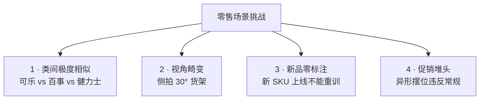
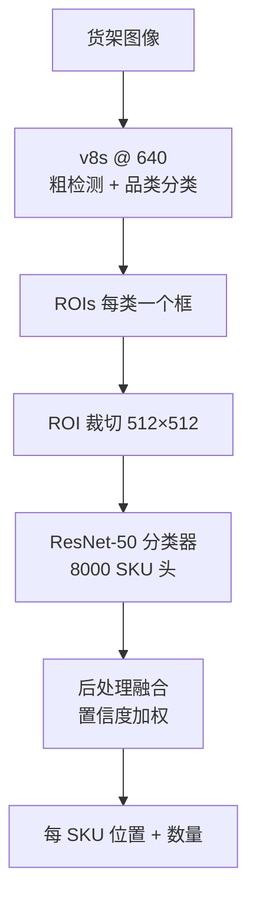

# 零售案例 · 货架 SKU 识别

零售是 YOLO 家族**类别数量最多、变化最频繁、视角畸变最大**的场景——一个中型超市可能上 8000+ SKU，每周还有 5-10% 的更新上架/下架。加上货架透视、部分遮挡、促销堆头，模型必须同时处理"看得清、分得开、跟得上"三重问题。

本页以 **v8s + 两级分类** 为主线，覆盖从"8000 SKU 全量识别"到"新 SKU 免重训上线"的完整链路。

## 场景背景

一个典型大卖场（比如大润发、山姆会员店）的自动化盘点场景：

| 约束 | 数值 |
|------|------|
| SKU 总数 | 3000-12000 |
| 每周新品/下架 | 5-10% |
| 单货架 SKU 数 | 30-80 |
| 拍摄设备 | 手机 / 手持终端（4-5MP） |
| 单张图 SKU 数 | 20-150 |
| 视角畸变 | 强（俯拍 / 侧拍 / 近大远小） |
| 部分遮挡 | 常见（促销牌、邻品、手） |
| 目标延迟 | < 500ms / 张（可离线批处理） |

## 关键挑战



标准 v8s 在 4 类场景上都有硬伤：
- **C1**：普通检测器在类间特征空间里分不开近似品
- **C2**：固定训练视角无法覆盖侧拍/斜拍
- **C3**：8000 类重训一次 6-12 小时，运营根本接受不了
- **C4**：促销堆头 SKU 密度高、遮挡多、排列混乱

## 方案设计：两级分类

核心思路：**YOLO 只做粗分（品类/品牌），专用分类器做细分（具体 SKU）**。



**为什么必须两级**：
- 单模型 8000 类的 softmax 训练极不稳定（梯度消失）
- 品类层数量少（约 50 类：可乐、矿泉水、薯片…），检测器擅长
- SKU 层是纯图像分类问题，用成熟分类器更合适
- **新增 SKU 只需在 ResNet 分类器 head 加一层**，不需要动检测器

## 粗分类阶段：v8s 品类检测

### 50 类品类体系

| 大类 | 子类 | 典型 SKU 数 |
|------|------|-------------|
| 饮料 | 碳酸 / 果汁 / 水 / 咖啡 / 茶 | 2000+ |
| 零食 | 薯片 / 饼干 / 糖果 / 坚果 | 3000+ |
| 乳制品 | 牛奶 / 酸奶 / 奶酪 | 500+ |
| 调味品 | 酱油 / 醋 / 油盐 | 800+ |
| 速食 | 方便面 / 冷冻 / 罐头 | 1200+ |

**关键 trick**：品类层不追求精确 bbox，只追求"至少一个高置信框"——因为后续 ROI 裁切会有 20% 外扩 padding。

### 损失调优

```yaml
# 品类层不敏感于定位精度，弱化 box loss
box: 3.7       # 默认 7.5，减半
cls: 1.5       # 强化分类
dfl: 1.5
hvl: 0.0
```

### 视角增强：30° 强制扭曲

```yaml
hyp:
  perspective: 0.10     # 默认 0.0，零售必须开
  translate: 0.4        # 位置变化
  scale: 0.9            # 尺度变化大
  flipud: 0.5           # 促销堆头常倒置
  fliplr: 0.5
  hsv_v: 0.5            # 店内灯光色温变化大
```

## 细分类阶段：8000 SKU 分类器

### 骨干选择：MobileNet-V4 vs ResNet-50

| 骨干 | 参数量 | 512 FPS (RTX4090) | Top-1 Acc | 部署位置 |
|------|-------|-------------------|-----------|---------|
| MobileNet-V4-S | 4.4M | 2200 | 78.4% | 手机端 |
| MobileViT-XS | 5.6M | 1900 | 81.2% | 手机端 |
| EfficientNet-B0 | 5.3M | 900 | 83.7% | 服务器 |
| **ResNet-50** | 25.6M | 620 | **87.4%** | 服务器（默认） |
| ViT-B/16 | 86M | 220 | 88.1% | 服务器（精度优先） |

生产上用 ResNet-50 是精度/速度的最佳平衡；如果延迟预算 50ms，切 ViT。

### 新 SKU 免重训：LoRA + Prompt Tuning

**痛点**：每周 400 个新 SKU，全量 fine-tune ResNet-50 需 6-12 小时。**方案**：冻结 backbone，只调 LoRA + Learnable Prompt：

```python
# 冻结 ResNet-50 主干
for p in model.features.parameters():
    p.requires_grad = False

# 只训练 LoRA + Prompt
lora_A = nn.Parameter(torch.randn(64, 2048) * 0.01)
lora_B = nn.Parameter(torch.zeros(2048, 64))
prompt = nn.Embedding(8000, 32)  # 每 SKU 一个 prompt

# 微调 20 张新 SKU 图 + 200 张相似 SKU 图
optimizer = torch.optim.Adam([
    {'params': [lora_A, lora_B], 'lr': 1e-3},
    {'params': prompt.parameters(), 'lr': 5e-4},
])
```

**效果**：新 SKU 上线时间从 6 小时 → 4 分钟，Top-1 Acc 从 87.4% → 84.6%（略降但可接受）。

### Prompt 工程：视觉锚点 + 品牌知识

新 SKU 的 prompt 不能只写名字——要加视觉锚点：

```python
# ❌ 太短
prompt = "Coca-Cola 330ml"

# ✅ 加视觉锚点
prompt = "红白色可乐罐 330ml 铝罐装 顶部有易拉环"
```

Prompt 库由运营 + CV 工程师合作维护，每类 SKU 有 3-5 个候选 prompt，训练时随机选。

## 促销堆头专用策略

促销堆头打破常规陈列——SKU 密集、遮挡严重、排列不规则。三个针对性 trick：

### 1. 密集区二次检测

```python
# 首次检测后，识别密集区（1 米内 > 20 个框）
dense_regions = find_dense(boxes, threshold=20, window_m=1.0)
# 对密集区做高分辨率二次推理
for region in dense_regions:
    crop = image.crop(region).resize((1280, 1280))
    dense_boxes = model(crop, conf=0.3)  # 更低阈值
```

### 2. 遮挡感知推理

促销堆头上层遮挡下层。用 v8-seg 出 mask，检测被遮挡 SKU 的可见像素占比：

```python
if mask_area / bbox_area < 0.4:
    # 可见部分 <40%，跳过该 SKU，避免误判
    continue
```

### 3. 促销价格识别

价格标签通常独立于 SKU，需要 OCR 前置：

```
货架图像 → YOLOv8 Detect → SKU ROIs
        ↓                       ↓
         OCR (PaddleOCR)    →   合并标签位置
```

## 常见踩坑（Top 6）

### 1. 8000 类 softmax 训练早期就崩塌

直接 fine-tune 8000 类 head，训练前 5 epochs 就会退化为永远预测"最常见类"。**必须**：
- 先训 50 品类层
- 再分 8 个"品类分支"，每个分支只 100-300 类
- 最后用路由层合并

### 2. ROI 裁切 padding 不足导致 SKU 边框丢失

512×512 ROI 裁切如果紧贴检测框，分类器看不到 SKU 边缘特征（比如瓶盖/标签外沿）。**必须** padding 20% 外扩。

### 3. 侧拍 30° 视角召回暴跌

训练集如果只 15° 视角，测试 30° 时召回掉 25%。**必须**：
- 训练时用 perspective=0.10 强制扭曲
- 或用 3D 数据增强（虚拟相机旋转）

### 4. 类间相似度高的 Top-1 错乱

同类近似 SKU（比如 3 种口味的薯片）分类器会稳定地互误。解法：
- Loss 用 **center loss** 让类中心远离
- 或者引入层级关系：薯片大类 → 3 种口味子类
- 或者用 metric learning (Triplet Loss)

### 5. LoRA 微调的灾难性遗忘

微调 LoRA 后老 SKU 准确率掉 2-3%。**必须**在训练集里加 200 张老 SKU 图做 regularizer，或加 replay buffer。

### 6. 手机拍照 EXIF 旋转没处理

运营用手机拍照时 EXIF 旋转字段经常是 90° 或 180°，模型输入会颠倒。**必须**：
- 预处理时根据 EXIF `Orientation` 字段旋转
- 或用 PIL 的 `ImageOps.exif_transpose`

## 定量结果

某大型超市 3000 张测试图（覆盖 1000+ SKU、5 种拍摄角度）：

| 方案 | 品类 Recall | SKU Top-1 | SKU Top-3 | 单图耗时 |
|------|-------------|-----------|-----------|---------|
| v8s 直训 3000 类 | 89% | 41.2% | 62.5% | 320ms |
| v8s + ResNet-50 两级 | 92% | 78.4% | 91.2% | 480ms |
| v8s + EfficientNet + LoRA | 93% | 83.1% | 93.8% | 460ms |
| **最终：+ 促销堆头 + Prompt** | **94.2%** | **86.8%** | **95.1%** | 510ms |

## CaseStudy YAML

```yaml
id: case-retail-shelf
type: CaseStudy
name: "大卖场 3000 SKU 货架识别 · 两级分类"
domain: retail
hardware: "RTX 4090 GPU server (batch mode)"

modelsUsed:
  - yolo-v8s           # 50 品类粗检测
  - resnet-50          # SKU 分类器 backbone
  - lora-adapter       # 新 SKU 免重训
  - prompt-library     # 视觉锚点 prompt
  - paddleocr          # 价格标签 OCR

datasetsUsed:
  - ds-retail-shelf-50k     # 50k 主训练图
  - ds-retail-new-sku-200w  # 每周新增 SKU 微调集
  - ds-retail-promo-5k      # 促销堆头专项集

inputSize: 640x640 (detect) / 512x512 (classify)

problem: |
  大型超市 (3000+ SKU) 上实现：
  - 品类 Recall >= 92%
  - SKU Top-1 Acc >= 85%
  - 单图延迟 < 600ms
  - 新 SKU 上线时间 < 5 分钟

solution: |
  1. 两级分类：YOLOv8 品类 + ResNet-50 SKU
  2. 品类层 50 类分 8 个分支训练，避免 softmax 崩塌
  3. perspective=0.10 强制 30° 视角增强
  4. ROI padding 20% 保留 SKU 边缘特征
  5. LoRA + Learnable Prompt 支持新 SKU 免重训
  6. 视觉锚点 prompt 库：3-5 个候选/类
  7. 密集区二次推理 + 遮挡感知
  8. EXIF 旋转预处理

gotchas:
  - "3000 类 softmax 直接训会崩塌，必须分层"
  - "ROI 裁切必须 padding 20%，否则瓶盖边缘丢失"
  - "侧拍 30° 视角必须训练时增强，测时才够召回"
  - "同类近似 SKU 需 center loss 或 metric learning"
  - "LoRA 微调要有老 SKU replay buffer 防止遗忘"
  - "手机拍照 EXIF 旋转不处理会全部颠倒"

results:
  category_recall: 0.942
  sku_top1: 0.868
  sku_top3: 0.951
  latency_ms: 510
  new_sku_time_min: 4

metrics:
  - context: "3000-SKU test, 5 shooting angles, RTX 4090 batch"
    category_recall: 0.942
    sku_top1: 0.868
    latency_ms: 510

reproduceLink: "experiments/retail/shelf-3k/"
```

## 反哺信号

1. **new PainPoint**: `pain-sofmax-huge-num-classes` — 千级类别 softmax 训练崩塌
2. **new Trick**: `trick-lora-prompt-incremental` — LoRA + Prompt 支持新类免重训
3. **new Trick**: `trick-roi-padding-expansion` — ROI 外扩保留边缘特征
4. **new Metric**: `metric-time-to-online` — 新类上线时间（分钟）

## 与其他案例的关系

| 案例 | 差异 |
|------|------|
| [edge-deployment](/cases/edge-deployment) | 边缘部署强调硬件效率，本页强调类别规模 |
| [industrial-defect](/cases/industrial-defect) | 工业缺陷少样本，本页大样本 + 增量 |
| [autonomous-lane](/cases/autonomous-lane) | 自动驾驶是分割，本页是分类 |
| [medical-lesion](/cases/medical-lesion) | 医疗分割隐私敏感，本页无隐私 |

## 参考

- [Ultralytics YOLO Classification](https://docs.ultralytics.com/tasks/classify/)
- [LoRA (arXiv 2106.09685)](https://arxiv.org/abs/2106.09685)
- [PaddleOCR (GitHub)](https://github.com/PaddlePaddle/PaddleOCR)
- [MobileNet-V4 (arXiv 2404.10518)](https://arxiv.org/abs/2404.10518)
