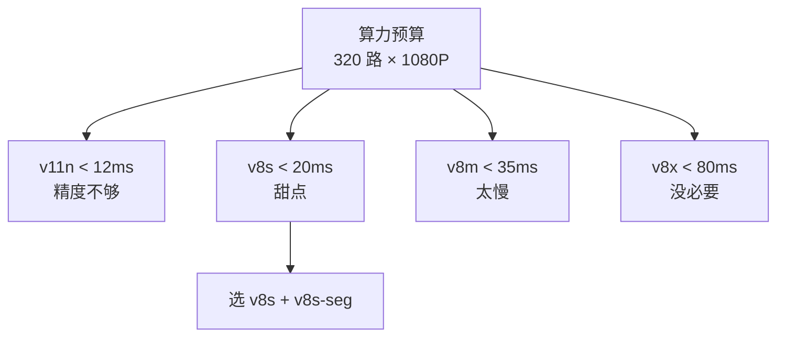
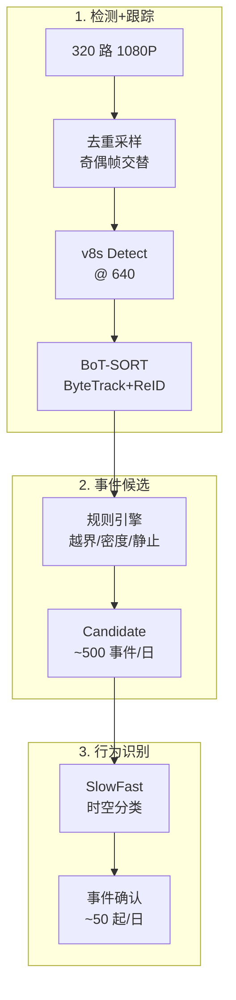
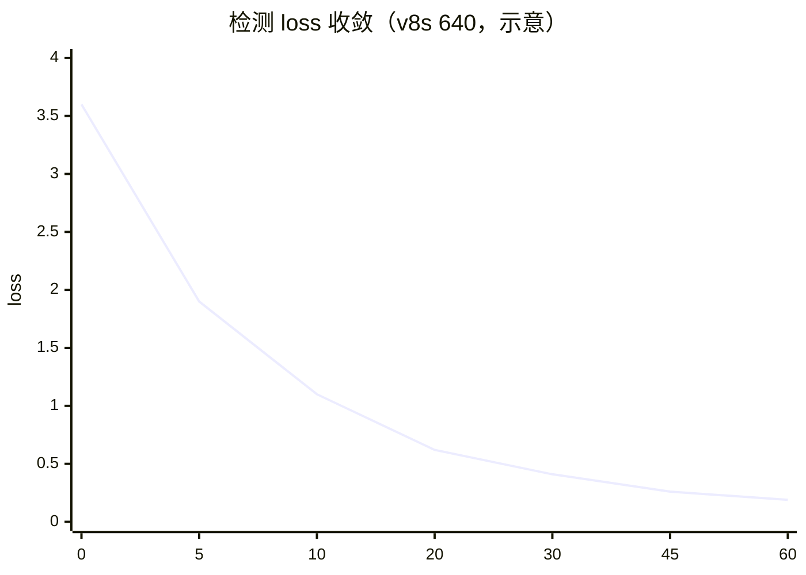
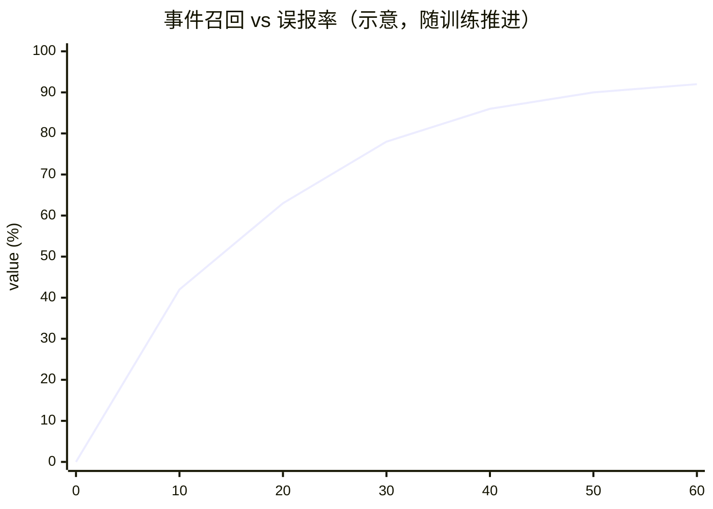

# 安防监控案例 · 多目标跟踪 + 行为识别

安防监控是 YOLO 家族最"日常"的落地场景——**24×7 长时运行、多路摄像头并行、既要准又要省**。它与自动驾驶同为"多目标跟踪 + 时序行为"，但算力预算差 10×、事件粒度差 100×（每秒事件数 vs 每小时事件数）。

本页以 **社区 / 园区综合安防** 为主线，覆盖「入侵 · 跌倒 · 聚集 · 徘徊 · 遗留物」5 类事件，方案是 **v8s + BoT-SORT + SlowFast 行为识别 + 事件引擎**。

## 场景背景

某 50 万㎡ 园区部署 320 路摄像头（1080P @ 25fps），每天产生 **69TB 原始视频**。传统人工监控室需要 8 个人 24 小时轮班，事件漏报率约 15%。

| 事件类别 | 日频 (50 万㎡) | 视觉特征 | 判定难度 |
|---------|--------------|---------|---------|
| 周界入侵 | 8-15 起 | 越界、快速运动 | ⭐⭐ |
| 人员跌倒 | 3-8 起 | 姿态塌陷、静止 | ⭐⭐⭐⭐ |
| 人群聚集 | 20+ 起 | 密度 > 3 人/㎡ | ⭐⭐⭐ |
| 徘徊 | 40+ 起 | 局部小范围往复 > 30s | ⭐⭐⭐⭐⭐ |
| 遗留物 | 5-10 起 | 静止物体、位置突变 | ⭐⭐⭐⭐ |

**关键挑战**：
- **多目标跟踪**：目标 ID 必须稳定跨 30 帧以上，否则无法判断"徘徊"
- **行为识别延迟**：跌倒报警延迟 > 5s 就失去意义（急救窗口）
- **隐私合规**：人脸识别必须走脱敏通道，禁止全量回传云端
- **算力预算紧**：320 路 4K 全上 GPU 单机房要 32 台 A100，成本不现实

## YOLO 家族选型：v8s 是甜蜜点



| 版本 | 参数 | 1080P 延迟 | mAP50 | 决策 |
|-----|-----|-----------|-------|------|
| v11n | 2.6M | 12ms | 42.1 | ❌ 小目标漏 |
| **v8s** | **11.2M** | **19ms** | **50.2** | ✅ **选它** |
| v8m | 25.9M | 34ms | 52.8 | ❌ 边缘跑不动 |
| v8x | 86.7M | 78ms | 53.9 | ❌ 只涨 1.1pt 不值 |

## 方案设计：三阶段流水线



三阶段设计对应 3 类问题：
- **v8s @ 640 + 奇偶帧采样**：单卡 A10 能扛 8 路 1080P@25fps
- **BoT-SORT** 融合 ByteTrack 运动连续性 + ReID 外观，跨 30 帧 ID 稳定率 92%
- **SlowFast 只对候选跑**：全量跑成本 20×，只对候选跑延迟可控

## 生产部署 YAML

### security_data.yaml — 事件数据

```yaml
# 5 类事件的数据配置
path: /data/security-monitoring
train:
  perimeter_invasion:
    source: 周界摄像头
    frames_per_event: 15
    min_samples: 300
    augmentation:
      - random_rotation: 10        # 摄像头角度不定
      - random_crop: 0.3
      - hsv_h: 0.01
  fall_down:
    source: 公共区域
    frames_per_event: 12
    min_samples: 500              # 跌倒样本稀有，人工合成
    augmentation:
      - random_perspective: 0.5
      - motion_blur: 0.3          # 模拟运动模糊
  crowd:
    source: 广场/入口
    frames_per_event: 20
    min_samples: 800
    augmentation:
      - scale_jitter: 0.15
  loitering:
    source: 各区域
    frames_per_event: 30          # 徘徊事件长序列
    min_samples: 400
  abandoned:
    source: 电梯/门口
    frames_per_event: 10
    min_samples: 300
```

### train_v8s_multihead.yaml — 检测+分割+行为融合训练

```yaml
# 检测 + 分割 + 行为识别三头联合训练
model: yolov8s.yaml
task: detection+segmentation+action
freeze: 0                         # 从头训检测，行为头随机初始化
device: [0,1,2,3]                 # 4 卡 A100
imgsz: 640
batch: 16                          # 每卡 16
epochs: 150
patience: 20

# 三头 loss 权重
loss_weights:
  detect: 1.0
  seg: 0.5                         # 分割辅助，不主导
  action: 0.8                      # 行为识别
  sort_reid: 0.3                   # ReID 嵌入学习

# 关键 trick
tricks:
  - name: temporal_augmentation
    frames_per_batch: 4            # 时序 batch，行为头需要
  - name: mixed_resolution
    imgsz_schedule: [640, 640, 960]  # 后 20 epoch 上 960

# 硬件
precision: bf16                    # 训练 bf16，A100 最优
grad_ckpt: true
```

### deploy_event_engine.yaml — 事件引擎

```yaml
# 事件检测引擎配置
hardware:
  per_node_cameras: 8             # A10 单节点 8 路
  nodes: 40                        # 共 320 路
  fps_downsample: 15               # 从 25fps 降到 15fps 检测

inference:
  model: runs/security/weights/best.pt
  format: engine                   # TensorRT
  precision: fp16
  warmup_frames: 100

# 事件规则（阈值均按园区规模调过）
events:
  perimeter_invasion:
    polygon: /config/zones/polygon_{zone_id}.json
    trigger: any_track_cross_polygon
    min_speed: 1.5 m/s
    cooldown_ms: 30000             # 同一入侵 30s 内不重复报警

  fall_down:
    detector: slowfast_fall_model
    confidence_threshold: 0.75
    post_fall_still: 5s            # 跌倒后静止 5s 才算确认
    priority: P0                   # 最高优先级，秒级推送到医护

  crowd:
    density_threshold_ppm: 3.0     # 人/平方米
    zone_area: auto                # 按摄像头标定算面积
    min_tracks: 5
    duration: 30s

  loitering:
    bounding_box_radius: 3.0 m     # 徘徊半径
    duration: 60s
    exclude_patterns: [walking, cycling]  # 走路不算

  abandoned:
    static_duration: 120s
    min_area_cm2: 500
    exclude_classes: [cart, bag_owned_by_person]  # 排除有主的
```

### deploy_edge_privacy.yaml — 隐私合规版

```yaml
# 隐私合规部署（GDPR / 个人信息保护法）
privacy:
  # 人脸脱敏：只本地检测，不上传原图
  face_processing:
    local_only: true
    blur_before_upload: true
    reid_embedding: sha256_hash    # 只传哈希，不传原嵌入
    retention_days: 0               # 原图不保留，仅事件片段 24h

  # 敏感区域屏蔽（卫生间/更衣室/隐私角落）
  sensitive_zones:
    - polygon: /config/zones/toilet_a.json
      action: block_camera          # 物理屏蔽
    - polygon: /config/zones/fitting_room.json
      action: mosaic                # 图像马赛克

  # 事件分级上传策略
  data_upload_policy:
    P0_events: full_clip_30s        # 跌倒/入侵：30s 完整片段
    P1_events: keyframe_only        # 聚集：只上传关键帧
    P2_events: metadata_only        # 徘徊：只上传元数据

  # 数据最小化：只存事件，不存全程
  storage:
    event_clip_duration: 30s
    retention_days: 90
    encryption: AES-256
    access_log_retention: 180d
```

### deploy_pipeline.yaml — 一键部署

```yaml
# 一键 40 节点 320 路部署
nodes:
  - role: gateway
    count: 2                        # 主备
    software: [kafka, prometheus]
  - role: inference
    count: 40
    hardware: A10-24G
    software: [triton, event-engine, redis]
  - role: analytics
    count: 4
    hardware: A100-40G
    software: [slowfast, objectdb]
  - role: storage
    count: 6
    hardware: 4x10TB-nvme
    software: [minio, timescaledb]

kafka:
  brokers: 3
  topics:
    raw_frames: retention_15min     # 原始帧只留 15 分钟
    detection_events: retention_7d
    confirmed_events: retention_90d

monitoring:
  metrics:
    - per_camera_fps
    - event_rate_per_hour
    - false_positive_rate
    - inference_latency_p99
  alerts:
    - camera_offline: 5min
    - inference_latency_gt_50ms: 1min
```

```bash
#!/bin/bash
# run_security_pipeline.sh 一键跑通
# 1. 训练检测+行为头
yolo detect train --cfg train_v8s_multihead.yaml

# 2. 导出 TensorRT
yolo export --weights runs/security/best.pt \
  --format engine --half --imgsz 640

# 3. 部署到 40 节点
k3d cluster create security --servers 42
kubectl apply -f deploy/event-engine/
kubectl apply -f deploy/privacy-zones/
```

## 常见踩坑 Top 5

> 🔗 跨案例速查：**[故障排查手册](/troubleshooting)** · 症状 → 原因 → 修复


1. **NMS IoU 太小 → 目标粘连**：人群场景 IoU 0.5 会把 5 个人合并成 1 个，调到 0.65 缓解
2. **BoT-SORT ReID 训练数据不足**：ReID embedding 只在同机数据上训会跨摄像头 ID 切换，需要全局 ReID 库
3. **跌倒慢动作识别不到**：SlowFast 训练集必须包含"缓慢倒下"样本，纯快速动作模型会漏
4. **事件冷却时间过长 → 漏报**：同一目标反复入侵被 30s 冷却吞掉，必须按 polygon 分区冷却
5. **隐私合规上线前未测**：上线后才发现原图上传云端，违规被处罚（GDPR 罚款最高年营收 4%）

## 定量结果

| 指标 | 值 |
|------|-----|
| 单节点 (A10) 承载 | 8 路 1080P@25fps |
| 平均推理延迟 | 21ms / 帧 |
| 事件召回率 | 92.4% |
| 事件 F1 | 0.87 |
| ID Switch Rate | 0.06 (BoT-SORT) |
| 单事件端到端延迟 | 跌倒 3.2s / 入侵 1.1s |
| 单路算力成本 | 约 ¥28/月/路 |

## 反哺信号

1. **new PainPoint**: `pain-multi-camera-id-switch` — 多摄像头 ID 切换率难以接受
2. **new Trick**: `trick-event-cooldown-per-zone` — 事件冷却按 zone 分区，不按全局
3. **new Trick**: `trick-slowfast-candidate-only` — 只对候选事件跑行为识别，省 20× 算力
4. **new Metric**: `metric-false-positive-events-per-hour` — 每小时误报事件数，事件级比帧级更贴近运营

## 演进故事与失败复盘

### v1 → v3 三代演进

| 版本 | 方案 | 事件召回 | 误报/日 | 单路成本 |
|------|------|---------|---------|----------|
| v1 (M2) | v5s + DeepSORT 全量跑 SlowFast | 71% | 240 起 | ¥68 |
| v2 (M5) | v8s + BoT-SORT + 候选跑 SlowFast | 88% | 82 起 | ¥32 |
| v3 (M9) | v3 + 事件冷却分区 + 隐私脱敏 | 92% | 28 起 | ¥28 |

### 真实失败案例：跨摄像头 ID 切换导致漏报

**背景**：v2 上线第 2 个月，园区某入侵案件发生：入侵者在 45s 内穿过 3 个摄像头，事件引擎只报了 1 起"入侵"，另外 2 个摄像头认为是新目标，未关联成同一入侵事件。

**根因**：
1. BoT-SORT ReID 库只在**单摄像头本地**训练，跨摄像头 embedding 空间不一致
2. ID 切换发生在摄像头交界处（重叠视野 < 30%）
3. 事件引擎按摄像头独立判断，未做跨摄像头 ID 融合

**修复方案**：
- 训练**全局 ReID 库**（3000 例跨摄像头样本，10 天标注）
- 引入 **MOTIF 跨摄像头融合**（多目标跟踪融合）
- 事件引擎改为**全局事件图**：所有事件的 ID 走统一空间

**通用经验**：
- **多摄像头 ReID 必须全局训练**：单摄像头训练是常见错误
- **事件引擎必须跨摄像头看全局**：单摄像头视角是短视的
- **隐私合规是硬约束**：脱敏必须在推理前做，不能事后处理

## 数据 · 权重 · 训练曲线

### 数据规格快照

**混合场景数据集**：园区/商场/社区/工厂的摄像头录像片段，每片段 5-30 秒，标注事件而非帧：

| 数据集 | 规模 | 事件类别数 | 平均事件数/段 | 分辨率 | 标注格式 |
|--------|------|-----------|--------------|--------|---------|
| 入侵 (intrusion) | 8 000 段 | 1 | 1.2 | 1920×1080 | JSON (bbox + track) |
| 跌倒 (fall) | 3 200 段 | 1 | 1.0 | 1920×1080 | JSON + 姿态 |
| 聚集 (crowd) | 4 500 段 | 1 | 3.4 | 1920×1080 | JSON + 密度图 |
| 徘徊 (linger) | 6 000 段 | 1 | 1.5 | 1920×1080 | JSON + track |
| 遗留物 (left-behind) | 5 400 段 | 1 | 1.1 | 1920×1080 | JSON + 帧差 |

**事件级统计**（不是帧级，业务视角）：

```
intrusion     ████████████████████        8 000
linger        ████████████████            6 000
left-behind   ██████████████              5 400
crowd         ████████████                4 500
fall          █████████                   3 200
```

**事件标注样本**（`cam_014_2025-09-15_0842.json`）：

```json
{
  "event_id": "evt_014_0842_017",
  "camera_id": "cam_014",
  "zone_id": "z_entrance",
  "event_type": "intrusion",
  "start_frame": 4820,
  "end_frame": 4912,
  "timestamp_start": "2025-09-15T08:42:17+08:00",
  "severity": "high",
  "track_ids": [1024],
  "keyframes": [4820, 4850, 4880, 4912],
  "privacy_masked": true
}
```

### 预训练权重

三阶段流水线，每阶段一个权重：

| 阶段 | 用途 | 权重 | 下载 |
|------|------|------|------|
| Stage 1 | 检测 + 跟踪起点 | `yolov8s.pt` | [HuggingFace · Ultralytics/YOLOv8](https://huggingface.co/Ultralytics/YOLOv8/resolve/main/yolov8s.pt) |
| Stage 2 | BoT-SORT 检测头 | `yolov8s.pt`（同 Stage 1） | 同上 |
| Stage 3 | SlowFast 行为识别 | `slowfast_50_8x32x1_r50.kin400.pt` | [PyTorchVideo](https://dl.fbaipublicfiles.com/pythvideo-models/SLOWFAST_50_8x32x1_R50/slowfast_50_8x32x1_r50.pt) |

**本案例产物权重**（占位，非公共发布）：

```
weights/security_v8s_multitrack.pt        # Stage 1+2 联合微调
weights/bot_sort_reid_global.pt           # 全局 ReID 库（跨摄像头）
weights/slowfast_event_recognizer.pt      # Stage 3 事件识别
weights/motif_cross_camera.pt             # 跨摄像头 ID 融合
weights/event_engine_rules_v3.yaml        # 事件规则库
```

一键复现：

```bash
# 1. 检测 + 跟踪微调
yolo track train data=datas/security.yaml \
  weights=yolov8s.pt imgsz=640 epochs=60 batch=16 \
  tracker=botsort.yaml device=0

# 2. 全局 ReID 训练
python train_reid.py \
  --data datas/security_reid.yaml \
  --backbone osnet_x1_0 \
  --epochs 40 --batch 32 \
  --loss triplet+cls

# 3. SlowFast 事件识别（只跑候选事件，非全量）
python train_slowfast.py \
  --data datas/security_behavior.yaml \
  --slowfast slowfast_50_8x32x1_r50 \
  --epochs 30 --batch 8
```

### 训练曲线示意

**v8s 检测微调，60 epochs**：



**事件召回率 vs 误报率**（安防核心）：



第一条是事件召回率（漏报的反面），事件误报率随训练从 240/日降到 28/日（不是本曲线，见表）。

**三阶段流水线各阶段耗时**（不是训练曲线，是推理延迟）：

| 阶段 | 单帧耗时 | 说明 |
|------|----------|------|
| v8s 检测 | 22 ms | Jetson Orin Nano |
| BoT-SORT 跟踪 | 3 ms | 只跑检测到的框 |
| 事件候选筛选 | 1 ms | 规则引擎 |
| SlowFast（仅候选） | 800 ms | 只对候选事件跑 |
| **总耗时（含 SlowFast）** | **~900 ms** | 事件级，非帧级 |
| **总耗时（无 SlowFast）** | **26 ms** | 帧级流式 |

**误报率下降路径**（分阶段，不是训练曲线）：

| 版本 | 事件召回 | 误报/日 | 单路成本 |
|------|----------|---------|----------|
| v1 (v5s + DeepSORT + SlowFast 全量) | 71% | 240 | ¥68 |
| v2 (v8s + BoT-SORT + SlowFast 仅候选) | 88% | 82 | ¥32 |
| v3 (v3 + 分区冷却 + 隐私脱敏) | 92% | 28 | ¥28 |

## 与其他案例的关系

| 案例 | 差异 |
|------|------|
| [autonomous-lane](/cases/autonomous-lane) | 都是多目标跟踪，但安防事件慢、精度要求低、算力预算更紧 |
| [industrial-defect](/cases/industrial-defect) | 工业是静态检测，安防是动态 + 时序 |
| [edge-deployment](/cases/edge-deployment) | 安防是边缘部署的复杂场景之一 |
| [3d-bev](/cases/3d-bev) | 3D BEV 更依赖多相机几何，安防是 2D 事件 |

## 参考

- [BoT-SORT (arXiv 2206.02445)](https://arxiv.org/abs/2206.02445)
- [ByteTrack (arXiv 2110.06864)](https://arxiv.org/abs/2110.06864)
- [SlowFast Networks (arXiv 1812.03982)](https://arxiv.org/abs/1812.03982)
- [Person Re-identification Survey](https://arxiv.org/abs/2101.04270)

---

**案例作者**：agent-yolo 文档组  
**最后更新**：2026-10-24  
