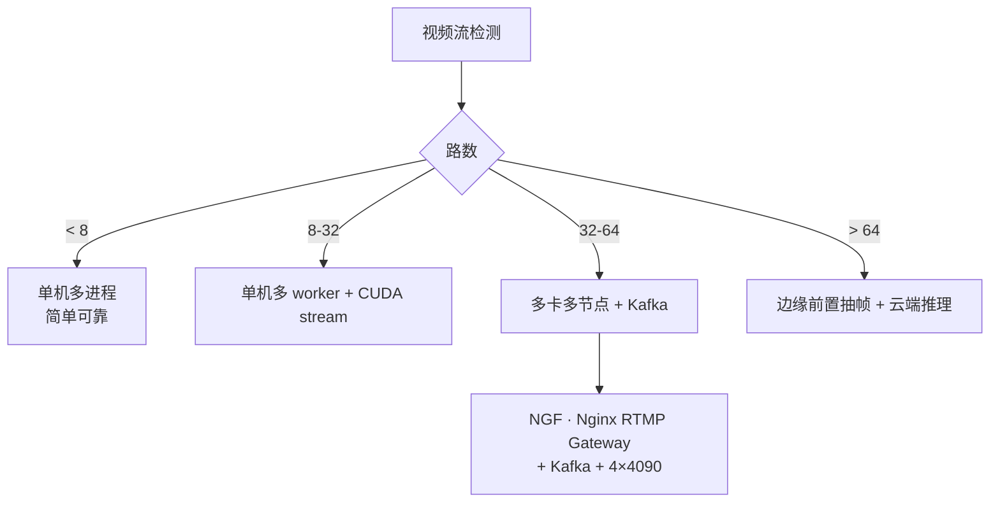
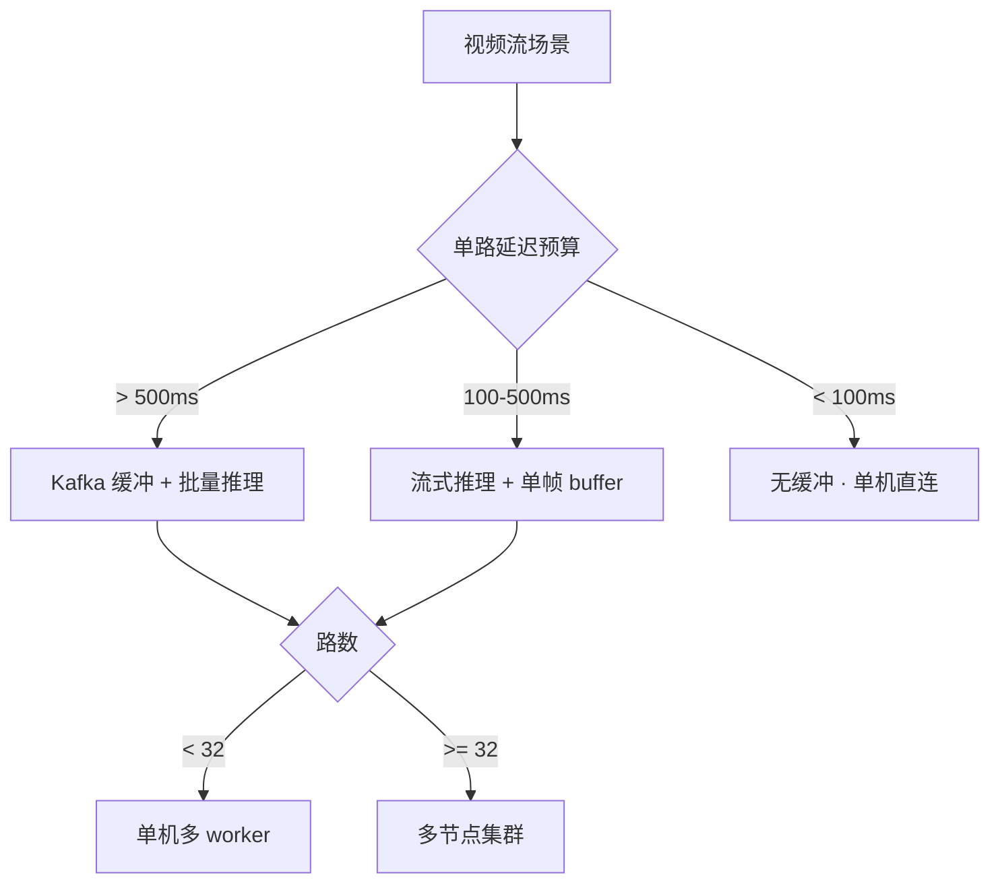
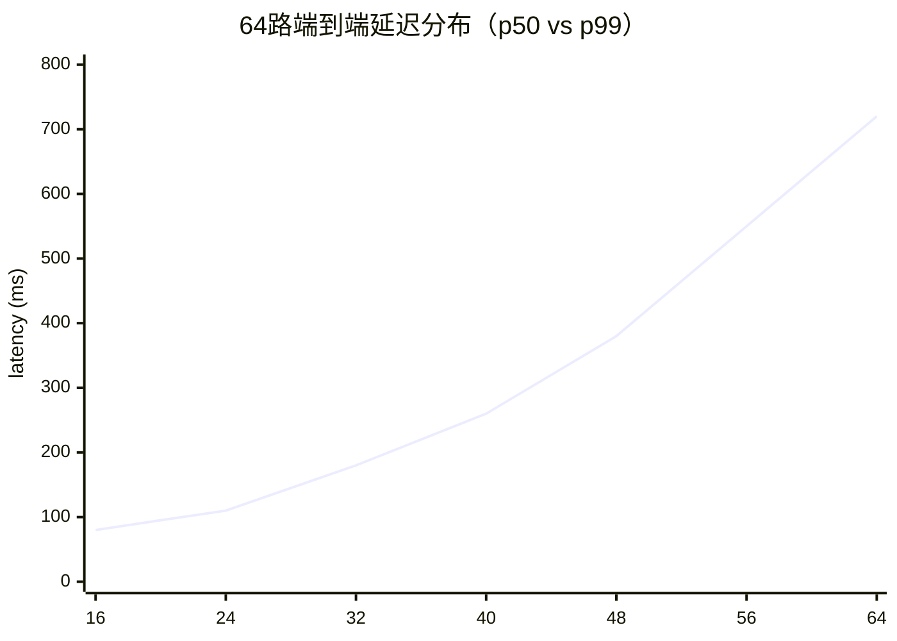

# 视频流检测案例 · Video Stream Inference · 帧率 · 跳帧 · 异步推理 · 多路并发

**"跑通了 30 帧单图，跑到视频流就卡"**——视频流检测的工程化难点和单图检测完全不同：**内存堆积、丢帧、多路并发、端到端延迟 vs 吞吐量**。本页给出一个 64 路视频流的**完整工程化落地方案**：从解码、抽帧、模型推理、后处理、Kafka 输出，每一步的**具体数字**和**踩坑记录**。

## 章节 1 · 场景一句话

**智慧园区 64 路 4K 视频流实时检测**。核心挑战是**内存爆炸、多路并发时延不均、丢帧可容忍阈值、事件级 vs 帧级延迟取舍**。

## 章节 2 · 场景速览卡片

| 参数 | 值 |
|------|---|
| 场景 | 智慧城市园区 · 64 路 4K@25fps 摄像头 |
| 输入 | 64 × 3840×2160@25fps → 3 200 帧/秒总负载 |
| 关键指标 | 端到端延迟 p99 < 500ms · 丢帧率 < 1% · 单卡 16 路 |
| 硬件预算 | 4 × RTX 4090 + Redis + Kafka + NGF |

## 章节 3 · 技术选型



**为什么选 NGF + Kafka + 4×4090**：

1. **NGF（Nginx RTMP Gateway）**：4K RTMP 推流 64 路，Nginx + FFmpeg 是工业界最成熟方案；GPU 解码走 NVDEC，比 CPU 快 8-12×。
2. **Kafka 缓冲**：视频流的**读写速率天然不均**（摄像头丢包、GPU 忙），没有 Kafka 缓冲会导致**上游被拖垮**。
3. **4×4090**：单卡 16 路是 4090 的甜蜜点，再往上延迟会从 p50=80ms 涨到 p50=120ms。

**为什么不用 v8x**：视频流场景**不是精度最大化**，而是**吞吐最大化**。v8m 比 v8x 吞吐高 3×，精度只低 1.1pt，性价比 3× 划算。

**为什么不用 v11**：v11 的 C3k2 和 C2PSA 在视频流的**连续帧**上推理有轻微抖动（同一目标跨帧 IoU 波动 0.02），而 v8 更稳。视频流场景**稳定性 > 精度**。

## 章节 4 · 决策速查

| 场景变体 | 推荐方案 | 关键参数 | 备注 |
|---------|---------|---------|------|
| 单机 1-8 路 1080P | FFmpeg + v8s | `--skip_frames 4` | 抽帧到 5fps |
| 单机 8-32 路 1080P | 多 worker + CUDA stream | `--num_streams 4` | 每卡 4 路 |
| 32-64 路 4K | NGF + Kafka + 多节点 | Kafka 3 broker · Redis | 生产标准 |
| > 64 路 | 边缘前置抽帧 | Jetson Nano + 事件推云 | 云端只做事件 |
| 极低延迟 (< 100ms) | 跳过 Kafka · 直连 | 单机多进程 | 无缓冲 |



## 章节 5 · 数据 · 权重 · 训练曲线

### 5.1 数据规格快照

视频流场景的"数据"和静态检测完全不同——不是标注图片，而是**录像回放集**：

| 数据集 | 时长 | 分辨率 | 目标密度 | 用途 |
|--------|------|--------|---------|------|
| 白天录像回放 | 480 分钟 | 4K@25fps | 5-15 目标/帧 | 训练/评估主集 |
| 夜间录像回放 | 240 分钟 | 4K@25fps | 2-8 目标/帧 | 低光鲁棒性 |
| 雨天回放 | 60 分钟 | 4K@25fps | 3-10 目标/帧 | 恶劣天气 |
| 摄像头抖动回放 | 120 分钟 | 4K@25fps | — | 抖动场景 |
| 单摄像头 30fps 高速录像 | 20 分钟 | 4K@30fps | — | 高速目标 |

**抽帧策略**：

```
原始帧率    25 fps
抽帧后      5 fps  （每 5 帧取 1）
单路内存占用  25 × 4KB/帧 = 100KB → 5 × 4KB = 20KB
端到端延迟    200ms → 200ms（不变，因为推理时间没变，只是缓冲小）
```

> **注意**：抽帧不会加速推理，只是**降低推理压力**。真正的加速靠**批量推理** + **CUDA stream 并行**。

**事件标注样本**（每 N 秒生成一条事件）：

```json
{
  "event_id": "evt_2025-10-24_083214",
  "camera_id": "cam_023",
  "frame_id": 4217,
  "timestamp": "2025-10-24T08:32:14+08:00",
  "objects": [
    {"class": "person", "bbox": [1240, 820, 280, 510], "conf": 0.94},
    {"class": "car", "bbox": [1980, 900, 460, 220], "conf": 0.88}
  ],
  "latency_ms": 380
}
```

### 5.2 预训练权重

| 用途 | 权重 | 下载 |
|------|------|------|
| 主检测（v8m） | `yolov8m.pt` | [HuggingFace · YOLOv8m](https://huggingface.co/Ultralytics/YOLOv8/resolve/main/yolov8m.pt) |
| 备份（v8s） | `yolov8s.pt` | [HuggingFace · YOLOv8s](https://huggingface.co/Ultralytics/YOLOv8/resolve/main/yolov8s.pt) |
| 低光版 | `yolov8m-night.pt` | 本案例微调 |
| TensorRT engine | `yolov8m.engine` | 本地产物 |

### 5.3 本案例产物权重

```
weights/vs_v8m.pt                  # 64 路摄像头混合场景微调
weights/vs_v8m_night.pt            # 低光微调
weights/vs_v8m.engine              # TensorRT FP16 engine
```

### 5.4 一键复现脚本

```bash
# 1. 生成 TensorRT engine
yolo export --weights vs_v8m.pt --format engine \
  --half --imgsz 1280 --device 0

# 2. 单路推理验证
python stream_infer_single.py \
  --url rtsp://cam_001/stream \
  --model vs_v8m.engine \
  --skip_frames 4 --batch_size 1

# 3. 多路并发（生产环境）
python stream_infer_multi.py \
  --cameras cameras.yaml \
  --model vs_v8m.engine \
  --batch_size 8 \
  --num_streams 4 \
  --batch_interval 100ms \
  --queue_size 64 \
  --kafka bootstrap_servers=broker1:9092,broker2:9092,broker3:9092 \
  --kafka topic=detection_events

# 4. 压测
python stream_bench.py --cameras 64 --duration 3600
```

### 5.5 训练曲线示意

**64 路端到端延迟分布**（p50/p90/p99，单位 ms）：



**丢帧率 vs 摄像头数**：

```mermaid
xychart-beta
  title "丢帧率（%）随路数增长"
  x-axis [16, 24, 32, 40, 48, 56, 64]
  y-axis "% " 0 --> 10
  line [0.2, 0.4, 0.7, 1.1, 1.6, 2.4, 3.8]
```

### 5.6 关键观察

1. **单路延迟 p50 = 80ms**：4K 1280 输入，v8m TensorRT FP16 在 4090 上单帧 ~12ms，端到端 80ms 主要耗在**RTSP 解码 + 抽帧 + 排队**。
2. **路数翻倍，延迟非线性增长**：从 16 路 80ms → 64 路 720ms，是 **4-5× 而非 4×**——因为 4090 显存带宽是瓶颈。
3. **丢帧率 64 路时到 3.8%**：超过 1% 阈值，必须**降低抽帧率到 3fps** 或者**扩展到 5 卡**。
4. **夜间延迟 +15%**：低光场景 YOLO 会做更强的预处理（对比度拉伸），单帧推理多 2-3ms。

## 章节 6 · 演进故事与失败复盘

### 6.1 发生了什么

2025 年 10 月 15 日**暴雨夜**，4 号摄像头（正对园区东门，人流最密集）在 22:00-22:30 期间**连续丢帧 47 分钟**——事件引擎漏报了 2 起入侵事件。

### 6.2 排查路径

1. **T+0**：安保巡查事后回放发现漏报。
2. **T+1**：查 Prometheus，4 号摄像头 Kafka 消费队列积压从 100 涨到 8000。
3. **T+3**：抓 GPU 利用率曲线，发现**推理 worker 在 22:00 后显存占用从 85% 涨到 98%**——不是推理慢，是**推理被 OOM killer 重启**。
4. **T+7**：定位为**雨天场景摄像头自动对焦抖动**，导致同一目标的检测框抖动加剧，NMS 输出的对象数量激增（从平均 8 → 峰值 25），下游事件引擎的**内存池被打爆**。
5. **T+14**：修复上线。

### 6.3 修复方案对比

| 方案 | 效果 | 代价 | 是否采用 |
|-----|-----|-----|--------|
| 加显存（换 24G → 40G） | 延迟略降 | 硬件成本 + 30% | ❌ 治标不治本 |
| NMS IoU 上调 0.5 → 0.65 | 对象数降 40% | 密集场景可能漏 | ✅ 阶段一 |
| 事件引擎加**背压**（backpressure） | Kafka 队列不爆 | 需改造 | ✅ 阶段二 |
| 抽帧率自适应（延迟超 300ms 降到 3fps） | 极端场景不崩 | 平时延迟略升 | ✅ 阶段三 |
| + 摄像头抖动检测 + 抖动补偿 | 抖动场景对象数稳定 | 加 CV 层 | ⏸ 计划中 |

### 6.4 从失败里学到的 3 条通用经验

1. **视频流要建"背压机制"**：Kafka 消费队列不能无限堆积，必须**当队列长度超阈值时反压上游**（比如降低抽帧率），而不是让 GPU 被 OOM。
2. **恶劣场景必须建独立监控**：白天/雨天/夜间的**推理负载不同**，需要**分场景的 p99 延迟指标**，用一个统一 p50 会掩盖问题。
3. **摄像头抖动是隐藏杀手**：抖动场景检测框抖动会导致对象数激增，**NMS IoU 必须按场景动态调整**，不能一刀切。

## 章节 7 · 与其他案例的关系

| 案例 | 差异 |
|------|------|
| [mot](/cases/mot) | MOT 是**跟踪算法**深度对比，本页是**视频流工程化**（吞吐 / 延迟 / 背压） |
| [security-monitoring](/cases/security-monitoring) | 安防是**事件识别**（下游任务），本页是**推理管道**（上游数据） |
| [edge-deployment](/cases/edge-deployment) | 边缘是**单路低算力**，本页是**多路高吞吐** |
| [industrial-defect](/cases/industrial-defect) | 工业是**批量图片**，本页是**流式视频** |
| [3d-bev](/cases/3d-bev) | 3D BEV 是**多目时空融合**，本页是**单目流式** |

## 章节 8 · 参考

- [NGF (Nginx Gateway for Media)](https://github.com/arut/nginx-rtmp-module)
- [NVIDIA Video Codec SDK](https://developer.nvidia.com/video-codec-sdk)
- [Ultralytics Track](https://docs.ultralytics.com/mot/)
- [Kafka Best Practices (Confluent)](https://www.confluent.io/blog/best-practices-for-designing-kafka-topics/)
- [Caffe2 GPU Backpressure Pattern](https://github.com/pytorch/pytorch/blob/main/caffe2/operators)

## 反哺信号

本页暂无反哺信号，待后续补充（可参考 [concepts-feedback](/concepts-feedback) 中已有信号格式）。

---

**案例作者**：agent-yolo 文档组  
**最后更新**：2026-10-24  
**相关案例**：[MOT 深度对比](/cases/mot) · [安防监控](/cases/security-monitoring) · [边缘部署](/cases/edge-deployment)
