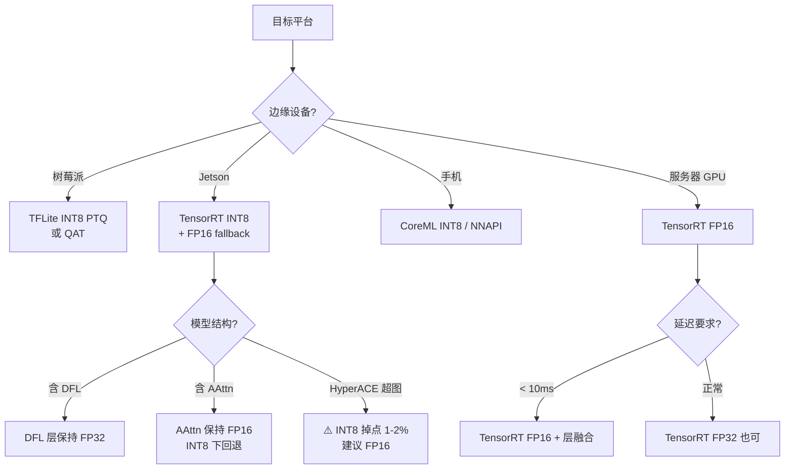
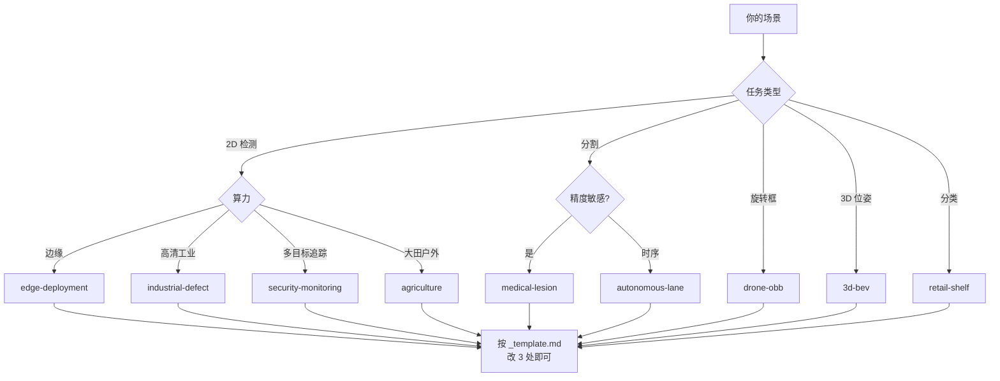
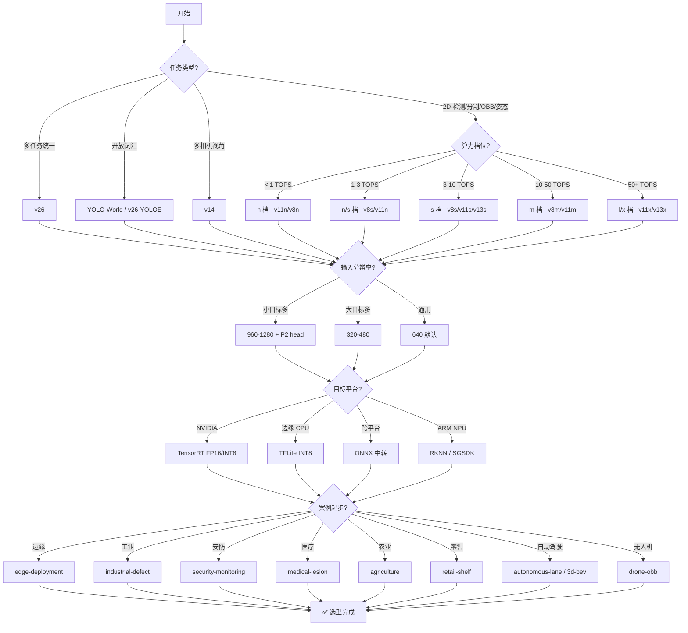

# 模型选型决策树

从"我要解决什么问题"到"哪个 YOLO 版本 + 哪个尺寸 + 什么量化 + 什么部署工具链"，5 分钟给出推荐。**如果这一页给不出结论，说明问题还需要更细的输入**——那就去看 [compare-matrix](/compare-matrix) 或 [cases/compare](/cases/compare) 找最接近的场景案例。

> **这一页存在的意义**：读者最常问的两个问题——"我该选哪个版本"和"我该选哪个案例起步"——目前散落在 14 个版本页和 9 个案例页里。**这里把这两条路汇成一张决策图**。

**配合阅读**：具体数字 → [基准数据](/benchmarks) · 结构差异 → [对比矩阵](/compare-matrix) · 为什么这么改 → [演化故事](/evolution-story)

---

## 一句话总纲

**决策顺序是：场景类型 → 算力预算 → 单/多任务 → 输入分辨率 → 量化需求 → 部署平台 → 案例模板**。跳过任何一步都会导致选型返工。

---

## 起点 1：从"任务类型"分岔

不是所有 YOLO 版本都支持所有任务。先按任务把版本池筛一遍。

| 任务类型 | 支持的版本 | 首选案例 |
|---------|-----------|---------|
| 2D 目标检测 | v1 ~ v26 全系 | 看下面算力维度 |
| 2D 实例分割 | v5+ / v8+ 成熟 / v11 / v26 | [medical-lesion](/cases/medical-lesion) / [autonomous-lane](/cases/autonomous-lane) |
| 姿态估计 (Pose) | v5+ / v8+ 成熟 / v11 / v26 | 未覆盖，可参考 retail-shelf 分类思路 |
| 旋转框 (OBB) | v8-OBB / v11-OBB / v26 | [drone-obb](/cases/drone-obb) |
| 3D BEV 位姿 | v11-3D + BEVFormer（外挂） | [3d-bev](/cases/3d-bev) |
| 分类 | v8c / v11c / v26 | [retail-shelf](/cases/retail-shelf) 分层路由 |
| 深度估计 | 仅 v26 | 无案例，参考 YOLO-Omni 论文 |
| 语义分割 | 仅 v26 | 无案例 |
| 开放词汇 (YOLOE) | v26 内嵌 / [YOLO-World](/derivatives/yoloworld/index) 独立 | [retail-shelf](/cases/retail-shelf) 用 LoRA 增量 |

**决策提示**：
- **只有检测需求** → 直接进"起点 2：算力预算"
- **多任务需求（分割+检测+OBB）** → **v26 是唯一答案**，直接跳到 [v26](/versions/v26/index)
- **开放词汇** → 二选一：v26 内嵌 YOLOE（省事） / 独立 YOLO-World（灵活、社区大）
- **3D 位姿** → YOLO 只是相机前端，主战场在 BEV 网络，看 [3d-bev](/cases/3d-bev)

---

## 起点 2：算力预算与硬件档位

**这一档决定模型的 n/s/m/l/x 档位**。9 大案例实测数据归纳出下面这张"算力→档位"映射：

| 算力档位 | 典型硬件 | 推荐档位 | 代表模型 | 典型场景 |
|---------|---------|---------|---------|---------|
| **< 1 TOPS** | 树莓派 4B/5、手机 A17/A18 | n 档 | v11n / v8n | edge-deployment / agriculture |
| **1-3 TOPS** | Jetson Nano / Xavier NX | n/s 档 | v8s / v11n | edge-deployment（工业入门） |
| **3-10 TOPS** | Jetson Orin Nano / Orin | s 档 | v8s / v11s / v13s | industrial-defect / security-monitoring |
| **10-50 TOPS** | Jetson Orin AGX / RTX 3060 | m 档 | v8m / v11m | autonomous-lane / medical-lesion |
| **50+ TOPS** | Orin AGX 64GB / RTX 3090 / A100 | l/x 档 | v11x / v13x | autonomous-lane / 3d-bev / drone-obb |

**参考数据**（来源：[cases/compare](/cases/compare) 汇总）：
- v11n / 640 输入 / Orin：**12ms**（FP16）
- v13s / 1280 输入 / Orin：**45ms**（FP16）
- v11x / 1920 输入 / Orin AGX：**78ms**（FP16，双头）
- v11-3D + BEVFormer / 900×6 相机 / Orin AGX：**87ms**（端到端）

**决策提示**：
- **不确定硬件** → 按目标场景倒推：手机 → n 档；工业相机 → s 档；车端 → m/l/x 档
- **算力充裕但延迟敏感** → 优先选 n 档而非升硬件（推理成本差 5-10 倍）
- **多路并发**（安防 N 路摄像头） → 单路 n/s 档 + 服务器级 GPU，比 1 路大模型便宜

---

## 起点 3：主版本选择

从 n/s/m/l/x 档位确定后，选主版本。这里有一个"甜区模型"：

```mermaid
flowchart TB
  A[需求] --> B{是否要多任务?}
  B -->|是| C[⭐ v26<br/>8 任务统一]
  B -->|否| D{是否需要开放词汇?}
  D -->|是| E{偏好}
  E -->|内嵌| C
  E -->|独立/社区| F[YOLO-World / YOLOE]
  D -->|否| G{是否要多相机/多视角?}
  G -->|是| H[YOLOv14 (Omni)<br/>⚠️ 学术线]
  G -->|否| I{核心诉求?}
  I -->|极致速度/边缘| J[⭐ v11<br/>C3k2 · 2.6M]
  I -->|最佳精度/科研| K[⭐ v13<br/>DSC3k2+HyperACE]
  I -->|生态最成熟| L[⭐ v8<br/>C2f · 生态最全]
  I -->|NMS-free 研究| M[v10 学术<br/>v26 工程]
  I -->|多视角+多相机| H
```

### 五档推荐 · 一句话说明

| 版本 | 一句话卖点 | 什么时候选 |
|-----|-----------|-----------|
| **v8** | 生态最成熟、教程最多、坑最少 | 生产环境、外包/协作项目、快速上线 |
| **v11** | 综合最优（速度+精度+体积） | 边缘到服务器的通用选型 |
| **v13** | 精度前沿、支持注意力 | 有精度瓶颈、科研、竞赛 |
| **v10** | NMS-free 首次落地 | 只需要学术验证、不用上线 |
| **v12** | 引入 AAttn 面积注意力 | 需要 Transformer 组件但算力够用 |
| **v14** | 多相机/多视角 | 360° 全景 / 无人机球面图像 |
| **v26** | 唯一 8 任务统一 | 一个模型覆盖检测+分割+姿态+OBB+分类+深度+语义+YOLOE |

**决策提示**：
- **"我要最快"** → v11n（不是 v26，因为 v26 是六任务统一，backbone 更重）
- **"我要最高精度"** → v13s（不是 v26，v26 精度接近但生态不成熟）
- **"我要一个模型搞定所有"** → v26（没有替代品）
- **"我要多相机/多视角"** → v14（学术线，工程落地需自行验证）

---

## 起点 4：输入分辨率

分辨率直接决定精度-速度权衡。**默认选 640**，只有特定场景才改。

| 输入分辨率 | 适用场景 | 关键考虑 |
|-----------|---------|---------|
| **320-480** | 边缘设备极致压缩 | 小目标召回 <30%，需 P2 head 补偿 |
| **640**（默认） | 通用场景 | YOLO 系列默认，无需思考 |
| **960** | 高分辨率图像 | FLOPs +225%，速度下降 30-40% |
| **1024** | 医疗/工业大分辨率 | 需要 A100/Jetson Orin AGX |
| **1280** | 工业高清缺陷检测 | 显存占用 4-6GB |
| **1920** | 自动驾驶 6 目融合 | 必须分相机处理或分块 |

**决策提示**：
- **小目标占多数**（PCB 缺陷、细胞、遥感） → 640 不够，考虑 960/1280 + P2 head（stride=4）
- **大目标为主**（车辆、人、货架大箱） → 640 足够，甚至 480 都可以
- **大图航拍** → 分块处理（tile + overlap）比拉高主分辨率更快

---

## 起点 5：量化策略

**这一步决定"训练完的模型能不能上线"**。9 大案例的反哺信号里，量化是最高频的踩坑点。



### 量化友好度速查

| 版本 | PTQ 掉点 | QAT 可行 | 关键约束 |
|------|---------|---------|---------|
| v8n/s | 0.5-1.0% | ✅ | 生态最成熟 |
| v11n/s | 0.5-1.2% | ✅ | C3k2 stride 变化需校准 |
| v13s | 1.0-2.0% | ✅ 但需调 | HyperACE 超图量化不友好 |
| v14n | 未大规模实测 | ⚠️ | CircularConv 需自定义 kernel |
| v26 | 0.5-1.5% | ✅ | End2End 头量化后 topk 需重调 |

### 三条铁律（来自 9 大案例反哺）

1. **DFL 层必须 FP32**——车道线抖动会从 2cm 涨到 6cm（[autonomous-lane](/cases/autonomous-lane) 事故复盘）
2. **NMS IoU 阈值在 INT8 下需重调**——量化让分数曲线右移，0.5 阈值变得过严（[edge-deployment](/cases/edge-deployment)）
3. **AAttn 在 INT8 下不可用**——FlashAttention 依赖 FP16/BF16，v12 骨干的 AAttn 在 INT8 下必须回退（[medical-lesion](/cases/medical-lesion)）

---

## 起点 6：部署工具链

不同平台有各自的推理框架，选错会浪费大量迁移成本。

| 目标平台 | 首选工具链 | 备选 | 参考案例 |
|---------|-----------|-----|---------|
| **NVIDIA GPU / Jetson** | TensorRT | ONNX Runtime GPU | industrial-defect / autonomous-lane |
| **移动端 iOS** | CoreML | MLC | 未覆盖 |
| **移动端 Android** | TFLite / NNAPI / MLC | ONNX Runtime Mobile | 未覆盖 |
| **边缘 CPU（Raspberry Pi / ARM）** | TFLite / ONNX Runtime | NCNN / MNN | edge-deployment / agriculture |
| **边缘 NPU（Rockchip / SigmaStar）** | RKNN / SGSDK | ONNX 中转 | 未覆盖 |
| **通用服务器** | ONNX Runtime | TensorRT / OpenVINO | security-monitoring |
| **浏览器/Web** | WebGPU / ONNX Runtime Web | TFLite.js | 未覆盖 |
| **嵌入式 MCU（ESP32 / STM32）** | ESP-DL / CMSIS-NN | TFLite Micro | 未覆盖 |

**决策提示**：
- **默认选 TensorRT**（如果是 NVIDIA 硬件）——生态最全、优化最深
- **跨平台需求**（同一模型部署到多个硬件） → 用 ONNX 作中间格式，各平台各自转换
- **ARM 边缘（Raspberry Pi）** → TFLite 是唯一成熟选择，NCNN/MNN 是国产备选

---

## 起点 7：案例模板起步

**不要从零开始**。挑一个最接近你场景的案例作为脚手架，改 domain/task/data 三处即可。



### 场景→案例速查

| 你的场景一句话 | 起点案例 |
|--------------|---------|
| "我在树莓派/Jetson 上跑 30fps 检测" | [edge-deployment](/cases/edge-deployment) |
| "我要在 PCB/面板上找小缺陷" | [industrial-defect](/cases/industrial-defect) |
| "我要多路摄像头做事件报警" | [security-monitoring](/cases/security-monitoring) |
| "我要做 3D 自动驾驶感知" | [3d-bev](/cases/3d-bev) |
| "我要在货架上识别 3000 个 SKU" | [retail-shelf](/cases/retail-shelf) |
| "我要做医学影像分割" | [medical-lesion](/cases/medical-lesion) |
| "我要检测大面积田里的病害" | [agriculture](/cases/agriculture) |
| "我要在俯视航拍图上找旋转车辆" | [drone-obb](/cases/drone-obb) |
| "我要做车道线实时分割" | [autonomous-lane](/cases/autonomous-lane) |

### 迁移三问

1. **数据**：数据集结构能复用吗？（YOLO txt vs COCO JSON vs VOC XML）
2. **训练**：类别数、输入尺寸、增强策略需要改吗？
3. **部署**：目标硬件与案例硬件一致吗？（不一致则量化/工具链要重新调）

---

## 完整决策流程图

把上面 7 步串起来看：



---

## 常见决策陷阱

| 陷阱 | 表现 | 正确做法 |
|-----|-----|---------|
| **只看 mAP，不看推理速度** | 选 v13x，上线发现延迟 200ms | 先定延迟上限，再选档位 |
| **忽略量化友好度** | 选 v12/v13，INT8 掉点 2%+ | 生产环境先 PTQ 试跑再选型 |
| **默认 640 输入** | 小目标召回 <50% | 先看数据集小目标占比再定分辨率 |
| **只考虑精度不考虑数据量** | v13 用 500 张数据，反而不如 v8 | 小数据优先选结构简单、易泛化的版本 |
| **忽略多任务收益** | 一个模型跑一个任务，多个模型重复部署 | 有 2+ 任务需求直接考虑 v26 |
| **忽视部署工具链** | 训练完发现 TensorRT 不支持某算子 | 训练前就用 TensorRT Builder 试跑一次 |
| **只测 FP32 就上线** | 上线 INT8 后抖动、误报暴涨 | 生产必测 FP16 + INT8 + QAT 三档 |
| **忽视硬件一致性** | Jetson 上跑通的模型换到 Orin 崩 | 硬件升级后重新量化，别直接搬模型 |

---

## 三张对照表联动

本页与下面两张横向页面是**互补关系**：

| 页面 | 视角 | 什么时候看 |
|-----|-----|-----------|
| **本页（决策树）** | 场景→版本 | 有具体需求、想快速定位 |
| **[compare-matrix](/compare-matrix)** | 版本→对比 | 想理解版本差异、看演进轨迹 |
| **[cases/compare](/cases/compare)** | 案例→速查 | 想直接抄案例做脚手架 |

**典型阅读路径**：
1. 不确定选哪个版本 → 看本页
2. 想了解为什么这么选 → 看 compare-matrix
3. 想直接抄某个场景的完整方案 → 看 cases/compare
4. 想理解每代为什么这么改 → 看 [evolution-story](/evolution-story)
5. 想写新案例 → 看 [cases/_template](/cases/_template)

---

## 一句话推荐（懒人版）

不知道选哪个？按下面三条默认走：

| 场景 | 默认推荐 |
|-----|---------|
| **通用生产环境** | v8s + 640 + TensorRT FP16 |
| **边缘部署** | v11n + 640 + TFLite INT8 |
| **多任务** | v26 + 按需选输入分辨率 |

其他所有场景，先看 [cases/compare](/cases/compare) 找最接近的案例，再从案例回到本页确认版本。
