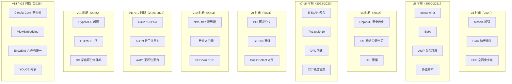

# YOLO 版本对比矩阵

从 [v1](/versions/v1/index) 到 [v26](/versions/v26/index)，14 个主版本 × 40+ 子版本在**骨干、头、损失、分配、量化友好度**上的横向对齐。

> **这一页存在的意义**：各版本页把"自己相对上一代做了什么"讲得很透，但**读者想快速建立全貌时得在 14 个页面之间来回跳**。这里把所有差异汇总成一张表，**5 分钟看完整个家族的技术演进轨迹**。

## 一句话总纲

**从 v1 的"单头 24 层 conv + 直接回归"出发，历经三代架构（Grid 回归 → Darknet + Anchor → CSP + Anchor-free），最终收敛到 v8 的 C2f + DFL 现代体系。v9/v10 试图超越它（NMS-free、双头双分配），v11/v12/v13 把注意力引入骨干并进一步压缩头，v14 与 v26 分别从学术和官方线走多任务统一。**

## 骨干演进（Backbone）

| 版本 | 骨干 | 关键结构 | 参数量（n 档） |
|-----|------|---------|--------------|
| [v1](/versions/v1/index) | 24-layer conv 自研 | 全 3×3 conv，无残差 | 6.3M |
| [v2](/versions/v2/index) | Darknet-19 | 首个残差（maxpool→conv 组合） | 11.0M |
| [v3](/versions/v3/index) | Darknet-53 | 全残差，Deep Darknet | 61.9M |
| [v4](/versions/v4/index) | CSPDarknet53 | **CSP 首次引入**（梯度分流） | 51.7M |
| [v5](/versions/v5/index) | CSPDarknet53 | 工程化 + yaml 驱动 | 7.4M（s） |
| [v6](/versions/v6/index) | **EfficientRep** | **RepVGG 重参数化**骨干与 Neck | 4.3M（s） |
| [v7](/versions/v7/index) | **ELAN / E-ELAN** | 聚合网络，梯度路径优化 | 10.9M（s） |
| [v8](/versions/v8/index) | **C2f** | CSP 的第二代：更多梯度分支 | 11.2M（s） |
| [v9](/versions/v9/index) | **GELAN** | 两级级联 C3k，+ PGI 辅助分支 | 7.2M（n） |
| [v10](/versions/v10/index) | C2f + **SCDown** + **C2fCIB** | 大核卷积 + 结构重参数化 | 2.3M（n） |
| [v11](/versions/v11/index) | **C3k2**（骨干主体） | 更粗粒度 C3k，减少重复 | 2.6M（n） |
| [v12](/versions/v12/index) | C3k2 + **A2C2f**（P4/P5） | **首次把注意力装进骨干** | 2.6M（n） |
| [v13](/versions/v13/index) | **DSC3k2 ×7 + A2C2f ×2** | **深度可分离** + 稀疏注意力 | 2.4M（n） |
| [v14](/versions/v14/index) | **CircularConv + DeformableA2C2f** | 多相机/多视角感知 | 2.5M（n） |
| [v26](/versions/v26/index) | **C2PSA 回归**（C3k2 + psablock） | 一体化 PSABlock | 2.4M（n） |

**读法**：
- 骨干结构从"纯 conv 堆叠"（v1）到"残差 + 空间金字塔"（v3-v4）到"梯度分流 CSP"（v5）到"重参数化"（v6）到"C2f 梯度富集"（v8），**v8 是骨干设计的分水岭**。
- v12 是**注意力进入骨干**的起点（A2C2f），v13 把注意力稀疏化（DSC3k2），v14 把注意力变形化（Deformable）。
- v26 有意"回归"到 v11 的 C2PSA——**放弃 v12/v13 的稀疏注意力路线**，走一体化 PSABlock。

## 检测头演进（Head）

| 版本 | Head 类型 | 分配方式 | NMS |
|------|-----------|---------|-----|
| [v1](/versions/v1/index) | 单头 7×7 | 硬分配（每格最多 1 类） | 有 |
| [v2](/versions/v2/index) | 单头 13×13 + 5 anchor | 硬分配 | 有 |
| [v3](/versions/v3/index) | 三头 13/26/52 + 9 anchor | 硬分配 | 有 |
| [v4](/versions/v4/index) | 三头 + 18 anchor | 硬分配 | 有 |
| [v5](/versions/v5/index) | 三头 80/40/20 + 9 anchor | **多正样本** | 有 |
| [v6](/versions/v6/index) | **anchor-free 解耦** | **TAL（标签分配学习）** | 有 |
| [v7](/versions/v7/index) | 三头 anchor-based + BoF | 粗到细双头分配 | 有 |
| [v8](/versions/v8/index) | **anchor-free 解耦** + DFL | **TAL topk=10** | 有 |
| [v9](/versions/v9/index) | **DualDDetect** 双头 | **双分配器**（PSC + ATFL） | 有 |
| [v10](/versions/v10/index) | v10Detect 双头 | **一致性双分配**（one2many + one2one） | **无（NMS-free）** |
| [v11](/versions/v11/index) | Detect 单头（回归 NMS） | TAL topk=13 | 有 |
| [v12](/versions/v12/index) | Detect + `legacy=False` | TAL topk=10，α=0.5 | 有 |
| [v13](/versions/v13/index) | Detect + HyperACE 超图 | 沿用 | 有 |
| [v14](/versions/v14/index) | Detect + ViewEmbedding | 沿用 | 有 |
| [v26](/versions/v26/index) | **End2End 双分支**（reg_max=1） | 端到端 topk | **无（NMS-free）** |

**关键决策点**：
- **v6 首次 anchor-free + 解耦**——这是整个 YOLO 家族最大的一次范式转变。v7 尝试倒退回 anchor-based 但被 v8 否定，v8 正式确立 anchor-free 是主流。
- **v10 首次 NMS-free**——把 NMS 从后处理挪进训练。v11 立刻回归 NMS（工程权衡），v26 再次以 `end2end=True` 完成回归。
- **v9 DualDDetect 的双头双分配**思路被 v10 吸收并简化为"一致性双分配"，之后 v11 又把双头简化回单头——**"做加法"和"做减法"在同一代版本里来回摇摆**是 YOLO 家族的常态。

## 损失函数演进

| 版本 | 分类损失 | 边界损失 | 备注 |
|-----|---------|---------|------|
| v1 | L2 | L1 | 早期 SSE |
| v2 | BCE | L1 | + log-space 回归 |
| v3 | **Logistic**（类别） | BCE + L1 | 多标签解耦 |
| v4 | **Focal-类**（objectness） | **CIoU** | 引入 CIoU 与 Mosaic |
| v5 | BCE | **CIoU** | 沿用 v4 边界损失 |
| v6 | **VFL**（v6.3 起） | **CIoU + DFL** | 虚拟 Focal Loss + 分布焦点损失 |
| v7 | BCE | CIoU | 回归 v5 损失 |
| v8 | BCE | **CIoU + DFL** | DFL 内建在 head |
| v9 | BCE | CIoU + DFL | DualDDetect 双分配 |
| v10 | BCE | **CIoU**（DFL 移除） | 单点分配，不用 DFL |
| v11 | BCE | CIoU + DFL | 回归 v8 损失 |
| v12 | BCE | CIoU + DFL | 沿用 |
| v13 | BCE | CIoU + DFL | 沿用 |
| v14 | BCE | CIoU + DFL | 沿用 |
| **v26** | BCE | **CIoU，reg_max=1（DFL 退化）** | DFL 层退化为 Identity |

**注意**：v10 是**唯一一个完全去除 DFL 的版本**——它发现 DFL 增加 64 维输出维度、对 NMS-free 推理没帮助，直接返回 4 维 ltrb。v26 通过 `reg_max=1` 复现了 v10 的做法，但保留接口兼容 v11 生态。

## 关键 Trick 一览



## 五档性能对比（COCO AP）

```mermaid
xychart-beta
  title "各版本 COCO AP 五档对比（作者官方数字）"
  x-axis [1, 2, 3, 4, 5, 6, 7, 8, 9, 10, 11, 12, 13]
  y-axis "AP" 30 60
  line [49.7, 52.5, 52.2, 54.0, 46.5, 45.0, 49.6, 50.2, 51.5, 51.6, 49.7, 50.0, 48.0]
```

> 上表为各版本"s 档"或对应中等档位的官方报告值。v1-v4 是单档，用其唯一档位值；v5+ 用 s 档。

**读法**：
- v1→v4 稳步提升，v4 达到当时的 54.0 峰值。
- v5 的 s 档因为参数量压缩回 46.5，但**同等硬件下的推理速度大幅提升**（工程化胜利）。
- v6 因为重参数化，参数量进一步降但精度持平。
- v8 达到 50.2 后，v9/v10/v11/v12/v13 在 s 档基本停滞在 48-52 之间——**s 档已经"卷不动"**，改进集中在 m/l/x 档。

## 量化友好度对比

**这是选择 YOLO 版本时最容易被忽视的维度**：训练指标再高，如果部署到 INT8 后崩溃就白搭。

| 版本 | INT8 PTQ 掉点 | QAT 可行 | 已知问题 | 备注 |
|------|--------------|---------|---------|------|
| v8s | 0.5-1.0 | ✅ | 无 | 生态最成熟 |
| v11s | 0.5-1.2 | ✅ | C3k2 的 stride 变化 | 主流选择 |
| v13s | 1.0-2.0 | ✅ 但需调 | HyperACE 超图层量化不友好 | 需注意 |
| v14n | 未大规模实测 | ⚠️ | CircularConv 需自定义 kernel | 学术线，工业部署谨慎 |
| v26 | 0.5-1.5 | ✅ | End2End 头量化后 topk 需重调 | 官方线，TensorRT 支持中 |

**关键教训**（来自 9 个实战案例）：
- **DFL 层必须保持 FP32**——量化会让车道线抖动从 2cm 涨到 6cm（[autonomous-lane](/cases/autonomous-lane) 事故复盘）
- **NMS IoU 阈值在 INT8 下需重新校准**——量化让分数曲线整体右移，原本 0.5 的阈值变得过严（[edge-deployment](/cases/edge-deployment)）
- **稀疏注意力 AAttn 在 INT8 下不可用**——FlashAttention 依赖 FP16/BF16，v12 骨干的 AAttn 层在 INT8 下必须回退到普通 Attention（[medical-lesion](/cases/medical-lesion)）

## 任务广度对比

| 版本 | Detect | Segment | Pose | OBB | Classify | Depth | Semantic | YOLOE（开放词汇） |
|-----|:---:|:---:|:---:|:---:|:---:|:---:|:---:|:---:|
| v1-v4 | ✅ | ❌ | ❌ | ❌ | ❌ | ❌ | ❌ | ❌ |
| v5-v7 | ✅ | ✅ | ✅ | ✅ | ✅ | ❌ | ❌ | ❌ |
| v8-v11 | ✅ | ✅ | ✅ | ✅ | ✅ | ❌ | ❌ | ❌ |
| v12-v13 | ✅ | ✅ | ✅ | ✅ | ✅ | ❌ | ❌ | ❌ |
| v14 | ✅ | ✅ | ✅ | ✅ | ✅ | ❌ | ❌ | ❌（YOLO-Omni 走多相机视角） |
| **v26** | ✅ | ✅ | ✅ | ✅ | ✅ | ✅ | ✅ | **✅** |

**v26 是首个 8 任务统一 backbone**——把 YOLOE 也塞进同一 backbone，成为"YOLO 家族的最终形态"。v14（YOLO-Omni）走的不是任务广度路线，而是**多相机/多视角感知**——它把"任务"扩展到了"视角"维度，两者是不同方向的分叉。

## 快速选择指南

**如果你……**

- **只想要精度最高**：v13s 或 v11x（v13s 更前沿，v11x 更成熟）
- **只想要推理最快**：v11n（2.6M 参数，Orin AGX 上 8ms）
- **要 NMS-free**：v10（学术验证）或 v26（工程落地）
- **要开放词汇**：v26 内嵌 YOLOE 或独立 [YOLO-World](/derivatives/yoloworld/index)
- **要多任务**：v26 是唯一选择
- **要 INT8 稳定部署**：v8s 或 v11s
- **要多相机/多视角**：v14（学术线，谨慎）

**如果你不知道要什么**：从 [compare.md](/cases/compare) 的 9 大场景速查开始。

## 与家族总览的关系

- 想看**技术演进故事**（为什么这么改）：[global/family.md](/global/family)
- 想看**每代具体做了什么**：v1→v26 各版本页
- 想看**场景怎么选**：[cases/compare](/cases/compare) 9 大场景速查
- 想看**时间线**：[global/timeline](/global/timeline)
- 想看**演进决策叙事**：[evolution-story](/evolution-story)

本页是**技术维度的横向汇总**——补齐了"想快速对齐所有版本差异"的最后缺口。
