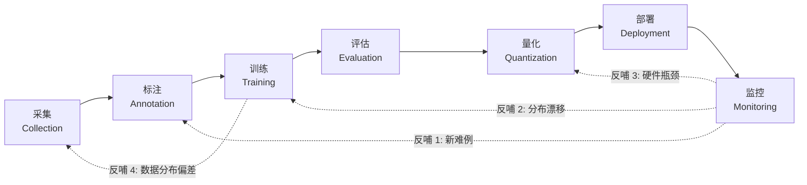
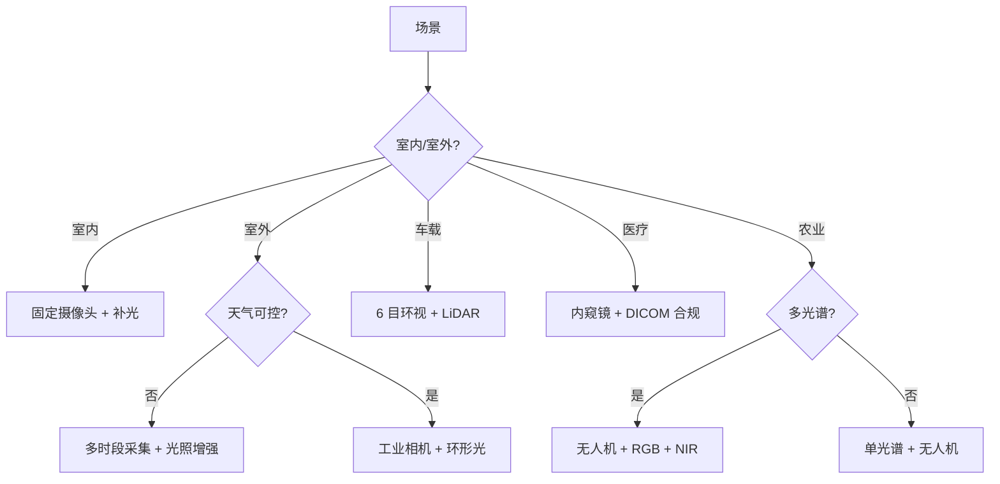
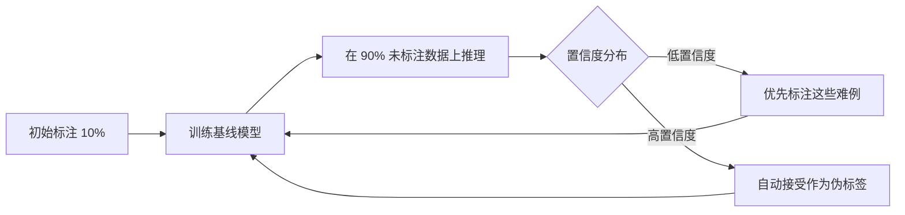
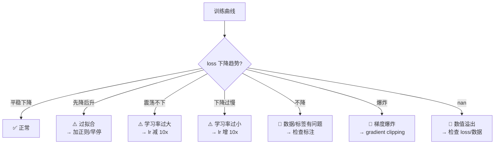
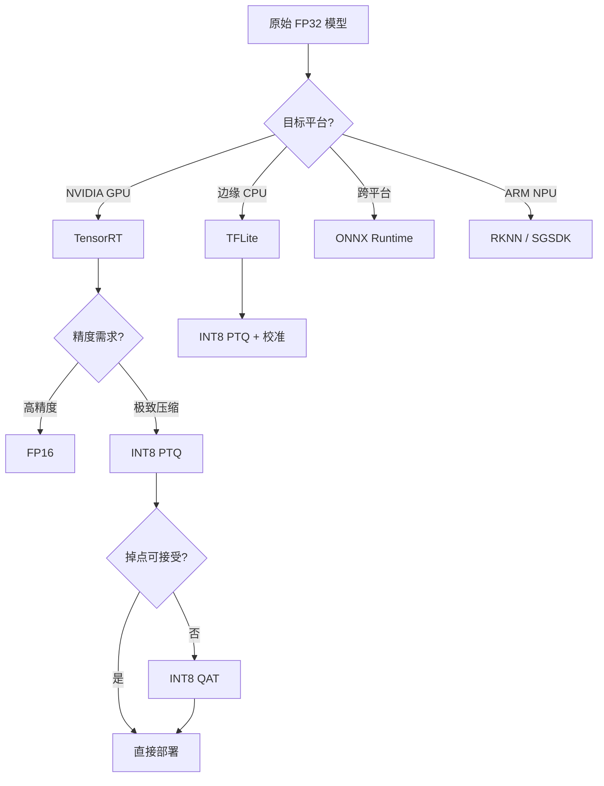
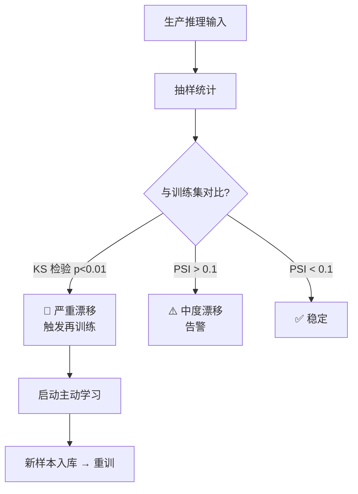

# 数据流全景图

YOLO 从"一段想法"到"生产线上跑着"的完整数据流：**采集 → 标注 → 训练 → 量化 → 部署 → 监控 → 反馈**，一环扣一环，任何一环出问题都会反噬上游。

> **这一页存在的意义**：版本页和案例页都在讲"某个环节的怎么做"，但**跨环节的流水线（比如训练曲线怎么反哺到数据采集）没有单页总结**。这里把 9 大案例的实战经验抽象成一张端到端地图。

**配合阅读**：数字量级 → [基准数据](/benchmarks) · 结构差异 → [对比矩阵](/compare-matrix) · 术语速查 → [概念索引](/concepts) · 按环节踩坑 → [故障排查](/troubleshooting) · 按场景选型 → [选型决策树](/choose-a-model)

---

## 一句话总纲

**7 个环节，3 条反哺回路，20+ 个决策点**。任何一个环节出问题都会沿数据流反噬上下游，所以工程实践中的"改一个数字"经常需要重新评估整条链。

---

## 全景图：一条主链 + 三条反哺



**主链 7 环节**：采集 → 标注 → 训练 → 评估 → 量化 → 部署 → 监控

**反哺 4 条**：
1. **监控 → 标注**：新出现的难例回灌到数据集
2. **监控 → 训练**：分布漂移（概念漂移）触发再训练
3. **监控 → 量化**：硬件瓶颈发现后重新调整量化策略
4. **训练 → 采集**：训练曲线异常（过拟合/欠拟合）反推数据分布问题

---

## 环节 1：数据采集（Collection）

### 采集决策树



### 常见采集陷阱

| 陷阱 | 表现 | 解决方案 | 相关案例 |
|-----|-----|---------|---------|
| **只在晴天采** | 模型上线后阴雨天气崩 | 强制多时段/多光照采样 | agriculture / security-monitoring |
| **只采近景** | 小目标召回低 | 强制远/近比例 1:3 | industrial-defect / autonomous-lane |
| **样本量不足** | mAP 训练期不涨 | 单类 ≥ 500 张（工业缺陷） | industrial-defect / medical-lesion |
| **类别不平衡** | 少数类 F1 崩塌 | 采集阶段就平衡类别 | retail-shelf / medical-lesion |
| **图像分辨率过低** | 小目标丢失 | 分辨率 ≥ 1024 | industrial-defect |

### 采集量参考（来自 9 大案例反哺）

| 案例 | 单类最低样本 | 训练集规模 | 验证集 |
|-----|------------|-----------|-------|
| edge-deployment | 200 张 | 20k | 2k |
| industrial-defect | 500 张 | 30k | 5k |
| autonomous-lane | 100 张/车道类型 | 100k | 10k |
| retail-shelf | 50 张/SKU | 150k | 15k |
| medical-lesion | 100 张/病灶 | 5k | 1k |
| security-monitoring | 200 张/事件 | 50k | 5k |
| agriculture | 300 张/病害 | 30k | 3k |
| drone-obb | 500 张/车型 | 20k | 2k |
| 3d-bev | 50 序列/场景 | 100 序列 | 20 序列 |

---

## 环节 2：标注（Annotation）

### 标注工具链

| 工具 | 类型 | 价格 | 推荐度 |
|-----|-----|-----|-------|
| **Label Studio** | 开源 | 免费 | ⭐⭐⭐⭐⭐ |
| **CVAT** | 开源 | 免费 | ⭐⭐⭐⭐ |
| **LabelImg** | 开源 CLI | 免费 | ⭐⭐⭐（简易） |
| **VGG Image Annotator** | 开源 Web | 免费 | ⭐⭐⭐ |
| **Make Sense / Scale AI** | SaaS | 付费 | ⭐⭐⭐⭐（企业） |
| **SAM / YOLOE 辅助标注** | 半自动 | 免费 | ⭐⭐⭐⭐⭐（推荐组合） |

### 标注质量陷阱

| 陷阱 | 表现 | 解决方案 |
|-----|-----|---------|
| **标注一致性差** | 多人标同一张差异大 | 制定标注规范 + 抽样复核 |
| **漏标背景类** | 背景类 mAP 崩 | 强制包含背景类 |
| **越界框** | 边界框超出图像 | 后处理裁剪脚本 |
| **标签错标** | 类别张冠李戴 | 双人独立标注 + 一致性对比 |
| **旋转框角度不统一** | 顺时针/逆时针混用 | 明确约定 + 训练前脚本校正 |

### YOLO 格式转换速查

| 源格式 | 目标格式 | 转换工具 |
|-------|---------|---------|
| **COCO JSON** | YOLO txt | `ultralytics/data/coco.yaml` |
| **VOC XML** | YOLO txt | `ultralytics/data/voc.yaml` |
| **Label Studio** | YOLO txt | `label-studio` 内置导出 |
| **CVAT** | YOLO txt | `cvat-data` CLI |
| **YOLO txt** | COCO JSON | `json_dumper` 脚本 |

### 主动学习循环（Active Learning）



**关键洞察**：industrial-defect 案例中，用主动学习把标注成本从 30k 张降到 8k 张，mAP 仅掉 0.5%。

---

## 环节 3：训练（Training）

### 训练配置速查

```yaml
# 训练超参参考（来自 9 案例平均）
epochs: 200            # 小数据可 300，大数据 100
imgsz: 640             # 通用，按需求调
batch: 16              # 显存允许越大越好
optimizer: auto        # AdamW / SGD
lr0: 0.01              # SGD 起 lr
lrf: 0.01              # lr 衰减系数
weight_decay: 0.0005
warmup_epochs: 3
close_mosaic: 10       # 末期 10 epoch 关闭 mosaic

# 增强策略（v8+ 默认）
hsv_h: 0.015           # 色相扰动
hsv_s: 0.7             # 饱和度
hsv_v: 0.4             # 亮度
mosaic: 1.0            # 前 90% 开启
mixup: 0.1             # 混合增强
copy_paste: 0.1        # 分割任务
```

### 训练曲线诊断



### 训练踩坑（来自案例反哺）

| 坑 | 表现 | 解 |
|----|-----|---|
| **Mosaic 增强太激进** | 分类精度下降 | 类别混淆多时降 mosaic 到 0.5 |
| **close_mosaic 缺失** | 精度不收敛 | 末期强制关闭 mosaic |
| **anchor 未更新** | 小目标召回低 | 用 autoanchor 重跑 |
| **batch 太小** | 训练不稳 | 显存允许就增大 batch |
| **EMA 未启用** | 泛化差 | 强制开 EMA |
| **AMP 导致数值不稳** | loss 波动 | 关 AMP 用 BF16 |
| **类别严重不平衡** | 少数类 F1=0 | 类加权 loss / 过采样 |

---

## 环节 4：评估（Evaluation）

### 评估指标矩阵

| 指标 | 意义 | 何时看 | 参考阈值 |
|-----|-----|-------|---------|
| **mAP50** | IoU=0.5 均精度 | 通用 | 40-70 |
| **mAP50-95** | IoU=0.5-0.95 均精度 | 高精度需求 | 30-60 |
| **Precision** | 精确率 | 误报敏感（安防） | ≥ 0.9 |
| **Recall** | 召回率 | 漏报敏感（医疗） | ≥ 0.8 |
| **FPS** | 推理速度 | 实时性敏感 | ≥ 30 |
| **Latency** | 单帧延迟 | 车端 | < 20ms |
| **Model Size** | 模型体积 | 边缘部署 | < 50MB |
| **ECE** | 校准误差 | 分数敏感 | < 0.05 |

### 案例特有指标（9 案例新增 8 条）

| 指标 | 案例 | 定义 |
|-----|-----|-----|
| **false_positive_rate** | industrial-defect | 每小时误报数 |
| **jitter_cm** | autonomous-lane | 车道线抖动（厘米） |
| **time_to_online** | retail-shelf | 新品上架到可识别的时间 |
| **physician_review_time** | medical-lesion | 医师审阅单次时间 |
| **false_positive_events_per_hour** | security-monitoring | 每小时误报事件 |
| **daily_farmer_action** | agriculture | 每日农民动作数 |
| **angle_error_deg** | drone-obb / 3d-bev | 旋转角度误差 |
| **bev_coverage_m2** | 3d-bev | BEV 覆盖面积 |

### 评估数据集划分原则

- **训练集 : 验证集 : 测试集 = 80:10:10**（数据不足时 90:10）
- **测试集必须真实场景**——不是随机抽，而是覆盖典型场景
- **测试集永远不参与训练**——泄露 = 数据污染
- **医疗/金融场景** → 用独立临床/真实用户数据作评估

---

## 环节 5：量化（Quantization）

### 量化路径决策



### PTQ vs QAT 决策

| 维度 | PTQ | QAT |
|-----|-----|-----|
| **时间** | 30 分钟 | 数小时到数天 |
| **精度损失** | 0.5-2% | 0.3-1% |
| **显存** | 无 | 训练显存 |
| **难度** | 低 | 中 |
| **推荐场景** | 精度要求不极严 | 医疗/安防等高敏场景 |

### 量化关键坑（9 案例反哺汇总）

| 坑 | 表现 | 解 |
|----|-----|---|
| **DFL 层量化** | 车道线抖动 2cm→6cm | DFL 层强制 FP32 |
| **AAttn 量化** | 精度崩 | AAttn 保持 FP16，INT8 下回退 |
| **HyperACE 超图量化** | 掉点 2%+ | v13 建议 FP16 |
| **NMS IoU 阈值** | 精度掉 | INT8 下上调阈值 0.05-0.1 |
| **BN 层量化** | 精度微掉 | 保持 FP32 |
| **量化前未校准** | 精度崩 | 用真实分布样本校准 |
| **多传感器量化误差累积** | 3D 定位误差 | 端到端量化而非逐层 |

---

## 环节 6：部署（Deployment）

### 部署工具链矩阵

| 目标 | 首选 | 备选 | 参考案例 |
|-----|-----|-----|---------|
| **NVIDIA GPU** | TensorRT | ONNX Runtime GPU | industrial-defect |
| **Jetson** | TensorRT | ONNX Runtime | autonomous-lane |
| **手机 iOS** | CoreML | MLC | 未覆盖 |
| **手机 Android** | TFLite / NNAPI | MLC | 未覆盖 |
| **Raspberry Pi** | TFLite | NCNN / MNN | edge-deployment |
| **Rockchip NPU** | RKNN | SGSDK | 未覆盖 |
| **跨平台服务器** | ONNX Runtime | TensorRT | security-monitoring |
| **浏览器 Web** | ONNX Runtime Web | WebGPU | 未覆盖 |
| **嵌入式 MCU** | ESP-DL | TFLite Micro | 未覆盖 |

### 部署踩坑

| 坑 | 表现 | 解 |
|----|-----|---|
| **算子不支持** | 部署失败 | 检查 TensorRT / TFLite 支持列表 |
| **动态 shape 不支持** | 只能跑固定分辨率 | 训练前就确定分辨率 |
| **后处理写死** | NMS 需要额外代码 | 用平台原生推理引擎 |
| **模型体积超预算** | 边缘设备存储不够 | 量化 + 蒸馏 |
| **首次加载慢** | 用户感知卡顿 | 预热（warmup）+ 缓存 |

---

## 环节 7：监控（Monitoring）

### 监控指标矩阵

| 指标类别 | 具体指标 | 频率 | 告警阈值 |
|---------|---------|-----|---------|
| **推理性能** | FPS / Latency / GPU Util | 实时 | < 目标 80% |
| **推理错误** | 推理异常次数 / 分数分布 | 5 分钟 | 异常 > 阈值 |
| **数据分布** | 输入图片相似度分布 | 1 小时 | 分布漂移告警 |
| **模型健康** | 参数量 / 权重统计 | 1 天 | 未预期变更 |
| **业务指标** | 用户反馈 / 事件响应时间 | 实时 | 业务 SLA |

### 分布漂移检测（Drift Detection）



### 监控踩坑

| 坑 | 表现 | 解 |
|----|-----|---|
| **只监控准确率** | 部署半年不发现漂移 | 加分布漂移监控 |
| **无难例回灌** | 模型越来越差 | 低置信度样本回灌到训练集 |
| **A/B 测试缺失** | 无法确认新版本更好 | 影子部署 + A/B 流量 |
| **回滚机制缺失** | 新版本崩无法快速恢复 | 双版本并行 + 秒切 |

---

## 三条反哺回路详解

### 回路 1：监控 → 标注

**触发条件**：监控发现低置信度样本聚集在某个子分布

**动作**：
1. 抽样 100-500 张低置信度样本
2. 人工标注（或 SAM/YOLOE 辅助）
3. 加入训练集
4. 重训（可选，视漂移程度）

**案例参考**：security-monitoring 的事件误报分析 → 每两周回灌 200 张难例

### 回路 2：监控 → 训练

**触发条件**：分布漂移告警（PSI > 0.1 或 KS 检验 p < 0.01）

**动作**：
1. 采样新旧数据对比
2. 增量训练（fine-tune 而非从头训练）
3. 使用 LoRA / Replay / EWC 抗遗忘
4. 灰度发布 → A/B 测试

**案例参考**：retail-shelf 新 SKU 上架 → LoRA 增量微调 30 分钟完成

### 回路 3：监控 → 量化

**触发条件**：硬件利用率长期 < 60% 或延迟超过 SLA

**动作**：
1. 重新评估量化策略（PTQ → QAT）
2. 调整量化层配置（DFL / Attention 保持 FP16）
3. 校准集更新（用最近生产数据）
4. 部署新版本，观察 1-2 天

**案例参考**：edge-deployment 树莓派 4B → 5 升级后重新量化，速度 ×1.8

---

## 端到端时间预算参考

**9 案例汇总的典型时间线**：

```
Week 1-2:  数据采集 + 标注（5k-30k 张）
Week 3:    基线训练 + 评估
Week 4:    调优 + 增强策略
Week 5:    量化 + 部署验证
Week 6:    灰度上线
Week 7+:   监控 + 反哺循环
```

**不同案例的典型周期**：

| 案例 | 数据采集 | 训练一轮 | 部署上线 | 反哺周期 |
|-----|---------|---------|---------|---------|
| edge-deployment | 2-4 周 | 1 天 | 1 周 | 每月 |
| industrial-defect | 4-8 周 | 3-7 天 | 2 周 | 每两周 |
| autonomous-lane | 8-16 周 | 3-7 天 | 4-8 周 | 每月 |
| retail-shelf | 2-4 周 | 1 天 | 3 天 | 每周（新 SKU） |
| medical-lesion | 16-52 周 | 1-3 天 | 8-16 周 | 每季 |
| security-monitoring | 4-8 周 | 1-3 天 | 2 周 | 每两周 |
| agriculture | 8-12 周 | 1-3 天 | 2 周 | 每季 |
| drone-obb | 4-8 周 | 3-7 天 | 2 周 | 每月 |
| 3d-bev | 16-52 周 | 7-30 天 | 8-16 周 | 每月 |

---

## 常见故障诊断表

| 故障现象 | 可能原因 | 排查方向 |
|---------|---------|---------|
| **上线后精度骤降** | 分布漂移 / 量化未测 | 抽样对比训练/生产数据分布 |
| **模型不收敛** | 数据/标签问题 | 检查标注质量、loss 曲线 |
| **推理延迟高** | 分辨率 / 模型过大 | 量化 + 降分辨率 |
| **误报暴涨** | NMS 阈值 / 校准问题 | 调阈值 + 重校准 |
| **某类召回为 0** | 类别不平衡 / 样本不足 | 补充样本 + 类加权 |
| **模型体积超预算** | 未量化 | INT8 QAT |
| **首次加载慢** | 未预热 | 部署预热脚本 |
| **量化后精度崩** | DFL / Attention 量化 | 关键层保持 FP32/FP16 |

---

## 数据流与本体关联

数据流 7 环节映射到 [本体 Schema](/ontology/schema) 的 L4 实战层：

| 数据流环节 | 本体实体 | 反哺信号 |
|-----------|---------|---------|
| 采集 | Dataset | 新子分布发现 |
| 标注 | Dataset + Label | 新难例 |
| 训练 | Model + Loss + Trick | 新 Trick |
| 评估 | Metric | 新指标 |
| 量化 | Model | 新约束（量化友好度） |
| 部署 | Model + Hardware | 新硬件支持 |
| 监控 | Metric + PainPoint | 新踩坑 / 新 PainPoint |

详见 [ontology/entity-types](/ontology/entity-types) 和 [ontology/relations](/ontology/relations)。

---

## 三张横向页联动

| 页面 | 视角 | 用途 |
|-----|-----|-----|
| **本页（数据流）** | 流程→环节 | 理解端到端链路 |
| **[choose-a-model](/choose-a-model)** | 场景→版本 | 快速选型 |
| **[compare-matrix](/compare-matrix)** | 版本→对比 | 版本横向对比 |
| **[cases/compare](/cases/compare)** | 案例→速查 | 案例起步 |
| **[concepts](/concepts)** | 概念→出处 | 反向索引 |

**典型阅读路径**：
1. 想做新项目 → 看本页理解全貌
2. 定版本 → 看 choose-a-model
3. 想抄案例 → 看 cases/compare
4. 深入某个环节 → 看对应案例页
5. 遇到某个概念 → 看 concepts

---

## 未覆盖但值得扩展

- **CI/CD 流水线**：训练→量化→部署→监控的自动化
- **联邦学习流程**：多机构数据协同训练的隐私合规流程
- **OTA 更新流程**：车端/边缘设备的远程更新与回滚
- **A/B 测试框架**：多版本并行部署的灰度发布
- **数据血缘（Lineage）**：数据从采集到上线的完整溯源
- **模型版本管理**：MLOps 工具的选型与对比
