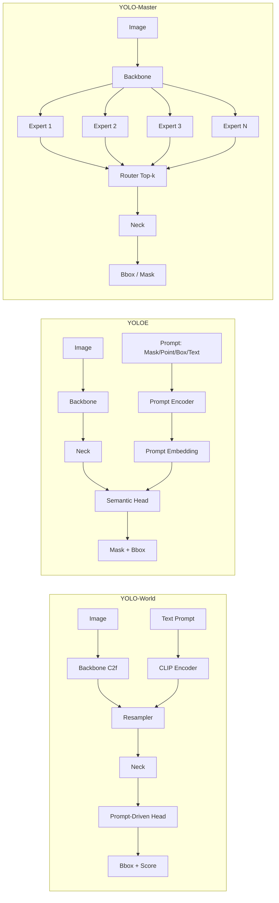
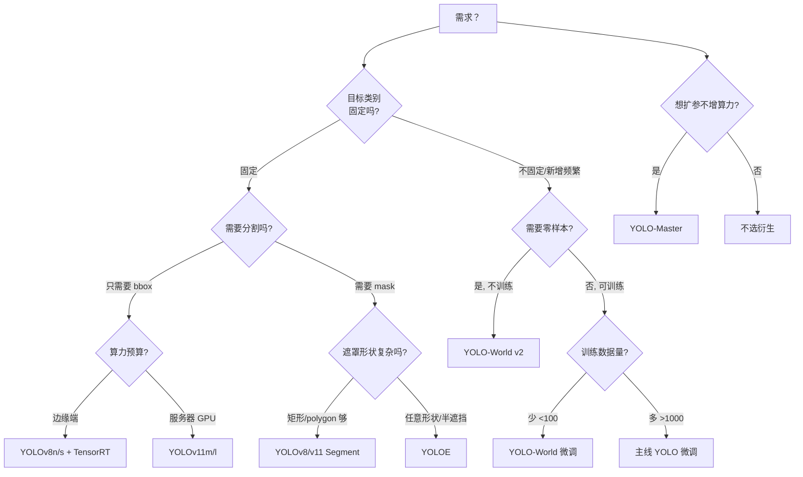
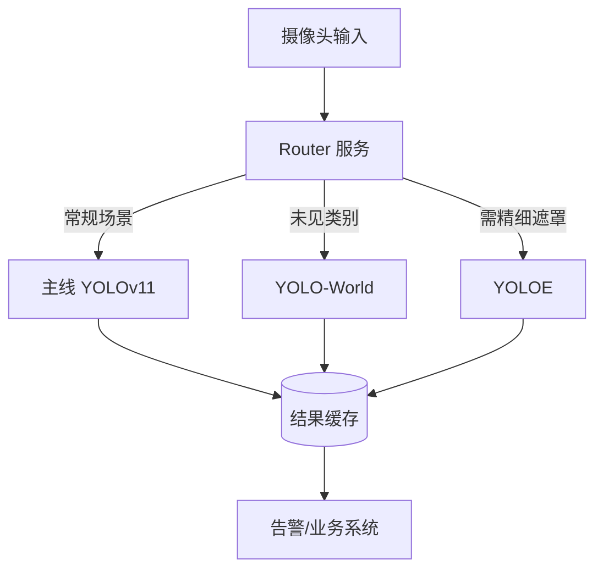

# YOLO 三大衍生分支对比：YOLO-World / YOLOE / YOLO-Master

主线 YOLO（v1–v26）解决的是"**给定固定类别集，做检测/分割**"。生产环境经常碰到三种"变数"，主线模型不够用：

1. **类别变了** —— 今天检测"人"，明天要检测"红色安全帽"、"临时摆放的纸箱"，重新训练太慢 → **YOLO-World**（开放词汇 / Prompt-driven）
2. **场景变了** —— 目标被遮挡、被裁剪、半露出、只露一小角也要框出来 → **YOLOE**（开放式语义分割 / 任意遮罩）
3. **模型不够强 / 数据不够多** —— 想用更大的参数、MoE 路由扩模型，但推理时算力受限 → **YOLO-Master**（MoE + 稀疏路由）

三者都由 Peking University / 相关实验室与 Ultralytics 社区共同推进，代码都开源在 [Ultralytics/ultralytics](https://github.com/ultralytics/ultralytics)，可直接 `import` 使用。

本页把三者横向对比、给出选型决策树和混合部署方案。

---

## 一句话定位

| 分支 | 一句话定位 | 核心机制 | 是否需训练 | 典型硬件 |
|------|-----------|---------|-----------|---------|
| **YOLO-World** | 给文本 prompt 就能检测任意类别 | 文本-视觉双分支 + Resampler + Prompt-driven Head | 冻结主干 + 微调 Head（可选零样本） | Jetson Orin / RTX 3060 |
| **YOLOE** | 用 mask / 点 / 框 / 文本 4 种 prompt 做开放分割 | Prompt Encoder + 语义分割头（替代 bbox 头） | 需在特定数据上训练 | A100 / RTX 4090 |
| **YOLO-Master** | MoE 稀疏路由，参数扩容但不增推理算力 | Sparse MoE + Top-k Router + Expert 负载均衡 | 从头训练 | A100 集群 / H100 |

---

## 能力矩阵

| 能力 | YOLOv8/v11 (baseline) | YOLO-World | YOLOE | YOLO-Master |
|------|----------------------|-----------|-------|-------------|
| 固定类别检测 | ✅ | ✅ | ✅（可退化为检测） | ✅ |
| **零样本（未见类别）** | ❌ | ✅✅✅ | ✅（文本 prompt） | ❌ |
| **开放词汇（自然语言描述）** | ❌ | ✅✅✅ | ✅✅ | ❌ |
| **实例分割（bbox）** | ✅ | ✅ | ✅ | ✅ |
| **任意遮罩分割** | ❌（仅 polygon/segment） | ❌ | ✅✅✅ | ❌ |
| **点/框/文本/mask 4 种 prompt** | ❌ | 文本 | ✅✅✅ | ❌ |
| **MoE 稀疏激活** | ❌ | ❌ | ❌ | ✅✅✅ |
| **训练数据效率** | 标准 | 高（少样本可学） | 中 | 中（依赖数据量） |
| **推理速度（相对主线）** | 1.0× | 0.7–0.9× | 0.5–0.7× | 0.9–1.0×（稀疏） |
| **ONNX 导出稳定性** | 稳 | 中（文本编码需 CPU） | 中 | 低（MoE 算子不通用） |
| **边缘端友好度** | 高 | 中 | 低 | 低 |

✅✅✅ 领先、✅✅ 强、✅ 可用、❌ 不支持

---

## 架构对比



**关键差异**：

- **YOLO-World** 的杀手锏是 **CLIP 编码 + Resampler**：把图像特征和文本嵌入拉到同一空间，Head 里的分类权重被"prompt 向量"取代。
- **YOLOE** 把 bbox 头换成 **mask decoder**，prompt encoder 支持 4 种输入，输出是 mask logits。
- **YOLO-Master** 在 FFN 位置插入 **MoE**：每个 token 只激活 top-k experts（k 通常 2），参数量扩大 3-8 倍但 FLOPs 保持。

---

## 数字对比（COCO val2017）

| 模型 | Backbone | AP | AP50 | 参数 (M) | GFLOPs | FPS (Orin AGX) |
|------|----------|-----|------|---------|--------|----------------|
| YOLOv8s | CSPDarknet-s | 44.9 | 66.5 | 11.2 | 28.6 | ~65 |
| YOLOv11s | C3k2 | 47.0 | 68.9 | 9.4 | 26.7 | ~72 |
| **YOLO-World v2 (s)** | CSPDarknet-s | 43.6* | 65.0* | 11.5 | 32.1 | ~48 |
| **YOLO-World v2 (m)** | CSPDarknet-m | 48.7* | 69.5* | 22.3 | 75.3 | ~28 |
| **YOLOE-11m-seg** | C3k2-m | 47.0 | – | 22.4 | 75.4 | ~22 |
| **YOLO-Master-n** | MoE-n | 45.5 | 66.8 | 21.0 (激活 5.5) | 28.2 | ~58 |
| **YOLO-Master-l** | MoE-l | 52.8 | 73.4 | 120.0 (激活 25.0) | 82.5 | ~18 |

*：YOLO-World 在 COCO 上是 zero-shot 数字，非 COCO 训练。零样本意味着模型完全没见过这些类别名，纯靠文本-视觉对齐。

---

## 选型决策树



**决策要点**：

- **"类别频繁新增"** → 99% 选 YOLO-World，避免每次加类都重训
- **"半遮挡 / 目标只有露头"** → YOLOE，主线 YOLO 在遮挡率 >50% 时 mAP 掉 30%+
- **"参数量想扩 5x 但延迟不能涨"** → YOLO-Master，MoE 稀疏激活
- **"三者都要"** → 见下方"混合部署"

---

## 选型陷阱

### 陷阱 1：把 YOLO-World 当 YOLOv8 用

很多团队直接 `YOLO-World-l.pt` 替换 `YOLOv8l.pt`，结果：

- **推理延迟涨 30-40%**：因为多了一个 CLIP 文本编码步骤
- **ONNX 导出报错**：CLIP 的 Transformer 算子很多推理引擎不支持
- **边缘端崩掉**：Jetson Nano 上 CLIP-B 就 OOM

**正确做法**：如果类别完全固定，别用 YOLO-World。它是为"变类别"设计的。

### 陷阱 2：YOLOE 训练数据用 YOLO format 直接喂

YOLOE 训练需要 **mask 图像**（每个类别一张二值图），不是 YOLO 的 polygon 坐标。用 X-AnyLabeling + SAM 生成 mask 后，走 `YOLOE-26-seg.yaml` 训练。

```python
from ultralytics import YOLOE

model = YOLOE("yoloe-11-seg.yaml")
model.train(data="my_coco.yaml", epochs=100, imgsz=1024, mask=True)
```

### 陷阱 3：YOLO-Master 的 Router 没训练好

MoE 训练有个著名的 **"expert collapse"** 现象：所有 token 都路由到同一个 expert，其他 experts 权重永远是 0。

**解决方案**：YOLO-Master 提供了 3 种路由策略：

- `topk_anneal`（默认）：训练初期随机路由，后期收敛到 top-k
- `mot`：Multi-gate Optimal Transport，负载均衡更好
- `soft_moe`：软路由，用于蒸馏

**推荐先用 `topk_anneal`**，训练 20 epoch 后再看 expert 激活分布，如果 <30% 的 experts 被激活，换 `mot`。

### 陷阱 4：三者叠加

有些想法是"YOLO-Master 骨干 + YOLO-World Head + YOLOE Decoder"三合一。技术上可行但：

- 参数爆炸到 200M+
- 训练极其不稳定（MoE + 少样本 + 分割三重不稳定因素）
- 部署几乎不可能

**建议**：一个场景只选一个方向做深，别贪多。

---

## 混合部署方案

生产系统里三者往往需要协同：



**分流规则建议**：

1. **默认走主线 YOLOv11**（延迟最低、最稳）
2. **主线 YOLO 输出中若出现 conf < 0.4 且靠近画面边缘** → 触发 YOLO-World 二次检测（可能是新类别）
3. **主线 YOLO 检测到"人"但 mask 覆盖率 <30%** → 触发 YOLOE 精确分割（可能是遮挡场景）

**成本估算**（1 台 A100 服务器）：

| 部署方式 | 硬件 | 月成本 | QPS | 场景 |
|---------|------|-------|-----|------|
| 纯主线 | 1× Orin AGX 64G | 一次性 ¥25k | 200 | 固定类别工业 |
| 主线 + World | 1× A100 | ¥8k | 30 | 电商新品识别 |
| 主线 + YOLOE | 1× A100 | ¥8k | 15 | 医学影像分割 |
| 三合一 | 2× A100 | ¥16k | 12 | 复杂多场景 |

---

## 三者共同局限

1. **长尾类别仍差** —— YOLO-World 对常见名词（car, person）很强，但"戴蓝色帽子的女性"这类组合描述会掉 20%+
2. **推理依赖 CLIP** —— YOLO-World 和 YOLOE 都依赖 CLIP 类模型，CLIP 的中文文本能力弱，中文场景建议换 CN-CLIP
3. **开源权重覆盖不全** —— YOLO-Master 的 `-l` 版本权重需要自训，官方只提供 `-n` 起点
4. **社区活跃度差异** —— YOLO-World 最活跃（GitHub 15k+ star），YOLO-Master 相对冷门（3k+ star）

---

## 版本兼容速查

| Ultralytics 版本 | YOLO-World | YOLOE | YYOLO-Master |
|-----------------|-----------|-------|-------------|
| 8.0.x | ✅ v1 | ❌ | ❌ |
| 8.1.x | ✅ v2 | ❌ | ❌ |
| 8.2.x | ✅ v2 | ✅ | ❌ |
| 8.3.x | ✅ v2 | ✅ | ✅ |

**建议 pin `ultralytics>=8.3.0`** 才能同时使用三者。

---

## 相关页面

- [YOLO-World 详细页](./yoloworld/)
- [YOLOE 详细页](./yoloe/)
- [YOLO-Master 详细页](./master/)
- [主线版本对比](../compare-matrix.md)
- [版本改动清单](../versions/changelog.md)
- [高级训练技巧](../recipes/advanced-train.md)
