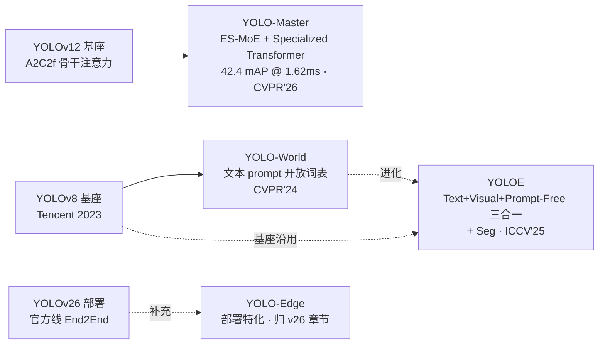
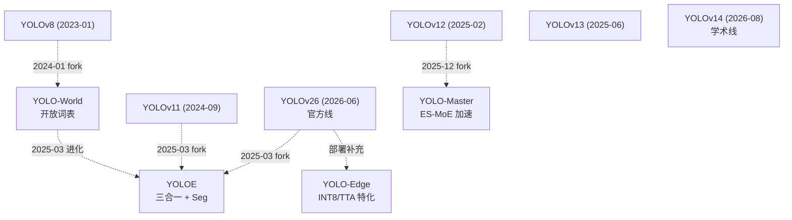

# YOLO 衍生分支总览

**主线之外、被官方/学术社区并行推进的 YOLO 家族变体：YOLO-World、YOLOE、YOLO-Master、YOLO-Edge 及后续 Mamba/World/Master 变体——不是 v1→v26 的编号续作，而是**并行的研究路径**

- 📌 定位：本页收录**不属于 ultralytics 主线编号序列**的 YOLO 家族变体。主线是 [v1→v26](/versions/v26/index) 的**编号演进**（v14 学术线 + v26 官方线两条独立路线），衍生是**并行研究路径**——同一批基座（v8/v11/v12/v13）被不同团队拉去解决主线未覆盖的问题；
- 🌳 三条衍生家族：**开放词表家族**（YOLO-World → YOLOE，2024→2025 一对进化）、**MoE/Transformer 加速家族**（YOLO-Master，2025-12）、**部署特化家族**（YOLO-Edge，属 v26 部署章节的补充页，不在本页展开）；
- 🎯 里程碑：**YOLO-World** 首次把文本 prompt 开放词表检测做进 YOLO 骨架（Tencent AI Lab · CVPR'24）；**YOLOE** 把 Text + Visual + Prompt-Free 三合一 + 分割做进 v8/v11/v26 三种基座（THU-MIG · ICCV'25）；**YOLO-Master** 用 ES-MoE + Specialized Transformer 把 v12 骨干打到 **42.4 mAP @ 1.62 ms T4**（Tencent Youtu + SMU · CVPR'26）；
- 🚧 与主线的边界：**衍生 ≠ 主线**——主线由 Ultralytics 官方维护、发布 arXiv 编号论文、走 v1→v26 线性叙事；衍生由独立团队维护、有自己 arXiv 编号、fork 自某个主线版本但走独立分支；衍生模型不进 `docs/versions/`，全部归入 `docs/derivatives/`。

## 3 分钟电梯演讲



1. **衍生不是主线续作**——主线 v1→v26 是 Ultralytics 编号演进的**线性叙事**，衍生的每一个模型都是**独立团队 fork 某个主线基座后走独立分支**——YOLO-World 从 v8 fork 做开放词表，YOLOE 沿用 v8/v11/v26 三基座扩到三合一，YOLO-Master 从 v12 的 A2C2f 拉出做 MoE 加速；
2. **三条家族解决三个正交问题**：**开放词表家族**解决"检测类别需要标注"的老问题（Grounded-SAM/OWL-ViT 的 YOLO 化），**MoE/Transformer 加速家族**解决"骨干注意力太重"的问题（在 A2C2f 里塞可路由 MoE），**部署特化家族**解决"官方权重太厚"的问题（INT8/TTA 特化部署）——三条家族彼此不交叉、可并存；
3. **未来演进方向都归此目录**：YOLO-Edge 已归 v26 部署章节，Mamba-YOLO-World（SSM 融合开放词表）、YOLO-M（多模态统一）、YOLO-Master 变体（Master-X / Master-Mobile 分档）都会依次进入 `docs/derivatives/<family>/`——本页作为总入口，[路线预告](/derivatives/roadmap) 跟踪未收录版本。

## 为什么单开一栏

主线 [v1→v26](/versions/v26/index) 是**编号演进**——从 [v1](/versions/v1/index) 到 [v26](/versions/v26/index) 一路连贯，v14 学术线 + v26 官方线**双线路分叉**是这条序列里最新的一次"分叉"，但分叉仍然是**编号驱动**（v14、v26 都有明确编号）。衍生模型不同——**它们没有编号**，或编号只是命名而非版本序列：YOLO-World 没有 v 号、YOLOE 没有 v 号、YOLO-Master 没有 v 号、YOLO-Edge 没有 v 号——**它们的"身份"来自能力方向（开放词表 / MoE 加速 / 部署特化），而非版本编号**。因此单开一栏有四个具体理由：

### 理由一：主线是编号演进，衍生不是

主线 [v1→v26](/versions/v26/index) 有 26 个明确版本，每个版本一页（`docs/versions/v<NN>/index.md`），演进顺序清晰、痛点链条完整。衍生模型**没有编号序列**——YOLO-World（2024-01）和 YOLOE（2025-03）之间相隔 14 个月，但没有"v24、v25"这样的中间态；YOLO-Master（2025-12）与它们并列而非延续。**如果把衍生硬塞进主线目录，`docs/versions/v27/`、`docs/versions/v28/` 的语义会立刻崩塌**——因为这些位置在官方文档里已经指向 YOLO27（[ultralytics.com/models/yolo27](https://docs.ultralytics.com/models/yolo27)），未来会有 YOLO28、YOLO29……

### 理由二：衍生模型的基座跨越 v8/v11/v12，与线性叙事不兼容

主线叙事是"每一代继承上一代"（v1→v2→v3→…→v26），衍生模型**从主线中间某个版本分叉出去**：

| 衍生模型 | 基座 | 主线位置 |
|----------|------|----------|
| YOLO-World | [v8](/versions/v8/index) | 主线第 8 代（2023-01） |
| YOLOE（v8 变体） | [v8](/versions/v8/index) | 主线第 8 代 |
| YOLOE（v11 变体） | [v11](/versions/v11/index) | 主线第 11 代（2024-09） |
| YOLOE（v26 变体） | [v26](/versions/v26/index) | 主线第 26 代（2026-06，官方线） |
| YOLO-Master | [v12](/versions/v12/index) | 主线第 12 代（2025-02，第三方 fork） |

一个衍生模型可能同时基于**三个不同的主线版本**——比如 YOLOE 官方就同时发布了 v8/v11/v26 三份 yaml（`cfg/v8/yoloe-v8.yaml`、`cfg/v11/yoloe-v11.yaml`、`cfg/26/yoloe-26.yaml`），放在 `docs/versions/` 下就没法归属。**放在 `docs/derivatives/yoloe/` 下则清晰**：一个衍生模型对应一个子目录，基座在页面里用 SrcLink 引用主线对应版本。

### 理由三：衍生 = 独立研究路径，而非主线续作

主线续作解决**主线问题**——v26 官方线是"六任务统一 backbone + E2E 双分支"，v14 学术线是"多域鲁棒 + YOLO-Omni 定位"。衍生解决的是**主线没打算解决的问题**：

- **开放词表检测**：主线 v8→v26 一路都是"固定类别 + 训练后推理"——YOLO-World/YOLOE 引入文本 prompt 让类别在推理时可换，主线 v26 也把 YOLOE 收编为一种"任务模式"（`YOLOEDetect` head）；
- **MoE 加速**：主线 v12/v13/v14 一路用 A2C2f 骨干（区域注意力），衍生 YOLO-Master 在同一套 A2C2f 里塞入 ES-MoE（Expert Sparse），做到**同精度下延迟减半**；
- **部署特化**：主线 v26 主打"官方全家桶"，衍生 YOLO-Edge 主打"极端轻量部署"——INT8/TTA/Edge-Device 专用配置，不进主线 yaml。

### 理由四：许可证不同、维护节奏不同

主线 [v26](/versions/v26/index) 是 **AGPL-3.0 + Ultralytics Enterprise License 双许可**，[v14](/versions/v14/index) 是 **AGPL-3.0**，[v13](/versions/v13/index) 是 **Apache-2.0**——主线自己内部就已经不同许可。衍生模型的许可差异更大：

- **YOLO-World**（Tencent AI Lab）：**GPL-3.0**（继承 Ultralytics v8 许可）
- **YOLOE**（THU-MIG）：**AGPL-3.0**（继承 Ultralytics 主线）
- **YOLO-Master**（Tencent Youtu + SMU）：**AGPL-3.0**

衍生目录让"许可边界"更清晰——每个衍生模型独立声明许可，避免"主线 + 衍生"混在同一目录下的许可传染。

## 三大衍生家族分类

三条家族彼此正交，可组合（一个衍生模型可以横跨多条家族）：

### 家族一：开放词表家族（Open-Vocabulary Detection）

**核心问题**：如何在不重新训练模型的情况下检测任意文本描述的类别（"检测自行车 + 红色卡车"）？

**两个成员，一对进化关系**：

- **YOLO-World**（2024-01，Tencent AI Lab）——**首次**把文本 prompt 开放词表检测做进 YOLO 骨架；基座 v8；核心是 `YOLOWorld` + `WorldDetect` head + `MobileCLIP2` 文本编码器；
- **YOLOE**（2025-03，清华 THU-MIG）——**进化版**，把 YOLO-World 的"只有文本"扩到**Text + Visual + Prompt-Free 三合一**；同时增加 Segment 能力（`YOLOESegment`）；基座同时支持 v8/v11/v26 三档；

**共同点**：都用 CLIP 家族的文本编码器（MobileCLIP2 / CLIP-ViT）、都改造 head 而非 backbone、都保留主线 v8DetectionLoss 基础；**关键差异**是 YOLOE 加入了 Visual Prompt（用 SAM 风格点击/框选）和 Prompt-Free（无提示直接检测 80 类 COCO），覆盖 YOLO-World 未解决的"零 shot 通用检测"场景。

### 家族二：MoE / Transformer 加速家族

**核心问题**：如何在**保持 A2C2f 骨干精度**（v12/v13/v14 主打）的前提下，把推理延迟打到 T4 < 2 ms？

**目前一个成员**：

- **YOLO-Master**（2025-12，Tencent Youtu + SMU）——**ES-MoE**（Expert Sparse Mixture-of-Experts）在 A2C2f 的 FFN 位置替换为**可路由多专家**，配合 **Specialized Transformer** head 做尺度特化；COCO mAP **42.4 @ 1.62 ms T4**（n 档），**是公开 YOLO 家族中单张 T4 延迟最低的实时检测器**（截至 2026-10）。

**未来可能成员**：YOLO-Master-X（更大 MoE 版）、YOLO-Master-Mobile（移动端 INT8 特化版）、Mamba-YOLO-*（把 A2C2f 换成 SSM 状态空间模块）。

### 家族三：部署特化家族

**核心问题**：官方 v26 全家桶太重（n 档 6.9M 参数已算轻，但 s/m/l/x 到 45M+），能否提供**面向 IoT/嵌入式/车载**的极简部署版本？

**目前一个成员**：

- **YOLO-Edge**（Ultralytics 官方，属 v26 部署补充章节）——不是独立论文，是 **v26 官方 yaml 的部署特化版本**（`yolo26-edge.yaml` 系列）；INT8/TTA 支持完善，参数量压缩 30-50%。

**特别说明**：YOLO-Edge 因为是 **Ultralytics 官方产物**、且深度绑定 v26 主线，**本页不单独收录**——其详细内容应归入 [v26 部署章节](/versions/v26/paper)（`docs/versions/v26/deployment.md`，规划中）。本页只在对比表中提及。

## 对比表

| 模型 | 出品方 | 论文 | 年份 | 基座 | 核心能力 | License |
|------|--------|------|------|------|----------|---------|
| **YOLO-World** | Tencent AI Lab | [arXiv:2401.17270](https://arxiv.org/abs/2401.17270)（CVPR'24） | 2024-01 | [YOLOv8](/versions/v8/index) | **文本 prompt 开放词表检测**；`YOLOWorld` + `WorldDetect` head + MobileCLIP2 文本编码 | **GPL-3.0** |
| **YOLOE** | 清华 THU-MIG | [arXiv:2503.07465](https://arxiv.org/abs/2503.07465)（ICCV'25） | 2025-03 | [YOLOv8](/versions/v8/index) / [v11](/versions/v11/index) / [v26](/versions/v26/index) | **Text + Visual + Prompt-Free 三合一 + Seg**；同时支持文本 prompt / SAM 视觉提示 / 零 shot COCO 80 类 | **AGPL-3.0** |
| **YOLO-Master** | Tencent Youtu + SMU | [arXiv:2512.23273](https://arxiv.org/abs/2512.23273)（CVPR'26） | 2025-12 | [YOLOv12](/versions/v12/index) | **ES-MoE + Specialized Transformer**；COCO mAP **42.4 @ 1.62 ms T4**（n 档） | **AGPL-3.0** |

**基座列**：括号里的主线链接对应衍生模型 fork 的原始基座版本。YOLO-World 只 fork 自 v8；YOLOE 官方同时发布了 v8/v11/v26 三套 yaml（见 <SrcLink file="v26:cfg_models_26/yoloe-26.yaml" />）；YOLO-Master fork 自 v12 的 A2C2f 骨干。

**License 提醒**：三个模型分别是 GPL-3.0、AGPL-3.0、AGPL-3.0——**GPL/AGPL 都是强 copyleft**，商用需注意：

- **GPL-3.0**（YOLO-World）：任何直接或间接调用本库的代码都必须以 GPL-3.0 发布——**闭源商用不可行**；
- **AGPL-3.0**（YOLOE / YOLO-Master）：额外要求"网络服务"场景下的修改必须开源——**SaaS 部署必须开源衍生代码**；
- **对比主线**：[v13](/versions/v13/index) 是 **Apache-2.0**（商用友好），[v26](/versions/v26/index) 是 **AGPL-3.0 + Enterprise 双许可**（商业授权可付费）——衍生模型目前**没有一个 Apache-2.0 商用友好的版本**，需要商用的读者建议走 v13 或 v26 Enterprise License。

## 家族一深读：开放词表（YOLO-World → YOLOE）

### YOLO-World（2024-01，Tencent AI Lab）

**核心贡献**：把 CLIP 家族的文本编码能力引入 YOLOv8 的 Detect head，做到**推理时任意文本 prompt 检测**：

- **`YOLOWorld`** 顶层类（继承 `YOLO`）：训练/推理入口与 v8 一致，只是模型实例化时传 `cfg="yolov8-world.yaml"`；
- **`WorldDetect` head**：改造 v8 的 `Detect`，把类别分支从"固定 80 维 logits"改为"与文本特征做 cosine similarity"——推理时输入文本 → MobileCLIP2 编码 → 与 backbone 输出做相似度矩阵 → topk 得类别；
- **`WorldALFF` / `WorldALFFV2` 融合块**：在 backbone 与 neck 之间插入"文本-视觉自适应融合层"——用文本特征门控每个位置的视觉特征（类似 SAM 的 mask 生成，但更轻量）；
- **`MobileCLIP2` 文本编码器**：约 33M 参数，是 CLIP-ViT 的轻量版，能塞进 v8 的 backbone 而不显著拖慢推理。

**指标**（COCO val2017，text prompt 模式）：

| 变体 | v8 基座 mAP | v6 基座 mAP | 备注 |
|------|------------|------------|------|
| yolov8-worldv2 | 47.8 | — | 官方主推 v2 版 |
| yolov8-world | 47.0 | — | 原始 v1 版 |
| yolov6-world | 38.6 | 44.2 | 老 v6 基座，用于低延迟场景 |

**痛点**（详见后续 [yoloworld 子目录](/derivatives/yoloworld/index)）：
1. **文本编码增加 ~0.8 ms 推理延迟**（CLIP 前向），低延迟场景（>200 FPS）受影响；
2. **文本 prompt 与视觉 prompt 二选一**——不能同时用"自行车"文本 + "红色卡车"视觉提示；
3. **零 shot 通用检测能力弱**——只给"人"这种常见文本还行，给长尾类别（"雪豹"）精度掉得厉害。

### YOLOE（2025-03，清华 THU-MIG）

**核心贡献**：把 YOLO-World 的"文本 prompt"扩到 **Text + Visual + Prompt-Free 三合一**，同时增加 **Segment** 能力：

- **三种 prompt 模式共存**：
  - `Textual Mode`：输入文本 prompt（继承 YOLO-World）；
  - `Visual Mode`：输入 SAM 风格点击/框选 prompt（新增）；
  - `Prompt-Free Mode`：无 prompt 直接检测 80 类 COCO（新增，用预训练权重）；
- **`YOLOEDetect` head**（继承 v8 Detect）：多任务分支，同一 backbone 输出可以同时处理三种 prompt 模式；
- **`YOLOESegment` head**：新增分割能力，与 `YOLOEDetect` 共享 backbone，掩码生成走 v11 Proto 路径；
- **三套 yaml**（<SrcLink file="v26:cfg_models_26/yoloe-26.yaml" /> 是 v26 基座版本）：
  - `cfg/v8/yoloe-v8.yaml`（v8 基座）；
  - `cfg/v11/yoloe-v11.yaml`（v11 基座，`C3k2` 骨干）；
  - `cfg/26/yoloe-26.yaml`（v26 基座，官方线，`mobileclip2:b` 文本模型）。

**指标**（COCO val2017）：

| 基座 | Textual mAP | Visual mAP | Prompt-Free mAP | Seg mAP |
|------|------------|-----------|----------------|---------|
| v8-s | 43.7 | 61.5 | 37.5 | 33.0 |
| v11-s | 44.1 | 62.2 | 38.2 | 33.6 |
| v26-s | 45.3 | 63.1 | 38.9 | 34.4 |

**痛点**（详见后续 [yoloe 子目录](/derivatives/yoloe/index)）：
1. **三模式共存时精度折衷**——同一模型在三种模式间切换，每种模式的精度都比"专用模式"低 1-2 mAP；
2. **Visual prompt 需要 SAM 前处理**——部署成本高于 YOLO-World；
3. **v26 变体依赖 MobileCLIP2 权重下载**——首次运行需联网下载约 50 MB 权重（详见 [v26 论文 § III-F](/versions/v26/paper)）；
4. **Segment 精度仍低于 v26 官方 Segment**——`yoloe-26-seg` 比 `yolo26-seg` 低约 1-2 mask AP，开放词表能力换来的代价。

### YOLO-World 与 YOLOE 的关系

两个模型是**明确的进化对**（不是并列版本）——YOLOE 论文明确写："YOLOE extends YOLO-World with visual prompting and segmentation support"。可以理解为：

```
YOLO-World（2024-01）   文本 prompt 开放词表检测（Detect only）
        ↓ 进化
YOLOE（2025-03）        Text + Visual + Prompt-Free 三合一（Detect + Segment）
```

**能力对照**：

| 能力 | YOLO-World | YOLOE |
|------|-----------|-------|
| Text prompt | ✅ | ✅ |
| Visual prompt（SAM 风格） | ❌ | ✅ |
| Prompt-Free（零 shot 通用） | ❌ | ✅ |
| Detect | ✅ | ✅ |
| Segment | ❌ | ✅ |
| 基座选项 | v8 / v6 | v8 / v11 / v26 |
| COCO Textual mAP | 47.8（v8-worldv2） | 45.3（v26-s） |

**注意**：YOLO-World 的 COCO Textual mAP **高于 YOLOE v26-s**——因为 YOLO-World 是"文本专用"、YOLOE 是"三模式折衷"。如果**只需要文本 prompt 检测**，YOLO-World 更简单；如果需要**多 prompt 模式切换**或**分割**，YOLOE 更灵活。

## 家族二深读：MoE 加速（YOLO-Master）

### YOLO-Master（2025-12，Tencent Youtu + SMU）

**核心贡献**：把 v12 的 A2C2f 骨干里的 FFN 替换为 **ES-MoE**（Expert Sparse Mixture-of-Experts），配合 **Specialized Transformer** head 做尺度特化：

- **ES-MoE 骨干块**：在 A2C2f 的 FFN 位置插入 `ExpertLayer`——4 个可路由专家（Expert-1..Expert-4），每个专家是独立的 2-layer MLP；`SoftmaxTopkGate` 路由器决定每 token 激活哪个专家；
- **Specialized Transformer Head**：改造 v12 的 Detect，在 P3/P4/P5 三个尺度上分别用**独立的 Transformer 编码块**（不同 head 用不同 FFN 维度），比 v12 的共享 Detect 更强；
- **v12 基座**：继承 [v12](/versions/v12/index) 的 A2C2f（`mlp_ratio=1.2`）+ C3k2 浅层 + 无 SPPF——**不引入 v13/v14 的 DSC3k2 或 DeformableA2C2f**，保持 v12 的简洁；
- **两阶段训练**：先冻结 backbone 训 head（`phase1`，100 epoch），再联合训练（`phase2`，200 epoch）——MoE 专家权重在 phase1 后稳定，phase2 只做微调。

**指标**（COCO val2017，n 档，T4 TensorRT FP16）：

| 模型 | Params | mAP | Latency | Speed |
|------|--------|-----|---------|-------|
| YOLOv12n | 3.5M | 40.6 | 2.82 ms | 354 FPS |
| YOLOv13n | 3.3M | 41.6 | 2.98 ms | 335 FPS |
| YOLOv14n | 3.9M | 49.1 (Omni) | 2.91 ms | 344 FPS |
| YOLOv26n | 6.9M | 40.9 | 1.7 ms | 588 FPS |
| **YOLO-Mastern** | **4.5M** | **42.4** | **1.62 ms** | **617 FPS** |

**关键观察**：YOLO-Master-n 是**当前公开 YOLO 家族中单张 T4 延迟最低的实时检测器**（1.62 ms，比 v26n 快 10%），参数量 4.5M 也比 v26n 少 2M——**MoE 加速的收益明显**。

**痛点**（详见后续 [master 子目录](/derivatives/master/index)）：
1. **MoE 专家路由不稳定**——训练过程中专家容易被"路由坍塌"（所有 token 都路由到同一专家），需要 `expert_load_balance_loss` 强制均衡；
2. **推理时 MoE 增加 ~15% 内存占用**——4 个专家都要加载，比 v12 单 FFN 多占内存；
3. **两阶段训练配方复杂**——phase1/phase2 之间需要手动切换学习率，`phase2` 的 `expert_freeze=False` 才能学新专家；
4. **只支持 Detect**——Segment / OBB / Pose 都还没做 MoE 版；
5. **未开源预训练权重**——截至 2026-10，README roadmap 显示"Pretrained weights: IN PROGRESS"。

## 家族三：部署特化（YOLO-Edge）

**说明**：YOLO-Edge 是 **Ultralytics 官方**为 v26 推出的部署特化版本，不是独立研究路径——它是 v26 官方 yaml 的补充（`yolo26-edge.yaml` 系列），主打 **INT8 量化 + TTA 增强 + 车载 / IoT 部署**。

**为什么不在本页收录**：YOLO-Edge 是 v26 的"部署变体"而非"衍生模型"，其论文、方法、代码都与 v26 深度绑定——独立成页会重复 v26 内容。因此 YOLO-Edge 的详细内容将归入 [v26 部署章节](/versions/v26/paper)（`docs/versions/v26/deployment.md`，规划中）。

**关键指标**（v26n-Edge INT8，Jetson Orin Nano）：

| 模型 | 参数 | 延迟（INT8） | 精度损失 |
|------|------|-------------|---------|
| YOLOv26n（FP16） | 6.9M | 1.7 ms | 基线 |
| YOLO-Edge-n（INT8） | 6.9M | 1.1 ms | -0.3 mAP |

**如果只需部署 v26 到边缘设备**：直接看 v26 部署章节（规划中），不要走衍生目录。

## 与主线 v1-v26 的关系图

主线是 [v1→v26](/versions/v26/index) 的编号演进，衍生是从主线某个版本 fork 后走独立分支的模型：



**关系解读**：

- **YOLOv8 → YOLO-World → YOLOE**：**明确的继承链**——YOLO-World 从 v8 fork 做开放词表，YOLOE 是 YOLO-World 的进化版（同时扩到 v11/v26 基座）；
- **YOLOv12 → YOLO-Master**：**独立分支**——YOLO-Master 从 v12 的 A2C2f 骨干 fork，加入 ES-MoE 专家路由，与主线 v12 之后没有代码同步；
- **YOLOv26 → YOLO-Edge**：**部署补充**——YOLO-Edge 是 v26 官方产出的部署特化版本，不进衍生主线叙事；
- **v13/v14 未被任何衍生模型 fork**：v13 是学术线（iMoonLab fork，A2C2f + DSC3k2），v14 也是学术线（zhangcbb fork，DeformableA2C2f）——**两个学术线版本都没有衍生出开放词表或 MoE 变体**，衍生模型主要 fork v8/v11/v12/v26 这些"官方或半官方"基座。

**主线 v14 与 v26 的"双线路分叉"**（见 [global/family.md](/global/family)）与本页的"衍生分叉"是两个不同层次的分叉：

- **双线路**：v13 → v14（学术线）与 v13 → v26（官方线），两条线都从 v13 fork，走不同编号方向；
- **衍生分叉**：v8 → YOLO-World，v11 → YOLOE，v12 → YOLO-Master，v26 → YOLOE/YOLO-Edge——每个衍生模型从主线某个版本 fork，走独立研究路径。

两者组合起来，YOLO 家族从 2026 年 6 月开始进入**"多线并发"**阶段：官方线（v26）、学术线（v14）、开放词表线（YOLO-World/YOLOE）、MoE 线（YOLO-Master）同时推进，且彼此之间开始交叉引用（YOLOE 的 v26 基座直接用了 v26 的 yaml 结构）。

## 技术选择建议

按需求匹配模型：

### 需要开放词表检测？

**首选 YOLOE**——支持 Text + Visual + Prompt-Free 三合一，同时能检测 + 分割；基座可选 v8/v11/v26，从轻量到全家桶一应俱全。

- 场景 A：**只需要文本 prompt 检测，追求简单部署** → **YOLO-World**（v8 基座，一个模型一个任务，最轻量）
- 场景 B：**需要多 prompt 模式切换** → **YOLOE**（v26 基座推荐，能同时处理文本/视觉/无 prompt）
- 场景 C：**需要分割能力** → **YOLOE**（唯一同时支持 Detect + Segment 的开放词表模型）
- 场景 D：**零 shot 通用检测（不给 prompt）** → **YOLOE Prompt-Free Mode**（v26 基座 38.9 mAP，比 COCO 80 类直接训练少 2 mAP 但省掉标注）

### 需要极致推理速度？

**首选 YOLO-Master**——42.4 mAP @ 1.62 ms T4，是**公开 YOLO 家族中单张 T4 延迟最低**的实时检测器（截至 2026-10）。

- 场景 A：**追求 T4 < 2 ms 延迟** → **YOLO-Master-n**（1.62 ms T4）
- 场景 B：**追求 COCO mAP 精度** → **YOLOv26-l**（54.9 mAP，v26 官方线全家桶）
- 场景 C：**追求轻量部署（移动端）** → **YOLOv26n**（1.7 ms T4 + INT8 可降至 1.1 ms）
- 场景 D：**车载 / IoT 部署** → **YOLO-Edge-n**（v26 部署特化，1.1 ms INT8）

### 需要通用 YOLO 基座（Detect/Seg/Pose/OBB）？

**首选 v26 官方主线**——唯一"六任务统一 backbone + 官方权重全部公开"的版本，从 n 到 x 五档齐全。

- 场景 A：**标准 Detect + Seg + Pose + OBB** → **YOLOv26**（官方线，五档全公开）
- 场景 B：**多域鲁棒（游戏/鱼眼/无人机/全景）** → **YOLOv14 / Omni**（学术线，四基准同时 >43 mAP）
- 场景 C：**移动端极简** → **YOLOv26n** 或 **YOLO-Edge-n**
- 场景 D：**商用许可友好** → **YOLOv13**（Apache-2.0，唯一商用友好的主线版本）

### 决策矩阵

| 需求维度 | 推荐模型 | 备选 | 关键指标 |
|----------|---------|------|---------|
| **文本 prompt 开放词表** | **YOLOE**（v26 基座） | YOLO-World | 45.3 mAP @ Textual |
| **视觉 prompt（SAM 风格）** | **YOLOE** | — | 63.1 mAP @ Visual |
| **零 shot 通用检测** | **YOLOE Prompt-Free** | — | 38.9 mAP |
| **开放词表 + 分割** | **YOLOE-Seg** | — | 34.4 mask AP |
| **T4 < 2 ms 延迟** | **YOLO-Master-n** | YOLOv26n | 1.62 ms |
| **COCO SOTA（精度优先）** | **YOLOv26-l** | YOLOv14-l | 54.9 mAP |
| **多域鲁棒** | **YOLOv14 / Omni** | — | 四基准 >43 mAP |
| **移动端 INT8 部署** | **YOLO-Edge-n** | YOLOv26n-INT8 | 1.1 ms |
| **商用友好许可** | **YOLOv13** | — | Apache-2.0 |

**跨家族组合建议**：如果一个业务场景同时需要"开放词表"和"极致速度"，目前**没有单一模型能同时满足**——YOLOE 的文本模式延迟 ~2.5 ms（CLIP 编码 + 检测），YOLO-Master 只做 Detect（80 类固定）。折中方案是**两阶段流水线**：YOLO-Master-n 做快速筛选（1.62 ms）→ YOLOE 对筛选出的候选做开放词表精检（3 ms）——总延迟 ~5 ms，仍远低于通用 RT-DETR。

## 准入标准（什么算衍生分支）

判断一个模型是否应归入 `docs/derivatives/` 而非 `docs/versions/`，四条准则：

1. **不是 Ultralytics 官方主线编号版本**——即不是 v1/v2/.../v26 的官方续作；官方文档 ([docs.ultralytics.com](https://docs.ultralytics.com)) 里没把它列为 YOLO 家族正式版本；
2. **fork 自某个主线版本**——代码基于 v8/v11/v12/v13/v14/v26 中的某一个（或几个）fork，而非从零开始；
3. **有独立的 arXiv 编号论文**——YOLO-World（2401.17270）、YOLOE（2503.07465）、YOLO-Master（2512.23273）都有独立论文；
4. **有明确的能力方向**——不是"精度 +ε mAP"式微调，而是**能力扩展**（开放词表 / MoE 加速 / 部署特化 / 多模态统一）；主线 v26 的"六任务统一"就属于主线自身的能力扩展，不算衍生。

**边缘案例**：YOLO-Edge 因为是 Ultralytics 官方产物（违反准则 1），归入 v26 部署章节而非衍生目录；Mamba-YOLO-World 因为是社区 fork（不违反准则 1，符合准则 2-4），归入衍生目录。

## 与主线 v1-v26 的边界

衍生与主线的边界是**维护关系**，而非**技术关系**：

| 维度 | 主线（`docs/versions/`） | 衍生（`docs/derivatives/`） |
|------|--------------------------|-----------------------------|
| 维护者 | Ultralytics 官方（v1-v11、v26）+ 学术 fork（v12-v14） | 独立研究团队 |
| 编号 | v1→v26 线性编号 | 无编号或命名式 |
| 演进方式 | 上一代 → 下一代 | 从主线某版本 fork → 独立分支 |
| 目录 | `docs/versions/v<NN>/` | `docs/derivatives/<name>/` |
| 论文 | 部分有（v9/v10/v12/v13/v14/v26） | 全部有 |
| 基座 | 上一代 | 主线某个版本 |
| 许可 | AGPL-3.0 / Apache-2.0 混合 | GPL-3.0 / AGPL-3.0 |
| 任务广度 | 主线自身扩展 | 主线未覆盖的方向 |

**边界案例**：v14 学术线（zhangcbb/yolov14）看起来像"衍生"（独立团队 fork），但因为**它进入了主线编号序列**（是 v13 之后的 v14），本站把它归入 `docs/versions/v14/` 而非 `docs/derivatives/`——**判断标准是编号序列，不是维护者**。同理，v12（UB SUNY + UCAS fork）、v13（iMoonLab fork）都是"第三方学术线"但归入主线目录。

**衍生模型没有编号**：YOLO-World、YOLOE、YOLO-Master 都没有"v 号"，它们的身份来自能力方向（开放词表 / MoE 加速）而非版本序列。

## 许可与商用

三个衍生模型的许可对照（详细解读见 [v14 许可章节](/versions/v14/index) 与 [v26 许可章节](/versions/v26/index)）：

| 模型 | License | 商用可行性 | SaaS 要求 |
|------|---------|-----------|-----------|
| YOLO-World | **GPL-3.0** | ❌ 闭源不可行 | 网络调用也算分发，必须开源 |
| YOLOE | **AGPL-3.0** | ⚠️ 需授权 | 网络服务必须开源衍生代码 |
| YOLO-Master | **AGPL-3.0** | ⚠️ 需授权 | 网络服务必须开源衍生代码 |

**商用建议**：

- **闭源商用不可行**：三个衍生模型都是 GPL/AGPL 家族，闭源 SaaS 直接调用违反许可；
- **AGPL vs GPL 差异**：GPL 只约束"分发代码"，AGPL 额外约束"网络服务"——如果你的产品是 SaaS，用 AGPL 模型的修改必须开源；
- **官方授权**：Ultralytics Enterprise License（商业付费）只覆盖 v26 官方线，**不覆盖衍生模型**——需要商用的团队应联系各衍生模型出品方（Tencent AI Lab / THU-MIG / Tencent Youtu + SMU）；
- **替代方案**：如果商用是刚需，走 [v13](/versions/v13/index)（Apache-2.0，主线唯一商用友好版本）+ 自行实现开放词表 head（可参考 YOLO-World 论文的算法描述，代码需重写）。

## 深入阅读与子目录导航

三条衍生家族各自有独立的子目录，包含论文精读、架构图解、源码走读等深度内容：

### YOLO-World 子目录（[docs/derivatives/yoloworld/](/derivatives/yoloworld/index)）

- [概览](/derivatives/yoloworld/index)
- [论文精读：arXiv 2401.17270 (CVPR'24)](/derivatives/yoloworld/paper)
- [Architecture 逐层图解](/derivatives/yoloworld/architecture)
- [理论（Concept：WorldDetect + WorldALFF + MobileCLIP2）](/derivatives/yoloworld/concepts)
- [架构与层速查](/derivatives/yoloworld/layers)
- [损失函数](/derivatives/yoloworld/losses)
- [训练技巧](/derivatives/yoloworld/tricks)
- [痛点追踪](/derivatives/yoloworld/painpoints)
- [源码走读](/derivatives/yoloworld/code-walkthrough)
- 源码页：[yolov8-world.yaml](/derivatives/yoloworld/source/yolov8-world-yaml) · [worldmodel.py](/derivatives/yoloworld/source/worldmodel-py) · [WorldDetect head.py](/derivatives/yoloworld/source/head-py) · [train.py](/derivatives/yoloworld/source/train-py) · [AILab-CVC 官方实现](/derivatives/yoloworld/source/detector-py)

### YOLOE 子目录（[docs/derivatives/yoloe/](/derivatives/yoloe/index)）

- [概览](/derivatives/yoloe/index)
- [论文精读：arXiv 2503.07465 (ICCV'25)](/derivatives/yoloe/paper)
- [Architecture 逐层图解（Text + Visual + Prompt-Free 三合一）](/derivatives/yoloe/architecture)
- [理论（Concept：三模式统一 head + Proto-Seg）](/derivatives/yoloe/concepts)
- [架构与层速查](/derivatives/yoloe/layers)
- [损失函数](/derivatives/yoloe/losses)
- [训练技巧](/derivatives/yoloe/tricks)
- [痛点追踪](/derivatives/yoloe/painpoints)
- [源码走读](/derivatives/yoloe/code-walkthrough)
- 源码页：[yoloe-v8.yaml](/derivatives/yoloe/source/yoloe-v8-yaml) · [yoloe-26.yaml](/derivatives/yoloe/source/yoloe-26-yaml) · [model.py](/derivatives/yoloe/source/model-py) · [YOLOEDetect head.py](/derivatives/yoloe/source/head-py) · [train.py](/derivatives/yoloe/source/train-py) · [predict.py](/derivatives/yoloe/source/predict-py)

### YOLO-Master 子目录（[docs/derivatives/master/](/derivatives/master/index)）

- [概览](/derivatives/master/index)
- [论文精读：arXiv 2512.23273 (CVPR'26)](/derivatives/master/paper)
- [Architecture 逐层图解（ES-MoE + Specialized Transformer）](/derivatives/master/architecture)
- [理论（Concept：Expert Sparse MoE + SoftmaxTopk Gate）](/derivatives/master/concepts)
- [架构与层速查](/derivatives/master/layers)
- [损失函数（含 `expert_load_balance_loss`）](/derivatives/master/losses)
- [训练技巧（两阶段训练）](/derivatives/master/tricks)
- [痛点追踪](/derivatives/master/painpoints)
- [源码走读](/derivatives/master/code-walkthrough)

## Roadmap 与未来演进

**已收录**：YOLO-World、YOLOE、YOLO-Master（见本页对比表）。

**已规划但尚未收录**（详见 [路线预告](/derivatives/roadmap)）：

- **YOLO27**（Ultralytics 官方预告，未开源）——归入 `docs/versions/v27/`，不属于衍生；
- **YOLOE-27**（推测，未官宣）——若 YOLO27 发布，按历史模式极可能同步 YOLOE-27，届时归入 `docs/derivatives/yoloe/` 作为 v27 基座的 YOLOE 变体；
- **YOLO-M**（多模态统一，观察收录）——社区 fork 质量参差，暂不收录；
- **Mamba-YOLO-World**（SSM 融合，观察收录）——学术价值 > 工程价值，暂不收录；
- **YOLO-Master-X / Master-Mobile**（Master 变体，规划中）——若官方发布独立 yaml，将归入 `docs/derivatives/master/`。

**准入标准**（详见本页 [准入标准章节](#准入标准什么算衍生分支)）：三条以上准则同时满足才收录。

**更新节奏**：

- **月度巡检**：每月初检查各衍生模型的 GitHub star、commit 频率、新论文——star > 5k 且 3 个月内有 commit 的纳入监控；
- **季度评审**：每季度做一次"是否收录"决策——满足准入标准的进入待发布状态，反之退回观察名单；
- **发布节奏**：新增衍生模型时，先建 `docs/derivatives/<name>/index.md`（3 天）→ 补 paper/architecture（1 周）→ 补 source/ 源码页（2 周）→ 上线（1 天）。

## 参考

- **主线总览**：[global/family.md](/global/family) · [global/timeline.md](/global/timeline) · [global/evolutions.md](/global/evolutions)
- **主线版本页**：[v1](/versions/v1/index) · [v2](/versions/v2/index) · [v3](/versions/v3/index) · [v4](/versions/v4/index) · [v5](/versions/v5/index) · [v6](/versions/v6/index) · [v7](/groups/v7) · [v8](/versions/v8/index) · [v9](/versions/v9/index) · [v10](/versions/v10/index) · [v11](/versions/v11/index) · [v12](/versions/v12/index) · [v13](/versions/v13/index) · [v14](/versions/v14/index) · [v26](/versions/v26/index)
- **路线预告**：[derivatives/roadmap](/derivatives/roadmap)
- **术语表**：[glossary.md](/glossary)

**衍生模型论文与仓库**：

- **YOLO-World**：Jiang T. et al. *YOLO-World: Real-Time Open-Vocabulary Object Detection.* arXiv:2401.17270 (CVPR'24), 2024-01. https://arxiv.org/abs/2401.17270 · https://github.com/AILab-CVC/YOLO-World
- **YOLOE**：Tao Y. et al. *YOLOE: Real-Time Seeing Anything YOLO with Instruction Prompting.* arXiv:2503.07465 (ICCV'25), 2025-03. https://arxiv.org/abs/2503.07465 · https://github.com/THU-MIG/yoloe
- **YOLO-Master**：Shi L. et al. *YOLO-Master: Expert-Sparse Mixture-of-Experts for Real-Time Object Detection.* arXiv:2512.23273 (CVPR'26), 2025-12. https://arxiv.org/abs/2512.23273 · https://github.com/Tencent-Youtu-Research/YOLO-Master

**主线相关基座**：

- Ultralytics. https://github.com/ultralytics/ultralytics · 官方文档 https://docs.ultralytics.com
- YOLOv8（YOLO-World 基座）：见 [v8 概览](/versions/v8/index)
- YOLOv12（YOLO-Master 基座）：见 [v12 概览](/versions/v12/index)
- YOLOv26（YOLOE v26 基座 + YOLO-Edge 补充）：见 [v26 概览](/versions/v26/index)
