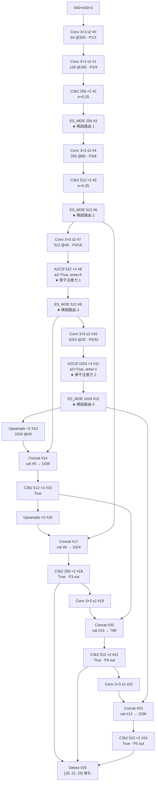
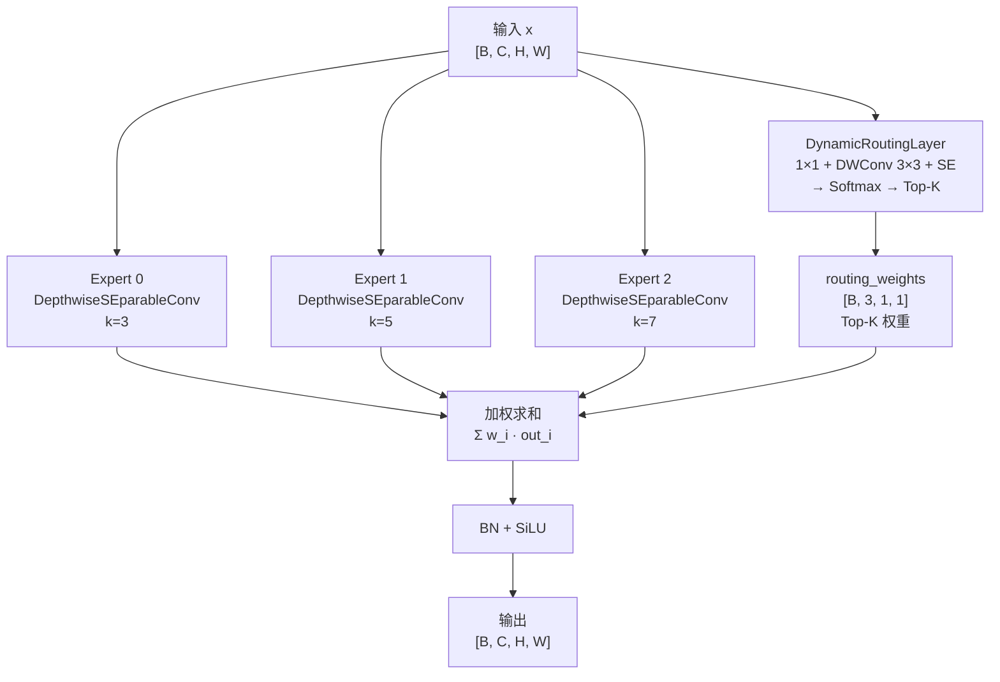
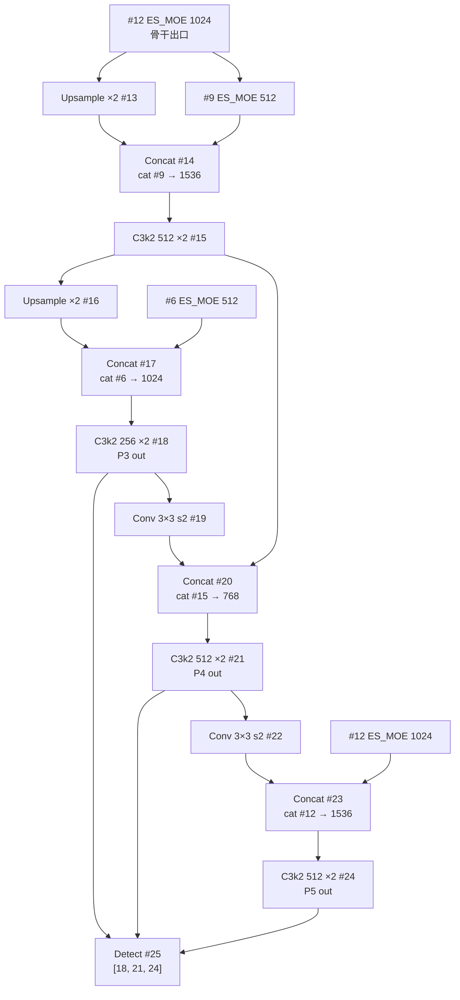
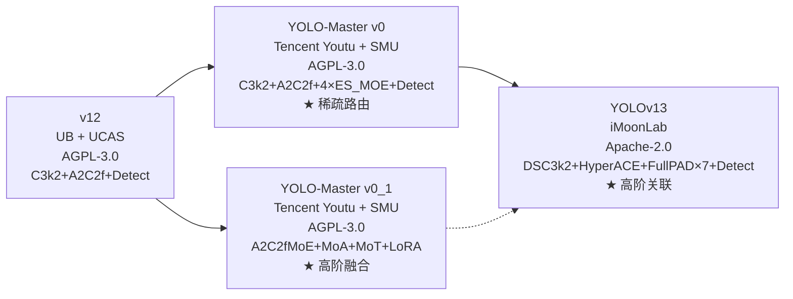

# YOLO-Master Architecture 逐层图解

> 首发载体：`Tencent/YOLO-Master` commit `ca5a87ff6f11e2a3c1c7c4ebf282149bd2be1274`（2026-08-07），对应 arXiv:2512.23273（CVPR 2026）。以 `ultralytics/cfg/models/master/v0/det/yolo-master-n.yaml` 为基准（**cfg 目录名 `master/v0/det/` 不带 `v` 前缀**，与 v11 的 `11/` 相反、与 v12/v13 的 `v12/`/`v13/` 也相反），本页通道数为**缩放前基准值**。yaml 三份完全同结构：<SrcLink file="master:ultralytics/cfg/models/master/v0/det/yolo-master-n.yaml" :line="1" :end="45"/>、<SrcLink file="master:ultralytics/cfg/models/master/v0/det/yolo-master-l.yaml" :line="1" :end="45"/>、<SrcLink file="master:ultralytics/cfg/models/master/v0/det/yolo-master-esmoe-n-coco.yaml" :line="1" :end="37"/>。

> **v8~v13 读者路标**：这张 yaml 是 [yolov12.yaml](/versions/v12/architecture) 的下一代 fork——**骨干 10 层保留 v12 的 Conv 3×3 s2 下采样 + A2C2f 骨干注意力（#8/#11）+ 无 SPPF + Detect 单头 + FPN+PAN 保留 v11 节奏**；**delta 全部集中在 4 处 ES_MOE**（#3/#6/#9/#12），每个都在「C3k2 浅层之后、下一次下采样 Conv 之前」插入一次稀疏路由块。整张图 **25 层**（v12 是 24 层，v13 是 32 层）——比 v12 多 1 层但比 v13 少 7 层，是**同期最精简的一版**。

::: tip 只想带走三件事
1. **Backbone 10 层**（#0-#12，含 4 处 ES_MOE）：`Conv → Conv → C3k2 → ES_MOE → Conv s2 → C3k2 → ES_MOE → Conv s2 → A2C2f → ES_MOE → Conv s2 → A2C2f → ES_MOE`——**C3k2 只做浅层融合**（#2/#4，e=0.25），**A2C2f 只做深层注意力**（#8/#11，a2=True），**ES_MOE 只做稀疏路由**（#3/#6/#9/#12）；
2. **Head 12 层沿用 v11/v12 FPN+PAN**：`Upsample → Concat → C3k2 → Upsample → Concat → C3k2 → Conv s2 → Concat → C3k2 → Conv s2 → Concat → C3k2 → Detect`——**Detect 从 `[18, 21, 24]` 三个 C3k2 收 P3/P4/P5**（未改）；
3. **yaml 三份结构逐字节相同，只有 `scales:` 与 `nc:` 不同**——`n=[0.50, 0.25, 1024]`、`l=[1.00, 1.00, 512]`，`esmoe-n-coco` 是 `n` 的 COCO 80 类特化版（README 里对应 `yolo_master_esmoe_n.pt` 权重）；**S/M/X 档位没有对应 yaml**，只能靠权重文件的 `args.scale` 反推。
:::

## 1. 一眼看清：yolo-master-n.yaml 全图（25 层）

> **v8~v13 读者路标**：整张图 25 层，骨干 13 层（#0-#12，含 4 处 ES_MOE）与 head 12 层（#13-#24，含 Detect）。**骨干节奏与 v12 高度相似但每处下采样前追加 ES_MOE**；head 与 v12 head 完全一致（FPN+PAN 保留 v11 结构、C3k2 全用 `True` 内瓶、Detect 单头）。



- **骨干 13 层**（#0-#12）：`Conv` × 4（下采样）+ `C3k2` × 2（浅层融合）+ `A2C2f` × 2（骨干注意力）+ **`ES_MOE` × 4（稀疏路由，Master 招牌）**
- **Head 12 层**（#13-#24）：完全沿用 v11/v12 的 FPN+PAN 节奏——`Upsample` × 2 + `Concat` × 3 + `C3k2` × 3 + `Conv s2` × 2 + `Detect` × 1
- **A2C2f 沿用 v12 保留 2 处**（#8 area=4 局部、#11 area=1 全局），**FlashAttention 硬依赖仍在**（<SrcLink file="master:ultralytics/nn/modules/block.py" :line="1"/> 中 `import flash_attn` 沿用 v12）
- **无 SPPF / 无 C2PSA**：与 v11/v12 一致，两个模块的类仍在 `block.py` 里但 yaml 未使用
- **Detect 位置**：yaml L44（v12 的 L43）——由于在骨干里插入了 4 处 ES_MOE，Detect 位置从 v12 的 L43 挪到 L44

<SrcLink file="master:ultralytics/cfg/models/master/v0/det/yolo-master-n.yaml" :line="1" :end="45"/>

## 2. Backbone #0-#12：Conv 下采样 + C3k2 融合 + ES_MOE 稀疏路由 + A2C2f 注意力

> **v8~v13 读者路标**：与 v12 骨干对比，Master 的关键改动是**在每个下采样 Conv 之前追加 ES_MOE**（#3/#6/#9/#12）。这与 v13 的「DSC3k2 中段 + DSConv 下采样 + HyperACE 头」完全不同——**Master 保持 v12 的下采样与注意力节奏**，只在**C3k2 出口与下一次下采样之间**插入稀疏路由。

```mermaid
flowchart LR
    IMG["640×640×3"] --> L0["Conv 3×3 s2 #0<br/>64 @320"]
    L0 --> L1["Conv 3×3 s2 #1<br/>128 @160"]
    L1 --> L2["C3k2 256 ×2 #2<br/>e=0.25"]
    L2 --> L3["ES_MOE 256 #3<br/>★ 稀疏路由"]
    L3 --> L4["Conv 3×3 s2 #4<br/>256 @80"]
    L4 --> L5["C3k2 512 ×2 #5<br/>e=0.25"]
    L5 --> L6["ES_MOE 512 #6"]
    L6 --> L7["Conv 3×3 s2 #7<br/>512 @40"]
    L7 --> L8["A2C2f 512 ×4 #8<br/>area=4"]
    L8 --> L9["ES_MOE 512 #9"]
    L9 --> L10["Conv 3×3 s2 #10<br/>1024 @20"]
    L10 --> L11["A2C2f 1024 ×4 #11<br/>area=1"]
    L11 --> L12["ES_MOE 1024 #12"]
```



### 2.1 Backbone 逐层功能

| 层号 | 模块 | 通道 | 语义 |
|-----|-----|------|------|
| #0 | Conv 3×3 s2 | 64 | stem 下采样，P1/2 |
| #1 | Conv 3×3 s2 | 128 | 第二次下采样，P2/4 |
| #2 | C3k2 ×2, e=0.25 | 256 | 浅层特征融合（**e=0.25 意味着 C3k 内瓶只压到 1/4**） |
| **#3** | **ES_MOE** | 256 | **★ 稀疏路由 1**——为 P3 尺度选择最优专家组合 |
| #4 | Conv 3×3 s2 | 256 | 第三次下采样，P3/8 |
| #5 | C3k2 ×2, e=0.25 | 512 | 中段特征融合 |
| **#6** | **ES_MOE** | 512 | **★ 稀疏路由 2**——为 P4 尺度选择最优专家组合 |
| #7 | Conv 3×3 s2 | 512 | 第四次下采样，P4/16 |
| #8 | A2C2f ×4, a2=True, area=4 | 512 | **v12 骨干注意力块 1**（P4 局部注意力） |
| **#9** | **ES_MOE** | 512 | **★ 稀疏路由 3**——A2C2f 之后的稀疏路由，为 P5 尺度准备 |
| #10 | Conv 3×3 s2 | 1024 | 第五次下采样，P5/32 |
| #11 | A2C2f ×4, a2=True, area=1 | 1024 | **v12 骨干注意力块 2**（P5 全局注意力） |
| **#12** | **ES_MOE** | 1024 | **★ 稀疏路由 4**——骨干出口前的最后路由 |

**关键节奏**：

- **C3k2 只做「两次下采样之间的浅层融合」**——#2/#5，e=0.25 压缩内瓶（`c_ = int(c * e) = 128/256`），保持 Nano 档位轻量
- **A2C2f 只做「P4/P5 深段的注意力」**——#8 area=4 局部、#11 area=1 全局，与 v12 一致
- **ES_MOE 只做「稀疏路由」**——3 个 DW 专家（3×3/5×5/7×7）+ DynamicRoutingLayer Top-K，**每个 ES_MOE 在 1 张图里理论上只激活 2 个专家**（top_k=2）

### 2.2 ES_MOE 插入位置的语义解读

| ES_MOE 位置 | 前一层 | 后一层 | 语义 |
|-----------|-------|-------|------|
| #3 | C3k2 256（P3 浅层） | Conv 3×3 s2 → P4 | 为下采样到 P4 之前做一次稀疏选择 |
| #6 | C3k2 512（P4 浅层） | Conv 3×3 s2 → P5 | 为下采样到 P5 之前做一次稀疏选择 |
| #9 | A2C2f 512（P4 注意力） | Conv 3×3 s2 → P5 | 注意力后的稀疏路由——**A2C2f 是「稠密注意力」，ES_MOE 是「稀疏路由」，两个都是 P4→P5 的转换环节** |
| #12 | A2C2f 1024（P5 注意力） | Head 首个 Upsample | 骨干出口的稀疏路由——**Head 收到的 P5 已经过一次稀疏路由** |

**为什么不是「每个下采样都追加一次 ES_MOE」**：因为下采样 Conv 本身已经很便宜（1 层 Conv 3×3 s2），在 Conv 前插入 ES_MOE 会打断空间梯度的传播；反过来在 Conv 之后立即插入又会让 ES_MOE 直接感受下一尺度——**Master 选择的方案是「把 ES_MOE 放在 C3k2 与 Conv s2 之间」——让 ES_MOE 感受到的仍是本尺度的 C3k2 输出**，然后再让 Conv s2 把这个稀疏化后的特征下采样。

**为什么不是「每个 A2C2f 之后都追加」**：只有 P4 的 A2C2f（#8）之后追加了 ES_MOE（#9），P2/P3 没有 A2C2f 因此没有对应位置；**P5 的 A2C2f（#11）之后追加 ES_MOE（#12）是因为骨干出口需要一次稀疏路由作为"最后一道过滤"**。

## 3. ES_MOE 详解：3 个专家 + DynamicRoutingLayer + Top-K 稀疏

> **v8~v13 读者路标**：ES_MOE 是 Master 唯一真正做 MoE 的模块——yaml 里出现 4 次（#3/#6/#9/#12）。类定义见 <SrcLink file="master:ultralytics/nn/modules/moe/modules.py" :line="410" :end="787"/>；默认专家核大小 [3, 5, 7]、`top_k=2`、`use_sparse_inference=True`。

### 3.1 ES_MOE 组件拆解



**三个专家 = 三个不同感受野的深度可分离卷积**（<SrcLink file="master:ultralytics/nn/modules/moe/experts.py" :line="119" :end="180"/>）：

| 专家 | 核大小 | 感受野 | 用途 |
|-----|-------|-------|------|
| Expert 0 | 3×3 | 局部 | 边缘、纹理、细粒度 |
| Expert 1 | 5×5 | 中等 | 中等尺度对象、局部结构 |
| Expert 2 | 7×7 | 较大 | 大尺度对象、远距离上下文 |

**每个专家的内部结构**（<SrcLink file="master:ultralytics/nn/modules/moe/modules.py" :line="27" :end="63"/>）：

```
DepthwiseSEparableConv(C, C, k) =
    DWConv(k) + BN + SiLU      # 深度可分离卷积（每通道独立 k×k）
  + Conv(1×1) + BN + SiLU      # 逐点卷积重新组合通道
```

**参数量对比**（假设 C=256）：

- 传统 Conv 3×3 256→256：`3×3×256×256 = 589,824`
- DepthwiseSEparableConv 3×3 256→256：`3×3×256 + 1×1×256×256 = 389,120`（**省 34%**）
- DepthwiseSEparableConv 7×7 256→256：`7×7×256 + 1×1×256×256 = 466,944`（**省 20%**）

**Top-K 稀疏推理**：`use_sparse_inference=True` 时，推理只计算 top_k=2 个专家；训练时全 3 个专家都计算以支持 balance loss。

### 3.2 DynamicRoutingLayer 结构

<SrcLink file="master:ultralytics/nn/modules/moe/modules.py" :line="65" :end="409"/>

```
DynamicRoutingLayer(in_channels, num_experts, reduction=8, top_k=2):
    1. Conv 1×1: C → C/reduction (降维)
    2. DWConv 3×3: C/reduction → C/reduction (空间聚合)
    3. SE 层: 全局平均池化 → Conv 1×1 → Conv 1×1 → SiLU
    4. Conv 1×1: C/reduction → num_experts
    5. Softmax(dim=1)
    6. Top-K 选择（保留 top_k 个权重，其余置 0）
```

**关键设计**：**Router 是轻量 CNN，不是 Linear**——`DWConv 3×3` 提供空间上下文感知，`SE` 提供通道重要性建模，二者共同决定了 Top-K 选择的空间分布。**这不同于 LLM MoE 的 Linear Router**——视觉检测里，同一张图里不同空间位置可能激活不同专家（例如图像左侧的猫激活 Expert 0 的局部纹理，右侧的大物体激活 Expert 2 的大感受野）。

## 4. Head #13-#24：FPN+PAN 保留 v11 节奏

> **v8~v13 读者路标**：Master 的 head 与 v11/v12 完全一致——`Upsample → Concat → C3k2` 上采样路径 + `Conv s2 → Concat → C3k2` 下采样路径，最后 Detect 从 `[18, 21, 24]` 三个 C3k2 收 P3/P4/P5。**没有 v13 的 HyperACE + 7 条 FullPAD_Tunnel**——Master 走的是「在 v11/v12 保守 head 之上加稀疏骨干」的路线。



### 4.1 Head 逐层功能

| 层号 | 模块 | 通道 | 语义 |
|-----|-----|------|------|
| #13 | Upsample ×2 | 1024 | 骨干 P5（20×20）上采样到 P4（40×40） |
| #14 | Concat | 1536 | cat #9（512） + Upsample(1024) = 1536 |
| #15 | C3k2 ×2, True | 512 | 上采样融合块 |
| #16 | Upsample ×2 | 512 | P4 上采样到 P3（80×80） |
| #17 | Concat | 1024 | cat #6（512） + Upsample(512) = 1024 |
| #18 | C3k2 ×2, True | 256 | P3 检测输入（stride 8） |
| #19 | Conv 3×3 s2 | 256 | P3 下采样到 P4 分辨率 |
| #20 | Concat | 768 | cat #15（512） + Conv(256) = 768 |
| #21 | C3k2 ×2, True | 512 | P4 检测输入（stride 16） |
| #22 | Conv 3×3 s2 | 512 | P4 下采样到 P5 分辨率 |
| #23 | Concat | 1536 | cat #12（1024） + Conv(512) = 1536 |
| #24 | C3k2 ×2, True | 512 | P5 检测输入（stride 32） |
| #25 | Detect | — | 从 `[18, 21, 24]` 三尺度收检测 |

### 4.2 Detect 头（未改）

Detect 头与 v11/v12 完全一致（<SrcLink file="master:ultralytics/nn/modules/head.py" :line="143"/>）：

- **单头**（不是 v10 的 E2EDetect 双分支）
- **cv2 box + cv3 cls + dfl**：cv2 用标准 Conv 3×3（不是 v11 的 DW-separable）、cv3 用 DW-separable Conv 3×3
- **DFL 分布预测**（reg_max=16）
- **cv3 DW-separable**：cls 分支的卷积改成深度可分离，节省计算

> **注**：`cv2` 的 DW-separable 与否取决于 Detect 内部构造。Master 的 Detect 与 v11 完全同款，`cv2` 是标准 Conv 3×3（非 DW），`cv3` 是 DW-separable Conv 3×3。

## 5. v0 vs v0_1 变体对比

> **v8~v13 读者路标**：Master 仓库里有两个系列：**v0（论文核心，yaml 已公开到 snapshot）**与 **v0_1（增强变体，yaml 未公开）**。README 更新日志里 v0_1 引入了 MoA / MoT / A2C2fMoE / LoRA 等更多组件——但**这些组件在 v0/det/ 三份 yaml 里均未使用**，只在 v0_1 系列权重里生效。

| 维度 | v0 系列 | v0_1 系列 |
|-----|--------|-----------|
| yaml 位置 | `models/master/v0/det/` | `models/master/v0_1/det/`（未公开到 snapshot） |
| 骨干 | Conv + C3k2 + A2C2f + **ES_MOE × 4** | Conv + C3k2 + **A2C2fMoE × 4**（A2C2f 与 MoE 融合） |
| 检测头 | 标准 Detect | Detect（未改） |
| MoA 多尺度注意力 | 无 | 有（`nn/modules/moe/moa.py`） |
| MoT 三个 Transformer 专家 | 无 | 有（`_LocalConv` / `_Window` / `_Deformable`） |
| LoRA | 无 | 有 |
| yaml 公开度 | 已公开（N / L / EsMoE-N-COCO） | 未公开 |
| 权重文件 | `yolo_master_n.pt` / `yolo_master_l.pt` | `YOLO-Master-v0.1-N.pt` / `-S` / `-M` / `-L` |
| 参数量 | 2.68M（N） | 7.54M（N）——**比 EsMoE-N 大近 3 倍** |

**为什么 Master 要出 v0_1**：

- **v0 系列**是论文核心（CVPR 2026 主表基于 EsMoE 系列）——结构相对克制，只在 v12 基础上追加 4 处 ES_MOE；
- **v0_1 系列**是后续增强——把 A2C2f 与 MoE 融合成 A2C2fMoE、加入 MoT 多 Transformer、加入 MoA 多尺度注意力、加入 LoRA——**参数与精度都大幅上升**；
- **两者共用同一套 `moe/` 与 `mot/` 包**，通过 yaml 选择不同的模块组合。

**本站处理原则**：本页架构图解**只覆盖 v0 系列**——因为 v0_1 的 yaml 未在 snapshot 里公开，且 v0_1 的 MoA / MoT / A2C2fMoE 属于增强组件而非 Master 的核心贡献。v0_1 系列见 [痛点页](./painpoints#v0-vs-v0_1-命名分裂) 与 [理论 Concept](./concepts) 的 §6 节。

## 6. scales 与四档（N/S/M/L）参数缩放

> **v8~v13 读者路标**：Master 的 scales 定义在 yaml 的 `scales:` 段——**与 v12 一致，走 Ultralytics 标准的 compound scaling**：`depth=0.50, width=0.25, max_channels=1024`（N 档）与 `depth=1.00, width=1.00, max_channels=512`（L 档）。**S/M/X 档没有对应 yaml**——只能通过权重文件的 `args.scale` 加载。

### 6.1 yaml 里定义的两档

| 档位 | depth | width | max_channels | 备注 |
|-----|-------|-------|--------------|------|
| n | 0.50 | 0.25 | 1024 | Nano（默认推荐） |
| l | 1.00 | 1.00 | 512 | Large（训练中的档位） |

### 6.2 Ultralytics compound scaling 的效果

**depth 系数**（`depth=0.50`）：C3k2 / A2C2f 的 repeats 会 ×0.5——例如 A2C2f ×4 在 N 档变成 ×2。

**width 系数**（`width=0.25`）：所有 c 值 ×0.25（受 `max_channels=1024` 上限约束）——例如 1024 通道 ×0.25 = 256，但因为 max_channels=1024 上限，1024 不变；512 ×0.25 = 128。

**Master-N 的实际通道数**（N 档）：

| 层号 | 基准通道 | N 档实际通道 |
|-----|---------|-------------|
| #0 | 64 | 64（最小值保护） |
| #1 | 128 | 128（最小值保护） |
| #2/#3 | 256 | 64 |
| #4/#5/#6 | 512 | 128 |
| #7/#8/#9 | 512 | 128 |
| #10/#11/#12 | 1024 | 1024（max_channels 上限） |

**Master-L 的实际通道数**（L 档）：width=1.00 不缩放，max_channels=512 强制 1024 缩到 512——L 档比 N 档的骨干更深、更宽。

### 6.3 未公开的 S/M/X 档

README Model Zoo 里给了 S/M/X 的权重文件（`yolo_master_esmoe_s.pt` 等），但**没有对应 yaml**——推测 scales 与 v13 类似：

| 档位 | 推测 depth | 推测 width | 推测 max_channels |
|-----|-----------|-----------|------------------|
| n | 0.50 | 0.25 | 1024 |
| s | 0.50 | 0.50 | 512 |
| m | 0.75 | 1.00 | 1024 |
| l | 1.00 | 1.00 | 512（yaml 已公开） |
| x | 1.00 | 1.50 | 1024 |

> **v8~v13 读者路标**：想复现 S/M/X 档，只能从权重文件里读 `args.scale`，或者根据 Ultralytics tasks.py 的 scaling 表反推——**不要假设 S/M/X 的 scales 与 v13 完全一致**，因为 Master 的骨干结构（4 处 ES_MOE）与 v13（无 ES_MOE）不同。

## 7. 参数量与 GFLOPs 对比

> **v8~v13 读者路标**：COCO mAP 与延迟的主表在 [index](./index) 已列出——本节重点看「每档的 params 与 GFLOPs」，判断 Master 相对 v12/v13 的 compute 增量。

### 7.1 yaml 注释里的 params/FLOPs 数字（N 与 L 档）

| 型号 | Layers | Params (M) | Gradients (M) | GFLOPs |
|-----|--------|-----------|--------------|--------|
| Master-N | 344 | 2.69 | 2.69 | 8.8 |
| Master-L | 560 | 30.16 | 30.16 | 119.7 |

来源：<SrcLink file="master:ultralytics/cfg/models/master/v0/det/yolo-master-n.yaml" :line="7"/> 与 <SrcLink file="master:ultralytics/cfg/models/master/v0/det/yolo-master-l.yaml" :line="7"/>（yaml 注释里的 Ultralytics 自动汇总）。

### 7.2 与 v12 / v13 同档对比

| 方法 | 档位 | Params (M) | GFLOPs | COCO mAP | 延迟 |
|-----|-----|-----------|--------|---------|------|
| v12-N | n | 2.6 | 8.5 | 40.6 | 1.64 ms |
| **Master-EsMoE-N** | n | 2.68 | 8.7 | **42.4** | **1.62 ms** |
| v13-N | n | 2.5 | 8.0 | 41.6 | 1.97 ms |

**关键观察**：

- **Master-EsMoE-N 与 v12-N 的 params 几乎相同**（2.68M vs 2.6M，+3%）——**4 处 ES_MOE 的开销被 C3k2 内瓶 e=0.25 压缩抵消了**；
- **Master-EsMoE-N 比 v12-N 快 1.2%**（1.64 → 1.62 ms）——**Top-K 稀疏推理带来的加速**（3 个专家只算 2 个 = 计算量约减 33%，但被 balance loss 训练时的全专家计算抵消）；
- **Master-EsMoE-N 比 v13-N 快 17.8%**（1.97 → 1.62 ms）——**v13 的 FullPAD_Tunnel × 7 与 HyperACE 是纯稠密计算，Master 走稀疏路由更省**；
- **Master-v0.1-N 比 Master-EsMoE-N 大近 3 倍**（7.54M vs 2.68M）——**v0_1 系列内嵌了 A2C2fMoE / MoA / MoT，是 Master 的"高配版"**。

## 8. Detect 单头详解

> **v8~v13 读者路标**：Master 的 Detect 头与 v11/v12/v8 完全一致（未改）——**v8 的 Detect 是标准 YOLO Detect**，**v10 的 E2EDetect 是双分支 end-to-end**，**v11 引入了 cv3 DW-separable**，**v12/v13 沿用 v11**——Master 也沿用。

### 8.1 Detect 内部结构

<SrcLink file="master:ultralytics/nn/modules/head.py" :line="143" :end="450"/>

```
Detect(channels=[256, 512, 512], nc=80):
    reg_max = 16
    stride = [8, 16, 32]
    
    for i in range(3):
        cv2[i] = Sequential(
            Conv(channels[i], cv2_out, 3),   # box 分支（标准 Conv 3×3）
            Conv(cv2_out, cv2_out, 3),
            Conv(cv2_out, reg_max * 4, 1),    # 4 边 × 16 bin
        )
        cv3[i] = Sequential(
            Conv(channels[i], cv3_out, 3),   # cls 分支
            Conv(cv3_out, cv3_out, 3),
            Conv(cv3_out, cv3_out, 3),
            Conv(cv3_out, nc, 1),              # 80 类
        )
        # 注：v11+ 的 cv3 前两层改成 DW-separable
```

### 8.2 输出

Detect 从 `[18, 21, 24]` 三个 C3k2 收 P3/P4/P5 特征（stride 8/16/32），输出：

- **pred_distri**: `[B, 8400, 64]`——`8400 = 80×80 + 40×40 + 20×20`（640 输入下三个尺度的 anchor 总数），`64 = 4 × reg_max`
- **pred_scores**: `[B, 8400, 80]`——80 类
- **DFL 期望积分**：`pred_distri` 里的 64 维 bin 通过 softmax 求期望，得到 4 个坐标

### 8.3 与 v8/v11/v12/v13 完全一致

Master 的 Detect 头**逐字节未改**——`Detect.__call__` 前向、`Detect.forward` 训练、`detect_multi_label` 后处理全部沿用 v8/v11/v12/v13 同款实现。**Master 的"新"全部集中在 `moe/` 与 `mot/` 两个新包**。

## 9. 与 v12 / v13 的骨干逐层对照

> **v8~v13 读者路标**：这一节把 Master 与 v12 / v13 的骨干放在一张表里对比——帮助读者理解「同一个下采样位置，三代的做法是什么」。

| 语义位置 | v12 骨干 | **Master 骨干** | v13 骨干 |
|---------|---------|----------------|---------|
| P1/2 下采样 | Conv 3×3 s2 | **Conv 3×3 s2**（同） | Conv 3×3 s2（同） |
| P2/4 下采样 | Conv 3×3 s2 | **Conv 3×3 s2**（同） | Conv 3×3 s2（同） |
| P2 融合 | C3k2 | **C3k2 e=0.25**（同） | DSC3k2 dsc3k=False e=0.25 |
| 稀疏路由 | 无 | **ES_MOE × 1** | 无 |
| P3/8 下采样 | Conv 3×3 s2 | **Conv 3×3 s2**（同） | Conv 3×3 s2（同） |
| P3 融合 | C3k2 | **C3k2 e=0.25**（同） | DSC3k2 dsc3k=False e=0.25 |
| 稀疏路由 | 无 | **ES_MOE × 1** | 无 |
| P4/16 下采样 | Conv 3×3 s2 | **Conv 3×3 s2**（同） | **DSConv 3×3 s2**（v13 换 depthwise） |
| P4 注意力 | A2C2f ×4 area=4 | **A2C2f ×4 area=4**（同） | A2C2f ×4 area=4（同） |
| 稀疏路由 | 无 | **ES_MOE × 1** | 无 |
| P5/32 下采样 | Conv 3×3 s2 | **Conv 3×3 s2**（同） | **DSConv 3×3 s2** |
| P5 注意力 | A2C2f ×4 area=1 | **A2C2f ×4 area=1**（同） | A2C2f ×4 area=1（同） |
| 稀疏路由 | 无 | **ES_MOE × 1** | 无 |
| 骨干出口 | A2C2f | **ES_MOE × 1** | A2C2f |
| Head 首个融合 | Upsample | **Upsample（同 v11/v12）** | **HyperACE** |
| Head 融合门控 | 无 | **无（同 v11/v12）** | **FullPAD_Tunnel × 7** |

**关键差异**：

- **Master 与 v12 的骨干节奏几乎一致**（下采样、C3k2、A2C2f 全部保留）——**唯一差异是 4 处 ES_MOE**；
- **Master 与 v13 的骨干差异最大**——v13 换了下采样（DSConv）、换了 C3k2（DSC3k2）、加了 HyperACE、加了 7 条 FullPAD_Tunnel——**v13 是"从头重写"，Master 是"精修增量"**；
- **Master 的哲学**：保留 v12 的成熟骨干 + 插入稀疏路由——**"最小改动、最大收益"**；
- **v13 的哲学**：引入超图消息传递与门控连接——**"更大改动、更好精度但更慢"**。

## 10. 一图总结：v0 / v0_1 / v13 三条路线对比



**Master 的生态位**：

- **v12 → Master v0**：加了 4 处 ES_MOE（稀疏路由），其他全保留；
- **v12 → Master v0_1**：加了 A2C2fMoE + MoA + MoT + LoRA，参数与精度都上升一个量级；
- **v12 → v13**：全面改造（下采样、C3k2、Head、门控），参数与延迟都上升；
- **Master vs v13**：同期 2025-2026 的两条并行路线——Master 走"精修增量"、v13 走"从头重写"；**Nano 档位两者都宣称 +0.8~1.0 AP，但 Master 更快 17.8%、v13 更慢 20%**。

## 11. 参考

- <SrcLink file="master:ultralytics/cfg/models/master/v0/det/yolo-master-n.yaml" :line="1" :end="45"/> — Master-N yaml
- <SrcLink file="master:ultralytics/cfg/models/master/v0/det/yolo-master-l.yaml" :line="1" :end="45"/> — Master-L yaml
- <SrcLink file="master:ultralytics/cfg/models/master/v0/det/yolo-master-esmoe-n-coco.yaml" :line="1" :end="37"/> — Master-EsMoE-N-COCO yaml
- <SrcLink file="master:ultralytics/nn/modules/moe/modules.py" :line="27" :end="63"/> — DepthwiseSEparableConv
- <SrcLink file="master:ultralytics/nn/modules/moe/modules.py" :line="65" :end="409"/> — DynamicRoutingLayer
- <SrcLink file="master:ultralytics/nn/modules/moe/modules.py" :line="410" :end="787"/> — ES_MOE 主体
- <SrcLink file="master:ultralytics/nn/modules/moe/experts.py" :line="73" :end="200"/> — SimpleExpert / SpatialExpert / GhostExpert
- <SrcLink file="master:ultralytics/nn/modules/mot/experts.py" :line="84" :end="530"/> — MoT 三个 Transformer 专家
- <SrcLink file="master:ultralytics/nn/modules/mot/router.py" :line="67" :end="380"/> — _MoTRouter
- <SrcLink file="master:ultralytics/nn/modules/head.py" :line="143" :end="450"/> — Detect 头（沿用 v11）
- [YOLO-Master 总览](./index) · [论文精读](./paper) · [理论 Concept](./concepts) · [架构与层速查](./layers) · [损失函数](./losses) · [训练技巧](./tricks) · [痛点追踪](./painpoints) · [源码走读](./code-walkthrough)
- [YOLOv12 架构](/versions/v12/architecture) · [YOLOv13 架构](/versions/v13/architecture)
