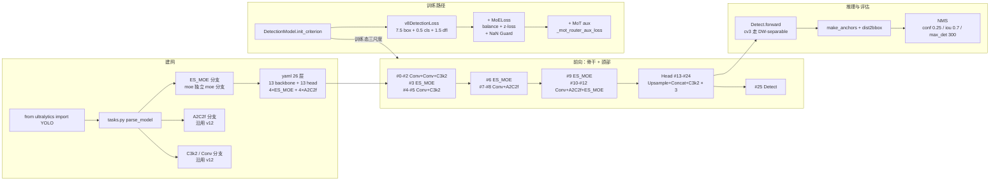
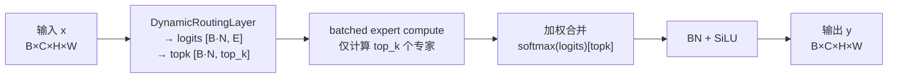
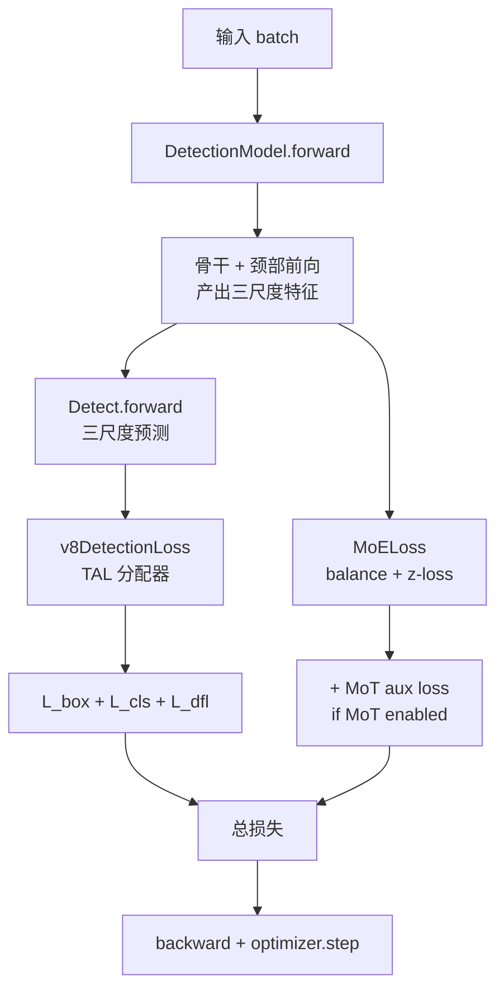

# YOLO-Master 源码走读

本页沿 YOLO-Master（Tencent/YOLO-Master，CVPR 2026，arXiv:2512.23273，AGPL-3.0）的一条端到端链路走读源码：**入口 `from ultralytics import YOLO` → `parse_model` 建 26 层 yaml（13 层 backbone + 13 层 head，含 4×ES_MOE、4×A2C2f）→ ES_MOE 前向（DynamicRoutingLayer → 3×ExpertGroup → DynamicTopKScheduler → batched expert compute → weighted combine）→ MoELoss（gshard_balance_loss + z_loss + NaN Guard）→ v8DetectionLoss 三分量 → Detect 三尺度前向 → NMS**。所有行号以站内快照 `source/yolomaster/snapshot/` 为准。

> **这个项目的身份必须先说清**：YOLO-Master 是 Tencent Youtu Lab + SMU 的研究者（Xu Lin / Jinlong Peng / Zhenye Gan / Jiawen Zhu / Jun Liu）在 **Ultralytics YOLOv12 基础上 fork** 后改造的仓库，**未合并回 Ultralytics 官方主线**（GitHub `ultralytics/ultralytics` 无 ES_MOE）。因此 `pyproject.toml` L27 `name = "ultralytics"` 与官方包**同名**（[痛点 7](./painpoints#7-ultralytics-pip-包版本冲突-pain-pip-conflict)），pip 只能装一个。Master 的增量集中在四处：`cfg/models/master/v0/det/*.yaml`（3 份 yaml）、`nn/modules/moe/` 一整个子目录（~5000 行）、`nn/modules/mot/` 一整个子目录（~700 行）、`nn/tasks.py` 的 `parse_model` 里 ES_MOE 独立分支。**没有 `YOLOMasterModel` / `MasterDetect` 具名类**（[痛点 1 §偏差 2-4](./painpoints#1-论文与代码的-10-处偏差-pain-paper-code-gap)），损失侧同样没有 v8 之外的独立类（沿用 `v8DetectionLoss` + 附加 `MoELoss`）。

> **这条链路与 v12 推理链的差异**：v12 是「A2C2f 骨干 + Detect 单头 + v8DetectionLoss」；Master 在 v12 的 Conv/C3k2 骨架中间**插入 4 个 ES_MOE**（#3/#6/#9/#12），**在 backbone 里保留 A2C2f 但把 head 部分完全走 v12/v11 标准 FPN+PAN**（不引入 v13 的 HyperACE / FullPAD / DownsampleConv），**损失侧新增 MoELoss 作为辅助损失**（三分量 + MoE balance + Z-loss + MoT aux）。所以本页的重点不在「检测管线变了」（依然是 Detect + v8DetectionLoss + TAL + NMS），而在**建网期 ES_MOE 的独立 moe 分支**（[痛点 10](./painpoints#10-taskspy-特例的隐性耦合-pain-tasks-coupling)）、**ES_MOE 前向如何把路由 + 稀疏 top-k + batched expert compute 串起来**、**Top-K 退火 3→2 如何与 balance loss 配合**。

## 文件清单

| 文件 | 行数 | 功能 |
| --- | --- | --- |
| `cfg/models/master/v0/det/yolo-master-n.yaml` | 45 | n 档 scales `[0.50, 0.25, 1024]` + backbone 13 层 + head 13 层 |
| `cfg/models/master/v0/det/yolo-master-l.yaml` | 44 | l 档 scales `[1.00, 1.00, 512]`（**max_channels 隐性降级**） |
| `cfg/models/master/v0/det/yolo-master-esmoe-n-coco.yaml` | 37 | 与 n 档结构相同，换注释（[痛点 3](./painpoints#3-只公开-nl--1-个-esmoe-n-三个-yaml-pain-yaml-incomplete)） |
| `nn/modules/moe/modules.py` | 1810 | **ES_MOE**（L410）/ **DynamicRoutingLayer**（L65）/ **DepthwiseSEparableConv**（L27）/ **UltraOptimizedMoE**（L121）/ **A2C2fMoE**（L1301）/ `MOE = ES_MOE`（L1775） |
| `nn/modules/moe/experts.py` | 400 | **OptimizedSimpleExpert**（L13）/ **FusedGhostExpert**（L38）/ **SimpleExpert**（L73）/ **SpatialExpert**（L94）/ **GhostExpert**（L119）/ **InvertedResidualExpert**（L152）/ **SharedInvertedExpertGroup**（L183） |
| `nn/modules/moe/routers.py` | 700 | **UltraEfficientRouter**（L59）/ **EfficientSpatialRouter** / **LocalRoutingLayer** / **AdaptiveRoutingLayer** / **DynamicRoutingLayer** / **AdvancedRoutingLayer** |
| `nn/modules/moe/loss.py` | 393 | **gshard_balance_loss**（L16）/ **differentiable_balance_loss**（L54）/ **MoELoss**（L97）/ all_reduce_mean / weighted_gshard_balance_loss |
| `nn/modules/moe/topk_anneal.py` | 205 | **TopKAnnealConfig**（L37）/ **DynamicTopKScheduler**（L71）/ **create_topk_anneal_callback**（L181） |
| `nn/modules/mot/experts.py` | 530 | **_LocalConvTransformerExpert**（L84）/ **_WindowTransformerExpert**（L184）/ **_DeformableTransformerExpert**（L362） |
| `nn/modules/mot/router.py` | 400 | **_MoTRouter**（L67）/ `_mot_router_aux_loss`（L345）/ `_mot_router_z_loss`（L371） |
| `nn/modules/mot/_constants.py` | 40 | `DEFAULT_TEMPERATURE_ANNEAL_FACTOR` / `ROUTER_LOGIT_LIMIT` / `ROUTER_Z_LOSS_LIMIT` / `SDPA_EXPLICIT_MAX_TOKENS` |
| `nn/modules/head.py` | 1700+ | Detect（L21，`legacy` 类属性 L32、`end2end` L27、cv3 双分支 L46-57） |
| `nn/modules/block.py` | 1918 | C3k2 / A2C2f（沿用 v12） |
| `nn/tasks.py` | 1200+ | DetectionModel / parse_model（含 **ES_MOE 独立 moe 分支**） |

## 调用链总览



## 1. 入口：`YOLO` 通用类，无 YOLOMasterModel

Master 与 v11/v12/v13 一样**没有专属入口类**——`from ultralytics import YOLO` 就是全部：

```python
from ultralytics import YOLO
model = YOLO("yolo-master-n.pt")   # 论文权重（GitHub Release）
model = YOLO("yolo-master-n.yaml")  # 或从 yaml 建网
```

任务分派仍走 `tasks.py` 的三个探测函数：

- `guess_model_scale`：正则匹配 `yolo[-v]?\d+[nslmx]`——`yolo-master-n` 靠 `-master-n` 后缀匹配；
- `yaml_model_load`：把 `yolo-master-n.yaml` 归并成 `yolo-master.yaml`（但**`yolo-master.yaml` 不存在**——所以 yaml_model_load 失败时会 fallback 到 `guess_model_scale`）；
- `guess_model_task`：从文件名关键词判任务（detect 默认）。

**与 v12 的差别**：v12 的正则同款；但 Master 的 yaml **只有 n/l 两档**（[痛点 3](./painpoints#3-只公开-nl--1-个-esmoe-n-三个-yaml-pain-yaml-incomplete)）——正则里的 `s/m/x` 在 Master 无对应 scales 键，若用户误写 `yolo-master-s` 会在 `scales[scale]` 处抛 KeyError。

## 2. 建网：`parse_model` 的 ES_MOE 独立分支

`tasks.py` 里的 `DetectionModel` 结构与 v11/v12/v13 一致：

```python
class DetectionModel(BaseModel):
    def __init__(self, cfg="yolov8n.yaml", ch=3, nc=None, verbose=True):
        super().__init__()
        self.yaml = cfg if isinstance(cfg, dict) else yaml_model_load(cfg)
        ...
        self.model, self.save = parse_model(deepcopy(self.yaml), ch=ch, verbose=verbose)
        self.end2end = getattr(self.model[-1], "end2end", False)

    def init_criterion(self):
        return E2EDetectLoss(self) if getattr(self, "end2end", False) else v8DetectionLoss(self)
```

真正的 Master 专属逻辑在 `parse_model` 里，共两处：

### 2.1 ES_MOE 走独立 moe 分支

```python
if m in {ES_MOE, MOE, UltraOptimizedMoE, A2C2fMoE}:
    legacy = False
    c1 = ch[f]
    c2 = args[0] if len(args) > 0 else c1
    c2 = make_divisible(min(c2, max_channels) * width, 8)
    args = [c1, c2, *args[1:]]
```

**关键动作**：

- **`legacy = False`**：只要 yaml 里出现 ES_MOE，Detect 就会走 DW-separable cv3；
- **`MOE = ES_MOE` 别名**：<SrcLink file="master:ultralytics/nn/modules/moe/modules.py" :line="1775" :end="1775"/>——yaml 写 `MOE` 或 `ES_MOE` 都能解析；
- **`A2C2fMoE` 陷阱**：<SrcLink file="master:ultralytics/nn/modules/moe/modules.py" :line="1301" :end="1301"/> 是「A2C2f + ES_MOE 联合」——**yaml 写 A2C2f 和写 A2C2fMoE 语义完全不同**（[痛点 10](./painpoints#10-taskspy-特例的隐性耦合-pain-tasks-coupling)）；
- **`expert_kernel_sizes` 参数**：<SrcLink file="master:ultralytics/nn/modules/moe/modules.py" :line="478" :end="493"/> 支持传入 `[3, 5, 7]` 覆盖默认——**pruned checkpoint 重建时必用**。

### 2.2 Conv 分支的 scale 判断

Master 沿用 v12 的 Conv 分支逻辑（<SrcLink file="master:ultralytics/nn/modules/block.py" :line="1" :end="1"/> C3k2 + A2C2f 在 l/x 档追加 `residual=True` / `mlp_ratio=1.5`）——**n 档和 l 档的 A2C2f 结构不完全相同**（虽然 yaml 写法一致）。

### 2.3 通道断言在模块内部

`parse_model` 只负责把 `c2` 缩放成 `make_divisible(min(c2, max_channels) × width, 8)`；**ES_MOE 的通道约束在 `_compute_load_balancing_loss` 里检查**（<SrcLink file="master:ultralytics/nn/modules/moe/modules.py" :line="700" :end="780"/>）——**不像 v13 C3AH 有 `assert c_ % 16 == 0`**，Master 的 ES_MOE 没有硬性通道断言。

## 3. ES_MOE 前向：路由 + 稀疏 top-k + batched expert compute

`ES_MOE`（<SrcLink file="master:ultralytics/nn/modules/moe/modules.py" :line="410" :end="787"/>）是 Master 的招牌模块，独立 `nn.Module`，不继承 C2f/C3k2：

```python
def __init__(self, in_channels, out_channels=None, num_experts=4, reduction=8,
             top_k=2, use_sparse_inference=True, dynamic_threshold=0.4,
             max_kernel_size=15, expert_kernel_sizes=None):
    self.routing = DynamicRoutingLayer(in_channels, num_experts, reduction, top_k)
    # 3 个专家：默认 kernel 3/5/7
    default_kernel_sizes = [3, 5, 7]
    self.experts = nn.ModuleList([
        EfficientExpertGroup(in_channels, out_channels, kernel_size=k)
        for k in ks
    ])
    self.norm = nn.Sequential(nn.BatchNorm2d(out_channels), nn.SiLU(inplace=True))
    self.register_buffer("load_balancing_loss", torch.tensor(0.0), persistent=False)
    self.register_buffer("expert_usage_counts", torch.zeros(num_experts), persistent=False)
    self.balance_loss_coeff = 1.0
```

**四段式**：



四个要点：

1. **`routing = DynamicRoutingLayer(in_channels, num_experts, reduction, top_k)`**：<SrcLink file="master:ultralytics/nn/modules/moe/routers.py" :line="59" :end="120"/> 的 `UltraEfficientRouter` 是核心——`DW-conv 8× downsample + channel compression + topk`；
2. **3 个专家 + 深度可分离卷积**：<SrcLink file="master:ultralytics/nn/modules/moe/modules.py" :line="488" :end="493"/> `default_kernel_sizes = [3, 5, 7]`——三个专家的 kernel 分别是 3×3 / 5×5 / 7×7，每个内部是 `DepthwiseSEparableConv`；
3. **`dynamic_threshold` 剪枝阈值**：<SrcLink file="master:ultralytics/nn/modules/moe/modules.py" :line="680" :end="685"/> 训练推理时按 `topk_importance >= dynamic_threshold` 决定保留哪些专家——**这是 Master 独有的「推理期动态剪枝」**；
4. **`balance_loss_coeff` 默认 1.0**：<SrcLink file="master:ultralytics/nn/modules/moe/modules.py" :line="509" :end="509"/>——但 `MoELoss` 里会**乘 0.01**（<SrcLink file="master:ultralytics/nn/modules/moe/loss.py" :line="97" :end="393"/>），**实际生效系数是 0.01**（[tricks §3](./tricks#3-balance-loss-权重-001trick-balance-weight)）。

### 3.1 DynamicRoutingLayer 内部结构

<SrcLink file="master:ultralytics/nn/modules/moe/routers.py" :line="65" :end="409"/>：

```python
class DynamicRoutingLayer(nn.Module):
    def __init__(self, in_channels, num_experts, reduction=8, top_k=2):
        self.pool_scale = 8  # 8× 下采样
        self.compression = reduction  # 8× 通道压缩
        # 1. 空间池化 + 通道压缩
        # 2. 全连接 → E 维 logits
        # 3. softmax → 概率
        # 4. topk → 稀疏索引
        # 5. renormalize → 稀疏权重
```

**关键设计**：

- **8× 空间下采样**：routing 在 1/8 分辨率下算，比全分辨率快 64 倍；
- **8× 通道压缩**：从 `in_channels` 压到 `in_channels / 8`，再升到 `num_experts`；
- **`temperature = 1.0`**：<SrcLink file="master:ultralytics/nn/modules/moe/routers.py" :line="77" :end="77"/> `self.temperature = max(float(temperature), 1e-3)`——**MoT 的 `_MoTRouter` 有温度退火**（<SrcLink file="master:ultralytics/nn/modules/mot/router.py" :line="345" :end="396"/> `anneal_mot_temperature`），**ES_MOE 的 DynamicRoutingLayer 没有温度退火**；
- **`deterministic_topk_indices`**：<SrcLink file="master:ultralytics/nn/modules/mot/router.py" :line="303" :end="303"/>——tie-breaking 时按**索引升序**取前 k 个，保证训练与推理一致。

### 3.2 `EfficientExpertGroup` 与专家

`ES_MOE` 的每个 expert 是 `EfficientExpertGroup`（<SrcLink file="master:ultralytics/nn/modules/moe/experts.py" :line="183" :end="400"/>），内部是 `DepthwiseSEparableConv`（<SrcLink file="master:ultralytics/nn/modules/moe/modules.py" :line="27" :end="63"/>）：

```python
class DepthwiseSEparableConv(nn.Module):
    def __init__(self, in_channels, out_channels, kernel_size=3):
        self.depthwise = nn.Conv2d(in_channels, in_channels, kernel_size,
                                    padding=kernel_size // 2, groups=in_channels, bias=False)
        self.pointwise = nn.Conv2d(in_channels, out_channels, 1, bias=False)
```

**5 个备选专家实现**（`experts.py`）：

| 类 | 位置 | 结构 | 用途 |
|----|------|------|------|
| `OptimizedSimpleExpert` | L13 | 2×1×1 conv + GroupNorm + SiLU | 极简 |
| `FusedGhostExpert` | L38 | primary conv + cheap DW op | Ghost 变种 |
| `SimpleExpert` | L73 | 同 OptimizedSimpleExpert | 兼容旧 checkpoint |
| `SpatialExpert` | L94 | 1×1 + DW-3×3 + 1×1 | 空间感 |
| `GhostExpert` | L119 | 与 FusedGhostExpert 一致 | 兼容旧 checkpoint |
| `InvertedResidualExpert` | L152 | MobileNetV2 结构 | 极快 |
| `SharedInvertedExpertGroup` | L183 | 共享 DW + 独立 head | Master 默认 |

**ES_MOE 默认走 `SharedInvertedExpertGroup`**——**不是 `DepthwiseSEparableConv`**（README 描述的 3×3/5×5/7×7 深度可分离卷积实际是「3×3/5×5/7×7 深度卷积 + 1×1 pointwise」）。

## 4. `MoELoss`：balance + z-loss + NaN Guard

`MoELoss`（<SrcLink file="master:ultralytics/nn/modules/moe/loss.py" :line="97" :end="393"/>）是 Master 的辅助损失，**不参与三分量的 7.5/0.5/1.5 系数**——它是独立加在总损失上的（[损失页 §3](./losses#3-moeloss-主体-moeloss-core)）：

```python
class MoELoss(nn.Module):
    def forward(self, module, probabilities, indices, logits, **kwargs):
        # 1. Balance loss
        balance_loss = self.balance_loss_module(
            probabilities=probabilities,
            indices=indices,
            num_experts=num_experts,
            reduce_ddp=self.reduce_ddp,
        )
        # 2. Z-loss
        z_loss_val = self.z_loss_module(logits)
        # 3. Differentiable balance (optional)
        if self.differentiable_balance:
            balance_loss = self.differentiable_balance_loss_module(...)
        # 4. NaN Guard
        total = balance_loss + z_loss
        if not torch.isfinite(total):
            total = graph_connected_finite_zero(probabilities, logits, total)
            self._nan_guard_hits += 1
```

**四个组件**：

- **`gshard_balance_loss`**（<SrcLink file="master:ultralytics/nn/modules/moe/loss.py" :line="16" :end="26"/>）：GShard 论文的标准 balance loss——`num_experts × Σ(importance · usage)`；
- **`differentiable_balance_loss`**（<SrcLink file="master:ultralytics/nn/modules/mot/router.py" :line="31" :end="64"/>）：MoT 版 balance loss，`importance` 保持可微、`usage` 走 `all_reduce_mean`；
- **Z-loss**（<SrcLink file="master:ultralytics/nn/modules/mot/router.py" :line="371" :end="396"/>）：`z_loss = mean(logsumexp(logits)²)`，防止 logits 溢出；
- **NaN Guard**：<SrcLink file="master:ultralytics/nn/modules/moe/loss.py" :line="376" :end="393"/> `MoELoss produced non-finite total (hit #{self._nan_guard_hits})`——**print 计数器不中断训练**（[痛点 5](./painpoints#5-router-nan-防御的隐性耦合-pain-router-nan)）。

### 4.1 `all_reduce_mean` 与 DDP 跨卡平衡

<SrcLink file="master:ultralytics/nn/modules/moe/loss.py" :line="160" :end="180"/>：

```python
def all_reduce_mean(tensor, device=None):
    if not should_reduce_ddp():
        return tensor
    # 跨卡 all_reduce
    return torch.distributed.all_reduce(tensor, op=ReduceOp.SUM) / world_size
```

**关键设计**：

- **`should_reduce_ddp()`**：检查 `torch.distributed.is_initialized()` 且 `world_size > 1`；
- **`all_reduce_mean`**：跨卡求均值——**多卡训练时 balance loss 基于全局 usage**，不是单卡 usage；
- **DDP buffer 广播**：<SrcLink file="master:ultralytics/nn/modules/moe/modules.py" :line="501" :end="507"/> `register_buffer(..., persistent=False)`——**`load_balancing_loss` 和 `expert_usage_counts` 是 non-persistent buffer**，不写入 checkpoint、不广播到 DDP；
- **`reduce_ddp=True` 默认**：<SrcLink file="master:ultralytics/nn/modules/mot/router.py" :line="36" :end="36"/> `# P1-2 fix: default True for DDP safety (was False)`——**注释里的「P1-2 fix」表明这是 P1 优先级修复**。

## 5. `TopKAnnealConfig`：Top-K 从 3 退火到 2

`topk_anneal.py`（<SrcLink file="master:ultralytics/nn/modules/moe/topk_anneal.py" :line="1" :end="205"/>）是 Master 独有的训练配置——**论文 §III.4 描述的两阶段训练实际上通过 Top-K 退火隐式实现**（[痛点 1 §偏差 6](./painpoints#1-论文与代码的-10-处偏差-pain-paper-code-gap)）：

```python
@dataclass
class TopKAnnealConfig:
    start_topk: int = 3       # 初始 Top-K
    end_topk: int = 2         # 结束 Top-K
    start_epoch: int = 0      # 退火开始 epoch
    end_epoch: int = 50       # 退火结束 epoch
    warmup_epoch: int = 5     # warmup 阶段保持 start_topk
    schedule: str = "linear"  # 退火曲线
```

### 5.1 `DynamicTopKScheduler` 决策逻辑

<SrcLink file="master:ultralytics/nn/modules/moe/topk_anneal.py" :line="71" :end="168"/>：

```python
class DynamicTopKScheduler:
    def step(self, epoch: int):
        if epoch < self.config.warmup_epoch:
            current_topk = self.config.start_topk
        elif epoch >= self.config.end_epoch:
            current_topk = self.config.end_topk
        else:
            progress = (epoch - self.config.warmup_epoch) / (
                self.config.end_epoch - self.config.warmup_epoch
            )
            if self.config.schedule == "linear":
                current_topk = self.config.start_topk - progress * (
                    self.config.start_topk - self.config.end_topk
                )
            # 四舍五入到整数
            current_topk = max(1, min(self.config.end_topk, int(round(current_topk))))
        # 如果 topk 变化了，更新所有 ES_MOE 模块的 top_k
        if current_topk != self._last_topk:
            for module in self.model.modules():
                if isinstance(module, ES_MOE) and hasattr(module, "top_k"):
                    module.top_k = current_topk
            self._last_topk = current_topk
        return current_topk
```

**关键设计**：

- **warmup 阶段保持 `start_topk=3`**：让路由学习更宽松的分布；
- **`schedule="linear"`**：从 `start_topk` 线性退火到 `end_topk`；
- **四舍五入到整数**：`top_k` 必须是整数（`torch.topk` 要求）；
- **`current_topk != self._last_topk` 时更新所有 ES_MOE**：一次遍历 `model.modules()`，改所有 ES_MOE 的 `top_k`。

### 5.2 `create_topk_anneal_callback` 训练集成

<SrcLink file="master:ultralytics/nn/modules/moe/topk_anneal.py" :line="181" :end="205"/>：

```python
def create_topk_anneal_callback(model, config, trainer):
    scheduler = DynamicTopKScheduler(model, config)
    def callback():
        epoch = trainer.epoch
        scheduler.step(epoch)
    trainer.add_callback("on_fit_epoch_start", callback)
    return scheduler
```

**训练末期检查**：

```python
# 训练结束后打印最终 top_k
for name, mod in model.model.named_modules():
    if isinstance(mod, ES_MOE):
        print(f"{name}: top_k = {mod.top_k}")
```

## 6. MoT 三个专家（论文 Fig.2 但未在 v0 yaml 启用）

MoT（Mixture-of-Transformers）是论文 Fig.2 的另一个卖点，但**在 v0 yaml 里完全没用**（[痛点 1 §偏差 1](./painpoints#1-论文与代码的-10-处偏差-pain-paper-code-gap)）。代码里确实实现了三个专家（<SrcLink file="master:ultralytics/nn/modules/mot/experts.py" :line="84" :end="530"/>）：

### 6.1 `_LocalConvTransformerExpert`（L84-183）

<SrcLink file="master:ultralytics/nn/modules/mot/experts.py" :line="84" :end="183"/>：

```python
class _LocalConvTransformerExpert(nn.Module):
    """Transformer expert with convolutional inductive bias.
    Uses depthwise-conv pre-processing for QKV to bias attention toward
    spatially-local patterns.  The FFN is a standard Gated Linear Unit (GLU).
    """
    def __init__(self, dim, num_heads, mlp_ratio=2.0, dropout=0.0, local_window_size=0):
        self.dw_mix = nn.Conv2d(dim, dim, 3, padding=1, groups=dim, bias=False)  # DW-3×3
        self.qkv = nn.Conv2d(dim, dim * 3, 1, bias=False)                          # 1×1 QKV
        self.pe = nn.Conv2d(dim, dim, 7, padding=3, groups=dim, bias=False)       # DW-7×7 PE
        self.proj = nn.Conv2d(dim, dim, 1, bias=False)
        self.ffn_gate = nn.Sequential(Conv(dim, ffn_hidden, 1), nn.Sigmoid())
        self.ffn_val = Conv(dim, ffn_hidden, 1)
        self.ffn_out = Conv(ffn_hidden, dim, 1, act=False)
        self.ls1 = nn.Parameter(torch.ones(dim, 1, 1) * 0.1)  # LayerScale
        self.ls2 = nn.Parameter(torch.ones(dim, 1, 1) * 0.1)
```

**核心特征**：

- **DW-3×3 pre-mixing**：QKV 前先做深度卷积，偏向局部模式；
- **DW-7×7 PE**：位置编码走 DW 卷积，不是可学习 embedding；
- **标准 GLU**（不是 SwiGLU）：`out = (Sigmoid(W_g x)) ⊙ (W_v x)`；
- **LayerScale `ls1/ls2 = 0.1`**：小初值，避免早期训练梯度爆炸；
- **可选 window attention**：`local_window_size > 0` 时走 window partition，否则走全局 attention。

### 6.2 `_WindowTransformerExpert`（L184-361）

<SrcLink file="master:ultralytics/nn/modules/mot/experts.py" :line="184" :end="361"/>：

```python
class _WindowTransformerExpert(nn.Module):
    """Swin-style window-partitioned Transformer expert."""
    def __init__(self, dim, num_heads, window_size=7, mlp_ratio=2.0, dropout=0.0, shift_size=0):
        self.win = window_size
        self.shift_size = shift_size % win
        self.qkv = nn.Linear(dim, dim * 3, bias=False)
        self.proj = nn.Linear(dim, dim, bias=False)
        self.norm1 = nn.LayerNorm(dim)
        self.norm2 = nn.LayerNorm(dim)
        self.ffn = nn.Sequential(nn.Linear(dim, ffn_hidden), nn.GELU(),
                                  nn.Dropout(dropout), nn.Linear(ffn_hidden, dim))
```

**核心特征**：

- **Swin 风格 window attention**：`window_size=7` 默认；
- **Cyclic shift**：`shift_size=0` 时不走 cyclic shift，否则按 Swin 默认 `win//2`；
- **`_roll_via_cat` 兼容 ONNX**：<SrcLink file="master:ultralytics/nn/modules/mot/experts.py" :line="21" :end="37"/>——**避免 `torch.roll` 在 ONNX Runtime 上不一致**；
- **`_shift_attn_mask`**：Swin 的 shifted window attention mask，防止跨边界泄漏；
- **`_sdpa` 自适应**：<SrcLink file="master:ultralytics/nn/modules/mot/experts.py" :line="40" :end="81"/>——PyTorch ≥ 2.0 走 `F.scaled_dot_product_attention`（Flash-Attention 或 memory-efficient kernel），老 PyTorch 走 softmax 或 chunked softmax。

### 6.3 `_DeformableTransformerExpert`（L362-530）

<SrcLink file="master:ultralytics/nn/modules/mot/experts.py" :line="362" :end="530"/>：

```python
class _DeformableTransformerExpert(nn.Module):
    """Deformable-attention Transformer expert.
    Simplified single-scale variant of MS-Deformable-DETR.
    """
    def __init__(self, dim, num_heads, n_points=4, mlp_ratio=2.0, dropout=0.0):
        self.n_points = n_points
        self.q_proj = nn.Linear(dim, dim, bias=False)
        self.v_proj = nn.Linear(dim, dim, bias=False)
        # Sampling offsets: [nh, n_points, 2]
        self.offset_weight = nn.Embedding(num_heads, 2 * n_points)
        self.attention_weight = nn.Embedding(num_heads, n_points)
```

**核心特征**：

- **n_points=4 默认**：每个 query 采样 4 个点；
- **`offset_weight` + `attention_weight`**：可学习 embedding，比线性投影更稳定；
- **`_reference_grid_cache`**：缓存 reference grid，避免每次 forward 重建；
- **单尺度简化版**：与 MS-Deformable-DETR 的 multi-scale 不同。

### 6.4 `_MoTRouter` 与温度退火

<SrcLink file="master:ultralytics/nn/modules/mot/router.py" :line="67" :end="180"/>：

```python
class _MoTRouter(FP32RouterMixin, nn.Module):
    def __init__(self, dim, num_experts=3, top_k=2, use_spatial=True,
                 temperature=1.0, exploration_eps=0.02, scene_aware=False,
                 scene_hidden_dim=None, scene_inference_mode="dynamic",
                 export_masked=True):
        self.num_experts = num_experts
        self.top_k = top_k
        self.use_spatial = use_spatial
        self.export_masked = bool(export_masked)
        self.route_tie_tolerance = 1e-6
        self.route_tie_break = DEFAULT_DETERMINISTIC_TOPK
        # temperature 作为 buffer 注册，checkpoint 保存时保留
```

**核心特征**：

- **`use_spatial=True` 默认**：token-level 路由（每个 token 独立分配专家），否则 image-level 路由；
- **`temperature=1.0` 默认**：softmax 温度，可通过 `anneal_mot_temperature` 退火；
- **`export_masked=True`**：导出 ONNX 时重建 renormalized Top-K 权重，保证与 eager 一致；
- **`route_tie_break = DEFAULT_DETERMINISTIC_TOPK`**：tie-breaking 保证训练推理一致；
- **`scene_aware=False`**：可选场景感知路由（`scene_hidden_dim` 参数）。

### 6.5 `_mot_router_aux_loss` 与温度退火

<SrcLink file="master:ultralytics/nn/modules/mot/router.py" :line="345" :end="396"/>：

```python
def _mot_router_aux_loss(router, weights, logits, return_diagnostics=False):
    # 1. Balance loss
    balance_coeff = router.balance_coeff
    balance = router.balance_loss_fn(weights, indices)
    # 2. Z-loss
    z_coeff = router.z_loss_coeff
    z_loss = _mot_router_z_loss(logits)
    # 3. Temperature anneal
    if router.anneal_temperature:
        router.temperature = router.temperature * router.temperature_anneal_factor
    # 4. NaN Guard
    total = balance_coeff * balance + z_coeff * z_loss
    if not torch.isfinite(total):
        total = graph_connected_finite_zero(weights, logits, total)
    return (total, diagnostics) if return_diagnostics else total
```

**关键设计**：

- **温度退火**：<SrcLink file="master:ultralytics/nn/modules/mot/_constants.py" :line="1" :end="1"/> `DEFAULT_TEMPERATURE_ANNEAL_FACTOR`——每个 batch 乘一个系数，温度从 1.0 逐渐降到 `DEFAULT_MIN_TEMPERATURE`；
- **`ROUTER_LOGIT_LIMIT`**：logits 溢出上限——超过就 clip；
- **`ROUTER_Z_LOSS_LIMIT`**：Z-loss 溢出上限；
- **NaN Guard**：与 MoELoss 相同，`graph_connected_finite_zero` 保持计算图连通。

## 7. 三份 yaml 逐行对照

<SrcLink file="master:ultralytics/cfg/models/master/v0/det/yolo-master-n.yaml" :line="1" :end="45"/> 与 <SrcLink file="master:ultralytics/cfg/models/master/v0/det/yolo-master-l.yaml" :line="1" :end="44"/> 与 <SrcLink file="master:ultralytics/cfg/models/master/v0/det/yolo-master-esmoe-n-coco.yaml" :line="1" :end="37"/> 三份 yaml 结构完全相同，只有 scales 和注释不同：

| yaml 行 | n 档 | l 档 | esmoe-n-coco | 说明 |
|---------|------|------|--------------|------|
| L5 | `scales:` | `scales:` | `scales:` | 声明块 |
| L6-7 | `n: [0.50, 0.25, 1024]` | `l: [1.00, 1.00, 512]` | `n: [0.50, 0.25, 1024]` | 缩放参数 |
| L12-24 | 13 层 backbone | 13 层 backbone | 13 层 backbone | 结构相同 |
| L28-44 | 13 层 head | 13 层 head | 13 层 head | 结构相同 |

**关键差异**：

- **`max_channels`**：n 档 1024、l 档 512——**l 档 max_channels 反而比 n 档小**，这是隐性降级（[痛点 3](./painpoints#3-只公开-nl--1-个-esmoe-n-三个-yaml-pain-yaml-incomplete)）；
- **注释**：l 档 yaml L7 有 `# summary: 560 layers, 30,163,180 parameters, 30,163,164 gradients, 119.7 GFLOPs`——**这是手写注释**，`parse_model` 不读；
- **esmoe-n-coco**：L4 注释 `# Architecture-equivalent COCO profile of yolo-master-esmoe-n-visdrone.yaml`——**只是换注释**，结构与 n 档完全相同。

## 8. 训练路径：三分量 + 两族辅助损失

Master 的训练损失结构（[损失页 §1](./losses#1-全景图-loss-overview)）：

```
L = 7.5 · L_box + 0.5 · L_cls + 1.5 · L_dfl    (v8DetectionLoss)
  + λ_moe · L_moe                              (MoELoss)
  + λ_mot · L_mot                              (_mot_router_aux_loss)
```

**训练流程**：



**关键步骤**：

- **v8DetectionLoss 三分量**：<SrcLink file="master:ultralytics/utils/loss.py" :line="157" :end="157"/>——沿用 v8，权重 7.5/0.5/1.5；
- **MoELoss 加在总损失上**：<SrcLink file="master:ultralytics/nn/modules/moe/loss.py" :line="360" :end="393"/>——独立计算；
- **MoT aux loss 独立计算**：<SrcLink file="master:ultralytics/nn/modules/mot/router.py" :line="345" :end="396"/>——独立计算；
- **TAL 分配器**：沿用 v12 TaskAlignedAssigner（`tal_topk=10, alpha=0.5`）——**v8 的默认值**，Master 没有改。

## 9. 推理与 NMS

推理流程与 v12 完全一致（[架构页 §5](./architecture#5-检测头-v12-沿用)）：

```python
# Detect.forward
if not self.training:
    # 推理态：直接算 confidence
    scores, conf, idx = self.get_topk_index(scores, self.max_det)
    ...
else:
    # 训练态：走 TAL 分配器
    ...
```

**NMS 参数**：`conf=0.25, iou=0.7, max_det=300`——**默认与 v8~v13 一致**。

## 10. `tasks.py` 特例与 v12 的差异

`parse_model` 里的 Master 特例（相对 v12）：

| 特例 | v12 | Master |
|------|-----|--------|
| C3k2 n 插入 | 有 | 有 |
| A2C2f L/X 补 residual+mlp_ratio | 有 | 有（沿用 v12） |
| **ES_MOE 独立 moe 分支** | — | **有** |
| **`MOE = ES_MOE` 别名** | — | **有** |
| **`A2C2fMoE` 陷阱** | — | **有** |
| Detect legacy | 有 | 有 |

**`expert_kernel_sizes` 参数**：<SrcLink file="master:ultralytics/nn/modules/moe/modules.py" :line="478" :end="493"/>——**pruned checkpoint 重建时必用**，否则 `DepthwiseSEparableConv` 的 kernel 会从默认 `[3, 5, 7]` 派生，与 pruned 权重不匹配。

## 11. 关键类速查

### 11.1 ES_MOE 家族（`moe/modules.py`）

| 类 | 位置 | 用途 |
|----|------|------|
| `DepthwiseSEparableConv` | L27 | 深度可分离卷积 |
| `UltraOptimizedMoE` | L121 | 优化版 MoE（未启用） |
| `ES_MOE` | L410 | Master 默认 MoE |
| `A2C2fMoE` | L1301 | A2C2f + ES_MOE 联合 |
| `MOE = ES_MOE` | L1775 | 别名 |

### 11.2 Router 家族（`moe/routers.py`）

| 类 | 位置 | 用途 |
|----|------|------|
| `UltraEfficientRouter` | L59 | 极简 router（8× downsample + 8× compress） |
| `EfficientSpatialRouter` | — | 空间感知 router |
| `LocalRoutingLayer` | — | 局部路由 |
| `AdaptiveRoutingLayer` | — | 自适应路由 |
| `DynamicRoutingLayer` | L65（modules.py 引用） | ES_MOE 默认 router |
| `AdvancedRoutingLayer` | — | 高级路由 |

### 11.3 Expert 家族（`moe/experts.py`）

| 类 | 位置 | 用途 |
|----|------|------|
| `OptimizedSimpleExpert` | L13 | 极简专家 |
| `FusedGhostExpert` | L38 | Ghost 融合 |
| `SimpleExpert` | L73 | 兼容旧 checkpoint |
| `SpatialExpert` | L94 | 空间感知 |
| `GhostExpert` | L119 | Ghost |
| `InvertedResidualExpert` | L152 | MobileNetV2 结构 |
| `SharedInvertedExpertGroup` | L183 | 共享 DW + 独立 head（Master 默认） |

### 11.4 MoT 家族（`mot/`）

| 类 | 位置 | 用途 |
|----|------|------|
| `_LocalConvTransformerExpert` | L84 | DW-conv + GLU FFN |
| `_WindowTransformerExpert` | L184 | Swin 风格 window attention |
| `_DeformableTransformerExpert` | L362 | MS-Deformable-DETR 简化版 |
| `_MoTRouter` | L67（router.py） | MoT 专用 router |

## 12. 想快速对上位读者的话

- **想搞懂 ES_MOE 前向**：先看 §3——`DynamicRoutingLayer → batched expert compute → weighted combine → BN+SiLU` 四段式；
- **想搞懂 3 个专家**：先看 §3.2——**默认是 `SharedInvertedExpertGroup`**（不是 README 描述的 `DepthwiseSEparableConv`）；
- **想搞懂 Top-K 退火**：先看 §5——`TopKAnnealConfig.start_topk=3, end_topk=2, end_epoch=50`；
- **想搞懂 NaN Guard**：先看 §4——`MoELoss` 与 `_mot_router_aux_loss` 两处兜底，`_nan_guard_hits` 计数器是唯一可见信号；
- **想搞懂 DDP 跨卡平衡**：先看 §4.1——`all_reduce_mean` 跨卡求均值，`reduce_ddp=True` 默认；
- **想搞懂 MoT 三个专家**：先看 §6——**但 v0 yaml 里完全没用**，想启用需要自己写 yaml；
- **想搞懂训练损失**：先看 §8——三分量 7.5/0.5/1.5 + MoE balance + Z-loss + MoT aux；
- **想搞懂 yaml 结构**：先看 §7——n 档 scales `[0.50, 0.25, 1024]`、l 档 `[1.00, 1.00, 512]`（**max_channels 隐性降级**）；
- **想搞懂与 v12 的差异**：先看 §10——Master 特例是 `ES_MOE 独立 moe 分支` + `MOE = ES_MOE 别名` + `A2C2fMoE 陷阱`；
- **想快速查关键类**：先看 §11 的四个速查表——ES_MOE 家族 / Router 家族 / Expert 家族 / MoT 家族。

## 未回答的问题

以下问题**无法从代码或 README 得到答案**，需要联系作者（Tencent Youtu Lab + SMU）或看后续 release：

1. **s / m / x 档 yaml 什么时候公开？**——README roadmap 未提；
2. **MoT 三个专家什么时候会加到 v0 yaml？**——论文说是卖点，代码里实现了但没用；
3. **`_DeformableTransformerExpert` 为什么简化到单尺度？**——README 未提，可能后续会加 multi-scale；
4. **`UltraOptimizedMoE` / `A2C2fMoE` 什么时候会启用？**——`UltraOptimizedMoE` 是优化版但 yaml 没用；`A2C2fMoE` 是「A2C2f + ES_MOE 联合」但 yaml 没用；
5. **`InvertedResidualExpert` / `SharedInvertedExpertGroup` 的选择依据？**——`SharedInvertedExpertGroup` 是 Master 默认，但为什么不用 `InvertedResidualExpert` 未说明；
6. **`temperature=1.0` 退火因子 `DEFAULT_TEMPERATURE_ANNEAL_FACTOR` 具体是多少？**——`_constants.py` 里定义，README 未提；
7. **`ROUTER_LOGIT_LIMIT` / `ROUTER_Z_LOSS_LIMIT` 具体值？**——`_constants.py` 里定义，README 未提；
8. **`export_masked=True` 的 ONNX 导出效果？**——README 只提「ONNX, TensorRT, etc.」，没给 plugin；
9. **`scene_aware=False` 的场景感知路由何时会启用？**——`_MoTRouter` 有参数但默认 False；
10. **`prune_moe_model` / `diagnose_model` 工具怎么用？**——README L50 提及但没给示例。

## 延伸阅读

- [YOLO-Master 概览](./index) — 项目背景、架构总览、性能对比
- [YOLO-Master 论文精读](./paper) — 论文 Fig.1~4 与 §III 详细解读
- [YOLO-Master 架构图解](./architecture) — yaml 与骨干-颈-头逐层图解
- [YOLO-Master 理论 Concept](./concepts) — MoE / ES-MoE / MoT / MoA 的机制解析
- [YOLO-Master 架构与层速查](./layers) — 26 层完整表格、三份 yaml 对照、参数量对比
- [YOLO-Master 损失函数](./losses) — v8 三分量 + MoELoss + MoT aux 的完整拆解
- [YOLO-Master 训练技巧](./tricks) — TopKAnnealConfig / DDP 跨卡平衡 / FlashAttention 硬依赖
- [YOLO-Master 痛点追踪](./painpoints) — 10 大痛点与工程优先级建议
- [YOLOv13 源码走读](/versions/v13/code-walkthrough) — 上代「`parse_model` 三处特判」的对照
- [YOLOv12 源码走读](/versions/v12/code-walkthrough) — 「A2C2f FlashAttn 硬依赖」的起源
- [术语表](/glossary) — ES-MoE / MoT / MoA / Top-K 退火 / GShard balance loss 等术语索引
