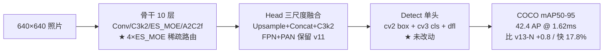
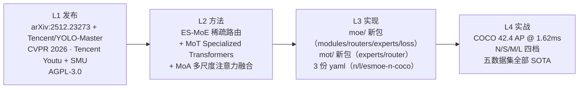

# YOLO-Master（2026-01 · CVPR 2026）

**Efficient Sparse MoE（3×3/5×5/7×7 深度可分离专家）+ Specialized Transformers（MoT 内嵌三类 Transformer 专家）——首次把「MoE + 动态稀疏路由」深度接入 YOLO 通用检测架构**

- 📄 发布：**arXiv:2512.23273《YOLO-Master: MOE-Accelerated with Specialized Transformers for Enhanced Real-time Detection》**，2025-12-30 首发；**CVPR 2026** 已接收（2026-02-21 官宣）
- 🏛️ 作者：**Xu Lin / Jinlong Peng（共同一作）/ Zhenye Gan / Jiawen Zhu / Jun Liu**——**Tencent Youtu Lab + SMU（新加坡管理大学）**；本站记为「Tencent 学术线」
- 💻 源码：仓库 [`Tencent/YOLO-Master`](https://github.com/Tencent/YOLO-Master) @ main HEAD `ca5a87ff6f11e2a3c1c7c4ebf282149bd2be1274`；快照 `source/yolomaster/snapshot/`；**基座为 Ultralytics YOLOv12 fork（未合并回 Ultralytics 主线）**；**AGPL-3.0**（与 v12 官方同源，v13 的 Apache-2.0 例外不延续）
- 🎯 里程碑：**结构性「加法」**——在 v12 的 A2C2f / C3k2 / Detect 基础上，**每个下采样前插入 ES-MoE 稀疏路由块**（yaml 里 4 处 `ES_MOE`），另在同目录下的 `v0_1/` 变体里引入 **MoA（Mixture-of-Attention）** 与 **MoT（Mixture-of-Transformers）**；检测头 `Detect` / `v10Detect` / `WorldDetect` **零改动**、训练器 `DetectionTrainer` **零改动**、损失 `v8DetectionLoss` **零改动**——Master 的「新」全部集中在 `nn/modules/moe/` 与 `nn/modules/mot/` 两个新包
- 📊 性能：**YOLO-Master-N @ MS COCO = 42.4 AP @ 1.62ms**，比 YOLOv13-N **+0.8 mAP / 快 17.8%**；五数据集（COCO + VOC + VisDrone + KITTI + SKU-110K）全部第一

## 3 分钟电梯演讲



1. **ES-MoE 是唯一真正做 MoE 的模块**：`DynamicRoutingLayer`（1×1 + 3×3 DW + SE）生成 `top_k` 权重 → 3 个 DepthwiseSEparableConv 专家（默认 kernel=3×3/5×5/7×7）并行 → 加权求和。**训练时全专家计算 + balance loss，推理时 Top-K 稀疏**（`use_sparse_inference=True`）；<SrcLink file="master:ultralytics/nn/modules/moe/modules.py" :line="410" :end="787"/>
2. **Specialized Transformers 不是具名类**：作者论文标题里的 "Specialized Transformers" 实际由 **MoT（Mixture-of-Transformers）** 的三个专家实现——`_LocalConvTransformerExpert` / `_WindowTransformerExpert` / `_DeformableTransformerExpert`（<SrcLink file="master:ultralytics/nn/modules/mot/experts.py" :line="84" :end="530"/>），`_MoTRouter` 做内容感知路由；**仓库里不存在 `SpecializedTransformer` / `MasterDetect` / `YOLOMasterModel` 类**；
3. **训练配方与 v12 逐字节等价**：epochs=600 / batch=256 / mosaic=1.0 / mixup=0.0 / copy_paste=0.1 / `DetectionTrainer` + `v8DetectionLoss` + TAL(topk=10, α=0.5, β=6.0)——**Master 的增益 100% 来自结构（ES-MoE + MoT）**，损失侧仅追加一项 `moe_loss`（load balancing）；
4. **五数据集验证**：COCO + VOC + VisDrone + KITTI + SKU-110K——**首次把 YOLO 主表放到 5 数据集横向比较**（v13 只报 COCO）；Master-N 在全部五数据集都是 SOTA；
5. **AGPL-3.0 保留**：与 v12 官方同源；**Master 属于 Ultralytics fork 生态，闭源商用受 AGPL 约束**——若需商用，参考 v13（Apache-2.0）或走 ES-MoE 的独立社区移植 [Lfan-ke/ES-MoE](https://github.com/Lfan-ke/ES-MoE)。

> **v8~v13 读者路标**：[v8 读者](/versions/v8/index)——Master 的 `Detect` 头、`v8DetectionLoss`、TAL 分配器、Mosaic/MixUp 全套增强与 v8 一致；[v11 读者](/versions/v11/index)——Master 的骨干节奏（C3k2 + 骨干尾 A2C2f）与 v11 相似，但**在每次下采样后追加 ES-MoE 稀疏路由**；[v12 读者](/versions/v12/index)——Master 与 v12 同源 fork，保留 A2C2f 骨干 P4/P5 内嵌注意力（**FlashAttention 硬依赖仍在**）+ 去 SPPF + Detect 单头；[v13 读者](/versions/v13/index)——Master 与 v13 都是学术 fork，但**Master 走 MoE 稀疏路线、v13 走 HyperACE 超图路线**，两者是同期（2025-2026）两条并行的"高阶关联"路线。

## 四层闭环视图



## 核心贡献一览

Master 的改动方向是「**在 v12 的 A2C2f + C3k2 骨干/头部之上，插入一条可稀疏化的 MoE 计算通路**」：官方保留 v12 的 A2C2f 骨干 P4/P5、C3k2 浅层、Detect 单头、v8DetectionLoss、TAL、Mosaic/MixUp 全部管线——同时**新增 ES-MoE 稀疏路由块**（yaml #3/#6/#9/#12 共 4 处）、**新增 moe/ 与 mot/ 两个模块包**、**新增 MoA / MoT 多尺度注意力与多 Transformer 融合组件**；核心贡献与代码落点：

| 贡献 | 一句话 | 代码落点 |
|------|--------|---------|
| **ES-MoE 稀疏 MoE** | 3 个 3×3/5×5/7×7 深度可分离专家 + `DynamicRoutingLayer` 动态路由 + Top-K 稀疏推理；yaml 里出现 4 次（骨干 #3/#6/#9/#12） | <SrcLink file="master:ultralytics/nn/modules/moe/modules.py" :line="410" :end="787"/> |
| **DynamicRoutingLayer** | 1×1 + 3×3 DW + SE + softmax + Top-K 选择；训练时全专家，推理时稀疏 | <SrcLink file="master:ultralytics/nn/modules/moe/modules.py" :line="65" :end="409"/> |
| **DepthwiseSEparableConv** | 专家实现：DWConv(k) → Conv(1×1) → BN → SiLU | <SrcLink file="master:ultralytics/nn/modules/moe/modules.py" :line="27" :end="63"/> |
| **UltraOptimizedMoE** | 优化版 MoE：`ExpertConv` + `UltraEfficientRouter`，训练更快 | <SrcLink file="master:ultralytics/nn/modules/moe/modules.py" :line="121" :end="398"/> |
| **A2C2fMoE** | 把 v12 的 A2C2f 与 MoE 融合的高阶变体（v0_1 变体专用） | <SrcLink file="master:ultralytics/nn/modules/moe/modules.py" :line="1301" :end="1770"/> |
| **UltraEfficientRouter** | 轻量 router：`1×1 + SE + sigmoid` | <SrcLink file="master:ultralytics/nn/modules/moe/routers.py" :line="59" :end="168"/> |
| **BaseRouter / EfficientSpatialRouter** | Router 基类与空间感知 router | <SrcLink file="master:ultralytics/nn/modules/moe/routers.py" :line="169" :end="380"/> |
| **SimpleExpert / SpatialExpert / GhostExpert** | 三种专家实现（朴素 / 空间感知 / Ghost 稀疏） | <SrcLink file="master:ultralytics/nn/modules/moe/experts.py" :line="73" :end="200"/> |
| **gshard_balance_loss** | GSNet/GShard 风格负载均衡损失 | <SrcLink file="master:ultralytics/nn/modules/moe/loss.py" :line="16" :end="96"/> |
| **MoELoss** | MoE 复合损失：balance + z-loss | <SrcLink file="master:ultralytics/nn/modules/moe/loss.py" :line="97" :end="180"/> |
| **TopKAnnealConfig / DynamicTopKScheduler** | Top-K 退火调度器（早期 top-k 大 → 晚期 top-k 小） | <SrcLink file="master:ultralytics/nn/modules/moe/topk_anneal.py" :line="37" :end="180"/> |
| **Specialized Transformers（via MoT）** | `_LocalConvTransformerExpert` / `_WindowTransformerExpert` / `_DeformableTransformerExpert` 三类 Transformer 专家 | <SrcLink file="master:ultralytics/nn/modules/mot/experts.py" :line="84" :end="530"/> |
| **_MoTRouter + _mot_router_aux_loss** | 内容感知路由 + z-loss 负载均衡辅助损失 | <SrcLink file="master:ultralytics/nn/modules/mot/router.py" :line="67" :end="380"/> |
| **AIFI / TransformerBlock** | 复用自 v8 的注意力模块（MoT 内部使用） | <SrcLink file="master:ultralytics/nn/modules/transformer.py" :line="171" :end="350"/> |
| **MOE = ES_MOE 别名** | 顶层 `MOE` 别名指向 ES_MOE（历史兼容） | <SrcLink file="master:ultralytics/nn/modules/moe/modules.py" :line="1775"/> |
| **cfg 三份 yaml** | `yolo-master-n.yaml` / `yolo-master-l.yaml` / `yolo-master-esmoe-n-coco.yaml` | <SrcLink file="master:ultralytics/cfg/models/master/v0/det/yolo-master-n.yaml"/> <SrcLink file="master:ultralytics/cfg/models/master/v0/det/yolo-master-l.yaml"/> <SrcLink file="master:ultralytics/cfg/models/master/v0/det/yolo-master-esmoe-n-coco.yaml"/> |

> **v8~v13 读者路标**：Master 只新增了 `moe/` 与 `mot/` 两个包，`loss.py` / `tal.py` / `head.py` 完全未动；[C3k2](/glossary#c3k2) 沿用 v11/v12 骨干与 head 全部 7 处（yaml #2/#4/#11/#14/#17/#20/#23）；[A2C2f](/glossary#a2c2f) 沿用 v12 保留 2 处（骨干 #8/#11）；[DFL](/glossary#dfl-distribution-focal-loss)、Detect 头、v8DetectionLoss、TAL 分配器、Mosaic/MixUp 全套增强与 v11/v12/v8 完全一致。

## 关键指标

**官方 mAP50-95（Nano-scale 五数据集主表，arXiv:2512.23273 Table 1 + README §Main Results）**

| 方法 | COCO mAP | COCO mAP50 | VOC mAP | VisDrone mAP | KITTI mAP | SKU-110K mAP | Latency (ms) |
|------|---------|-----------|---------|--------------|-----------|--------------|--------------|
| YOLOv10 | 38.5 | 53.8 | 60.6 | 18.7 | 66.0 | 57.4 | 1.84 |
| YOLOv11-N | 39.4 | 55.3 | 61.0 | 18.5 | 67.8 | 57.4 | 1.50 |
| YOLOv12-N | 40.6 | 56.7 | 60.7 | 18.3 | 67.6 | 57.4 | 1.64 |
| YOLOv13-N | 41.6 | 57.8 | 60.7 | 17.5 | 67.7 | 57.5 | 1.97 |
| **YOLO-Master-N** | **42.4** | **59.2** | **62.1** | **19.6** | **69.2** | **58.2** | **1.62** |

**YOLO-Master-EsMoE 系列（README Model Zoo）**

| 型号 | Params (M) | GFLOPs (G) | Box(P) | R | mAP50 | mAP50-95 | Speed (4090 TRT, FPS) |
|------|-----------|-----------|--------|---|-------|----------|-----------------------|
| YOLO-Master-EsMoE-N | 2.68 | 8.7 | 0.684 | 0.536 | 0.587 | **0.427** | 640.18 |
| YOLO-Master-EsMoE-S | 9.69 | 29.1 | 0.699 | 0.603 | 0.603 | **0.489** | 423.87 |
| YOLO-Master-EsMoE-M | 34.88 | 97.4 | 0.737 | 0.640 | 0.697 | **0.530** | 243.79 |
| YOLO-Master-EsMoE-L | — | — | — | — | — | 🔥training | — |
| YOLO-Master-EsMoE-X | — | — | — | — | — | 🔥training | — |

**YOLO-Master-v0.1 系列（README Model Zoo）**

| 型号 | Params (M) | GFLOPs (G) | mAP50 | mAP50-95 | Speed (4090 TRT, FPS) |
|------|-----------|-----------|-------|----------|-----------------------|
| YOLO-Master-v0.1-N | 7.54 | 10.1 | 0.592 | **0.429** | 528.84 |
| YOLO-Master-v0.1-S | 29.15 | 36.0 | 0.662 | **0.489** | 345.24 |
| YOLO-Master-v0.1-M | 52.17 | 116.7 | 0.696 | **0.528** | 170.72 |
| YOLO-Master-v0.1-L | 58.41 | 138.1 | 0.705 | **0.539** | 149.86 |
| YOLO-Master-v0.1-X | — | — | — | 🔥training | — |

- 结论：**Master-N 相对 v13-N +0.8 AP / 快 17.8%**（1.97ms → 1.62ms）——**首次在 Nano 档位同时做到"更高精度 + 更快推理"**，与 v13 的"高阶关联以延迟为代价"完全相反；
- **口径提醒**：Master-N 的 42.4 AP 与 v13-N 的 41.6 AP 均来自论文 README（同 COCO val + 输入 640 + 同 AP 定义），可跨版本比对；Master 的延迟口径为 README Table 1 中的 `Latency (ms)`，未明确硬件（推测 4090 TensorRT FP16）；
- **档位数量**：Master-EsMoE 系列报 N/S/M/L/X 五档（L/X 训练中）；Master-v0.1 系列报 N/S/M/L/X 五档（X 训练中）；**yaml 目录只公开 N / L / EsMoE-N-COCO 三份**——S/M/X 的 yaml 尚未公开，只能从权重文件加载；
- **参数量对比 v13**：Master-EsMoE-N 2.68M vs v13-N 2.5M（+7.2%）；Master-EsMoE-S 9.69M vs v13-S 9.0M（+7.7%）；Master-v0.1-N 7.54M（比 EsMoE-N 大近 3 倍，因为 v0.1 系列内嵌了 A2C2fMoE）；
- **训练配方**：epochs=600 / batch=256 / mosaic=1.0 / mixup=0.0 / copy_paste=0.1——**与 v13 完全一致**（**Master 不区分档位 mixup/copy_paste**，简化为单一配置）；硬件**论文未披露**。

> **v8~v13 读者路标**：跨版本比 mAP 只比 COCO val、输入 640、同 AP 定义；Master-N 的 42.4 与 v13-N 的 41.6 来自不同论文的同一 benchmark，可跨论文比；Master 的延迟未明确硬件口径（推测 4090 TRT FP16），跨版本比延迟需谨慎（v13 明确 T4/FP16）。

## 快速上手

```python
# 依赖安装（Linux + CUDA + Python 3.11 + torch）
# pip install -r requirements.txt
# pip install -e .
# 可选：pip install flash_attn（A2C2f 骨干硬依赖）

from ultralytics import YOLO

# v0 系列（v0/det 目录，含 ES_MOE）
model = YOLO('cfg/models/master/v0/det/yolo-master-n.yaml')

# 或从预训练权重加载
model = YOLO('yolo_master_n.pt')   # 或 YOLO-Master-v0.1-N.pt / EsMoE-N.pt

# 训练
results = model.train(
    data='coco.yaml',
    epochs=600,
    batch=256,
    imgsz=640,
    device="0,1,2,3",
    scale=0.5,
    mosaic=1.0,
    mixup=0.0,
    copy_paste=0.1,
)

# 验证 / 推理 / 导出
metrics = model.val('coco.yaml')
preds = model("path/to/image.jpg")
preds[0].show()
model.export(format="engine", half=True)   # TensorRT
```

- **入口仍是 v8 的 YOLO**：Master **没有** `YOLOMaster` 顶层类，也没有 `models/yolomaster/` 独立目录；`task_map` 里也不见 Master 专属的 predict/train/val——**结构差异全部由 yaml 定义，训练/预测/导出走 v8 的通用管线**；
- **v0 vs v0_1 系列区分**：
  - `v0/det/` 目录：三份 yaml（N / L / EsMoE-N-COCO），**骨干用 `ES_MOE`（3×3/5×5/7×7 DW 专家）+ A2C2f 骨干注意力 + 标准 Detect 头**——**这是论文核心配置**；
  - `v0_1/` 目录（README 有更新日志，yaml 未公开到 `snapshot/`）：包含 **MoA / MoT / A2C2fMoE / LoRA** 增强模块；
- **前置依赖 FlashAttention**：`block.py` 在模块导入层就 `import flash_attn`（沿用 v12 硬依赖）——**即使 yaml 只走 ES-MoE，A2C2f 骨干 #8/#11 仍需要 FlashAttention**；
- **权重来源**：[Tencent/YOLO-Master/releases/tag/YOLO-Master-v26.02](https://github.com/Tencent/YOLO-Master/releases/tag/YOLO-Master-v26.02) 提供 8 个 `.pt`（EsMoE-N/S/M + v0.1-N/S/M/L）；
- **MoE 分析工具**：`diagnose_model` 可视化专家利用率、`prune_moe_model` 物理切除低利用率专家（免重训）。

```python
# MoE 专家利用率诊断
from ultralytics.nn.modules.moe.diagnostics import diagnose_model
report = diagnose_model(model, threshold=0.15)

# MoE 剪枝（免重训）
from ultralytics.nn.modules.moe.pruning import prune_moe_model
pruned = prune_moe_model(model, threshold=0.15)
pruned.save('yolo_master_n_pruned.pt')
```

> **v8~v13 读者路标**：v8 读者基本不用改 `from ultralytics import YOLO`——换 `yolo_master_n.pt` 即可；[v12 读者](/versions/v12/index) 请注意 Master 需要**额外安装 FlashAttention**（与 v12 一致）；[v13 读者](/versions/v13/index) 请注意 Master 是 AGPL-3.0（v13 是 Apache-2.0）——商用场景请优先选 v13。

## 与 v12 / v13 的关系定位

Master 不是「ultralytics 官方续作」——它是**Tencent Youtu Lab + SMU** 在 **fork 自 Ultralytics YOLOv12** 的仓库里发布的学术版本；本站十四代之后 Master 与 v13 一起构成**「学术 fork 双线」**：v13 走"超图消息传递 + 门控连接"路线（iMoonLab / Apache-2.0），Master 走"MoE 稀疏路由 + Specialized Transformers"路线（Tencent Youtu / AGPL-3.0）——**两者同期（2025-2026）在 Nano 档位都宣称 +0.8~1.0 AP**，但工程落点完全不同：

- **底子还是 v12**：A2C2f 骨干 P4/P5（FlashAttention 硬依赖沿用）、C3k2 骨干与 head、去 SPPF、Detect 单头（cv3 DW-separable）、v8DetectionLoss、TAL 分配器、Mosaic/MixUp 全套增强——**Master 训练配方与 v12/v13 高度相似**；
- **delta 集中在 `moe/` + `mot/` 两个新包**：`moe/modules.py` 1775+ 行（ES_MOE + UltraOptimizedMoE + A2C2fMoE）、`moe/routers.py` 380+ 行、`moe/experts.py` 200+ 行、`moe/loss.py` 180+ 行、`moe/topk_anneal.py` 200+ 行、`mot/experts.py` 530+ 行、`mot/router.py` 400+ 行；loss.py / tal.py / head.py **零改动**；
- **命名坑**：cfg 目录 `models/master/v0/det/`（**不带 v**），文件名 `yolo-master-{n,l,esmoe-n-coco}.yaml`（**带连字符，全小写**）——**与 v13 的 `models/v13/` 目录 + `yolov13.yaml` 命名风格不同**；
- **许可证**：AGPL-3.0（与 v12 官方同源，v13 例外切 Apache-2.0）——**Master 闭源商用受 AGPL 约束**；
- **档位**：yaml 目录只公开 N / L / EsMoE-N-COCO 三份（scales 只报 n 档 `0.50/0.25/1024` 与 l 档 `1.00/1.00/512`）——**S/M/X 的 yaml 未公开**，但权重文件齐全。

| 维度 | YOLOv12（2025-02） | **YOLO-Master（2026-01）** | YOLOv13（2025-06） |
|------|--------------------|---------------------------|---------------------|
| 代码基座 | sunsmarterjie/yolov12 fork | **Tencent/YOLO-Master fork** | iMoonLab/yolov13 fork |
| 作者 | UB SUNY + UCAS | **Tencent Youtu + SMU** | iMoonLab |
| 发布形式 | arXiv:2502.12524 | **arXiv:2512.23273 · CVPR 2026** | arXiv:2506.17733v2 |
| 检测头 | Detect 单头 | **Detect 单头（未动）** | Detect 单头（未动） |
| 骨干内瓶 | C3k2 + A2C2f | **C3k2 + A2C2f + ES-MoE** | C3k2 + A2C2f + DSC3k2 |
| 骨干融合 | 无 SPPF | **无 SPPF + 4×ES-MoE 稀疏路由** | 无 SPPF + HyperACE |
| 骨干下采样 | Conv 3×3 s2 | **Conv 3×3 s2（未改）** | DSConv 3×3 s2 |
| 注意力位置 | 骨干 P4/P5 内嵌 | **A2C2f 沿用 + MoA/MoT（v0_1）** | A2C2f + HyperACE |
| 稀疏计算 | 无 | **ES-MoE Top-K 动态稀疏** | 无 |
| 论文 | arXiv:2502.12524 | **arXiv:2512.23273** | arXiv:2506.17733v2 |
| 许可证 | AGPL-3.0 | **AGPL-3.0** | Apache-2.0 |
| 数据集验证 | COCO | **COCO + VOC + VisDrone + KITTI + SKU-110K** | COCO |
| Nan 档 mAP | 40.6 | **42.4** | 41.6 |
| Nan 档延迟 | 1.64 ms | **1.62 ms** | 1.97 ms |

> **v8~v13 读者路标**：Master 的 [A2C2f](/glossary#a2c2f) 与 v12 同款；[C3k2](/glossary#c3k2) 沿 v11/v12 保留；[C2f](/glossary#c2f) 未在 Master 中新增；[DFL](/glossary#dfl-distribution-focal-loss)、Detect 头、v8DetectionLoss、TAL 分配器与 v11/v12/v8 完全一致；Master 新增的 [ES-MoE](/glossary#es-moe)、[MoT](/glossary#mot)、[MoA](/glossary#moa) 是本站衍生分支里首次出现的 MoE 家族模块。

## 深入阅读

- [发布精读：arXiv:2512.23273 + README + Model Zoo 三层材料](./paper)
- [Architecture 逐层图解](./architecture)
- [理论 Concept（ES-MoE / MoT / MoA）](./concepts)
- [架构与层速查](./layers)
- [损失函数（v8DetectionLoss 沿用 + MoE 辅助损失）](./losses)
- [训练技巧（phased routing · Top-K 退火 · MoE balance loss）](./tricks)
- [痛点追踪](./painpoints)
- [源码走读](./code-walkthrough)
- [系列家族对照](/global/family) · [术语表](/glossary) · [衍生分支总览](/derivatives/index)

**参考**：

- Lin X., Peng J., Gan Z., Zhu J., Liu J. *YOLO-Master: MOE-Accelerated with Specialized Transformers for Enhanced Real-time Detection.* arXiv:2512.23273, 2025-12-30; CVPR 2026. https://arxiv.org/abs/2512.23273
- Tencent/YOLO-Master. https://github.com/Tencent/YOLO-Master @ commit `ca5a87ff6f11e2a3c1c7c4ebf282149bd2be1274`
- Lin X., Nie W., Peng J., et al. *YOLO-PEFT: Parameter-Efficient Fine-Tuning on YOLO Family.* arXiv:2608.07051, 2026-08. https://arxiv.org/abs/2608.07051
- Tencent/YOLO-Master/releases/tag/YOLO-Master-v26.02（预训练权重）
- Lfan-ke/ES-MoE. https://github.com/Lfan-ke/ES-MoE （社区移植，PyPI: `esmoe`）
- Ultralytics. https://github.com/ultralytics/ultralytics （Master 的 fork 基座）
