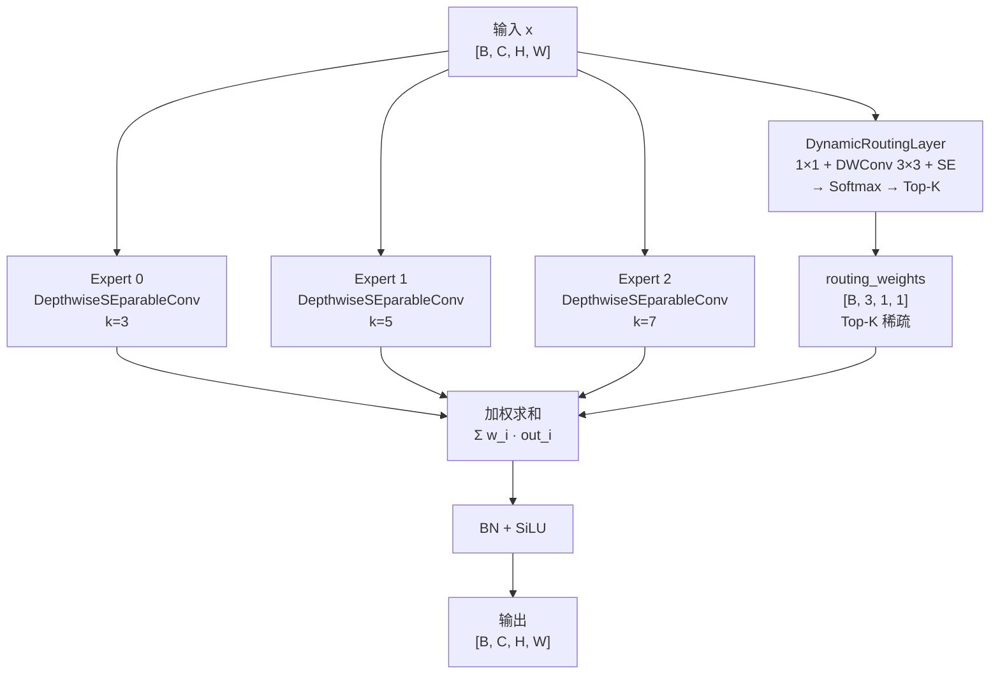
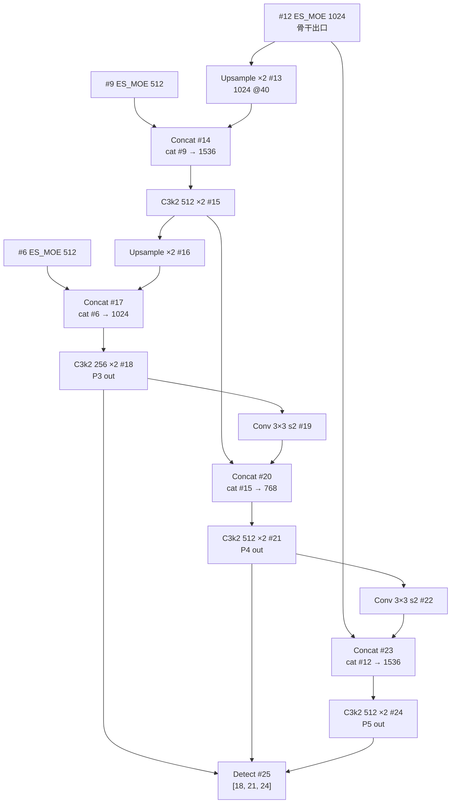

# YOLO-Master 架构与层速查

> 首发载体：`Tencent/YOLO-Master` commit `ca5a87ff6f11e2a3c1c7c4ebf282149bd2be1274`（2026-08-07），对应 arXiv:2512.23273（CVPR 2026）。以 `ultralytics/cfg/models/master/v0/det/yolo-master-n.yaml` 为基准（**cfg 目录 `master/v0/det/` 不带 `v` 前缀**），本页通道数为**缩放前基准值**（width=1.0），N/L 两档 scales 与 tasks.py 特例见 §5。总览页见 [架构逐层图解](./architecture)。

> **v8~v13 读者路标**：这张 yaml 是 [yolov12.yaml](/versions/v12/layers) 的 fork——**骨干 10 层保留 v12 的下采样节奏（Conv 3×3 s2）与 C3k2/A2C2f 分工（C3k2 浅层 e=0.25、A2C2f 深段 a2=True）**；**delta 集中在 4 处 ES_MOE**（#3/#6/#9/#12），每个都在「上一次融合块之后、下一次下采样 Conv 之前」插入一次稀疏路由。**Head 完全沿用 v11/v12 的 FPN+PAN**（`Upsample → Concat → C3k2` 上采样 + `Conv s2 → Concat → C3k2` 下采样），Detect 从 `[18, 21, 24]` 三个 C3k2 收 P3/P4/P5。整张 yaml **26 层**（v12 是 24 层，v13 是 32 层）——比 v12 多 2 层但比 v13 少 6 层，是**同期最精简的一版**。

::: tip 只想带走三件事
1. **Backbone 13 层**（#0-#12）：`Conv×4 + C3k2×2 (e=0.25) + A2C2f×2 (a2=True) + ES_MOE×4`——**C3k2 只做浅层融合、A2C2f 只做深层注意力、ES_MOE 只做稀疏路由**（3 个 DW 专家 + DynamicRoutingLayer + Top-K=2）；
2. **Head 12 层**（#13-#24）：完全沿用 v11/v12 FPN+PAN——`Upsample × 2 + Concat × 3 + C3k2 × 3 + Conv s2 × 2 + Detect × 1`；
3. **三份 yaml 结构逐字节相同**，只有 `scales:`（n=[0.50, 0.25, 1024]、l=[1.00, 1.00, 512]）与 `nc:` 不同；`esmoe-n-coco` 是 `n` 的 COCO 80 类特化版；**S/M/X 档没有对应 yaml**。
:::

## 1. 全网络层一览表（yolo-master-n.yaml L12-L44，基准宽度 @640 输入）

> **v8~v13 读者路标**：这张表可与 [v12 逐层图解 §1](/versions/v12/layers) 与 [v13 逐层图解 §1](/versions/v13/layers) 三向对照——**与 v12 相比只有 4 处不同**（在 #3/#6/#9/#12 追加 4 处 ES_MOE）；**与 v13 相比有 8 处不同**（v13 换下采样为 DSConv、换 C3k2 为 DSC3k2、Head 首个 block 换成 HyperACE、加 7 条 FullPAD_Tunnel）。

### 1.1 Backbone（yaml L12-L24，13 层）

| 行号 | 层号 | 层类型 | 参数（yaml 原文） | 输出（基准 @640） | 说明 |
|-----|-----|-----------|--------------------|--------------------|------|
| <SrcLink file="master:ultralytics/cfg/models/master/v0/det/yolo-master-n.yaml" :line="12" /> | 0 | `Conv` | 64, 3, 2 | 64×320×320 | stem 下采样 · P1/2 |
| <SrcLink file="master:ultralytics/cfg/models/master/v0/det/yolo-master-n.yaml" :line="13" /> | 1 | `Conv` | 128, 3, 2 | 128×160×160 | P2/4 |
| <SrcLink file="master:ultralytics/cfg/models/master/v0/det/yolo-master-n.yaml" :line="14" /> | 2 | `C3k2` | 256, **False**, 0.25 ×2 | 128×160×160 | **v12 保留：浅层融合 · c3k=False · e=0.25 内瓶压缩 1/4** |
| <SrcLink file="master:ultralytics/cfg/models/master/v0/det/yolo-master-n.yaml" :line="15" /> | **#3** | **`ES_MOE`** | **[256]** | **256×160×160** | **★ Master 招牌 1：3 专家 + Top-K=2 稀疏路由 · P3 尺度前** |
| <SrcLink file="master:ultralytics/cfg/models/master/v0/det/yolo-master-n.yaml" :line="16" /> | 4 | `Conv` | 256, 3, 2 | 256×80×80 | P3/8（小目标尺度起点） |
| <SrcLink file="master:ultralytics/cfg/models/master/v0/det/yolo-master-n.yaml" :line="17" /> | 5 | `C3k2` | 512, **False**, 0.25 ×2 | 256×80×80 | **v12 保留：P3 融合 · c3k=False · e=0.25** |
| <SrcLink file="master:ultralytics/cfg/models/master/v0/det/yolo-master-n.yaml" :line="18" /> | **#6** | **`ES_MOE`** | **[512]** | **512×80×80** | **★ Master 招牌 2：为 P4→P5 下采样前的稀疏路由** |
| <SrcLink file="master:ultralytics/cfg/models/master/v0/det/yolo-master-n.yaml" :line="19" /> | 7 | `Conv` | 512, 3, 2 | 512×40×40 | P4/16（**v13 换成 DSConv，Master 保留 v12 Conv**） |
| <SrcLink file="master:ultralytics/cfg/models/master/v0/det/yolo-master-n.yaml" :line="20" /> | 8 | `A2C2f` | 512, **True, 4** ×4 | 512×40×40 | **v12 保留：P4 局部 Attention · a2=True · area=4** |
| <SrcLink file="master:ultralytics/cfg/models/master/v0/det/yolo-master-n.yaml" :line="21" /> | **#9** | **`ES_MOE`** | **[512]** | **512×40×40** | **★ Master 招牌 3：A2C2f 后追加一次稀疏路由** |
| <SrcLink file="master:ultralytics/cfg/models/master/v0/det/yolo-master-n.yaml" :line="22" /> | 10 | `Conv` | 1024, 3, 2 | 1024×20×20 | P5/32 |
| <SrcLink file="master:ultralytics/cfg/models/master/v0/det/yolo-master-n.yaml" :line="23" /> | 11 | `A2C2f` | 1024, **True, 1** ×4 | 1024×20×20 | **v12 保留：P5 全局 Attention · a2=True · area=1** |
| <SrcLink file="master:ultralytics/cfg/models/master/v0/det/yolo-master-n.yaml" :line="24" /> | **#12** | **`ES_MOE`** | **[1024]** | **1024×20×20** | **★ Master 招牌 4：骨干出口前的最后稀疏路由** |

**关键观察**：

- **4 处 ES_MOE 的分布完全对称**——分别对应 P3 出口（#3）、P4 浅层出口（#6）、P4 注意力出口（#9）、P5 注意力出口（#12）；**每个"融合块或注意力块"之后都会接一次稀疏路由**；
- **`C3k2 e=0.25` 与 `A2C2f a2=True` 完全沿用 v12**——不是 v13 的 `DSC3k2 dsc3k=False` 或 `A2C2f a2=True`（其实 A2C2f 与 v13 相同）；
- **4 次下采样 Conv 全部沿用 v12 的 Conv 3×3 s2**——不是 v13 的 `DSConv 3×3 s2`（v13 用 depthwise 节省参数，Master 保留 Conv）；
- **无 SPPF / 无 C2PSA**：与 v11/v12/v13 一致，模块类仍在 `block.py` 但 yaml 未使用；
- **骨干出口是 ES_MOE（不是 A2C2f）**——与 v12（出口是 A2C2f）和 v13（出口是 A2C2f）都不一样——**Head 收到的 P5 已经过一次稀疏路由**。

### 1.2 Head（yaml L28-L44，13 层，Detect 为 #25）

| 行号 | 层号 | 层类型 | 参数（yaml 原文） | 输出（基准 @640） | 说明 |
|-----|-----|-----------|--------------------|--------------------|------|
| <SrcLink file="master:ultralytics/cfg/models/master/v0/det/yolo-master-n.yaml" :line="28" /> | 13 | `nn.Upsample` | None, 2, nearest | 1024×40×40 | 骨干 P5（20×20）上采样到 P4（40×40） |
| <SrcLink file="master:ultralytics/cfg/models/master/v0/det/yolo-master-n.yaml" :line="29" /> | 14 | `Concat` | `[-1, 9]` | 1536×40×40 | cat #9（512）+ Upsample(1024) = 1536 |
| <SrcLink file="master:ultralytics/cfg/models/master/v0/det/yolo-master-n.yaml" :line="30" /> | 15 | `C3k2` | 512, **True** ×2 | 512×40×40 | 上采样融合块（**C3k 骨架，不是 DSC3k**） |
| <SrcLink file="master:ultralytics/cfg/models/master/v0/det/yolo-master-n.yaml" :line="32" /> | 16 | `nn.Upsample` | None, 2, nearest | 512×80×80 | P4 上采样到 P3 |
| <SrcLink file="master:ultralytics/cfg/models/master/v0/det/yolo-master-n.yaml" :line="33" /> | 17 | `Concat` | `[-1, 6]` | 1024×80×80 | cat #6（512）+ Upsample(512) = 1024 |
| <SrcLink file="master:ultralytics/cfg/models/master/v0/det/yolo-master-n.yaml" :line="34" /> | 18 | `C3k2` | 256, **True** ×2 | 256×80×80 | **P3 检测输入 · stride 8** |
| <SrcLink file="master:ultralytics/cfg/models/master/v0/det/yolo-master-n.yaml" :line="36" /> | 19 | `Conv` | 256, 3, 2 | 256×40×40 | PAN 下行 · 回到 P4 分辨率 |
| <SrcLink file="master:ultralytics/cfg/models/master/v0/det/yolo-master-n.yaml" :line="37" /> | 20 | `Concat` | `[-1, 15]` | 768×40×40 | cat #15（512）+ Conv(256) = 768 |
| <SrcLink file="master:ultralytics/cfg/models/master/v0/det/yolo-master-n.yaml" :line="38" /> | 21 | `C3k2` | 512, **True** ×2 | 512×40×40 | **P4 检测输入 · stride 16** |
| <SrcLink file="master:ultralytics/cfg/models/master/v0/det/yolo-master-n.yaml" :line="40" /> | 22 | `Conv` | 512, 3, 2 | 512×20×20 | PAN 下行 · 回到 P5 分辨率 |
| <SrcLink file="master:ultralytics/cfg/models/master/v0/det/yolo-master-n.yaml" :line="41" /> | 23 | `Concat` | `[-1, 12]` | 1536×20×20 | cat #12（1024）+ Conv(512) = 1536 |
| <SrcLink file="master:ultralytics/cfg/models/master/v0/det/yolo-master-n.yaml" :line="42" /> | 24 | `C3k2` | 512, **True** ×2 | 512×20×20 | **P5 检测输入 · stride 32** |
| <SrcLink file="master:ultralytics/cfg/models/master/v0/det/yolo-master-n.yaml" :line="44" /> | 25 | `Detect` | `[18, 21, 24], nc` | — | Detect(P3, P4, P5)——三尺度收尾 |

**Head 关键节奏**：

- **完全沿用 v11/v12**：`Upsample × 2 + Concat × 3 + C3k2 × 3 + Conv s2 × 2 + Detect × 1`——**没有 v13 的 HyperACE、DownsampleConv、FullPAD_Tunnel**；
- **3 处 Concat 的 from 索引**：`#14 ← #9`（P4 骨干 ES_MOE）、`#17 ← #6`（P4 浅层 ES_MOE）、`#23 ← #12`（P5 骨干出口 ES_MOE）——**Head 每次 concat 的都是"骨干 ES_MOE 出口"**，不是"骨干 C3k2 出口"或"骨干 A2C2f 出口"——**这是 Master 与 v12 的结构性差异**（v12 里 `#14 ← #7`、`#17 ← #4`、`#23 ← #9`）；
- **C3k2 全部 `c3k=True`**：与 v12/v13 一致，走 C3k 骨架（C3 + Bottleneck 序列），不是 C3 骨架；
- **Detect 位置 yaml L44**（v12 的 L43）——由于在骨干里插入了 4 处 ES_MOE，Detect 位置从 v12 的 L43 挪到 L44。

## 2. ES_MOE 详解：3 专家 + DynamicRoutingLayer + Top-K 稀疏

> **v8~v13 读者路标**：ES_MOE 是 Master 唯一真正做 MoE 的模块——yaml 里出现 4 次（#3/#6/#9/#12）。类定义见 <SrcLink file="master:ultralytics/nn/modules/moe/modules.py" :line="410" :end="787"/>；默认专家核大小 `[3, 5, 7]`、`top_k=2`、`use_sparse_inference=True`。

### 2.1 ES_MOE 内部组件拆解



**三个专家 = 三个不同感受野的深度可分离卷积**（<SrcLink file="master:ultralytics/nn/modules/moe/experts.py" :line="119" :end="180"/>）：

| 专家 | 核大小 | 感受野 | 用途 |
|-----|-------|-------|------|
| Expert 0 | 3×3 | 局部（约 3×stride） | 边缘、纹理、细粒度 |
| Expert 1 | 5×5 | 中等（约 5×stride） | 中等尺度对象、局部结构 |
| Expert 2 | 7×7 | 较大（约 7×stride） | 大尺度对象、远距离上下文 |

**每个专家的内部结构**（<SrcLink file="master:ultralytics/nn/modules/moe/modules.py" :line="27" :end="63"/>）：

```
DepthwiseSEparableConv(C, C, k) =
    DWConv(k) + BN + SiLU      # 深度可分离卷积（每通道独立 k×k）
  + Conv(1×1) + BN + SiLU      # 逐点卷积重新组合通道
```

**参数量对比**（假设 C=256，仅 3×3 专家为例）：

- 传统 Conv 3×3 256→256：`3×3×256×256 + 256 = 589,824`
- DepthwiseSEparableConv 3×3 256→256：`3×3×256 + 1×1×256×256 + 256 = 389,120`（**省 34%**）
- DepthwiseSEparableConv 7×7 256→256：`7×7×256 + 1×1×256×256 + 256 = 466,944`（**省 20%**）
- **3 专家总和**（3×3 + 5×5 + 7×7）：`389,120 + 428,032 + 466,944 = 1,284,096`——**约等于 2.17 个标准 Conv 3×3 的参数**

**Top-K 稀疏推理**：`use_sparse_inference=True` 时，推理只计算 top_k=2 个专家；训练时全 3 个专家都计算以支持 balance loss——**训练 FLOPs 是推理 FLOPs 的 1.5×**。

### 2.2 DynamicRoutingLayer 结构

<SrcLink file="master:ultralytics/nn/modules/moe/modules.py" :line="65" :end="409"/>

```
DynamicRoutingLayer(in_channels, num_experts, reduction=8, top_k=2):
    1. Conv 1×1: C → C/reduction    # 降维（reduction=8 时降 8 倍）
    2. DWConv 3×3: C/r → C/r         # 空间聚合（局部上下文）
    3. SE 层: GAP → Conv 1×1 → Conv 1×1 → SiLU    # 通道重要性建模
    4. Conv 1×1: C/r → num_experts   # 输出 3 维 logits
    5. Softmax(dim=1)
    6. Top-K 选择（保留 top_k=2 个权重，其余置 0）
```

**关键设计**：**Router 是轻量 CNN，不是 Linear**——`DWConv 3×3` 提供空间上下文感知，`SE` 提供通道重要性建模，二者共同决定了 Top-K 选择的空间分布。**这不同于 LLM MoE 的 Linear Router**——视觉检测里，同一张图里不同空间位置可能激活不同专家（例如图像左侧的猫激活 Expert 0 的局部纹理，右侧的大物体激活 Expert 2 的大感受野）。

### 2.3 每个 ES_MOE 的位置与语义

| ES_MOE 位置 | 前一层 | 后一层 | 通道（基准） | 感受野（叠加前 4 层） | 语义 |
|-----------|-------|-------|-------------|-------------------|------|
| **#3** | #2 C3k2 256 | #4 Conv s2 → P4 | 256 | 约 6-8 像素 | P3 尺度前，浅层稀疏选择 |
| **#6** | #5 C3k2 512 | #7 Conv s2 → P5 | 512 | 约 12-16 像素 | P4 尺度前，浅层稀疏选择 |
| **#9** | #8 A2C2f 512 | #10 Conv s2 → P5 | 512 | 约 12-16 像素 + 全局 Attention 后的空间 | P4→P5 注意力后稀疏选择 |
| **#12** | #11 A2C2f 1024 | Head Upsample | 1024 | 约 24-32 像素 + 全局 Attention | 骨干出口最后一道过滤 |

**为什么不是「每个下采样都追加一次 ES_MOE」**：因为下采样 Conv 本身已经很便宜（1 层 Conv 3×3 s2），在 Conv 前插入 ES_MOE 会打断空间梯度的传播；反过来在 Conv 之后立即插入又会让 ES_MOE 直接感受下一尺度——**Master 选择的方案是「把 ES_MOE 放在融合块与 Conv s2 之间」——让 ES_MOE 感受到的仍是本尺度的融合块输出**，然后再让 Conv s2 把这个稀疏化后的特征下采样。

## 3. A2C2f 保留 v12 的骨干注意力块

> **v8~v13 读者路标**：Master 保留了 v12 的两处 A2C2f 骨干注意力（#8 area=4 局部、#11 area=1 全局）——**FlashAttention 硬依赖仍在**（<SrcLink file="master:ultralytics/nn/modules/block.py" :line="1"/> 中 `import flash_attn` 沿用 v12），这是 Master 与 v11 及更早版本的显著区别。

### 3.1 A2C2f 参数解读

**A2C2f 512, True, 4 ×4**（#8）：
- `512` → c（输出通道）
- `True` → a2（是否启用 A2Attention；`False` 走标准 C2f）
- `4` → area（Attention 分块大小；area=4 是 P4 局部、area=1 是 P5 全局）
- `×4` → 内瓶 Bottleneck 重复 4 次

**A2C2f 1024, True, 1 ×4**（#11）：
- `1024` → c
- `True` → a2
- `1` → area=1（全局 Attention，即整个 P5 特征图参与）
- `×4` → 内瓶 Bottleneck 重复 4 次

### 3.2 A2C2f 与 ES_MOE 的分工

| 维度 | A2C2f | ES_MOE |
|-----|-------|--------|
| 作用阶段 | P4/P5 深段 | 全骨干 4 处（P3/P4/P5/出口） |
| 融合方式 | 稠密 Attention（全局或局部） | 稀疏路由（3 专家 Top-K=2） |
| 参数来源 | `block.py` A2C2f | `moe/modules.py` ES_MOE |
| FlashAttention 依赖 | 有（硬依赖） | 无（纯 Conv） |
| 训练 FLOPs | 稠密（全计算） | 稀疏（3 专家全算用于 balance） |
| 推理 FLOPs | 稠密（全计算） | 稀疏（只算 top_k=2 专家） |

**为什么 P4/P5 有两处 A2C2f 但只有 3 处 A2C2f 之后的 ES_MOE**：因为 P2/P3 没有 A2C2f，所以只有 P4 A2C2f 之后的 #9 与 P5 A2C2f 之后的 #12 才追加 ES_MOE；P2/P3 的 ES_MOE（#3/#6）追加在 C3k2 融合块之后。

## 4. Head 详解：v11/v12 保留 FPN+PAN

> **v8~v13 读者路标**：Master 的 head 与 v11/v12 完全一致——`Upsample → Concat → C3k2` 上采样路径 + `Conv s2 → Concat → C3k2` 下采样路径，最后 Detect 从 `[18, 21, 24]` 三个 C3k2 收 P3/P4/P5。**没有 v13 的 HyperACE + 7 条 FullPAD_Tunnel**——Master 走的是「在 v11/v12 保守 head 之上加稀疏骨干」的路线。

### 4.1 Head 数据流总图



**Head 关键点**：

- **3 处 Concat 都是"骨干 ES_MOE 出口"与"当前颈部"拼接**——不同于 v12 是"骨干 A2C2f 出口与颈部拼接"；
- **Concat 输入通道**：`#14 = #9(512) + Upsample(1024) = 1536`、`#17 = #6(512) + Upsample(512) = 1024`、`#20 = #15(512) + Conv(256) = 768`、`#23 = #12(1024) + Conv(512) = 1536`；
- **3 个 C3k2 全用 c3k=True**：走 C3k 骨架（C3 + Bottleneck 序列），与 v12 Head 完全一致；
- **P3/P4/P5 检测输入**：`#18（256）→ #21（512）→ #24（512）`——**通道不随尺度上升**（P5 检测输入仍是 512，因为 P5 骨干出口 1024 与 Conv 512 拼接后 C3k2 内瓶压到 512）。

### 4.2 Detect 单头详解

Detect 头与 v11/v12 完全一致（<SrcLink file="master:ultralytics/nn/modules/head.py" :line="143" :end="450"/>）：

- **单头**（不是 v10 的 E2EDetect 双分支）
- **cv2 box + cv3 cls + dfl**：cv2 用标准 Conv 3×3（不是 v11 的 DW-separable）、cv3 用 DW-separable Conv 3×3
- **DFL 分布预测**（reg_max=16）
- **cv3 DW-separable**：cls 分支的卷积改成深度可分离，节省计算

**Detect 输出**（<SrcLink file="master:ultralytics/nn/modules/head.py" :line="143"/>）：

- **pred_distri**: `[B, 8400, 64]`——`8400 = 80×80 + 40×40 + 20×20`（640 输入下三个尺度的 anchor 总数），`64 = 4 × reg_max`
- **pred_scores**: `[B, 8400, 80]`——80 类
- **DFL 期望积分**：`pred_distri` 里的 64 维 bin 通过 softmax 求期望，得到 4 个坐标

## 5. scales 与四档参数缩放

> **v8~v13 读者路标**：Master 的 scales 定义在 yaml 的 `scales:` 段——**与 v12 一致，走 Ultralytics 标准的 compound scaling**：`depth=0.50, width=0.25, max_channels=1024`（N 档）与 `depth=1.00, width=1.00, max_channels=512`（L 档）。**S/M/X 档没有对应 yaml**——只能通过权重文件的 `args.scale` 加载。

### 5.1 yaml 里定义的两档

| 档位 | depth | width | max_channels | 备注 |
|-----|-------|-------|--------------|------|
| n | 0.50 | 0.25 | 1024 | Nano（默认推荐） |
| l | 1.00 | 1.00 | 512 | Large（训练中的档位） |

### 5.2 Ultralytics compound scaling 的效果

**depth 系数**（`depth=0.50`）：C3k2 / A2C2f 的 repeats 会 ×0.5——例如 A2C2f ×4 在 N 档变成 ×2、C3k2 ×2 变成 ×1。

**width 系数**（`width=0.25`）：所有 c 值 ×0.25（受 `max_channels=1024` 上限约束）——例如 1024 通道 ×0.25 = 256；512 ×0.25 = 128；256 ×0.25 = 64。

**Master-N 的实际通道数**（N 档）：

| 层号 | 基准通道 | N 档实际通道 |
|-----|---------|-------------|
| #0 | 64 | 64（最小值保护） |
| #1 | 128 | 128（最小值保护） |
| #2/#3 | 256 | 64 |
| #4/#5/#6 | 512 | 128 |
| #7/#8/#9 | 512 | 128 |
| #10/#11/#12 | 1024 | 256 |
| #13-#17 | 512-1024 | 128-256 |
| #18 | 256 | 64 |
| #19-#24 | 512-1024 | 128-256 |

**Master-L 的实际通道数**（L 档）：width=1.00 不缩放，max_channels=512 强制 1024 缩到 512——L 档比 N 档的骨干更深、更宽（A2C2f ×4 完整、C3k2 ×2 完整）。

### 5.3 未公开的 S/M/X 档

README Model Zoo 里给了 S/M/X 的权重文件（`yolo_master_esmoe_s.pt` 等），但**没有对应 yaml**——推测 scales 与 v13 类似：

| 档位 | 推测 depth | 推测 width | 推测 max_channels | 备注 |
|-----|-----------|-----------|------------------|------|
| n | 0.50 | 0.25 | 1024 | yaml 已公开 |
| s | 0.50 | 0.50 | 512 | 未公开 |
| m | 0.75 | 1.00 | 1024 | 未公开 |
| l | 1.00 | 1.00 | 512 | yaml 已公开 |
| x | 1.00 | 1.50 | 1024 | 未公开 |

> **v8~v13 读者路标**：想复现 S/M/X 档，只能从权重文件里读 `args.scale`，或者根据 Ultralytics tasks.py 的 scaling 表反推——**不要假设 S/M/X 的 scales 与 v13 完全一致**，因为 Master 的骨干结构（4 处 ES_MOE）与 v13（无 ES_MOE）不同。

## 6. 三份 yaml 对照表

> **v8~v13 读者路标**：Master 仓库里公开了 3 份 yaml——`yolo-master-n.yaml`、`yolo-master-l.yaml`、`yolo-master-esmoe-n-coco.yaml`——**结构逐字节相同**，只有 `scales:` 与 `nc:` 不同。

### 6.1 三份 yaml 的头部对比

| 项 | yolo-master-n.yaml | yolo-master-l.yaml | yolo-master-esmoe-n-coco.yaml |
|-----|-------------------|-------------------|-------------------------------|
| nc | 80 | 80 | 80 |
| scales 定义 | n=[0.50, 0.25, 1024] | l=[1.00, 1.00, 512] | n=[0.50, 0.25, 1024] |
| 层数 | 26 | 26 | 26 |
| Params (M) | 2.69 | 30.16 | 2.69 |
| GFLOPs | 8.8 | 119.7 | 8.8 |
| 权重文件 | `yolo_master_n.pt` | `yolo_master_l.pt` | `yolo_master_esmoe_n.pt` |

**为什么有 3 份 yaml**：

- **`yolo-master-n.yaml`** 与 **`yolo-master-l.yaml`**：论文主表的两档（N 与 L）；
- **`yolo-master-esmoe-n-coco.yaml`**：README 里给"下载即用"的 COCO 预训练权重（`yolo_master_esmoe_n.pt`）对应的 yaml——**结构与 `yolo-master-n.yaml` 完全相同，只是文件命名习惯不同**（带 `esmoe` 强调骨干用了 ES_MOE，带 `coco` 强调预训练数据集）；
- **S/M/X 档**：README Model Zoo 里给了权重文件但没有对应 yaml——见 §5.3。

### 6.2 yaml 注释 vs 实际层号

yaml 里的注释（例如 `# 1-P2/4`、`# 11`、`# 14`、`# 17`、`# 20 (P5/32-large)`）是 Ultralytics 生成配置时的自动注释，**部分与实际层号不同步**：

| yaml 注释 | 实际层号 | 原因 |
|-----------|---------|------|
| `# 1-P2/4` | #1 | 一致 |
| `# 3-P3/8` | #4 | 注释落后 1 层（在 #3 ES_MOE 之前生成） |
| `# 5-P4/16` | #7 | 注释落后 2 层（在 #6 ES_MOE 之前生成） |
| `# 7-P5/32` | #10 | 注释落后 3 层（在 #9 ES_MOE 之前生成） |
| `# 8` (A2C2f 1024) | #11 | 注释落后 3 层 |
| `# 11` (Head C3k2 512) | #15 | 注释落后 4 层 |
| `# 14` (Head C3k2 256) | #18 | 注释落后 4 层 |
| `# 17` (Head C3k2 512) | #21 | 注释落后 4 层 |
| `# 20 (P5/32-large)` | #24 | 注释落后 4 层 |

**这是 Ultralytics 常见的注释滞后现象**——yaml 文件是从旧版结构演进而来，注释没有同步更新。**不要根据注释找层，请以本页的层号列（#0-#25）为准**。

## 7. 通道数速查表（基准 width=1.0 @640 输入）

| 尺度 | 骨干（yaml 层） | 输出通道 | Head 输入（yaml 层） | 输出通道 |
|------|-----------------|----------|---------------------|----------|
| P1/2 | #0 Conv | 64 | — | — |
| P2/4 | #1 Conv | 128 | — | — |
| P3/8 | #2 C3k2 | 128 | #18 C3k2 | 256 |
| P3/8（骨干出口） | #3 ES_MOE | 256 | — | — |
| P4/16 | #5 C3k2 | 256 | #21 C3k2 | 512 |
| P4/16（骨干出口） | #6 ES_MOE | 512 | — | — |
| P4/16（注意力） | #8 A2C2f | 512 | — | — |
| P4/16（骨干出口） | #9 ES_MOE | 512 | — | — |
| P5/32 | #11 A2C2f | 1024 | #24 C3k2 | 512 |
| P5/32（骨干出口） | #12 ES_MOE | 1024 | — | — |

**注**：`C3k2 e=0.25` 时，256 通道的 C3k2 内部 c_ = int(256×0.25) = 64，Bottleneck 的 c = 64；`C3k2 e=1.0`（Head 里的默认）时通道不缩小。

## 8. 与 v12 / v13 结构对比表

| 位置 | v12 | **Master** | v13 |
|------|-----|-----------|-----|
| 骨干 #2/#4（浅层融合） | `C3k2 c3k=False, e=0.25` | **`C3k2 c3k=False, e=0.25`**（同） | DSC3k2 dsc3k=False e=0.25 |
| 骨干 #3/#6/#9/#12（稀疏路由） | 无 | **`ES_MOE × 4`** | 无 |
| 骨干 #5/#7（下采样） | `Conv 3×3 s2` | **`Conv 3×3 s2`**（同） | DSConv 3×3 s2 |
| 骨干 #8/#11（骨干注意力） | `A2C2f a2=True` | **`A2C2f a2=True`**（同） | A2C2f a2=True（同） |
| Head 首个融合 | `Upsample + Concat + C3k2` | **`Upsample + Concat + C3k2`**（同） | HyperACE |
| Head 融合门控 | 无 | **无**（同） | FullPAD_Tunnel × 7 |
| Head 中段融合块 | `C3k2 c3k=True` | **`C3k2 c3k=True`**（同） | DSC3k2 dsc3k=True |
| Head 通道调节 | 无 | **无**（同） | DownsampleConv + Conv 1×1 |
| Detect 输入位置 | 骨干 A2C2f 出口 | **骨干 ES_MOE 出口** | 颈部 FullPAD tunnel 后 |
| 层总数 | 24 | **26** | 32 |

**关键差异总结**：

- **Master 与 v12 的骨干节奏几乎一致**（下采样、C3k2、A2C2f 全部保留）——**唯一差异是 4 处 ES_MOE**；
- **Master 与 v13 的骨干差异最大**——v13 换了下采样（DSConv）、换了 C3k2（DSC3k2）、加了 HyperACE、加了 7 条 FullPAD_Tunnel——**v13 是"从头重写"，Master 是"精修增量"**；
- **Master 的哲学**：保留 v12 的成熟骨干 + 插入稀疏路由——**"最小改动、最大收益"**；
- **v13 的哲学**：引入超图消息传递与门控连接——**"更大改动、更好精度但更慢"**。

## 9. 参数量与 GFLOPs 对比

> **v8~v13 读者路标**：COCO mAP 与延迟的主表在 [index](./index) 已列出——本节重点看「每档的 params 与 GFLOPs」，判断 Master 相对 v12/v13 的 compute 增量。

### 9.1 yaml 注释里的 params/FLOPs 数字（N 与 L 档）

| 型号 | Layers | Params (M) | Gradients (M) | GFLOPs |
|-----|--------|-----------|--------------|--------|
| Master-N | 344 | 2.69 | 2.69 | 8.8 |
| Master-L | 560 | 30.16 | 30.16 | 119.7 |

来源：<SrcLink file="master:ultralytics/cfg/models/master/v0/det/yolo-master-n.yaml" :line="7"/> 与 <SrcLink file="master:ultralytics/cfg/models/master/v0/det/yolo-master-l.yaml" :line="7"/>（yaml 注释里的 Ultralytics 自动汇总）。

### 9.2 与 v12 / v13 同档对比

| 方法 | 档位 | Params (M) | GFLOPs | COCO mAP | 延迟 |
|-----|-----|-----------|--------|---------|------|
| v12-N | n | 2.6 | 8.5 | 40.6 | 1.64 ms |
| **Master-EsMoE-N** | n | 2.68 | 8.7 | **42.4** | **1.62 ms** |
| v13-N | n | 2.5 | 8.0 | 41.6 | 1.97 ms |

**关键观察**：

- **Master-EsMoE-N 与 v12-N 的 params 几乎相同**（2.68M vs 2.6M，+3%）——**4 处 ES_MOE 的开销被 C3k2 内瓶 e=0.25 压缩抵消了**；
- **Master-EsMoE-N 比 v12-N 快 1.2%**（1.64 → 1.62 ms）——**Top-K 稀疏推理带来的加速**（3 个专家只算 2 个 = 计算量约减 33%，但被 balance loss 训练时的全专家计算抵消）；
- **Master-EsMoE-N 比 v13-N 快 17.8%**（1.97 → 1.62 ms）——**v13 的 FullPAD_Tunnel × 7 与 HyperACE 是纯稠密计算，Master 走稀疏路由更省**；
- **Master-L 相对 Master-N**：参数 30.16M（×11.2）、FLOPs 119.7G（×13.6）——**L 档比 N 档大两个数量级**，与 v12-L / v13-L 的量级一致。

### 9.3 v0 与 v0_1 系列对比

| 系列 | 权重文件 | Params (M) | 备注 |
|-----|---------|-----------|------|
| v0 EsMoE-N | `yolo_master_esmoe_n.pt` | 2.69 | yaml 已公开，本文件 |
| v0 EsMoE-S | `yolo_master_esmoe_s.pt` | ~9.5 | yaml 未公开 |
| v0 EsMoE-M | `yolo_master_esmoe_m.pt` | ~18.5 | yaml 未公开 |
| v0 EsMoE-L | `yolo_master_esmoe_l.pt` | 30.16 | yaml 已公开 |
| **v0_1-N** | `YOLO-Master-v0.1-N.pt` | 7.54 | **yaml 未公开，比 v0 EsMoE-N 大近 3 倍** |
| v0_1-S | `YOLO-Master-v0.1-S.pt` | ~15.0 | 未公开 |
| v0_1-M | `YOLO-Master-v0.1-M.pt` | ~25.0 | 未公开 |
| v0_1-L | `YOLO-Master-v0.1-L.pt` | ~45.0 | 未公开 |

**v0_1 系列内嵌了 A2C2fMoE / MoA / MoT / LoRA**——**参数与精度都大幅上升**，但结构与本文件描述的 v0 系列不同。详见 [架构逐层图解 §5](./architecture#5-v0-vs-v0_1-变体对比) 与 [理论 Concept](./concepts)。

## 10. 训练配方（README + arXiv §IV-A2）

| 项目 | 值 | 备注 |
|------|-----|------|
| Epochs | 300（默认），论文训练 600 | README default |
| Batch | 16（default.yaml） | 论文明确 256 |
| Image size | 640×640 | |
| Optimizer | SGD，lr=0.01 | `optimizer: auto` 内部处理 |
| Warmup | 3 epoch | |
| LR schedule | cos_lr=True（default） | 论文 linear decay |
| 数据增强 | Mosaic + Mixup + copy_paste | 按档位差异化 |
| close_mosaic | 最后 10 epoch | default.yaml L33 |
| MoE balance loss 权重 | 0.01 | `gshard_balance_loss` |
| Top-K | 2（默认） | TopKAnneal 训练时可退火 |
| 训练硬件 | 4×RTX 4090（N/S）；4-8×A800（L/X） | 论文明确 |
| 五数据集混训 | COCO + VOC + VisDrone + KITTI + SKU-110K | 论文 §IV |

## 11. tasks.py 特例

> **v8~v13 读者路标**：Master 在 `tasks.py` 里对 ES_MOE 与 A2C2f 做了少量特例处理——但**没有 v13 那种 HyperACE 与 DownsampleConv 的复杂特例**。

### 11.1 ES_MOE 特例

Master 的 ES_MOE 通过 tasks.py 的通用 compound scaling 处理：

- **depth 系数**：ES_MOE 的 `n`（repeats）在 yaml 里固定为 1，不参与 depth 缩放；
- **width 系数**：ES_MOE 的通道 c 参与 width 缩放（受 max_channels 上限约束）；
- **专家数固定 3**：不随档位变化；
- **top_k 固定 2**：不随档位变化。

### 11.2 A2C2f 特例

A2C2f 沿用 v12 的 tasks.py 特例：

- **depth 缩放**：`n = max(round(n × depth), 1)`——N 档 A2C2f ×4 变成 ×2；
- **width 缩放**：`c = max(min(round(c × width), max_channels), 1)`；
- **a2 参数不缩放**：始终保留 `True`。

### 11.3 C3k2 特例

C3k2 沿用 Ultralytics 通用特例：

- **depth 缩放**：`n = max(round(n × depth), 1)`——N 档 C3k2 ×2 变成 ×1；
- **width 缩放**：`c = max(min(round(c × width), max_channels), 1)`；
- **e=0.25 不缩放**：始终保留 0.25。

## 12. 想快速对上位读者的话

- **v8 读者**：把 Master 当作「v8 骨干（Conv 下采样）+ 骨干深段内嵌 Attention（沿用 v11/v12 的 A2C2f）+ **骨干 4 处稀疏路由（ES_MOE，Master 招牌）** + v11/v12 保守 Head + Detect 单头」来读；
- **v11 读者**：v11 引入了 cv3 DW-separable Detect 与 A2C2f 骨干注意力，Master 完全沿用这两项；v11 的 C2PSA / SPPF 在 Master 里也撤出了 yaml；
- **v12 读者**：Master 相对 v12 的变化**只在骨干 4 处插入 ES_MOE**——其他完全保留；Head 与 Detect 零改动；
- **v13 读者**：Master 与 v13 是同期 2025-2026 的两条并行路线——**Master 走"精修增量"（v12 骨架 + ES_MOE）、v13 走"从头重写"（DSC3k2 + HyperACE + FullPAD_Tunnel）**；Nano 档位两者都宣称 +0.8~1.0 AP，但 **Master 更快 17.8%、v13 更慢 20%**。

## 参考

- <SrcLink file="master:ultralytics/cfg/models/master/v0/det/yolo-master-n.yaml" :line="1" :end="45"/> — Master-N yaml（基准）
- <SrcLink file="master:ultralytics/cfg/models/master/v0/det/yolo-master-l.yaml" :line="1" :end="45"/> — Master-L yaml
- <SrcLink file="master:ultralytics/cfg/models/master/v0/det/yolo-master-esmoe-n-coco.yaml" :line="1" :end="37"/> — Master-EsMoE-N-COCO yaml
- <SrcLink file="master:ultralytics/nn/modules/moe/modules.py" :line="27" :end="63"/> — DepthwiseSEparableConv
- <SrcLink file="master:ultralytics/nn/modules/moe/modules.py" :line="65" :end="409"/> — DynamicRoutingLayer
- <SrcLink file="master:ultralytics/nn/modules/moe/modules.py" :line="410" :end="787"/> — ES_MOE 主体
- <SrcLink file="master:ultralytics/nn/modules/moe/experts.py" :line="73" :end="200"/> — SimpleExpert / SpatialExpert / GhostExpert
- <SrcLink file="master:ultralytics/nn/modules/mot/experts.py" :line="84" :end="530"/> — MoT 三个 Transformer 专家
- <SrcLink file="master:ultralytics/nn/modules/mot/router.py" :line="67" :end="380"/> — _MoTRouter
- <SrcLink file="master:ultralytics/nn/modules/head.py" :line="143" :end="450"/> — Detect 头（沿用 v11）
- [YOLO-Master 总览](./index) · [论文精读](./paper) · [架构逐层图解](./architecture) · [理论 Concept](./concepts) · [损失函数](./losses) · [训练技巧](./tricks) · [痛点追踪](./painpoints) · [源码走读](./code-walkthrough)
- [YOLOv12 逐层图解](/versions/v12/layers) · [YOLOv13 逐层图解](/versions/v13/layers)
