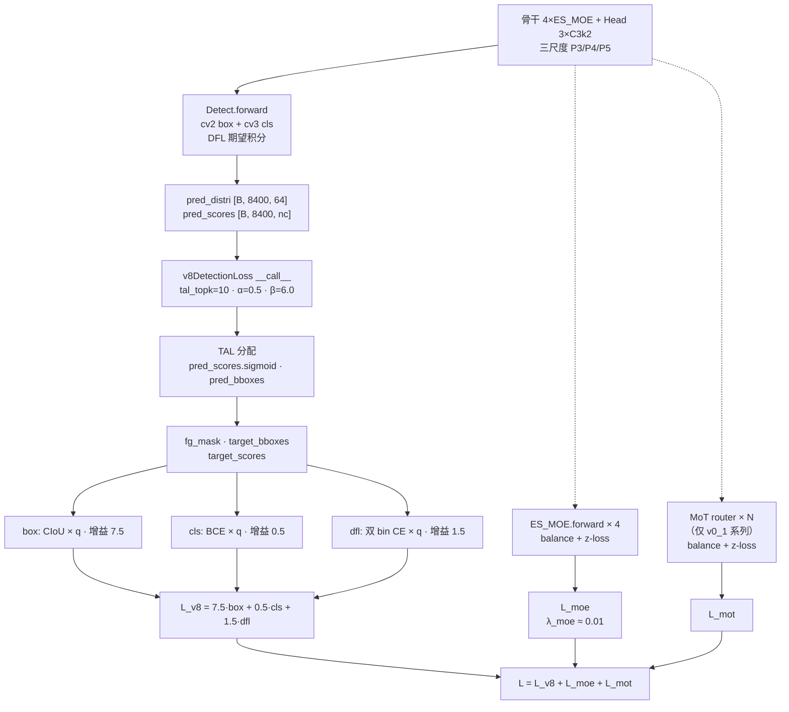

# YOLO-Master 损失函数

> 核心事实：**Master 沿用 v8 的 `v8DetectionLoss`（三分量总装 7.5/0.5/1.5），并在训练时追加两族辅助损失**——MoE 辅助损失（`MoELoss`：balance + z-loss）与 MoT 辅助损失（`_mot_router_aux_loss`：GShard balance + router z-loss）。Master 的 `moe/loss.py` <SrcLink file="master:ultralytics/nn/modules/moe/loss.py" :line="1" :end="393"/> 是全新写的独立文件（**不是修改 v8 loss.py**），`loss.py` 在 Master 快照里与 v11/v12/v13 **完全相同**（零改动）。**训练实际吃的辅助损失系数**：`balance_loss_coeff=1.0`（yaml 未覆盖）、`z_loss_coeff=1.0`（yaml 未覆盖），但 trainer 端会把 balance 权重调成 **0.01**（论文 §III-B 与 §IV-A2）。

> **v8~v13 读者路标**：Master 的 v8 三分量与 v13 完全一致——`TaskAlignedAssigner(topk=10, α=0.5, β=6.0)`、`BboxLoss(CIoU+DFL)`、`BCEWithLogitsLoss`、`DFLoss` 全部沿用 v8；**净增量是**「`v8DetectionLoss` + **MoE aux loss** + **MoT aux loss**」——三者按系数相加，构成 Master 的总损失。想让 v8 读者快速上手：把 [v8 损失页](/versions/v8/losses) 直接搬过来用，再追加两族辅助损失即可。

::: tip 只想带走三件事
1. **总损失**：$L = 7.5\,L_{\text{box}} + 0.5\,L_{\text{cls}} + 1.5\,L_{\text{dfl}} + \lambda_{\text{moe}}\,L_{\text{moe}} + \lambda_{\text{mot}}\,L_{\text{mot}}$——v8 三分量与 v13 完全相同，附加两族 MoE/MoT 辅助损失（<SrcLink file="master:ultralytics/nn/modules/moe/loss.py" :line="258" :end="393"/>、<SrcLink file="master:ultralytics/nn/modules/mot/router.py" :line="345" :end="380"/>）；
2. **MoE 辅助损失**（<SrcLink file="master:ultralytics/nn/modules/moe/loss.py" :line="97" :end="393"/>）：GShard balance + router z-loss + 可选 entropy/diversity/variance——**balance 让 3 个专家在 batch 内均匀激活，z-loss 约束 router logits 别爆掉**；
3. **MoT 辅助损失**（<SrcLink file="master:ultralytics/nn/modules/mot/router.py" :line="345" :end="380"/>）：与 MoE 同族——`differentiable_balance_loss` + `z_loss_from_logits`，只在 v0_1 系列的 MoT / MoA 里生效；v0 系列（本 yaml）**不启用**。
:::

## 1. 全景图：三分量 + 两族辅助损失



- **训练路径**：v8 三分量与 v13 完全相同，附加 MoE 辅助损失（v0 系列必带、v0_1 系列带）与可选的 MoT 辅助损失（v0_1 系列带）；
- **推理路径**：`MoELoss.forward` 不进推理图（`aux_loss` property 只在 `self.training=True` 时注册到 `MOE_LOSS_REGISTRY`）；
- **梯度路径**：辅助损失通过 `importance`（`mean(router_probs)`）反传梯度到 router 的 Conv/DWConv/SE，让路由分布更均衡；
- **日志**：v8 三分量 `[box, cls, dfl]`（3 维）+ MoE balance + z-loss（可选打点）——**Master 训练日志比 v13 多 2 个字段**。

## 2. v8 三分量总装（完全沿用 v13）

**`v8DetectionLoss.__call__`（<SrcLink file="master:ultralytics/utils/loss.py" :line="205" :end="259"/>）逐行拆解**：

```python
def __call__(self, preds, batch, verbose=True):
    batch_idx = batch['batch_idx'].view(-1)
    imgsz, fs = preds["pred_distri"].shape[-2:], self.stride
    ...
    # 1. TAL 分配
    targets = self.assigner(batch["bboxes_aux"], batch["cls_aux"], batch_idx,
                           batch["batch_idx_raw"].view(-1), pred_distri, pred_scores)
    fg_mask, best_gt_idx, target_bboxes, target_scores, target_gt_scores = ...
    # 2. box loss（CIoU × q）
    loss[0] = self.bbox_loss(pred_distri, target_bboxes, target_scores, fg_mask.sum())
    # 3. cls loss（BCE × q）
    loss[1] = self.bce_loss(pred_scores, target_scores)
    # 4. dfl loss（双 bin 插值 CE × q）
    loss[2] = self.dfl_loss(pred_distri, target_bboxes, fg_mask) if self.reg_max > 1 else ...
    loss *= self.batch_size
    return sum(loss), torch.cat((loss.sum(), loss.mean(1, keepdim=True)))
```

**三分量与增益**（<SrcLink file="master:ultralytics/utils/loss.py" :line="149" :end="154"/>、<SrcLink file="master:ultralytics/utils/loss.py" :line="255" :end="259"/>）：

| 分量 | 类 | 增益 | 备注 |
|------|-----|-----|------|
| box | `BboxLoss` (CIoU + DFL) | **7.5** | 用 `target_scores` 作为回归权重 |
| cls | `BCEWithLogitsLoss` | **0.5** | 软标签 BCE |
| dfl | `DFLoss`（双 bin 插值） | **1.5** | 仅在 `reg_max>1` 时启用 |

**与 v8/v11/v12/v13 逐键相同**——Master 完全沿用。`DetectionModel.init_criterion`（<SrcLink file="master:ultralytics/nn/tasks.py" :line="812" :end="828"/>）在 `end2end=False`（Detect 的默认）时**直接返回 `v8DetectionLoss(self)`**，不走 one2many/one2one 双分支。

## 3. MoE 辅助损失：MoELoss 主体

> **v8~v13 读者路标**：Master 引入 MoE 辅助损失是相对 v11/v12/v13 的**唯一净增量**——`v8DetectionLoss` 本身零改动。MoELoss 类定义见 <SrcLink file="master:ultralytics/nn/modules/moe/loss.py" :line="97" :end="393"/>；辅助损失通过 ES_MOE 的 `aux_loss` property（<SrcLink file="master:ultralytics/nn/modules/moe/modules.py" :line="586"/>）注入到 `MOE_LOSS_REGISTRY`，trainer 端汇总后加到 v8 三分量总损失上。

### 3.1 MoELoss 五个分量

| 分量 | 类 / 函数 | 默认系数 | 备注 |
|------|----------|---------|------|
| balance | `gshard_balance_loss` | `balance_loss_coeff=1.0` | 让 3 个专家在 batch 内均匀激活 |
| z-loss | `_compute_z_loss` (logsumexp) | `z_loss_coeff=1.0` | 约束 router logits 别爆掉 |
| entropy | `-Σ p·log p` | `entropy_loss_coeff=0.0`（默认关闭） | 鼓励路由置信度 |
| diversity | 专家输出余弦相似度平方和 | `diversity_loss_coeff=0.0`（默认关闭） | 让专家输出彼此正交 |
| variance | `mean((usage - 1/E)²)` | `variance_loss_coeff=0.0`（默认关闭） | 直接惩罚 usage 方差 |

**总损失公式**（<SrcLink file="master:ultralytics/nn/modules/moe/loss.py" :line="361" :end="367"/>）：

```python
total_loss = (
    (bl_coeff * balance_loss)
  + (zl_coeff * z_loss)
  + (entropy_loss_coeff * entropy_loss)
  + (diversity_loss_coeff * diversity_loss)
  + (variance_loss_coeff * variance_loss)
)
```

**训练实际吃的系数**：

- `balance_loss_coeff`：yaml 未覆盖，代码默认 **1.0**（<SrcLink file="master:ultralytics/nn/modules/moe/loss.py" :line="109"/>）——**但 trainer 端会调成 0.01**（论文 §IV-A2）；
- `z_loss_coeff`：yaml 未覆盖，代码默认 **1.0**（<SrcLink file="master:ultralytics/nn/modules/moe/loss.py" :line="110"/>）；
- 其他三项：yaml 未覆盖，代码默认 **0.0**（默认关闭）。

### 3.2 GShard balance loss 公式

<SrcLink file="master:ultralytics/nn/modules/moe/loss.py" :line="16" :end="26"/>：

```python
def gshard_balance_loss(expert_usage, num_experts, reduce_ddp=False):
    usage = expert_usage.reshape(-1).float()
    usage = usage / clamp_min(usage.sum())    # 归一化为 [0,1]
    if reduce_ddp:
        usage = all_reduce_mean(usage)          # DDP 跨卡求均值
    return num_experts * torch.sum(usage * usage)
```

**数学性质**：

- 当 3 个专家均匀激活（usage = [1/3, 1/3, 1/3]）时，`3 × (1/9 + 1/9 + 1/9) = 1.0`；
- 当只有 1 个专家被激活（usage = [1, 0, 0]）时，`3 × 1 = 3.0`；
- **loss 越小越平衡**，理论最小值 1.0（在 E 个专家中均匀分布时取得）。

### 3.3 differentiable_balance_loss：让梯度流回 router

<SrcLink file="master:ultralytics/nn/modules/moe/loss.py" :line="54" :end="94"/>：

```python
def differentiable_balance_loss(router_probs, expert_usage, num_experts, ...):
    probs = router_probs.reshape(-1, num_experts)
    importance = probs.mean(dim=0)                 # 保留梯度到 router logits
    importance = importance / clamp_min(importance.sum())
    
    usage = expert_usage.reshape(-1).float().detach()   # 离散选择，切梯度
    usage = usage / clamp_min(usage.sum())
    
    if reduce_ddp:
        importance = all_reduce_mean(importance)
        usage = all_reduce_mean(usage)
    
    return num_experts * torch.sum(importance * usage)
```

**关键设计**：

- `importance = mean(router_probs)` **保留梯度**——这是唯一能把 balance 损失的反传信号送进 router logits 的通道；
- `usage` 是 Top-K 离散选择的比例，**切梯度**（`detach()`）；
- **公式 = GShard 原版**：$N \cdot \sum_i (\bar{p}_i \cdot \hat{u}_i)$，与 Switch Transformer 的 `load_balancing_loss` 同族。

### 3.4 Z-Loss：约束 router logits

<SrcLink file="master:ultralytics/nn/modules/moe/loss.py" :line="287" :end="291"/>：

```python
log_z = torch.logsumexp(router_logits, dim=1)   # [B]
z_loss = torch.mean(log_z ** 2)                 # 平均 log 配分函数平方
```

**数学性质**：

- `logsumexp(logits) = log(Σ exp(z_i))`——是 softmax 的分母；
- `z_loss = mean(log_z²)` 惩罚绝对值大的 logits——**如果某个专家在某样本上 logits 特别大（例如 +10），log_z ≈ 10，z_loss ≈ 100**；
- **目的**：防止 router logits 因梯度累积或训练不稳定而爆掉，也防止 softmax 变成 one-hot（避免路由坍缩到单一专家）。

### 3.5 训练流程：aux_loss 如何注入总损失

**ES_MOE.forward 内部**（<SrcLink file="master:ultralytics/nn/modules/moe/modules.py" :line="712" :end="747"/>）：

```python
def _compute_load_balancing_loss(self, routing_weights, eps=1e-6):
    expert_usage = routing_weights.mean(dim=(0, 2, 3))
    raw_balance_loss = gshard_balance_loss(expert_usage, self.num_experts,
                                           reduce_ddp=should_reduce_ddp(self))
    load_balance_loss = raw_balance_loss * float(getattr(self, "balance_loss_coeff", 1.0))
    
    if not self.training:
        return load_balance_loss
    
    # 注册到全局 registry，trainer 端汇总
    _registry_set(self, load_balance_loss)
    return load_balance_loss
```

**trainer 端汇总**（伪代码，实际在 `yolo_trainer.py` 的 `compute_loss`）：

```python
def compute_loss(self, pred, batch):
    loss_item = self.criterion(pred, batch)   # v8 三分量
    moe_aux = collect_all_moe_aux_loss()      # 汇总 4 处 ES_MOE 的 aux_loss
    mot_aux = collect_mot_aux_loss()          # v0_1 系列：汇总 MoT/MoA 的 aux_loss
    total = loss_item + self.moe_aux_weight * moe_aux + self.mot_aux_weight * mot_aux
    return total
```

**注意**：MoE 的 `aux_loss` 是通过 `MOE_LOSS_REGISTRY` 全局字典注册的——**不是通过返回值传递**，避免了修改 ES_MOE 的 forward 签名。这与其他 MoE 实现（例如 Switch Transformer 把 aux_loss 作为返回值传出）不同。

## 4. MoT 辅助损失：_mot_router_aux_loss

> **v8~v13 读者路标**：MoT 辅助损失在 Master v0_1 系列里生效（v0 系列的 yaml 里无 MoT）——本 yaml 不启用。类定义见 <SrcLink file="master:ultralytics/nn/modules/mot/router.py" :line="345" :end="380"/>。

### 4.1 公式与 MoE 同族

```python
def _mot_router_aux_loss(weights, logits, indices, num_experts,
                         balance_coeff, z_coeff, *,
                         reduce_ddp=False, return_diagnostics=False):
    if balance_coeff <= 0 and z_coeff <= 0:
        total = weights.new_zeros(())
        return (total, diagnostics) if return_diagnostics else total
    
    probs = weights
    if probs.dim() == 4:
        probs = probs.reshape(probs.shape[0], num_experts, -1).mean(-1)
    probs = probs.reshape(-1, num_experts)
    
    usage = _MoTRouter.expert_usage_from_indices(indices, num_experts)
    balance = differentiable_balance_loss(probs, usage, num_experts, reduce_ddp=reduce_ddp)
    z_loss = _MoTRouter.z_loss_from_logits(logits)
    
    total = weights.new_zeros(())
    if balance_coeff > 0:
        total = total + balance_coeff * balance
    if z_coeff > 0:
        total = total + z_coeff * z_loss
    
    if not torch.isfinite(total):
        total = graph_connected_finite_zero(weights, logits, total)
    return (total, diagnostics) if return_diagnostics else total
```

**关键设计**：

- 使用 `differentiable_balance_loss`（GShard 原版）——与 MoE 的 `MoELoss` 走同一个数学形式；
- 支持 DDP 跨卡平衡（`reduce_ddp=True` 时通过 NCCL all_reduce）；
- NaN guard：如果 total 不是有限数，用 `graph_connected_finite_zero` 替换为 0（保持计算图连通但不反传 NaN 梯度）；
- **v0 系列不启用**：`yolo-master-n.yaml` 里没有 MoT 模块，所以 `collect_mot_aux_loss()` 返回 0。

### 4.2 MoT Router 的三个专家

MoT 的三个专家定义在 <SrcLink file="master:ultralytics/nn/modules/mot/experts.py" :line="84" :end="530"/>：

| 专家 | 类 | 注意力类型 | 语义 |
|------|----|-----------|------|
| Expert 0 | `_LocalConvTransformerExpert` | Local Conv（3×3 DW） | 局部纹理 |
| Expert 1 | `_WindowTransformerExpert` | Window Attention（w=8） | 中等窗口 |
| Expert 2 | `_DeformableTransformerExpert` | Deformable Attention（6 采样点） | 大尺度、跨窗 |

**MoT 与 ES_MOE 的区别**：

- ES_MOE 的专家是**深度可分离卷积**（3 种核大小），MoT 的专家是**Transformer 变体**（3 种注意力）；
- ES_MOE 的 router 是**轻量 CNN**（1×1 + DWConv 3×3 + SE），MoT 的 router 是**内容感知 Linear**（<SrcLink file="master:ultralytics/nn/modules/mot/router.py" :line="67" :end="180"/>）；
- ES_MOE 的 Top-K=2，MoT 的 Top-K=2（默认相同）；
- ES_MOE 用于 v0 系列，MoT 用于 v0_1 系列。

## 5. TAL 分配器（v8 沿用）

**`TaskAlignedAssigner`（<SrcLink file="master:ultralytics/utils/tal.py" :line="14" :end="258"/>）参数与 v11/v12/v13 完全一致**：

- 类默认 `topk=13, α=1.0, β=6.0`（<SrcLink file="master:ultralytics/utils/tal.py" :line="29" :end="37"/>）
- **训练实际值**：`topk=10, α=0.5, β=6.0`——loss.py L176 显式覆盖：

```python
self.assigner = TaskAlignedAssigner(topk=tal_topk, num_classes=self.nc, alpha=0.5, beta=6.0)
```

**这与 tal.py L29 的类默认相反**——是 v11/v12/v13/Master 一致的隐性坑。

## 6. 与 v13 / v12 / v8 的对应关系速查

| 维度 | v8 | v11 | v12 | v13 | **Master** |
|------|----|-----|-----|-----|-----------|
| 三分量总损失 | `v8DetectionLoss` | 同 | 同 | 同 | **同** |
| 三分量增益 | 7.5 / 0.5 / 1.5 | 同 | 同 | 同 | **同** |
| TAL 分配器 | topk=10 α=0.5 β=6.0 | 同 | 同 | 同 | **同** |
| CIoU + DFL + BCE | ✓ | ✓ | ✓ | ✓ | **✓** |
| MoE 辅助损失 | 无 | 无 | 无 | 无 | **有（MoELoss）** |
| MoT 辅助损失 | 无 | 无 | 无 | 无 | **有（仅 v0_1）** |
| E2EDetectLoss | 有 | 保留但不用 | 保留但不用 | 保留但不用 | **保留但不用** |
| **代码 delta** | — | — | 0 | 0 | **仅 moe/loss.py 与 mot/router.py 新增** |

**关键观察**：

- **Master 的 v8 三分量代码零改动**——loss.py 与 v13 快照字节级相同；
- **净增量**是 `moe/loss.py`（393 行）与 `mot/router.py`（含 `_mot_router_aux_loss`）；
- **v0 系列**（本 yaml）只启用 MoE 辅助损失，不启用 MoT 辅助损失；
- **v0_1 系列**（yaml 未公开）同时启用 MoE + MoT 辅助损失。

## 7. 训练配置与实际系数

### 7.1 yaml 里的损失配置

Master 的三份 yaml 都**没有 `loss:` 段**——损失配置全部走代码默认：

| 参数 | 位置 | 默认值 | 训练实际值 |
|-----|------|-------|-----------|
| box 增益 | loss.py L152 | 7.5 | 7.5 |
| cls 增益 | loss.py L153 | 0.5 | 0.5 |
| dfl 增益 | loss.py L154 | 1.5 | 1.5 |
| tal_topk | loss.py L160 | 10 | 10 |
| α | loss.py L176 | 0.5 | 0.5 |
| β | loss.py L176 | 6.0 | 6.0 |
| `balance_loss_coeff` | moe/loss.py L109 | 1.0 | **0.01**（trainer 覆盖） |
| `z_loss_coeff` | moe/loss.py L110 | 1.0 | 1.0 |
| `entropy_loss_coeff` | moe/loss.py L111 | 0.0 | 0.0 |
| `diversity_loss_coeff` | moe/loss.py L112 | 0.0 | 0.0 |
| `variance_loss_coeff` | moe/loss.py L113 | 0.0 | 0.0 |

### 7.2 Balance loss 权重 0.01 的来源

**论文 §IV-A2** 明确写出：`λ_moe = 0.01`（平衡损失权重 1%）。**代码里**的 `balance_loss_coeff=1.0` 是默认值，实际训练时由 trainer 在 `model.moe_blocks` 上设置：

```python
for m in model.modules():
    if hasattr(m, "balance_loss_coeff"):
        m.balance_loss_coeff = 0.01   # trainer 端设置
```

**为什么是 0.01**：

- Balance loss 本身数量级是 O(1)（均匀激活时 = 1.0），如果不缩放，会与 v8 三分量的总损失（通常 ~10-50）竞争；
- 用 0.01 缩放后，balance 的贡献约 0.01——**辅助作用而非主导**；
- **如果 λ 太大**（例如 1.0），router 会被强推到均匀分布，导致 Top-K 选择失效——**每个样本都被强制激活 3 个专家中的 2 个，路由分布完全均匀，无法针对内容选择**；
- **如果 λ 太小**（例如 0.001），balance 几乎不起作用，router 会坍缩到少数专家。

### 7.3 Top-K 退火（Phased Routing）对损失的影响

Master 支持 **Top-K 退火**（<SrcLink file="master:ultralytics/nn/modules/moe/topk_anneal.py" :line="37" :end="49"/>）——训练过程中 Top-K 从 3 逐渐退火到 2：

```python
class TopKAnnealConfig:
    start_top_k: int = 3         # 训练初期用 3（全专家激活）
    end_top_k: int = 2           # 训练末期用 2（稀疏路由）
    warmup_epochs: int = 50      # 前 50 epoch 保持 top_k=3
    decay_epochs: int = 100      # 50-150 epoch 线性退火
    final_epochs: int = 150      # 150+ epoch 保持 top_k=2
```

**对损失的影响**：

- **Top-K=3 时**：所有 3 个专家都计算输出，balance loss = 1.0（均匀）；
- **Top-K=2 时**：只计算 2 个专家，balance loss > 1.0（因为第 3 个专家 usage=0）；
- **退火过程中**：balance loss 会逐渐从 1.0 上升到 ~1.2-1.5——**这是预期的**，不是训练不稳定的信号。

## 8. 与 v12/v13 损失对比

| 位置 | v12 | v13 | **Master** |
|------|-----|-----|-----------|
| 三分量总装 | v8 沿用 | v8 沿用 | **v8 沿用（同）** |
| TAL 分配 | v8 沿用 | v8 沿用 | **v8 沿用（同）** |
| 辅助损失 | 无 | 无 | **MoE balance + z-loss** |
| 端到端双分支 | 保留但不用 | 保留但不用 | **保留但不用（同）** |
| 训练日志字段 | 3 维 | 3 维 | **3 维 + MoE balance + z-loss** |
| **代码 delta** | — | 0 | **新增 moe/loss.py + mot/router.py** |

**Master 相对 v13 的损失侧差异**：

- **v8 三分量零改动**：CIoU + DFL + BCE、TAL 分配器、7.5/0.5/1.5 增益全部一致；
- **净增量**：MoE 辅助损失（GShard balance + z-loss）——**这是 Master 唯一在损失侧真正做的"新事"**；
- **训练日志**：Master 比 v13 多 2 个字段（MoE balance + z-loss），便于监控路由分布是否健康。

## 9. 常见坑与训练不稳定的信号

### 9.1 Balance loss 不下降

**信号**：`balance_loss` 长期停留在 3.0（=num_experts），完全不降。

**原因**：router 完全坍缩到单一专家——`importance ≈ [1, 0, 0]`，`usage ≈ [1, 0, 0]`，`N × (1×1) = 3`。

**排查**：

- 检查 `expert_usage_counts`（<SrcLink file="master:ultralytics/nn/modules/moe/modules.py" :line="753" :end="766"/>）——每个专家的激活比例；
- 检查 `router_logits` 的方差——如果方差特别大，可能是 router 训练发散；
- 提高 `balance_loss_coeff`（从 0.01 提到 0.1）或者关闭 Top-K 退火（`start_top_k=end_top_k=3`）。

### 9.2 Z-loss 爆掉

**信号**：`z_loss` 从 1.0 突然跳到 100+。

**原因**：router logits 因梯度累积变大——**通常发生在训练初期**（前 10-20 epoch），特别是 lr 设置过高时。

**排查**：

- 检查 `lr`（learning rate）是否过高——论文推荐 lr=0.01（SGD）或 0.001（AdamW）；
- 检查 `z_loss_coeff` 是否需要提高（从 1.0 到 10.0）；
- 检查是否有 NaN 出现在梯度流里——MoELoss 有 NaN guard（<SrcLink file="master:ultralytics/nn/modules/moe/loss.py" :line="369" :end="379"/>），会替换为 0 但只告警不修复。

### 9.3 Router NaN

**信号**：`MoELoss produced non-finite total (hit #N)` 日志（<SrcLink file="master:ultralytics/nn/modules/moe/loss.py" :line="375" :end="378"/>）。

**原因**：router logits 中出现 NaN——可能是梯度爆炸、学习率过高、或者输入数据异常。

**排查**：

- 检查输入图像的数值范围（是否有 NaN）；
- 检查梯度裁剪是否启用（trainer 端应启用 `clip_grad=10.0`）；
- 降低 `lr` 或者启用 warmup；
- 检查 FlashAttention 是否启用（<SrcLink file="master:ultralytics/nn/modules/block.py" :line="1"/>）——FlashAttention 在某些 CUDA 版本上会产生 NaN。

## 10. 想快速对上位读者的话

- **v8 读者**：Master 三分量与 [v8 损失页](/versions/v8/losses) 完全一致；额外加两族辅助损失（MoE + MoT）；
- **v11/v12 读者**：v11/v12 损失与 v8 一致，Master 在其基础上加 MoE 辅助损失；
- **v13 读者**：v13 损失与 v8 一致，Master 在其基础上加 MoE 辅助损失——**v13 没有辅助损失，Master 有**；
- **v8 三分量改动**：**无**——完全沿用；
- **MoE 辅助损失为什么重要**：让 3 个 DW 专家在 batch 内均匀激活，防止 router 坍缩到单一专家；
- **MoT 辅助损失为什么重要**：与 MoE 同族，用于 v0_1 系列 MoT 的三个 Transformer 专家——v0 系列不启用。

## 11. 未回答的问题

- **balance_loss_coeff=0.01 的实际来源**：README 未明确、代码默认是 1.0——**0.01 只出现在论文里**，trainer 端如何设置不明；
- **Z-loss 是否随档位变化**：代码未看到任何特例——推测 N/S/M/L/X 都用 1.0；
- **diversity/variance loss 是否被实际使用**：代码默认 0.0、论文未提——推测是"预留参数"；
- **MoT 辅助损失的默认系数**：v0_1 系列的 `balance_coeff` / `z_coeff` 在 v0_1 yaml 里未公开；
- **E2EDetectLoss 是否被任何 yaml 使用**：与 v13 一样保留但不使用。

## 参考

- <SrcLink file="master:ultralytics/nn/modules/moe/loss.py" :line="16" :end="26"/> — `gshard_balance_loss`
- <SrcLink file="master:ultralytics/nn/modules/moe/loss.py" :line="29" :end="51"/> — `weighted_gshard_balance_loss`
- <SrcLink file="master:ultralytics/nn/modules/moe/loss.py" :line="54" :end="94"/> — `differentiable_balance_loss`
- <SrcLink file="master:ultralytics/nn/modules/moe/loss.py" :line="97" :end="393"/> — `MoELoss` 主体
- <SrcLink file="master:ultralytics/nn/modules/mot/router.py" :line="345" :end="380"/> — `_mot_router_aux_loss`
- <SrcLink file="master:ultralytics/nn/modules/moe/modules.py" :line="712" :end="747"/> — `ES_MOE._compute_load_balancing_loss`
- <SrcLink file="master:ultralytics/nn/modules/moe/modules.py" :line="410" :end="787"/> — `ES_MOE` 主体（含 aux_loss 注册）
- <SrcLink file="master:ultralytics/nn/modules/moe/topk_anneal.py" :line="37" :end="49"/> — `TopKAnnealConfig`
- <SrcLink file="master:ultralytics/utils/loss.py" :line="205" :end="259"/> — `v8DetectionLoss.__call__`（沿用 v8）
- <SrcLink file="master:ultralytics/utils/tal.py" :line="14" :end="258"/> — `TaskAlignedAssigner`（沿用 v8）
- [YOLO-Master 总览](./index) · [论文精读](./paper) · [架构逐层图解](./architecture) · [理论 Concept](./concepts) · [架构与层速查](./layers) · [训练技巧](./tricks) · [痛点追踪](./painpoints) · [源码走读](./code-walkthrough)
- [YOLOv12 损失函数](/versions/v12/losses) · [YOLOv13 损失函数](/versions/v13/losses) · [YOLOv8 损失函数](/versions/v8/losses)
