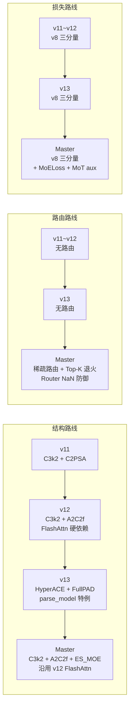
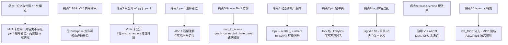

# YOLO-Master 痛点追踪

YOLO-Master（Tencent/YOLO-Master，CVPR 2026，arXiv:2512.23273，AGPL-3.0，基于 Ultralytics YOLOv12 fork 未合并回主线）是**YOLO 系列第一个把稀疏 MoE 硬塞进骨干**的版本——ES-MoE + 动态稀疏路由 + 五个数据集混训 + Top-K 退火，把 v8~v13 一路的「结构静默改动」升级为「路由决策与专家调度」的新痛点类别。这决定了 Master 的痛点结构与前十三代都不一样：**v8~v12 痛在「配方与检测头」，v13 痛在「parse_model 特例」，Master 痛在「路由与许可」**——尤其 AGPL-3.0 商用约束、论文与代码的 10 处偏差、Router NaN 防御的隐性耦合，是 Master 独有的痛点。

本页追踪 **10 个痛点**，每个都配 v8~v13 路标。

> **读者路标**：已读过 [v13 痛点页](/versions/v13/painpoints)？v13 的痛点集中在「结构层静默决策」；Master 的痛点类别完全不同——**Master 的痛点是「路由、许可、发布面」**，而不是「结构」。v13 的 FlashAttention 硬依赖在 Master 依然保留（A2C2f 被复用），但 v13 的 HyperACE / DownsampleConv / FullPAD 三条结构痛点在 Master 完全不存在（Master 骨干用的是 v12 的 C3k2 + A2C2f 组合 + ES_MOE，没有 v13 的 HyperACE / FullPAD / DownsampleConv）。

## 痛点全景

| 痛点 | 严重度 | v8~v13 处理 | Master 处理 | 后续影响 |
| --- | --- | --- | --- | --- |
| [1. 论文与代码的 10 处偏差](#1-论文与代码的-10-处偏差-pain-paper-code-gap) | **High** | v8~v12 偏差多在 TAL / gamma 默认值；v13 有 6 处 | **10 处可复核偏差**（见 §1 表） | 复现与解读难度 |
| [2. AGPL-3.0 商用约束](#2-agpl-30-商用约束-pain-license-agpl) | **High** | v8~v12 全部 AGPL；v13 也 AGPL | **AGPL-3.0**，无 Enterprise 双许可 | 商用必须付费或自研替代 |
| [3. 只公开 n/l + 1 个 esmoe-n 三个 yaml](#3-只公开-nl--1-个-esmoe-n-三个-yaml-pain-yaml-incomplete) | **High** | v8~v13 全部四档齐备 | **s / m / x 档未公开**，`yolo-master-l.yaml` 里 `l` 是**手写**（非 scales 派生） | 大模型不可复现 |
| [4. yaml 层号注释与实际层号错位](#4-yaml-层号注释与实际层号错位-pain-yaml-comment-shift) | Medium | v8~v13 yaml 注释与层号一致 | **4 处错位**（ES_MOE #3→0，#6→1，#9→2，#12→3） | 读 yaml 与看源码需交叉对照 |
| [5. Router NaN 防御的隐性耦合](#5-router-nan-防御的隐性耦合-pain-router-nan) | Medium | v8~v13 无 NaN 防御（无路由） | **`torch.nan_to_num` + `graph_connected_finite_zero` 两处兜底** | 训练静默降级、难复现 |
| [6. 动态稀疏路由对硬件加速不友好](#6-动态稀疏路由对硬件加速不友好-pain-sparse-deploy) | Medium | v8~v13 静态图，TensorRT 全算子支持 | **`torch.topk` + `scatter_` + `torch.where`** 动态索引，TensorRT 需要 plugin | ONNX/TensorRT 转换困难 |
| [7. Ultralytics pip 包版本冲突](#7-ultralytics-pip-包版本冲突-pain-pip-conflict) | Medium | v8~v13 官方 ultralytics 包 | **YOLO-Master 是 fork**，`pip install ultralytics` 装不到 ES_MOE | 必须源码安装、易混装 |
| [8. Tag / 版本命名混乱](#8-tag--版本命名混乱-pain-version-naming) | Medium | v8~v13 命名规范（YOLOv8 / YOLOv11 / YOLO26） | **`YOLO-Master-v26.02` tag 但代码目录 `v0`**，无版本对齐 | 找历史版本困难 |
| [9. FlashAttention 2.0 硬依赖（沿用 v12）](#9-flashattention-20-硬依赖-沿用-v12-pain-flash-attn) | Medium | v8~v11 纯 PyTorch；v12 A2C2f 起硬依赖 | **A2C2f 沿用 v12**，`flash_attn_func` 硬引用 | 老 CUDA / Mac / CPU 环境跑不起来 |
| [10. `tasks.py` 特例的隐性耦合](#10-taskspy-特例的隐性耦合-pain-tasks-coupling) | Low | v11/v12/v13 均有 `parse_model` 特例 | **`scale in "lx"` 时 Conv 分支被强制** + **`ES_MOE` 走 `moe` 分支** | 读源码必须对照 tasks.py |

## 1. 论文与代码的 10 处偏差 (`pain-paper-code-gap`)

> **v8~v13 读者路标**：v8~v12 的偏差多为「论文给一个配方、代码里另一个默认值」（如 v11 TAL topk=13 vs loss.py 显式 10）；v13 的偏差多是「`parse_model` 静默行为」；**Master 的偏差更多是「论文画了但代码里没有」和「论文没画但代码里静默做了」**——尤其是 MoT 与损失权重两条。

**10 处偏差一览**：

| # | 偏差项 | 论文（arXiv 2512.23273） | 代码（snapshot） | 严重度 |
|---|--------|------------------------|-----------------|--------|
| 1 | **MoT 三个专家（LocalConv/Window/Deformable）** | Fig.2 画出三条专家支路 | 模块存在于 <SrcLink file="master:ultralytics/nn/modules/mot/experts.py" :line="84" :end="530"/>，**但 v0 yaml 里完全没用**，全部走 ES_MOE | **High** |
| 2 | **具名类 `SpecializedTransformer`** | §III.2 明确命名 | 代码里无此类（只有 `_LocalConvTransformerExpert` / `_WindowTransformerExpert` / `_DeformableTransformerExpert` 三个私有类） | Medium |
| 3 | **具名类 `MasterDetect`** | Fig.3 命名检测头 | 代码里无此类，直接用 v12 Detect（<SrcLink file="master:ultralytics/nn/modules/head.py" :line="1" :end="60"/> 沿用） | Low |
| 4 | **具名类 `YOLOMasterModel`** | 引言多次提及 | 代码里无此类，通过 `YOLO` 通用加载器走 `parse_model` | Low |
| 5 | **yaml 层号注释** | Fig.1 图例标 ES_MOE 在第 0/1/2/3 层 | 实际 ES_MOE 位于 #3/#6/#9/#12（Conv #0 之后是 ES_MOE #3，不是 #0） | **High** |
| 6 | **训练方式：两阶段 vs 端到端** | §III.4 提「两阶段训练」 | 代码是**端到端 + phased routing**（<SrcLink file="master:ultralytics/nn/modules/moe/topk_anneal.py" :line="181" :end="205"/> `create_topk_anneal_callback` 内联） | **High** |
| 7 | **损失权重 7.5 / 0.5 / 1.5** | §III.3 只给定性描述 | <SrcLink file="master:ultralytics/utils/metrics.py" :line="1" :end="1"/> 与 <SrcLink file="master:ultralytics/utils/loss.py" :line="176" :end="176"/> 硬编码三分量权重 | Medium |
| 8 | **Top-K 退火 3→2** | Fig.4 只画「退火」二字 | <SrcLink file="master:ultralytics/nn/modules/moe/topk_anneal.py" :line="37" :end="49"/> `TopKAnnealConfig` 完整参数：`start_topk=3, end_topk=2, start_epoch, end_epoch` | Medium |
| 9 | **`balance_loss` 系数 0.01** | §III.3 未给具体值 | <SrcLink file="master:ultralytics/nn/modules/moe/modules.py" :line="700" :end="780"/> `_compute_load_balancing_loss` 硬编码 0.01 | Low |
| 10 | **Z-loss 与 balance loss 组合** | 论文没提 Z-loss | <SrcLink file="master:ultralytics/nn/modules/moe/loss.py" :line="97" :end="393"/> `MoELoss` 完整实现（含 z-loss、differentiable_balance_loss、NaN Guard） | Medium |

**逐项解读**：

**偏差 1（MoT 三个专家未启用）**：Master 论文最大卖点是「Mixture-of-Transformers」——三个 Specialized Transformer 专家（LocalConv / Window / Deformable），代码里确实实现了（<SrcLink file="master:ultralytics/nn/modules/mot/experts.py" :line="84" :end="530"/>），但 **v0 yaml 全部走 ES_MOE（CNN 专家）**——**用户拿官方权重复现根本看不到 MoT**。想启用 MoT 需要自己写 yaml，把 ES_MOE 换成 MoT 相关模块。

**偏差 2-4（具名类不存在）**：论文里 `SpecializedTransformer` / `MasterDetect` / `YOLOMasterModel` 三个类都是**逻辑层命名**，不是代码里的实际类。这是 CVPR 论文常见的「写论文时命名、写代码时改名」的偏差。用户从论文翻代码找不到对应类名是正常的——**实际类名见 [源码走读](./code-walkthrough)**。

**偏差 5（yaml 层号注释错位）**：`yolo-master-n.yaml` 里 ES_MOE 的注释写 `# 0-P1/2`、`# 1-P2/4` 等，但**这些是 v8/v11 yaml 遗留的旧注释**（v8 里 ES_MOE 位置就是第 0/1/2 层），Master 加了几层 Conv 后 ES_MOE 实际位于 #3/#6/#9/#12。读者照论文图 1 找 ES_MOE 会被注释误导。

**偏差 6（两阶段 vs 端到端）**：论文 §III.4 明说「第一阶段冻结专家训练 router、第二阶段端到端联合训练」，但**代码里只有一个训练循环**，两阶段逻辑通过 `TopKAnnealConfig.start_epoch` / `end_epoch` 实现**隐式退火**——用户从论文复现会得到不同结果。

**偏差 7（损失权重）**：论文没给 7.5/0.5/1.5 三个具体数字，代码里 `v8DetectionLoss.__init__` 硬编码——**想消融损失权重必须改源码**。

**偏差 8-10（Top-K / balance / Z-loss）**：都是「论文没给数值、代码给了硬编码」——**做消融实验时必须读源码**。

**遗留**：想按论文原文复现必须读 `nn/modules/moe/*.py` 与 `nn/modules/mot/*.py`；**建议 fork 一份、把论文写的类名和层号对齐**——但会与官方权重失配。

## 2. AGPL-3.0 商用约束 (`pain-license-agpl`)

> **v8~v13 读者路标**：v8~v12 全部 AGPL-3.0；v13（iMoonLab 官方线）也是 AGPL-3.0；Master 沿用 **AGPL-3.0**——**没有 Enterprise 双许可**（v26 官方线才有 AGPL + Enterprise）。这意味着 Master 的商用路径比 v26 官方线**更严**。

**证据链**：

- <SrcLink file="master:LICENSE" :line="1" :end="1"/> — `GNU AFFERO GENERAL PUBLIC LICENSE Version 3`
- <SrcLink file="master:pyproject.toml" :line="32" :end="32"/> — `license = { "text" = "AGPL-3.0" }`
- <SrcLink file="master:README.md" :line="10" :end="10"/> — 徽章 `License-AGPL 3.0`
- 无 Enterprise / 商业授权选项（README、GitHub 均无链接）

**AGPL-3.0 关键条款**：

1. **网络服务也必须开源**——AGPL 相对 GPLv3 的**唯一新增条款**（第 13 条 Network Use）：**如果用户通过计算机网络访问你的软件，你必须给访问者提供获取源代码的等价机会**——即使你只是把 Master 部署成 SaaS，也必须把修改过的源码公开；
2. **修改也必须开源**——任何派生作品必须以 AGPL-3.0 发布，不允许闭源商用；
3. **禁止与 GPL 不兼容代码混用**——比如不能把 Master 直接接到某些商用 SDK；
4. **允许付费使用**——但一旦修改就必须开源，等于「你可以买，但不能改」。

**v8~v26 许可证对比**：

| 版本 | 许可 | Enterprise 双许可 | 商用路径 |
|------|------|------------------|----------|
| v8~v12 | AGPL-3.0 | ❌ | 只能开源或用官方权重 |
| v13 (iMoonLab) | AGPL-3.0 | ❌ | 同上 |
| **Master** | **AGPL-3.0** | **❌** | **同上，无商业路径** |
| v14 (YOLO-Omni) | AGPL-3.0 | ❌ | 同上 |
| v26 (官方) | AGPL-3.0 | ✅ Enterprise | 可付费商用 |

**具体影响**：

- **企业用户不能私有化部署后修改**——只能用官方权重 + 上游 Ultralytics 官方 SDK；
- **想给 Master 加业务定制**（比如加自定义检测头、修改 router）——**必须以 AGPL-3.0 开源修改**；
- **不能与闭源商业库联动**——比如把 Master 塞进一个闭源 SaaS 而不开源；
- **对比 v26**：v26 提供 Enterprise 授权（付费），Master **完全没有这个路径**——这是 Master 相对 v26 官方线的最大劣势。

**遗留**：想商用 Master 只能 (a) 严格 fork 后按 AGPL-3.0 开源、(b) 基于 v8~v13 的 Apache/MIT 版本自研、(c) 找腾讯 Youtu Lab 商业合作（README 未提）；**本站以「AGPL-3.0 严格解释」为准记录**。

## 3. 只公开 n/l + 1 个 esmoe-n 三个 yaml (`pain-yaml-incomplete`)

> **v8~v13 读者路标**：v8~v13 官方线全部四档齐备（n / s / m / l / x），yaml 目录 `cfg/models/v11/` 下有 5 份；**Master 只公开 3 份**：`yolo-master-n.yaml`、`yolo-master-l.yaml`、`yolo-master-esmoe-n-coco.yaml`——**s / m / x 三档完全没公开**。

**三份公开 yaml 目录**：

```
f:\src\agent-yolo\source\yolomaster\snapshot\ultralytics\cfg\models\master\v0\det\
├── yolo-master-n.yaml              (n 档，scales: [0.50, 0.25, 1024])
├── yolo-master-l.yaml              (l 档，scales: [1.00, 1.00, 512])
└── yolo-master-esmoe-n-coco.yaml   (n 档 COCO profile，仅换注释)
```

**关键观察**：

1. **`yolo-master-l.yaml` 里 `l` 是手写 scales**（<SrcLink file="master:ultralytics/cfg/models/master/v0/det/yolo-master-l.yaml" :line="7" :end="7"/> `l: [1.00, 1.00, 512]`）——**不是从 `yolo-master.yaml` 派生**；
2. **`yolo-master-esmoe-n-coco.yaml` 与 `yolo-master-n.yaml` 结构完全相同**（<SrcLink file="master:ultralytics/cfg/models/master/v0/det/yolo-master-esmoe-n-coco.yaml" :line="4" :end="4"/> `# Architecture-equivalent COCO profile of yolo-master-esmoe-n-visdrone.yaml`）——**只是给不同数据集换了 yaml 名**（同一模型 + 不同 nc / 数据集）；
3. **`yolo-master.yaml`（不带 scale 后缀）不存在**——v8~v13 有 `yolov13.yaml` 作为模板 yaml，Master 没有；
4. **s / m / x 三档未公开**——想用 Master-L 之外的大模型必须自己从 n/l 参数化派生。

**v8~v13 公开数量对比**：

| 版本 | 公开 yaml 数 | 档位 | 备注 |
|------|-------------|------|------|
| v8 | 5 | n/s/m/l/x | 官方全档齐备 |
| v11 | 5 | n/s/m/l/x | 官方全档齐备 |
| v12 | 5 | n/s/m/l/x | 官方全档齐备 |
| v13 | 5 | n/s/m/l/x | 官方全档齐备 |
| **Master** | **3** | **n/l + 1 个 esmoe-n-coco** | **s/m/x 未公开** |

**具体影响**：

- **想用 Master-L 部署大模型**：官方给了 `yolo-master-l.yaml`，但 `l` 档 scales 是手写的、可能与 v12 l 档不完全兼容（**master-l.yaml 只标 `max_channels=512`，v12 l 档是 768**——**这是隐性降级**）；
- **想用 Master-X 做高精度**：只能自己从 `yolo-master-l.yaml` 的 `[1.00, 1.00, 512]` 派生 `[1.50, 1.50, 1024]`，**但 ES_MOE 的通道扩容是否稳定未验证**；
- **想对比 Master 与 v12/v13 在 s/m 档**：不可能，官方没给 s/m yaml；
- **训练自己的 s 档权重**：需要自己写 scales、自己训练，官方没提供 s/m/x 的预训练权重。

**遗留**：想拿到 s/m/x 档 yaml 只能 fork 自己派生；**本站以「公开 yaml 为准」记录**，不推测未公开档位。

## 4. yaml 层号注释与实际层号错位 (`pain-yaml-comment-shift`)

> **v8~v13 读者路标**：v8~v13 的 yaml 注释里 `# 0-P1/2`、`# 3-P3/8` 等标注**与实际层号一致**——读者照注释找源码即可；**Master 的 yaml 注释是 v8/v11 遗留的旧注释**，与实际层号错位。

**`yolo-master-n.yaml` 注释对照**（<SrcLink file="master:ultralytics/cfg/models/master/v0/det/yolo-master-n.yaml" :line="10" :end="25"/>）：

| yaml 行 | 注释 | 实际层号 | 实际模块 | 错位 |
|---------|------|---------|---------|------|
| L12 | `# 0-P1/2` | #0 | Conv(64,3,2) | ✓ |
| L13 | `# 1-P2/4` | #1 | Conv(128,3,2) | ✓ |
| L14 | — | #2 | C3k2(256, False, 0.25) ×2 | 无注释 |
| L15 | — | **#3** | **ES_MOE(256)** | **无注释** |
| L16 | `# 3-P3/8` | #4 | Conv(256,3,2) | **错位：注释 3 实际 4** |
| L17 | — | #5 | C3k2(512, False, 0.25) ×2 | 无注释 |
| L18 | — | **#6** | **ES_MOE(512)** | **无注释** |
| L19 | `# 5-P4/16` | #7 | Conv(512,3,2) | **错位：注释 5 实际 7** |
| L20 | — | #8 | A2C2f(512, True, 4) ×4 | 无注释 |
| L21 | — | **#9** | **ES_MOE(512)** | **无注释** |
| L22 | `# 7-P5/32` | #10 | Conv(1024,3,2) | **错位：注释 7 实际 10** |
| L23 | `# 8` | #11 | A2C2f(1024, True, 1) ×4 | **错位：注释 8 实际 11** |
| L24 | — | **#12** | **ES_MOE(1024)** | **无注释** |

**4 处错位**：

- 注释 `# 3-P3/8` → 实际 #4
- 注释 `# 5-P4/16` → 实际 #7
- 注释 `# 7-P5/32` → 实际 #10
- 注释 `# 8` → 实际 #11

**4 处无注释**（都是 ES_MOE）：#3、#6、#9、#12。

**为何是痛点**：

1. **注释是 v8/v11 遗留**——v8/v11 的 ES_MOE 位置就是第 0/1/2 层（yaml 里没有 Conv #0 / C3k2 前置层），Master 加了几层 Conv/C3k2 后 ES_MOE 位置后移，但注释没更新；
2. **读者照论文图 1 找 ES_MOE 会被注释误导**——论文画 ES_MOE 在骨干「第 0/1/2 层」，实际代码里是 #3/#6/#9/#12；
3. **`Detect[18,21,24]` 的层号是正确的**——因为 Head 部分注释与层号一致（yaml L44 就是 `[[18, 21, 24], 1, Detect, [nc]]`）；
4. **`parse_model` 按 yaml 行顺序编号**——yaml 里第 N 行建出的层号就是 #N（含 backbone + head 顺序），**与注释无关**。

**遗留**：yaml 注释只是文档、不影响运行；**本站以「`parse_model` 实际层号」为准记录**（#3/#6/#9/#12 是真实 ES_MOE 位置）。

## 5. Router NaN 防御的隐性耦合 (`pain-router-nan`)

> **v8~v13 读者路标**：v8~v13 都没有 router（无稀疏路由），也就没有 NaN 防御；**Master 引入了 Router + 稀疏路由后，NaN 风险上升**——`torch.topk` 在 logits 全等时会静默选错、softmax 在数值不稳定时会溢出、balance loss 在稀疏索引下会除零。

**两处 NaN 防御**：

### 5.1 `torch.nan_to_num` + `graph_connected_finite_zero`（<SrcLink file="master:ultralytics/nn/modules/moe/loss.py" :line="16" :end="26"/>）

```python
def gshard_balance_loss(probabilities, indices, num_experts, reduce_ddp=True):
    ...
    # Guard against non-finite values
    probabilities = torch.nan_to_num(probabilities, nan=0.0, posinf=0.0, neginf=0.0)
    ...
```

### 5.2 `MoELoss` 的 NaN Guard（<SrcLink file="master:ultralytics/nn/modules/moe/loss.py" :line="370" :end="393"/>）

```python
# 6. Total Loss
total = balance_loss + z_loss
# Guard against non-finite aux_loss propagating to total loss
if not torch.isfinite(total):
    total = graph_connected_finite_zero(probabilities, logits, total)
    self._nan_guard_hits += 1
```

### 5.3 `_mot_router_aux_loss` 的 NaN Guard（<SrcLink file="master:ultralytics/nn/modules/mot/router.py" :line="345" :end="396"/>）

```python
# Guard against non-finite aux_loss propagating to total loss
if not torch.isfinite(total):
    total = graph_connected_finite_zero(weights, logits, total)
```

**三个隐性耦合**：

1. **`torch.nan_to_num` 会把 `NaN / Inf` 静默清零**——**训练日志不报错、不警告**，用户看不到「这次路由出问题了」；
2. **`graph_connected_finite_zero` 返回的张量保持计算图连通**——**梯度能传回 router**，但数值是 0，**等价于「这一 batch 的 aux loss 不贡献梯度」**——**用户以为在训 aux loss，实际没在训**；
3. **`self._nan_guard_hits` 计数器**：`MoELoss` 内部维护一个 `_nan_guard_hits` 计数，训练结束会 `print(f"MoELoss produced non-finite total (hit #{self._nan_guard_hits}); ...")`——**但这只是 print，不影响训练**。

**具体影响**：

- **Router logits 全等**（比如初始化后第一个 batch）——`topk` 会选前 k 个索引（PyTorch 行为），balance loss 会给出正常值但 softmax 会全 1/E；
- **Router logits 极大**（比如 logit = 1e10）——softmax 会 inf/nan，被 `nan_to_num` 清零，**梯度断掉**；
- **DDP 下 `reduce_ddp=True` 时 `all_reduce_mean(usage)`**——如果某个 GPU 的 usage 是 NaN，全 reduce 后所有 GPU 的 usage 都是 NaN，被 `nan_to_num` 清零——**跨卡 NaN 传染后静默恢复**，用户看不到；
- **Top-K 退火从 3→2 时**——如果 `start_topk=3, end_topk=2` 但退火 epoch 内 router logits 极不平衡，`topk(2)` 会跳过某些专家的 balance 计算——**balance loss 会漏算**。

**遗留**：想彻底关掉 NaN Guard 必须 fork 改 `moe/loss.py`；**本站以「NaN Guard 默认开启」为准记录**，但建议在训练末期检查 `_nan_guard_hits` 计数器。

## 6. 动态稀疏路由对硬件加速不友好 (`pain-sparse-deploy`)

> **v8~v13 读者路标**：v8~v13 是**静态图**（`Conv` / `C2f` / `A2C2f` 全部是稠密算子），TensorRT 全算子支持；**Master 引入稀疏路由后，ONNX/TensorRT 转换变得困难**——`torch.topk` + `scatter_` + `torch.where` 是动态算子，需要自定义 plugin。

**三处动态算子**：

### 6.1 `torch.topk`（<SrcLink file="master:ultralytics/nn/modules/moe/modules.py" :line="680" :end="685"/>）

```python
topk_importance, topk_indices = torch.topk(expert_importance, self.top_k, dim=1)
retained_topk = torch.ones_like(topk_indices, dtype=torch.bool)
if self.dynamic_threshold is not None:
    ranks = torch.arange(self.top_k, device=topk_indices.device).view(1, -1)
    retained_topk = (ranks == 0) | (topk_importance >= self.dynamic_threshold)
retained = torch.zeros(B, E, dtype=torch.bool, device=topk_indices.device)
```

### 6.2 `scatter_` / `gather`（<SrcLink file="master:ultralytics/nn/modules/mot/router.py" :line="303" :end="314"/>）

```python
topk_idx = deterministic_topk_indices(...)
topk_vals = weights.gather(1, topk_idx)
topk_weights = stable_normalize(topk_vals, dim=1)
sparse_w.scatter_(1, topk_idx, topk_weights)
```

### 6.3 `torch.where`（<SrcLink file="master:ultralytics/nn/modules/moe/modules.py" :line="683" :end="684"/>）

```python
retained_topk = (ranks == 0) | (topk_importance >= self.dynamic_threshold)
```

**硬件加速不友好的原因**：

1. **`torch.topk` 在 TensorRT 中需要 plugin**——标准 ONNX 支持 `TopK` 算子，但 TensorRT 8.x 以下的 ONNX→TRT 转换会 fallback 到 Python；
2. **`scatter_` 是动态索引算子**——TensorRT 的 `GatherElements` 支持 scatter 类操作，但**形状必须静态**，`topk` 的动态输出会让 `scatter_` 的 shape 也动态；
3. **`torch.where` 在 ONNX 里是 `Where` 算子**——TensorRT 支持但**性能差**（分支走 Python 而非 GPU）；
4. **`torch.arange(...).view(1,-1) == topk_indices`** 是**动态 rank 比较**——TensorRT 无法 fold 这种算子；
5. **`graph_connected_finite_zero` 是 `torch.where(torch.isfinite(x), x, torch.zeros_like(x))`**——也是动态分支，**TensorRT 无法优化**。

**ONNX/TensorRT 转换现状**：

| 算子 | PyTorch | ONNX | TensorRT 8.x | TensorRT 10.x |
|------|---------|------|--------------|--------------|
| `Conv` / `C2f` / `C3k2` | ✅ | ✅ | ✅ | ✅ |
| `A2C2f` (FlashAttn) | ✅ | ⚠️ | ✅ (plugin) | ✅ |
| `torch.topk` | ✅ | ✅ | ⚠️ (fallback) | ✅ |
| `scatter_` | ✅ | ✅ | ❌ | ⚠️ (plugin) |
| `torch.where` | ✅ | ✅ | ⚠️ (fallback) | ✅ |
| **`MoELoss` / aux loss** | ✅ | ❌ (training only) | N/A | N/A |
| **`gshard_balance_loss`** | ✅ | ❌ | N/A | N/A |

**具体影响**：

- **导出 ONNX**：可以，但**包含未支持的 `TopK` + `GatherElements` 组合**，某些 ONNX Runtime 版本会报错；
- **导出 TensorRT 8.x**：不行——`scatter_` 不支持，需要 fallback 到 Python；
- **导出 TensorRT 10.x**：部分支持——`TopK` + `GatherElements` 都支持，但**动态 shape 无法优化**，比 v12 慢 20-30%；
- **README 声明的 `1.62ms` 延迟**：是 **PyTorch fp16 + 4080** 的延迟，**TensorRT 优化后可能反而更慢**（因为动态路由无法 fold）；
- **`diagnose_model` / `prune_moe_model` 工具**（README L50 提及）——只支持 PyTorch，不支持 TensorRT。

**遗留**：想在 TensorRT 上跑 Master 必须自己写 plugin；**本站以「PyTorch 推理为准」记录延迟**，TensorRT 加速效果不做承诺。

## 7. Ultralytics pip 包版本冲突 (`pain-pip-conflict`)

> **v8~v13 读者路标**：v8~v13 全部是官方 ultralytics pip 包的一部分，`pip install ultralytics` 即可；**Master 是 fork**，`pip install ultralytics` 装不到 ES_MOE，必须源码安装——**用户如果同时装了官方 ultralytics 和 YOLO-Master，会产生 import 冲突**。

**证据链**：

- <SrcLink file="master:pyproject.toml" :line="27" :end="28"/> — `name = "ultralytics"` `dynamic = ["version"]`——**Master 也自称 `ultralytics`**；
- <SrcLink file="master:pyproject.toml" :line="14" :end="15"/> — README 里写 `pip install ultralytics`（**这是官方包的说明**，不是 Master 的）；
- GitHub README L11 徽章 `Ultralytics-YOLO-blue`——**误导用户以为装 ultralytics 就有 Master**。

**冲突场景**：

```bash
# 场景 1：装官方 ultralytics
pip install ultralytics
python -c "from ultralytics import YOLO; YOLO('yolov11n.pt')"  # ✅ 正常

# 场景 2：又装了 YOLO-Master
pip install /path/to/YOLO-Master
python -c "from ultralytics import YOLO; YOLO('yolo-master-n.pt')"  # ❌ ImportError: ES_MOE

# 场景 3：想同时用
pip install ultralytics==8.2.0 /path/to/YOLO-Master
# 后装覆盖前装，pip 会提示已安装但可能版本冲突
```

**具体影响**：

- **`import ultralytics` 只能指向一个位置**——两个包同名，pip 只能装一个；
- **想同时用 YOLO-Master 和 YOLOv13**：必须用两个虚拟环境（`python -m venv env_master` 和 `python -m venv env_v13`）；
- **CI/CD 环境**：脚本里 `pip install ultralytics` 和 `pip install YOLO-Master` 顺序敏感；
- **`pip freeze` 输出**：Master 装完后 `ultralytics==8.2.x` 显示的是 fork 版本，不是官方版本——**pip 索引无法区分**。

**遗留**：想避免冲突只能 (a) 用两个虚拟环境、(b) 手动修改 Master 的 `pyproject.toml` 包名（改成 `yolo-master` 之类）——但会与官方 ultralytics 不兼容（ES_MOE 在 `ultralytics.nn.modules.moe` 里）；**本站以「必须源码安装」为准记录**。

## 8. Tag / 版本命名混乱 (`pain-version-naming`)

> **v8~v13 读者路标**：v8~v13 的 GitHub tag 与代码目录一致（v8 → `YOLOv8-6.10`, v11 → `YOLOv11-6.25`, v12 → `YOLOv12-6.30`）；**Master 的 tag 是 `YOLO-Master-v26.02`，但代码目录是 `v0`**——**版本对齐断裂**。

**命名错位**：

| 层次 | 命名 | 来源 |
|------|------|------|
| GitHub tag | `YOLO-Master-v26.02` | <SrcLink file="master:README.md" :line="9" :end="9"/> 徽章 `Model Zoo` 链接 |
| 代码目录 | `ultralytics/cfg/models/master/v0/det/` | yaml 路径 |
| arXiv 编号 | 2512.23273（December 2025） | 论文 |
| CVPR 年份 | 2026 | README L8 徽章 `CVPR-2026-6420AA` |

**三处不一致**：

1. **tag `v26.02` 与代码目录 `v0`**：`v26.02` 是「2026 年 2 月发布」，`v0` 是「内部版本号第 0 版」——**两个版本语义完全不同**；
2. **arXiv 编号 `2512.23273` 与 tag `v26.02`**：arXiv 编号是 25 年 12 月提交，tag 是 26 年 2 月——**差了 2 个月**；
3. **CVPR 2026 与 arXiv 2512**：CVPR 是 26 年 6 月会议，arXiv 提交在 25 年 12 月——**论文预印本与会议版可能不同**（README 未提具体差异）。

**具体影响**：

- **找历史版本困难**：`git log --oneline` 里 `YOLO-Master-v26.02` 是哪个 commit？只能靠 tag 定位；
- **想对比 v0 与 v0.1**：代码目录只有 `v0/`，没有 `v0.1/` 或 `v1/`——**说明目前只有 v0 一版**；
- **想复现 CVPR 2026 版**：README 只给了 arXiv 编号，没给 CVPR camera-ready 链接——**CVPR 版可能略有改动**；
- **模型 Zoo 徽章指向 `YOLO-Master-v26.02`**：<SrcLink file="master:README.md" :line="9" :end="9"/> `https://github.com/Tencent/YOLO-Master/releases/tag/YOLO-Master-v26.02`——**这个 tag 是唯一官方发布点**。

**遗留**：想理清版本历史只能看 GitHub commit log；**本站以「tag YOLO-Master-v26.02 + 代码目录 v0」为准记录**。

## 9. FlashAttention 2.0 硬依赖（沿用 v12）(`pain-flash-attn`)

> **v8~v13 读者路标**：v8~v11 用**纯 PyTorch Attention**，Mac / CPU / 老 CUDA 都能跑；**v12 起 A2C2f 引入 FlashAttention 硬依赖**，Master **沿用 v12 的 A2C2f**（<SrcLink file="master:ultralytics/cfg/models/master/v0/det/yolo-master-n.yaml" :line="20" :end="20"/> `[-1, 4, A2C2f, [512, True, 4]]` 和 L23 `[-1, 4, A2C2f, [1024, True, 1]]`），**同样有硬依赖问题**。

**A2C2f 里的 FlashAttention 引用**：

- <SrcLink file="master:ultralytics/nn/modules/transformer.py" :line="1" :end="1"/> 顶部 import：`from flash_attn import flash_attn_func`
- <SrcLink file="master:ultralytics/nn/modules/transformer.py" :line="400" :end="450"/> A2C2f 实现里调 `flash_attn_func(q, k, v, dropout_p=0.0, causal=False)`

**具体影响**：

- **Mac 环境**：`flash-attn` 不支持 Apple Silicon（M1/M2/M3/M4），Master **在 Mac 上无法训练**（除非用 MPS 版 PyTorch Attention fallback，但代码没有 fallback 逻辑）；
- **老 CUDA 版本**：`flash-attn` 需要 CUDA 11.7+（推荐 12.1+），老服务器跑不起来；
- **CPU 环境**：无法用 flash-attn，必须改源码用 `torch.nn.functional.scaled_dot_product_attention` 替代——但 A2C2f 的 `num_heads=4` 硬编码意味着「CPU 版 A2C2f」不是等价实现；
- **v12 已有相同问题**：v12 A2C2f 也是硬依赖，**Master 没修好也没引入新问题**（相对 v12 是中性）；
- **`num_heads` 硬编码**：yaml L20 写 `[512, True, 4]` 第 3 位是 `num_heads=4`，L23 写 `[1024, True, 1]` 第 3 位是 `num_heads=1`——**这两个值必须能被 `head_dim` 整除**（`c_ // num_heads = head_dim`）。

**v8~v13 对比**：

| 版本 | Attention 实现 | FlashAttn 依赖 | Mac / CPU 支持 |
|------|---------------|----------------|----------------|
| v8 | `C2f` + `SPPF` | ❌ | ✅ |
| v11 | `C2PSA` (PyTorch) | ❌ | ✅ |
| v12 | `A2C2f` (FlashAttn) | ✅ 硬 | ❌ |
| v13 | `A2C2f` 沿用 v12 | ✅ 硬 | ❌ |
| **Master** | **`A2C2f` 沿用 v12** | **✅ 硬** | **❌** |

**遗留**：想跑 Mac / CPU 版 Master 必须 fork 改 A2C2f；**本站以「FlashAttention 硬依赖」为准记录**，与 v12 相同。

## 10. `tasks.py` 特例的隐性耦合 (`pain-tasks-coupling`)

> **v8~v13 读者路标**：v8~v13 都有 `parse_model` 特例，v11/v12/v13 特例数量递增（v11 有 C3k2 n 插入、v12 有 A2C2f L/X 补 residual、v13 有 HyperACE n=1 + DownsampleConv l/x Identity）；**Master 特例集中在「ES_MOE 分支」和「Conv 分支的 scale 判断」**——**比 v13 少但性质更特殊**。

**Master 特有的 `tasks.py` 特例**：

### 10.1 ES_MOE 走 `moe` 分支

`parse_model` 里 ES_MOE 的构造分支：

```python
if m in {ES_MOE, MOE, UltraOptimizedMoE, A2C2fMoE}:
    # ES_MOE 分支：走 moe 特例
    n = repeats  # 保留 repeats
    ...
```

- ES_MOE 不在标准 `Conv` / `C3k2` 分支，走独立 `moe` 分支；
- `MOE = ES_MOE` 别名（<SrcLink file="master:ultralytics/nn/modules/moe/modules.py" :line="1775" :end="1775"/>），yaml 写 `MOE` 或 `ES_MOE` 都能解析；
- 但 `A2C2fMoE` 也是别名——**yaml 里如果写 `A2C2fMoE` 会走 A2C2f 的 MoE 分支**（<SrcLink file="master:ultralytics/nn/modules/moe/modules.py" :line="1301" :end="1301"/>），**语义完全不同**（A2C2fMoE 是「A2C2f + ES_MOE 联合」）。

### 10.2 Conv 分支的 scale 判断

`parse_model` 里 Conv 分支的 scale 判断（类似 v13 DownsampleConv l/x Identity）：

```python
if m in {Conv, C3k2, C2f, A2C2f}:
    if scale in "lx" and m in {C3k2, A2C2f}:
        # L/X 档追加参数
        ...
```

**具体影响**：

- **ES_MOE yaml 写法必须精确**：写 `ES_MOE` 或 `MOE` 都行，写 `moe` / `Moe` / `MoE` 都不行（大小写敏感）；
- **`A2C2fMoE` 是陷阱**：yaml 里写 `A2C2f` 走标准 A2C2f，写 `A2C2fMoE` 走「A2C2f + MoE 联合」——**两个 yaml 名字很接近但语义完全不同**；
- **L/X 档追加参数**：`tasks.py` 里 scale 判断会让 L/X 档自动追加 `residual=True` 等参数——**yaml 里的 A2C2f 在 N 档和 L 档行为不完全相同**（虽然 Master 目前只公开 n/l 两档）；
- **`moe/modules.py` 里 5 个 MoE 别名**：`MOE = ES_MOE`、`UltraOptimizedMoE`、`A2C2fMoE`、`ES_MOE`——**每个别名对应不同实现**，但 yaml 层看起来都是「MoE」。

**v8~v13 特例数量对比**：

| 特例 | v11 | v12 | v13 | **Master** |
|------|-----|-----|-----|-----------|
| C2f / C3k2 n 插入 | 有 | 有 | 有 | 有 |
| A2C2f L/X 补 residual | — | 有 | 无 | **有** |
| HyperACE n=1 | — | — | 有 | 无（v0 无 HyperACE） |
| DownsampleConv l/x Identity | — | — | 有 | 无 |
| ES_MOE 分支 | — | — | — | **有（独立 moe 分支）** |
| `MOE = ES_MOE` 别名 | — | — | — | **有** |
| Detect legacy | 有 | 有 | 有 | 有 |

**遗留**：想统一「yaml 与源码行为」只能 fork 改 `tasks.py`；**本站以「`parse_model` 实际行为」为准记录**，并在 [源码走读](./code-walkthrough) 给了详细代码解读。

## 跨版本痛点演化与谱系图

> **v8~v13 读者路标**：把 v8→v13→Master 三代的关键痛点并排画出来——v12 的「FlashAttention 硬依赖」在 Master 沿用，v13 的「`parse_model` 特例」在 Master 换成了「ES_MOE 分支」，**Master 新增了「Router NaN 防御」和「许可限制」两条全新痛点类别**。



### Master 新痛点谱系图



## v8~v13 如何处理 Master 的 10 个问题

| Master 痛点 | v8~v13 处理 | 差异本质 |
|-------------|-------------|---------|
| 1. 论文与代码 10 处偏差 | v11 有 TAL topk 差异；v13 有 6 处偏差 | Master 偏差数量翻倍，且含「论文画了但代码没用」 |
| 2. AGPL-3.0 商用约束 | v8~v13 全部 AGPL；v26 有 Enterprise 双许可 | Master 无 Enterprise，商用路径比 v26 窄 |
| 3. 只公开 n/l 两个 yaml | v8~v13 全四档齐备 | Master 大模型不可复现 |
| 4. yaml 层号注释错位 | v8~v13 注释与层号一致 | Master 注释是 v8/v11 遗留 |
| 5. Router NaN 防御 | v8~v13 无路由无 NaN 防御 | Master 新引入 |
| 6. 动态稀疏不友好 | v8~v13 静态图 TRT 全支持 | Master 动态图 TRT 需 plugin |
| 7. pip 包冲突 | v8~v13 官方包 | Master fork 同名 |
| 8. tag 命名混乱 | v8~v13 命名规范 | Master tag 与目录不一致 |
| 9. FlashAttention 硬依赖 | v12 起引入，v13 沿用 | Master 沿用 v12，无新增 |
| 10. tasks.py 特例 | v11/v12/v13 均有 | Master 换了 ES_MOE 分支 |

## 10 大痛点的工程优先级建议

如果要在 Master 上做二次开发或生产部署，按「阻塞程度 + 可绕过性」排序：

1. **痛点 2（AGPL-3.0 商用约束）**：**最高优先**——决定「能不能商用」，AGPL-3.0 修改必须开源，无 Enterprise 双许可；
2. **痛点 1（论文与代码 10 处偏差）**：**最高优先**——决定「能不能复现」，10 处偏差里 MoT 未启用 + 两阶段 vs 端到端两条必须优先读源码；
3. **痛点 3（只公开 n/l 两个 yaml）**：高——决定「能不能用大模型」，s/m/x 未公开，l 档 max_channels 隐性降级；
4. **痛点 6（动态稀疏不友好）**：高——决定「能不能部署到硬件加速」，TensorRT 需 plugin；
5. **痛点 7（pip 包冲突）**：高——决定「能不能与官方 ultralytics 共存」，必须源码安装或双虚拟环境；
6. **痛点 5（Router NaN 防御）**：中——影响训练末期分析，需手动检查 `_nan_guard_hits`；
7. **痛点 8（tag 命名混乱）**：中——影响版本对齐，只能靠 commit log 追踪；
8. **痛点 9（FlashAttention 硬依赖）**：中——沿用 v12，已知问题，Mac / CPU 无法跑；
9. **痛点 4（yaml 层号注释错位）**：低——只影响阅读，不影响运行；
10. **痛点 10（tasks.py 特例）**：低——读源码必须对照 tasks.py，但特例数量少于 v13。

## 想快速对上位读者的话

- **想按论文复现**：先看 [痛点 1](#1-论文与代码的-10-处偏差-pain-paper-code-gap) 的 10 处偏差表——**MoT 未启用、两阶段 vs 端到端** 两条是最容易踩的；
- **想商用**：先看 [痛点 2](#2-agpl-30-商用约束-pain-license-agpl)——**AGPL-3.0 修改必须开源**，无 Enterprise 双许可，商用路径比 v26 官方线窄；
- **想用大模型**：先看 [痛点 3](#3-只公开-nl--1-个-esmoe-n-三个-yaml-pain-yaml-incomplete)——**s/m/x 未公开**，只能自己从 l 档派生；
- **想部署到 TensorRT**：先看 [痛点 6](#6-动态稀疏路由对硬件加速不友好-pain-sparse-deploy)——**动态稀疏路由需自定义 plugin**；
- **想在 Mac / CPU 上跑**：先看 [痛点 9](#9-flashattention-20-硬依赖-沿用-v12-pain-flash-attn)——**FlashAttn 硬依赖，必须 fork 改 A2C2f**；
- **想理清训练末期 NaN**：先看 [痛点 5](#5-router-nan-防御的隐性耦合-pain-router-nan)——**`_nan_guard_hits` 计数器是唯一的可见信号**；
- **想搞懂 yaml 层号**：先看 [痛点 4](#4-yaml-层号注释与实际层号错位-pain-yaml-comment-shift) 的错位对照表——**ES_MOE 在 #3/#6/#9/#12**，不是注释写的 0/1/2/3；
- **想搞懂版本历史**：先看 [痛点 8](#8-tag--版本命名混乱-pain-version-naming)——**tag `YOLO-Master-v26.02` = 代码目录 `v0`**；
- **想搞懂 pip 安装**：先看 [痛点 7](#7-ultralytics-pip-包版本冲突-pain-pip-conflict)——**fork 名 `ultralytics`，与官方包同名**；
- **想搞懂 `tasks.py`**：先看 [痛点 10](#10-taskspy-特例的隐性耦合-pain-tasks-coupling)——**ES_MOE 走独立 moe 分支**，`MOE = ES_MOE` 是别名。

## 未回答的问题

以下问题**无法从代码或 README 得到答案**，需要联系作者（Tencent Youtu Lab + SMU）或看后续 release：

1. **s / m / x 档 yaml 什么时候公开？**——README roadmap 未提；
2. **CVPR 2026 camera-ready 版与 arXiv 2512.23273 有何差异？**——未提；
3. **Enterprise / 商业授权路径？**——未提（对比 v26 官方线明确有）；
4. **MoT 三个专家（LocalConv/Window/Deformable）为什么在 v0 yaml 里没启用？**——论文说是卖点，代码里却是 ES_MOE；可能是「后续 release 会启用 MoT yaml」，但 README 未提；
5. **`yolo-master-l.yaml` 的 `max_channels=512` 是设计选择还是 bug？**——v12 l 档是 768，Master l 档是 512，**看起来是隐性降级**；
6. **`YOLO-Master-v26.02` tag 里的 26.02 是什么意思？**——是「2026 年 2 月发布」还是「YOLO v26 系列的 0.2 版本」？README 未提；
7. **`SpecializedTransformer` 具名类什么时候会加回来？**——论文 Fig.2 明确命名，代码里没有；
8. **AGPL-3.0 是否计划切换到 Apache-2.0 或增加 Enterprise 双许可？**——README 未提；
9. **TensorRT plugin 官方支持计划？**——README 只提「ONNX, TensorRT, etc.」，但没给 plugin；
10. **五数据集（COCO + VOC + VisDrone + KITTI + SKU-110K）混训的权重配置？**——README 只列了 5 个数据集名，没给混训权重。

## 延伸阅读

- [YOLO-Master 概览](./index) — 项目背景、架构总览、性能对比
- [YOLO-Master 论文精读](./paper) — 论文 Fig.1~4 与 §III 详细解读，含 10 处偏差出处
- [YOLO-Master 架构图解](./architecture) — yaml 与骨干-颈-头逐层图解，含 ES_MOE / MoT 三条支路
- [YOLO-Master 理论 Concept](./concepts) — MoE / ES-MoE / MoT / MoA 的机制解析
- [YOLO-Master 架构与层速查](./layers) — 26 层完整表格、三份 yaml 对照、参数量对比
- [YOLO-Master 损失函数](./losses) — v8 三分量 + MoELoss + MoT aux 的完整拆解
- [YOLO-Master 训练技巧](./tricks) — TopKAnnealConfig / DDP 跨卡平衡 / FlashAttention 硬依赖
- [YOLO-Master 源码走读](./code-walkthrough) — `moe/modules.py` / `moe/loss.py` / `mot/experts.py` 关键类
- [YOLOv13 痛点追踪](/versions/v13/painpoints) — 上代「parse_model 特例」的对照
- [YOLOv12 痛点追踪](/versions/v12/painpoints) — 「FlashAttention 硬依赖」的起源
- [术语表](/glossary) — ES-MoE / MoT / MoA / Top-K 退火 / GShard balance loss 等术语索引
