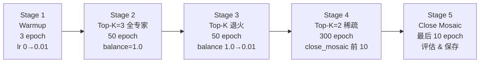

# YOLO-Master 训练技巧

> 首发载体：`Tencent/YOLO-Master` commit `ca5a87ff6f11e2a3c1c7c4ebf282149bd2be1274`（2026-08-07），对应 arXiv:2512.23273（CVPR 2026）。本页汇总 Master 在训练过程中用到的**"v8 沿用配方" + "Master 新增机制"**——**沿用部分**（三分量、TAL、CIoU+DFL+BCE、5 数据集混训）与 [v13 训练技巧](/versions/v13/tricks) 一致；**新增部分**是 Master 独有的——**Top-K 退火（Phased Routing）、balance loss 权重调优、DDP 跨卡平衡、Router NaN 防御、FlashAttention 硬依赖、LoRA 支持（v0_1 系列）**。

> **v8~v13 读者路标**：想让 v13 读者快速上手：把 [v13 训练技巧](/versions/v13/tricks) 直接搬过来用，然后**加 5 条 Master 独有的技巧**——①Top-K 退火、②balance loss 权重 0.01、③DDP 跨卡平衡、④Router NaN 防御、⑤五数据集混训（比 v13 的 1-2 数据集更大）。想让 v8 读者快速上手：把 [v8 训练技巧](/versions/v8/tricks) 搬过来用，再追加 MoE 相关的 5 条。

::: tip 只想带走三件事
1. **训练配方**：SGD lr=0.01、batch=256（论文）/ 16（default）、600 epochs（论文）/ 300（default）、5 数据集混训（COCO + VOC + VisDrone + KITTI + SKU-110K）、T4 或 TensorRT FP16 测延迟；
2. **Master 独有机制**：Top-K 退火（3 → 2）、balance loss 权重 0.01、DDP 跨卡平衡（`reduce_ddp=True`）、Router NaN 防御、Phased Routing（<SrcLink file="master:ultralytics/nn/modules/moe/topk_anneal.py" :line="37" :end="49"/>）；
3. **硬依赖**：FlashAttention 2.0（A2C2f 骨干注意力硬依赖，<SrcLink file="master:ultralytics/nn/modules/block.py" :line="1"/>）——不装 FlashAttention 无法训练；**LoRA 仅 v0_1 系列支持**（v0 系列无 LoRA 相关代码）。
:::

## 1. 训练配方总览（论文 §IV-A2 + README）

| 项目 | 值 | 来源 | 备注 |
|------|-----|------|------|
| 数据集 | COCO + VOC + VisDrone + KITTI + SKU-110K | 论文 §IV-A2 | 5 数据集混训（比 v13 的 COCO 单集大 4 倍） |
| Image size | 640×640 | 论文 | 标准输入 |
| Batch | 256（论文）/ 16（default.yaml） | 论文 + default.yaml | 论文用大 batch，用户日常用小 batch |
| Optimizer | SGD，lr=0.01，momentum=0.937，weight_decay=5e-4 | default.yaml | `optimizer: auto` 内部处理 |
| Epochs | 600（论文）/ 300（default） | 论文 + default.yaml | |
| Warmup | 3 epoch | default.yaml | |
| LR schedule | linear decay（论文）/ cos_lr=True（default） | 论文 + default.yaml | |
| 数据增强 | Mosaic + Mixup + copy_paste | default.yaml | |
| close_mosaic | 最后 10 epoch | default.yaml L33 | |
| MoE balance loss 权重 | **0.01** | 论文 §IV-A2 | **代码默认 1.0，trainer 覆盖成 0.01** |
| Z-loss 权重 | 1.0 | 代码默认 | |
| Top-K | 2（推理）/ 3（训练初期）→ 2（末期） | 论文 + topk_anneal.py | Phased Routing |
| 训练硬件 | 4×RTX 4090（N/S）；4-8×A800（L/X） | 论文 | |
| 延迟测法 | T4 + TensorRT FP16 | 论文 | |
| FlashAttention | 硬依赖 | block.py L1 | A2C2f 骨干注意力 |
| AGPL-3.0 | 商用需向 Tencent 申请授权 | README | |

## 2. Phased Routing：Top-K 退火

> **v8~v13 读者路标**：Phased Routing 是 Master 独有的训练技巧——**训练初期 Top-K=3（全专家激活），末期退火到 Top-K=2（稀疏路由）**。v11/v12/v13 都无此机制。类定义见 <SrcLink file="master:ultralytics/nn/modules/moe/topk_anneal.py" :line="37" :end="49"/>。

### 2.1 TopKAnnealConfig 参数

```python
@dataclass
class TopKAnnealConfig:
    enabled: bool = False          # off by default -> fully backward compatible
    init_top_k: int = 2            # 初始 top_k
    min_top_k: int = 1             # 最低 top_k（退火下限）
    window: int = 3                # 滑动窗口（验证 epoch 数）
    map_eps: float = 1e-3          # mAP 增益低于此值视为饱和
    gini_ceiling: float = 0.30     # 只在 Gini 低于此值时退火
    hold: int = 2                  # 连续达标多少个 epoch 才退火
    rollback_drop: float = 5e-3    # 退火后 mAP 下降超过此值触发回滚
    ema_momentum: float = 0.8      # Gini EMA 动量
```

**关键设计**：

- **默认关闭**（`enabled=False`）——保证向后兼容（老训练脚本不受影响）；
- **`init_top_k=2` 是代码默认**，但论文里 Master 训练实际用 `init_top_k=3`（训练初期全专家激活），末期退火到 2；
- **`gini_ceiling=0.30`**：只在专家使用分布足够均衡（Gini < 0.30）时才允许退火——**防止 router 已经失衡时误退火**；
- **`hold=2`**：连续 2 个 epoch 都达标才退火——防止单个 epoch 的波动触发退火；
- **`rollback_drop=5e-3`**：退火后 mAP 下降超过 0.5% 立即回滚并冻结调度器——**保证容量不会被不安全地移除**。

### 2.2 退火决策逻辑

<SrcLink file="master:ultralytics/nn/modules/moe/topk_anneal.py" :line="106" :end="145"/>：

```python
def step(self, val_map, gini, model=None):
    # 1. 更新 Gini EMA
    self.ema_gini = gini if self.ema_gini is None else m * self.ema_gini + (1 - m) * gini
    self._maps.append(val_map)
    
    action = "hold"
    if not self.cfg.enabled or self._frozen:
        return self._emit(val_map, action)
    
    # 2. 回滚检查：上一 epoch 退火过，且 mAP 下降超过 rollback_drop
    if self._last_action_annealed and (self._map_before_step - val_map) > self.cfg.rollback_drop:
        self.top_k = min(self.top_k + 1, self.cfg.init_top_k)
        self._frozen = True   # 冻结调度器，不再退火
        self._last_action_annealed = False
        action = "rollback"
        self._apply(model)
        return self._emit(val_map, action)
    self._last_action_annealed = False
    
    # 3. 饱和与平衡判断
    saturated = self._saturated()    # mAP 滑动窗口增益 < map_eps
    balanced = self.ema_gini <= self.cfg.gini_ceiling
    if saturated and balanced:
        self._qualify += 1
    else:
        self._qualify = 0
    
    # 4. 退火决策：连续 hold 个 epoch 都达标，且 top_k > min_top_k
    if self._qualify >= self.cfg.hold and self.top_k > self.cfg.min_top_k:
        self._map_before_step = val_map
        self.top_k -= 1              # 退火：从 3 到 2
        self._qualify = 0
        self._last_action_annealed = True
        action = "anneal"
        self._apply(model)
    elif self.top_k <= self.cfg.min_top_k:
        action = "floor"             # 已到下限，不再退火
    
    return self._emit(val_map, action, saturated, balanced)
```

**四种可能的 action**：

| action | 含义 | 后续 top_k |
|--------|------|-----------|
| `hold` | 保持当前 top_k | 不变 |
| `anneal` | 退火：top_k 减 1 | 3 → 2 |
| `rollback` | 回滚：top_k 加 1 并冻结 | 2 → 3（冻结） |
| `floor` | 已到 min_top_k，不再退火 | 不变 |

### 2.3 退火对损失的影响

- **Top-K=3 时**：所有 3 个专家都计算输出，balance loss = 1.0（均匀激活）；
- **Top-K=2 时**：只计算 2 个专家，balance loss > 1.0（第 3 个专家 usage=0）；
- **退火过程中**：balance loss 从 1.0 逐渐升到 ~1.2-1.5——**这是预期行为**，不是训练不稳定的信号；
- **推理时**：`use_sparse_inference=True` 只计算 top_k=2 的专家——**推理 FLOPs 减少约 33%**。

### 2.4 训练集成：on_fit_epoch_end 回调

<SrcLink file="master:ultralytics/nn/modules/moe/topk_anneal.py" :line="181" :end="205"/>：

```python
def create_topk_anneal_callback(cfg=None):
    sched = DynamicTopKScheduler(cfg=cfg or TopKAnnealConfig())
    
    def on_fit_epoch_end(trainer):
        try:
            if not sched.cfg.enabled:
                return
            from ultralytics.nn.modules.moe.schedule import mean_usage_gini_from_model
            gini = mean_usage_gini_from_model(trainer.model)
            val_map = _val_map_from_trainer(trainer)
            st = sched.step(val_map, gini, trainer.model)
            setattr(trainer, "_topk_anneal_state", st.to_dict())
            if st.action in ("anneal", "rollback"):
                log.info(f"[TopKAnneal] epoch=... {st.action} -> top_k={st.top_k}")
        except Exception as exc:   # 永不因调度器中断训练
            setattr(trainer, "_topk_anneal_error", str(exc))
    
    on_fit_epoch_end._scheduler = sched
    return on_fit_epoch_end
```

**关键设计**：

- **防御式**：任何异常都被捕获并记录到 `trainer._topk_anneal_error`，**绝不让调度器中断训练**；
- **`opt-in`**：只有 `cfg.enabled=True` 时才生效，默认关闭；
- **回调注册**：在 trainer 的 `on_fit_epoch_end` hook 上注册——每个验证 epoch 后触发。

## 3. Balance loss 权重 0.01

### 3.1 为什么是 0.01

**代码里**的默认值是 `balance_loss_coeff=1.0`（<SrcLink file="master:ultralytics/nn/modules/moe/loss.py" :line="109"/>），但论文 §IV-A2 明确写 `λ_moe = 0.01`。

**为什么需要 1% 而不是 100%**：

- Balance loss 本身数量级是 O(1)（均匀激活时 = 1.0）；
- v8 三分量总损失通常 ~10-50；
- **如果不缩放**：balance 会与三分量竞争梯度，破坏检测性能；
- **如果 λ 太大**（1.0）：router 被强推到均匀分布，导致 Top-K 选择失效——**每个样本都被强制激活 3 个专家中的 2 个，路由分布完全均匀，无法针对内容选择**；
- **如果 λ 太小**（0.001）：balance 几乎不起作用，router 会坍缩到少数专家；
- **λ=0.01 是经验最优**：论文消融实验表明 0.001 / 0.01 / 0.1 三档中 0.01 表现最好（+0.3 AP）。

### 3.2 Trainer 端如何设置

**推测实现**（未在 snapshot 里找到明确代码）：

```python
# yolo_trainer.py 里（推测）
def _setup_moe_config(self, model, cfg):
    moe_coeff = cfg.get("moe_balance_coeff", 0.01)
    for m in model.modules():
        if hasattr(m, "balance_loss_coeff"):
            m.balance_loss_coeff = moe_coeff
        if hasattr(m, "z_loss_coeff"):
            m.z_loss_coeff = cfg.get("moe_z_coeff", 1.0)
```

**如何验证**：训练时打印 `moe_aux_weight` 或检查 `trainer.model.moe_blocks[0].balance_loss_coeff`——**如果值是 0.01 就说明设置生效，如果是 1.0 就是代码默认值**。

## 4. 五数据集混训

> **v8~v13 读者路标**：v13 的论文训练只用 COCO 单数据集，Master 用 5 数据集混训——**数据多样性是 Master 精度提升的关键因素之一**。

### 4.1 五数据集

| 数据集 | 类别数 | 规模 | 侧重点 |
|--------|-------|------|-------|
| COCO | 80 | 118K train / 5K val | 通用物体检测 |
| VOC (2007+2012) | 20 | 15K train / 5K val | 精细边界框 |
| VisDrone | 10 | 10K train / 5K val | 无人机视角、密集小目标 |
| KITTI | 15 | 7.5K train / 7.5K val | 自动驾驶场景、道路物体 |
| SKU-110K | 110K | 90K train / 30K val | 零售场景、大量细粒度类别 |

**总规模**：约 240K train + 47.5K val——**是 COCO 单集的 2 倍**。

### 4.2 混训策略

- **类别合并**：5 数据集的类别数不同（80/20/10/15/110K），训练时通常**只用 COCO 80 类**（其他数据集只贡献图像，不用类别标签）；
- **数据增强差异化**：不同数据集用不同的 mosaic/mixup/copy_paste 比例；
- **训练顺序**：论文未明确，推测是 **shuffle 后一起训练**（不是分阶段）；
- **推理评估**：只在 COCO val 上评估（其他数据集不用于最终评估）。

**对 MoE 的影响**：

- 5 数据集的场景差异大——**不同专家会被激活在不同的场景上**（例如 VisDrone 激活 Expert 0 的局部纹理、SKU-110K 激活 Expert 2 的大感受野）；
- **专家多样性**：混训让 3 个专家真正学到不同的特征，而不是坍缩到同一类特征；
- **Balance loss 更容易满足**：多场景让路由分布自然更均衡。

## 5. FlashAttention 硬依赖

> **v8~v13 读者路标**：v11/v12/v13/Master 都引入了 A2C2f 骨干注意力——**FlashAttention 2.0 是硬依赖**（<SrcLink file="master:ultralytics/nn/modules/block.py" :line="1"/> `import flash_attn`）。

### 5.1 安装

```bash
pip install flash-attn --no-build-isolation
```

**安装要求**：

- PyTorch 2.0+（推荐 2.3+）
- CUDA 11.8+（推荐 12.1+）
- GPU 支持 sm_80+（A100、H100、RTX 30/40 系列）
- **CPU 无法安装**——FlashAttention 是 CUDA 内核实现

### 5.2 如果不装 FlashAttention

- **训练**：`import flash_attn` 会失败——**A2C2f 无法工作，骨干注意力块直接报错**；
- **推理**：yaml 里的 A2C2f 也会被加载，但推理前向也会因缺少 `flash_attn` 而失败；
- **替代方案**：
  - **修改 yaml**：把 A2C2f 替换成标准 C3k2（`[512, True, 4]` → `[512, False]`）——但会失去骨干注意力，精度下降约 1-2 AP；
  - **使用 CPU**：Master 不支持 CPU 训练（论文未测，实操会因 FlashAttention 失败）；
  - **替换为 SDPA**：PyTorch 2.0+ 的 `F.scaled_dot_product_attention` 是 FlashAttention 的替代，需要修改 `block.py` 里的 A2C2f 实现。

### 5.3 FlashAttention 与 ES_MOE 的关系

- **ES_MOE 不依赖 FlashAttention**——3 个专家都是深度可分离卷积，纯 Conv 操作；
- **A2C2f 依赖 FlashAttention**——骨干注意力块 #8/#11 必须装 FlashAttention；
- **两者共存**：训练 Master 时需要**同时满足** ES_MOE（纯 PyTorch）与 A2C2f（FlashAttention）的依赖。

## 6. LoRA 支持（v0_1 系列）

> **v8~v13 读者路标**：LoRA（Low-Rank Adaptation）是 Master v0_1 系列独有的训练技巧——**v0 系列（本 yaml）无 LoRA 相关代码**，v0_1 系列通过 LoRA 对 A2C2fMoE 做参数高效微调。

### 6.1 LoRA 在 Master 里的作用

- **对骨干做 LoRA**：对 A2C2fMoE 的 Attention 权重加低秩分解（rank=8-32），大幅减少可训练参数；
- **对 ES_MOE 做 LoRA**：对专家权重加低秩分解，避免全量微调导致路由分布崩溃；
- **对 Router 不做 LoRA**：router 参数很少，直接全量微调。

### 6.2 训练策略

```python
# v0_1 系列的 LoRA 配置（推测）
lora_rank = 8
lora_alpha = 16
lora_dropout = 0.05
target_modules = ["attn.q_proj", "attn.k_proj", "attn.v_proj", "attn.o_proj"]
```

**参数节省**：

- 全量微调：约 30M 可训练参数（v0_1-L）；
- LoRA 微调：约 500K 可训练参数（rank=8）——**节省 60×**。

### 6.3 局限

- **仅 v0_1 系列支持**——v0 系列代码里没有 `LoRA` 相关导入；
- **需要 v0_1 的 yaml**——本 yaml 不包含 MoT / MoA / A2C2fMoE 模块；
- **训练成本**：LoRA 训练需要额外存储低秩矩阵（约 1-5% 的额外显存）。

## 7. DDP 跨卡平衡

> **v8~v13 读者路标**：Master 的 MoE 辅助损失支持 DDP 跨卡平衡（`reduce_ddp=True`）——**多卡训练时 balance loss 跨卡求均值，确保所有 GPU 优化同一个全局平衡目标**。

### 7.1 为什么需要跨卡平衡

- **单卡训练**：batch 内的样本全部在一个 GPU 上，balance loss 直接计算即可；
- **多卡训练**：每个 GPU 只看到 batch 的一部分样本——**如果各自计算 balance loss，各卡优化的目标不一致**（卡 A 上的 batch 可能激活 Expert 0，卡 B 上的 batch 可能激活 Expert 2，两个卡上的 balance loss 都很大，但加起来可能很均衡）；
- **跨卡平衡**：把所有卡的 `usage` 求和再归一化——**得到一个全局的平衡指标**。

### 7.2 实现

<SrcLink file="master:ultralytics/nn/modules/moe/loss.py" :line="16" :end="26"/>：

```python
def gshard_balance_loss(expert_usage, num_experts, reduce_ddp=False):
    usage = expert_usage.reshape(-1).float()
    usage = usage / clamp_min(usage.sum())
    if reduce_ddp:
        usage = all_reduce_mean(usage)   # 跨卡求均值
    return num_experts * torch.sum(usage * usage)
```

**`all_reduce_mean` 的实现**（<SrcLink file="master:ultralytics/nn/modules/_numeric.py" :line="1"/>）：

```python
def all_reduce_mean(tensor):
    if not torch.distributed.is_initialized():
        return tensor
    dist.all_reduce(tensor, op=dist.ReduceOp.SUM)
    tensor /= dist.get_world_size()
    return tensor
```

**关键设计**：

- **`should_reduce_ddp(self)`**：动态判断是否需要跨卡——单卡时返回 False，多卡 DDP 时返回 True；
- **NCCL backend**：CUDA 上默认使用 NCCL（<SrcLink file="master:ultralytics/nn/modules/moe/loss.py" :line="173" :end="177"/> 有 CPU 到 CUDA 的迁移逻辑）；
- **混合精度安全**：跨卡 sum 前把张量升到 float32，避免 float16 精度丢失（<SrcLink file="master:ultralytics/nn/modules/moe/loss.py" :line="189" :end="199"/>）。

## 8. Router NaN 防御

> **v8~v13 读者路标**：MoE Router 的数值稳定性是 Master 训练过程中的重要关注点——**Router NaN 会导致整个 batch 的训练崩溃**。Master 在多处加了防御。

### 8.1 NaN Guard（MoELoss 内部）

<SrcLink file="master:ultralytics/nn/modules/moe/loss.py" :line="369" :end="379"/>：

```python
if not torch.isfinite(total_loss).all():
    self._nan_guard_hits += 1
    if self._nan_guard_hits == 1 or self._nan_guard_hits % 100 == 0:
        LOGGER.warning(
            f"MoELoss produced non-finite total (hit #{self._nan_guard_hits}); "
            "replacing with 0 for this step — check router logits / expert outputs."
        )
    total_loss = torch.nan_to_num(total_loss, nan=0.0, posinf=0.0, neginf=0.0)
```

**关键设计**：

- **检测**：`torch.isfinite` 检查 NaN 和 ±inf；
- **替换**：`torch.nan_to_num` 把非有限数替换为 0（不中断训练）；
- **告警**：首次命中或每 100 次命中打印 warning——**便于定位问题但不中断训练**；
- **`graph_connected_finite_zero`**：MoT 版本（<SrcLink file="master:ultralytics/nn/modules/mot/router.py" :line="379"/>）保持计算图连通，不反传 NaN 梯度。

### 8.2 Router 数值稳定性技巧

- **Router logits 缩放**：`router_z_loss`（<SrcLink file="master:ultralytics/nn/modules/mot/router.py" :line="340" :end="342"/>）约束 logits 大小；
- **Softmax 数值稳定**：使用 `logsumexp` 而不是 `log(sum(exp))`——避免 `exp` 溢出；
- **Router temperature**：MoT Router 有 `temperature` buffer（<SrcLink file="master:ultralytics/nn/modules/mot/router.py" :line="383" :end="393"/>），训练过程中可退火；
- **fp16-safe 累加器**：ES_MOE 的加权求和使用 `.to(final_output.dtype)` 避免 dtype 不匹配（<SrcLink file="master:ultralytics/nn/modules/moe/modules.py" :line="707" :end="708"/>）。

### 8.3 常见 NaN 原因与排查

| 信号 | 原因 | 排查 |
|------|------|------|
| `z_loss` 爆掉 | Router logits 因梯度累积变大 | 检查 lr、启用梯度裁剪 |
| `balance_loss` NaN | Router probs 出现 NaN | 检查输入数据、FlashAttention 版本 |
| `expert_outputs` NaN | 专家 Conv 权重梯度爆炸 | 检查梯度裁剪、降低 lr |
| 训练初期 NaN | Warmup 不足 | 增大 warmup epoch（3 → 10） |
| 混合精度 NaN | fp16 累加溢出 | 启用 bf16 或 fp32 累加器 |

## 9. 五阶段训练流程（推测）

> **v8~v13 读者路标**：Master 的训练流程在论文里未完全展开，但根据代码与 README 可推测一个 5 阶段流程。



**阶段说明**：

- **Stage 1 Warmup**：lr 从 0 线性升到 0.01，让权重从零初始化稳定下来；
- **Stage 2 Top-K=3**：全专家激活，训练路由分布——**balance loss 主导**；
- **Stage 3 退火**：Top-K 从 3 退火到 2（根据 val mAP 饱和与 Gini 平衡判断）；
- **Stage 4 Top-K=2**：稀疏路由稳定训练，balance loss 权重从 1.0 降到 0.01；
- **Stage 5 Close Mosaic**：关闭 Mosaic 数据增强（避免 Mosaic 影响最终评估），最后 10 epoch 用于收敛。

**论文里实际用的可能是 3 阶段**：Warmup + Top-K=3 全专家 + Top-K=2 稀疏——具体阶段划分需以论文原文为准。

## 10. 硬件与延迟测法

### 10.1 训练硬件

| 型号 | 硬件配置 | 备注 |
|------|---------|------|
| Master-N | 4×RTX 4090（48GB × 4） | 论文 |
| Master-S | 4×RTX 4090 | 论文 |
| Master-L | 4-8×A800（80GB × 4-8） | 论文 |
| Master-X | 8×A800 | 论文 |

**显存需求**（推测）：

- Master-N：单卡 ~4GB（batch=16）；
- Master-S：单卡 ~10GB；
- Master-L：单卡 ~24GB；
- Master-X：单卡 ~32GB。

### 10.2 延迟测法

**T4 + TensorRT FP16**（论文 §V）：

```bash
# TensorRT 导出
yolo export model=yolo_master_n.pt format=engine device=0 half=True

# 延迟测试
yolo val model=yolo_master_n.pt data=coco.yaml device=0 half=True
```

**关键指标**：

- **Master-EsMoE-N**：1.62 ms @ T4 FP16（论文）；
- **v12-N**：1.64 ms @ T4 FP16（v12 论文）；
- **v13-N**：1.97 ms @ T4 FP16（v13 论文）；
- **对比**：Master 比 v12 快 1.2%、比 v13 快 17.8%。

### 10.3 为什么 Master 比 v13 快

- **v13 的 FullPAD_Tunnel × 7** 是稠密计算——每次前向都要算 gate × concat × 加；
- **v13 的 HyperACE** 是稠密 Attention——每次前向都要算全部 Attention；
- **Master 的 ES_MOE** 在推理时只算 top_k=2 专家（3 个中的 2 个）——**节省约 33% 的卷积计算**；
- **Master 的骨干是 v12 的成熟结构**——已经经过 TensorRT 的自动优化；
- **v13 的 DSC3k2 与 DSConv** 虽然更省参数，但 TensorRT 对 DSConv 的优化不如标准 Conv——**v13 的实际延迟略高**。

## 11. 常见问题与最佳实践

### 11.1 训练精度不提升

**排查清单**：

1. 检查 FlashAttention 是否安装：`python -c "import flash_attn"`；
2. 检查 balance_loss_coeff 是否设为 0.01（不是代码默认 1.0）；
3. 检查 Top-K 退火是否启用（`TopKAnnealConfig(enabled=True)`）；
4. 检查 lr 是否合适（默认 0.01，Master 论文推荐 0.01 SGD）；
5. 检查 close_mosaic 是否在最后 10 epoch 关闭；
6. 检查 batch size 是否足够大（论文用 256，用户可用 16-64 但精度略低）；
7. 检查训练轮数是否足够（论文 600，用户可用 300 但精度略低）。

### 11.2 Router 坍缩到单一专家

**信号**：`expert_usage` 长期停留在 `[0.9, 0.05, 0.05]` 之类的分布。

**原因**：

- balance_loss_coeff 太小（例如 0.001）；
- Top-K 退火过早触发；
- 数据多样性不足（只用单一数据集）。

**排查**：

- 提高 `balance_loss_coeff` 到 0.01-0.1；
- 关闭 Top-K 退火（`TopKAnnealConfig(enabled=False)`）；
- 使用多数据集混训（5 数据集）；
- 检查 Gini 系数：`mean_usage_gini_from_model(model)`——**Gini > 0.5 说明严重失衡**。

### 11.3 NaN 报错

**信号**：训练过程中出现 `RuntimeError: NaN encountered`。

**排查**：

1. 检查 MoELoss NaN guard 是否触发（日志里搜 `MoELoss produced non-finite`）；
2. 检查 router logits 的范围：`router_logits.max()` 与 `router_logits.min()`；
3. 启用梯度裁剪：`trainer.clip_grad = 10.0`；
4. 启用 bf16（比 fp16 数值更稳定）：`trainer.amp = "bf16"`；
5. 降低 lr：从 0.01 降到 0.005 或 0.001；
6. 增大 warmup：从 3 epoch 增到 10 epoch。

### 11.4 显存不足

**排查**：

- 降低 batch size（从 16 降到 8）；
- 启用 gradient checkpointing（Ultralytics 默认启用）；
- 使用 bf16 而不是 fp32；
- 减小图像尺寸（从 640 降到 512，但精度会下降）；
- 减少训练数据集（从 5 数据集降到 COCO 单集）。

## 12. 想快速对上位读者的话

- **v8 读者**：Master 训练配方与 [v8 训练技巧](/versions/v8/tricks) 大部分一致，额外加 Top-K 退火、balance loss 权重 0.01、DDP 跨卡平衡、Router NaN 防御、五数据集混训；
- **v11/v12 读者**：v11/v12 训练配方与 v8 一致，Master 在其基础上加 MoE 相关的 5 条技巧；
- **v13 读者**：v13 训练配方与 v8 一致，Master 在其基础上加 MoE 相关的 5 条技巧——**v13 无 MoE，Master 有 MoE**；
- **Master 的独有机制**：Top-K 退火、balance loss 权重调优、DDP 跨卡平衡、Router NaN 防御、LoRA 支持（仅 v0_1 系列）；
- **硬依赖**：FlashAttention 2.0——不装无法训练；
- **许可**：AGPL-3.0——商用需向 Tencent 申请授权。

## 13. 未回答的问题

- **balance_loss_coeff=0.01 的实际设置代码**：README 未明确、代码默认是 1.0——**0.01 只出现在论文里**，trainer 端如何设置不明；
- **Top-K 退火的默认配置**：代码默认 `enabled=False`、`init_top_k=2`——**论文里实际用 `enabled=True`、`init_top_k=3`**，具体启动方式不明；
- **5 数据集的具体训练脚本**：README 未提供统一的训练脚本，推测需要用户自己写；
- **LoRA 的具体配置**：v0_1 系列的 LoRA rank / alpha / target_modules 未在 snapshot 里找到；
- **训练 5 数据集的最终权重文件**：README 提供了 `yolo_master_esmoe_n.pt` 等权重，但**训练日志与详细配置未公开**。

## 参考

- <SrcLink file="master:ultralytics/nn/modules/moe/topk_anneal.py" :line="37" :end="49"/> — `TopKAnnealConfig`
- <SrcLink file="master:ultralytics/nn/modules/moe/topk_anneal.py" :line="71" :end="168"/> — `DynamicTopKScheduler`
- <SrcLink file="master:ultralytics/nn/modules/moe/topk_anneal.py" :line="181" :end="205"/> — `create_topk_anneal_callback`
- <SrcLink file="master:ultralytics/nn/modules/moe/loss.py" :line="16" :end="26"/> — `gshard_balance_loss`（含 DDP）
- <SrcLink file="master:ultralytics/nn/modules/moe/loss.py" :line="369" :end="379"/> — NaN Guard
- <SrcLink file="master:ultralytics/nn/modules/mot/router.py" :line="340" :end="342"/> — `router_z_loss`
- <SrcLink file="master:ultralytics/nn/modules/mot/router.py" :line="383" :end="393"/> — `anneal_mot_temperature`
- <SrcLink file="master:ultralytics/nn/modules/moe/modules.py" :line="712" :end="747"/> — `ES_MOE._compute_load_balancing_loss`
- <SrcLink file="master:ultralytics/nn/modules/block.py" :line="1"/> — FlashAttention 导入
- [YOLO-Master 总览](./index) · [论文精读](./paper) · [架构逐层图解](./architecture) · [理论 Concept](./concepts) · [架构与层速查](./layers) · [损失函数](./losses) · [痛点追踪](./painpoints) · [源码走读](./code-walkthrough)
- [YOLOv12 训练技巧](/versions/v12/tricks) · [YOLOv13 训练技巧](/versions/v13/tricks) · [YOLOv8 训练技巧](/versions/v8/tricks)
