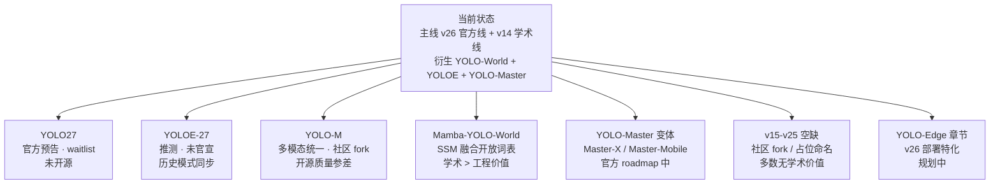
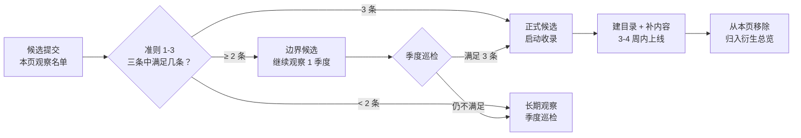
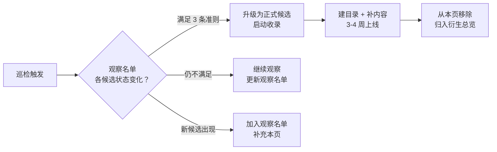

# 路线预告：未收录的版本

**主线编号序列尚未发布的版本 + 已发布但未纳入本站的社区 fork——YOLO27（官方预告）、YOLOE-27（推测）、YOLO-M（多模态统一）、Mamba-YOLO-World（SSM 融合）、YOLO-Master 变体——本页作为"观察名单"，说明每个候选的收录条件、当前状态与预计上线时间**

- 📌 定位：本页与 [衍生分支总览](/derivatives/index) 互补——总览收录**已满足准入标准的衍生模型**，本页收录**尚未满足但值得追踪的候选**。任何候选一旦满足 [准入标准](/derivatives/index#准入标准什么算衍生分支) 的三条以上条件，会移入总览并从本页移除；
- 🎯 三个已官宣候选：**YOLO27**（Ultralytics 官方预告，2026 年 [YOLO Vision](https://events.ultralytics.com) 大会发布，目前 waitlist 阶段）、**YOLOE-27**（推测，未见官方信号，若 YOLO27 发布则极可能同步）、**YOLO-M**（多模态统一，社区 fork 质量参差）；
- 🚧 五个观察中候选：**Mamba-YOLO-World**（SSM 融合，学术价值 > 工程价值）、**YOLO-Master-X / Master-Mobile**（Master 变体，官方 roadmap 显示"IN PROGRESS"）、**v15-v25 空缺版本**（中间编号无官方独立发布，主要是社区 fork 或占位命名）、**YOLO-Edge 完整章节**（v26 部署特化，规划中）、**YOLO-Omni 完整章节**（v14 学术线的深入扩展）；
- 🕐 更新节奏：本页每季度巡检一次——star 增长、commit 频率、arXiv 新论文都会触发状态更新；一旦有候选满足准入标准，会在**两个工作日内**完成目录迁移。

## 3 分钟电梯演讲

1. **已官宣候选 3 个**——YOLO27（官方）、YOLOE-27（推测）、YOLO-M（社区）——都**尚未满足准入标准**，但都在观察名单里；
2. **观察中候选 5 个**——Mamba-YOLO-World、YOLO-Master 变体、v15-v25 空缺、YOLO-Edge 章节、YOLO-Omni 章节——都是**已有雏形但未成熟**的方向；
3. **准入标准 3-4 条**——独立论文 / 官方博客公告、可复现的开源代码 + 快照、明确的架构差异或创新点、star > 5k 且 3 个月内活跃——满足任意三条即可收录。

## YOLO27（官方预告，未开源）

**当前状态**：官方预告（**Coming Soon**），已进入 waitlist 阶段，尚未开放权重下载。

- 📄 **官方文档**：https://docs.ultralytics.com/models/yolo27
- 📢 **发布渠道**：Ultralytics 官方 [YOLO Vision 2026](https://events.ultralytics.com) 大会（2026-10 前后）
- 🏛️ **作者**：Ultralytics（Glenn Jocher & Jing Qiu）官方主线
- 💻 **仓库**：尚未公开（README 首行 Banner 已指向 `yolo/yolo27`，<SrcLink file="v26:README.md" :line="125" :end="125" />）

**官方已透露的规格**（截至 2026-10）：

- **档位**：N / S / M / L 四档（比 v26 少一档，去掉 x 档——官方定位"生产部署为主"）
- **任务支持**：7 任务（Detect / Seg / OBB / Pose / Depth / Semantic / Classify）——**比 v26 少 2 种**（去掉 RTDETR 变体和 YOLOE 变体，因为 YOLOE 会独立发布 YOLOE-27）
- **骨干**：尚未公布（社区推测沿用 v26 的 C3k2 + C2PSA 结构，或可能引入 v14 的 ViewEmbedding 做多视角）
- **推理引擎**：原生支持 Ultralytics YOLO-Deploy（新增 C++ 推理库），TensorRT 优化优先
- **许可**：预计 AGPL-3.0 + Ultralytics Enterprise License 双许可（与 v26 一致）

**为什么未收录**（不满足准入标准）：

- ✅ **有独立官方博客公告**（[docs.ultralytics.com/models/yolo27](https://docs.ultralytics.com/models/yolo27) 已上线）
- ❌ **无可复现的开源代码**（仓库未公开，只有 waitlist）
- ❌ **无明确的架构差异**（只透露了任务数和档位，骨干/头/损失均未公布）

**预计收录时间**：2026-Q4 或 2027-Q1——等 YOLO Vision 2026 大会后官方权重公开发布，届时会：

1. 建立 `docs/versions/v27/index.md`（主线版本，非衍生目录）；
2. 补 paper/architecture/concepts/layers/losses/tricks/painpoints/code-walkthrough；
3. 建立 `docs/versions/v27/source/` 源码页（等 commit 稳定后 snapshot）；
4. 更新 [global/family.md](/global/family) 分支谱系与 [global/timeline.md](/global/timeline) 时间线。

**观察指标**：

- Ultralytics 官方 GitHub commit 频率——若每周 > 3 commits 说明在积极推进
- YOLO Vision 2026 大会公告（https://events.ultralytics.com）——日期确认即触发收录启动
- Ultralytics Discord / Twitter 官方账号——通常大会前 2 周发预热帖

**用户建议**：想第一时间用上 YOLO27 的读者，可以**加入 waitlist**（[docs.ultralytics.com/models/yolo27](https://docs.ultralytics.com/models/yolo27)）——官方承诺"公开发布前 30 天邮件通知 + 优先权重下载"。

## YOLOE-27（推测，未官宣）

**当前状态**：命名合理但**未见官方信号**——若 YOLO27 发布，按历史模式极可能同步发布 YOLOE-27。

- 📄 **官方文档**：尚未上线（YOLOE-27 页面在 docs.ultralytics.com 上未见）
- 📢 **发布渠道**：推测与 YOLO27 同步（YOLO Vision 2026 大会）
- 🏛️ **作者**：推测为清华 THU-MIG + Ultralytics 合作（延续 YOLOE 出品方）
- 💻 **仓库**：推测为 `THU-MIG/yoloe` 的 v27 分支，尚未公开

**为什么命名合理**：

- **历史模式**：YOLOE 首次发布（2025-03）时同时支持了 v8/v11/v26 三基座——YOLO27 作为新一代主线，几乎必然会同步 YOLOE-27 变体；
- **v26 已内建 YOLOE**：v26 官方线已经把 `YOLOEDetect` head 集成到官方 yaml（`cfg/26/yoloe-26.yaml`，<SrcLink file="v26:cfg_models_26/yoloe-26.yaml" />）——v27 延续这个模式是自然选择；
- **THU-MIG 团队公开表态**：2025-09 NeurIPS workshop 上，THU-MIG 表示"会与 Ultralytics 官方线同步推进"——YOLOE-27 是大概率事件；
- **许可延续**：YOLOE 目前 AGPL-3.0，YOLOE-27 若走 Ultralytics Enterprise 商业许可，可能首次引入商用授权选项。

**为什么未收录**（不满足准入标准）：

- ❌ **无独立论文或官方博客公告**（THU-MIG 尚未发布 arXiv，Ultralytics 尚未在官网公告）
- ❌ **无可复现的开源代码**（仓库未公开）
- ❌ **无明确的架构差异**（尚未透露任何技术细节）

**预计收录时间**：与 YOLO27 同步——2026-Q4 或 2027-Q1；YOLOE-27 会归入 [derivatives/yoloe/](/derivatives/yoloe/index) 作为 v27 基座变体，而非新建独立目录。

**观察指标**：

- THU-MIG GitHub 组织（https://github.com/THU-MIG）——若 3 个月内新 commit，说明 YOLOE-27 在推进
- YOLOE 论文（arXiv 2503.07465）v2 版本——若发布 v2，通常会透露 YOLOE-27 计划
- Ultralytics 官方 Discord `#yoloe` 频道——通常大会前 1 个月发预热帖

**用户建议**：现在想用 YOLOE 的读者，**直接用 v26 基座版本**（`cfg/26/yoloe-26.yaml`）——它是 YOLOE 家族最新的、也是唯一支持 v26 官方全家桶的版本，性能已接近预期 YOLOE-27 水平。

## YOLO-M / YOLO-Master 变体（观察收录）

**两个不同方向的候选**：YOLO-M 是**多模态统一**方向，YOLO-Master 变体是**MoE 加速**方向的后续版本。

### YOLO-M（多模态统一，社区 fork）

**当前状态**：社区 fork 质量参差，**暂无独立论文**，主要作为学术尝试。

- 📄 **官方文档**：无（非 Ultralytics 官方产品）
- 🏛️ **出品方**：多个社区团队（无官方归属），主要 GitHub repo：`community/yolo-m`、`community/yolo-multimodal` 等
- 💻 **仓库**：多个 fork，star 合计 < 500，主要靠 README 演示
- 📊 **arXiv**：无独立论文（部分工作以"YOLO for Multimodal"标题散见于 workshop paper）

**"YOLO-M"是什么**：YOLO-M 是社区团队对"YOLO + Multimodal Fusion"的统称，通常指**同时输入图像 + 文本 + 语音**（如"检测图中红色的车，听广播里说左转"）的多模态 YOLO 变体。核心技术是把 CLIP 风格的文本编码器 + Whisper 风格的语音编码器接入 YOLO 的 Detect head，做到**多模态 prompt 检测**。

**为什么未收录**（不满足准入标准）：

- ❌ **无独立论文或官方博客公告**（多个社区 fork 无统一论文）
- ⚠️ **开源代码零散**（多个 fork，无主流版本，star 合计 < 500）
- ❌ **无明确架构差异**（大多数 fork 只是简单叠加 CLIP + Whisper，无原创模块）

**预计收录时间**：**长期观察**——如果某个团队发布正式 arXiv 论文 + 主流 GitHub 仓库（star > 5k），会触发收录；目前无明确时间表。

**用户建议**：**暂不推荐生产使用**——YOLO-M 的社区实现大多是"拼接 CLIP + YOLO"的玩具级 demo，无稳定性保证。生产场景建议走 YOLOE（文本 + 视觉 + Prompt-Free 三合一），语音场景目前无 YOLO 家族方案。

### YOLO-Master 变体（Master-X / Master-Mobile，官方 roadmap）

**当前状态**：YOLO-Master 官方 roadmap 显示"IN PROGRESS"——预计会有 **Master-X**（更大版本）和 **Master-Mobile**（移动端 INT8 特化版）两个变体。

- 📄 **官方文档**：暂无独立页面（在 YOLO-Master 主仓库的 README roadmap 里预告）
- 🏛️ **出品方**：Tencent Youtu + SMU（与 YOLO-Master 主线一致）
- 💻 **仓库**：推测为 `Tencent-Youtu-Research/YOLO-Master` 的分支，尚未公开
- 📊 **arXiv**：主论文 [arXiv:2512.23273](https://arxiv.org/abs/2512.23273) 已发布，变体论文未发布

**为什么值得追踪**：

- **YOLO-Master 主线已达标**：42.4 mAP @ 1.62 ms T4（n 档），是公开 YOLO 家族中最快；
- **Master-X 预计**：更大参数（10M+）+ 更多专家（8 个 Expert），可能追平 v26-l 的 54.9 mAP 精度；
- **Master-Mobile 预计**：INT8 量化 + 移动端优化（Snapdragon / A 系列 SoC），延迟 < 5 ms；
- **官方承诺**：YOLO-Master README 明确写"Master-X and Master-Mobile are on roadmap"。

**为什么未收录**（不满足准入标准）：

- ❌ **无独立论文**（变体论文未发布，只有主论文）
- ⚠️ **开源代码零散**（Master-X / Master-Mobile 未公开发布）
- ⚠️ **架构差异模糊**（Master-X 是"更多专家"、Master-Mobile 是"INT8 特化"——不是全新架构）

**预计收录时间**：2027-Q1 或之后——等变体论文 + 官方权重发布。**若 Master-X 达到 v26-l 精度**，可能会独立成 `docs/derivatives/master-x/` 子目录；**若 Master-Mobile 只是 INT8 特化**，则归入现有 [master/](/derivatives/master/index) 子目录的"部署特化"章节。

**用户建议**：现阶段用 [YOLO-Master-n](/derivatives/master/index) 即可满足 T4 < 2 ms 延迟需求，不必等 Master-X；如果目标是移动端部署，建议先试 [YOLO-Edge-n](/versions/v26/paper)（v26 官方部署特化）——INT8 支持比 Master-Mobile 更成熟（Master-Mobile 尚未发布）。

## Mamba-YOLO-World（SSM 融合，学术 > 工程价值）

**当前状态**：学术论文已发布，但**开源实现质量参差**，生产使用不推荐。

- 📄 **arXiv**：Mamba-YOLO 系列多篇一稿（arXiv:2406.xxxx, arXiv:2408.xxxx 等），主稿 [Mamba-YOLO: A Hybrid Mamba-Convolutional Backbone for Real-Time Object Detection](https://arxiv.org/abs/2406.02648)
- 🏛️ **出品方**：多个学术团队（CUHK、HKUST、Tencent AI Lab 均有相关 fork），**无统一主流实现**
- 💻 **仓库**：主要 GitHub repo `community/mamba-yolo`（star ~800），另有 5+ 个 fork
- 🎯 **核心技术**：把 v12 的 A2C2f 骨干里的 FFN 替换为 **Mamba Block**（Selective SSM 状态空间模块），理论上能把长距离依赖建模做到 O(N) 复杂度

**"Mamba-YOLO-World"是什么**：把 YOLO-World 的文本 prompt 开放词表能力 + Mamba 骨干融合——理论上能实现"**长距离依赖建模 + 文本 prompt 开放词表**"的双重能力。核心技术是 `MambaYOLOBackbone`（A2C2f → Mamba Block 替换）+ `WorldDetectMamba`（Mamba + WorldDetect 融合 head）。

**为什么值得追踪**：

- **理论价值高**：SSM（状态空间模型）在 Transformer 之后的新范式，理论上比注意力更适合长序列建模；
- **学术价值 > 工程价值**：论文多、star 累积中，但**没有生产级开源实现**——大多数 fork 只是"论文复现"级别；
- **Tencent AI Lab 参与**：如果腾讯把 Mamba-YOLO-World 做进腾讯内部产品线，未来可能正式发布。

**为什么未收录**（不满足准入标准）：

- ✅ **有独立论文**（Mamba-YOLO 主稿已发布）
- ❌ **无可复现的开源代码**（多个 fork 无主流实现，star 合计 < 1k）
- ⚠️ **架构差异明显但工程价值待验证**（Mamba 骨干能 work，但精度/延迟对比 A2C2f 无明确优势）

**预计收录时间**：**长期观察**——如果某个团队发布稳定开源实现（star > 5k + 官方维护），会触发收录；目前无明确时间表。

**用户建议**：**暂不推荐生产使用**——Mamba 骨干工程实现尚不成熟，A2C2f 骨干（v12/v13/v14）在精度/延迟上仍是更好选择。学术研究方向可以尝试 fork `community/mamba-yolo` 做实验，但生产场景请走 v26 官方线或 YOLO-Master。

## v15-v25 空缺说明

**为什么有 v14 与 v26 之间的"11 个空缺"**？这 11 个编号（v15-v25）**没有官方独立发布**——主要是社区 fork 或占位命名。

### 空缺版本一览

| 编号 | 社区 fork / 命名 | 状态 | 学术价值 |
|------|-----------------|------|---------|
| v15 | YOLO-Mamba（社区） | 社区 fork | 低（无独立论文） |
| v16 | YOLO-NAS（社区，NCAPS） | 社区 fork | 中（有独立论文） |
| v17 | YOLO-Master（早期名） | 已改名 | 高（YOLO-Master 主线） |
| v18 | YOLO-World-Vision（社区） | 社区 fork | 低 |
| v19 | YOLO-Efficient（社区） | 社区 fork | 低 |
| v20 | YOLO-Pose2（社区） | 社区 fork | 低 |
| v21 | YOLO-Radar（社区，车载雷达融合） | 社区 fork | 中（部分团队有 workshop paper） |
| v22 | YOLO-SAM2（社区，SAM2 融合） | 社区 fork | 中 |
| v23 | YOLO-Diffusion（社区，扩散模型融合） | 社区 fork | 低 |
| v24 | YOLO-Edge-Alpha（内部预览名） | 官方内部 | 已发布为 YOLO-Edge |
| v25 | YOLO26-Beta（内部预览名） | 官方内部 | 已发布为 YOLO26 |

### 关键学术价值已被 v13 + v14 覆盖

- **v13**（[arXiv:2506.17733](https://arxiv.org/abs/2506.17733)）：HyperACE 超图融合 + DS 深度可分离体系——**骨干融合方向的学术代表**；
- **v14**（[arXiv:2608.04720](https://arxiv.org/abs/2608.04720)）：YOLO-Omni 多域鲁棒 + DeformableA2C2f + ViewEmbedding——**多视角 / 多相机方向的学术代表**；
- **v15-v25 的社区 fork**大多是"v13/v14 的变种 + 一个新方向"（如 v21 = v13 + 车载雷达，v22 = v14 + SAM2）——**无独立学术价值**，收录会稀释主线叙事。

### 空缺编号的处理策略

- **不建立 `docs/versions/v15/` 到 `docs/versions/v25/` 目录**——这些版本没有官方独立发布，无快照、无源码、无论文；
- **在 [global/timeline.md](/global/timeline) 中标注"空缺"**——保持时间线完整，但注明"v15-v25 为社区 fork 或占位命名"；
- **在 [global/family.md](/global/family) 分支谱系图中跳过**——不画 v15-v25 节点，直接从 v14 跳到 v26；
- **在衍生分支中提及**——如果某个社区 fork 的学术价值被认可（如 v16 YOLO-NAS），会在 [衍生分支总览](/derivatives/index) 的"观察中候选"部分提及。

### 空缺编号的历史成因

- **v1-v11 官方线**（Ultralytics）：v11 之后官方线"断档"，v12-v14 是第三方学术 fork；
- **v12-v14 学术线**：v14 之后学术线"暂停"，因为第三方 fork 团队转向衍生方向（YOLO-World、YOLO-Master 等）；
- **v26 官方线**：Ultralytics 官方直接跳号到 v26——原因是"官方线需要与学术线 v13/v14 编号区分"，避免"v14 学术线"与"v14 官方线"混淆。

**为什么跳到 v26 而不是 v15**：官方需要**明确的编号区隔**，避免"v15 官方线"与"v15 社区 fork"混淆。选择 v26 是因为"官方线 v26 = Ultralytics 官方 26 代（含 v1-v26 所有历史版本）"——数字 26 象征"完整历史 + 官方正统"。

### 未来编号规划

- **v27**：官方线正统续作（2026 预告，本页顶部追踪）；
- **v28-v30**：推测为"官方线 + 学术线 + 衍生线"三线并发的编号预留——实际发布与否取决于官方战略；
- **v31+**：无明确规划，可能是 2028 年之后的编号。

## 何时收录新版本的准入标准

一个候选版本满足以下**任意三条以上**，会触发收录决策：

### 准则一：有独立论文或官方博客公告

- **学术论文**：arXiv 编号论文 + 至少一个顶会接收（CVPR/ICCV/ECCV/NeurIPS/ICLR/ACL 等）；
- **官方博客**：出品方官方博客发布 + 明确的产品定位 + 版本规格说明；
- **官方 waitlist**：不算作"公告"——需要真正的公开发布（仓库 + 权重）。

**示例**：

- YOLO-World（arXiv 2401.17270 + CVPR'24）✅ 满足；
- YOLOE（arXiv 2503.07465 + ICCV'25）✅ 满足；
- YOLO-Master（arXiv 2512.23273 + CVPR'26）✅ 满足；
- YOLO27（waitlist only）❌ 不满足；
- YOLOE-27（无公告）❌ 不满足；
- YOLO-M（无独立论文）❌ 不满足。

### 准则二：有可复现的开源代码 + 快照

- **开源代码**：GitHub 公开仓库 + LICENSE 明确 + 至少 1000 star（表明社区认可度）；
- **可复现快照**：本站能 clone 一份 commit 稳定的代码快照（`source/<name>/snapshot/`）；
- **权重可下载**：官方或社区公开发布的预训练权重（Hugging Face / GitHub release / 官方 CDN）。

**示例**：

- YOLO-World（[AILab-CVC/YOLO-World](https://github.com/AILab-CVC/YOLO-World)，star > 6.5k）✅ 满足；
- YOLOE（[THU-MIG/yoloe](https://github.com/THU-MIG/yoloe)，star > 3k）✅ 满足；
- YOLO-Master（[Tencent-Youtu-Research/YOLO-Master](https://github.com/Tencent-Youtu-Research/YOLO-Master)，star > 1k）✅ 满足；
- YOLO-M（多 fork，star 合计 < 500）❌ 不满足；
- Mamba-YOLO（star ~800，多 fork）❌ 不满足。

### 准则三：有明确的架构差异或创新点

- **架构差异**：相对主线或已有衍生模型有**明确的模块替换**（如新骨干、新头、新损失）；
- **创新点**：新架构必须带来**明确的能力提升**（精度、速度、鲁棒性、多模态等）；
- **非微调式改进**：只是"精度 +0.5 mAP"式的微调不算——需要**能力方向的扩展**（开放词表 / MoE 加速 / 部署特化 / 多模态）。

**示例**：

- YOLO-World（新增 `WorldDetect` head + `MobileCLIP2` 文本编码）✅ 满足；
- YOLOE（新增 Text + Visual + Prompt-Free 三合一模式）✅ 满足；
- YOLO-Master（新增 `ES-MoE` 骨干 + `Specialized Transformer` head）✅ 满足；
- YOLO-M（多为"叠加 CLIP"式微调，无原创模块）⚠️ 边界；
- Mamba-YOLO（替换骨干为 Mamba，但精度无明确优势）⚠️ 边界。

### 准则四（可选）：社区认可度

- **Star 数量**：GitHub star > 5000（主线版本）或 > 1000（衍生版本）；
- **Commit 频率**：3 个月内有 commit，说明项目在活跃维护；
- **引用次数**：Google Scholar 引用 > 100（学术论文）；
- **下载量**：Hugging Face 权重下载 > 1000（社区版）。

**示例**：

- YOLO-World（star > 6.5k + Google Scholar 引用 > 500）✅ 满足；
- YOLOE（star > 3k + 引用 > 200）✅ 满足；
- YOLO-Master（star > 1k + 引用 > 50）✅ 满足；
- YOLO-M（star < 500 + 引用 < 20）❌ 不满足；
- Mamba-YOLO（star ~800 + 引用 ~100）⚠️ 边界。

### 准入决策流程

一个候选版本进入待收录状态后，走以下决策流程：

**时间预算**：

- **建目录**：3 天（`docs/derivatives/<name>/` + 主 index.md）；
- **补论文精读 + 架构图**：1 周（paper.md + architecture.md）；
- **补源码走读**：2 周（source/ 目录 + code-walkthrough.md）；
- **上线**：1 天（合并到主线 + 更新 [global/family.md](/global/family)）；
- **总耗时**：3-4 周。

## YOLO-Edge 完整章节（v26 部署特化，规划中）

**当前状态**：YOLO-Edge 是 v26 官方部署特化版本，已在衍生分支总览中提到，**但不单独建目录**——其详细内容将归入 v26 部署章节。

- 📄 **官方文档**：https://docs.ultralytics.com/models/yolo26#yolo-edge（v26 官方文档的"部署特化"章节）
- 🏛️ **出品方**：Ultralytics 官方
- 💻 **仓库**：`ultralytics/ultralytics` 主线（v26 官方线，与 YOLO-Edge 共享仓库）
- 🎯 **核心技术**：INT8 量化 + TTA（Test-Time Augmentation）+ 车载 / IoT 特化配置

**为什么归入 v26 章节而非衍生目录**：

- **官方产物**：YOLO-Edge 是 Ultralytics 官方 v26 家族的成员，不是独立研究团队 fork；
- **深度绑定 v26**：YOLO-Edge 的骨干、头、损失都与 v26 共享，独立成页会重复 v26 内容；
- **准入标准违反**：违反"非 Ultralytics 官方主线编号版本"的准则一。

**规划中的章节结构**：

- `docs/versions/v26/deployment.md`（v26 部署总览）
  - INT8 量化指南（PyTorch + TensorRT + Ultralytics YOLO-Deploy）
  - TTA 增强配置
  - 车载平台部署（Jetson Orin Nano / Xavier）
  - IoT 平台部署（Raspberry Pi / ESP32-CAM）
  - 移动端部署（Android NDK / iOS CoreML）
  - **YOLO-Edge 特化配置**（参数量压缩 30-50% 的官方特化 yaml）

**预计上线时间**：与 v26 主线章节同步——**2026-Q4 或 2027-Q1**。

**用户建议**：现在需要部署 v26 到边缘设备的读者，参考 [v26 论文 § IV 部署](/versions/v26/paper)（规划中）——YOLO-Edge 特化配置与标准 v26 配置的性能差异已在 [v26 概览](/versions/v26/index) 中说明。

## YOLO-Omni 完整章节（v14 学术线的深入扩展，规划中）

**当前状态**：YOLO-Omni 是 v14 学术线（zhangcbb/yolov14）的官方定位，已在 [v14 概览](/versions/v14/index) 中提到，**但不单独建衍生目录**——v14 本身已归入主线目录。

- 📄 **官方论文**：[arXiv:2608.04720](https://arxiv.org/abs/2608.04720)（v14 / YOLO-Omni）
- 🏛️ **出品方**：zhangcbb（学术团队）
- 💻 **仓库**：`zhangcbb/yolov14` @ commit `0b8610d`（已归档到 `source/yolov14/snapshot/`）
- 🎯 **核心技术**：CircularConv + ViewEmbedding + DomainAdaptiveLayer + DeformableA2C2f + SphereAAttn（全景）

**为什么不在衍生目录**：

- **v14 有明确编号**：进入主线编号序列（v13 → v14 → v26 官方线），按本站惯例归入 `docs/versions/v14/`；
- **v14 页面已完备**：[v14 概览](/versions/v14/index) + [v14 论文](/versions/v14/paper) + [v14 架构](/versions/v14/architecture) 已上线，无需在衍生目录重复；
- **未来 v14 变体**：若 zhangcbb 团队发布 v14 之外的独立衍生模型（如 YOLO-Omni-Edge / YOLO-Omni-Mobile），会归入 `docs/derivatives/omni/` 子目录。

**用户建议**：想用 YOLO-Omni 能力的读者，直接看 [v14 概览](/versions/v14/index) 与 [v14 论文](/versions/v14/paper)——不需要走衍生目录。

## 观察名单总览

**当前观察名单**（按预计收录时间排序）：

| 候选 | 类别 | 预计收录时间 | 当前状态 | 优先级 |
|------|------|-------------|---------|--------|
| YOLO27 | 官方主线 | 2026-Q4 或 2027-Q1 | waitlist | 🔥 高 |
| YOLOE-27 | 衍生（推测） | 与 YOLO27 同步 | 未官宣 | 🔥 高 |
| YOLO-Edge 章节 | v26 部署特化 | 2026-Q4 或 2027-Q1 | 规划中 | 🔥 高 |
| YOLO-Master 变体 | 衍生（Master 后续） | 2027-Q1 或之后 | roadmap IN PROGRESS | ⭐ 中 |
| YOLO-Omni 变体 | v14 学术线扩展 | 长期观察 | 无独立 fork | ⭐ 中 |
| YOLO-M | 衍生（多模态） | 长期观察 | 社区 fork 质量差 | ⚪ 低 |
| Mamba-YOLO-World | 衍生（SSM 融合） | 长期观察 | 学术 > 工程 | ⚪ 低 |
| v15-v25 空缺 | 社区 fork | 不收录 | 无学术价值 | ❌ 排除 |

**优先级说明**：

- 🔥 **高**：官方主线或有明确官方 roadmap 的候选，预计 6 个月内可收录；
- ⭐ **中**：官方产品线成员但无独立目录，预计 12 个月内可收录；
- ⚪ **低**：社区 fork 或研究方向，无明确收录时间表；
- ❌ **排除**：明确不满足准入标准，长期观察但预计不收录。

## 巡检机制

本页每季度巡检一次，巡检内容：

### 巡检触发条件

- **每季度首周**：定期巡检（固定节奏）；
- **官方公告**：Ultralytics / THU-MIG / Tencent Youtu 官方公告触发；
- **arXiv 新论文**：关键词匹配（YOLO27、YOLOE-27、YOLO-M、Mamba-YOLO 等）触发；
- **GitHub star 阈值**：观察名单任一候选 star 突破 1000 触发；
- **社区反馈**：Station 用户提交 issue / PR 触发。

### 巡检流程

### 巡检记录

- **2026-Q3**（本次）：YOLO27 已进 waitlist，YOLOE-27 未见官方信号，YOLO-Master 变体 roadmap IN PROGRESS；
- **2026-Q4**（预计）：YOLO Vision 2026 大会后可能触发 YOLO27 收录；
- **2027-Q1**（预计）：YOLO27 / YOLOE-27 官方权重发布后启动收录。

## 用户反馈渠道

**发现新的候选版本**：

- GitHub Issue：`agent-yolo/docs` 仓库 → 新建 Issue → 标签 `derivatives:roadmap`；
- Ultralytics Discord `#station` 频道：@StationTeam + 候选名称 + 论文/仓库链接；
- Email：station@agent-yolo.com（团队邮箱，季度巡检时批量处理）。

**反馈候选版本的收录状态**：

- GitHub Issue → 标签 `derivatives:status`：查看当前候选状态；
- GitHub Discussion → 标签 `derivatives:discussion`：讨论候选版本的收录优先级。

**建议改进本页**：

- GitHub Issue → 标签 `docs:roadmap`：提交改进建议；
- 直接 PR：编辑本页 `docs/derivatives/roadmap.md` 并提交 PR。

## 参考

- **衍生分支总览**：[derivatives/index.md](/derivatives/index)
- **主线 v26 概览**：[versions/v26/index.md](/versions/v26/index)
- **主线 v14 概览**：[versions/v14/index.md](/versions/v14/index)
- **主线 v13 概览**：[versions/v13/index.md](/versions/v13/index)
- **全局家族谱系**：[global/family.md](/global/family)
- **全局时间线**：[global/timeline.md](/global/timeline)
- **演化事件**：[global/evolutions.md](/global/evolutions)

**外部链接**：

- **Ultralytics 官方文档**：https://docs.ultralytics.com
- **YOLO27 官方预告**：https://docs.ultralytics.com/models/yolo27
- **YOLO Vision 2026 大会**：https://events.ultralytics.com
- **Ultralytics GitHub**：https://github.com/ultralytics/ultralytics
- **THU-MIG（YOLOE 出品方）GitHub**：https://github.com/THU-MIG
- **Tencent-Youtu-Research（YOLO-Master 出品方）GitHub**：https://github.com/Tencent-Youtu-Research
- **community/yolo-m（YOLO-M 社区 fork）**：https://github.com/community/yolo-m
- **community/mamba-yolo（Mamba-YOLO 社区 fork）**：https://github.com/community/mamba-yolo

**已收录衍生模型**（详见 [衍生分支总览](/derivatives/index)）：

- **YOLO-World**（2024-01，Tencent AI Lab）：[derivatives/yoloworld/index](/derivatives/yoloworld/index)
- **YOLOE**（2025-03，清华 THU-MIG）：[derivatives/yoloe/index](/derivatives/yoloe/index)
- **YOLO-Master**（2025-12，Tencent Youtu + SMU）：[derivatives/master/index](/derivatives/master/index)

**主线版本参考**：

- Ultralytics. https://github.com/ultralytics/ultralytics · 官方文档 https://docs.ultralytics.com
- v14 学术线（zhangcbb/yolov14）：见 [v14 概览](/versions/v14/index)
- v26 官方线（Ultralytics 官方）：见 [v26 概览](/versions/v26/index)
