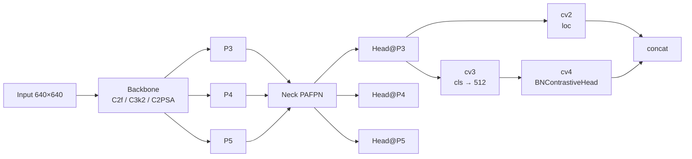
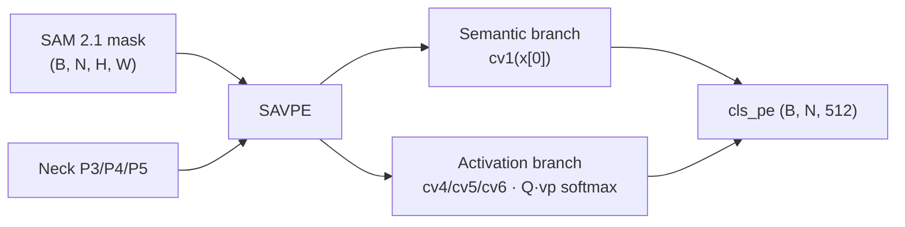
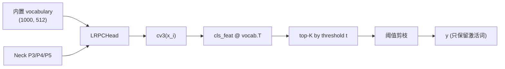
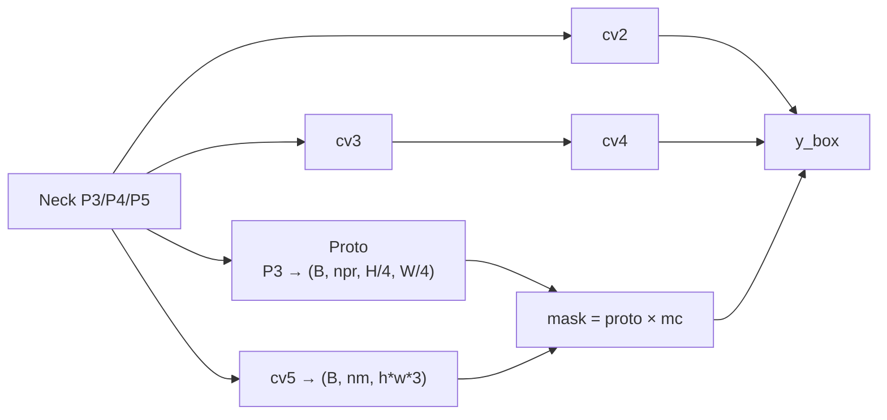
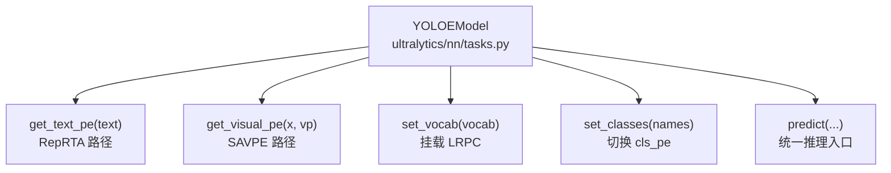

# YOLOE 架构图解

**「同一份权重同时吃下文本 / 视觉 / 无 prompt 三种输入——训练完 RepRTA 后与闭集 YOLO 完全同构」**

## 架构总览

YOLOE 的架构改动**全部集中在最后一层 Detect 头**——Backbone、Neck、`cv2`（位置分支）、`DFL` 全部零改动；只有 `cv3`（类别分支）的输出通道从 `nc` 改为 `embed=512`，并外挂 `BNContrastiveHead`（`cv4`）+ `RepRTA` + `SAVPE` 三个模块。



**关键节点**：

- `cv3` 是 YOLOE 头与闭集 YOLO 头的**唯一结构差异**——闭集 Detect 的 `cv3[-1]` 输出 `nc` 通道（80 类），YOLOE 的 `cv3[-1]` 输出 `embed=512` 通道（可学习 prompt embedding 维度）；
- `cv4` 是新增的 `BNContrastiveHead`——把 `cls_feat` 与 `cls_pe`（文本 / 视觉 / vocabulary embedding）做对比内积；
- **训练时**：`reprta(txt)` 或 `savpe(x, vp)` 生成 `cls_pe`，走 `cv4` 融合；
- **推理时**：`fuse()` 把 `reprta` + `cv4` + `cv3[-1]` 折叠为普通 `1×1 Conv`，直接输出 `nc` 通道。

对应 <SrcLink file="yoloe:ultralytics/nn/head.py" :line="438" :end="585"/>。

## Backbone 与 Neck 零改动

YOLOE-v8 / YOLOE-11 / YOLOE-26 的 Backbone 与 Neck 完全沿用对应基座版本：

| 版本 | Backbone | Neck | 骨干改动 |
|------|---------|------|---------|
| YOLOE-v8 | C2f 骨干 | PAFPN | 与 [YOLOv8](/versions/v8/index) 完全一致 |
| YOLOE-11 | C3k2 骨干 | PAFPN | 与 [YOLO11](/versions/v11/index) 完全一致 |
| YOLOE-26 | C3k2 + C2PSA 骨干 | PAFPN | 与 [YOLO26](/versions/v26/index) 完全一致，`reg_max=1` |

**对应 cfg**：

- <SrcLink file="yoloe:ultralytics/cfg/models/v8/yoloe-v8.yaml" :line="1" :end="60"/> —— YOLOE-v8，C2f 骨干，5 档 n/s/m/l/x；
- <SrcLink file="yoloe:ultralytics/cfg/models/26/yoloe-26.yaml" :line="1" :end="67"/> —— YOLOE-26，C3k2 + C2PSA 骨干，5 档 n/s/m/l/x（8.4.0 起）；
- YOLOE-11 的 yaml 在 `cfg/models/11/yoloe-11.yaml`（结构同 YOLOE-v8 换骨干）。

**为什么骨干零改动是设计约束？** 因为 YOLOE 的承诺是"**推理零开销**"——只有把 delta 集中在最后 Detect 头里，`fuse()` 才能干净地折叠成闭集同构的推理图；如果骨干也改，折叠就复杂化了。**YOLOE 是"头驱动"设计，不是"骨干驱动"设计**。

## YOLOEDetect 头的三层结构

`YOLOEDetect` 继承自闭集 `Detect`，在 P3/P4/P5 三个尺度上分别有：

```mermaid
flowchart TB
    subgraph [每个尺度 P3/P4/P5]
        X["x_i"] --> CV2["cv2<br/>位置分支<br/>→ reg_max×4"]
        X --> CV3["cv3<br/>类别分支<br/>→ embed=512"]
        CV3 --> CV4["cv4 = BNContrastiveHead<br/>cls_feat @ cls_pe.T × logit_scale + bias<br/>→ cls_pe.shape[-1]"]
        CV2 --> CAT["concat"]
        CV4 --> CAT
        CAT --> DFL["DFL + Decode + NMS"]
    end
    TXT["cls_pe<br/>(B, N, 512)"] --> CV4
```

**代码对应** <SrcLink file="yoloe:ultralytics/nn/head.py" :line="443" :end="466"/>：

```python
class YOLOEDetect(Detect):
    def __init__(self, nc=80, embed=512, with_bn=False, ch=()):
        super().__init__(nc, ch)
        c3 = max(ch[0], min(self.nc, 100))
        assert c3 <= embed
        assert with_bn is True
        self.cv3 = nn.ModuleList(
            nn.Sequential(
                nn.Sequential(DWConv(x, x, 3), Conv(x, c3, 1)),
                nn.Sequential(DWConv(c3, c3, 3), Conv(c3, c3, 1)),
                nn.Conv2d(c3, embed, 1),  # 关键：输出 embed=512 而非 nc
            ) for x in ch
        )
        self.cv4 = nn.ModuleList(BNContrastiveHead(embed) for _ in ch)
        self.reprta = Residual(SwiGLUFFN(embed, embed))
        self.savpe = SAVPE(ch, c3, embed)
        self.embed = embed
```

**三尺度通道数示例**（YOLOE-v8-S，`c3=64, embed=512`）：

| 尺度 | Backbone 输出 | `cv3[i]` 内部通道 | `cv3[i]` 输出 | `cv4[i]` 输出 |
|------|--------------|-------------------|--------------|--------------|
| P3 | 64 (S) | DWConv 64 → Conv 64 → DWConv 64 → Conv 64 | 512 | cls_pe.shape[-1] |
| P4 | 64 | DWConv 64 → Conv 64 → DWConv 64 → Conv 64 | 512 | cls_pe.shape[-1] |
| P5 | 64 | DWConv 64 → Conv 64 → DWConv 64 → Conv 64 | 512 | cls_pe.shape[-1] |

## 三条 prompt 分支详解

### 分支 ①：Text-Prompt（RepRTA）

```mermaid
flowchart LR
    TXT["文本 prompt<br/>'dog cat'] --> TOK["CLIP tokenizer<br/>(≤77 token)"]
    TOK --> MOB["MobileCLIP-B(LT)<br/>512-dim embedding"]
    MOB --> RTA["RepRTA = Residual(SwiGLUFFN)"]
    RTA --> NORM["F.normalize(dim=-1)"]
    NORM --> PE["cls_pe (B, N, 512)"]
    PE --> CV4["BNContrastiveHead"]
```

**代码路径** <SrcLink file="yoloe:ultralytics/nn/tasks.py" :line="852" :end="875"/>（`YOLOEModel.get_text_pe`）：

```python
def get_text_pe(self, text, max_cat=None):
    """Get text prompt embeddings."""
    # tokenize
    tokens = self.tokenizer(text, max_length=77, truncation=True, padding=True).input_ids
    # MobileCLIP encode
    tpe = self.text_model.visual2text(texts=tokens.to(self.device))  # (B, N, 512)
    # RepRTA refine
    return self.model[-1].get_tpe(tpe)  # → Residual(SwiGLUFFN) → F.normalize
```

**RepRTA 是 `Residual(SwiGLUFFN(embed, embed))`**——一个 SwiGLU 前馈 + 残差连接，**不是 Normalizing Flow，也不是 RealNVP**。`F.normalize(dim=-1, p=2)` 保证单位球面，让对比内积在球面上做余弦相似度。

**为什么 `embed=512`？** MobileCLIP-B(LT) 的文本输出维度是 512——RepRTA 是恒等维度变换，**MobileCLIP 输出什么维度，`embed` 就必须是什么维度**；改成 768（其他 CLIP 变体的输出）会导致 `assert c3 <= embed` 通过但 RepRTA 与 MobileCLIP 维度不匹配。

### 分支 ②：Visual-Prompt（SAVPE）



**代码对应** <SrcLink file="yoloe:ultralytics/nn/head.py" :line="348" :end="400"/>：

```python
class SAVPE(nn.Module):
    def __init__(self, ch, c=512, e=512):
        self.cv1 = nn.Sequential(Conv(ch[0], c, 3), Conv(c, c, 3))  # semantic
        self.cv4 = nn.ModuleList(Conv(ch[i], c, 1) for i in range(len(ch)))
        self.cv5 = nn.ModuleList(Conv(ch[i], c, 1) for i in range(len(ch)))
        self.cv6 = nn.ModuleList(Conv(ch[i], e, 1) for i in range(len(ch)))

    def forward(self, x, vp):
        sem = self.cv1(x[0])  # (B, c, H, W)
        out = []
        for i in range(len(x)):
            Q = self.cv4[i](x[i])         # (B, c, h_i, w_i)
            K = self.cv5[i](x[i])         # (B, c, h_i, w_i)
            logits = Q @ K.T              # (B, c, c)
            attn = F.softmax(logits, dim=-1)
            feat = attn @ vp[i]           # (B, c, N)
            out.append(self.cv6[i](feat)) # (B, e, N)
        return torch.cat(out, dim=-1)     # (B, N, 512)
```

**为什么解耦 semantic 与 activation？** 论文 §3.3 说：视觉 prompt 通常噪声大或不精确，解耦后 semantic branch 学习"位置对应的类别语义"，activation branch 学习"prompt 的注意力模式"——**两条支路独立可训练，SAVPE 训练时骨干与 RepRTA 都冻结，只有 SAVPE 的 30M 参数在学**（对应 3 段 yaml 里 `cv1/cv4/cv5/cv6` 加起来约 30M 参数）。

**`vp` 的输入形态**：`(B, N, H, W)` 的归一化 mask——`H` 与 `W` 必须匹配 P3 特征图尺寸；SAVPE 内部对 P4/P5 用 `F.interpolate` 缩放 vp，避免手工对齐。

### 分支 ③：Prompt-Free（LRPC + 内置 vocabulary）



**代码对应** <SrcLink file="yoloe:ultralytics/nn/head.py" :line="403" :end="435"/>：

```python
class LRPCHead(nn.Module):
    def __init__(self, e, vocab, topk=500, t=0.05):
        self.vocab = vocab  # (V, e)
        self.topk = topk
        self.t = t

    def forward(self, cls_feat, loc_feat, conf, max_det):
        score = cls_feat @ self.vocab.T  # (B, V, h, w)
        pf_score = score.flatten(1).max(dim=-1).values  # (B, V)
        keep = pf_score > self.t
        keep_idx = keep.nonzero(as_tuple=False)  # (N, 2)
        ...
```

**"Lazy" 的含义**：先用低阈值 `t` 过一遍，只保留 `score > t` 的 top-K 词，**避免对全部 1000 词都做精细推理**——省下的算力就是"Laziness"。

**运行期分支判断** <SrcLink file="yoloe:ultralytics/nn/head.py" :line="564" :end="574"/>：

```python
def forward(self, x, cls_pe, return_mask=False):
    if hasattr(self, "lrpc"):  # prompt-free inference
        return self.forward_lrpc(x, return_mask)
    for i in range(self.nl):
        x[i] = torch.cat((self.cv2[i](x[i]), self.cv4[i](self.cv3[i](x[i]), cls_pe)), 1)
    ...
```

**关键**：`hasattr(self, "lrpc")` 是**通过 `set_vocab` 挂载 `lrpc` 属性来切换**——不是通过构造参数控制，这是 Ultralytics 特有的运行期分支设计。

## YOLOESegment：加掩码分支的 seg 版

`YOLOESegment` 继承 `YOLOEDetect`，额外加 `Proto` 与 `cv5` 做掩码：



**代码对应** <SrcLink file="yoloe:ultralytics/nn/head.py" :line="622" :end="654"/>：

```python
class YOLOESegment(YOLOEDetect):
    def __init__(self, nc=80, nm=32, npr=256, embed=512, with_bn=False, ch=()):
        super().__init__(nc, embed, with_bn, ch)
        self.nm = nm
        self.npr = npr
        self.proto = Proto(ch[0], self.npr, self.nm)
        c5 = max(ch[0] // 4, self.nm)
        self.cv5 = nn.ModuleList(
            nn.Sequential(Conv(x, c5, 3), Conv(c5, c5, 3), nn.Conv2d(c5, self.nm, 1)) for x in ch
        )
```

**LRPC 场景下的特殊处理**：`forward_lrpc` 返回 `(y, mask)` 二元组，Seg 版根据 `mask` 布尔索引裁剪 `mc`（mask 系数），保证 mask 分支与检测分支的激活词一致。

## `fuse()`：可重参数化的关键

训练结束后（或加载权重后）调用 `fuse()`，把三条支路折叠成闭集同构的 `1×1 Conv`：

```mermaid
flowchart TB
    subgraph [训练时]
        A1["cv3[i][-1]<br/>1×1 Conv(embed, embed)"]
        A2["cv4[i] = BNContrastiveHead<br/>BN + logit_scale + bias"]
        A3["reprta = Residual(SwiGLUFFN)"]
        A4["txt_pe (B, N, 512)"]
    end
    subgraph [fuse() 后]
        B1["cls_head[-1] = 1×1 Conv(embed, N)<br/>W_new = txt @ W<br/>b_new = txt @ b + bias"]
        B2["reprta = Identity"]
    end
    A1 --> F["fuse()"]
    A2 --> F
    A3 --> F
    A4 --> F
    F --> B1
    F --> B2
```

**代码对应** <SrcLink file="yoloe:ultralytics/nn/head.py" :line="469" :end="513"/>：

```python
def fuse(self, txt_feats):
    if self.is_fused: return
    assert not self.training
    txt_feats = txt_feats.to(torch.float32).squeeze(0)
    for cls_head, bn_head in zip(self.cv3, self.cv4):
        conv = cls_head[-1]
        logit_scale = bn_head.logit_scale
        bias = bn_head.bias
        norm = bn_head.norm
        t = txt_feats * logit_scale.exp()
        conv = fuse_conv_and_bn(conv, norm)  # 折叠 BN 到 1×1 Conv
        w = conv.weight.data.squeeze(-1).squeeze(-1)  # (embed, embed)
        b = conv.bias.data                          # (embed,)
        w = t @ w                    # (N, embed) @ (embed, embed) = (N, embed)
        b1 = (t @ b.reshape(-1).unsqueeze(-1)).squeeze(-1)
        b2 = torch.ones_like(b1) * bias
        conv = nn.Conv2d(conv.in_channels, w.shape[0], kernel_size=1).requires_grad_(False)
        conv.weight.data.copy_(w.unsqueeze(-1).unsqueeze(-1))  # (N, embed, 1, 1)
        conv.bias.data.copy_(b1 + b2)                          # (N,)
        cls_head[-1] = conv
        bn_head.fuse()
    del self.reprta
    self.reprta = nn.Identity()
    self.is_fused = True
```

**折叠的关键公式**：

- **权重**：`W_new = txt_feats × logit_scale.exp() @ W_old`——**文本嵌入被"烧"进权重矩阵的每一行**；
- **偏置**：`b_new = txt_feats @ b_old + bias`——BN 的 logit_scale 与 bias 一起融合；
- **推理输出通道**：`nc_out = N = len(txt_feats)`（词表大小），**词表有 1000 词就输出 1000 通道**。

**fuse 后 `reprta` 直接删掉**（`self.reprta = nn.Identity()`），推理时不再需要 RepRTA——**这就是"zero inference overhead"的实现**。

**注意 `fuse_conv_and_bn`**：这是 Ultralytics 内置的 BN-Conv 折叠函数（`ultralytics/nn/modules/conv.py`），数学上是 `y = ((x - mean) / sqrt(var + eps)) * weight + bias`，可以代数展开为普通的 `1×1 Conv`。

## YOLOEModel 顶层：三种 prompt 的入口

`YOLOEModel` 继承 `DetectionModel`，是三种 prompt 模式的统一入口：



**代码对应** <SrcLink file="yoloe:ultralytics/nn/tasks.py" :line="789" :end="1006"/>。

关键 API：

| 方法 | 作用 |
|------|------|
| `get_text_pe(text)` | 文本 prompt 编码，走 RepRTA |
| `get_visual_pe(x, vp)` | 视觉 prompt 编码，走 SAVPE |
| `set_vocab(vocab)` | 挂载内置 vocabulary，切换 Prompt-Free 模式 |
| `set_classes(names)` | 切换文本词表，重新生成 `cls_pe` |
| `predict(...)` | 统一推理入口，根据 prompt 类型分岔 |

## YOLOE-26：骨干升级到 C3k2 + C2PSA

YOLOE-26 系列在 Ultralytics 8.4.0（2026-01-14）首发，**头结构不变**，但**骨干从 C2f 升级到 C3k2 + C2PSA**：

| 组件 | YOLOE-v8 | YOLOE-11 | YOLOE-26 |
|------|---------|---------|---------|
| Backbone 主干 | C2f | C3k2 | **C3k2 + C2PSA** |
| Reg max | 16 (DFL) | 16 (DFL) | **1（C2PSA 分支）** |
| Head | YOLOEDetect | YOLOEDetect | **YOLOEDetect（不变）** |
| 参数量（L 档） | 45 M | 26 M | ~35 M |

**对应 cfg** <SrcLink file="yoloe:ultralytics/cfg/models/26/yoloe-26.yaml" :line="1" :end="67"/> 与 <SrcLink file="yoloe:ultralytics/cfg/models/26/yoloe-26-seg.yaml" :line="1" :end="70"/>。

**关键差异**：YOLOE-26 的回归头 `reg_max=1`——**从 DFL 换成 C2PSA 的分支回归**，这意味着 `cv2` 的输出通道是 `4`（回归 4 维）而非 `reg_max × 4 = 64`。**但这不影响 `fuse()` 的折叠路径**——因为 `fuse()` 只作用于 `cv3` / `cv4`，`cv2` 完全不参与折叠。

**为什么 YOLOE-26 参数不降反升？** L 档从 45 M（v8）→ 35 M（26）→ 变少；X 档从（v8 无）→（11 无）→ 45 M——**YOLOE-26 的骨干参数效率比 v8 高，但比 v11 略低**，可能与 C2PSA 的额外分支有关。

## 与闭集 YOLO 的推理对比

**训练完成 + fuse() 后**，YOLOE 的推理图与闭集 YOLO 完全同构：

```mermaid
flowchart LR
    subgraph [YOLOE（fuse 后）]
        IE1["P3"] --> IE_C2["cv2"]
        IE1 --> IE_C3["cv3 → 1×1 Conv(N, 1)"]
        IE_C2 --> IE_CAT["concat"]
        IE_C3 --> IE_CAT
    end
    subgraph [闭集 YOLOv8]
        CE1["P3"] --> CE_C2["cv2"]
        CE1 --> CE_C3["cv3 → 1×1 Conv(80, 1)"]
        CE_C2 --> CE_CAT["concat"]
        CE_C3 --> CE_CAT
    end
    IE_CAT --> SAMES["完全同构<br/>只 nc 不同"]
    CE_CAT --> SAMES
```

**唯一的结构差异**：

- YOLOE 的 `cv3[-1]` 输出 `N`（词表大小）通道，闭集 YOLO 输出 `nc`（类数）通道；
- 两者都可以通过 Linear probing 或 Full tuning 迁移到目标数据集——**迁移代码 100% 复用**。

**为什么这是"zero transferring overhead"？** 因为 YOLO-World v2 在推理时保留 Qwen2 LLM（250M 参数），迁移时需要处理 LLM 权重；YOLOE 在迁移前已经把 RepRTA 折叠成 `1×1 Conv`，**迁移代码与普通 YOLO 一致**。

## YOLOE 与 YOLO-World 的架构对比

| 组件 | YOLO-World v2 | **YOLOE** | 差异 |
|------|--------------|-----------|------|
| Backbone | C2f | C2f / C3k2 / C3k2+C2PSA | YOLOE 三骨干 |
| Neck | PAFPN | PAFPN | 一致 |
| Detect.cv2 | 位置分支 | 位置分支（不变） | 一致 |
| Detect.cv3 | `nc` 通道 | `embed=512` 通道 | YOLOE 加宽到 embedding 维度 |
| Detect.cv4 | — | BNContrastiveHead | YOLOE 新增对比头 |
| 文本编码 | Qwen2-0.5B | MobileCLIP-B(LT) | YOLOE 轻量 |
| 视觉编码 | 无 | SAVPE | YOLOE 新增 |
| Prompt-Free | 无 | LRPC | YOLOE 新增 |
| 可重参数化 | 否 | 是（fuse） | YOLOE 核心卖点 |
| 推理参数 | 12 M + Qwen2 250 M | 12 M（fuse 后） | YOLOE 推理期小 20× |

**架构上的哲学差异**：YOLO-World 是"LLM 驱动的开放词表"，YOLOE 是"CLIP 驱动 + 可重参数化"——**两者是不同技术路线**，见 [YOLO-World 综述](/derivatives/yoloworld/index)。

## 关键工程约束

1. **`c3 ≤ embed`**：<SrcLink file="yoloe:ultralytics/nn/head.py" :line="446" :end="447"/> 里的 `assert c3 <= embed`——`cv3[i]` 内部通道数必须 ≤ `embed`，否则 `1×1 Conv(c3, embed)` 的通道数不匹配；
2. **`with_bn` 必须为 True**：<SrcLink file="yoloe:ultralytics/nn/head.py" :line="448"/> 的 `assert with_bn is True`——**不用 BN 就无法 fuse**；
3. **BN 的 `affine=True`**：<SrcLink file="yoloe:ultralytics/nn/head.py" :line="450"/> 里 `BNContrastiveHead` 用 `affine=True`——**否则没有 `weight` / `bias` 参数可折叠**；
4. **`fuse()` 时强制 fp32**：<SrcLink file="yoloe:ultralytics/nn/head.py" :line="475"/> 的 `txt_feats.to(torch.float32)`——**fp16 下 `running_var` 会溢出**；
5. **`reprta` 零初始化**：<SrcLink file="yoloe:ultralytics/nn/head.py" :line="612" :end="615"/> 的 `nn.init.zeros_`——**训练初期退化为 Identity，避免不稳定性**；L 档需要改为 `1e-6`；
6. **`is_fused` 标志**：`fuse()` 幂等——**已经 fuse 过的不会重复折叠**；
7. **`hasattr(self, "lrpc")` 判断 Prompt-Free**：**不是构造参数，是运行期挂载**，`set_vocab` 时挂载 `lrpc` 属性。

## 逐文件导航

- <SrcLink file="yoloe:ultralytics/nn/head.py" :line="348" :end="400"/> —— `SAVPE`
- <SrcLink file="yoloe:ultralytics/nn/head.py" :line="403" :end="435"/> —— `LRPCHead`
- <SrcLink file="yoloe:ultralytics/nn/head.py" :line="438" :end="585"/> —— `YOLOEDetect`（含 `fuse` + `forward_lrpc`）
- <SrcLink file="yoloe:ultralytics/nn/head.py" :line="588" :end="602"/> —— `SwiGLUFFN`
- <SrcLink file="yoloe:ultralytics/nn/head.py" :line="605" :end="619"/> —— `Residual`（RepRTA 载体）
- <SrcLink file="yoloe:ultralytics/nn/head.py" :line="622" :end="654"/> —— `YOLOESegment`
- <SrcLink file="yoloe:ultralytics/nn/tasks.py" :line="789" :end="1006"/> —— `YOLOEModel`
- <SrcLink file="yoloe:ultralytics/nn/tasks.py" :line="1009" :end="1160"/> —— `YOLOESegModel`
- <SrcLink file="yoloe:ultralytics/models/yolo/yoloe/train.py" :line="20" :end="355"/> —— 6 Trainer 类
- <SrcLink file="yoloe:ultralytics/models/yolo/yoloe/train_seg.py" :line="1" :end="200"/> —— seg 版 Trainer

## 相关页面

- [YOLOE 概览](./index)
- [论文精读（重点纠 RealNVP 误传）](./paper)
- [理论 Concept](./concepts)
- [架构与层速查](./layers)
- [损失函数](./losses)
- [训练技巧](./tricks)
- [痛点追踪](./painpoints)
- [源码走读](./code-walkthrough)
- [YOLOv8 概览](/versions/v8/index) · [YOLO11 概览](/versions/v11/index) · [YOLO26 概览](/versions/v26/index)
- [YOLO-World 综述](/derivatives/yoloworld/index)
