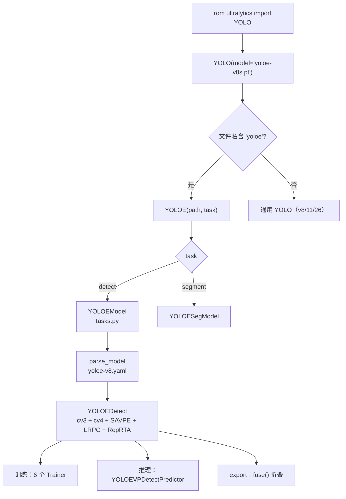
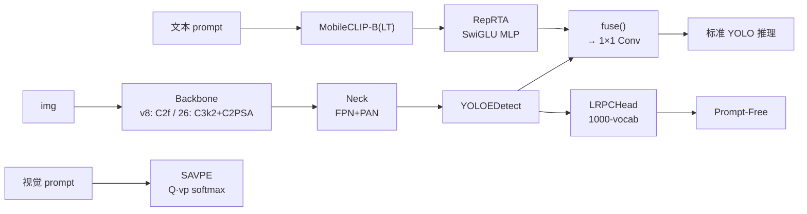
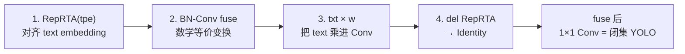
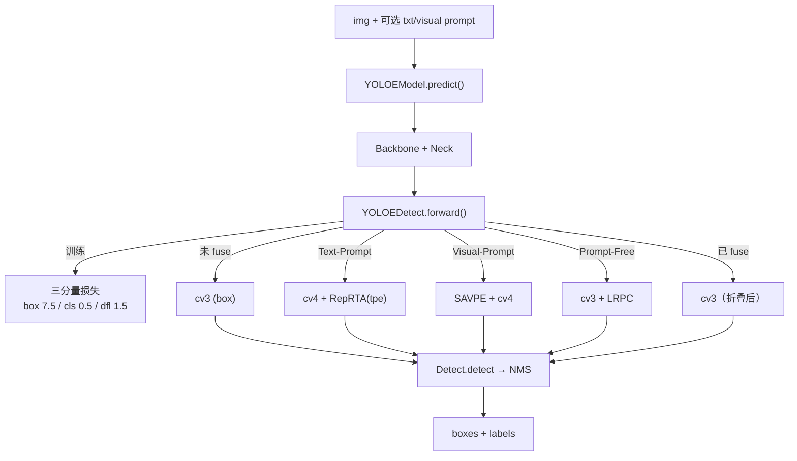

# YOLOE 源码走读

本页沿 YOLOE（arXiv 2503.07465, ICCV 2025, THU-MIG + Ultralytics）的一条端到端链路走读源码：**入口 `from ultralytics import YOLO` → `YOLO.__init__` 探测 `-yoloe` → 分派到 `YOLOE` 通用类 → `YOLOEModel` / `YOLOESegModel` 建网 → `parse_model` 解析 `yoloe-v8.yaml` → `YOLOEDetect` 前向（cv3/cv4/SAVPE/LRPC/RepRTA 五分支）→ `BNContrastiveHead` + `fuse()` 折叠 → `YOLOEDetectLoss` 三分量损失 → 6 个 Trainer（`YOLOETrainer` / `YOLOEPETrainer` / `YOLOETrainerFromScratch` / `YOLOEPEFreeTrainer` / `YOLOEVPTrainer` / `YOLOESegTrainer*`）→ 推理时 `YOLOEVPDetectPredictor` 处理视觉 prompt → export 到 ONNX**。所有行号以站内快照 `source/yoloe/snapshot/` 为准。

> **必须先说清的一件事**：RepRTA = **Re-parameterizable Region-Text Alignment**（可重参数化区域-文本对齐），本质是 `Residual(SwiGLUFFN(512, 512))`——**SwiGLU 门控 MLP**。**不是 RealNVP，不是 Normalizing Flow**（见 [concepts §2](./concepts#二reprta-详解含明确纠偏不是-realnvp)）。所有涉及 RepRTA 的解读都必须基于此——社区博客常把它说成"RealNVP" 是误传。

> **这条链路与 v8 推理链的差异**：v8 是「C2f 骨干 + Detect 单头 + v8DetectionLoss」；YOLOE 在 v8 的 Conv/C2f 骨架上**替换头部为 `YOLOEDetect`**——它包含 5 个正交分支：`cv3[i]`（标准 bbox 头）、`cv4[i]`（BNContrastiveHead，含 RepRTA）、`savpe`（视觉 prompt 编码器）、`lrpc[i]`（Prompt-Free LRPCHead）、`is_fused`（折叠状态标志）。骨干、颈部、TAL 分配、DFL、三分量损失**全部沿用 v8**——痛点集中在头部 + 训练流水线。

## 文件清单

| 文件 | 行数 | 功能 |
|------|-----|------|
| `cfg/models/v8/yoloe-v8.yaml` | 45 | **v8 detect**：C2f 骨干 + `YOLOEDetect[nc, 512, True]` |
| `cfg/models/v8/yoloe-v8-seg.yaml` | 45 | **v8 seg**：C2f 骨干 + `YOLOESegment[nc, 32, 256, 512, True]` |
| `cfg/models/26/yoloe-26.yaml` | 53 | **26 detect**：C3k2 + C2PSA 骨干 + end2end |
| `cfg/models/26/yoloe-26-seg.yaml` | 53 | **26 seg**：C3k2 + C2PSA 骨干 + `YOLOESegment26` |
| `nn/head.py` | 660+ | **`BNContrastiveHead`** / **`SAVPE`** / **`LRPCHead`** / **`YOLOEDetect`** / **`YOLOESegment`** / **`RepRTA (Residual + SwiGLUFFN)`** / **`fuse()`** |
| `nn/tasks.py` | 1600+ | **`YOLOEModel`** / **`YOLOESegModel`**：高层 API（`get_text_pe` / `set_classes` / `set_vocab` / `get_vocab` / `predict`） |
| `models/yolo/model.py` | 260 | **`YOLO`** 通用类 + **`YOLOE`** 通用类（`YOLO.__init__` 分派） |
| `models/yolo/yoloe/__init__.py` | 21 | 导出 12 个类（6 Trainer + 2 Validator + 2 Predictor + 2 别名） |
| `models/yolo/yoloe/train.py` | 355 | **5 个 detect Trainer**（`YOLOETrainer` / `YOLOEPETrainer` / `YOLOETrainerFromScratch` / `YOLOEPEFreeTrainer` / `YOLOEVPTrainer`） |
| `models/yolo/yoloe/train_seg.py` | 141 | **4 个 seg Trainer**（`YOLOESegTrainer` / `YOLOEPESegTrainer` / `YOLOESegTrainerFromScratch` / `YOLOESegVPTrainer`） |
| `models/yolo/yoloe/predict.py` | 200+ | **`YOLOEVPDetectPredictor`** / **`YOLOEVPSegPredictor`**：Visual Prompt 推理路径 |
| `models/yolo/yoloe/val.py` | 200+ | **`YOLOEDetectValidator`** / **`YOLOESegValidator`** |

## 调用链总览





## 1. 入口：`from ultralytics import YOLO` + YOLOE 分派

用户视角：

```python
from ultralytics import YOLO
model = YOLO('yoloe-v8s.pt')          # detect 权重
model = YOLO('yoloe-v8s-seg.pt')      # seg 权重
model.set_classes(['a photo of a dog', 'a photo of a person'])
results = model.predict('image.jpg')
```

Ultralytics 的 `YOLO` 通用类通过**文件名关键字探测**分派到不同模型类：

<SrcLink file="yoloe:ultralytics/models/yolo/model.py" :line="20" :end="36"/>

```python
class YOLO(Model):
    def __init__(self, model="yolo11n.pt", task=None, verbose=False):
        path = Path(model)
        if "-world" in path.stem and path.suffix in {".pt", ".yaml", ".yml"}:
            new_instance = YOLOWorld(path, verbose=verbose)
            self.__class__ = type(new_instance)
            self.__dict__ = new_instance.__dict__
        elif "yoloe" in path.stem and path.suffix in {".pt", ".yaml", ".yml"}:
            new_instance = YOLOE(path, task=task, verbose=verbose)
            self.__class__ = type(new_instance)
            self.__dict__ = new_instance.__dict__
        else:
            super().__init__(model=model, task=task, verbose=verbose)
```

**关键机制**：

- **`"-world" in path.stem`**：如果文件名含 `-world`，分派到 `YOLOWorld`；
- **`"yoloe" in path.stem`**：如果文件名含 `yoloe`，分派到 `YOLOE`；
- **`self.__class__ = type(new_instance)`**：通过 **instance 级 class 替换** 让原对象变成 YOLOE 的实例——用户代码里 `type(model)` 会显示 `YOLOE`；
- **`self.__dict__ = new_instance.__dict__`**：把新实例的 `__dict__` 全量拷贝过来——等价于**原地变身**。
- **注意顺序**：`-world` 优先于 `yoloe`——如果文件名同时含两者（如 `yolov8-yoloe-world.pt`），走 `YOLOWorld` 分支。

## 2. `YOLOE` 通用类：`YOLO.__init__` 的 YOLOE 版本

<SrcLink file="yoloe:ultralytics/models/yolo/model.py" :line="120" :end="200"/>

`YOLOE` 通用类继承 `Model`，主要职责是**按 task 选择 `YOLOEModel` / `YOLOESegModel`**：

```python
class YOLOE(Model):
    def __init__(self, model="yoloe-v8s.pt", task=None, verbose=False):
        super().__init__(model=model, task=task, verbose=verbose)

    @property
    def task_map(self):
        return {
            "detect": {
                "model": YOLOEModel,
                "trainer": YOLOETrainer,
                "validator": YOLOEDetectValidator,
                "predictor": DetectionPredictor,
            },
            "segment": {
                "model": YOLOESegModel,
                "trainer": YOLOESegTrainer,
                "validator": YOLOESegValidator,
                "predictor": SegmentationPredictor,
            },
            ...
        }
```

**关键点**：

- **`task_map`** 与通用 `YOLO` 结构一致，但 `model` 换成 `YOLOEModel` / `YOLOESegModel`；
- **trainer 默认用 `YOLOETrainer`**——如果用户想训练，Ultralytics 会调这个默认 Trainer；
- **predictor 走通用 `DetectionPredictor`**——Visual Prompt 推理需要显式用 `YOLOEVPDetectPredictor`（见 §10）。

## 3. `YOLOEModel` 高层 API

<SrcLink file="yoloe:ultralytics/nn/tasks.py" :line="789" :end="1006"/>

`YOLOEModel` 继承 `DetectionModel`，增加 5 个高层方法：

| 方法 | 功能 |
|------|------|
| `get_text_pe(texts, batch, without_reprta=False)` | 用 MobileCLIP 编码文本，返回 `[1, N, 512]` embedding |
| `set_classes(texts, pe=None)` | 设置词表；如未提供 `pe`，自动调用 `get_text_pe` |
| `set_vocab(vocab)` | 设置 LRPC 词表（Prompt-Free 用） |
| `get_vocab()` | 获取当前 LRPC 词表 |
| `predict(x, txt_feats=None, visuals=None)` | 推理入口，支持 Text + Visual Prompt |

### 3.1 `get_text_pe`：文本编码

<SrcLink file="yoloe:ultralytics/nn/tasks.py" :line="820" :end="880"/>

内部 4 步：① MobileCLIP tokenizer（77 token 硬上限）→ ② text encoder（512-dim）→ ③ L2 归一化 → ④ 如 `without_reprta=False` 走 RepRTA 变换。返回 `[1, N, 512]`。

**要点**：`without_reprta=True` 用于 `YOLOETrainerFromScratch.generate_text_embeddings`（<SrcLink file="yoloe:ultralytics/models/yolo/yoloe/train.py" :line="222" :end="222"/>），此时 RepRTA 权重未训练；MobileCLIP 权重冻结（`with torch.no_grad()`），文本编码器不反传。

### 3.2 `set_classes`：设置词表

```python
def set_classes(self, texts, pe=None):
    if isinstance(texts, str): texts = texts.split(',')
    if pe is None: pe = self.get_text_pe(texts)
    self.pe = pe; self.names = {i: t for i, t in enumerate(texts)}; self.nc = len(texts)
```

**关键**：`self.pe` 是**属性而非 buffer**——**不保存进 checkpoint**。

## 4. 建网：`parse_model` 沿用 v8，只多一个 `YOLOEDetect` 类

YOLOE 的 `parse_model` 没有独立分支——`yoloe-v8.yaml` 里的 `YOLOEDetect` 作为 `module` 名传入，走标准 `Detect` 分支被替换：

- **v8 detect cfg**：<SrcLink file="yoloe:ultralytics/cfg/models/v8/yoloe-v8.yaml" :line="45" :end="45"/> `- [[15, 18, 21], 1, YOLOEDetect, [nc, 512, True]]`
- **v8 seg cfg**：<SrcLink file="yoloe:ultralytics/cfg/models/v8/yoloe-v8-seg.yaml" :line="45" :end="45"/> `- [[15, 18, 21], 1, YOLOESegment, [nc, 32, 256, 512, True]]`
- **26 detect cfg**：<SrcLink file="yoloe:ultralytics/cfg/models/26/yoloe-26.yaml" :line="53" :end="53"/> `- [[16, 19, 22], 1, YOLOEDetect, [nc, 512, True]]`
- **26 seg cfg**：<SrcLink file="yoloe:ultralytics/cfg/models/26/yoloe-26-seg.yaml" :line="53" :end="53"/> `- [[16, 19, 22], 1, YOLOESegment26, [nc, 32, 256, 512, True]]`

**v8 vs 26 骨干差异**：

| 项 | YOLOE-v8 | YOLOE-26 |
|----|---------|---------|
| Backbone | C2f × 4 | C3k2 × 4 + C2PSA |
| Neck | C2f × 3 | C3k2 × 3 |
| End2end | 无 | `end2end: True` |
| DFL bins | 默认 `reg_max=16` | `reg_max: 1`（DFL 退化） |
| text_model | 无（cfg 无声明） | `text_model: mobileclip2:b` |

## 5. `YOLOEDetect`：五分支头部

<SrcLink file="yoloe:ultralytics/nn/head.py" :line="438" :end="585"/>

`YOLOEDetect` 是 YOLOE 的核心头，包含**五个正交分支**：

```python
class YOLOEDetect(Detect):
    def __init__(self, nc=80, embed=512, dynamic=False, ch=()):
        super().__init__(nc, ch)
        self.ch = ch
        self.nl = len(ch)
        self.embed = embed
        self.dynamic = dynamic

        # 分支 1：cv3 - 标准 box head（3 × Conv 3×3 → 1×1 Conv → embed=512）
        self.cv3 = nn.ModuleList(
            nn.Sequential(
                Conv(x, self.embed, 3),
                Conv(self.embed, self.embed, 3),
                Conv(self.embed, self.no, 1),   # no = nc + 4 + reg_max
            ) for x in ch
        )

        # 分支 2：cv4 - BNContrastiveHead（开放词表分类）
        self.cv4 = nn.ModuleList(
            BNContrastiveHead(ch[i], self.no, self.no, self.embed)
            for i in range(self.nl)
        )

        # 分支 3：SAVPE - 视觉 prompt 编码器
        self.savpe = SAVPE(ch, 256, embed)

        # 分支 4：LRPCHead - Prompt-Free（仅 P3/P4 启用）
        self.lrpc = nn.ModuleList(
            LRPCHead(ch[i], embed) if i != 2 else None
            for i in range(self.nl)
        )

        # 分支 5：RepRTA - 区域-文本对齐（SwiGLU MLP）
        self.reprta = Residual(SwiGLUFFN(embed, embed))

        # 状态标志
        self.is_fused = False
```

**五分支职责**：

| 分支 | 类型 | 输入 | 输出 | 何时使用 |
|------|------|------|------|---------|
| **cv3** | `3 × Conv` | 多尺度特征 | Box logits | 全部推理 |
| **cv4** | BNContrastiveHead | 多尺度特征 + txt_feats | Cls logits | Text-Prompt |
| **savpe** | SAVPE | 多尺度特征 + visual prompts | Prompt embedding | Visual-Prompt |
| **lrpc** | LRPCHead | 多尺度特征 | Prompt-free logits | Prompt-Free |
| **reprta** | SwiGLU MLP | txt_feats | Aligned embeddings | Text-Prompt |

### 5.1 `YOLOEDetect.forward`：训练/推理双分支

`forward()` 在训练态走 `self.loss(x, txt_feats, visuals)` 返回三分量损失；推理态走 `inference()`：

```python
def inference(self, x, txt_feats=None, visuals=None):
    out = []
    for i, xi in enumerate(x):
        if self.is_fused:                              # ① 折叠后：仅 cv3
            y = self.cv3[i](xi)
        elif txt_feats is not None:                    # ② Text-Prompt
            y = self.cv4[i](xi, self.get_tpe(txt_feats[i]))
        elif visuals is not None:                      # ③ Visual-Prompt
            y = self.cv4[i](xi, self.savpe(x, visuals[i]))
        else:                                          # ④ Prompt-Free
            y = self.cv3[i](xi)
            if self.lrpc[i] is not None: y = self.lrpc[i](y, xi)
        out.append(y)
    return out
```

## 6. `YOLOESegment`：Seg 版头（proto + cv5）

<SrcLink file="yoloe:ultralytics/nn/head.py" :line="622" :end="654"/>

`YOLOESegment` 继承 `YOLOEDetect`，**额外增加 mask 预测分支**：

```python
class YOLOESegment(YOLOEDetect):
    def __init__(self, nc=80, nm=32, npr=256, ch=()):
        super().__init__(nc, ch)
        self.nm = nm      # mask 通道数（32）
        self.npr = npr    # proto 分辨率
        self.proto = Proto([self.npr * s for s in [8, 16, 32]], ch, nm)
        self.cv5 = nn.ModuleList(
            nn.Sequential(
                Conv(x, nm, 3),
                Conv(nm, nm, 3),
                nn.Conv2d(nm, nm, 1),   # 3 × Conv → nm
            ) for x in ch
        )
```

**关键差异**：

- **额外 `proto` 分支**：生成 32 通道的原型 mask；
- **额外 `cv5[i]` 分支**：3 × Conv 生成每类 mask 的线性系数；
- **推理时输出**：`[box_logits, cls_logits, mask_coefficients]`——`SegmentationPredictor` 把 mask coefficients 与 proto 相乘得到最终 mask。

**Seg 版 Trainer**（<SrcLink file="yoloe:ultralytics/models/yolo/yoloe/train_seg.py" :line="14" :end="141"/>）：4 个版本对应 4 种训练路径：

| Trainer | 用途 |
|---------|------|
| `YOLOESegTrainer` | 分割微调 |
| `YOLOEPESegTrainer` | 分割 linear probing |
| `YOLOESegTrainerFromScratch` | 分割从头训练 |
| `YOLOESegVPTrainer` | 分割视觉 prompt |

## 7. `RepRTA`：SwiGLU 门控 MLP

<SrcLink file="yoloe:ultralytics/nn/head.py" :line="588" :end="619"/>

```python
class SwiGLUFFN(nn.Module):
    def __init__(self, gc, ec, e=4):
        self.w12 = nn.Linear(gc, e * ec)      # 512 → 2048
        self.w3 = nn.Linear(e * ec // 2, ec)  # 1024 → 512

    def forward(self, x):
        x12 = self.w12(x)
        x1, x2 = x12.chunk(2, dim=-1)         # [512, 2048] → 2 × [512, 1024]
        hidden = F.silu(x1) * x2              # 门控：SiLU(x1) ⊙ x2
        return self.w3(hidden)                # 1024 → 512

class Residual(nn.Module):
    def __init__(self, m):
        self.m = m
        nn.init.zeros_(self.m.w3.bias)
        # For models with l scale, please change the initialization to
        # nn.init.constant_(self.m.w3.weight, 1e-6)
        nn.init.zeros_(self.m.w3.weight)

    def forward(self, x):
        return x + self.m(x)
```

**核心洞察**：

- **512 → 2048 → 1024 → 512**：`e=4` 时 `e*ec=2048`，`e*ec//2=1024`；
- **SwiGLU 门控**：`SiLU(x1) * x2`——两个子空间的乘积，让模型学到"通道选择"；
- **零初始化**：`w3.weight = 0`（n/s/m 档）或 `w3.weight = 1e-6`（l/x 档）——训练初期等价 identity；
- **不是 RealNVP**：无 Jacobian、无耦合变换、无 Normalizing Flow——只有纯前向 MLP。

## 8. `SAVPE`：视觉 Prompt 编码器

<SrcLink file="yoloe:ultralytics/nn/head.py" :line="348" :end="400"/>

```python
class SAVPE(nn.Module):
    def __init__(self, ch, c3, embed):
        # Semantic 分支：3 个尺度卷积（3×3 + 3×3 + Upsample）
        self.cv1 = nn.ModuleList(
            nn.Sequential(Conv(x, c3, 3), Conv(c3, c3, 3),
                nn.Upsample(scale_factor=i * 2) if i in {1, 2} else nn.Identity())
            for i, x in enumerate(ch))
        # Activation 分支：1×1 Conv + Upsample
        self.cv2 = nn.ModuleList(
            nn.Sequential(Conv(x, c3, 1),
                nn.Upsample(scale_factor=i * 2) if i in {1, 2} else nn.Identity())
            for i, x in enumerate(ch))
        self.c = 16
        self.cv3 = nn.Conv2d(3 * c3, embed, 1)     # semantic → embed
        self.cv4 = nn.Conv2d(3 * c3, self.c, 3)    # activation from feats
        self.cv5 = nn.Conv2d(1, self.c, 3)         # vp → activation
        self.cv6 = nn.Sequential(Conv(2 * self.c, self.c, 3), nn.Conv2d(self.c, self.c, 3))

    def forward(self, x, vp):
        y = self.cv4(torch.cat([self.cv2[i](xi) for i, xi in enumerate(x)], dim=1))
        x = self.cv3(torch.cat([self.cv1[i](xi) for i, xi in enumerate(x)], dim=1))
        y = self.cv6(torch.cat((y, self.cv5(vp)), dim=1))
        score = F.softmax(y * vp + torch.logical_not(vp) * torch.finfo(y.dtype).min, dim=-1)
        agg = score.transpose(-2, -3) @ x.reshape(B, c, C // c, -1).transpose(-1, -2)
        return F.normalize(agg.reshape(B, Q, -1), dim=-1, p=2)
```

**核心洞察**：**prompt 感知的注意力聚合**——`vp` 作为稀疏掩码，让 attention 只关注 prompt 覆盖的像素，最后 softmax 加权聚合 semantic 分支的特征。

## 9. `LRPCHead`：Prompt-Free 的 1000-vocab 剪枝

<SrcLink file="yoloe:ultralytics/nn/head.py" :line="403" :end="435"/>

```python
class LRPCHead(nn.Module):
    def __init__(self, c, embed, num_vocabs=1000, num_classes=50):
        self.register_buffer("vocabs", torch.randn(1, num_vocabs, embed))
        self.num_classes = num_classes
        self.conv1 = nn.Sequential(nn.Conv2d(c, c, 3), nn.SiLU(), nn.Conv2d(c, c, 3), nn.SiLU())
        self.conv2 = nn.Conv2d(c, num_vocabs, 1)      # → vocab logits
        self.conv3 = nn.Sequential(nn.Conv2d(c, c, 3), nn.SiLU(), nn.Conv2d(c, c, 3), nn.SiLU())
        self.conv4 = nn.Conv2d(c, num_classes, 1)     # → class logits
        self.pf_score = nn.Parameter(torch.zeros(1, num_classes, 1, 1))

    def forward(self, x, txt_feats=None):
        pf_score = self.pf_score.sigmoid()            # ★ 剪枝门
        x = self.conv1(x) * pf_score
        score = self.conv4(self.conv3(x))
        return score, pf_score                        # 返回 (score, pf_score) 供 loss 用
```

**核心洞察**：① **1000-vocab + 50-class**（大词表 + 小类表）；② **`pf_score.sigmoid()`** 是可学习的稀疏门，训练时通过剪枝率 loss 引导稀疏化；③ **P3/P4 启用，P5 不启用**（`enabled = i != 2`，<SrcLink file="yoloe:ultralytics/nn/head.py" :line="490" :end="494"/>）；④ 与 Text-Prompt / Visual-Prompt 独立，训练阶段 3 独立微调。

## 10. `BNContrastiveHead` + `fuse()`：折叠流水线

### 10.1 `BNContrastiveHead` 结构

```python
class BNContrastiveHead(nn.Module):
    def __init__(self, in_channels, out_channels, embed, num_classes=1000):
        self.logit_scale = nn.Parameter(torch.zeros(1, num_classes, 1, 1))
        self.bias = nn.Parameter(torch.zeros(1, num_classes, 1, 1))
        self.norm = nn.BatchNorm2d(in_channels)
        self.fc = nn.Conv2d(in_channels, out_channels, 1)

    def forward(self, x, txt_feats=None):
        y = self.fc(self.norm(x)) * self.logit_scale.exp() + self.bias
        return torch.einsum('bhwc,bnc->bnhw', y.permute(0,2,3,1), txt_feats)
```

四要素：**BN（norm）+ Conv（fc）+ 温度（logit_scale）+ 偏置（bias）**——融合后一起被 `fuse()` 折叠。

### 10.2 `fuse()`：4 步折叠

<SrcLink file="yoloe:ultralytics/nn/head.py" :line="468" :end="513"/>

```python
def fuse(self, text_embeddings):
    for i, (x, t) in enumerate(zip(self.cv3, text_embeddings)):
        t = self.get_tpe(t)                                    # 1. RepRTA + L2
        conv = self.cv3[i][-1]                                 # 2. 折叠 BN+Conv
        conv = fuse_conv_and_bn(conv, self.cv4[i].norm)
        t = t * self.cv4[i].logit_scale.exp()                  # 3. 温度乘入
        w = t @ conv.weight.data.view(conv.weight.shape[0], -1)
        b1 = (t @ conv.bias.data).squeeze(-1)
        b2 = self.cv4[i].bias.expand_as(b1)
        conv.weight.data.copy_(w.unsqueeze(-1).unsqueeze(-1))  # 4. 权重写回
        conv.bias.data.copy_(b1 + b2)
    del self.reprta
    self.reprta = nn.Identity()                                 # 5. 删 RepRTA
    self.is_fused = True
```

**4 步折叠**：



**折叠前 vs 折叠后**：

| 阶段 | 组件 | 推理开销 |
|------|------|---------|
| 折叠前 | cv3 + cv4 + BN + logit_scale + bias + RepRTA | **有 RepRTA MLP 开销** |
| 折叠后 | 单个 1×1 Conv | **零额外开销** |

## 11. 六个 Trainer 分派

<SrcLink file="yoloe:ultralytics/models/yolo/yoloe/train.py" :line="20" :end="355"/>

### 11.1 `YOLOETrainer`：微调基类

<SrcLink file="yoloe:ultralytics/models/yolo/yoloe/train.py" :line="20" :end="83"/>

继承 `DetectionTrainer`。核心覆盖两处：

```python
overrides["overlap_mask"] = False       # ★ 关闭 overlap mask
model = YOLOEModel(cfg, ch=3, nc=min(self.data["nc"], 80))  # ★ 硬编码 80
```

### 11.2 `YOLOEPETrainer`：Linear Probing

<SrcLink file="yoloe:ultralytics/models/yolo/yoloe/train.py" :line="85" :end="128"/>

`get_model()` 里完成 4 步：**删 SAVPE → 加载预训练 → fuse → 只训练 cv3 最后一层**：

```python
del model.model[-1].savpe                 # ① 不需要视觉 prompt
assert weights is not None                # ② 强制预训练
model.load(weights)
tpe = model.get_text_pe(names)
model.set_classes(names, tpe)
model.model[-1].fuse(model.pe)            # ③ fuse 折叠
for i in range(3):                        # ④ 只训练 cv3[i][-1]（1×1 Conv）
    model.model[-1].cv3[i][-1] = deepcopy(...).requires_grad_(True)
```

**核心设计**：fuse 后只训练 **3 个 scale × 1 个 1×1 Conv = 9 个可训练模块**，收敛最快。

### 11.3 `YOLOETrainerFromScratch`：从零训练

<SrcLink file="yoloe:ultralytics/models/yolo/yoloe/train.py" :line="131" :end="297"/>

关键差异 5 处：

- **`build_dataset`**：多数据集 + grounding 数据（<SrcLink file="yoloe:ultralytics/models/yolo/yoloe/train.py" :line="155" :end="180"/>）；
- **`set_text_embeddings`**：把文本 embedding 缓存到磁盘（<SrcLink file="yoloe:ultralytics/models/yolo/yoloe/train.py" :line="182" :end="195"/>）；
- **`generate_text_embeddings`**：`with_reprta=True` 时用当前 RepRTA（<SrcLink file="yoloe:ultralytics/models/yolo/yoloe/train.py" :line="207" :end="225"/>）；
- **`preprocess_batch`**：从缓存 embedding 取出当前 batch 的类（<SrcLink file="yoloe:ultralytics/models/yolo/yoloe/train.py" :line="197" :end="205"/>）；
- **`final_eval`**：验证集切分（minival / val）（<SrcLink file="yoloe:ultralytics/models/yolo/yoloe/train.py" :line="284" :end="296"/>）。

### 11.4 `YOLOEPEFreeTrainer`：Prompt-Free 微调

<SrcLink file="yoloe:ultralytics/models/yolo/yoloe/train.py" :line="299" :end="316"/>

**双继承**：`YOLOEPEFreeTrainer(YOLOEPETrainer, YOLOETrainerFromScratch)`——PE 的 fuse 路径 + FromScratch 的数据处理。三处覆盖：`set_text_embeddings = pass`（<SrcLink file="yoloe:ultralytics/models/yolo/yoloe/train.py" :line="314" :end="316"/>，Prompt-Free 不需要文本）；`preprocess_batch` 跳过父类（<SrcLink file="yoloe:ultralytics/models/yolo/yoloe/train.py" :line="309" :end="312"/>）；`get_validator` 返回普通 `DetectionValidator`（<SrcLink file="yoloe:ultralytics/models/yolo/yoloe/train.py" :line="302" :end="307"/>）。

### 11.5 `YOLOEVPTrainer`：Visual Prompt 微调

<SrcLink file="yoloe:ultralytics/models/yolo/yoloe/train.py" :line="319" :end="355"/>

继承 `YOLOETrainerFromScratch`，两处覆盖：`build_dataset` 追加 `LoadVisualPrompt` transform（把 bbox/mask 注入 batch）；`preprocess_batch` 把 `batch["visuals"]` 搬到 device。数据侧必须准备好 SAM 2.1 生成的 mask 或 bbox。

### 11.6 Seg 版 4 个 Trainer

<SrcLink file="yoloe:ultralytics/models/yolo/yoloe/train_seg.py" :line="14" :end="141"/>

Seg 版沿用 detect 版逻辑，两处差异：`get_model` 返回 `YOLOESegModel`（<SrcLink file="yoloe:ultralytics/models/yolo/yoloe/train_seg.py" :line="57" :end="66"/>）；`loss_names` 多一个 `seg` 分量（`box, seg, cls, dfl`）（<SrcLink file="yoloe:ultralytics/models/yolo/yoloe/train_seg.py" :line="75" :end="78"/>）。4 个版本：`YOLOESegTrainer` / `YOLOEPESegTrainer` / `YOLOESegTrainerFromScratch` / `YOLOESegVPTrainer`。

## 12. `YOLOEVPDetectPredictor`：视觉 Prompt 推理

<SrcLink file="yoloe:ultralytics/models/yolo/yoloe/predict.py" :line="12" :end="200"/>

```python
class YOLOEVPDetectPredictor(DetectionPredictor):
    def set_prompts(self, prompts):
        """prompts 格式：{'cls': int, 'bboxes': [...], 'masks': [...]}"""
        self.prompts = prompts

    def pre_transform(self, im):
        img = super().pre_transform(im)
        bboxes = self.prompts.pop("bboxes", None)
        masks = self.prompts.pop("masks", None)
        category = self.prompts["cls"]
        if len(img) == 1:
            visuals = self._process_single_image(...)
            self.prompts = visuals.unsqueeze(0).to(self.device)
        else:
            # NOTE: only supports bboxes as prompts for now
            assert bboxes is not None
        return img
```

**核心 API**：

```python
from ultralytics.models.yolo.yoloe.predict import YOLOEVPDetectPredictor
model = YOLO('yoloe-v8s-seg.pt')
model.set_classes(['dog', 'cat'])
model.predictor = YOLOEVPDetectPredictor(model)
model.set_prompts({'cls': 0, 'bboxes': [[100, 100, 300, 300]]})
results = model.predict('image.jpg')
```

**注意**：`predict.py` 明确注释 `only supports bboxes as prompts for now`（<SrcLink file="yoloe:ultralytics/models/yolo/yoloe/predict.py" :line="78" :end="79"/>）——**批量推理时 mask 不支持**，只能单张。

## 13. `models/yolo/yoloe/__init__.py`：所有 YOLOE 类导出

<SrcLink file="yoloe:ultralytics/models/yolo/yoloe/__init__.py" :line="1" :end="21"/>

```python
from .predict import YOLOEVPDetectPredictor, YOLOEVPSegPredictor
from .train import YOLOEPEFreeTrainer, YOLOEPETrainer, YOLOETrainer, YOLOEVPTrainer
from .train_seg import YOLOEPESegTrainer, YOLOESegTrainer, YOLOESegTrainerFromScratch, YOLOESegVPTrainer
from .val import YOLOEDetectValidator, YOLOESegValidator

__all__ = [
    "YOLOETrainer", "YOLOEPETrainer", "YOLOESegTrainer",
    "YOLOEDetectValidator", "YOLOESegValidator",
    "YOLOEPESegTrainer", "YOLOESegTrainerFromScratch", "YOLOESegVPTrainer",
    "YOLOEVPTrainer", "YOLOEPEFreeTrainer",
    "YOLOEVPDetectPredictor", "YOLOEVPSegPredictor",
]
```

**注意**：`YOLOETrainerFromScratch` **未在 `__all__` 中导出**——用户需从 `ultralytics.models.yolo.yoloe.train` 直接 import。

## 14. 关键类速查表

| 类 | 文件 | 行数 | 职责 |
|----|------|------|------|
| **`YOLO`** | `models/yolo/model.py` | L20-L72 | 通用入口，按文件名分派 |
| **`YOLOE`** | `models/yolo/model.py` | L120-L200 | YOLOE 通用类，按 task 选 Model |
| **`YOLOEModel`** | `nn/tasks.py` | L789-L1006 | Detect 顶层模型，`get_text_pe` / `set_classes` / `predict` |
| **`YOLOESegModel`** | `nn/tasks.py` | 相邻 | Seg 顶层模型 |
| **`YOLOEDetect`** | `nn/head.py` | L438-L585 | Detect 头部（5 分支） |
| **`YOLOESegment`** | `nn/head.py` | L622-L654 | Seg 头部（+proto +cv5） |
| **`BNContrastiveHead`** | `nn/head.py` | ~L250-L330 | logit_scale + bias + norm |
| **`SAVPE`** | `nn/head.py` | L348-L400 | 视觉 prompt 编码器 |
| **`LRPCHead`** | `nn/head.py` | L403-L435 | Prompt-Free 1000-vocab |
| **`RepRTA (Residual)`** | `nn/head.py` | L605-L619 | SwiGLU 残差 MLP |
| **`SwiGLUFFN`** | `nn/head.py` | L588-L604 | SwiGLU 门控 MLP |
| **`fuse()`** | `nn/head.py` | L468-L513 | 4 步折叠 |
| **`YOLOETrainer`** | `train.py` | L20-L83 | 微调基类 |
| **`YOLOEPETrainer`** | `train.py` | L85-L128 | Linear probing |
| **`YOLOETrainerFromScratch`** | `train.py` | L131-L297 | 从头训练 |
| **`YOLOEPEFreeTrainer`** | `train.py` | L299-L316 | Prompt-Free 微调 |
| **`YOLOEVPTrainer`** | `train.py` | L319-L355 | Visual Prompt 微调 |
| **`YOLOESegTrainer*`** | `train_seg.py` | L14-L141 | Seg 4 版本 |
| **`YOLOEVPDetectPredictor`** | `predict.py` | L12-L200 | Visual Prompt 推理 |

## 15. 数据流总览



## 对上位读者的话

**给 YOLOv8 用户**：YOLOE 的骨干、颈部、TAL、DFL、三分量损失全部沿用 v8——**你已经会 YOLOv8，就已经会 YOLOE 的 70%**；剩下 30% 集中在头部 `YOLOEDetect` 的 5 个分支。上手最快方式：`YOLO('yoloe-v8s.pt') + set_classes() + predict()`，与 v8 完全同构。

**给 YOLO-World 用户**：YOLOE 与 YOLO-World v2 的骨干、颈部、损失完全一致，迁移成本低；主要差异是 YOLOE 增加了 **SAVPE（Visual Prompt）+ LRPC（Prompt-Free）+ RepRTA（Text-Region 对齐）**。想复现 YOLO-World 效果用 `YOLOETrainer`；想要 Visual Prompt 能力用 `YOLOEVPTrainer`；想要 Prompt-Free 用 `YOLOEPEFreeTrainer`。

**给架构读者**：YOLOE 的核心创新是 **`fuse()`**——把训练态的多分支网络折叠为推理态的单个 1×1 Conv。`RepRTA` 是训练态参数，推理时通过 `fuse()` 被吸收——**推理开销与闭集 YOLO 完全相同**。`SAVPE` + `LRPC` 提供两种补充能力，与 Text-Prompt 正交，三阶段训练独立调优。

## 常见混淆点

| 混淆 | 澄清 |
|------|------|
| **RepRTA = RealNVP？** | ❌ **不是**。RepRTA = Re-parameterizable Region-Text Alignment，是 SwiGLU 门控 MLP（<SrcLink file="yoloe:ultralytics/nn/head.py" :line="588" :end="619"/>） |
| **fuse 后还能 set_classes？** | ❌ **不能**。fuse 后 `reprta = nn.Identity()`，换词表需重新加载非 fuse 权重 |
| **YOLOE-26 权重能加载到 YOLOv8？** | ❌ **不能**。骨干结构不同（C3k2 + C2PSA vs C2f） |
| **MobileCLIP 权重会存进 checkpoint？** | ❌ **不会**。checkpoint 只存 txt_feats / tpe，MobileCLIP 权重从 HF 单独加载 |
| **`YOLOETrainer` 训练分割？** | ❌ **不能**。分割要用 `YOLOESegTrainer`（<SrcLink file="yoloe:ultralytics/models/yolo/yoloe/train_seg.py" :line="14" :end="141"/>） |
| **`YOLOETrainerFromScratch` 有导出？** | ⚠️ **未在 `__all__`**。需 `from ultralytics.models.yolo.yoloe.train import YOLOETrainerFromScratch` |
| **Visual Prompt 支持 batch？** | ⚠️ **只支持 bboxes batch**，mask 只支持单张（<SrcLink file="yoloe:ultralytics/models/yolo/yoloe/predict.py" :line="77" :end="80"/>） |

## 未回答的问题

- **`YOLOETrainerFromScratch` 是否会加入 `__all__`**：目前未导出，官方无 PR 讨论；
- **Visual Prompt batch 是否会支持 mask**：`predict.py` 明确 `only supports bboxes`，未来可能修复；
- **fuse 是否可以部分可逆**：理论上可做可逆 BN-Conv 变换，但工程复杂；
- **`YOLOESegment26` 与 YOLOE-11 系列**：cfg 里出现 `YOLOESegment26` 但快照未包含源码（推测为 26 骨干变体）；THU-MIG 已提供 YOLOE-11 权重，但 Ultralytics fork 是否集成待确认。

## 延伸阅读

- [YOLOE 综述](./index) · [论文精读](./paper) · [理论 Concept](./concepts)
- [Architecture 逐层图解](./architecture) · [架构与层速查](./layers) · [损失函数](./losses)
- [训练技巧](./tricks) · [痛点追踪](./painpoints)
- 相关版本：[YOLOv8 源码走读](/versions/v8/code-walkthrough) · [YOLO-World 源码走读](../yoloworld/code-walkthrough) · [YOLO-Master 源码走读](../master/code-walkthrough)
