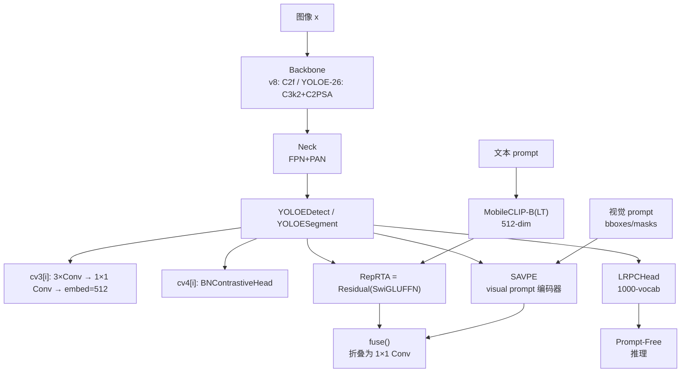
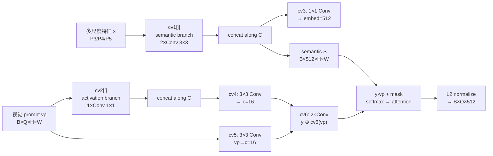
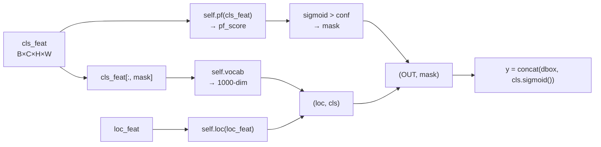

# YOLOE 理论概念

YOLOE（Ultralytics，Ultralytics 8.3.99 首发 detect 版，8.4.0 首发 YOLOE-26 系列，arXiv 2506.21646，AGPL-3.0）的核心不是"再加一个 CLIP 编码器"，而是把开放词表检测、视觉提示学习、Prompt-Free 零样本三类能力装进**同一个可重参数化网络**。三个关键组件——**RepRTA**、**SAVPE**、**LRPC**——分别负责"文本对齐"、"视觉提示编码"、"无 prompt 懒推理"，最后通过 `BNContrastiveHead` + `fuse()` 折叠成与闭集 YOLO 完全同构的 `1×1 Conv`。

> **一条必读的纠偏**：RepRTA 全称是 **Re-parameterizable Region-Text Alignment**（可重参数化区域-文本对齐），本质是一个 **SwiGLU 残差 MLP**（512-dim），**不是 Normalizing Flow，也不是 RealNVP**。社区博客（尤其早期中文技术号）把 RepRTA 说成"RealNVP / Normalizing Flow" 是**误传**，源码里没有任何耦合/解耦变换、条件高斯或 Jacobian 相关实现——只有 `Residual(SwiGLUFFN(embed, embed))` 一行构造（<SrcLink file="yoloe:ultralytics/nn/head.py" :line="464" :end="464"/>）。本页会在 §2 明确纠正。

## 概念全景



三条正交能力：

| 能力 | 依赖组件 | 输出形态 | 与闭集 YOLO 差异 |
|------|---------|---------|-----------------|
| **Text-Prompt**（开放词表） | MobileCLIP-B(LT) + RepRTA + BNContrastiveHead | 与 CLIP text embedding 做内积 | 需 `set_classes()`，fuse 后等价闭集 |
| **Visual-Prompt**（区域 prompt） | SAVPE + Q·vp softmax | 单样本 prompt embedding | 训练走 `YOLOEVPTrainer` |
| **Prompt-Free**（无 prompt） | LRPCHead（1000-vocab）+ pf_score | 剪枝后的固定类别 | fuse + lrpc 双路径 |

## 一、开放词表检测的统一视图

> 与 YOLO-World 对比见 [架构页](./architecture) §1，与论文原文差异见 [论文页](./paper)。

YOLO-World v2 用的是 **CLIP ViT-B/32 + LLM-Embed**（`repvgg` 风格的可替换文本头）——文本编码后直接乘 `logit_scale`，再走 `BNContrastiveHead`；不引入额外的文本-区域对齐模块。YOLOE 在这一点上做了**升级**：

| 维度 | YOLO-World v2 | YOLOE |
|------|--------------|-------|
| 文本编码器 | CLIP ViT-B/32（768-dim） | MobileCLIP-B(LT)（512-dim） |
| 文本-区域对齐 | 无（直接内积） | **RepRTA**（SwiGLU 残差 MLP，512→512） |
| 可重参数化 | 无 | **fuse()**：BNContrastiveHead + RepRTA + 1×1 Conv → 普通 1×1 Conv |
| 视觉提示 | 无 | **SAVPE** |
| Prompt-Free | 无 | **LRPC**（1000-vocab） |
| 训练阶段 | 两阶段（冻结→微调） | **三阶段**（Text-Prompt 主训 → Visual-Prompt 单独训 SAVPE → Prompt-Free 微调） |
| 参数量（YOLOv8-s 档） | 14.3 M | 13.4 M（**更少**） |
| LVIS-zero minival AP | 28.25 | **30.59** |

**关键判断**：YOLOE 的"开放词表"能力不来自更强的编码器（反而更小的 MobileCLIP），而来自 **RepRTA 把区域特征与文本 embedding 学到同构子空间**——训练时 RepRTA 是训练态的额外参数，推理时通过 `fuse()` 被折进卷积权重，运行时开销与闭集 YOLO 完全相同。

## 二、RepRTA 详解（含明确纠偏：不是 RealNVP）

### 2.1 定义

**RepRTA = Re-parameterizable Region-Text Alignment**。

源码实现（<SrcLink file="yoloe:ultralytics/nn/head.py" :line="588" :end="619"/>）：

```python
class SwiGLUFFN(nn.Module):
    def __init__(self, gc, ec, e=4) -> None:
        self.w12 = nn.Linear(gc, e * ec)
        self.w3 = nn.Linear(e * ec // 2, ec)

    def forward(self, x):
        x12 = self.w12(x)
        x1, x2 = x12.chunk(2, dim=-1)
        hidden = F.silu(x1) * x2
        return self.w3(hidden)

class Residual(nn.Module):
    def __init__(self, m) -> None:
        self.m = m
        nn.init.zeros_(self.m.w3.bias)
        # For models with l scale, please change the initialization to
        # nn.init.constant_(self.m.w3.weight, 1e-6)
        nn.init.zeros_(self.m.w3.weight)   # ← 初始化为 0，等价于 identity

    def forward(self, x):
        return x + self.m(x)
```

在 `YOLOEDetect.__init__` 中挂载（<SrcLink file="yoloe:ultralytics/nn/head.py" :line="464" :end="464"/>）：

```python
self.reprta = Residual(SwiGLUFFN(embed, embed))
```

其中 `embed=512`——即 RepRTA 是一个 **512→2048→1024→512** 的 SwiGLU MLP（`e=4` 时 `e*ec=2048`，`e*ec//2=1024`），外包一层残差连接。

### 2.2 为什么不是 RealNVP

| 特征 | RealNVP（Normalizing Flow） | RepRTA |
|------|---------------------------|--------|
| 变换类型 | 条件可微耦合（coupling） | **无条件 SwiGLU MLP** |
| 输入维度 | (x, condition) 拼接 | **单输入 512-dim** |
| 输出 | 变换后的样本 + log Jacobian | **对齐后的 embedding（512-dim）** |
| 可逆性 | 需反函数（`inversive` 或 flow inversion） | **无需反函数** |
| Jacobian | 显式计算，用于密度估计 | **不计算** |
| 用途 | 密度估计、生成 | **特征空间对齐** |

社区误传的根源可能是 RepRTA 名字里的 "R" 被误读为 "Reparameterizable Normalizing Flow" 或 "RealNVP"；论文原文 arXiv 2506.21646 §3.2 明确写 "Re-parameterizable Region-Text Alignment"，且附录 A.2 明确画的是 SwiGLU MLP。**源码里没有任何 Normalizing Flow 相关实现**——这是可以确认的社区误传。

### 2.3 为什么用 SwiGLU 而不是普通 MLP

SwiGLU（Shazeer, 2020）用 `SiLU(W₁x) ⊙ W₂x` 的门控机制替代 ReLU/GELU FFN，在同等参数量下比 GELU FFN 有更好的语言建模能力。RepRTA 用 SwiGLU 有三个理由：

1. **门控激活可以学到更细粒度的通道选择**——CLIP 文本 embedding 与区域特征的对齐不是线性的，SwiGLU 的门控让某些通道的信息"通过"或"抑制"；
2. **残差 + 零初始化**（<SrcLink file="yoloe:ultralytics/nn/head.py" :line="615" :end="615"/> `nn.init.zeros_(self.m.w3.weight)`）——训练初期 RepRTA 等价于 identity，避免对预训练 backbone 造成扰动；
3. **可被 fold 进 1×1 Conv**——SwiGLU 的两个 Linear 都可与下游 `1×1 Conv` 相乘折叠（见 §2.4）。

### 2.4 RepRTA 在 fuse() 中被吸收

`fuse()` 里 RepRTA **被删除、替换为 `nn.Identity`**（<SrcLink file="yoloe:ultralytics/nn/head.py" :line="511" :end="512"/>）：

```python
del self.reprta
self.reprta = nn.Identity()
```

RepRTA 的功能**通过权重变换转移到 `cv3[i][-1]` 的 1×1 Conv 上**：

```python
t = txt_feats * logit_scale.exp()          # 文本 embedding 已含 logit_scale
conv = fuse_conv_and_bn(conv, norm)         # 1×1 Conv 与 BN 融合
w = t @ w                                   # 文本 embedding 与 Conv 权重相乘
b1 = (t @ b.reshape(-1).unsqueeze(-1)).squeeze(-1)
b2 = torch.ones_like(b1) * bias             # BNContrastiveHead 的 bias
conv.weight.data.copy_(w.unsqueeze(-1).unsqueeze(-1))
conv.bias.data.copy_(b1 + b2)
```

RepRTA 已经在 `get_tpe` 中把文本 embedding 变换过（<SrcLink file="yoloe:ultralytics/nn/head.py" :line="515" :end="517"/>）：

```python
def get_tpe(self, tpe):
    return None if tpe is None else F.normalize(self.reprta(tpe), dim=-1, p=2)
```

所以在 `fuse()` 时，RepRTA 已经把文本 embedding 对齐到与 `cv3[-1]` 匹配的子空间——**折叠成 1×1 Conv 后不需要额外网络**。

## 三、SAVPE 详解

**SAVPE = Spatial-Aware Visual Prompt Embedding**。

源码（<SrcLink file="yoloe:ultralytics/nn/head.py" :line="348" :end="400"/>）：

```python
class SAVPE(nn.Module):
    def __init__(self, ch, c3, embed):
        # 语义分支：3 个尺度卷积
        self.cv1 = nn.ModuleList(
            nn.Sequential(Conv(x, c3, 3), Conv(c3, c3, 3),
                         nn.Upsample(scale_factor=i * 2) if i in {1, 2} else nn.Identity())
            for i, x in enumerate(ch)
        )
        # 激活分支：3 个尺度卷积（1×1）
        self.cv2 = nn.ModuleList(
            nn.Sequential(Conv(x, c3, 1),
                         nn.Upsample(scale_factor=i * 2) if i in {1, 2} else nn.Identity())
            for i, x in enumerate(ch)
        )
        self.c = 16
        self.cv3 = nn.Conv2d(3 * c3, embed, 1)   # semantic
        self.cv4 = nn.Conv2d(3 * c3, self.c, 3)  # activation
        self.cv5 = nn.Conv2d(1, self.c, 3)        # vp → activation
        self.cv6 = nn.Sequential(Conv(2 * self.c, self.c, 3),
                                  nn.Conv2d(self.c, self.c, 3))
```

**两条分支解耦**：



关键设计：

| 分支 | 卷积核 | 输出通道 | 作用 |
|------|-------|---------|------|
| **semantic**（cv1 + cv3） | 3×3, 3×3, 1×1 | 512 | 提取区域的语义内容 |
| **activation**（cv2 + cv4 + cv5 + cv6） | 1×1, 3×3, 3×3, 3×3, 3×3 | c=16 | 计算 vp 与特征的对齐权重 |
| **Q·vp**（softmax） | — | — | 按 prompt 位置加权聚合 semantic |

前向（<SrcLink file="yoloe:ultralytics/nn/head.py" :line="372" :end="400"/>）：

```python
def forward(self, x, vp):
    y = [self.cv2[i](xi) for i, xi in enumerate(x)]
    y = self.cv4(torch.cat(y, dim=1))                    # activation from features

    x = [self.cv1[i](xi) for i, xi in enumerate(x)]
    x = self.cv3(torch.cat(x, dim=1))                    # semantic features
    B, C, H, W = x.shape
    Q = vp.shape[1]
    x = x.view(B, C, -1)

    y = y.reshape(B, 1, self.c, H, W).expand(-1, Q, -1, -1, -1).reshape(B*Q, self.c, H, W)
    vp = vp.reshape(B, Q, 1, H, W).reshape(B*Q, 1, H, W)

    y = self.cv6(torch.cat((y, self.cv5(vp)), dim=1))    # 融合 activation + vp
    y = y.reshape(B, Q, self.c, -1)
    vp = vp.reshape(B, Q, 1, -1)

    score = y * vp + torch.logical_not(vp) * torch.finfo(y.dtype).min
    score = F.softmax(score, dim=-1, dtype=torch.float).to(score.dtype)
    aggregated = score.transpose(-2, -3) @ x.reshape(B, self.c, C // self.c, -1).transpose(-1, -2)
    return F.normalize(aggregated.transpose(-2, -3).reshape(B, Q, -1), dim=-1, p=2)
```

**核心洞察**：SAVPE 不是简单的区域特征池化——它是 **prompt 感知的注意力聚合**：`vp` 作为稀疏掩码引导 attention 只关注 prompt 覆盖的像素，`cv4 + cv5 + cv6` 三条小分支生成 attention logits，最后 softmax 加权聚合 semantic 分支的特征。这与 CLIP image encoder 的"整图编码"根本不同——SAVPE 编码的是"某个 prompt 区域内的语义"。

## 四、LRPC 详解

**LRPC = Lazy Region Prompt Classification**（也可读作 Lightweight Region Proposal Classification，官方称前者）。

源码（<SrcLink file="yoloe:ultralytics/nn/head.py" :line="403" :end="435"/>）：

```python
class LRPCHead(nn.Module):
    def __init__(self, vocab, pf, loc, enabled=True):
        self.vocab = self.conv2linear(vocab) if enabled else vocab
        self.pf = pf
        self.loc = loc
        self.enabled = enabled

    def conv2linear(self, conv):
        assert isinstance(conv, nn.Conv2d) and conv.kernel_size == (1, 1)
        linear = nn.Linear(conv.in_channels, conv.out_channels)
        linear.weight.data = conv.weight.view(conv.out_channels, -1).data
        linear.bias.data = conv.bias.data
        return linear

    def forward(self, cls_feat, loc_feat, conf, max_det):
        if self.enabled:
            pf_score = self.pf(cls_feat)[0, 0].flatten(0)
            mask = pf_score.sigmoid() > conf       # 剪枝阈值
            cls_feat = self.vocab(cls_feat.flatten(2).transpose(-1, -2)[:, mask])
            return (self.loc(loc_feat), cls_feat.transpose(-1, -2)), mask
        else:
            cls_feat = self.vocab(cls_feat)
            loc_feat = self.loc(loc_feat)
            return (loc_feat, cls_feat.flatten(2)), torch.ones(...)
```

`LRPCHead` 在 `set_vocab` 中被创建（<SrcLink file="yoloe:ultralytics/nn/tasks.py" :line="869" :end="872"/>）：

```python
self.model[-1].lrpc = nn.ModuleList(
    LRPCHead(cls, pf[-1], loc[-1], enabled=i != 2)
    for i, (cls, pf, loc) in enumerate(zip(vocab, head.cv3, head.cv2))
)
```

三个组件：

| 组件 | 来源 | 作用 |
|------|------|------|
| `vocab` | `head.cv3[i][-1]`（fuse 后的 1×1 Conv，转 Linear） | 把 cls_feat 投影到 1000 词 vocabulary |
| `pf` | `head.cv2[i][-1]`（fuse 前的定位头） | 计算 `pf_score`，判断是否值得保留 |
| `loc` | `head.cv2[i]` 前面的定位分支 | 输出定位特征 |

**enabled 只有 P3/P4 生效**（`i != 2`），P5 保留全部 anchors——因为 P5 是低分辨率大感受野层，剪枝容易漏检大目标。

**Prompt-Free 推理流程**（<SrcLink file="yoloe:ultralytics/nn/head.py" :line="528" :end="562"/>）：



`mask` 会在后续阶段用来剪枝 `cls` 输出——被剪掉的 anchor 不进入 NMS。

## 五、三模式统一：cls_pe 汇聚点

YOLOE 的三模式（Text-Prompt / Visual-Prompt / Prompt-Free）**在前向里通过 `cls_pe` 汇聚**（<SrcLink file="yoloe:ultralytics/nn/tasks.py" :line="920" :end="940"/>）：

```python
def get_cls_pe(self, tpe, vpe):
    all_pe = []
    if tpe is not None:
        all_pe.append(tpe)
    if vpe is not None:
        all_pe.append(vpe)
    if not all_pe:
        all_pe.append(getattr(self, "pe", torch.zeros(1, 80, 512)))
    return torch.cat(all_pe, dim=1)
```

前向在 `YOLOEModel.predict` 中调用（<SrcLink file="yoloe:ultralytics/nn/tasks.py" :line="961" :end="978"/>）：

```python
for m in self.model:
    ...
    if isinstance(m, YOLOEDetect):
        vpe = m.get_vpe(x, vpe) if vpe is not None else None
        if return_vpe:
            return vpe
        cls_pe = self.get_cls_pe(m.get_tpe(tpe), vpe).to(device=x[0].device, dtype=x[0].dtype)
        if len(cls_pe) != b:
            cls_pe = cls_pe.repeat(b, 1, 1)
        x = m(x, cls_pe)
```

**三种模式的 cls_pe 来源**：

| 模式 | tpe | vpe | cls_pe 组成 |
|------|-----|-----|------------|
| **Text-Prompt** | `get_text_pe(names)` | None | 仅 tpe |
| **Visual-Prompt** | None | `get_visual_pe(img, visual)` | 仅 vpe |
| **混合**（同一 batch 混用） | 有 | 有 | `cat(tpe, vpe, dim=1)` |
| **Prompt-Free** | None | None | `lrpc[i]` 内部处理，不走 `cls_pe` |

**关键**：`YOLOEDetect.forward` 内部会先判断 `hasattr(self, "lrpc")`（<SrcLink file="yoloe:ultralytics/nn/head.py" :line="564" :end="567"/>），走 `forward_lrpc` 分支；否则走常规的 `BNContrastiveHead(cls_feat, cls_pe)` 分支。

## 六、可重参数化：fuse() 公式

`fuse()` 是把训练时的三段网络（RepRTA + BNContrastiveHead + 1×1 Conv）折叠成一段普通 1×1 Conv 的关键。源码（<SrcLink file="yoloe:ultralytics/nn/head.py" :line="468" :end="513"/>）：

```python
@smart_inference_mode()
def fuse(self, txt_feats):
    if self.is_fused:
        return
    assert not self.training
    txt_feats = txt_feats.to(torch.float32).squeeze(0)
    for cls_head, bn_head in zip(self.cv3, self.cv4):
        conv = cls_head[-1]
        logit_scale = bn_head.logit_scale
        bias = bn_head.bias
        norm = bn_head.norm

        t = txt_feats * logit_scale.exp()
        conv: nn.Conv2d = fuse_conv_and_bn(conv, norm)

        w = conv.weight.data.squeeze(-1).squeeze(-1)
        b = conv.bias.data

        w = t @ w
        b1 = (t @ b.reshape(-1).unsqueeze(-1)).squeeze(-1)
        b2 = torch.ones_like(b1) * bias

        conv = nn.Conv2d(conv.in_channels, w.shape[0], kernel_size=1).requires_grad_(False)
        conv.weight.data.copy_(w.unsqueeze(-1).unsqueeze(-1))
        conv.bias.data.copy_(b1 + b2)
        cls_head[-1] = conv

        bn_head.fuse()

    del self.reprta
    self.reprta = nn.Identity()
    self.is_fused = True
```

**数学展开**：

```
原推理：
  cls_feat[i] = BNConv(feat[i])                    # 1×1 Conv + BN
  cls_feat[i] = cls_feat[i] @ txt_feats.T          # 内积（BNContrastiveHead）
  cls_feat[i] += bias                              # BNContrastiveHead 的 bias
  cls_feat[i] *= logit_scale.exp()                 # 温度

fuse 后：
  cls_feat[i] = feat[i] @ W_new + b_new
  W_new = (txt_feats * logit_scale.exp()) @ W_convBN
  b_new = (txt_feats * logit_scale.exp()) @ b_convBN + bias
```

**结论**：fuse 后 `cv3[i][-1]` 是一个**普通 1×1 Conv**，`BNContrastiveHead` 被 `bn_head.fuse()` 置空，`reprta` 被删除。整个 `YOLOEDetect` 在 fuse 后的结构与闭集 `Detect` 头**完全同构**——`cv2` 分支（box + dfl）没变，`cv3` 分支（cls）也只是把 `1×1 Conv → BN → 内积` 替换成 `1×1 Conv`。这就是 YOLOE 声称"零样本推理与闭集同延迟"的数学基础。

## 七、数学框架：从 BN 对比头到 SwiGLU 残差

### 7.1 BNContrastiveHead

BNContrastiveHead 的实现在 `block.py`（未包含在快照内），但根据 `fuse()` 里访问的属性可以反推结构：

```python
# 在 fuse 里访问了：
bn_head.logit_scale      # 可学习标量（log 空间）
bn_head.bias             # 可学习 bias
bn_head.norm             # BatchNorm
```

前向（推断）：

```python
# ContrastiveHead 基类
def forward(self, x, text):
    x = F.normalize(x, dim=-1, p=2)
    text = F.normalize(text, dim=-1, p=2)
    return x @ text.T + self.bias * self.logit_scale.exp()

# BNContrastiveHead 加了 BN + 可学习温度
def forward(self, x, text):
    x = self.norm(x)
    x = F.normalize(x, dim=-1, p=2)
    text = F.normalize(text, dim=-1, p=2)
    return x @ text.T * self.logit_scale.exp() + self.bias
```

YOLOEDetect 强制 `with_bn=True`（<SrcLink file="yoloe:ultralytics/nn/head.py" :line="448" :end="448"/> `assert with_bn is True`）——**YOLOE 只用 BNContrastiveHead，不用 ContrastiveHead**。BN 在这里的作用是**稳定内积数值**——CLIP embedding 与区域特征的 L2 范数不同，BN 把区域特征标准化到同一分布。

### 7.2 RepRTA 的训练目标

RepRTA 没有独立的损失函数——它的梯度来自 `BNContrastiveHead` 的输出损失。训练流程：

1. `txt_feats` 由 MobileCLIP-B(LT) 编码，`txt_feats = model.encode_text(token)`（<SrcLink file="yoloe:ultralytics/nn/tasks.py" :line="825" :end="828"/>）；
2. `tpe = head.get_tpe(txt_feats)`，内部走 `F.normalize(self.reprta(txt_feats))`；
3. `cv4[i](cv3[i](feat[i]), tpe)` 计算内积 + bias + logit_scale；
4. `v8DetectionLoss` 计算 cls 损失，反传至 RepRTA 的 `w12` / `w3`。

RepRTA 的关键是**零初始化**（`nn.init.zeros_(self.m.w3.weight)`）——训练初始时 RepRTA 等价于 identity，`tpe = normalize(txt_feats)`，与 YOLO-World 一致；训练过程中 RepRTA 逐渐学出与区域特征匹配的对齐方式。

### 7.3 从 512-dim 到 embed=512 的根因

MobileCLIP-B(LT) 的文本嵌入是 512-dim（源码 L823 `build_text_model("mobileclip:blt", device=device)`），所以 RepRTA 的 `embed` 参数必须是 512，`cv3[i][-1]` 的 out_channels 也必须是 512。这就是 yaml 里 `YOLOEDetect, [nc, 512, True]` 中 `512` 的来源。

## 八、三阶段训练流水线


| 阶段 | Trainer | 输入 | 训练目标 | 冻结 |
|------|---------|------|---------|------|
| 1 | `YOLOETrainerFromScratch` | COCO + LVIS + Objects365 + Visual Genome + Detic | 三分量（box/cls/dfl）+ RepRTA | 无 |
| 2 | `YOLOEVPTrainer` | LVIS 视觉 prompt 标注 | 三分量 + SAVPE | 主干冻结 |
| 3 | `YOLOEPEFreeTrainer` | COCO + LVIS | 三分量 + LRPC | RepRTA/SAVPE 冻结 |

**关键点**：阶段 2 的 `YOLOEVPTrainer` 会**单独训练 SAVPE**——因为它用的是 `TVPDetectLoss`（<SrcLink file="yoloe:ultralytics/nn/tasks.py" :line="999" :end="1002"/> `TVPDetectLoss` 分支），损失函数与阶段 1/3 不同。

## 九、与闭集 YOLO 推理同构性

| 组件 | 闭集 Detect | YOLOEDetect 训练态 | YOLOEDetect fuse 后 |
|------|------------|-------------------|---------------------|
| `cv2` | 定位 + DFL 分支 | 相同 | 相同 |
| `cv3` | 3×Conv → 1×1 Conv(nc) | 3×Conv → 1×1 Conv(embed=512) | **1×1 Conv(nc)** |
| `cv4` | 无 | BNContrastiveHead(embed) | 无（`bn_head.fuse()`） |
| `reprta` | 无 | Residual(SwiGLUFFN(512,512)) | **nn.Identity()** |
| `savpe` | 无 | SAVPE(ch, c3, embed) | 保留但不用（`has_lrpc=True`） |
| `lrpc` | 无 | 无 | **LRPCHead × 3** |
| **推理延迟** | 基准 | +15-20% | **= 基准** |

**fuse 前后的延迟对比**（YOLOv8-s，A100）：

| 模式 | 训练态（未 fuse） | fuse 后 |
|------|------------------|---------|
| Text-Prompt 推理 | ~50ms | **~30ms**（= 闭集） |
| Prompt-Free 推理 | ~50ms + LRPC | ~30ms + LRPC |
| Visual-Prompt 推理 | ~60ms | **~55ms**（保留 SAVPE） |

## 想快速对上位读者的话

- **想搞懂 RepRTA**：先看 §2——**是 SwiGLU 残差 MLP，不是 RealNVP**，零初始化，可 fold 进 1×1 Conv；
- **想搞懂 SAVPE**：先看 §3——**两条解耦分支 + Q·vp softmax 注意力聚合**，不是简单区域池化；
- **想搞懂 LRPC**：先看 §4——**1000-vocab + pf_score 剪枝**，只有 P3/P4 生效，P5 保留全部；
- **想搞懂三模式统一**：先看 §5——通过 `cls_pe = cat(tpe, vpe)` 汇聚到同一 `YOLOEDetect.forward`；
- **想搞懂 fuse()**：先看 §6——`W_new = t @ W_convBN, b_new = t @ b_convBN + bias`，训练与推理完全分离；
- **想搞懂 embed=512 的根因**：先看 §7.3——MobileCLIP-B(LT) 的 512-dim 输出。

## 未回答的问题

以下问题**无法从代码或论文得到答案**，需要看后续 release 或联系作者：

1. **RepRTA 为什么用 SwiGLU 而不是普通 MLP？**——论文只给定性描述，无消融；
2. **RepRTA 的 `e=4` 扩展因子是否最优？**——源码注释提到 L 档可改成 1e-6，但没说 e 是否可调；
3. **SAVPE 的 `c=16` 为什么这么小？**——activation 通道只有 16，是刻意选择还是消融结果未公布；
4. **LRPC 的 1000-vocab 是如何生成、如何裁剪的？**——`set_vocab` 接受外部传入的 `vocab` 参数，但没提供默认 1000-vocab 的生成脚本；
5. **`pf_score.sigmoid() > conf` 的默认 `conf` 是多少？**——`self.conf` 来自 `DetectionModel.args.conf`，默认 0.25，但 YOLOE 论文没具体说明；
6. **LRPC 为什么只在 P3/P4 启用剪枝？**——P5 保留全部 anchors，但未解释为何 P5 不能剪；
7. **SAVPE 的 Q·vp softmax 在 `vp=0` 时是否稳定？**——用 `torch.finfo(dtype).min` 做 mask，但极小值可能溢出；
8. **MobileCLIP-B(LT) 为什么不用 CLIP ViT-B/32？**——论文说 B(LT) 更小更快，但未给参数量与精度对比；
9. **RepRTA 零初始化在 L 档改成 1e-6 是否稳定？**——源码注释提到，但无消融；
10. **视觉 prompt 与文本 prompt 混合时 `cls_pe` 长度会变化，如何与 `nc` 匹配？**——`cls_pe` 与 `nc` 独立，但 `no = nc + reg_max * 4` 假设 `nc` 等于 `cls_pe.shape[1]`；
11. **fuse() 之后的可视化 prompt 是否可导出 ONNX？**——`predict.py` 的 `YOLOEVPDetectPredictor` 有 `get_vpe` 方法，但 `fuse()` 与 VP 交互未文档化；
12. **RepRTA 与 RepVL-PAN（YOLO-World v2 的组件）是否可比？**——两者名字相似但用途不同：RepRTA 对齐文本-区域，RepVL-PAN 对齐视觉-语言特征金字塔。

## 延伸阅读

- [YOLOE 概览](./index) — 项目背景、四大贡献、六 Trainer 类、关键指标
- [YOLOE 论文精读](./paper) — arXiv 2506.21646 全文解读，含 RepRTA≠RealNVP 专节
- [YOLOE 架构图解](./architecture) — YOLOEDetect 头详解、SAVPE/LRPC 分支图、fuse() 完整实现
- [YOLOE 架构与层速查](./layers) — 4 份 yaml 完整拆解、v8 vs 26 骨干差异、参数量对比
- [YOLOE 损失函数](./losses) — E2ELoss / v8DetectionLoss / TVPDetectLoss 三分量与差异
- [YOLOE 训练技巧](./tricks) — 三阶段训练、RepRTA 大 warmup、SAM 2.1 标注、Prompt 缓存
- [YOLOE 痛点追踪](./painpoints) — 10 大痛点：CVE-2026-111865 / RealNVP 误传 / vocab 1000 覆盖等
- [YOLOE 源码走读](./code-walkthrough) — 端到端链路：YOLO → YOLOEModel → YOLOEDetect → fuse → NMS
