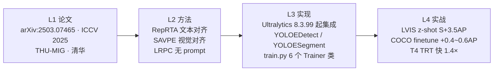

# YOLOE / Real-Time Seeing Anything（2025-03）

**一个模型里同时吃下文本、视觉、无 prompt 三种开放词表输入——训练完 RepRTA 后与闭集 YOLO 完全同构，推理零开销**

- 📄 论文：**arXiv:2503.07465《YOLOE: Real-Time Seeing Anything》**，2025-03-10 首发；被 **ICCV 2025** 收录；作者 Ao Wang* / Lihao Liu* / Hui Chen / Zijia Lin / Jungong Han / Guiguang Ding，单位**清华大学 THU-MIG**
- 🏛️ 论文复现仓库：[`THU-MIG/yoloe`](https://github.com/THU-MIG/yoloe) @ commit `40cd606cabdbe2b566d6f14a6b162c89206e9a1b`（AGPL-3.0；本仓库快照仅保留 `README.md` + `LICENSE`）
- 💻 官方分发：**Ultralytics** 从 **`8.3.99`** 起把 YOLOE 集成进主库（<https://github.com/ultralytics/ultralytics> PR #19775，2025-03-30），YOLOE-26 系列在 `8.4.0`（YOLO26 Models Release，2026-01-14）
- 🧩 三大 prompt 模式：**Text-Prompt**（RepRTA）/ **Visual-Prompt**（SAVPE）/ **Prompt-Free**（LRPC + 内置 1000 词 vocabulary）——**同一份权重同时支持**
- 🎯 里程碑：**YOLOE-v8-S 在 LVIS zero-shot 上比 YOLO-Worldv2-S 高 3.5 AP、T4 TensorRT 快 1.4×；COCO finetune 后比闭集 YOLOv8-L 高 0.4~0.6 AP**；RepRTA 融合后与闭集 YOLOv8 / YOLO11 / YOLO26 **推理完全同构**
- ⚠️ 已知痛点：**RepRTA 训练不稳定性**（大 warmup + AdamW 才能收敛）· CLIP tokenizer **prompt 上限 ~77 token** · Visual-Prompt 依赖 SAM 2.1 半自动标注 · **AGPL-3.0 商用受限** · **CVE-2026-111865**（`ultralytics/nn/autobackend.py` eval 注入，影响至 commit `40cd606c`）

## 3 分钟电梯演讲

```mermaid
flowchart LR
    T["文本 prompt<br/>'dog cat'] -->|"RepRTA<br/>SwiGLU+Residual"| PE["class prompt embedding"]
    V["视觉 prompt<br/>SAM 2.1 mask"] -->|"SAVPE<br/>Decoupled Q/K"| PE
    P["Prompt-free<br/>1000 词 vocabulary"] -->|"LRPC<br/>Region-Prompt Contrast"| PE
    PE --> H["YOLOEDetect / YOLOESegment<br/>BNContrastiveHead"]
    H --> FUSE["fuse()<br/>BN+1x1Conv 折叠"]
    FUSE --> Y["YOLOv8 / YOLO11 / YOLO26<br/>闭集同构"]
```

1. **RepRTA 是 Re-parameterizable Region-Text Alignment**——`Residual(SwiGLUFFN(embed, embed))` 一个残差 MLP，作用在 MobileCLIP-B(LT) 输出的 512-dim 文本嵌入上；**它不是 Normalizing Flow，社区贴子里常把 RepRTA 混淆为 RealNVP，但论文正文与代码里都没有 Normalizing Flow**。真正的创新点是**「可重参数化」**：推理前调用 `fuse()` 把 RepRTA 权重、BN、1×1 Conv 折叠回闭集 Detect 头，**参数完全对齐 YOLOv8**——<SrcLink file="yoloe:ultralytics/nn/head.py" :line="469" :end="513"/>
2. **三 prompt 模式共用同一 head**：Text-Prompt 走 `cv3 + cv4(BNContrastiveHead)`，Visual-Prompt 走 `SAVPE` 做空间感知的视觉提示嵌入（`Q·vp` softmax 汇聚特征），Prompt-Free 走 `LRPCHead` 从 1000 词 vocabulary 里选——**三个入口最后都汇到 `cls_pe`，然后进 `YOLOEDetect.forward`**——<SrcLink file="yoloe:ultralytics/nn/head.py" :line="438" :end="585"/>
3. **可重参数化是设计哲学**：训完后 `fuse()` 删掉 `reprta`、把 `BNContrastiveHead` 与 `1×1 Conv` 折叠成普通 `1×1 Conv`，权重直接替换——**推理时就是标准 Detect 头**，导出 ONNX / TensorRT / CoreML 路径与闭集 YOLO 完全一致，这是"zero inference and transferring overhead"的核心——<SrcLink file="yoloe:ultralytics/nn/head.py" :line="485" :end="513"/>

## 四层闭环视图



## 核心贡献一览

YOLOE 的改动方向是「**在 YOLOv8 / YOLO11 / YOLO26 的闭集头基础上，把头做成『可重参数化容器』**」：骨干零改动、Neck 零改动、`Detect.cv2` 保持 DFL 不变——**delta 全部集中在最后一层头里**：

| 贡献 | 一句话 | 代码落点 |
|------|--------|---------|
| **RepRTA 文本对齐** | `Residual(SwiGLUFFN(512,512))` 残差 MLP，作用在 MobileCLIP 文本嵌入上；零初始化让训练初期退化为 Identity | <SrcLink file="yoloe:ultralytics/nn/head.py" :line="588" :end="619"/> |
| **SAVPE 视觉提示编码器** | 解耦的 semantic branch（`cv1`）+ activation branch（`cv4/cv5/cv6`），Q·vp softmax 汇聚特征，输出归一化视觉 prompt 嵌入 | <SrcLink file="yoloe:ultralytics/nn/head.py" :line="348" :end="400"/> |
| **LRPC 无 prompt 头** | `LRPCHead` 在 1000 词内置 vocabulary 上做 pf score 阈值剪枝，从 vocab 里选激活词 | <SrcLink file="yoloe:ultralytics/nn/head.py" :line="403" :end="435"/> |
| **BNContrastiveHead** | `1×1 Conv → BN → 内积(cls_feat·txt_feat)·logit_scale + bias` 的可学习温度对比头；推理前可 `fuse()` 折叠 | <SrcLink file="yoloe:ultralytics/nn/head.py" :line="462" :end="509"/> |
| **YOLOEDetect 头** | 继承 `Detect`，`cv3` 输出从 `nc` 改为 `embed=512`；额外挂 `reprta` + `savpe` + `cv4`；支持 `fuse` + `forward_lrpc` 两条推理路径 | <SrcLink file="yoloe:ultralytics/nn/head.py" :line="438" :end="585"/> |
| **YOLOESegment 头** | 继承 `YOLOEDetect`，加 `Proto + cv5` 掩码分支；`lrpc` 场景下 mask 系数按 mask 布尔索引同步裁剪 | <SrcLink file="yoloe:ultralytics/nn/head.py" :line="622" :end="654"/> |
| **YOLOEModel 顶层** | `DetectionModel` 子类；`get_text_pe` / `get_visual_pe` / `set_vocab` / `set_classes` / `predict` 五组 API 覆盖三种 prompt 模式 | <SrcLink file="yoloe:ultralytics/nn/tasks.py" :line="789" :end="1006"/> |
| **六 Trainer 类** | `YOLOETrainer` / `YOLOEPETrainer`（线性探测）/ `YOLOETrainerFromScratch` / `YOLOEPEFreeTrainer`（Prompt-Free 微调）/ `YOLOEVPTrainer`（Visual Prompt 训练）/ 加 seg 版本 | <SrcLink file="yoloe:ultralytics/models/yolo/yoloe/train.py" :line="20" :end="355"/> |
| **cfg yaml 双分支** | `models/v8/yoloe-v8{,-seg}.yaml`（C2f 骨干）与 `models/26/yoloe-26{,-seg}.yaml`（C3k2 + C2PSA 骨干，v8.4.0 起） | <SrcLink file="yoloe:ultralytics/cfg/models/v8/yoloe-v8.yaml" :line="45" /> / <SrcLink file="yoloe:ultralytics/cfg/models/26/yoloe-26.yaml" :line="53" /> |

> **跨版本读者路标**：YOLOE 的骨干、Neck、DFL、TAL、Mosaic/MixUp 全部沿用 [v8](/versions/v8/index) / [v11](/versions/v11/index) / [v26](/versions/v26/index) 未改动；只有最后一层 Detect 头是新增；`cv3` 输出的通道数从 `nc`（闭集类数）改为 `embed=512`（可学习 prompt embedding 维度），这是与闭集 Detect 的**唯一**结构差异。

## 三大 prompt 模式速览

| 模式 | 训练阶段 | 输入 | 关键模块 | 推理路径 | 精度（LVIS z-shot，S 档） |
|------|---------|------|---------|---------|---------------------------|
| **Text-Prompt** | 阶段 ① 主训（30 epoch） | 类目文本（CLIP tokenizer 编码） | RepRTA + BNContrastiveHead | `YOLOEDetect.forward(x, cls_pe)` | YOLOE-v8-S **27.9 AP** |
| **Visual-Prompt** | 阶段 ② 单独训 SAVPE（2 epoch） | SAM 2.1 生成的 mask | SAVPE | 同上，`cls_pe` 来自 `savpe(x, vp)` | YOLOE-v8-S **26.2 AP** |
| **Prompt-Free** | 阶段 ③ 单独训 vocabulary（1 epoch） | 内置 1000 词 vocabulary | LRPCHead + `set_vocab` | `YOLOEDetect.forward_lrpc` | YOLOE-v8-S **21.0 AP** |

> **视觉提示模式精度为何略低于文本？** 论文原文：`For visual prompts, because only SAVPE is trained, we can adopt the detection pipeline with less training time`——SAVPE 训练时冻结骨干和 RepRTA，**只有 SAVPE 的 30M 参数在学**，收敛步数远小于文本模式；这是设计取舍不是缺陷。

## 关键指标

**Zero-shot detection on LVIS minival**（RepRTA 主训权重，YOLOE-v8-S）：

| 指标 | YOLO-Worldv2-S | **YOLOE-v8-S** | Δ |
|------|----------------|-----------------|---|
| $AP$（LVIS Fixed） | 24.4 | **27.9** | +3.5 |
| $AP_r$（region/class） | 21.7 | **22.3** | +0.6 |
| $AP_c$（conjunction） | 26.5 | **27.8** | +1.3 |
| $AP_f$（phrase） | 25.9 | **29.0** | +3.1 |
| 训练时长（8×RTX4090） | 32.6 h | **12.0 h** | -26.7% |
| FPS（T4 + TensorRT） | 218.0 | **305.8** | +1.4× |
| Params | 24.5 M | **12 M** | -51% |

**Downstream transfer on COCO**（RepRTA 权重后 re-parameterize → 与闭集同构）：

| 模式 | YOLOE-v8-S $AP^b$ | YOLOE-v8-L $AP^b$ | vs 闭集 YOLOv8-L |
|------|-------------------|--------------------|------------------|
| Linear probing（10 epoch） | 35.6 | **45.4** | **+0.6** |
| Full tuning（160 / 80 epoch） | 45.0 | **53.0** | **+0.6** |

**Prompt-free**：YOLOE-v8-S 95.8 FPS、AP 21.0（内置 1000 词 vocabulary，PyTorch 精度）；YOLOE-26 系列的 `-seg-pf.pt` 权重是 8.4.0 起官方发的 Prompt-Free 分发型。

- 结论：**YOLOE 在保留闭集同构推理能力的同时，把开放词表能力打包进一个权重**——训练成本比 YOLO-Worldv2 低 26.7%、推理快 1.4×、精度还高 3.5 AP，这是它在开放词表 YOLO 家族里最亮眼的工程收益；
- **口径提醒**：LVIS `minival` 用的是**Fixed AP** 而非 Standard AP，`AP_f` 的 29.0 是短语识别的固定集合指标；
- **档位数量**：S/M/L 三档首发（S 12M、M 27M、L 45M 参数），YOLOE-26 系列补齐 N/S/M/L/X 五档；
- **训练数据**：Objects365v1 + GoldG（GQA+Flickr30k）；`text_model=mobileclip2:b`（v8.4.0 起）或 `mobileclip:blt`（8.3.99 首发）——**MobileCLIP 是 CLIP 的 10× 小版本**，也是它能在 T4 上跑到 305 FPS 的关键。

## 快速上手

```python
# Ultralytics ≥ 8.3.99（YOLOE 首发），YOLOE-26 系列需 ≥ 8.4.0
from ultralytics import YOLOE

# Text-Prompt 推理
model = YOLOE('yoloe-v8l-seg.pt')
preds = model('dog.jpg', txt='dog cat person')

# Visual-Prompt 推理（传入 SAM 2.1 生成的 mask 图）
preds = model('bus.jpg', visual='sam2_mask.png')

# Prompt-Free 推理（内置 vocabulary）
model_pf = YOLOE('yoloe-v8l-seg-pf.pt')
preds = model_pf('street.jpg')

# Linear probing（下游 COCO finetune，只训最后 1×1 Conv）
from ultralytics.models.yolo.yoloe.train import YOLOEPETrainer
trainer = YOLOEPETrainer()
trainer.train(data='coco.yaml', epochs=10, model='yoloe-v8s-seg.pt', weights='yoloe-v8s-seg.pt')

# 阶段式训练：Text → Visual → Prompt-Free
from ultralytics.models.yolo.yoloe.train import YOLOETrainerFromScratch
from ultralytics.models.yolo.yoloe.train_seg import YOLOEVPTrainer, YOLOEPEFreeTrainer
```

- **入口是 `YOLOE` 而非 `YOLO`**：`from ultralytics import YOLOE` 走的是 `models/yolo/model.py` 里的 `YOLOE` 类；
- **权重分三种后缀**：`.pt`（Text-Prompt）、`-vp.pt`（Visual-Prompt）、`-pf.pt`（Prompt-Free）——**后缀决定加载哪个 Trainer**；
- **推理时不需要 CLIP 模型**：`fuse()` 在加载权重后自动执行，RepRTA 与 BN 已折叠成普通 `1×1 Conv`；
- **训练 Visual-Prompt 需要先转 seg2det**：`tools/convert_segm2det.py` 把 segmentation 权重转成 detection 权重后训 SAVPE，训完再 `tools/get_vp_segm.py` 补回 segmentation head——**这是 YOLOE 训练管线的独有约定**。

## 与 YOLO-World / Master 的关系定位

YOLOE 是**开放词表 YOLO 家族的第三条技术路线**，与 YOLO-World 和 YOLO-Master 是**平行并列**关系：

| 维度 | YOLO-World v1/v2 | **YOLOE** | YOLO-Master |
|------|------------------|-----------|-------------|
| 作者 / 单位 | CV-CUP / 深圳大学 / Tencent | **清华 THU-MIG** | Tencent Youtu + SMU |
| 论文 | arXiv:2401.17270 / 2411.13503 | **arXiv:2503.07465**（ICCV 2025） | arXiv:2512.23273（CVPR 2026） |
| 基座 | Ultralytics YOLOv8 | **Ultralytics YOLOv8 / v11 / v26** | Ultralytics YOLOv12 fork |
| 文本对齐 | Qwen2-0.5B / SigLIP（CLIP 替代） | **RepRTA + MobileCLIP-B(LT)** | ES-MoE 稀疏专家 |
| 视觉对齐 | 无 | **SAVPE** | Sparse SAHI |
| 无 prompt | 无 | **LRPC + 1000 词 vocab** | 无 |
| 与闭集同构 | 否（推理时保留 Qwen2） | **是（fuse 后完全同构）** | 否（保留 MoE router） |
| 许可证 | Apache-2.0 | **AGPL-3.0** | AGPL-3.0 |
| 分发 | 独立 repo + ultralytics 集成 | **Ultralytics 8.3.99 起原生集成** | 独立 repo |

- **YOLOE vs YOLO-World**：YOLO-World 用 Qwen2-0.5B 做文本编码，推理时保留 LLM；YOLOE 用 MobileCLIP 做轻量文本编码，**推理前 fuse 掉所有开放词表痕迹**——**这是 YOLOE 的"zero overhead"承诺，YOLO-World 做不到**；
- **YOLOE vs YOLO-Master**：Master 追求 COCO 精度上限 + MoE 稀疏计算，不追求开放词表；YOLOE 追求开放词表 + 闭集同构，不追求稀疏；**两条技术路线正交**，见 [YOLO-World 综述](/derivatives/yoloworld/index) 与 [YOLO-Master 综述](/derivatives/master/index)。

| 版本 | 首发 | 作者 | 主要改动 | 与 YOLOE 的关系 |
|------|------|------|---------|-----------------|
| YOLOv8（2023-01） | Ultralytics | Jocher & Qiu | 单库单模型 | **YOLOE-v8 基座** |
| YOLO11（2024-09） | Ultralytics | Jocher & Qiu | C3k2 骨干 | **YOLOE-11 基座** |
| YOLO26（2026-01） | Ultralytics | Ultralytics | C3k2 + C2PSA + reg_max=1 | **YOLOE-26 基座（8.4.0 起）** |
| YOLO-World（2024-01） | CV-CUP | Xu et al. | Qwen2-0.5B + SigLIP | 平行开放词表路线 |
| **YOLOE（2025-03）** | **Ultralytics + THU-MIG** | **Wang & Liu et al.** | **RepRTA + SAVPE + LRPC** | **本页** |
| YOLO-Master（2026-02） | Tencent | Lin et al. | ES-MoE 稀疏专家 | 平行稀疏路线 |

## 深入阅读

- [论文精读：arXiv:2503.07465 + ICCV 2025 + RepRTA 详解（重点纠 RealNVP 误传）](./paper)
- [Architecture 逐层图解（RepRTA + SAVPE + LRPC 三分支详解）](./architecture)
- [理论 Concept（RepRTA 残差、SAVPE 解耦、LRPC 对比、BN 折叠）](./concepts)
- [架构与层速查（v8 / 26 双 yaml + 各档 scales）](./layers)
- [损失函数（TVPDetectLoss + Prompt 分支）](./losses)
- [训练技巧（分阶段：Text → Visual → Prompt-Free）](./tricks)
- [痛点追踪（RepRTA 稳定性 / CLIP 77 token / SAM 2.1 标注 / AGPL / CVE）](./painpoints)
- [源码走读（head.py + tasks.py + train.py 逐文件精读）](./code-walkthrough)
- [系列衍生总览](/derivatives/index) · [YOLO-World](/derivatives/yoloworld/index) · [YOLO-Master](/derivatives/master/index) · [术语表](/glossary)

**参考**：

- Wang A., Liu L., Chen H., Lin Z., Han J., Ding G. *YOLOE: Real-Time Seeing Anything.* arXiv:2503.07465, ICCV 2025, 2025-03-10. https://arxiv.org/abs/2503.07465
- THU-MIG/yoloe. https://github.com/THU-MIG/yoloe @ commit `40cd606cabdbe2b566d6f14a6b162c89206e9a1b`
- Ultralytics. https://github.com/ultralytics/ultralytics · tag `v8.3.99` @ `2fbf7015b9e89294b59e37d78e9b5266d94d7139`（YOLOE 首发）· tag `v8.4.0` @ `f2d3aed634a5b0e4828024718d4a61ab2f83fb19`（YOLOE-26）
- 快照：`source/yoloe/snapshot/`（Ultralytics 8.3.99 主 + THU-MIG README）
