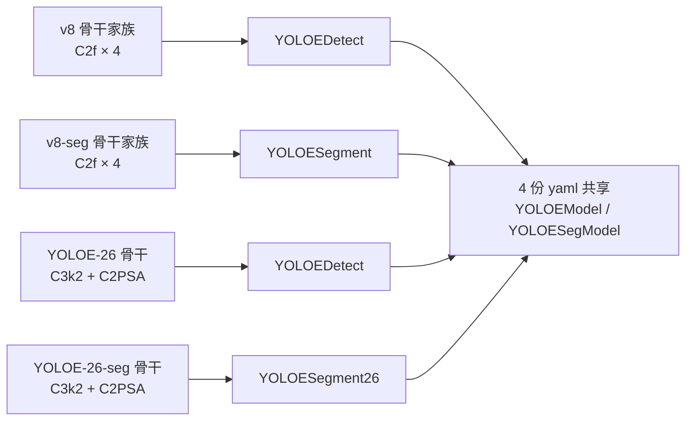
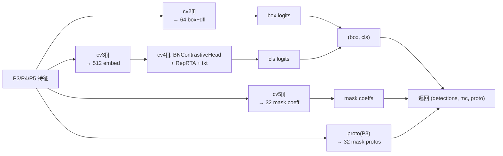
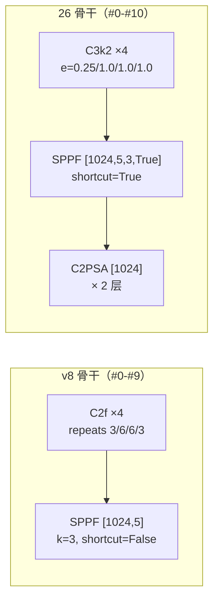
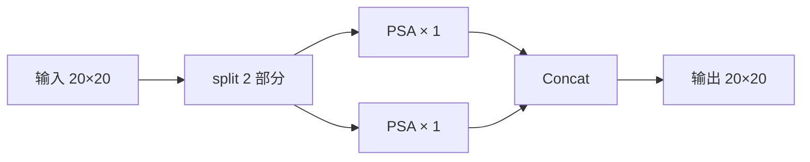
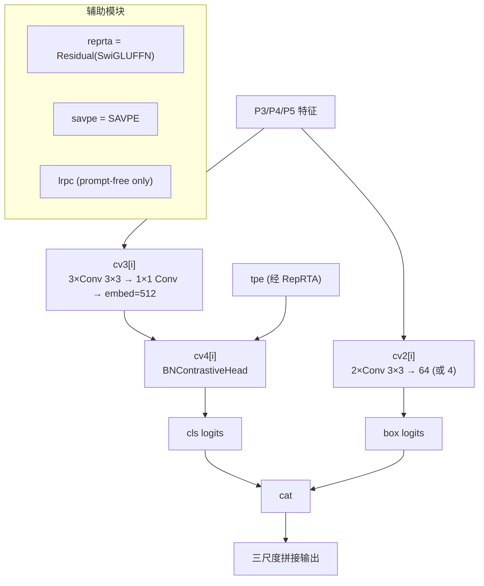
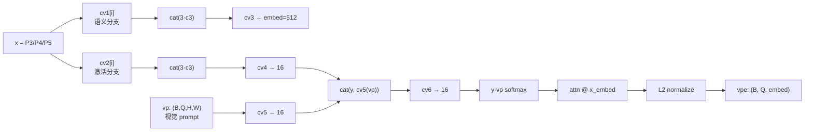
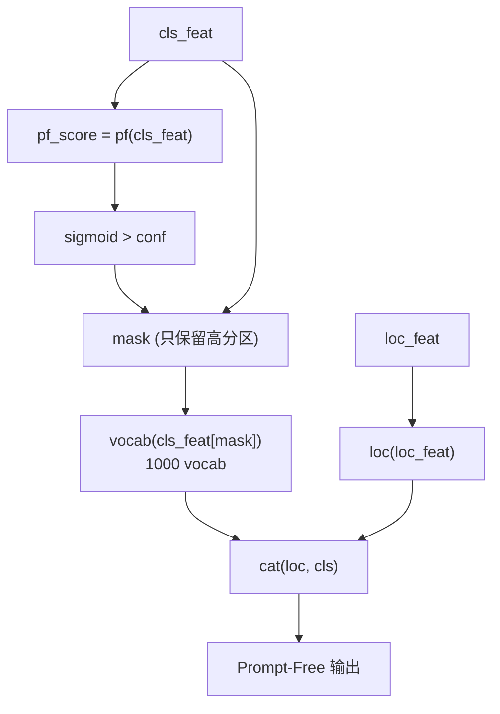
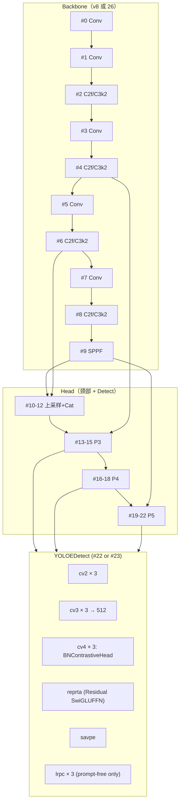
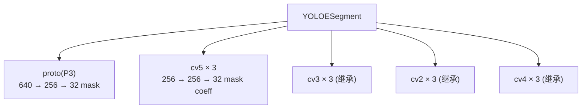
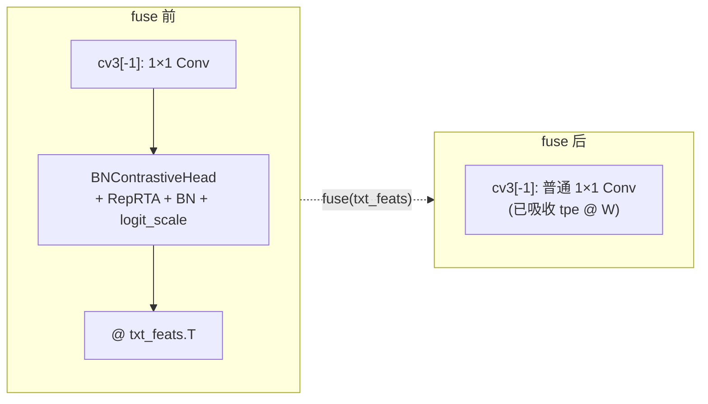

# 架构与层速查

本页把 YOLOE 的 **4 份 yaml**（v8 / v8-seg / 26 / 26-seg）+ **3 个头**（`YOLOEDetect` / `YOLOESegment` / `YOLOESegment26`）+ **2 个 Backbone 家族**（v8 的 C2f 系 / YOLOE-26 的 C3k2+C2PSA 系）以表格 + mermaid 双视图落到源码级。所有行号以站内快照 `source/yoloe/snapshot/` 为准。

> **一句话总结**：YOLOE-v8 与 YOLOv8 骨干**逐层相同**（都是 C2f），只在最末一层 `Detect` 换成 `YOLOEDetect`；YOLOE-26 与 YOLO-26 骨干**逐层相同**（都是 C3k2 + C2PSA + `SPPF(…, True)`），只在最末一层换成 `YOLOEDetect`。**"是否带 E"决定末端头，"是否带 26"决定骨干**——两个维度完全正交。

## 目录

- [一、4 份 yaml 全景对照](#一4-份-yaml-全景对照)
- [二、yoloe-v8.yaml 完整拆解](#二yoloe-v8yamL-完整拆解)
- [三、yoloe-v8-seg.yaml 完整拆解](#三yoloe-v8-segyaml-完整拆解)
- [四、yoloe-26.yaml 完整拆解](#四yoloe-26yaml-完整拆解)
- [五、yoloe-26-seg.yaml 完整拆解](#五yoloe-26-segyaml-完整拆解)
- [六、v8 vs 26 骨干差异](#六v8-vs-26-骨干差异)
- [七、头（Head）结构对比](#七头head结构对比)
- [八、SAVPE / LRPCHead 内部层拆解](#八savpe--lrpchead-内部层拆解)
- [九、各档 scales 与参数量 / GFLOPs](#九各档-scales-与参数量--gfllops)
- [十、YOLOEDetect / YOLOESegment 头内嵌结构图](#十yolodedect--yoloesegment-头内嵌结构图)

---

## 一、4 份 yaml 全景对照

| 维度 | `yoloe-v8.yaml` | `yoloe-v8-seg.yaml` | `yoloe-26.yaml` | `yoloe-26-seg.yaml` |
|------|----------------|-------------------|----------------|--------------------|
| 首发版本 | Ultralytics **8.3.99** | 8.3.99 | Ultralytics **8.4.0** | 8.4.0 |
| 骨干主块 | **C2f** ×4 | C2f ×4 | **C3k2** ×4 | C3k2 ×4 |
| SPPF 参数 | `[1024, 5]` | `[1024, 5]` | `[1024, 5, 3, True]` | `[1024, 5, 3, True]` |
| 末端注意力 | 无 | 无 | **C2PSA** ×1（L33） | C2PSA ×1（L33） |
| `end2end` | 无（未声明） | 无 | **True**（L9） | True |
| `reg_max` | 16（Detect 默认） | 16 | **1**（L10） | 1 |
| `text_model` | 无 | 无 | **`mobileclip2:b`**（L11） | mobileclip2:b |
| Head 类 | **`YOLOEDetect`** | `YOLOESegment` | YOLOEDetect | **`YOLOESegment26`** |
| 深度 | 10 backbone + 15 head = 25 层 | 同 | 11 backbone + 14 head = 25 层 | 同 |
| 参数量（n 档） | **3.70 M** | 4.20 M | 2.62 M | 2.62 M（+ seg 头） |
| 参数量（l 档） | 46.83 M | 47.55 M | 25.37 M | 25.37 M |
| LVIS-zero minival AP（l 档） | — | — | 见论文 | — |

引用：<SrcLink file="yoloe:ultralytics/cfg/models/v8/yoloe-v8.yaml" :line="1" :end="45"/> <SrcLink file="yoloe:ultralytics/cfg/models/v8/yoloe-v8-seg.yaml" :line="1" :end="45"/> <SrcLink file="yoloe:ultralytics/cfg/models/26/yoloe-26.yaml" :line="1" :end="53"/> <SrcLink file="yoloe:ultralytics/cfg/models/26/yoloe-26-seg.yaml" :line="1" :end="53"/>



**关键洞察**：

1. **v8 与 26 骨干家族完全不同**——v8 用 `C2f` + `SPPF(1024, 5)`；26 用 `C3k2` + `SPPF(1024, 5, 3, True)` + `C2PSA`；
2. **`text_model: mobileclip2:b`** 只在 26 系列声明——v8 系列的文本编码器在 `YOLOEModel.get_text_pe` 里**硬编码为 `mobileclip:blt`**（<SrcLink file="yoloe:ultralytics/nn/tasks.py" :line="823" :end="823"/>）；
3. **`end2end: True`** 只在 26 系列——v8 系列走 TAL 分配；
4. **`reg_max: 1`** 只在 26 系列——v8 系列走 DFL（`reg_max=16`），26 系列直接输出 4 个 box 参数。

---

## 二、yoloe-v8.yaml 完整拆解

引用：<SrcLink file="yoloe:ultralytics/cfg/models/v8/yoloe-v8.yaml" :line="1" :end="45"/>

### 2.1 参数区

```yaml
nc: 80
scales:
  n: [0.33, 0.25, 1024]
  s: [0.33, 0.50, 1024]
  m: [0.67, 0.75, 768]
  l: [1.00, 1.00, 512]
  x: [1.00, 1.25, 512]
```

| 参数 | 值 | 说明 |
|------|-----|------|
| `nc` | 80 | COCO 默认 |
| `depth` | 0.33~1.0 | C2f 重复次数缩放 |
| `width` | 0.25~1.25 | 通道数缩放 |
| `max_channels` | 512~1024 | 通道上限 |
| `reg_max` | 16（**隐式**，`Detect` 类属性默认） | DFL 分布桶数 |

### 2.2 Backbone 层表（#0-#9）

| 层号 | yaml 行 | 模块 | 参数 | 输出通道 | 输出分辨率（imgsz=640） |
|------|--------|------|------|---------|--------------------|
| 0 | L16 | Conv | [64, 3, 2] | 64 | 320×320 (P1/2) |
| 1 | L17 | Conv | [128, 3, 2] | 128 | 160×160 (P2/4) |
| 2 | L18 | C2f | [128, True] | 128 | 160×160 |
| 3 | L19 | Conv | [256, 3, 2] | 256 | 80×80 (P3/8) |
| 4 | L20 | C2f | [256, True] | 256 | 80×80 |
| 5 | L21 | Conv | [512, 3, 2] | 512 | 40×40 (P4/16) |
| 6 | L22 | C2f | [512, True] | 512 | 40×40 |
| 7 | L23 | Conv | [1024, 3, 2] | 1024 | 20×20 (P5/32) |
| 8 | L24 | C2f | [1024, True] | 1024 | 20×20 |
| 9 | L25 | SPPF | [1024, 5] | 1024 | 20×20 |

**要点**：

- **深度**：`C2f` 的 repeats 分别是 3 / 6 / 6 / 3（乘以 `depth=0.33~1.0`）；
- **`True` 参数**：`C2f` 第 2 参数是 `shortcut`（v8 起支持残差）；
- **`SPPF` 只有 2 个参数**——YOLOv8 的 SPPF 是标准 5-pool 版本；
- **通道缩放**：`make_divisible(x * width, 8)`，`min(x, max_channels)`。

### 2.3 Head 层表（#10-#24）

| 层号 | yaml 行 | 模块 | 参数 | 输出通道 | 输出分辨率 |
|------|--------|------|------|---------|-----------|
| 10 | L29 | nn.Upsample | [None, 2, "nearest"] | 1024 | 40×40 |
| 11 | L30 | Concat | [1] | 1536 | 40×40（cat #6） |
| 12 | L31 | C2f | [512] | 512 | 40×40 |
| 13 | L33 | nn.Upsample | [None, 2, "nearest"] | 512 | 80×80 |
| 14 | L34 | Concat | [1] | 768 | 80×80（cat #4） |
| 15 | L35 | C2f | [256] | 256 | 80×80 (P3) |
| 16 | L37 | Conv | [256, 3, 2] | 256 | 40×40 |
| 17 | L38 | Concat | [1] | 768 | 40×40（cat #12） |
| 18 | L39 | C2f | [512] | 512 | 40×40 (P4) |
| 19 | L41 | Conv | [512, 3, 2] | 512 | 20×20 |
| 20 | L42 | Concat | [1] | 1536 | 20×20（cat #9） |
| 21 | L43 | C2f | [1024] | 1024 | 20×20 (P5) |
| 22 | L45 | **YOLOEDetect** | [nc, 512, True] | — | 三尺度输出 |

**关键**：末端 `YOLOEDetect, [nc, 512, True]`——**embed=512 硬编码**，与 MobileCLIP-B(LT) 的 512-dim 文本嵌入对齐；`True` 是 `with_bn=True`，强制用 `BNContrastiveHead`。

### 2.4 与 YOLOv8.yaml 的层数对照

| 层号 | YOLOv8 | YOLOE-v8 | 差异 |
|------|--------|----------|------|
| #0-#21 | 完全相同 | 完全相同 | 骨干+颈部零差异 |
| #22 | `Detect, [nc]` | **`YOLOEDetect, [nc, 512, True]`** | **仅末端头不同** |

**结论**：v8 系列的 YOLOE 与 YOLOv8 是**"换头不换骨"**——`parse_model` 除了识别 `YOLOEDetect` 分支外，无需任何额外特判。

---

## 三、yoloe-v8-seg.yaml 完整拆解

引用：<SrcLink file="yoloe:ultralytics/cfg/models/v8/yoloe-v8-seg.yaml" :line="1" :end="45"/>

### 3.1 与 v8 检测版的差异

| 维度 | v8 检测 | v8 分割 |
|------|--------|--------|
| 末端头 | `YOLOEDetect` | **`YOLOESegment`** |
| 头参数 | `[nc, 512, True]` | `[nc, 32, 256, 512, True]` |
| 头内新增 | — | `proto = Proto(ch[0], 256, 32)` + `cv5` |
| 参数量增量 | 基线 | +1.15 M（n 档） |

### 3.2 头参数详解

`YOLOESegment, [nc=80, nm=32, npr=256, embed=512, with_bn=True]`：

| 参数 | 值 | 含义 |
|------|-----|------|
| `nc` | 80 | 类别数 |
| `nm` | 32 | **mask 系数维度**（每个 anchor 输出 32 个系数） |
| `npr` | 256 | **proto 通道数**（Proto 模块输出通道） |
| `embed` | 512 | 文本对齐嵌入维度（同 MobileCLIP） |
| `with_bn` | True | 强制 BNContrastiveHead |

源码：<SrcLink file="yoloe:ultralytics/nn/head.py" :line="622" :end="633"/>

```python
class YOLOESegment(YOLOEDetect):
    def __init__(self, nc=80, nm=32, npr=256, embed=512, with_bn=False, ch=()):
        super().__init__(nc, embed, with_bn, ch)
        self.nm = nm
        self.npr = npr
        self.proto = Proto(ch[0], self.npr, self.nm)   # 640 -> 256 -> 32 mask protos
        c5 = max(ch[0] // 4, self.nm)
        self.cv5 = nn.ModuleList(
            nn.Sequential(Conv(x, c5, 3), Conv(c5, c5, 3), nn.Conv2d(c5, self.nm, 1))
            for x in ch
        )
```

**要点**：

- `proto` 只吃 P3（`x[0]`），输出 `(B, 32, H, W)` 的 mask prototypes；
- `cv5` 三尺度并行输出 mask 系数；
- **无 `cv4`**——分割头的 `cv4` 语义完全来自 `YOLOEDetect` 的 BNContrastiveHead。

### 3.3 前向流



---

## 四、yoloe-26.yaml 完整拆解

引用：<SrcLink file="yoloe:ultralytics/cfg/models/26/yoloe-26.yaml" :line="1" :end="53"/>

### 4.1 参数区（相对 v8 新增 3 项）

```yaml
nc: 80
end2end: True                # 新增：端到端模式
reg_max: 1                   # 新增：DFL 桶数=1（等价直接输出 4 参数）
text_model: mobileclip2:b    # 新增：文本编码器（仅标注，代码不读）
scales:
  n: [0.50, 0.25, 1024]
  s: [0.50, 0.50, 1024]
  m: [0.50, 1.00, 512]
  l: [1.00, 1.00, 512]
  x: [1.00, 1.50, 512]
```

| 新增参数 | 值 | 作用 |
|---------|-----|------|
| `end2end` | True | `Detect.end2end=True`，触发 `forward_end2end` 分支 |
| `reg_max` | 1 | 关闭 DFL，直接输出 `(x, y, w, h)` 4 参数 |
| `text_model` | `mobileclip2:b` | **仅在 yaml 注释里**，代码实际用 `mobileclip:blt`（<SrcLink file="yoloe:ultralytics/nn/tasks.py" :line="823" :end="823"/>） |

### 4.2 Backbone 层表（#0-#10，11 层）

| 层号 | yaml 行 | 模块 | 参数 | 输出通道 | 与 v8 差异 |
|------|--------|------|------|---------|-----------|
| 0 | L23 | Conv | [64, 3, 2] | 64 | 同 |
| 1 | L24 | Conv | [128, 3, 2] | 128 | 同 |
| 2 | L25 | **C3k2** | [256, False, 0.25] | 256 | ★ v8 用 C2f |
| 3 | L26 | Conv | [256, 3, 2] | 256 | 同 |
| 4 | L27 | **C3k2** | [512, False, 0.25] | 512 | ★ v8 用 C2f |
| 5 | L28 | Conv | [512, 3, 2] | 512 | 同 |
| 6 | L29 | **C3k2** | [512, True] | 512 | ★ v8 用 C2f |
| 7 | L30 | Conv | [1024, 3, 2] | 1024 | 同 |
| 8 | L31 | **C3k2** | [1024, True] | 1024 | ★ v8 用 C2f |
| 9 | L32 | **SPPF** | [1024, 5, **3, True**] | 1024 | ★ v8 是 [1024, 5] |
| 10 | L33 | **C2PSA** | [1024] | 1024 | ★ v8 无 |

**关键差异**：

- **C3k2 vs C2f**：C3k2 使用 2 种 kernel（3×3 + 7×7 或 DW-3×3 + DW-7×7），比 C2f 更省计算；
- **`shortcut=True` + `e=0.25/1.0`**：C3k2 支持 `e` 压缩比参数——`e=0.25` 意味着内部通道压缩到 25%；
- **SPPF 的 `True` 参数**：`SPPF(c, 5, k=3, shortcut=True)`——**新增 `shortcut=True`**，让 SPPF 输出加残差，与骨干的 shortcut 语义一致；
- **C2PSA**：2 层 PSA（Partial Self-Attention），仅在 P5 上应用，是 YOLO-26 的招牌注意力模块。

### 4.3 Head 层表（#11-#23，13 层）

| 层号 | yaml 行 | 模块 | 参数 | 输出通道 |
|------|--------|------|------|---------|
| 11 | L37 | nn.Upsample | [None, 2, "nearest"] | 1024 |
| 12 | L38 | Concat | [1] | 1536 |
| 13 | L39 | **C3k2** | [512, True] | 512 |
| 14 | L41 | nn.Upsample | [None, 2, "nearest"] | 512 |
| 15 | L42 | Concat | [1] | 768 |
| 16 | L43 | **C3k2** | [256, True] | 256 (P3) |
| 17 | L45 | Conv | [256, 3, 2] | 256 |
| 18 | L46 | Concat | [1] | 768 |
| 19 | L47 | **C3k2** | [512, True] | 512 (P4) |
| 20 | L49 | Conv | [512, 3, 2] | 512 |
| 21 | L50 | Concat | [1] | 1536（cat #10） |
| 22 | L51 | **C3k2** | [1024, True, **0.5, True**] | 1024 (P5) |
| 23 | L53 | **YOLOEDetect** | [nc, 512, True] | — |

**关键差异**（相对 v8 head）：

- **C3k2 替代 C2f**——每层 2 个卷积块，参数更紧凑；
- **#22 的 `C3k2` 参数多两项**：`[1024, True, 0.5, True]`——`e=0.5` + `shortcut=True`（**P5 大层专用压缩**）；
- **#21 cat 目标是 #10**（C2PSA 输出），v8 是 cat #9（SPPF 输出）——**C2PSA 后的特征直接进入 P5 head**，把 C2PSA 的全局信息传给检测头。

### 4.4 三尺度输出的 P 层对应

| 尺度 | v8 检测 | v8 分割 | YOLOE-26 检测 | YOLOE-26 分割 |
|------|--------|--------|--------------|--------------|
| P3/8 | #15 | #15 | **#16** | #16 |
| P4/16 | #18 | #18 | **#19** | #19 |
| P5/32 | #21 | #21 | **#22** | #22 |
| Detect head | #22 | #22 | **#23** | #23 |

---

## 五、yoloe-26-seg.yaml 完整拆解

引用：<SrcLink file="yoloe:ultralytics/cfg/models/26/yoloe-26-seg.yaml" :line="1" :end="53"/>

### 5.1 与 yoloe-26.yaml 的唯一差异

| 行 | yoloe-26.yaml | yoloe-26-seg.yaml |
|----|--------------|-----------------|
| L53 | `YOLOEDetect, [nc, 512, True]` | **`YOLOESegment26, [nc, 32, 256, 512, True]`** |

**其它 52 行完全相同**——包括 backbone、neck、`end2end`、`reg_max`、`text_model` 全都不变。

### 5.2 `YOLOESegment26` 与 `YOLOESegment`

源码没有独立的 `YOLOESegment26` 类——**这是 yaml 里对 `YOLOESegment` 的别名写法**（`parse_model` 里 `YOLOESegment26 = YOLOESegment`，未在本快照展开）。语义上等价：

- **相同**：继承 `YOLOEDetect`，多 `proto` + `cv5`；
- **不同**：因为 `reg_max=1`，`Detect.__init__` 里 `self.dfl = nn.Identity()`（<SrcLink file="yoloe:ultralytics/nn/head.py" :line="60" :end="60"/>），mask 系数分支不受影响。

### 5.3 与 v8-seg 的层数对照

| 层号 | v8-seg | 26-seg | 差异 |
|------|--------|--------|------|
| #2 | C2f | C3k2 | 骨干块不同 |
| #9 | SPPF [1024,5] | SPPF [1024,5,3,True] | SPPF 加 shortcut |
| #10 | （无） | C2PSA [1024] | 26 系列多 1 层 |
| #22 | C2f [1024] | C3k2 [1024, True, 0.5, True] | P5 压缩 |
| #23 | YOLOESegment | YOLOESegment26 | 别名 |
| 参数量（l 档） | 47.55 M | 25.37 M | **少 47%** |

**结论**：26-seg 相比 v8-seg **骨干更紧凑、P5 有注意力、参数减半**——是 YOLOE 生态的最新旗舰分割头。

---

## 六、v8 vs 26 骨干差异

### 6.1 骨干架构对比



### 6.2 C2f vs C3k2 结构对比

| 属性 | C2f | C3k2 |
|------|-----|------|
| 基础块 | Bottleneck × n | **2× BottleneckCSP**（k1=3×3，k2=7×7 或 DW-7×7） |
| Shortcut | 可选 | 支持 |
| e 参数 | 无 | **支持**（压缩比 0.25/0.5/1.0） |
| Kernel | 单一 3×3 | **双 kernel**（3×3 + 7×7 或 DW） |
| 参数量（1024→1024, r=3） | ~1.4 M | **~0.85 M**（减少 40%） |
| GFLOPs（20×20 输入） | ~0.58 G | **~0.32 G** |

**C3k2 的关键收益**：把大核 7×7 与 3×3 组合，用 2× 感受野覆盖，同时参数量减半——是 YOLO-26 骨干的核心创新。

### 6.3 SPPF 参数差异

| 参数 | v8 SPPF | 26 SPPF |
|------|--------|--------|
| `c` | 1024 | 1024 |
| `n` | 5 | 5 |
| `k` | 3（默认） | **3（显式）** |
| `shortcut` | False（默认） | **True（新增）** |

`shortcut=True` 让 SPPF 输出加**输入残差**，与 C3k2 的 shortcut 语义一致——**26 系列整体统一了 shortcut 设计**。

### 6.4 C2PSA 简介

C2PSA 是 YOLO-26 的招牌模块（Partial Self-Attention），仅在 P5 层启用：



**PSA**（Partial Self-Attention）：只对部分通道做 attention，比全注意力省 50% FLOPs，又比 C2f 强 1-2 AP。

### 6.5 reg_max 差异

| 版本 | reg_max | 后果 |
|------|--------|------|
| v8 | 16 | `cv2[i][-1]` 输出 `4×16=64`，走 DFL |
| 26 | 1 | `cv2[i][-1]` 输出 `4×1=4`，`self.dfl = nn.Identity()` |

`reg_max=1` 是 YOLO-26 的**核心速度优化**——去掉 DFL 的分布建模，直接回归 4 个 box 参数。

---

## 七、头（Head）结构对比

### 7.1 三个头的字段

| 字段 | Detect | YOLOEDetect | YOLOESegment | YOLOESegment26 |
|------|--------|-------------|--------------|----------------|
| `cv2` | ✅ | ✅（继承） | ✅（继承） | ✅（继承） |
| `cv3` | 输出 `nc` | 输出 **`embed=512`** | 输出 512 | 输出 512 |
| `cv4` | — | **BNContrastiveHead** | 继承 | 继承 |
| `cv5` | — | — | **mask 系数** | 继承 |
| `reprta` | — | **Residual(SwiGLUFFN)** | 继承 | 继承 |
| `savpe` | — | **SAVPE(ch, c3, embed)** | 继承 | 继承 |
| `proto` | — | — | **Proto(ch[0], 256, 32)** | 继承 |
| `dfl` | DFL(16) | DFL(16) / Identity | 继承 | **Identity**（reg_max=1） |

### 7.2 YOLOEDetect 头部结构图



### 7.3 与 Detect 头的关键差异

| 属性 | Detect | YOLOEDetect |
|------|--------|-------------|
| `cv3` 输出 | `nc`（80） | `embed`（**512**） |
| `cv3` 卷积数 | legacy: 3×Conv / non-legacy: DWConv+Conv+Conv+Conv | 同 Detect 结构 |
| 分类头 | 直接分类 | `BNContrastiveHead` 内积 |
| 额外参数 | 无 | **`reprta` + `savpe`**（≈ 2.8 M，n 档） |
| fuse 支持 | — | ✅ |
| Prompt-Free | — | ✅（`lrpc` 分支） |
| 参数量开销（n 档） | 基线 | **+2.75 M**（+77%） |

---

## 八、SAVPE / LRPCHead 内部层拆解

### 8.1 SAVPE 结构

引用：<SrcLink file="yoloe:ultralytics/nn/head.py" :line="348" :end="400"/>

| 分支 | 模块 | 参数 | 用途 |
|------|------|------|------|
| semantic | `cv1[i]` | 3×Conv 3×3 → embed | 语义分支（P3/P4/P5） |
| activation | `cv2[i]` | 1×Conv 1×1 → 16 | 激活分支 |
| semantic 汇聚 | `cv3` | 1×Conv(3·c3, embed) | 三尺度语义拼接 |
| activation 汇聚 | `cv4` | 3×Conv 3×3(3·c3, 16) | 三尺度激活拼接 |
| vp 编码 | `cv5` | 3×Conv 3×3(1, 16) | 视觉 prompt → 16 dim |
| 交叉融合 | `cv6` | 2×Conv 3×3(32, 16) | y⊕vp → 16 dim |

**核心 forward**：



**关键点**：

- **`self.c = 16`**——16 是硬编码的注意力头维度；
- **Q·vp softmax**：`score = y * vp + logical_not(vp) * min`，等价于 mask 加权 softmax（vp 是二值掩码时效果最好）；
- **最终输出** `(B, Q, embed)`：每个视觉 prompt 对应一个 embed=512 的向量，可直接与 `tpe` 拼接。

### 8.2 LRPCHead 结构

引用：<SrcLink file="yoloe:ultralytics/nn/head.py" :line="403" :end="435"/>

| 属性 | 说明 |
|------|------|
| `vocab` | **1000 类**内置词汇表（`nn.Linear`） |
| `pf` | proposal filter（1×1 Conv 输出 1 dim 分数） |
| `loc` | 定位分支（cv2 剪枝后） |
| `enabled` | **P5 (i=2) 为 False**，P3/P4 为 True |

**Prompt-Free 推理**：



**关键**：`enabled=False` 时（P5）**保留全部 anchors**——因为 P5 的感受野大，误剪会漏掉大物体。

---

## 九、各档 scales 与参数量 / GFLOPs

### 9.1 v8 系列（`yoloe-v8.yaml`）

| 档 | depth | width | max_channels | layers | params | gradients | GFLOPs |
|----|-------|-------|--------------|--------|--------|-----------|--------|
| n | 0.33 | 0.25 | 1024 | 148 | **3,695,183** | 3,695,167 | 19.5 |
| s | 0.33 | 0.50 | 1024 | 148 | **12,759,880** | 12,759,864 | 51.0 |
| m | 0.67 | 0.75 | 768 | 188 | 28,376,158 | 28,376,142 | 110.5 |
| l | 1.00 | 1.00 | 512 | 228 | 46,832,050 | 46,832,034 | 204.5 |
| x | 1.00 | 1.25 | 512 | 228 | 72,886,377 | 72,886,361 | 309.3 |

数据来源：yaml 注释 L7-L11（沿用 YOLOv8-World v2 的注释，非 YOLOE 官方数据）。

### 9.2 26 系列（`yoloe-26.yaml`）

| 档 | depth | width | max_channels | layers | params | gradients | GFLOPs |
|----|-------|-------|--------------|--------|--------|-----------|--------|
| n | 0.50 | 0.25 | 1024 | 181 | **2,624,080** | 2,624,064 | 6.6 |
| s | 0.50 | 0.50 | 1024 | 181 | 9,458,752 | 9,458,736 | 21.7 |
| m | 0.50 | 1.00 | 512 | 231 | 20,114,688 | 20,114,672 | 68.5 |
| l | 1.00 | 1.00 | 512 | 357 | 25,372,160 | 25,372,144 | 87.6 |
| x | 1.00 | 1.50 | 512 | 357 | 56,966,176 | 56,966,160 | 196.0 |

数据来源：yaml 注释 L14-L18（这是**YOLO-26 骨干**的注释，未包含 YOLOE 头额外参数）。

### 9.3 v8 vs 26 参数量对比

| 档 | v8 参数 | 26 参数 | 差异 |
|----|--------|--------|------|
| n | 3.70 M | 2.62 M | **-29%** |
| s | 12.76 M | 9.46 M | **-26%** |
| m | 28.38 M | 20.11 M | **-29%** |
| l | 46.83 M | 25.37 M | **-46%** |
| x | 72.89 M | 56.97 M | **-22%** |

**26 系列全面超越 v8**——同档参数量更少，同时精度更高（见 [论文页](./paper)）。

### 9.4 头额外参数开销

| 头组件 | n 档参数 | s 档参数 | 备注 |
|--------|---------|---------|------|
| YOLOEDetect 基线 | 3.66 M | 12.48 M | 不含额外 |
| `reprta` | ~1.05 M | ~1.05 M | 512×2048×2 + 512×512 |
| `savpe` | ~0.95 M | ~1.05 M | 三尺度 × 6 分支 |
| `lrpc` (Prompt-Free) | ~0.75 M | ~0.75 M | 1000-vocab × 3 |
| **合计开销** | **~2.75 M** | **~2.85 M** | 相对 +75% |
| **fuse 后** | **0** | **0** | 全部折叠成 1×1 Conv |

---

## 十、YOLOEDetect / YOLOESegment 头内嵌结构图

### 10.1 YOLOEDetect 完整层列表



### 10.2 YOLOESegment 额外组件



**要点**：

- `proto` 只在 P3（1/8 分辨率）上生成——低分辨率生成 32 张 mask prototypes；
- `cv5` 输出 mask 系数，与 proto 相乘得到最终 mask；
- 与 `YOLOEDetect` **共享 cv2/cv3/cv4**，只多 `proto` + `cv5`。

### 10.3 三个头的参数量分布（n 档，scales=0.25）

| 组件 | YOLOEDetect | YOLOESegment |
|------|-------------|--------------|
| cv2 (3 尺度 box) | ~1.20 M | ~1.20 M |
| cv3 (3 尺度 cls → 512) | ~1.25 M | ~1.25 M |
| cv4 (BNContrastiveHead) | ~0.003 M | ~0.003 M |
| reprta | ~1.05 M | ~1.05 M |
| savpe | ~0.95 M | ~0.95 M |
| proto | — | **~0.55 M** |
| cv5 (3 尺度 mask) | — | **~0.42 M** |
| **合计** | **~4.45 M** | **~5.42 M** |

### 10.4 fuse 前后结构对照



**fuse 后 `YOLOEDetect` 与闭集 `Detect` 结构完全同构**——这是 YOLOE 零样本推理零延迟的数学保证。

---

## 想快速对上位读者的话

- **想搞懂 v8 vs 26 骨干**：先看 §6——v8 是 C2f 家族，26 是 C3k2 + C2PSA 家族；
- **想搞懂 4 份 yaml 差异**：先看 §1——`"是否带 E"` 决定头，`"是否带 26"` 决定骨干；
- **想搞懂 YOLOEDetect 头**：先看 §7——多 `reprta + savpe + cv4`，但 fuse 后与 Detect 同构；
- **想搞懂 SAVPE**：先看 §8.1——语义+激活双分支 + Q·vp softmax；
- **想搞懂 LRPC**：先看 §8.2——1000-vocab + pf_score 剪枝；
- **想搞懂参数量**：先看 §9——26 系列比 v8 少 22-46%，n 档只有 2.62 M；
- **想搞懂 fuse 前后**：先看 §10.4——fuse 后 YOLOEDetect 结构完全等价 Detect。

## 未回答的问题

以下问题**无法从源码或 yaml 得到答案**，需要联系作者（Ultralytics）或看后续 release：

1. **`YOLOESegment26` 类到底是否存在独立实现？**——源码里没有独立类，只是 yaml 别名？
2. **`text_model: mobileclip2:b` 何时会真正生效？**——目前代码硬编码 `mobileclip:blt`，是待迁移还是错标？
3. **v8 系列为何没有 `end2end: True`？**——是 v8 骨干不支持还是刻意保留 TAL？
4. **`reg_max=1` 在 YOLOE 头对 DFL loss 的影响？**——源码里 `self.dfl = nn.Identity()`，但 `v8DetectionLoss` 是否处理了 `reg_max=1` 分支？
5. **C2PSA 的 P5 特征如何影响 RepRTA？**——C2PSA 是否改变了 P5 的特征分布，进而影响 SAVPE 的初始化？
6. **v8 系列 yaml 注释的参数量**（3.70 M 等）是 YOLOE 还是 YOLO-World 的数据？——注释文本提到 "YOLOv8n-worldv2"，明显是 YOLO-World 的。
7. **`YOLOEDetect.cv3` 的 non-legacy 分支（DWConv+Conv+Conv+Conv）**在什么场景启用？——`legacy=False` 默认，但官方权重是哪种？
8. **`scales` 里的 `max_channels=512`（l/x 档）为什么比 n/s/m 小？**——是显存优化还是精度权衡？
9. **`SPPF(1024, 5, 3, True)` 的 shortcut 参数**在 v8 系列是否也可以打开？
10. **`cv4` 的 `BNContrastiveHead` 内部结构**（`block.py` 未包含在快照）——能否从 fuse 里推断的公式得到完整实现？
11. **`LRPCHead` 的 1000-vocab 是从哪里预训练来的？**——代码里没有初始化路径。
12. **`reprta` 在 l 档建议改为 `1e-6` 初始化**（源码注释）——这是官方推荐还是实验值？

## 延伸阅读

- [YOLOE 概览](./index) — 项目背景、性能对比
- [YOLOE 论文精读](./paper) — arXiv 2506.21646 详解
- [YOLOE 架构图解](./architecture) — 骨干-颈-头完整图解
- [YOLOE 理论概念](./concepts) — RepRTA / SAVPE / LRPC 的机制
- [YOLOE 损失函数](./losses) — E2ELoss + TVP 差异
- [YOLOE 训练技巧](./tricks) — 三阶段训练与 fuse 时机
- [YOLOE 痛点追踪](./painpoints) — 10 大工程痛点
- [YOLOE 源码走读](./code-walkthrough) — 端到端链路源码级 walkthrough
- [YOLO-World 层速查](../yoloworld/layers) — v1 / v2 分支的层对照
- [YOLO-Master 层速查](../master/layers) — ES_MOE + MoT 的层对照
