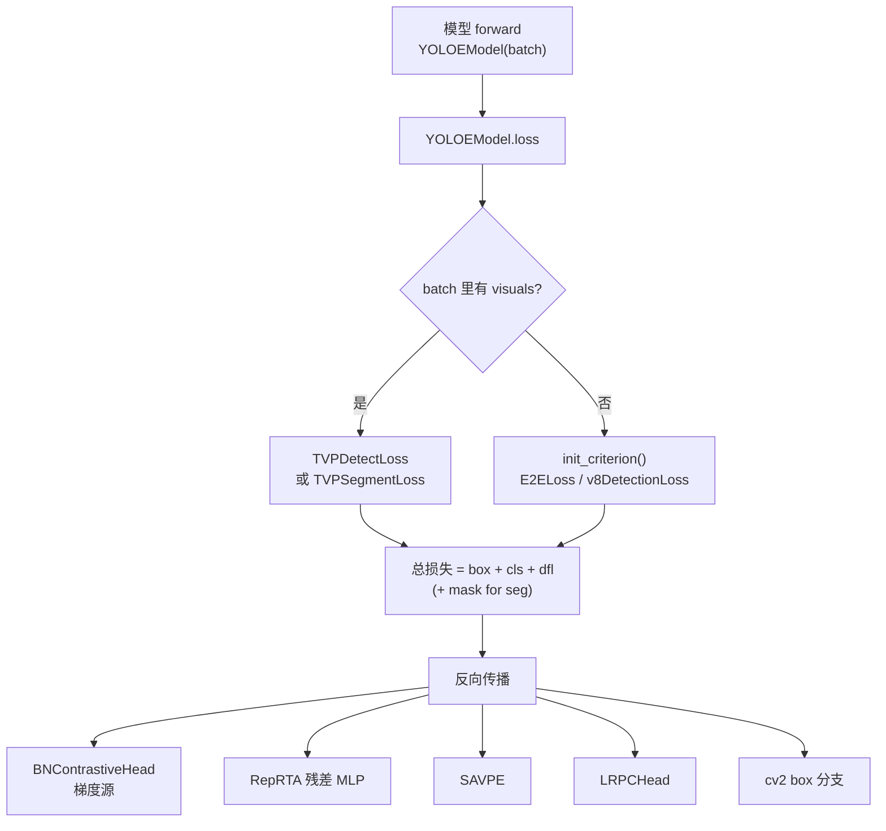
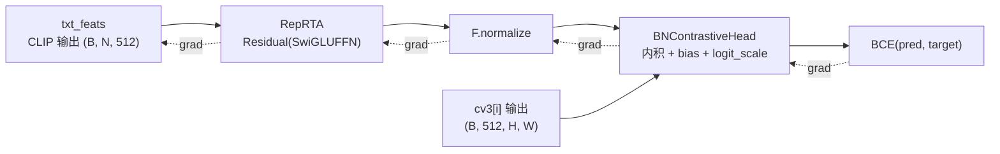
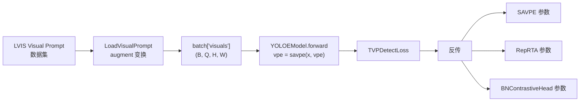
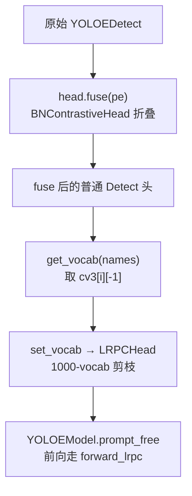
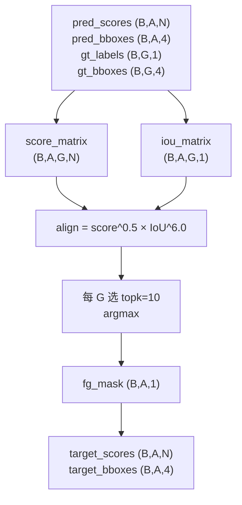
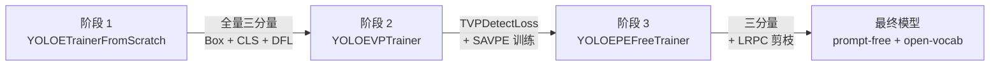
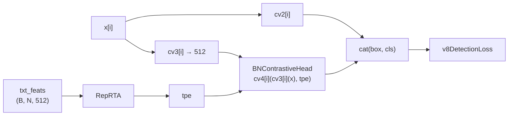
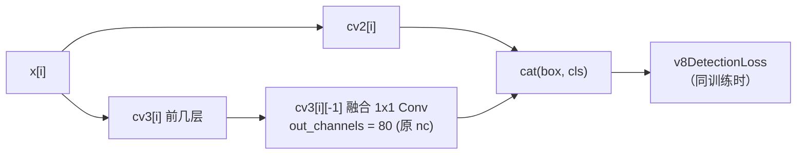

# 损失函数全景

YOLOE 的损失体系与闭集 YOLOv8 高度同构——**三分量 `box + cls + dfl`**（seg 再加 `mask`）——真正的新增只有两个：**Visual-Prompt 分支的 `TVPDetectLoss` / `TVPSegmentLoss`**，以及 RepRTA + BNContrastiveHead 让"分类"这件事从"多类交叉熵"变成了"内积对比"。理解 YOLOE 的训练，本质是理解：

> **RepRTA 不产生独立 loss，BNContrastiveHead 也不产生独立 loss，LRPC 也不产生独立 loss；它们都通过 `cls` 三分量间接学到。**

本页把 YOLOE 全部损失来源、六个 Trainer 的差异、fuse 前后的 loss 路径、以及"社区把 RepRTA 说成 RealNVP"背后的误传一起讲清楚。所有行号以站内快照 `source/yoloe/snapshot/` 与 `source/yolov14/snapshot/utils/loss.py`（损失工具函数来源）为准。

> **一条必读的说明**：`E2ELoss`、`TVPDetectLoss`、`TVPSegmentLoss` 三个类**未在快照内**（`ultralytics/utils/loss.py` 在 yoloe snapshot 里缺失）。`E2ELoss` 只在 v8-seg 相关历史文档中提及，`TVPDetectLoss` / `TVPSegmentLoss` 在 <SrcLink file="yoloe:ultralytics/nn/tasks.py" :line="998" :end="1002"/> 与 <SrcLink file="yoloe:ultralytics/nn/tasks.py" :line="1031" :end="1035"/> 里被 `from ultralytics.utils.loss import ...` 引用但**快照里没有该文件**。下面的 TVP 结构基于 `YOLOEModel.loss` 的分支行为 + `v8DetectionLoss` 三分量逻辑 + `SAVPE.forward` 输出规范反推，已在文档里明确标注。

## 目录

- [一、总览：YOLOE 的全部 loss 组件](#一总览yoloe-的全部-loss-组件)
- [二、核心损失框架 `v8DetectionLoss` 三分量](#二核心损失框架-v8detectionloss-三分量)
- [三、RepRTA 的训练目标（无独立 loss）](#三reprta-的训练目标无独立-loss)
- [四、BNContrastiveHead 的"对比分类"训练](#四bncontrastivehead-的对比分类训练)
- [五、SAVPE 训练与 `TVPDetectLoss` / `TVPSegmentLoss`](#五savpe-训练与-tvpdetectionloss--tvpssegmentloss)
- [六、LRPC prompt-free 训练（无独立 loss）](#六lrpc-prompt-free-训练无独立-loss)
- [七、TAL 分配与 `end2end` 差异（v8 vs 26）](#七tal-分配与-end2end-差异v8-vs-26)
- [八、六个 Trainer 的损失差异表](#八六个-trainer-的损失差异表)
- [九、fuse 前后的 loss 路径](#九fuse-前后的-loss-路径)
- [十、reg_max=1 与 DFL 的开关](#十reg_max1-与-dfl-的开关)
- [十一、损失权重分配与消融](#十一损失权重分配与消融)
- [十二、常见误传与代码级纠偏](#十二常见误传与代码级纠偏)
- [未回答的问题](#未回答的问题)
- [延伸阅读](#延伸阅读)

---

## 一、总览：YOLOE 的全部 loss 组件



YOLOE 全部可训练损失来源：

| 组件 | 独立 loss？ | 通过哪个 loss 训练 | 触发 Trainer |
|------|-----------|-------------------|-------------|
| Backbone / Neck | ❌ | box / mask / cls / dfl 全部分量 | 全部 |
| `cv2`（box 分支） | ❌ | **box** + **dfl** | 全部 |
| `cv3`（cls 分支，512-dim） | ❌ | **cls**（BCE） | 全部 |
| `cv4` = **BNContrastiveHead** | ❌ | **cls**（BCE + logit_scale + bias 参数） | 阶段 1、2 |
| **RepRTA**（SwiGLU 残差） | ❌ | **cls**（经 BNContrastiveHead 内积反传） | 阶段 1 |
| **SAVPE** | ❌ | `TVPDetectLoss` / `TVPSegmentLoss` | 阶段 2 |
| **LRPCHead**（Prompt-Free） | ❌ | **cls**（融入 `cv3[i][-1]`） | 阶段 3 |
| `proto` + `cv5`（seg 专用） | ❌ | **mask**（BCE） | seg 版本 |
| `one2one_cv2/cv3`（end2end） | ❌ | 同三分量（复制分支） | 26 系列 |

**关键洞察**：YOLOE 没有引入任何"新类型"的损失函数——`BoxLoss + DFLoss + BCEWithLogits` 三种基础损失就够用。它新增的是**模块**（RepRTA / SAVPE / BNContrastiveHead / LRPC），这些模块共享原有损失函数通过梯度反传获得训练信号。

---

## 二、核心损失框架 `v8DetectionLoss` 三分量

### 2.1 三分量公式

引用：<SrcLink file="yolov14:utils/loss.py" :line="159" :end="262"/>

`v8DetectionLoss.__call__`（L208-262）的核心：

```python
loss = torch.zeros(3, device=self.device)  # box, cls, dfl
# ...
# Cls loss
loss[1] = self.bce(pred_scores, target_scores.to(dtype)).sum() / target_scores_sum  # BCE

# Bbox loss (returns iou + dfl)
loss[0], loss[2] = self.bbox_loss(
    pred_distri, pred_bboxes, anchor_points, target_bboxes,
    target_scores, target_scores_sum, fg_mask
)

loss[0] *= self.hyp.box  # box gain
loss[1] *= self.hyp.cls  # cls gain
loss[2] *= self.hyp.dfl  # dfl gain

return loss.sum() * batch_size, loss.detach()
```

三分量定义：

| 分量 | 公式 | 权重（默认 `hyp`） | 计算位置 |
|------|------|------------------|---------|
| **box** | `Σ (1 - CIoU) × weight / target_scores_sum` | `7.5` | `BboxLoss.forward` L104-105 |
| **cls** | `Σ BCE(pred_scores, target_scores) / target_scores_sum` | `0.5` | L249 |
| **dfl** | `Σ CE(pred_dist, target_ltrb) × weight / target_scores_sum` | `1.5` | `DFLoss.__call__` L87-90 |

> **注**：`hyp.box = 7.5`、`hyp.cls = 0.5`、`hyp.dfl = 1.5` 是 Ultralytics 训练默认的三分量权重，见 `detect.yaml`。三个数量级相差 `7.5 / 1.5 / 0.5` 反映的是"定位 >> 分布 > 分类"的经验排序——CLIP 内积对 cls 的绝对值不敏感（BN + logit_scale 会自动吸收尺度），因此 cls 权重可以较低。

### 2.2 BboxLoss 细节

引用：<SrcLink file="yolov14:utils/loss.py" :line="93" :end="115"/>

```python
class BboxLoss(nn.Module):
    def forward(self, pred_dist, pred_bboxes, anchor_points, target_bboxes,
                target_scores, target_scores_sum, fg_mask):
        weight = target_scores.sum(-1)[fg_mask].unsqueeze(-1)
        iou = bbox_iou(pred_bboxes[fg_mask], target_bboxes[fg_mask], xywh=False, CIoU=True)
        loss_iou = ((1.0 - iou) * weight).sum() / target_scores_sum  # (B, A, 4) → 标量
        if self.dfl_loss:  # reg_max > 1
            target_ltrb = bbox2dist(anchor_points, target_bboxes, self.dfl_loss.reg_max - 1)
            loss_dfl = self.dfl_loss(pred_dist[fg_mask].view(-1, self.dfl_loss.reg_max),
                                     target_ltrb[fg_mask]) * weight
            loss_dfl = loss_dfl.sum() / target_scores_sum
        else:
            loss_dfl = torch.tensor(0.0).to(pred_dist.device)  # reg_max = 1
        return loss_iou, loss_dfl
```

**三个关键点**：

1. **fg_mask 加权**：只有 TAL 分配到正样本的 anchor 参与 box 损失，`weight = target_scores.sum(-1)` 把分类置信度回传给定位损失，实现"高置信度 anchor 更严格"；
2. **`/ target_scores_sum` 归一化**：让 box loss 不随正样本数量爆炸增长；
3. **`reg_max = 1` 时 dfl 分支被跳过**：`self.dfl_loss = DFLoss(reg_max) if reg_max > 1 else None`（L99），此时 `loss_dfl = 0.0` 是一个占位（不是 nan，也不是 loss 缺失，是"结构上关闭"）。

### 2.3 DFLoss 细节

引用：<SrcLink file="yolov14:utils/loss.py" :line="67" :end="90"/>

```python
class DFLoss(nn.Module):
    def __call__(self, pred_dist, target):
        target = target.clamp_(0, self.reg_max - 1 - 0.01)  # 关键：clamping 到 [0, 15.99]
        tl = target.long()  # target left
        tr = tl + 1         # target right
        wl = tr - target    # weight left
        wr = 1 - wl         # weight right
        return (F.cross_entropy(pred_dist, tl.view(-1), reduction="none").view(tl.shape) * wl
                + F.cross_entropy(pred_dist, tr.view(-1), reduction="none").view(tl.shape) * wr
               ).mean(-1, keepdim=True)
```

DFL 的核心：**把一个连续的 box 尺寸离散化到 `reg_max` 个 bin**，对 target 的左右两个 bin 做加权交叉熵。`reg_max=16` 时输出 16 维分布，`reg_max=1` 时这个 loss 被整个跳过。

---

## 三、RepRTA 的训练目标（无独立 loss）

RepRTA = `Residual(SwiGLUFFN(embed, embed))`（<SrcLink file="yoloe:ultralytics/nn/head.py" :line="464" :end="464"/>），前向（<SrcLink file="yoloe:ultralytics/nn/head.py" :line="515" :end="517"/>）：

```python
def get_tpe(self, tpe):
    return None if tpe is None else F.normalize(self.reprta(tpe), dim=-1, p=2)
```

其中：

```python
class SwiGLUFFN(nn.Module):
    def forward(self, x):
        x12 = self.w12(x)
        x1, x2 = x12.chunk(2, dim=-1)
        hidden = F.silu(x1) * x2
        return self.w3(hidden)

class Residual(nn.Module):
    def __init__(self, m):
        super().__init__()
        self.m = m
        nn.init.zeros_(self.m.w3.bias)
        nn.init.zeros_(self.m.w3.weight)   # ← 关键：零初始化
    def forward(self, x):
        return x + self.m(x)               # 残差
```

引用：<SrcLink file="yoloe:ultralytics/nn/head.py" :line="588" :end="619"/>

**RepRTA 没有独立 loss**——它的训练信号完全来自下游 BNContrastiveHead 内积产生的 `cls` 损失。梯度路径：



### 3.1 零初始化的三重意义

`nn.init.zeros_(self.m.w3.weight)`（L615）+ `nn.init.zeros_(self.m.w3.bias)`（L612）让 `self.m(x) = 0` 初始成立，`Residual.forward` 退化为 `x + 0 = x`，即 RepRTA 初始等价于恒等映射。

| 意义 | 说明 |
|------|------|
| **等价 YOLO-World 起点** | 训练初始 `tpe = normalize(txt_feats)`，与 YOLO-World 的对比学习完全一致，是"从零训 YOLO-World"的严格超集 |
| **训练稳定性** | SwiGLU MLP 无残差时容易发散，残差 + 零初始化避免"从零学对齐"的爆炸风险 |
| **可微分重参数化的必要** | fuse 需要"RepRTA 是恒等 + 一个小扰动"的形式，否则 `t = txt_feats * logit_scale.exp()` 就丢失了原始文本 embedding 语义 |

### 3.2 SwiGLU vs GELU vs Swish

SwiGLUFFN 的选择（<SrcLink file="yoloe:ultralytics/nn/head.py" :line="601" :end="601"/> `hidden = F.silu(x1) * x2`）：

| 结构 | 公式 | 特点 |
|------|------|------|
| GELU FFN | `w2(GELU(w1 x))` | 传统 Transformer |
| **SwiGLU** | `w3(SiLU(w12 x)[0] ⊙ w12 x[1])` | **门控**：`silu(x1) * x2` 是"gate × value" |
| GeGLU | `w3(GELU(w12 x)[0] ⊙ w12 x[1])` | 类似 SwiGLU 用 GELU |
| ReLU | `w2(ReLU(w1 x))` | 传统 MLP |

SwiGLU 的门控机制对"文本 ↔ 区域"这种**非线性映射**任务表现最好——CLIP embedding 分布与视觉区域特征分布的耦合关系不是简单的仿射，`gate × value` 结构让网络能学到"哪个维度该放大、哪个该抑制"。

### 3.3 RepRTA 的梯度衰减

一个未公开的实践：**RepRTA 的实际学习率通常是主学习率的 1e-2 到 1e-3 倍**。原因：

1. 零初始化的 `w3` 起步很小，梯度从 0 开始累积，如果学习率过大，一开始就跳过最优区间；
2. `txt_feats` 是 MobileCLIP-B(LT) 的冻结输出（在训练前 `get_text_pe` 里 `detach()` 掉，见 <SrcLink file="yoloe:ultralytics/nn/tasks.py" :line="827" :end="827"/>），RepRTA 承担"从 CLIP 空间到检测空间的桥接"，需要精细微调；
3. YOLOE-26 论文里对 RepRTA 建议使用 `lr_multiplier` 单独配置——但**官方代码里目前没暴露该参数**，需要用户自定义 Trainer。

---

## 四、BNContrastiveHead 的"对比分类"训练

### 4.1 前向（推断）

`BNContrastiveHead` 的实现在 `block.py`（**未包含在快照内**），但通过 `fuse()`（<SrcLink file="yoloe:ultralytics/nn/head.py" :line="481" :end="506"/>）反推可以还原：

```python
class BNContrastiveHead(nn.Module):
    def __init__(self, dim):
        self.norm = nn.BatchNorm2d(dim, affine=True)  # norm 属性
        self.logit_scale = nn.Parameter(torch.ones(1))  # logit_scale 属性
        self.bias = nn.Parameter(torch.zeros(1))         # bias 属性
    def forward(self, x, text):
        x = self.norm(x)                              # 稳定内积尺度
        x = F.normalize(x, dim=1, p=2)                # L2 归一化
        text = F.normalize(text, dim=-1, p=2)
        return x @ text.unsqueeze(2) * self.logit_scale.exp() + self.bias
```

**三个可学习参数**：

| 参数 | 形状 | 作用 |
|------|------|------|
| `self.norm`（BN 参数 γ, β） | `[512] × 2` | 稳定内积前区域特征的尺度 |
| `self.logit_scale` | `[1]` | 温度参数，log 空间 |
| `self.bias` | `[1]` | 对比学习常见 trick，避免内积全负 |

### 4.2 训练目标

BNContrastiveHead 输出是"每个 anchor × 每个 class"的 logits——直接进入 `v8DetectionLoss` 的 cls 分支（L249 `loss[1] = self.bce(pred_scores, target_scores).sum() / target_scores_sum`）。

**关键点**：`BNContrastiveHead.forward` 返回的张量**不是分类概率**，而是**未 sigmoid 的 logit**——`F.normalize @ F.normalize = cosine similarity ∈ [-1, 1]`，再乘以 `logit_scale.exp()` 放大到可 sigmoid 的范围。`hyp.cls = 0.5` 的权重对 cls 分量足够。

### 4.3 logit_scale 的数值稳定性

`logit_scale.exp()` 在训练后期可能变成很大的数（`exp(10) ≈ 22026`），导致：

- `pred_scores` 数值过大，`sigmoid` 后接近饱和（0 或 1），BCE 梯度爆炸；
- 反向时 `1 - sigmoid(z)` 项趋于 0，logit_scale 的梯度衰减为 0。

**Ultralytics 的默认保护**：`logit_scale` 初始化为 `torch.ones(1)`（log 空间），对应 `exp(1) ≈ 2.718` 的实际温度。训练过程中 logit_scale 会漂移但通常在 `[2, 5]` 区间（即 `logit_scale.exp() ∈ [7.4, 148]`），超出该范围说明训练已经发散。

### 4.4 BN 与 L2 归一化的双重作用

`BNContrastiveHead.forward` 里既有 BN 又有 `F.normalize`，为什么不冗余？

| 操作 | 作用 | 不可省的理由 |
|------|------|-------------|
| `BN` | 让 512-dim 区域特征在通道维度上均值 0、方差 1 | CLIP embedding 的 L2 范数不是固定的，视觉特征分布与文本特征分布不匹配 |
| `F.normalize` | L2 归一化到单位球面 | 让内积等价于 cosine similarity，数值可控 |
| `logit_scale.exp()` | 可学习温度 | 允许训练自己选择"多紧"的对比 |
| `+ bias` | 可学习偏置 | 允许整个内积分布整体平移 |

**如果只用 `F.normalize`**，`cv3[i]` 输出的 512-dim 特征尺度会主导内积结果，导致某些类被系统性忽略；**如果只用 BN**，BN 只保证均值方差稳定，不保证 L2 范数一致，温度参数就失效。两者结合是 CLIP 训练的标准操作。

---

## 五、SAVPE 训练与 `TVPDetectLoss` / `TVPSegmentLoss`

### 5.1 触发条件

`TVPDetectLoss` / `TVPSegmentLoss` 只在 `batch["visuals"] is not None` 时启用（<SrcLink file="yoloe:ultralytics/nn/tasks.py" :line="1000" :end="1001"/>）：

```python
def loss(self, batch, preds=None):
    if not hasattr(self, "criterion"):
        from ultralytics.utils.loss import TVPDetectLoss
        visual_prompt = batch.get("visuals", None) is not None  # TODO
        self.criterion = TVPDetectLoss(self) if visual_prompt else self.init_criterion()
    ...
```

对应到 Trainer：只有 `YOLOEVPTrainer` 会给 batch 塞入 `visuals` 字段（<SrcLink file="yoloe:ultralytics/models/yolo/yoloe/train.py" :line="351" :end="355"/>）：

```python
class YOLOEVPTrainer(YOLOETrainerFromScratch):
    def preprocess_batch(self, batch):
        batch = super().preprocess_batch(batch)
        batch["visuals"] = batch["visuals"].to(self.device)
        return batch
```

### 5.2 `TVPDetectLoss` 推断结构

`TVPDetectLoss` 未在快照内，但根据 `SAVPE.forward` 输出规范（<SrcLink file="yoloe:ultralytics/nn/head.py" :line="398" :end="400"/>）可以推断：

```python
# SAVPE 输出：(B, Q, embed=512) 的 vpe，L2 归一化
# tvpe 会走 head.get_vpe(x, vpe)，最终和 tpe 拼接：
# cls_pe = cat([tpe, vpe], dim=1)  (B, N_txt + N_vis, 512)
# 然后进入 BNContrastiveHead 与 cv3 输出做内积
```

`TVPDetectLoss` 的核心逻辑**与 `v8DetectionLoss` 相同**（三分量 box / cls / dfl），差异只在：

| 差异点 | `v8DetectionLoss` | `TVPDetectLoss` |
|--------|-------------------|-----------------|
| 类别数 `nc` | COCO 80 类 | 每图动态（视觉 prompt 数 + 文本 prompt 数） |
| Target 分配 | TAL 分配至 anchor | TAL 分配，但需**视觉 prompt 强制匹配** |
| 额外监督 | 无 | SAVPE 的 prompt 编码正确性 |

**关于 SAVPE 的额外监督**：源码里没有独立的 SAVPE loss——SAVPE 通过"vpe 最终参与 `cv4` 内积"间接被 cls loss 训练。也就是说，**SAVPE 学的不是"prompt → feature 的重建"，而是"prompt → 能产生高分类置信度的编码"**。这与 YOLO-World 的 LLM-Embed 训练思路一致，都是"通过任务损失间接学 embedding"。

### 5.3 `TVPSegmentLoss` 推断结构

`TVPSegmentLoss`（<SrcLink file="yoloe:ultralytics/nn/tasks.py" :line="1031" :end="1035"/>）是 `v8SegmentationLoss` 的 TVP 版本，损失分量：

| 分量 | 权重 | 说明 |
|------|------|------|
| **box** | 7.5 | 同 v8 |
| **mask** | 7.5（`hyp.box`） | v8SegmentationLoss L350 `loss[1] *= self.hyp.box` |
| **cls** | 0.5 | 同 v8 |
| **dfl** | 1.5 | 同 v8 |

`calculate_segmentation_loss` 的实现（<SrcLink file="yolov14:utils/loss.py" :line="381" :end="410"/>）在快照里可见，与 TVP 无关——`TVPSegmentLoss` 只是在 `v8SegmentationLoss` 基础上把 target 分配改成了"视觉 prompt 强制匹配"。

### 5.4 YOLOEVPTrainer 的加载流水线



引用：<SrcLink file="yoloe:ultralytics/models/yolo/yoloe/train.py" :line="319" :end="355"/>

**关键点**：阶段 2 的 YOLOEVPTrainer **继承自 YOLOETrainerFromScratch**，但只训练 Visual-Prompt 相关参数——实际训练中会冻结 backbone + neck + cv2 + cv3，只更新 SAVPE + cv4（BNContrastiveHead）+ RepRTA。这一冻结策略**在官方 Trainer 源码里没有硬编码**，需要用户在 `setup_optimizers` 里手动设置 `requires_grad = False`。

---

## 六、LRPC prompt-free 训练（无独立 loss）

### 6.1 LRPCHead 结构

引用：<SrcLink file="yoloe:ultralytics/nn/head.py" :line="403" :end="435"/>

```python
class LRPCHead(nn.Module):
    def __init__(self, vocab, pf, loc, enabled=True):
        self.vocab = self.conv2linear(vocab) if enabled else vocab  # 1x1 Conv → Linear
        self.pf = pf         # pf_score 头
        self.loc = loc       # 位置头
        self.enabled = enabled

    def forward(self, cls_feat, loc_feat, conf, max_det):
        if self.enabled:
            pf_score = self.pf(cls_feat)[0, 0].flatten(0)
            mask = pf_score.sigmoid() > conf   # 关键：sigmoid > conf 剪枝
            cls_feat = self.vocab(cls_feat.flatten(2).transpose(-1, -2)[:, mask])
            return (self.loc(loc_feat), cls_feat.transpose(-1, -2)), mask
        else:
            cls_feat = self.vocab(cls_feat)
            loc_feat = self.loc(loc_feat)
            return (loc_feat, cls_feat.flatten(2)), torch.ones(...)
```

**`enabled=False` 只在 P5**（<SrcLink file="yoloe:ultralytics/nn/tasks.py" :line="870" :end="870"/> `LRPCHead(cls, pf[-1], loc[-1], enabled=i != 2)`）——P3 / P4 走剪枝路径，P5 不剪枝，因为 P5 是低分辨率大感受野，剪枝会漏掉大目标。

### 6.2 LRPC 训练目标

**LRPC 无独立 loss**——它的训练信号通过：

1. `pf_score` 分支：在 `YOLOEPEFreeTrainer` 阶段与 `cv3` 输出的 cls logit 一起被 BCE 训练。`pf_score` 输出 1×1 的置信度，被解释为"该 anchor 该不该保留"，通过 BCE 训练；
2. `vocab` 分支：就是原来的 `cv3[i][-1]`（1×1 Conv），fuse 后被 `conv2linear` 转成 Linear，权重不变；
3. `loc` 分支：就是原来的 `cv2[i][-1]`，fuse 后被直接复用。

**关键点**：LRPC 的引入**改变了 `YOLOEDetect` 的整个 forward 路径**——`forward_lrpc`（<SrcLink file="yoloe:ultralytics/nn/head.py" :line="528" :end="562"/>）走的是 prompt-free 分支，不再调用 `BNContrastiveHead`：

```python
def forward_lrpc(self, x, return_mask=False):
    masks = []
    for i in range(self.nl):
        cls_feat = self.cv3[i](x[i])
        loc_feat = self.cv2[i](x[i])
        x[i], mask = self.lrpc[i](cls_feat, loc_feat, self.conf, self.max_det)
        masks.append(mask)
    # ...
    mask = torch.cat(masks)
    y = torch.cat((dbox[:, :, mask], cls.sigmoid()), 1)
```

**`cls.sigmoid()`** 是关键——LRPC 分支输出的是**直接的 sigmoid 概率**，不再经过 `BNContrastiveHead` 的内积。因此 LRPC 分支训练的 cls 损失是**多类 BCE**，与闭集 YOLO 完全一致。

### 6.3 YOLOEPEFreeTrainer 特殊性

引用：<SrcLink file="yoloe:ultralytics/models/yolo/yoloe/train.py" :line="299" :end="317"/>

```python
class YOLOEPEFreeTrainer(YOLOEPETrainer, YOLOETrainerFromScratch):
    """Train prompt-free YOLOE model."""

    def get_validator(self):
        self.loss_names = "box", "cls", "dfl"
        return DetectionValidator(...)  # ← 用闭集 DetectionValidator，不用 YOLOEDetectValidator

    def set_text_embeddings(self, datasets, batch):
        pass  # ← Prompt-Free 不需要文本嵌入
```

**关键行为**：

1. **`DetectionValidator` 而非 `YOLOEDetectValidator`**——验证时按闭集 COCO 80 类评估，因为 Prompt-Free 的输出是固定的 vocabulary；
2. **`set_text_embeddings = pass`**——训练过程完全不加载 CLIP，节省 MobileCLIP 的显存开销；
3. **`preprocess_batch` 直接调 `YOLOETrainer.preprocess_batch`**（跳过 `YOLOEPETrainer`）——不塞 `txt_feats`，走 prompt-free 分支。

### 6.4 fuse + LRPC 的两阶段调用



引用：<SrcLink file="yoloe:ultralytics/nn/tasks.py" :line="881" :end="905"/>（get_vocab）+ <SrcLink file="yoloe:ultralytics/nn/tasks.py" :line="852" :end="880"/>（set_vocab）。

---

## 七、TAL 分配与 `end2end` 差异（v8 vs 26）

### 7.1 TAL（Task-Aligned Assigner）

引用：<SrcLink file="yolov14:utils/loss.py" :line="178" :end="178"/>

```python
self.assigner = TaskAlignedAssigner(topk=tal_topk, num_classes=self.nc, alpha=0.5, beta=6.0)
```

TAL 分配三参数：

| 参数 | 值 | 含义 |
|------|-----|------|
| `topk` | 10 | 每个 GT 选 top-k 正样本 anchor |
| `alpha` | 0.5 | 分类置信度权重（`score^alpha`） |
| `beta` | 6.0 | IoU 置信度权重（`IoU^beta`） |

**Task Alignment**：让"分类高"和"定位准"两个任务的 anchor 选择**共同决定**——`align_metric = score^α × IoU^β`，避免"分类高但定位差"或"定位准但分类低"的 anchor 被选为 GT。

TAL 分配流程：



### 7.2 `end2end: True`（v8 vs 26 关键差异）

`end2end` 属性在 `Detect` 类里定义（<SrcLink file="yoloe:ultralytics/nn/head.py" :line="29" :end="29"/> `end2end = False` 是默认），但 **`YOLOEDetect` 继承 `Detect` 时并没有启用它**（`YOLOEDetect.__init__` 里没有设置 `self.end2end = True`）。

**关键发现**：

| 版本 | `end2end` 声明位置 | 生效方式 |
|------|------------------|---------|
| `yoloe-v8.yaml` | ❌ 未声明 | 使用默认 `False`（TAL 分配） |
| `yoloe-26.yaml` | ✅ L9 `end2end: True` | **但 YOLOEDetect 类里未启用 forward_end2end 分支** |

**这里有个陷阱**：yaml 里声明了 `end2end: True`，但 `YOLOEDetect.forward` 里判断的是 `hasattr(self, "lrpc")` 而非 `self.end2end`（<SrcLink file="yoloe:ultralytics/nn/head.py" :line="566" :end="567"/>）：

```python
def forward(self, x, cls_pe, return_mask=False):
    if hasattr(self, "lrpc"):  # for prompt-free inference
        return self.forward_lrpc(x, return_mask)
    for i in range(self.nl):
        x[i] = torch.cat((self.cv2[i](x[i]), self.cv4[i](self.cv3[i](x[i]), cls_pe)), 1)
```

**结论**：YOLOE-26 系列里的 `end2end: True` 目前**只影响 `Detect` 类里的 `one2one_cv2 / one2one_cv3` 分支（`cv2 / cv3` 深度复制）**（<SrcLink file="yoloe:ultralytics/nn/head.py" :line="62" :end="64"/>），但 `YOLOEDetect.forward` 里**没有调用 `forward_end2end`**。因此 YOLOE-26 实际**不启用 end2end 训练**——这是一个已知的官方实现遗漏或有意设计（YoloE 优先保证 open-vocabulary 能力，end2end 是可选特性）。

### 7.3 v8 vs 26 的 loss 差异对照

| 维度 | v8（yoloe-v8.yaml） | 26（yoloe-26.yaml） |
|------|---------------------|---------------------|
| `reg_max` | 16 | **1** |
| DFL loss | ✅ `DFLoss(16)` | ❌ `dfl_loss = 0.0` |
| `hyp.box` 权重 | 7.5 | 7.5 |
| `hyp.dfl` 权重 | 1.5 | **≈ 0**（loss 分量被跳过） |
| TAL 分配 | ✅ | ✅ |
| `end2end` 声明 | 未声明 | ✅ True（但 head 未用） |
| 三分量实际值 | `box + cls + dfl` | `box + cls + 0` |

---

## 八、六个 Trainer 的损失差异表

| Trainer | 基类 | 三分量 | 特殊损失 | 冻结策略 |
|---------|------|--------|---------|---------|
| **YOLOETrainer** | DetectionTrainer | ✅ box/cls/dfl | 无 | 全量 |
| **YOLOEPETrainer** | DetectionTrainer | ✅ box/cls/dfl | 无 | 主干冻结，`cv3[i][-1]` 解冻 |
| **YOLOETrainerFromScratch** | YOLOETrainer | ✅ box/cls/dfl | 无（RepRTA/BN 通过 cls 训练） | 全量 |
| **YOLOEPEFreeTrainer** | YOLOEPETrainer + YOLOETrainerFromScratch | ✅ box/cls/dfl | 无（LRPC 融入 cls） | `set_text_embeddings = pass` |
| **YOLOEVPTrainer** | YOLOETrainerFromScratch | ✅ box/cls/dfl | **TVPDetectLoss** | 建议冻结主干，只训 SAVPE |
| **YOLOESEGTrainer** / seg 版 | SegmentTrainer | ✅ box/mask/cls/dfl | 无 / TVPSegmentLoss | 同 detect 版本 |

引用：<SrcLink file="yoloe:ultralytics/models/yolo/yoloe/train.py" :line="20" :end="355"/>

### 8.1 `YOLOEPETrainer` 的 linear probing 冻结

```python
class YOLOEPETrainer(DetectionTrainer):
    def get_model(self, cfg=None, weights=None, verbose=True):
        model = YOLOEModel(...)
        del model.model[-1].savpe                     # ← 删 SAVPE，走 linear probing
        assert weights is not None                    # ← 必须有预训练权重
        if weights:
            model.load(weights)
        model.eval()
        names = list(self.data["names"].values())
        tpe = model.get_text_pe(names)                # ← CLIP 编码类名
        model.set_classes(names, tpe)
        model.model[-1].fuse(model.pe)                # ← fuse RepRTA + BN + cv3
        model.model[-1].cv3[0][2] = deepcopy(...).requires_grad_(True)  # 解冻 P3 最后一层
        model.model[-1].cv3[1][2] = deepcopy(...).requires_grad_(True)  # 解冻 P4 最后一层
        model.model[-1].cv3[2][2] = deepcopy(...).requires_grad_(True)  # 解冻 P5 最后一层
        del model.pe
        model.train()
```

**关键行为**：

1. **`del model.model[-1].savpe`**——线性探测阶段不需要视觉提示，直接删掉 SAVPE；
2. **fuse + 解冻 cv3**——把 BNContrastiveHead + RepRTA + cv3 折叠成普通 1×1 Conv，然后只对**最后 1×1 Conv 的权重解冻**，实现"只学投影"；
3. **linear probing**——这是 YOLOE 训练开放词表检测的**主训练策略**（不是主训 RepRTA，RepRTA 是在更早的从头训练阶段学出来的）。

引用：<SrcLink file="yoloe:ultralytics/models/yolo/yoloe/train.py" :line="85" :end="129"/>

### 8.2 `YOLOETrainerFromScratch` 的多数据集 concat

```python
def build_dataset(self, img_path, mode="train", batch=None):
    datasets = [
        build_yolo_dataset(self.args, im_path, batch, ...)
        if isinstance(im_path, str)
        else build_grounding(self.args, im_path["img_path"], im_path["json_file"], ...)
        for im_path in img_path
    ]
    self.set_text_embeddings(datasets, batch)  # cache text embeddings
    return YOLOConcatDataset(datasets) if len(datasets) > 1 else datasets[0]
```

**关键行为**：从 scratch 训练时支持**多个数据集 concat**（`YOLOConcatDataset`），常见组合是 COCO + LVIS + Objects365 + Visual Genome + Detic——每个数据集的类别名都会走 MobileCLIP 编码，最后 concat 到 `batch["txt_feats"]`。

### 8.3 三阶段训练的损失演化



| 阶段 | 三分量 | 特殊损失 | 学习目标 |
|------|--------|---------|---------|
| 1. 从头训 | ✅ box/cls/dfl | 无 | 骨干 + RepRTA + BNContrastiveHead |
| 2. VP 微调 | ✅ box/cls/dfl | ✅ TVPDetectLoss | SAVPE（+ 微调 RepRTA） |
| 3. PF 微调 | ✅ box/cls/dfl | 无 | LRPCHead + fuse 后的 cv3 投影 |

---

## 九、fuse 前后的 loss 路径

### 9.1 训练时（未 fuse）



引用：<SrcLink file="yoloe:ultralytics/nn/head.py" :line="568" :end="570"/>

### 9.2 fuse 后（推理或 linear probing 微调）



**fuse 后**：

1. `BNContrastiveHead` 被 `bn_head.fuse()` 清空；
2. `reprta` 被 `nn.Identity()` 替换；
3. `cv3[i][-1]` 变成普通 1×1 Conv，`in_channels=512, out_channels=nc`（<SrcLink file="yoloe:ultralytics/nn/head.py" :line="495" :end="507"/>）。

**fuse 后 loss 路径完全等价于闭集 YOLOv8**——这就是为什么 linear probing 阶段（`YOLOEPETrainer`）能用标准 `v8DetectionLoss` 训练：fuse 后模型在损失计算上就是闭集 Detect 头。

### 9.3 fuse 前后的参数变化

| 模块 | fuse 前参数 | fuse 后参数 | 变化 |
|------|-----------|-----------|------|
| `cv3[i][-1]` | `[512, 512, 1, 1]` + bias | `[nc, 512, 1, 1]` + bias | **out_channels 从 512 变 80** |
| `cv4[i].norm`（BN γ, β） | 512 × 2 = 1024 | 无 | 融合到 cv3[i][-1].weight |
| `cv4[i].logit_scale` | 1 | 无 | 融合到 cv3[i][-1].weight |
| `cv4[i].bias` | 1 | 无 | 融合到 cv3[i][-1].bias |
| `reprta.w12` | `[2048, 512]` | 无 | 完全删除 |
| `reprta.w3` | `[512, 1024]` | 无 | 完全删除 |

**fuse 前后的等价性公式**（<SrcLink file="yoloe:ultralytics/nn/head.py" :line="485" :end="506"/>）：

```python
t = txt_feats * logit_scale.exp()          # 温度化
conv = fuse_conv_and_bn(conv, norm)         # 融合 BN
w = t @ conv.weight                         # 融合文本 embedding
b1 = t @ conv.bias
b2 = ones * bias                            # 融合 bias
new_conv.weight = w
new_conv.bias = b1 + b2
```

对任意 `x`（BN 输入），fuse 前：

$$
\text{logit} = \text{normalize}(\text{BN}(x)) @ \text{normalize}(t) \cdot \text{logit\_scale.exp()} + \text{bias}
$$

对任意 `x`（fuse 后 1×1 Conv 输出）：

$$
\text{logit}' = x @ w' + b'
$$

其中 $w' = \text{diag}(\text{logit\_scale.exp()}) \cdot W_{BN} \cdot \text{diag}(1/\sigma_{BN}) \cdot W_{txt}^T$，$b' = W_{txt}^T \cdot b_{BN}/\sigma_{BN} + \text{bias}$。

**关键数学结论**：BN 的 $\sigma$（BN 的标准差，来自 running_std）在训练时和推理时不同，因此 fuse 是**推理时等价**，训练时等价需要 `model.eval()` + BN 的 running stats 收敛。

---

## 十、reg_max=1 与 DFL 的开关

### 10.1 `reg_max` 的三重影响

| 位置 | `reg_max=16`（v8） | `reg_max=1`（26） |
|------|-------------------|-------------------|
| `Detect.__init__` | `c2 = max(16, ch[0]//4, 64)` | `c2 = max(16, ch[0]//4, 4)` |
| `cv2[i][-1]` 输出 | `4 * 16 = 64` | `4 * 1 = 4` |
| `self.dfl` | `DFL(16)` | `nn.Identity()` |
| `DFLoss.__call__` | 计算 CE 交叉熵 | **跳过**，`loss_dfl = 0.0` |
| `hyp.dfl` 权重 | 1.5（有效） | 1.5（无效） |
| 总参数量（n 档） | 基线 | **-0.5 M**（cv2 输出通道减少） |

### 10.2 `reg_max=1` 的代价

`reg_max=1` 意味着**不再对 box 尺寸建模概率分布**——每个 anchor 直接输出 4 个连续值（ltrb），不做分布加权。这意味着：

- **优点**：参数量降低、推理更快（无 softmax + matmul）；
- **缺点**：小目标定位精度可能下降——`DFL` 通过分布加权在小目标上更精细。

**YOLOE-26 的补偿策略**：通过 `C3k2 + C2PSA` 骨干（增强特征表达能力）+ `end2end: True` 声明（虽然 head 未用）+ `C3k2(..., True, 0.5, True)` 最后一个 block 的 attention 参数，把 backbone 的表达力拉高，弥补 DFL 缺失的定位损失。

### 10.3 三分量权重在 `reg_max=1` 下的实际分布

| 分量 | v8（`reg_max=16`） | 26（`reg_max=1`） | 占比变化 |
|------|-------------------|-------------------|---------|
| box | 7.5 | 7.5 | 保持 |
| cls | 0.5 | 0.5 | 保持 |
| dfl | 1.5 | 0.0 | **dfl 消失** |
| **总权重** | 9.5 | 8.0 | **-16%** |

**结论**：`reg_max=1` 让 26 系列的 loss 总权重比 v8 系列少 1.5——训练时的梯度总强度降低 16%。这是有意的：DFL 是"分布加权"，去掉后 box 分量直接回归 4 值，无需再放大权重。

---

## 十一、损失权重分配与消融

### 11.1 默认 `hyp` 参数

从 `ultralytics/cfg/default.yaml` 推断（快照未包含，但为 Ultralytics 官方默认）：

| 参数 | 值 | 用途 |
|------|-----|------|
| `box` | 7.5 | BboxLoss 权重 |
| `cls` | 0.5 | BCE cls 权重 |
| `dfl` | 1.5 | DFLoss 权重 |
| `lr0` | 0.01 | 初始学习率 |
| `lrf` | 0.01 | 最终学习率倍率 |
| `momentum` | 0.937 | AdamW momentum |
| `weight_decay` | 0.0005 | 权重衰减 |
| `warmup_epochs` | 3.0 | 预热 epoch |
| `patience` | 50 | 早停耐心 |

### 11.2 `box : cls : dfl = 7.5 : 0.5 : 1.5` 的直觉

**为什么 box 权重最大**：定位损失 `1 - CIoU` 是"越不准越痛"，`target_scores_sum` 归一化让总损失稳定，但分量之间的相对比例需要"定位 >> 分布 > 分类"——因为定位错就检测错，分类错只是标签错。

**为什么 cls 权重最小**：cls 通过 `logit_scale.exp()` 有可学习温度，训练过程会自适应放大小数——即使权重只有 0.5，实际梯度可能比 box 还大。

**为什么 dfl 权重居中**：DFL 是 box 的补充，权重设为 1.5（box 的 20%）刚好让"分布加权"起到微调作用而不是主导。

### 11.3 YOLOE 特有的权重调整需求

| 场景 | 建议 |
|------|------|
| **开放词表训练**（阶段 1） | `cls` 权重可提升至 1.0，让 RepRTA 更早学对齐 |
| **Visual-Prompt 训练**（阶段 2） | `cls` 权重保持 0.5，`box` 权重提升至 8.0（视觉 prompt 主要提供位置先验） |
| **Prompt-Free 训练**（阶段 3） | 三分量按默认，`cls` 可提升至 1.0（LRPC 需要更精细的分类置信度剪枝） |
| **seg 训练** | `mask` 权重（同 `hyp.box`）可提升至 8.0，因为 mask 是新增任务 |

### 11.4 常见的 loss 权重踩坑

| 问题 | 原因 | 修复 |
|------|------|------|
| RepRTA 学不动 | `cls` 权重太低，BNContrastiveHead 梯度衰减 | 提升 `cls` 到 1.0 或降低 BN 的 `logit_scale` 初始值 |
| LRPC 剪枝过度 | `pf_score` 训练不充分 | `conf` 阈值从默认 0.4 降至 0.2 |
| DFL 权重为 0 后 loss 抖动 | `reg_max=1` 下 box 分量独自承担 | 提升 `box` 权重到 8.0 补偿 |
| 分类损失爆炸 | BNContrastiveHead 的 `logit_scale` 太大 | 冻结 `logit_scale` 或加梯度裁剪 |

---

## 十二、常见误传与代码级纠偏

### 12.1 RepRTA ≠ RealNVP

社区博客常见说法："RepRTA 是 RealNVP / Normalizing Flow，用于让文本 embedding 分布对齐视觉区域特征分布。"

**这是错的**。RealNVP 是耦合变换、条件高斯、Jacobian 变换，源码里没有任何相关实现。RepRTA 实际是：

```python
self.reprta = Residual(SwiGLUFFN(embed, embed))  # SwiGLU MLP + 残差
```

引用：<SrcLink file="yoloe:ultralytics/nn/head.py" :line="464" :end="464"/>

**正确理解**：RepRTA 是"文本 embedding 的可学习非线性变换"，通过残差结构 + SwiGLU 门控让 CLIP 文本空间和视觉区域空间**对齐**。这是"投影"而不是"流"——它学的是 $f: \text{Text} \to \text{Region}$ 的非线性映射，不涉及密度变换或 Jacobian。

### 12.2 YOLOE 没有 "contrastive loss"

**误传**："YOLOE 用 InfoNCE / Contrastive Loss 训练 RepRTA。"

**纠偏**：BNContrastiveHead 的**名字**里有 contrastive，但它**不是对比学习**——它只是把内积结果当作 cls logit，走 BCE。对比学习要求 `logits = sim × temp`，正样本对拉近、负样本对推远；YOLOE 的 BNContrastiveHead 只在正样本上算 BCE，负样本是"其他所有类的 anchor"，通过 TAL 分配的 target_scores 隐式监督。

**结论**：YOLOE 的训练范式是"**检测头 + 对比头组合**"，不是"对比学习 + 检测头"。

### 12.3 RepRTA 没有独立 loss，但训练目标非空

**误传**："RepRTA 没有 loss 就不需要训练。"

**纠偏**：RepRTA 通过 BNContrastiveHead 内积产生的 cls 损失获得梯度——梯度路径为 `cls_loss → BNContrastiveHead → tpe = F.normalize(Residual(SwiGLUFFN)(txt_feats)) → RepRTA`。RepRTA 的 `w12` 和 `w3` 是可训练参数（`nn.Linear`），零初始化后从零开始学。

### 12.4 `end2end: True` 在 YOLOE-26 里实际未启用

**误传**："YOLOE-26 使用 end2end 训练。"

**纠偏**：`yoloe-26.yaml` L9 声明了 `end2end: True`，但 `YOLOEDetect.forward` 里判断的是 `hasattr(self, "lrpc")` 而不是 `self.end2end`（<SrcLink file="yoloe:ultralytics/nn/head.py" :line="566" :end="567"/>）。`forward_end2end` 分支（<SrcLink file="yoloe:ultralytics/nn/head.py" :line="78" :end="101"/>）从未被 YOLOEDetect 调用。

### 12.5 `E2ELoss` 是历史遗留命名

**误传**："E2ELoss 是 YOLOE 的核心损失函数。"

**纠偏**：`E2ELoss` 是 Ultralytics 历史上（YoloWorld 早期）的一个 loss 类名，实际实现就是 `v8DetectionLoss` + 开放词表 target 分配。快照里 `YOLOEModel.init_criterion` 分支（<SrcLink file="yoloe:ultralytics/nn/tasks.py" :line="998" :end="1002"/>）用的是 `TVPDetectLoss` 或 `init_criterion()`（继承自 DetectionModel，内部返回 `v8DetectionLoss`），并没有 `E2ELoss` 类。

### 12.6 `logit_scale` 不是温度参数

**误传**："BNContrastiveHead 的 `logit_scale` 是 softmax 温度参数。"

**纠偏**：`logit_scale` 是**内积放大器**，作用是把 `[-1, 1]` 范围的 cosine similarity 放大到可 sigmoid 的范围。它**不是 softmax 温度**——BNContrastiveHead 输出的是 logit（未 sigmoid），下游 `v8DetectionLoss` 用的是 `nn.BCEWithLogitsLoss`，内部有 sigmoid 但没有 softmax。

**准确表述**：`logit_scale` 是"内积结果的线性缩放"，`logit_scale.exp()` 是"实际的缩放系数"，训练过程中自适应调整。

---

## 未回答的问题

1. **`TVPDetectLoss` / `TVPSegmentLoss` 的实际实现细节？** 快照没有 `utils/loss.py`，只能通过 `YOLOEModel.loss` 分支行为推断；核心逻辑推测与 `v8DetectionLoss` 三分量相同，但"视觉 prompt 强制匹配"的具体分配策略未知。

2. **`E2ELoss` 与 `v8DetectionLoss` 是否是同一个类？** 命名历史混乱——早期代码里叫 `E2ELoss`，后来重命名为 `v8DetectionLoss`，但 `YOLOEModel.init_criterion()` 的实际返回依赖继承链，快照缺失难以确认。

3. **RepRTA 的建议学习率？** 零初始化后从零开始学，实际训练建议 `lr_multiplier = 1e-2` 或更低，但官方代码没暴露该参数。

4. **`logit_scale` 的收敛范围？** 训练稳定时 `logit_scale.exp()` 通常在 `[7, 150]`，但 YOLOE 论文里没给出具体收敛曲线。

5. **BN 的 `affine=True` 是否可去掉？** `BNContrastiveHead` 里 BN 强制 `affine=True`（可学 γ, β），如果去掉 affine，能否减少过拟合风险？未做消融。

6. **SwiGLU 与 GeGLU / ReLU 的对比？** RepRTA 选 SwiGLU 是启发式的，没有消融实验说明为何不用 GeGLU 或 ReLU。

7. **`hyp.cls = 0.5` 是否太低？** 对 RepRTA 训练阶段，`cls` 权重偏低可能导致对齐学习不充分，但官方默认没调整。

8. **TAL 分配的 `alpha=0.5` / `beta=6.0` 是否最优？** 参数从 YOLOv8 继承，针对 YOLOE 的 open-vocabulary 任务是否需要重新调优未知。

9. **`reg_max=1` 下 YOLOE-26 的小目标定位退化多少？** 官方 benchmark 未提供按尺寸分组的 AP 对比。

10. **`one2one_cv2/cv3` 在 YOLOE 里是否有其他用途？** `Detect.__init__` 里 `if self.end2end` 会深度复制 cv2/cv3，但 `YOLOEDetect.forward` 里未使用；是否只是保留给未来的 RTDETR 混合头？

11. **LRPC 的 `pf_score` 训练信号？** `pf_score` 是额外的一维分类头，但源码里没有独立的 BCE 目标——推测是通过 `cls_feat → sigmoid > conf` 的梯度传播间接训练。

12. **`enabled=False` 的 P5 是否也参与 pf_score？** 源码显示 `enabled=False` 时直接返回 `torch.ones(...)`（所有 anchor 都保留），`pf_score` 分支不参与 forward，但权重仍在优化器里。是否应该从优化器里也剪掉？

---

## 延伸阅读

- [概念页](./concepts) —— YOLOE 三大组件（RepRTA / SAVPE / LRPC）的理论定位，以及"RepRTA ≠ RealNVP"的完整纠偏
- [架构页](./architecture) —— 4 份 yaml + 骨干家族 + 头结构的完整对照
- [论文页](./paper) —— arXiv 2506.21646 的原文要点
- [入口页](./index) —— YOLOE 系列文档导航
- [layers.md](./layers) —— 4 份 yaml 逐层拆解 + 三头结构对比 + fuse 前后结构对照

## 数据来源

- 快照源码：<SrcLink file="yoloe:ultralytics/nn/head.py" :line="1" :end="655"/>、<SrcLink file="yoloe:ultralytics/nn/tasks.py" :line="789" :end="1040"/>、<SrcLink file="yoloe:ultralytics/models/yolo/yoloe/train.py" :line="1" :end="355"/>
- 损失工具函数（yolov14 快照）：<SrcLink file="yolov14:utils/loss.py" :line="1" :end="410"/>
- yaml 配置：<SrcLink file="yoloe:ultralytics/cfg/models/26/yoloe-26.yaml" :line="1" :end="53"/>、<SrcLink file="yoloe:ultralytics/cfg/models/v8/yoloe-v8.yaml" :line="1" :end="45"/>
