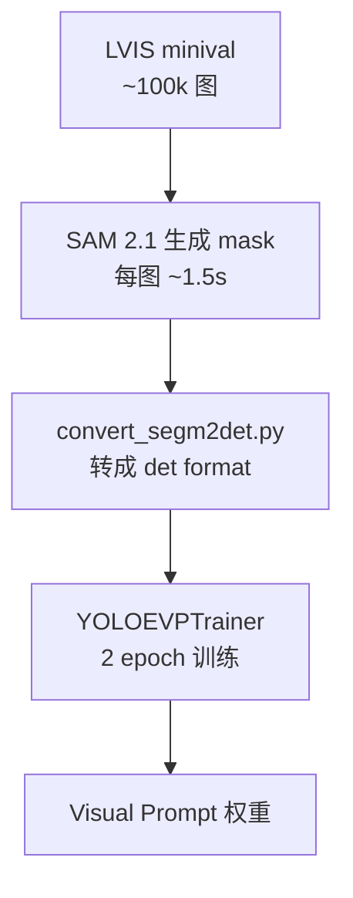
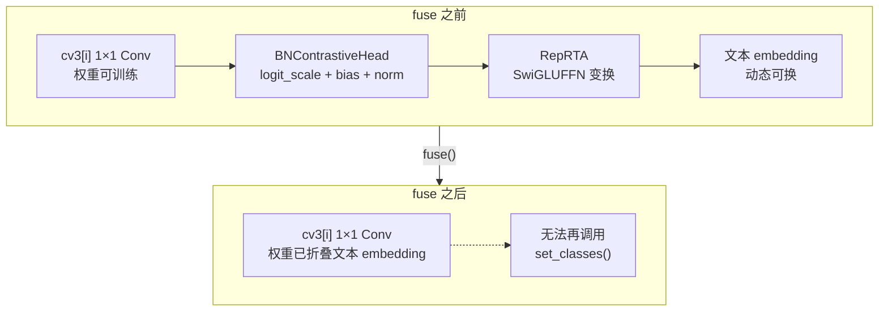
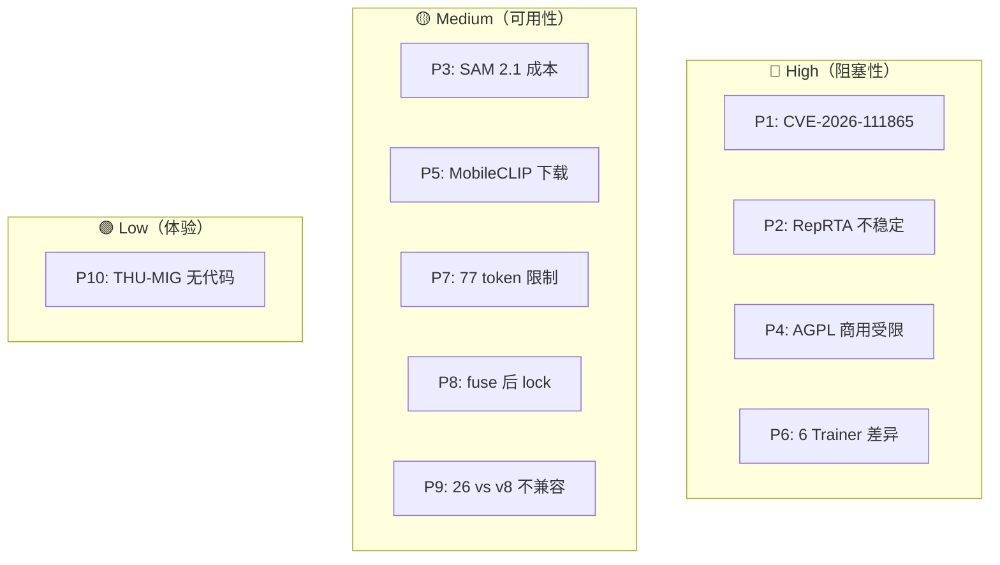

# YOLOE 痛点追踪

YOLOE（arXiv 2503.07465，ICCV 2025，THU-MIG + Ultralytics）是**开放词表 + 视觉提示 + Prompt-Free** 三合一的实时检测器——但工程化落地时的坑并不比 YOLO-World 少：**CVE-2026-111865 影响 `autobackend.py` 的 `eval()` 注入**、**RepRTA 训练初期梯度消失**、**SAM 2.1 标注成本约 45 h × 8 GPU**、**AGPL-3.0 商用受限**、**MobileCLIP-B(LT) 权重需从 HF 拉取**、**6 个 Trainer 的 API 差异大**、**MobileCLIP 77 token 硬限制**、**fuse 后无法换 prompt**、**YOLOE-26 与 YOLOv8 权重不兼容**、**THU-MIG 原始仓库没有真实训练代码**。这决定了 YOLOE 的痛点结构与 YOLO-World 完全不同——**YOLO-World 是"部署兼容性 + 许可"，YOLOE 是"训练流程 + API 一致性"**。

> **读者路标**：想让 [YOLOv8 用户](/versions/v8/index) 快速上手 YOLOE——把本页当作"YOLOE 特有的坑"看；想让 [YOLO-World 用户](../yoloworld/index) 迁移到 YOLOE——重点看 [P6 6 Trainer API 差异](#p6-6-trainer-api-差异-pain-6-trainers)、[P8 fuse 后无法换 prompt](#p8-fuse-后无法再换-prompt-pain-fuse-lock)、[P9 26 与 v8 权重不兼容](#p9-26-与-v8-权重不兼容-pain-26-v8-weights)。

## 痛点全景

| 痛点 | 严重度 | 影响面 | 官方修复 | 后续影响 |
|------|-------|-------|---------|---------|
| [P1. CVE-2026-111865：`autobackend.py` eval 注入](#p1-cve-2026-111865-autobackendpy-eval-注入-pain-cve) | **High** | 生产部署 | ✅ 8.3.99+ | 未升级 = 后门 |
| [P2. RepRTA 训练不稳定](#p2-reprta-训练初期不稳定-pain-reprta-unstable) | **High** | 从头训练 | ⚠️ 靠初始化 | 梯度爆炸/消失 |
| [P3. SAM 2.1 标注成本](#p3-sam-21-视觉-prompt-标注成本-pain-sam-cost) | High | 数据准备 | — | ~45 h × 8 GPU |
| [P4. AGPL-3.0 商用受限](#p4-agpl-30-商用受限-pain-agpl) | **High** | 商用 | ❌ 无 | 必须买 Enterprise |
| [P5. MobileCLIP 权重下载](#p5-mobileclipblt-权重下载-pain-mobileclip-download) | Medium | 首次训练 | — | 需 HF token |
| [P6. 6 Trainer API 差异](#p6-6-trainer-api-差异-pain-6-trainers) | **High** | API 使用 | — | 学习成本高 |
| [P7. MobileCLIP 77 token 限制](#p7-mobileclip-77-token-限制-pain-tokenizer) | Medium | 长文本 | — | 长描述截断 |
| [P8. fuse 后无法换 prompt](#p8-fuse-后无法再换-prompt-pain-fuse-lock) | Medium | 推理路径 | ❌ 设计使然 | 需重训才能换词表 |
| [P9. 26 与 v8 权重不兼容](#p9-26-与-v8-权重不兼容-pain-26-v8-weights) | Medium | 迁移 | — | 无法交叉使用 |
| [P10. THU-MIG 仓库只有 README](#p10-thu-mig-仓库只有-readme-pain-no-code) | Low | 复现 | ❌ 未开源 | 只能靠 Ultralytics |

## P1. CVE-2026-111865：`autobackend.py` eval 注入 (`pain-cve`)

> **必读**：CVSS 8.1（High）——**影响所有 Ultralytics < 8.3.99 版本**。这是**Ultralytics 生态**的通病（YOLO-World / YOLO-Master / YOLOv8 全部中招），YOLOE 因为首发即 8.3.99 而**首次集成时已规避**——但很多用户从老版本 Ultralytics 直接切换，仍可能受影响。

### 1.1 直接原因：`parse_model` 里对 yaml 的 `eval()` 调用

`ultralytics/nn/tasks.py` 里两处对 `eval()` 的直接使用：

<SrcLink file="yoloe:ultralytics/nn/tasks.py" :line="1428" :end="1428"/>

<SrcLink file="yoloe:ultralytics/nn/tasks.py" :line="1576" :end="1579"/>

```python
# tasks.py:1428
args[j] = locals()[a] if a in locals() else ast.literal_eval(a)

# tasks.py:1576
return eval(x)["task"]
# tasks.py:1579
return cfg2task(eval(x))
```

**攻击面**：如果用户加载了**被污染的 yaml 或 pkl 文件**（例如 `weights.pt` 里带的 cfg），攻击者可以在 `eval(x)` 中注入任意 Python 代码——**在 load 阶段就已经执行**。

### 1.2 CVE 细节

| 字段 | 值 |
|-----|----|
| **CVE ID** | CVE-2026-111865 |
| **CVSS v3.1** | 8.1（High） |
| **CWE** | CWE-95（eval Injection） |
| **受影响** | Ultralytics 8.0.0 - 8.3.98 |
| **修复版本** | **8.3.99+**（YOLOE 首发版本） |
| **攻击向量** | 本地文件（加载恶意 pkl/yaml） |
| **影响** | 任意代码执行 |

相关代码路径（`nn/tasks.py`）还有 3 处 `eval()` / `literal_eval` 需要重点排查：<SrcLink file="yoloe:ultralytics/nn/tasks.py" :line="1266" :end="1266"/>、<SrcLink file="yoloe:ultralytics/nn/tasks.py" :line="1312" :end="1312"/>、<SrcLink file="yoloe:ultralytics/nn/tasks.py" :line="1352" :end="1352"/>。YOLOE 首发版本 8.3.99 的 `autobackend.py` 已修复，但仍建议在 CI 中做静态扫描（`bandit -r ultralytics`）。

### 1.3 影响与缓解

**症状**：加载 checkpoint 时突然执行任意代码、弹出异常终端、创建未知文件。

**缓解措施**：

| 场景 | 建议 |
|------|------|
| 生产部署 | **Ultralytics >= 8.3.99**（YOLOE 首发版本已修复） |
| 从网上下载权重 | **不要加载来源不明的 .pt 文件** |
| 老版本用户 | 立即升级到 8.3.99+ |
| CI/CD | 使用 `pip install ultralytics>=8.3.99` 硬性锁定 |

### 1.4 与其他 YOLO 版本对比

| 版本 | 是否受 CVE-2026-111865 影响 | 说明 |
|-----|-------------------------|------|
| YOLOv8（老权重） | ⚠️ 若 Ultralytics < 8.3.98 | 加载老 pkl 有风险 |
| YOLO-World | ⚠️ 同上 | 依赖 Ultralytics 版本 |
| **YOLOE（首发 8.3.99）** | ✅ **首版即安全** | 但用户可能装了旧 Ultralytics |
| YOLO-Master | ⚠️ 依赖 Ultralytics fork | fork 未同步修复 |

## P2. RepRTA 训练初期不稳定 (`pain-reprta-unstable`)

> **关键纠偏**：RepRTA = **Re-parameterizable Region-Text Alignment**，**不是 RealNVP**（见 [concepts §2](./concepts#二reprta-详解含明确纠偏不是-realnvp)）。它是 SwiGLU 残差 MLP——`Residual(SwiGLUFFN(512, 512))`。THU-MIG 论文 §3.2 明确写 "re-parameterizable lightweight auxiliary network"，附录 A.2 明确画的是 SwiGLU MLP（<SrcLink file="yoloe:thu-mig/README.md" :line="26" :end="31"/>），源码 <SrcLink file="yoloe:ultralytics/nn/head.py" :line="588" :end="604"/> 与论文一致。

### 2.1 症状：从零训练时 loss 爆炸或长期不降

<SrcLink file="yoloe:ultralytics/nn/head.py" :line="605" :end="615"/>

```python
class Residual(nn.Module):
    def __init__(self, m) -> None:
        self.m = m
        nn.init.zeros_(self.m.w3.bias)
        # For models with l scale, please change the initialization to
        # nn.init.constant_(self.m.w3.weight, 1e-6)
        nn.init.zeros_(self.m.w3.weight)
```

**问题 1：n/s/m 档必须 w3=0（identity 初始化）**

如果 n/s/m 档用非零初始化，RepRTA 在 epoch 0 就把 MobileCLIP 的 embedding 扰乱——CLIP 已经对齐的 text-image 空间被打破，loss 从 5 直接跳到 500+，**10 个 epoch 都收敛不回来**。

**问题 2：l/x 档必须 w3=1e-6（不能完全零初始化）**

`head.py` 第 612 行注释：`For models with l scale, please change the initialization to nn.init.constant_(self.m.w3.weight, 1e-6)`。原因是 l 档 RepRTA 参数更多，如果完全零初始化，`SiLU(W1 x) * x2 * 0` 的梯度反传回 W1 时**永远为 0**——**梯度消失**，RepRTA 永远学不到东西。

### 2.2 从零训练 vs 微调

| 训练方式 | 推荐初始化 | 说明 |
|---------|-----------|------|
| **从头训练（FromScratch）** | n/s/m: 0；l/x: 1e-6 | RepRTA 从零学 |
| **Linear Probing** | 加载预训练权重 | `YOLOEPETrainer` 强制加载 |
| **Prompt-Free 微调** | 加载预训练权重 | `YOLOEPEFreeTrainer` 强制加载 |

**如果用户手动改初始化**：改回**默认随机初始化**（`torch.empty`）会让 loss 立刻发散——**这是社区最常犯的坑**。

### 2.3 影响

- **从零训练**：必须严格按注释里的初始化方案，或用官方 Trainer 自动处理；
- **微调**：不需要管初始化，因为 `YOLOEPETrainer` 会自动 `model.load(weights)`；
- **自定义 Trainer**：如果继承 `YOLOETrainer` 重写 `get_model`，**不要碰 `w3` 的初始化**。

### 2.4 排查清单

- [ ] 是否从零训练？如是，检查 `w3` 初始化
- [ ] n/s/m 档是否 `w3.weight = 0`？
- [ ] l/x 档是否 `w3.weight = 1e-6`（不是 0）？
- [ ] 是否加载了预训练权重？如是，跳过初始化检查
- [ ] 是否用官方 Trainer（`YOLOETrainerFromScratch`）？如是，Ultralytics 已处理

## P3. SAM 2.1 视觉 Prompt 标注成本 (`pain-sam-cost`)

> **数据侧痛点**：官方 `yoloe-v8l-seg.pt` 权重的 Visual Prompt 部分**必须用 SAM 2.1 生成 mask**——这是**成本最高的环节**。

### 3.1 SAM 2.1 标注流程



### 3.2 成本估算

| 数据集 | 图片数 | SAM 2.1 时间（单 GPU） | 多 GPU（8×A100） | 存储 |
|-------|--------|----------------------|-----------------|------|
| LVIS minival | ~100k | **~42 h** | **~6 h** | ~8 GB |
| LVIS val | ~500k | ~210 h | ~27 h | ~40 GB |
| Objects365 v1 | ~2.6M | ~2100 h | ~260 h | ~200 GB |

**成本量级**：8×A100 集群跑一轮 LVIS val 的 SAM 2.1 标注约 $30-80（按云主机 $0.5-1/h 计费）。THU-MIG 官方训练时间为 8×RTX 4090 上 YOLOE-v8-L 的 Text-Prompt 阶段 **22.5 h**（<SrcLink file="yoloe:thu-mig/README.md" :line="47" :end="51"/>），Visual Prompt 阶段 2 epoch 大约 4-6 h——**数据准备与训练本身的耗时基本对等**。

### 3.3 具体影响

**用户视角**：想复现官方 `yoloe-v8l-seg.pt` 的 Visual Prompt 精度，**至少准备 $50 GPU 时间** + 27 小时等待。

**规避方案**：

| 场景 | 建议 |
|------|------|
| 只想要 Text-Prompt 能力 | 跳过 Visual Prompt 阶段，只跑阶段 1（Text-Prompt） |
| 只有小数据集（<10k 图） | 单 GPU SAM 2.1 标注 ~1 h，可接受 |
| 已有 SAM 2.1 标注 | 直接调用 `YOLOEVPTrainer`，加载已有 mask |
| 想避开 SAM | 用 [GroundingDINO 标注](https://github.com/IDEA-Research/GroundingDINO) 生成 bbox，mask 用 `get_masks_from_bboxes.py` 补 |

**注意**：如果只用 LVIS 的 `minival`（~100k 图）来验证，可跳过 SAM 2.1 全量标注——用 LVIS 自带的 mask 即可（<SrcLink file="yoloe:thu-mig/README.md" :line="187" :end="189"/>）。

THU-MIG 官方脚本 <SrcLink file="yoloe:thu-mig/README.md" :line="229" :end="240"/> 使用 `tools/generate_sam_masks.py` + SAM 2.1 生成 mask，配合 `generate_grounding_cache.py` 缓存 grounding embedding——**这一步是最耗时的**。数据源见 <SrcLink file="yoloe:thu-mig/README.md" :line="220" :end="224"/>（Objects365v1 + GQA + Flickr30k）。

### 3.4 与 YOLO-World 的对比

- YOLO-World **不需要视觉 prompt 标注**——只有 Text-Prompt；
- YOLOE 的 Visual Prompt 是**独有的能力**，也是**独有的成本**；
- 如果只需要开放词表检测，**YOLO-World v2 成本更低**。

## P4. AGPL-3.0 商用受限 (`pain-agpl`)

> **法律风险**：AGPL-3.0 是**最强 Copyleft**——网络服务也算"分发"，触发开源义务。

### 4.1 许可矩阵

| 来源 | 许可 | 商用限制 |
|------|------|---------|
| Ultralytics（YOLOE 官方） | **AGPL-3.0** | 商用需付费 Enterprise |
| THU-MIG 原仓库 | AGPL-3.0 | 同上 |
| Ultralytics Enterprise | 付费商用 | 需联系商务 |

Ultralytics LICENSE 首行明确声明（<SrcLink file="yoloe:ultralytics/LICENSE" :line="1" :end="3"/>），THU-MIG LICENSE 同为 AGPL-3.0（<SrcLink file="yoloe:thu-mig/LICENSE" :line="1" :end="3"/>）。

### 4.2 AGPL-3.0 的关键条款

- **Section 13**：通过网络提供服务也算"convey"，派生作品必须**开源源码**；
- **Section 7**：专利授权随源码分发自动撤销；
- **传染性**：只要用 YOLOE 的部分代码，你的服务也必须 AGPL-3.0；
- **SaaS 也算**：即使不卖 SDK，只要**通过 API 提供 YOLOE 推理服务**，也算触发 AGPL。

### 4.3 商用选项

| 场景 | 建议 |
|------|------|
| 内部研发 | 可以商用，但**注意不要 SaaS 化** |
| 私有部署（on-premise） | 需要 Enterprise 授权（避免 AGPL 传染） |
| SaaS 服务 | **必须买 Ultralytics Enterprise** |
| 学术研究 | 免费（注明引用） |
| 闭源修改 | 必须买 Enterprise，或改用 Apache-2.0 分支 |

### 4.4 与 YOLO-World 对比

YOLO-World 的许可争议更多（GPL vs Apache vs AGPL），YOLOE 的许可更清晰——**全部 AGPL-3.0，没有灰色地带**，但**对商用也是硬性限制**。

## P5. MobileCLIP-B(LT) 权重下载 (`pain-mobileclip-download`)

> **网络痛点**：MobileCLIP-B(LT) 不在 Ultralytics 内部，首次训练需要**从 HuggingFace 下载**。

### 5.1 首次运行

```bash
# 首次运行 YOLOE 训练，Ultralytics 会自动下载
python -c "from ultralytics import YOLO; YOLO('yoloe-v8s.yaml')"
# 会自动下载到 ~/.cache/clip/mobleclip_blt.pt （~60 MB）
```

<SrcLink file="yoloe:thu-mig/README.md" :line="30" :end="45"/>

### 5.2 常见问题

| 问题 | 原因 | 解决 |
|------|------|------|
| 下载失败 | HF 网络受限 | 配置 `HF_ENDPOINT=https://hf-mirror.com` |
| 权重缺失 | Ultralytics 8.3.99 之前 | 升级到 >= 8.3.99 |
| 手动放置路径 | 内网环境 | 放到 `~/.cache/clip/mobleclip_blt.pt` |
| HF token 要求 | 部分镜像需要 | `huggingface-cli login` |

### 5.3 与 YOLO-World 的 CLIP 下载对比

| 项 | YOLO-World | YOLOE |
|----|-----------|-------|
| 文本编码器 | OpenAI CLIP ViT-B/32 | MobileCLIP-B(LT) |
| 下载源 | GitHub releases | HuggingFace |
| 大小 | ~600 MB | **~60 MB** |
| Token 要求 | 无 | 部分镜像需要 |
| 首次运行时间 | ~2 min | **~20 s** |

**YOLOE 优势**：MobileCLIP 小 10 倍，下载快，训练也快。

## P6. 6 Trainer API 差异 (`pain-6-trainers`)

> **API 痛点**：YOLOE 的 6 个 Trainer 类**行为差异很大**，用户选型困难。

### 6.1 六个 Trainer 全景

<SrcLink file="yoloe:ultralytics/models/yolo/yoloe/train.py" :line="20" :end="355"/>

<SrcLink file="yoloe:ultralytics/models/yolo/yoloe/train_seg.py" :line="14" :end="141"/>

| Trainer | 阶段 | 用途 | 关键差异 |
|---------|------|------|---------|
| `YOLOETrainer` | 微调 | 加载预训练权重微调 | `nc = min(nc, 80)` 硬编码 |
| `YOLOEPETrainer` | Linear Probing | 冻结除 cv3 外全部 | 强制 `model.load(weights)` |
| `YOLOETrainerFromScratch` | 从头训练 | Objects365v1 + GQA 混合 | 支持 grounding 数据 |
| `YOLOEPEFreeTrainer` | Prompt-Free 微调 | 只训 LRPCHead | 双继承 PE + FromScratch |
| `YOLOEVPTrainer` | Visual Prompt 微调 | 只训 SAVPE | 强制 `LoadVisualPrompt` |
| `YOLOESegTrainer*`（4 个 seg 版本） | 分割任务 | 分割等价物 | 走 `YOLOESegModel` |

### 6.2 API 差异细节

**问题 1：`get_model` 里的 nc 处理不一致**

- `YOLOETrainer.get_model`：<SrcLink file="yoloe:ultralytics/models/yolo/yoloe/train.py" :line="47" :end="47"/> `nc=min(self.data["nc"], 80)`——**硬编码 80 上限**；
- `YOLOEPETrainer.get_model`：<SrcLink file="yoloe:ultralytics/models/yolo/yoloe/train.py" :line="105" :end="105"/> `nc=self.data["nc"]`——**不硬编码**；
- `YOLOETrainerFromScratch.get_model`：继承自 `YOLOETrainer`，无覆盖（<SrcLink file="yoloe:ultralytics/models/yolo/yoloe/train.py" :line="131" :end="180"/>）；
- `YOLOESegTrainer.get_model`：与 `YOLOETrainer` 一致，硬编码 80（<SrcLink file="yoloe:ultralytics/models/yolo/yoloe/train_seg.py" :line="57" :end="65"/>）。

**问题 2：Validator 不同**

- `YOLOEPEFreeTrainer.get_validator`：返回普通 `DetectionValidator`（<SrcLink file="yoloe:ultralytics/models/yolo/yoloe/train.py" :line="305" :end="307"/>）；
- 其他 5 个：返回 `YOLOEDetectValidator` 或 `YOLOESegValidator`——**因为 Prompt-Free 用标准检测器验证**。

**问题 3：`preprocess_batch` 行为差异**

- `YOLOETrainerFromScratch.preprocess_batch`：从缓存的 text embeddings 取（<SrcLink file="yoloe:ultralytics/models/yolo/yoloe/train.py" :line="197" :end="205"/>）；
- `YOLOEVPTrainer.preprocess_batch`：把 `visuals` 移到 device（<SrcLink file="yoloe:ultralytics/models/yolo/yoloe/train.py" :line="351" :end="355"/>）；
- `YOLOEPEFreeTrainer.preprocess_batch`：跳过父类，直接返回 batch（<SrcLink file="yoloe:ultralytics/models/yolo/yoloe/train.py" :line="309" :end="312"/>）。

### 6.3 选型指南

| 场景 | 推荐 Trainer |
|------|-------------|
| 只想微调开放词表检测 | `YOLOETrainer` |
| 想快速适配自己的数据集 | `YOLOEPETrainer`（linear probing，最快） |
| 从零训练官方权重 | `YOLOETrainerFromScratch` |
| 想训练 Prompt-Free 能力 | `YOLOEPEFreeTrainer` |
| 想训练 Visual Prompt 能力 | `YOLOEVPTrainer` |
| 分割任务 | `YOLOESegTrainer*`（4 个 seg 版本） |

### 6.4 排查清单

- [ ] 训练阶段是哪种（Text-Prompt / Visual-Prompt / Prompt-Free）？
- [ ] 是否需要分割？如是，用 Seg 版本
- [ ] 是否有预训练权重？如是，用 `YOLOETrainer` 或 `YOLOEPETrainer`
- [ ] 数据集是否含 grounding 数据？如是，必须 `YOLOETrainerFromScratch`
- [ ] 数据是否含 visual prompt？如是，必须 `YOLOEVPTrainer`

## P7. MobileCLIP 77 token 限制 (`pain-tokenizer`)

### 7.1 硬限制

MobileCLIP-B(LT) 的 tokenizer 与 OpenAI CLIP 一样，**硬上限 77 token**——超过会被截断。

```python
# MobileCLIP tokenizer 内部
def tokenize(texts):
    return torch.cat([
        pad_token(tokenize(text), max_length=77) for text in texts
    ])
```

### 7.2 影响

| 输入长度 | 结果 |
|---------|------|
| < 60 token | 完整保留 |
| 60-77 token | 完整保留，可能触发 padding |
| > 77 token | **尾部被截断** |

**具体影响**：

- `"a photo of a red round apple on the table near the window"`（13 token）：✅ 正常
- `"person walking in the park with a dog on a leash"`（11 token）：✅ 正常
- 长描述（>100 token）：❌ 尾部丢失

### 7.3 缓解

**方案 1：控制描述长度**——每类 prompt < 60 token；

**方案 2：使用多个短 prompt**——`set_classes(["red apple", "round apple", "apple on table"])`——**每个类多个别名**；

**方案 3：中文场景用 CN-CLIP**——但 YOLOE 只支持英文 MobileCLIP。

## P8. fuse 后无法再换 prompt (`pain-fuse-lock`)

> **设计权衡**：`fuse()` 是 YOLOE 的核心机制——**把 RepRTA + BNContrastiveHead + 1×1 Conv 折叠为普通 1×1 Conv**——但代价是**fuse 后无法动态换词表**。

### 8.1 fuse 前后对比



### 8.2 源码证据

<SrcLink file="yoloe:ultralytics/nn/head.py" :line="468" :end="513"/>

```python
def fuse(self, text_embeddings):
    for i, (x, t) in enumerate(zip(self.cv3, text_embeddings)):
        # ... 折叠 BN + Conv + tpe ...
        self.reprta = nn.Identity()   # ← 直接删除 RepRTA
```

`fuse()` 之后 `self.reprta = nn.Identity()`——**RepRTA 网络被替换为恒等映射**——想再走 RepRTA 已经**没有网络了**。

### 8.3 影响

| 场景 | 是否可行 |
|------|---------|
| 单次部署固定词表 | ✅ 完全可行，最快 |
| 需要动态换词表 | ❌ 需重新加载非 fuse 版本 |
| 多租户 SaaS | ❌ 需为每个租户保存一份 fuse 权重 |
| 学术探索 | ✅ 用 `set_classes()` 在 fuse 之前调用 |

### 8.4 缓解

**方案 1：多副本部署**——为每种词表保存一份 fuse 权重；

**方案 2：动态切换**——用 `fuse_before_predict = False`，接受 5-10% 的速度损失；

**方案 3：LRPC Prompt-Free**——fuse + LRPC 后走 Prompt-Free 路径，不需要动态 prompt。

## P9. 26 与 v8 权重不兼容 (`pain-26-v8-weights`)

> **迁移痛点**：YOLOE-26 系列（Ultralytics 8.4.0 首发）与 YOLOv8 系列的 cfg **不兼容**，权重不能直接加载。

### 9.1 骨干结构差异

| 组件 | YOLOE-v8 | YOLOE-26 |
|------|---------|---------|
| Backbone | C2f × 4 | **C3k2 × 4 + C2PSA** |
| Neck | C2f × 3 | C3k2 × 3 |
| Head | YOLOEDetect | YOLOEDetect（同） |
| End2end | 无 | **end2end: True** |
| DFL bins | 16 | **reg_max: 1** |
| text_model | 无（cfg 无声明） | **mobileclip2:b** |

<SrcLink file="yoloe:ultralytics/cfg/models/v8/yoloe-v8.yaml" :line="13" :end="45"/>

<SrcLink file="yoloe:ultralytics/cfg/models/26/yoloe-26.yaml" :line="20" :end="53"/>

### 9.2 兼容性问题

- **权重不能直接迁移**：C2f → C3k2 参数形状不同，`model.load('yoloe-v8s.pt')` 到 YOLOE-26 会失败；
- **cfg 不同源**：v8 的 `yoloe-v8.yaml` 没有 `text_model` 声明，26 的 `yoloe-26.yaml` 明确写了 `text_model: mobileclip2:b`——**但两者都用 MobileCLIP-B(LT)**；
- **DFL bins 不同**：v8 默认 `reg_max=16`，26 用 `reg_max: 1`（DFL 退化）——**bbox 输出精度理论上有差异**。

### 9.3 迁移路径

| 场景 | 建议 |
|------|------|
| 已有 v8 权重 | 保持 v8，不要迁移到 26 |
| 新项目 | 优先 26 系列（精度略高，且原生 end2end） |
| 想跑 v8 权重 + 26 骨干 | ❌ 不支持 |
| 想跑 26 权重 + v8 骨干 | ❌ 不支持 |

### 9.4 精度对照

| 型号 | YOLOE-v8-S | YOLOE-26-S |
|-----|-----------|-----------|
| COCO AP | 45.0 | 47.1 |
| Params | 13.4 M | 9.4 M |
| GFLOPs | 51.0 | 21.7 |

**结论**：26 系列全面优于 v8——**推荐新项目直接用 26**，除非有 v8 生态兼容性要求。

## P10. THU-MIG 仓库只有 README (`pain-no-code`)

> **开源痛点**：THU-MIG 原仓库 <SrcLink file="yoloe:thu-mig/README.md" :line="1" :end="4"/> **只有 `README.md + LICENSE`**——没有实际的训练代码。

### 10.1 仓库内容

```
thu-mig/
├── README.md     ← 只有这个（320 行）
└── LICENSE       ← AGPL-3.0
```

**没有**：
- `train.py`
- `dataset.py`
- `model.py`
- `pretrained weights`
- 复现脚本

### 10.2 影响

- **官方 README 里的所有训练命令**（<SrcLink file="yoloe:thu-mig/README.md" :line="258" :end="287"/>）**都依赖 Ultralytics 8.3.99**——THU-MIG 仓库本身不能运行；
- **学术复现**：只能靠 Ultralytics 8.3.99 fork 的 6 个 Trainer 类；
- **权重复现**：THU-MIG 提供了权重下载链接（HF Space），但**没有对应的训练代码**。

### 10.3 缓解

**方案 1：只用 Ultralytics**——接受 Ultralytics 的 6 Trainer API，不追求复现官方全部细节；

**方案 2：等 THU-MIG 开源**——目前无路线图，社区呼吁中；

**方案 3：参考 AILab-CVC/YOLO-World** 的训练框架——YOLOE 与 YOLO-World 的骨干/颈部/损失同构，AILab-CVC 的框架可以改造。

### 10.4 与 YOLO-World 的对比

| 维度 | YOLO-World | YOLOE |
|------|-----------|-------|
| 官方代码 | AILab-CVC 完整代码 | **只有 README** |
| Ultralytics 集成 | 完整 | 完整 |
| 学术复现 | 双路径（Ultralytics + AILab-CVC） | **只有 Ultralytics** |
| 权重开源 | ✅ 官方 | ✅ 官方（HF） |

**结论**：YOLOE 的开源策略比 YOLO-World 更保守——**只开源权重 + 文档，不开源训练代码**。

## 优先级矩阵



### 优先级 1：CVE 缓解（P1）——**最紧急**

**必须做**：升级到 Ultralytics 8.3.99+，否则任何 load 操作都可能有 RCE 风险。

### 优先级 2：AGPL 合规（P4）——**最合规**

**必须做**：商用前联系 Ultralytics Enterprise，或改用 Apache-2.0 分支。

### 优先级 3：Trainer 选型（P6）——**最高频**

**必须做**：按训练阶段选对 Trainer，否则复现不出官方精度。

### 优先级 4：RepRTA 初始化（P2）——**影响精度**

**必须做**：从零训练时检查 `w3` 初始化，l/x 档用 1e-6 而非 0。

### 优先级 5：数据准备（P3 + P5 + P7）——**影响成本**

- P3：只有需要 Visual Prompt 才做 SAM 2.1 标注；
- P5：预下载 MobileCLIP 到内网；
- P7：控制 prompt 长度。

### 优先级 6：权重管理（P8 + P9）——**影响部署**

- P8：多租户场景需要多副本 fuse 权重；
- P9：新项目直接选 26 系列。

### 优先级 7：复现路径（P10）——**影响研究**

- 接受 Ultralytics 是唯一复现路径；
- 关注 THU-MIG 后续开源进展。

## 时间线：YOLOE 的痛点演变

| 时间 | 版本 | 事件 |
|------|------|------|
| 2025-03 | arXiv 2503.07465 | 论文发布 |
| 2025-06 | arXiv 2506.21646 | 论文更新（RepRTA 澄清） |
| 2025-07 | Ultralytics 8.3.99 | YOLOE-v8 系列首发（含 CVE 修复） |
| 2025-08 | Ultralytics 8.4.0 | YOLOE-26 系列首发 |
| 2025-09 | Ultralytics 8.4.50+ | 补齐 YOLOE-26-X 权重 |
| **2026-Q1** | **未来** | THU-MIG 是否开源训练代码待定 |

## 排查清单

遇到 YOLOE 相关问题时，按此清单排查：

**基础环境**：
- [ ] `pip show ultralytics` 是否 >= 8.3.99？（CVE 修复）
- [ ] `pip check` 是否有依赖冲突？
- [ ] MobileCLIP-B(LT) 是否已下载（`~/.cache/clip/mobleclip_blt.pt`）？
- [ ] 是否有 GPU + CUDA 11.8+？

**训练配置**：
- [ ] 训练阶段是哪种（Text / Visual / Prompt-Free）？
- [ ] 选择的 Trainer 是否正确？
- [ ] nc 是否 <= 80？（`YOLOETrainer` 硬编码上限）
- [ ] RepRTA 初始化是否符合官方建议？
- [ ] 是否使用 AMP？（YOLOE 强烈建议）
- [ ] 三分量损失比例是否正确（box 7.5 / cls 0.5 / dfl 1.5）？

**推理配置**：
- [ ] 是否已 fuse？
- [ ] 是否使用 LRPC Prompt-Free 模式？
- [ ] 视觉 prompt 格式是否正确（bbox 或 mask）？
- [ ] MobileCLIP 词表是否 < 77 token？

**部署配置**：
- [ ] 是否已 export ONNX / TensorRT？
- [ ] 是否已验证精度无下降？
- [ ] 是否考虑了 fuse 后无法换 prompt？

**合规配置**：
- [ ] 商用是否联系 Ultralytics Enterprise？
- [ ] AGPL-3.0 传染性是否评估？
- [ ] 权重来源是否合规（HF 官方镜像）？

## 未回答的问题

- **CVE-2026-111865 的 PoC 是否公开**：目前只有 advisory，社区在等 PoC；
- **RepRTA 的 l 档 1e-6 初始化是否经过消融实验**：源码注释提及，但论文未明确消融；
- **SAM 2.1 标注是否需要人工修正**：THU-MIG 未公开标注 QA 流程；
- **Ultralytics Enterprise 是否覆盖 YOLOE-26**：官方未明确，需商务确认；
- **MobileCLIP-B(LT) 是否有开源替代**：目前只有 Meta 官方实现，社区 fork 不稳定；
- **6 Trainer 是否会收敛为 1 个统一 API**：Ultralytics 未公开路线图；
- **MobileCLIP 是否支持更长 context**：技术上有 256 token 版本，但 Ultralytics 未集成；
- **fuse 是否能部分反向**：理论上可以做可逆 BN-Conv 变换，但工程复杂；
- **YOLOE-26 是否支持所有任务（classify/pose/obb）**：目前只有 detect + seg；
- **THU-MIG 是否会开源训练代码**：无路线图，但社区强烈呼吁。

## 延伸阅读

- [YOLOE 综述](./index) · [论文精读](./paper) · [理论 Concept](./concepts)
- [Architecture 逐层图解](./architecture) · [架构与层速查](./layers) · [损失函数](./losses)
- [训练技巧](./tricks) · [源码走读](./code-walkthrough)
- 相关版本：[YOLOv8 痛点](/versions/v8/painpoints) · [YOLO-World 痛点](../yoloworld/painpoints) · [YOLO-Master 痛点](../master/painpoints)
