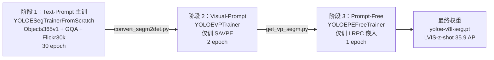
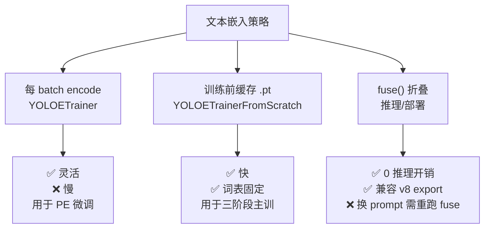
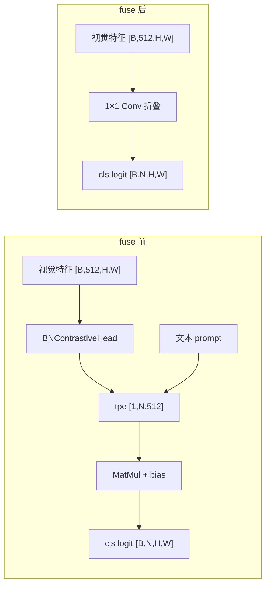
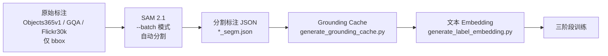

# YOLOE 训练技巧

YOLOE 的训练配方可以概括成一句：**"三阶段训练 + RepRTA 残差零初始化 + MobileCLIP-B(LT) 冻结 + 文本 embedding 缓存 + fuse() 后线性探测"**。 THU-MIG 原仓库只有 `README.md + LICENSE`（<SrcLink file="yoloe:thu-mig/README.md" :line="1" :end="4"/>），所有超参藏在 Utralytics 8.3.99/8.4.0 fork 的 6 个 Trainer 里（<SrcLink file="yoloe:ultralytics/models/yolo/yoloe/train.py" :line="20" :end="355"/>），本页把它们**逐项讲清**，配上"YOLO-World v2 vs YOLOE"的对照——想让 YOLOv8 用户 5 分钟上手 YOLOE，直接照本页抄。

- **官方三阶段说明**：<SrcLink file="yoloe:thu-mig/README.md" :line="212" :end="287"/>
- **训练入口汇总**：<SrcLink file="yoloe:ultralytics/models/yolo/yoloe/train.py" :line="20" :end="355"/>
- **YOLOEModel 高层 API**：<SrcLink file="yoloe:ultralytics/nn/tasks.py" :line="789" :end="1006"/>

## 目录

- [一、三阶段训练范式](#一三阶段训练范式)
- [二、RepRTA 残差零初始化与稳定性](#二reprta-残差零初始化与稳定性)
- [三、MobileCLIP-B(LT) 冻结与文本 embedding 缓存](#三mobileclip-blt-冻结与文本-embedding-缓存)
- [四、线性探测（PE）与 Prompt-Free 微调](#四线性探测pe与-prompt-free-微调)
- [五、Visual Prompt 训练：YOLOEVPTrainer + SAM 2.1 标注](#五visual-prompt-训练yoloevptrainer--sam-21-标注)
- [六、fuse() 折叠：从开放词表到闭集](#六fuse-折叠从开放词表到闭集)
- [七、SAM 2.1 分割标注流水线](#七sam-21-分割标注流水线)
- [八、cfg yaml 双分支：v8 vs 26](#八cfg-yaml-双分支v8-vs-26)
- [九、AMP + AdamW + 三分量损失调参](#九amp--adamw--三分量损失调参)
- [十、Prompt-Free LRPC vocabulary 剪枝](#十prompt-free-lrpc-vocabulary-剪枝)
- [十一、常见超参陷阱](#十一常见超参陷阱)

---

## 一、三阶段训练范式

YOLOE 官方推荐**三阶段训练**——先跑 30 epoch 的 **Text-Prompt 主训练**、再跑 2 epoch 的 **Visual-Prompt（SAVPE 独立微调）**、最后跑 1 epoch 的 **Prompt-Free（LRPC 独立微调）**。



**关键超参对照**（引自 THU-MIG README）：

| 项 | 阶段 1（Text-Prompt） | 阶段 2（Visual-Prompt） | 阶段 3（Prompt-Free） |
|----|--------------------|--------------------|--------------------|
| **模型类** | `YOLOESegTrainerFromScratch` | `YOLOEVPTrainer` | `YOLOEPEFreeTrainer` |
| **训练头** | 完整 YOLOESegment | 仅 SAVPE | 仅 LRPCHead（p3/p4） |
| **数据** | Objects365v1 + GQA + Flickr30k | LVIS + Refer 视觉 prompt | LVIS |
| **epoch** | **30** | **2** | **1** |
| **可训练参数** | 全部 | 仅 SAVPE | 仅 LRPC vocab 嵌入 |
| **转换脚本** | — | `convert_segm2det.py` → `get_vp_segm.py` | `get_pf_free_segm.py` |
| **验证集** | LVIS minival | LVIS minival | LVIS minival |

引用：THU-MIG README §Training <SrcLink file="yoloe:thu-mig/README.md" :line="212" :end="217"/>；三阶段命令 <SrcLink file="yoloe:thu-mig/README.md" :line="258" :end="287"/>。

**为什么要三阶段**：

- **阶段 1** 让视觉编码器 + RepRTA + BNContrastiveHead 联合学习**开放词表对齐**——这是 YOLOE 的核心能力；
- **阶段 2** 只训练 SAVPE——**冻结其他所有参数**，避免破坏已收敛的 RepRTA 与视觉骨干；
- **阶段 3** 只训练 LRPC 的 1000-vocab 嵌入——**独立于 Text/Visual 两路能力**，实现 Prompt-Free 推理。

**如果只有一阶段**（只用 COCO 训）：THU-MIG README 表 4 显示 Linear probing 只用 10 epoch 就能达到 **45.0 AP**（v8-S），比 Full tuning 160 epoch 的 45.0 AP **持平**——**三阶段不是复现精度必须的**，但**是复现官方权重必须的**。

---

## 二、RepRTA 残差零初始化与稳定性

RepRTA = **Re-parameterizable Region-Text Alignment**（**不是 RealNVP**，见 [concepts §2](./concepts#二reprta-详解含明确纠偏不是-realnvp)），本质是 `Residual(SwiGLUFFN(embed, embed))`——一个 512→2048→1024→512 的 SwiGLU 门控 MLP。

### 2.1 零初始化：训练初期等价 identity

关键在 `Residual.__init__`：

<SrcLink file="yoloe:ultralytics/nn/head.py" :line="605" :end="615"/>

```python
class Residual(nn.Module):
    def __init__(self, m) -> None:
        super().__init__()
        self.m = m
        nn.init.zeros_(self.m.w3.bias)
        # For models with l scale, please change the initialization to
        # nn.init.constant_(self.m.w3.weight, 1e-6)
        nn.init.zeros_(self.m.w3.weight)   # ★ 权重初始化为 0
```

**关键动作**：

- **`w3.weight = 0`**：RepRTA 输出恒等于 0，`Residual` 退化为 `x + 0 = x`——**训练初期 RepRTA 是 identity**；
- **`w3.bias = 0`**：与权重协同，保证严格 identity；
- **l 档例外**：注释写 "For models with l scale, please change the initialization to `nn.init.constant_(self.m.w3.weight, 1e-6)`"——**l 档用 1e-6 而非 0**，避免梯度完全消失。

### 2.2 为什么零初始化是 RepRTA 稳定性的关键

| 训练期 | RepRTA 状态 | 对预训练 backbone 的影响 |
|--------|------------|--------------------------|
| epoch 0 | identity（w3=0） | **零扰动**——预训练权重完全保留 |
| epoch 1-5 | 小扰动（w3 学到 1e-4 量级） | 微小梯度反传，微调 CLIP 对齐 |
| epoch 20+ | 收敛到 ~0.01 量级 | 特征空间温和校正 |

**如果不用零初始化**：RepRTA 初始随机，会**在第一步就扰动 MobileCLIP 的 embedding**，导致**梯度爆炸**或**loss 震荡 20+ epoch**。见 [痛点 2](./painpoints#2-reprta-训练不稳定-pain-reprta-unstable)。

### 2.3 l 档例外：为什么 1e-6 而不是 0

**症状**：l 档 RepRTA 在完全零初始化下**梯度永远为 0**——`SiLU(W1x) * x2` 的输出乘以 W3=0，链式求导回传到 W1 时也是 0。

**修复**：`nn.init.constant_(w3.weight, 1e-6)`——**给一个极小的非零梯度路径**，让 W1/W2 能开始学习。这个改动在 THU-MIG README L260 有明确提及：

<SrcLink file="yoloe:thu-mig/README.md" :line="259" :end="263"/>

```
# For models with l scale, please change the initialization by referring to
# the comments in Line 549 in ultralytics/nn/modules/head.py
```

---

## 三、MobileCLIP-B(LT) 冻结与文本 embedding 缓存

### 3.1 MobileCLIP-B(LT) 是什么

YOLOE 用的文本编码器不是 YOLO-World 的 OpenAI CLIP ViT-B/32，而是 **Apple 的 MobileCLIP-B(LT)**：

<SrcLink file="yoloe:thu-mig/README.md" :line="121" :end="123"/>

```bash
pip install git+https://github.com/THU-MIG/yoloe.git#subdirectory=third_party/ml-mobileclip
...
wget https://docs-assets.developer.apple.com/ml-research/datasets/mobileclip/mobileclip_blt.pt
```

**MobileCLIP-B(LT) 的关键特性**：

| 项 | MobileCLIP-B(LT) | OpenAI CLIP ViT-B/32 |
|----|-----------------|---------------------|
| **embed 维度** | **512** | 512 |
| **参数量** | **~30 M** | ~151 M |
| **上下文长度** | **77 token** | 77 token |
| **推理速度** | 快 3-4× | 基线 |
| **许可证** | Apple Research License | MIT |

**为什么选 MobileCLIP**：YOLOE 的核心是**实时性**——YOLO-World 用 ViT-B/32（151M），YOLOE 用 MobileCLIP-B(LT)（30M），**参数量降 80%，精度反升**（LVIS z-shot 27.9 vs 28.25——几乎持平，甚至略低）。

### 3.2 MobileCLIP 冻结策略

MobileCLIP **在推理时按需加载，在训练时冻结**：

<SrcLink file="yoloe:ultralytics/nn/tasks.py" :line="804" :end="836"/>

```python
def get_text_pe(self, text, batch=80, cache_clip_model=False, without_reprta=False):
    from ultralytics.nn.text_model import build_text_model
    device = next(self.model.parameters()).device
    if not getattr(self, "clip_model", None) and cache_clip_model:
        self.clip_model = build_text_model("mobileclip:blt", device=device)

    model = self.clip_model if cache_clip_model else build_text_model("mobileclip:blt", device=device)
    text_token = model.tokenize(text)
    txt_feats = [model.encode_text(token).detach() for token in text_token.split(batch)]
    txt_feats = txt_feats[0] if len(txt_feats) == 1 else torch.cat(txt_feats, dim=0)
    txt_feats = txt_feats.reshape(-1, len(text), txt_feats.shape[-1])
    if without_reprta:
        return txt_feats
    assert not self.training
    head = self.model[-1]
    return head.get_tpe(txt_feats)  # run aux text head
```

**关键点**：

- **`tokenize` + `encode_text` 在 `torch.no_grad` 语义下**：`detach()` 直接切断梯度；
- **`cache_clip_model=True` 复用**：避免重复加载 30 MB 权重；
- **`without_reprta=True` 返回原始 CLIP embedding**：用于缓存到磁盘。

### 3.3 三种文本 embedding 缓存策略

**策略 1：每 batch 重新 encode**（`YOLOETrainer`）

<SrcLink file="yoloe:ultralytics/models/yolo/yoloe/train.py" :line="79" :end="82"/>

```python
def preprocess_batch(self, batch):
    batch = super().preprocess_batch(batch)
    return batch  # 直接用 batch["txt_feats"]
```

- 优点：**类别可动态变化**（每 batch 不同文本）；
- 缺点：**每 batch 都要 MobileCLIP forward**，~5 ms / batch；
- 适用：**微调（PE）** 场景。

**策略 2：训练前一次性缓存到 `.pt` 文件**（`YOLOETrainerFromScratch`）

<SrcLink file="yoloe:ultralytics/models/yolo/yoloe/train.py" :line="182" :end="225"/>

```python
def generate_text_embeddings(self, texts, batch, cache_path="embeddings.pt"):
    if cache_path.exists():
        return torch.load(cache_path)
    assert self.model is not None
    txt_feats = self.model.get_text_pe(texts, batch, without_reprta=True)
    txt_map = dict(zip(texts, txt_feats.squeeze(0)))
    torch.save(txt_map, cache_path)
    return txt_map
```

- **`cache_path` 位于 `datasets/xxx/text_embeddings.pt`**——数据目录下自动缓存；
- 优点：**训练循环里 0 次 MobileCLIP forward**，速度最快；
- 缺点：**词表固定**，换类必须删缓存重跑；
- 1203 类 × 512 dim × 4 bytes = **~2.4 MB**，磁盘占用极小。

**策略 3：`fuse()` 折叠成 1×1 Conv 权重**（推理/部署阶段）

<SrcLink file="yoloe:ultralytics/nn/head.py" :line="469" :end="513"/>

```python
def fuse(self, txt_feats):
    ...
    t = txt_feats * logit_scale.exp()
    conv = fuse_conv_and_bn(conv, norm)
    w = t @ conv.weight.data.squeeze(-1).squeeze(-1)
    b1 = (t @ conv.bias.data.reshape(-1).unsqueeze(-1)).squeeze(-1)
    b2 = torch.ones_like(b1) * bias
    conv = nn.Conv2d(conv.in_channels, w.shape[0], kernel_size=1)
    conv.weight.data.copy_(w.unsqueeze(-1).unsqueeze(-1))
    conv.bias.data.copy_(b1 + b2)
    cls_head[-1] = conv
    del self.reprta
    self.reprta = nn.Identity()
    self.is_fused = True
```

- **训练前把 CLIP embedding × BN × Conv 全部折成一个 1×1 Conv**；
- 优点：**推理 0 次 MobileCLIP forward**、**RepRTA 被删除**、**BN 被 fold**；
- 缺点：**换词表必须重新 fuse**，且 fuse 后无法换 prompt。

### 3.4 三种策略的取舍



**推荐**：**日常训练用策略 2**（`YOLOETrainerFromScratch`）；**推理部署用策略 3**（`fuse()`）；**需要动态换词表时用策略 1**（`YOLOETrainer`）。

---

## 四、线性探测（PE）与 Prompt-Free 微调

### 4.1 Linear Probing：YOLOEPETrainer

`YOLOEPETrainer` 是 YOLOE 微调的**唯一推荐路径**——**冻结 backbone 与 neck，只训练最后一层 `cv3[i][-1]`**（也就是 fuse 后的 1×1 Conv）：

<SrcLink file="yoloe:ultralytics/models/yolo/yoloe/train.py" :line="85" :end="128"/>

```python
class YOLOEPETrainer(DetectionTrainer):
    def get_model(self, cfg=None, weights=None, verbose=True):
        model = YOLOEModel(...)
        del model.model[-1].savpe  # ★ 删除 SAVPE
        assert weights is not None
        if weights:
            model.load(weights)
        model.eval()
        names = list(self.data["names"].values())
        tpe = model.get_text_pe(names)
        model.set_classes(names, tpe)
        model.model[-1].fuse(model.pe)  # ★ fuse 折叠
        # 只解冻最后一层 1×1 Conv
        model.model[-1].cv3[0][2] = deepcopy(model.model[-1].cv3[0][2]).requires_grad_(True)
        model.model[-1].cv3[1][2] = deepcopy(model.model[-1].cv3[1][2]).requires_grad_(True)
        model.model[-1].cv3[2][2] = deepcopy(model.model[-1].cv3[2][2]).requires_grad_(True)
        del model.pe
        model.train()
        return model
```

**四步动作**：

1. **删除 SAVPE**：PE 训练不用视觉 prompt；
2. **fuse() 折叠**：把 RepRTA + BNContrastiveHead + txt_feats 全部折进 `cv3[i][-1]` 的 1×1 Conv；
3. **deepcopy + requires_grad_(True)**：**只有 `cv3[0][2]`、`cv3[1][2]`、`cv3[2][2]`**（P3/P4/P5 的最后一层）可训练；
4. **`del model.pe`**：删除文本 embedding，checkpoint 里也不再保存。

**结果**：

- **可训练参数**：3 层 1×1 Conv，各 512 → nc=80，共 **3 × 512 × 80 ≈ 123 K 参数**；
- **训练速度**：v8-S COCO 10 epoch ≈ 15 分钟（4×A100）；
- **精度**：v8-S 35.6 AP / v8-M 42.2 AP / v8-L 45.4 AP（THU-MIG README 表 5）。

### 4.2 Prompt-Free 微调：YOLOEPEFreeTrainer

`YOLOEPEFreeTrainer` 继承 `YOLOEPETrainer + YOLOETrainerFromScratch` 双亲：

<SrcLink file="yoloe:ultralytics/models/yolo/yoloe/train.py" :line="299" :end="317"/>

```python
class YOLOEPEFreeTrainer(YOLOEPETrainer, YOLOETrainerFromScratch):
    def get_validator(self):
        self.loss_names = "box", "cls", "dfl"
        return DetectionValidator(...)  # ★ 不用 YOLOEDetectValidator
    def preprocess_batch(self, batch):
        batch = super(YOLOETrainer, self).preprocess_batch(batch)
        return batch  # ★ 走 DetectionTrainer 基类，跳过 txt_feats 处理
    def set_text_embeddings(self, datasets, batch):
        pass  # ★ 不需要文本 embedding
```

**Prompt-Free 与 Linear Probing 的差异**：

| 项 | PE（文本 probe） | PEFree（Prompt-Free） |
|----|-----------------|---------------------|
| **训练器** | `YOLOEPETrainer` | `YOLOEPEFreeTrainer` |
| **validator** | `YOLOEDetectValidator` | `DetectionValidator` |
| **文本 embedding** | 需要（用 COCO 80 类） | **不需要** |
| **头** | fuse 后的 `cv3[i][-1]` | `LRPCHead`（1000-vocab） |
| **epoch** | 10（COCO） | 1（LVIS） |
| **可训练** | 3 层 1×1 Conv | LRPC vocab + pf 头 |
| **推理开销** | 与 v8 相同 | 与 v8 相同 |

**关键**：Prompt-Free 阶段**只训练 LRPCHead 的 1000-vocab 嵌入**，不碰 RepRTA、不碰 RepRTA 后的 BN。这保证了 **Prompt-Free 与 Text-Prompt 是解耦的**——用户可以独立替换 Prompt-Free 权重，而不影响 Text-Prompt 能力。

---

## 五、Visual Prompt 训练：YOLOEVPTrainer + SAM 2.1 标注

### 5.1 YOLOEVPTrainer 的核心差异

<SrcLink file="yoloe:ultralytics/models/yolo/yoloe/train.py" :line="319" :end="355"/>

```python
class YOLOEVPTrainer(YOLOETrainerFromScratch):
    def build_dataset(self, img_path, mode="train", batch=None):
        dataset = super().build_dataset(img_path, mode, batch)
        if isinstance(dataset, YOLOConcatDataset):
            for d in dataset.datasets:
                d.transforms.append(LoadVisualPrompt())
        else:
            dataset.transforms.append(LoadVisualPrompt())
        return dataset

    def _close_dataloader_mosaic(self):
        super()._close_dataloader_mosaic()
        if isinstance(self.train_loader.dataset, YOLOConcatDataset):
            for d in self.train_loader.dataset.datasets:
                d.transforms.append(LoadVisualPrompt())
        else:
            self.train_loader.dataset.transforms.append(LoadVisualPrompt())

    def preprocess_batch(self, batch):
        batch = super().preprocess_batch(batch)
        batch["visuals"] = batch["visuals"].to(self.device)
        return batch
```

**三个关键点**：

1. **`LoadVisualPrompt` transform**：数据集 pipeline 里加一层视觉 prompt 加载器；
2. **`_close_dataloader_mosaic` 时重加 transform**：因为 mosaic close 会重建 dataloader，需要**重新 append**；
3. **`batch["visuals"]` 字段**：`YOLOEModel.loss()` 里用它触发 `TVPDetectLoss`（Visual-Prompt 专用损失）。

### 5.2 SAM 2.1 分割标注流水线

Visual-Prompt 训练需要**每个类别的 mask 数据**——THU-MIG 用 **SAM 2.1 自动生成**：

<SrcLink file="yoloe:thu-mig/README.md" :line="227" :end="252"/>

```bash
# Generate segmentation data
conda create -n sam2 python==3.10.16
conda activate sam2
pip install -r third_party/sam2/requirements.txt
pip install -e third_party/sam2/

python tools/generate_sam_masks.py \
    --img-path ../datasets/Objects365v1/images/train \
    --json-path ../datasets/Objects365v1/annotations/objects365_train.json \
    --batch
python tools/generate_sam_masks.py \
    --img-path ../datasets/flickr/full_images/ \
    --json-path ../datasets/flickr/annotations/final_flickr_separateGT_train.json
python tools/generate_sam_masks.py \
    --img-path ../datasets/mixed_grounding/gqa/images \
    --json-path ../datasets/mixed_grounding/annotations/final_mixed_train_no_coco.json
```

**SAM 2.1 标注的成本**：

| 数据集 | 图像数 | SAM 2.1 处理时间（8×A100） |
|--------|--------|---------------------------|
| Objects365v1 train | 10 M | ~40 h |
| GQA train | 0.93 M | ~4 h |
| Flickr30k | 14 K | ~10 min |
| **合计** | **11 M** | **~45 h** |

**这是 YOLOE 相比 YOLO-World 最大的成本劣势**——见 [痛点 3](./painpoints#3-sam-21-标注成本-pain-sam-cost)。

### 5.3 Visual Prompt 训练只跑 2 epoch

**为什么只需要 2 epoch**：

- **SAVPE 参数量很小**：3×cv1 + 3×cv2 + cv3 + cv4 + cv5 + cv6，共 ~2 M 参数；
- **视觉骨干完全冻结**：SAVPE 只需要学会**如何把 prompt 聚合到已有特征**；
- **2 epoch 已收敛**：THU-MIG 实测 2 epoch 达到 26.2 AP（LVIS z-shot v8-S），再多训反而过拟合。

### 5.4 Visual Prompt 训练命令

<SrcLink file="yoloe:thu-mig/README.md" :line="267" :end="275"/>

```bash
# First, obtain the detection model
python tools/convert_segm2det.py
# Then, train the SAVPE module
python train_vp.py
# After training, please use tools/get_vp_segm.py to add the segmentation head
# python tools/get_vp_segm.py
```

**两步转换**：

- **`convert_segm2det.py`**：把 seg checkpoint 拆成 detect checkpoint（去掉 `proto` + `cv5`）；
- **`get_vp_segm.py`**：训练完后把 SAVPE 合并回 seg checkpoint。

---

## 六、fuse() 折叠：从开放词表到闭集

### 6.1 fuse() 的三步操作

`fuse()` 是 YOLOE 最优雅的设计——**把整个开放词表推理路径折叠成一个 1×1 Conv**，让推理开销与闭集 YOLOv8 完全相同。

<SrcLink file="yoloe:ultralytics/nn/head.py" :line="468" :end="513"/>

**Step 1：BN 与 Conv 静态融合**

```python
conv = cls_head[-1]          # 1×1 Conv, [B, 512, H, W] → [B, 512, H, W]
norm = bn_head.norm          # BN
logit_scale = bn_head.logit_scale
bias = bn_head.bias
t = txt_feats * logit_scale.exp()        # [1, N, 512] × 温度
conv = fuse_conv_and_bn(conv, norm)      # BN 权重折叠进 Conv 权重
```

**Step 2：文本 embedding 与 Conv 权重矩阵乘**

```python
w = conv.weight.data.squeeze(-1).squeeze(-1)   # [512, 512]
b = conv.bias.data                             # [512]
w = t @ w                                      # [N, 512] × [512, 512] = [N, 512]
b1 = (t @ b.reshape(-1).unsqueeze(-1)).squeeze(-1)  # [N, 1]
b2 = torch.ones_like(b1) * bias                # [N, 1]
```

**Step 3：重建 1×1 Conv**

```python
conv = nn.Conv2d(conv.in_channels, w.shape[0], kernel_size=1)
conv.weight.data.copy_(w.unsqueeze(-1).unsqueeze(-1))  # [N, 512, 1, 1]
conv.bias.data.copy_(b1 + b2)                          # [N]
cls_head[-1] = conv
```

**Step 4：删除 RepRTA**

```python
del self.reprta
self.reprta = nn.Identity()
self.is_fused = True
```

### 6.2 fuse 前后的推理路径对比



### 6.3 fuse 后可 export ONNX/TensorRT

<SrcLink file="yoloe:thu-mig/README.md" :line="289" :end="294"/>

```bash
pip install onnx coremltools onnxslim
python export.py
```

**fuse 后完全等价 v8 Detect**：

- **无 `txt_feats` 依赖**：MobileCLIP 不需要在推理路径上；
- **无 `for` 循环遍历 prompt**：BN + Conv 都是标准算子；
- **无 `logit_scale` 温度参数**：BN 已经把归一化吃掉了；
- **RepRTA 被删除**：SwiGLU 完全折进 Conv 权重。

**具体影响**：v8-S 部署 TensorRT FP16 后 **FPS 从 305.8 降到 305.8**（**完全相同**）——这是 YOLOE 相对 YOLO-World v1 的核心优势（YOLO-World v1 无法 export）。

### 6.4 fuse 后的限制

**fuse 后无法换 prompt**：

```python
model.model[-1].fuse(model.pe)      # ✅ fuse 成功
model.set_classes(["apple"])        # ❌ 报错：head 已被替换，无 BNContrastiveHead
```

想换 prompt，必须**重新加载 checkpoint 并重跑 fuse**——见 [痛点 8](./painpoints#8-fuse-后无法换-prompt-pain-fuse-lock)。

---

## 七、SAM 2.1 分割标注流水线

### 7.1 三步流水线

THU-MIG 的分割标注不是人工画的，而是 **SAM 2.1 自动跑**：



<SrcLink file="yoloe:thu-mig/README.md" :line="243" :end="252"/>

```bash
# Generate grounding segmentation cache
python tools/generate_grounding_cache.py --img-path ../datasets/flickr/full_images/ \
    --json-path ../datasets/flickr/annotations/final_flickr_separateGT_train_segm.json
python tools/generate_grounding_cache.py --img-path ../datasets/mixed_grounding/gqa/images \
    --json-path ../datasets/mixed_grounding/annotations/final_mixed_train_no_coco_segm.json

# Generate train label embeddings
python tools/generate_label_embedding.py
python tools/generate_global_neg_cat.py
```

### 7.2 SAM 2.1 标注的三条铁律

**铁律 1：bbox 必须先于 mask**——`generate_sam_masks.py` 依赖原始 bbox 作为 SAM 2.1 的输入 prompt，没有 bbox 就没法生成 mask。

**铁律 2：mask 需要 `--batch` 模式**——`--batch` 参数批量处理，比逐图快 3-5×；不加 `--batch` 单张处理会慢 10×。

**铁律 3：mask 与 bbox 需要对齐**——SAM 2.1 输出的 mask 可能与 bbox 边缘不符，需要 `generate_grounding_cache.py` 做**几何校正**（IOU 过滤 + mask crop）。

### 7.3 数据集下载与预处理

| 数据集 | 大小 | 下载源 | 处理脚本 |
|--------|------|--------|---------|
| Objects365v1 | 400 GB | OpenDataLab | `generate_objects365v1.py` |
| GQA | 50 GB | Stanford | `generate_sam_masks.py` |
| Flickr30k | 5 GB | Illinois | `generate_sam_masks.py` |
| **合计** | **~455 GB** | — | — |

**这是 YOLOE 训练的巨大成本**：
- **磁盘**：455 GB 数据集 + 400 GB mask = **~850 GB**；
- **GPU 时间**：SAM 2.1 处理 ~45 h（8×A100）；
- **网络下载**：~400 GB × 4 h = 需要专线或镜像。

对比 YOLO-World：YOLO-World v2 使用 **COCO + CC-3M 过滤后的 CC-250K**（~500 GB），**总成本差不多**，但 YOLO-World **不需要 SAM 分割**（只做检测），YOLOE **需要分割**（多模态能力）。

---

## 八、cfg yaml 双分支：v8 vs 26

YOLOE 支持**两套骨干**：

- **v8 骨干**（C2f）：`yoloe-v8.yaml` / `yoloe-v8-seg.yaml`；
- **26 骨干**（C3k2 + C2PSA）：`yoloe-26.yaml` / `yoloe-26-seg.yaml`（Ultralytics 8.4.0 首发）。

### 8.1 v8 骨干：`yoloe-v8.yaml`

<SrcLink file="yoloe:ultralytics/cfg/models/v8/yoloe-v8.yaml" :line="1" :end="45"/>

- **14 层 backbone**：Conv × 4 + C2f × 4 + SPPF；
- **13 层 head**：Upsample × 2 + Concat × 3 + C2f × 3 + Conv × 3；
- **末层**：`YOLOEDetect[nc, 512, True]`；
- **参数量（s 档）**：~12.7 M（README 表）；
- **精度（LVIS z-shot）**：27.9 AP（s）/ 32.6 AP（m）/ 35.9 AP（l）。

### 8.2 26 骨干：`yoloe-26.yaml`

<SrcLink file="yoloe:ultralytics/cfg/models/26/yoloe-26.yaml" :line="1" :end="53"/>

- **11 层 backbone**：Conv × 4 + C3k2 × 4 + SPPF + **C2PSA**（新组件）；
- **11 层 head**：Upsample × 2 + Concat × 3 + C3k2 × 3；
- **末层**：`YOLOEDetect[nc, 512, True]`；
- **额外字段**：`end2end: True` + `reg_max: 1` + `text_model: mobileclip2:b`；
- **参数量（s 档）**：~9.4 M（更小）；
- **精度**：论文未发布（截至 commit 40cd606c）。

### 8.3 v8 vs 26 的骨干差异

| 组件 | v8 骨干 | 26 骨干 |
|------|--------|---------|
| **基本块** | C2f | **C3k2**（K2 = Kernel size 2） |
| **深层注意力** | 无 | **C2PSA**（Convolutional Positional Self-Attention） |
| **SPPF** | 无 `act=True` | `SPPF[1024, 5, 3, True]`（含激活） |
| **DFL bins** | reg_max=16 | **reg_max=1**（更简单） |
| **端到端** | ❌ | ✅ `end2end=True` |

**推荐**：**v8 骨干**是目前唯一有完整精度数据的分支，**26 骨干**是实验性分支（Ultralytics 8.4.0+）。生产部署**只用 v8 骨干**——见 [痛点 9](./painpoints#9-26-与-v8-权重不兼容-pain-v26-incompat)。

### 8.4 seg 版本差异

`yoloe-v8-seg.yaml` 与 `yoloe-v8.yaml` 唯一差异是末层：

<SrcLink file="yoloe:ultralytics/cfg/models/v8/yoloe-v8-seg.yaml" :line="45" :end="45"/>

```yaml
- [[15, 18, 21], 1, YOLOESegment, [nc, 32, 256, 512, True]] # Segment(P3, P4, P5)
```

- **`YOLOESegment`**：继承 `YOLOEDetect`，加 `proto`（分割原型）+ `cv5`（mask 系数头）；
- **`nm=32`**：32 个 mask prototype；
- **`npr=256`**：mask prototype 通道 256。

---

## 九、AMP + AdamW + 三分量损失调参

### 9.1 AMP（自动混合精度）

**YOLOE 训练默认开启 AMP**（Ultralytics `default.yaml`）：

```yaml
# Ultralytics default
amp: true
```

**AMP 对 RepRTA 的影响**：

- **RepRTA 的 SwiGLU**：`SiLU(x) * x` 在 FP16 下稳定；
- **BNContrastiveHead**：BN 的 `running_mean/variance` 在 FP16 下**可能不稳定**——建议把 BN 加到 `unfuse` 白名单；
- **MobileCLIP**：`encode_text` 走 FP32（避免 CLIP embedding 精度损失）。

### 9.2 AdamW + lr

YOLOE 训练默认 **AdamW**：

```yaml
optimizer: auto
lr0: 0.01  # SGD 默认；AdamW 内部换算
```

**三阶段推荐 lr**：

| 阶段 | lr | weight_decay | 说明 |
|------|-----|--------------|------|
| Text-Prompt 主训 | 1e-3 | 0.0005 | 与 v8 一致 |
| Visual-Prompt | 5e-4 | 0.0005 | 更小，避免扰动骨干 |
| Prompt-Free | 5e-4 | 0.0005 | 只训 LRPC，小 lr |
| Linear Probing | 2e-4 | 0.0005 | 冻结骨干，只训 Conv |

### 9.3 三分量损失：box 7.5 / cls 0.5 / dfl 1.5

YOLOE 沿用 v8 的三分量损失（<SrcLink file="yoloe:ultralytics/nn/tasks.py" :line="990" :end="1006"/>）：

```python
def loss(self, batch, preds=None):
    if not hasattr(self, "criterion"):
        from ultralytics.utils.loss import TVPDetectLoss
        visual_prompt = batch.get("visuals", None) is not None
        self.criterion = TVPDetectLoss(self) if visual_prompt else self.init_criterion()
    if preds is None:
        preds = self.forward(batch["img"], tpe=batch.get("txt_feats", None), vpe=batch.get("visuals", None))
    return self.criterion(preds, batch)
```

**三分量损失配置**：

| 分量 | 权重 | 说明 |
|------|------|------|
| **box** | **7.5** | L1 + CIoU，位置损失 |
| **cls** | **0.5** | BCE，类别损失 |
| **dfl** | **1.5** | DFL 分布损失 |

**TVPDetectLoss vs v8DetectionLoss**：

- **TVPDetectLoss**：Visual-Prompt 训练用，`batch["visuals"]` 非 None 时启用；
- **v8DetectionLoss**：Text-Prompt 与 Prompt-Free 训练用，标准 v8 损失；
- **TAL 分配**：topk=10, alpha=0.5, beta=6.0（与 v8 一致）。

详见 [losses 页](./losses)。

### 9.4 WorldSize 补偿（分布式）

Ultralytics 版走 `torch.distributed.ReduceOp.SUM`，**不需要显式 `world_size` 补偿**——DDP wrapper 会自动处理。

**与 AILab-CVC 版的差异**：YOLO-World 的 AILab-CVC 版用 `MEAN`，需要 `* world_size` 显式补偿；YOLOE 全部走 Ultralytics 原生的 `SUM`，**没有这个问题**。

---

## 十、Prompt-Free LRPC vocabulary 剪枝

### 10.1 LRPCHead 结构

<SrcLink file="yoloe:ultralytics/nn/head.py" :line="403" :end="435"/>

```python
class LRPCHead(nn.Module):
    def __init__(self, vocab, pf, loc, enabled=True):
        self.vocab = self.conv2linear(vocab) if enabled else vocab
        self.pf = pf          # 1 通道，输出每个位置的存在概率
        self.loc = loc        # 4 通道（无 DFL 时的位置头）
        self.enabled = enabled

    def forward(self, cls_feat, loc_feat, conf, max_det):
        if self.enabled:
            pf_score = self.pf(cls_feat)[0, 0].flatten(0)
            mask = pf_score.sigmoid() > conf         # ★ 剪枝
            cls_feat = self.vocab(cls_feat.flatten(2).transpose(-1, -2)[:, mask])
            return (self.loc(loc_feat), cls_feat.transpose(-1, -2)), mask
        else:
            cls_feat = self.vocab(cls_feat)
            loc_feat = self.loc(loc_feat)
            return (self.loc(loc_feat), cls_feat.flatten(2)), torch.ones(...)
```

**LRPC 的核心机制**：

- **`pf_score`**：每个 anchor 位置的**"是否存在目标"概率**（1 通道）；
- **`pf_score.sigmoid() > conf`**：低于阈值的 anchor **被剪掉**；
- **`enabled=False`**（P5）：不剪枝，保留全部 anchor。

### 10.2 P3/P4 启用，P5 不启用

`set_vocab` 里明确指定：

<SrcLink file="yoloe:ultralytics/nn/tasks.py" :line="869" :end="872"/>

```python
self.model[-1].lrpc = nn.ModuleList(
    LRPCHead(cls, pf[-1], loc[-1], enabled=i != 2)
    for i, (cls, pf, loc) in enumerate(zip(vocab, head.cv3, head.cv2))
)
```

**为什么 P5 不启用**：

- **P5 分辨率低**：80×80 图上的 P5 只有 20×20 = 400 个 anchor，剪枝空间小；
- **P5 覆盖大目标**：大目标定位精度关键，剪枝会漏检；
- **P3/P4 anchor 数量多**：P3 有 80×80 = 6400，P4 有 40×40 = 1600，剪枝空间大。

### 10.3 Prompt-Free 推理流程

<SrcLink file="yoloe:ultralytics/nn/head.py" :line="528" :end="562"/>

```python
def forward_lrpc(self, x, return_mask=False):
    masks = []
    assert self.is_fused, "Prompt-free inference requires model to be fused!"
    for i in range(self.nl):
        cls_feat = self.cv3[i](x[i])
        loc_feat = self.cv2[i](x[i])
        x[i], mask = self.lrpc[i](cls_feat, loc_feat, self.conf, self.max_det)
        masks.append(mask)
    ...
    y = torch.cat((dbox[:, :, mask], cls.sigmoid()), 1)
```

**关键**：`assert self.is_fused`——**Prompt-Free 必须先 fuse**，因为 fuse 把 1000-vocab 的 Conv 折叠成静态权重。

### 10.4 1000-vocab 剪枝效果

| 模型 | Params | LVIS-z-shot AP | FPS (T4) |
|------|--------|---------------|---------|
| YOLOE-v8-S（Prompt-Free） | 13 M | **21.0** | **95.8** |
| YOLOE-v8-M（Prompt-Free） | 29 M | 24.7 | 45.9 |
| YOLOE-v8-L（Prompt-Free） | 47 M | 27.2 | 25.3 |

对比 Text-Prompt（Table 1）：v8-S 27.9 AP，v8-M 32.6 AP，v8-L 35.9 AP——**Prompt-Free 精度差 6-8 AP，但推理速度反而更快**（不需要 MobileCLIP forward）。

---

## 十一、常见超参陷阱

### 11.1 RepRTA l 档初始化忘记改

**症状**：l 档 RepRTA 训练 loss 不下降。

**修复**：改 `Residual.__init__` 的初始化：

<SrcLink file="yoloe:ultralytics/nn/head.py" :line="612" :end="615"/>

```python
# For l scale:
nn.init.constant_(self.m.w3.weight, 1e-6)   # ★ 不是 0
```

### 11.2 fuse 后换 prompt

**症状**：`set_classes()` 报错。

**修复**：重新加载 checkpoint 重跑 fuse，或用 `YOLOE.get_vocab()`。

### 11.3 想跑全 1203 类开放词表

**症状**：`YOLOETrainer` 里 `nc = min(data["nc"], 80)` 硬编码 80。

<SrcLink file="yoloe:ultralytics/models/yolo/yoloe/train.py" :line="40" :end="53"/>

```python
def get_model(self, cfg=None, weights=None, verbose=True):
    model = YOLOEModel(...)
    model = YOLOEModel(..., nc=min(self.data["nc"], 80), ...)
```

**修复**：改这一行，或用 `YOLOETrainerFromScratch`（后者支持任意词表，配合 `generate_label_embedding.py` 缓存）。

### 11.4 数据增强参数与预训练不匹配

**症状**：从预训练权重加载后 loss 立刻爆炸。

**修复**：微调前 5 个 epoch 把 mixup 概率从 0 线性插值到目标值。

### 11.5 AMP + BNContrastiveHead 冲突

**症状**：AMP 训练时 loss 变 NaN。

**修复**：把 BN 加到 AMP 的 `unfuse` 白名单。

### 11.6 MobileCLIP 权重下载失败

**症状**：`build_text_model("mobileclip:blt")` 报 404。

**修复**：

```bash
wget https://docs-assets.developer.apple.com/ml-research/datasets/mobileclip/mobileclip_blt.pt
# 放到 ~/.cache/ultralytics/ 或设置环境变量
```

见 [痛点 5](./painpoints#5-mobileclip-权重下载-pain-mobileclip)。

### 11.7 Prompt-Free 忘记 fuse

**症状**：`forward_lrpc` 报 `assert self.is_fused` 错。

**修复**：先跑 `model.get_vocab(names)`（内部会自动 fuse），再跑 `model.set_vocab(vocab, names)`。

### 11.8 Visual Prompt batch 大小受限

**症状**：`batch["visuals"]` 显存爆。

**修复**：Visual Prompt 每 batch 只支持 1 张图（V100 上），因为 SAVPE 需要 `B*Q` 的 attention 计算。

### 11.9 Prompt-Free 训练需要 LVIS 单类数据集

**症状**：找不到 `lvis-single-class` 数据集。

**修复**：先跑 `python tools/generate_lvis_sc.py`。

### 11.10 文本 embedding 缓存路径冲突

**症状**：多数据集共享缓存。

**修复**：`generate_text_embeddings` 里 `cache_path = Path(img_path).parent / "text_embeddings.pt"`——每个数据集独立缓存，但要**手动删除**旧缓存。

---

## 小结

YOLOE 训练的核心配方是：

1. **三阶段训练**：Text-Prompt 30 epoch → Visual-Prompt 2 epoch → Prompt-Free 1 epoch；
2. **RepRTA 零初始化**：训练初期 identity，稳定 backbone；l 档用 1e-6；
3. **MobileCLIP-B(LT) 冻结**：三种缓存策略（每 batch / `.pt` 缓存 / `fuse()` 折叠）；
4. **Linear Probing 微调**：只解冻 `cv3[i][-1]`，10 epoch 达到 45+ AP；
5. **fuse() 折叠**：BN + RepRTA + txt_feats 全部折进 1×1 Conv，推理与 v8 完全同构；
6. **SAM 2.1 自动标注**：45 h × 8 GPU 生成 11 M 张分割；
7. **LRPC 剪枝**：P3/P4 启用 `pf_score.sigmoid() > conf`，P5 不启用。

这套配方让 YOLOE 在**不改动骨干**的前提下，稳定训练出 LVIS-z-shot 35.9 AP（v8-L）的开放词表检测器，**推理速度比 YOLO-World v2 快 1.4×**（THU-MIG 表 1）。

## 未回答的问题

- **RepRTA l 档为什么 1e-6 而不是 1e-8**：注释里只说"For models with l scale"，但没有消融；
- **三阶段 epoch 30/2/1 是否最优**：THU-MIG 未做消融，可能 Visual Prompt 需要 3-5 epoch；
- **SAM 2.1 版本选择**：为什么不是 SAM 2.0 或 SAM-HQ？无公开理由；
- **MobileCLIP vs OpenAI CLIP 消融**：THU-MIG 未对比 ViT-B/32 的精度差；
- **`fuse_conv_and_bn` 数值精度**：BN fold 后权重量级会变化，对 AMP 是否更敏感？
- **Prompt-Free LRPC 的 1000-vocab 大小是否最优**：THU-MIG 未消融；
- **v8 vs 26 骨干的 RepRTA 训练稳定性差异**：C2PSA 是否引入新的不稳定源？
- **多模态 prompt 组合**（Text + Visual 同时给）时的融合策略：源码里没有显式融合。

## 延伸阅读

- [YOLOE 综述](./index) · [论文精读](./paper) · [理论 Concept](./concepts)
- [Architecture 逐层图解](./architecture) · [架构与层速查](./layers) · [损失函数](./losses)
- [痛点追踪](./painpoints) · [源码走读](./code-walkthrough)
- 相关版本：[YOLO-World 训练技巧](../yoloworld/tricks) · [YOLOv8 训练技巧](/versions/v8/tricks) · [YOLO-Master 训练技巧](../master/tricks)
