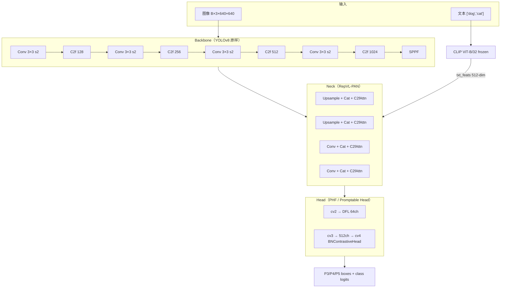
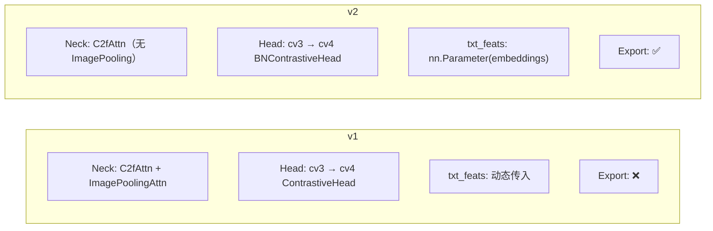

# Architecture 逐层图解

YOLO-World 的架构可以概括为「**YOLOv8 骨干不动、Neck 换成 VL 融合版、Head 换成分布对齐版**」。本页逐层拆解 RepVL-PAN 与 Promptable Head，对照 v1 与 v2 两个分支的具体实现差异。

## 3 层整体视图



三个尺度输出（P3/P4/P5）对应输入 640 时的 80×80 / 40×40 / 20×20 特征图，与 YOLOv8 完全一致。

## Backbone：完全沿用 YOLOv8

v1 与 v2 的 backbone **字节完全一致**，都是 YOLOv8 的 C2f + SPPF 结构：

```
backbone:
  - [-1, 1, Conv, [64, 3, 2]]     # 0-P1/2
  - [-1, 1, Conv, [128, 3, 2]]    # 1-P2/4
  - [-1, 3, C2f, [128, True]]     # 2
  - [-1, 1, Conv, [256, 3, 2]]    # 3-P3/8
  - [-1, 6, C2f, [256, True]]     # 4
  - [-1, 1, Conv, [512, 3, 2]]    # 5-P4/16
  - [-1, 6, C2f, [512, True]]     # 6
  - [-1, 1, Conv, [1024, 3, 2]]   # 7-P5/32
  - [-1, 3, C2f, [1024, True]]    # 8
  - [-1, 1, SPPF, [1024, 5]]      # 9
```

- **v1 引用**：<SrcLink file="yoloworld:ultralytics/cfg/models/v8/yolov8-world.yaml" :line="15" :end="26"/>
- **v2 引用**：<SrcLink file="yoloworld:ultralytics/cfg/models/v8/yolov8-worldv2.yaml" :line="15" :end="26"/>
- 与 v8 的 `yolov8.yaml` 完全一致——这是 YOLO-World"以 v8 为基座"承诺的直接体现。

## Neck：RepVL-PAN 的核心

RepVL-PAN 是把 YOLOv8 的 PAN 换成**「视觉-语言融合」版本**。v1 与 v2 有实质差异：

### v1 Neck（YOLOWorldDualPAFPN）

```
head (v1):
  - [-1, 1, nn.Upsample, [None, 2, "nearest"]]
  - [[-1, 6], 1, Concat, [1]]
  - [-1, 3, C2fAttn, [512, 256, 8]]       # 12
  - [-1, 1, nn.Upsample, [None, 2, "nearest"]]
  - [[-1, 4], 1, Concat, [1]]
  - [-1, 3, C2fAttn, [256, 128, 4]]       # 15 (P3/8-small)
  - [[15, 12, 9], 1, ImagePoolingAttn, [256]]  # 16 ★ v1 独有
  - [15, 1, Conv, [256, 3, 2]]
  - [[-1, 12], 1, Concat, [1]]
  - [-1, 3, C2fAttn, [512, 256, 8]]       # 19 (P4/16-medium)
  - [-1, 1, Conv, [512, 3, 2]]
  - [[-1, 9], 1, Concat, [1]]
  - [-1, 3, C2fAttn, [1024, 512, 16]]     # 22 (P5/32-large)
  - [[15, 19, 22], 1, WorldDetect, [nc, 512, False]]  # Detect
```

- 引用：<SrcLink file="yoloworld:ultralytics/cfg/models/v8/yolov8-world.yaml" :line="29" :end="48"/>
- **核心差异**：`ImagePoolingAttn` 层（L38）——在 P3 与 Neck 融合处做全局文本-视觉注意力融合；
- **AILab-CVC 版对应**：`YOLOWorldDualPAFPN`，额外包含 `text_enhancer = ImagePoolingAttentionModule`，增强 `txt_feats` 输入——<SrcLink file="yoloworld:ailab-cvc/yolo_world/models/necks/yolo_world_pafpn.py" :line="150" :end="235"/>；
- **导出限制**：`ImagePoolingAttn` 里有 `for` 循环遍历 anchor grid 与 slicing 操作，**无法通过 ONNX 序列化**——这是 v1 无法 export 的直接原因。

### v2 Neck（YOLOWorldPAFPN）

```
head (v2):
  - [-1, 1, nn.Upsample, [None, 2, "nearest"]]
  - [[-1, 6], 1, Concat, [1]]
  - [-1, 3, C2fAttn, [512, 256, 8]]       # 12
  - [-1, 1, nn.Upsample, [None, 2, "nearest"]]
  - [[-1, 4], 1, Concat, [1]]
  - [-1, 3, C2fAttn, [256, 128, 4]]       # 15 (P3/8-small)
  - [15, 1, Conv, [256, 3, 2]]            # 16 (跳过 ImagePoolingAttn)
  - [[-1, 12], 1, Concat, [1]]
  - [-1, 3, C2fAttn, [512, 256, 8]]       # 18 (P4/16-medium)
  - [-1, 1, Conv, [512, 3, 2]]
  - [[-1, 9], 1, Concat, [1]]
  - [-1, 3, C2fAttn, [1024, 512, 16]]     # 21 (P5/32-large)
  - [[15, 18, 21], 1, WorldDetect, [nc, 512, True]]  # Detect (with_bn=True)
```

- 引用：<SrcLink file="yoloworld:ultralytics/cfg/models/v8/yolov8-worldv2.yaml" :line="29" :end="46"/>
- **核心差异**：**去掉** `ImagePoolingAttn` 层（v1 L38 的位置替换成普通 `Conv`），把 v1 的 22 层缩到 21 层；
- **精度代价**：v2 相比 v1 精度掉 0.5~1 AP（论文 Table 5 消融），但**换来 ONNX / TensorRT 支持**；
- **AILab-CVC 版对应**：`YOLOWorldPAFPN`——<SrcLink file="yoloworld:ailab-cvc/yolo_world/models/necks/yolo_world_pafpn.py" :line="16" :end="146"/>；
- `WorldDetect` 的最后一个参数 `True`（`with_bn=True`）启用 BNContrastiveHead——见下文。

### C2fAttn 内部结构

`C2fAttn` 是 `C2f` 的 VL 融合版，在 FFN 中插入 attention 分支：

```python
# 简化伪代码，实际见 ultralytics/nn/modules/block.py
class C2fAttn(C2f):
    def forward(self, x, txt_feats):
        x = super().forward(x)          # 标准 C2f FFN
        attn = Attention(q=txt_feats, k=x, v=x)  # 文本作为 query
        x = x + attn                    # 残差注入
        return x
```

- **关键设计**：文本作为 query，视觉特征作为 key/value——`score = softmax(q · kᵀ / √d) · v`；
- **多尺度**：P3 用 4 头、P4 用 8 头、P5 用 16 头（yaml 中 `[C, heads, num_heads]` 的第 3 参数）；
- **快照未收录**：`ImagePoolingAttn` 定义在 `ultralytics/nn/modules/block.py`，快照未包含——需要回指 Ultralytics 主线源码。

## Head：Promptable Head of YOLOv8（PHF）

Head 是 YOLO-World 的第二个核心改动。v8 的 `Detect` 是 `cv2 (reg) + cv3 (cls)` 双分支，YOLO-World 的 `WorldDetect` 增加 `cv4 (contrastive)`：

### v8 Detect（对照）

```python
# Detect 类的分支结构
cv2: 3×3 Conv → 3×3 Conv → 1×1 Conv(4*reg_max=64)     # 回归分支
cv3: 3×3 Conv → 3×3 Conv → 1×1 Conv(nc)                # 分类分支
```

### YOLO-World WorldDetect

```python
# 见 head.py L211-260
class WorldDetect(Detect):
    def __init__(self, nc=80, embed=512, with_bn=False, ch=()):
        super().__init__(nc, ch)                # 继承 Detect，保留 cv2
        c3 = max(ch[0], min(nc, 100))
        # ★ cv3 输出改成 embed=512（不是 nc）
        self.cv3 = ModuleList(Sequential(Conv(x,c3,3), Conv(c3,c3,3), Conv(c3,embed,1)))
        # ★ 新增 cv4：BNContrastiveHead（v2）或 ContrastiveHead（v1）
        self.cv4 = ModuleList(BNContrastiveHead(embed) if with_bn else ContrastiveHead())
    
    def forward(self, x, text):
        for i in range(self.nl):
            # cv2 走回归，cv3 → cv4 走类别对比
            x[i] = cat(cv2[i](x[i]), cv4[i](cv3[i](x[i]), text), dim=1)
```

- 引用：<SrcLink file="yoloworld:ultralytics/nn/modules/head.py" :line="211" :end="260"/>

**关键设计**：

- `cv2` 完全沿用 v8（回归分支不动）；
- `cv3` 输出通道从 `nc`（80）改成 `embed=512`——因为要与 512-dim 文本嵌入做内积；
- `cv4` 是新加的对比头，把 `512-dim 视觉特征` 与 `512-dim 文本特征` 通过 `x · w` 内积映射到 `[K 类, H, W]` 的 class logits；
- **`bias_init` 只初始化 `cv2`**：L253-260 里 `cv3` 的 bias 被注释掉——因为 `cv4` 里有自己的 bias 学习。

### ContrastiveHead vs BNContrastiveHead

| 组件 | ContrastiveHead (v1) | BNContrastiveHead (v2) |
|------|---------------------|------------------------|
| 视觉归一化 | `F.normalize(x, dim=1, p=2)`（L2 归一化） | `BN(x)`（BatchNorm） |
| 文本归一化 | `F.normalize(w, dim=-1, p=2)` | `F.normalize(w, dim=-1, p=2)` |
| `logit_scale` 初值 | `log(1/0.07) ≈ 2.659` | `-1.0` |
| bias 初值 | `0.0` | `0.0` |
| 参数数量 | 2（bias + logit_scale） | embed+2（BN 有 γ, β） |
| 训练速度 | 较慢（L2 归一化每步算范数） | 快（BN 一次归一化） |
| 推理速度 | 较慢 | 快 |
| ONNX export | ❌ 失败 | ✅ 支持 |
| 精度 | 略高（+0.5 AP） | 略低 |

对应源码：
- `ContrastiveHead`: <SrcLink file="yoloworld:ailab-cvc/yolo_world/models/dense_heads/yolo_world_head.py" :line="28" :end="64"/>
- `BNContrastiveHead`: <SrcLink file="yoloworld:ailab-cvc/yolo_world/models/dense_heads/yolo_world_head.py" :line="68" :end="106"/>
- `RepBNContrastiveHead`（v2 微调用）: <SrcLink file="yoloworld:ailab-cvc/yolo_world/models/dense_heads/yolo_world_head.py" :line="110" :end="131"/>

### RepBNContrastiveHead：v2 微调专用

`RepBNContrastiveHead` 是 `BNContrastiveHead` 的**可重参数化**版本：

```python
class RepBNContrastiveHead:
    def __init__(self, embed_dims, num_guide_embeds, norm_cfg):
        self.norm = build_norm_layer(norm_cfg, embed_dims)[1]  # BN
        self.conv = nn.Conv2d(embed_dims, num_guide_embeds, 1)  # ★ 折叠用
    
    def forward(self, x):
        x = self.norm(x)
        x = self.conv(x)  # 输出 num_guide_embeds=80 通道
        return x
```

- **训练时用 `BNContrastiveHead`**：BN + 内积 + `logit_scale` + bias；
- **微调时切换到 `RepBNContrastiveHead`**：BN 权重与 `1×1 Conv` 融合成单一 Conv，**完全去掉 `txt_feats` 依赖**；
- **推理时可以 export**：因为不再有 `txt_feats` 分支，就是一个普通 Conv 输出 80 类 logits；
- **精度代价**：-0.3 AP（论文 Table 5 消融），但**换来完全兼容 v8 部署管线**。

## Ultralytics 顶层：WorldModel 与 WorldDetect 的分工

在 Ultralytics 集成版里，架构分为两层：

```
WorldModel (DetectionModel 子类)
  ├─ model: nn.Sequential  ← YAML 定义的网络层
  ├─ txt_feats: Tensor (1, 80, 512)  ← CLIP 编码的文本嵌入
  ├─ clip_model: CLIP 模型（可选缓存）
  ├─ set_classes(text): 写入 txt_feats + 更新 model[-1].nc
  ├─ predict(x): 前向，把 txt_feats 分发给 C2fAttn / ImagePoolingAttn / WorldDetect
  └─ loss(batch): 计算 loss
```

对应源码：<SrcLink file="yoloworld:ultralytics/nn/tasks_worldmodel.py" :line="5" :end="91"/>

**推理路径**：

```
predict(x)
  ↓
txt_feats = self.txt_feats (来自 set_classes)
  ↓
for m in self.model:
  if C2fAttn:      x = m(x, txt_feats)     # 文本引导的 attention
  if ImagePooling: txt_feats = m(x, txt_feats)  # 文本引导的全局池化
  if WorldDetect:  x = m(x, ori_txt_feats)  # 用原始文本嵌入（不被 ImagePooling 修改）
```

- 引用：<SrcLink file="yoloworld:ultralytics/nn/tasks_worldmodel.py" :line="35" :end="76"/>

**关键细节**：

- `ori_txt_feats` 是 `txt_feats.clone()`——因为 `ImagePoolingAttn` 会**修改** `txt_feats`（做全局池化后重塑），Head 需要用原始的；
- 每次 `predict` 都会检查 `len(txt_feats) != len(x)`——如果 batch size 变了就 `repeat`；
- **无独立 `YOLOWorldVal`**：验证时直接 `model.set_classes(texts)` 后走标准 `DetectionValidator`。

## AILab-CVC 顶层：YOLOWorldDetector 与 SimpleYOLOWorldDetector

在 AILab-CVC 原版里，架构分两类检测器：

### YOLOWorldDetector（v1）

```python
class YOLOWorldDetector(YOLODetector):
    def __init__(self, mm_neck=False, num_train_classes=80, num_test_classes=80):
        ...
    
    def extract_feat(self, batch_inputs, batch_data_samples):
        # ★ 联合前向：backbone 同时输出 img_feats 与 txt_feats
        img_feats, (txt_feats, txt_masks) = self.backbone(batch_inputs, texts)
        if mm_neck:
            img_feats = self.neck(img_feats, txt_feats)  # 双分支 neck
        else:
            img_feats = self.neck(img_feats)
        return img_feats, txt_feats, txt_masks
```

- 引用：<SrcLink file="yoloworld:ailab-cvc/yolo_world/models/detectors/yolo_world.py" :line="12" :end="105"/>

### SimpleYOLOWorldDetector（v2）

```python
class SimpleYOLOWorldDetector(YOLODetector):
    def __init__(self, prompt_dim=512, num_prompts=80, embedding_path='',
                 reparameterized=False, freeze_prompt=False, use_mlp_adapter=False):
        ...
        if not reparameterized:
            # ★ prompt embedding 作为可学习参数
            self.embeddings = nn.Parameter(torch.randn(num_prompts, prompt_dim))
            if freeze_prompt:
                self.embeddings.requires_grad = False
            if use_mlp_adapter:
                self.adapter = Sequential(Linear(512, 1024), ReLU, Linear(1024, 512))
    
    def extract_feat(self, batch_inputs, batch_data_samples):
        img_feats, _ = self.backbone(batch_inputs, None)  # 视觉分支
        if not reparameterized:
            txt_feats = self.embeddings[None]  # ★ 从 embeddings 参数取
            if self.adapter is not None:
                txt_feats = self.adapter(txt_feats) + txt_feats
                txt_feats = normalize(txt_feats, dim=-1)
```

- 引用：<SrcLink file="yoloworld:ailab-cvc/yolo_world/models/detectors/yolo_world.py" :line="109" :end="232"/>

**v2 vs v1 顶层差异**：

| 维度 | YOLOWorldDetector (v1) | SimpleYOLOWorldDetector (v2) |
|------|------------------------|-------------------------------|
| 文本编码器 | 通过 backbone 联合前向 | 从 `nn.Parameter(embeddings)` 直接取 |
| prompt 是否可学习 | ❌ 冻结 | ✅ 可训练（`freeze_prompt=False`） |
| prompt adapter | 无 | 可选 MLP adapter（`use_mlp_adapter`） |
| 重参数化 | ❌ | ✅（`reparameterized=True` 时折叠） |
| 训练数据 | 80 类文本动态采样 | 80 类 prompt 固定嵌入 |

## 关键超参速查

| 参数 | 值 | 说明 |
|------|-----|------|
| `embed`（文本嵌入维度） | 512 | CLIP ViT-B/32 输出维度 |
| `nc`（类别数） | 80（COCO）/ 1203（LVIS） | Ultralytics 硬编码 80，AILab-CVC 支持 1203 |
| `reg_max`（DFL 通道） | 16 | 完全沿用 v8 |
| `logit_scale` 初值 | v1: 2.659, v2: -1.0 | 温度系数 `exp(logit_scale)` |
| `norm_cfg`（BN 参数） | `type='BN1d', momentum=0.03` | v2 微调默认 |
| `num_heads`（attention 头） | P3: 4, P4: 8, P5: 16 | C2fAttn 里配置 |
| `prompt_dim`（v2） | 512 | 与 CLIP 对齐 |
| `num_prompts`（v2） | 80 | 可训练 prompt 数量 |

## 三档参数规模

按 Ultralytics `yolov8-worldv2.yaml` 的 scales 表：

| 档位 | depth | width | max_channels | Params | GFLOPs | FPS (V100) |
|------|-------|-------|--------------|--------|--------|------------|
| n | 0.33 | 0.25 | 1024 | — | — | —（未发布） |
| **s** | 0.33 | 0.50 | 1024 | 24.5 M | 74.2 | 74.1 |
| **m** | 0.67 | 0.75 | 768 | 38.2 M | 138.2 | 58.1 |
| **l** | 1.00 | 1.00 | 512 | 55.4 M | 196.4 | 52.0 |
| **x** | 1.00 | 1.25 | 512 | 72.6 M | 263.9 | 47.3 |

- 档位与 v8 一致（`n/s/m/l/x`），但**只发布了 s/m/l/x 四档**（n 档在 YOLO-World 里精度太低未发布）；
- 引用：<SrcLink file="yoloworld:ultralytics/cfg/models/v8/yolov8-worldv2.yaml" :line="6" :end="12"/>。

## 一图速览：v1 vs v2 结构对比



| 维度 | v1 | v2 |
|------|----|----|
| Neck 组件 | C2fAttn ×4 + ImagePoolingAttn | C2fAttn ×4（无 ImagePoolingAttn） |
| Head 对比头 | ContrastiveHead（L2 归一化） | BNContrastiveHead（BN） |
| txt_feats 来源 | 每次 `predict` 传入 | `nn.Parameter(embeddings)` 折叠 |
| Export ONNX | ❌ | ✅ |
| Export TensorRT | ❌ | ✅ |
| 精度（COCO z-shot，S 档） | 32.4 | 37.7 |
| FPS（V100，S 档） | 58.7 | 74.1 |
| 推荐用途 | 学术研究、原型验证 | 生产部署 |

**结论**：**默认用 v2**——精度更高、速度更快、能导出、生态更成熟。v1 只在需要精确复现论文消融实验时使用。

## 与 YOLOv8 骨架的对应关系

| YOLOv8 组件 | YOLO-World 对应 | 改动 |
|-------------|-----------------|------|
| `Detect` | `WorldDetect` | `cv3` 输出改 embed=512；新增 `cv4` |
| `C2f` | `C2fAttn` | 内部加 attention 分支 |
| `SPPF` | `SPPF` | 完全一致 |
| `Conv` | `Conv` | 完全一致 |
| Backbone | Backbone | 完全一致 |
| `DetectionModel` | `WorldModel` | 加 `txt_feats` / `set_classes` / `predict` 覆写 |
| `DetectionTrainer` | `WorldTrainer` | 加 `on_pretrain_routine_end`（加载 CLIP）+ `preprocess_batch`（tokenize+encode） |

## 深入阅读

- [论文精读](./paper) · [理论 Concept](./concepts) · [架构与层速查](./layers) · [损失函数](./losses) · [训练技巧](./tricks) · [痛点追踪](./painpoints) · [源码走读](./code-walkthrough)
