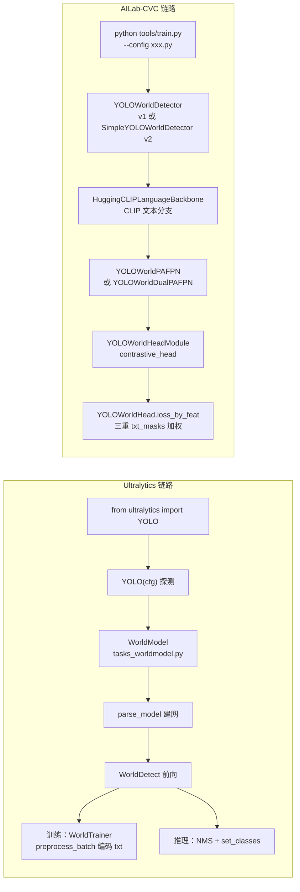
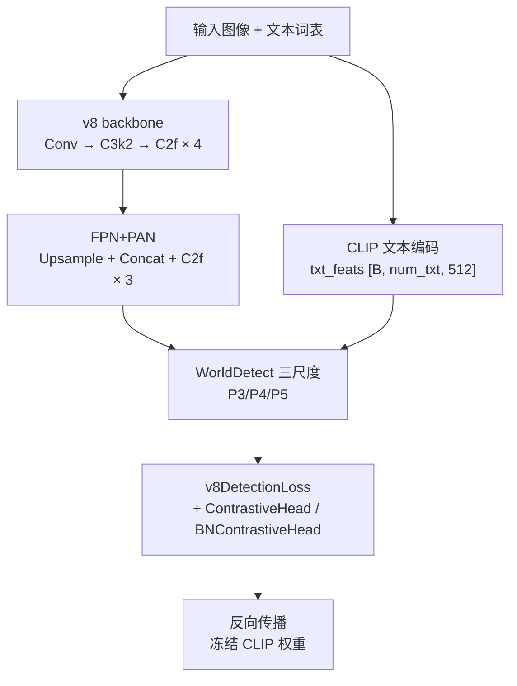
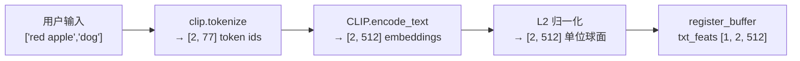
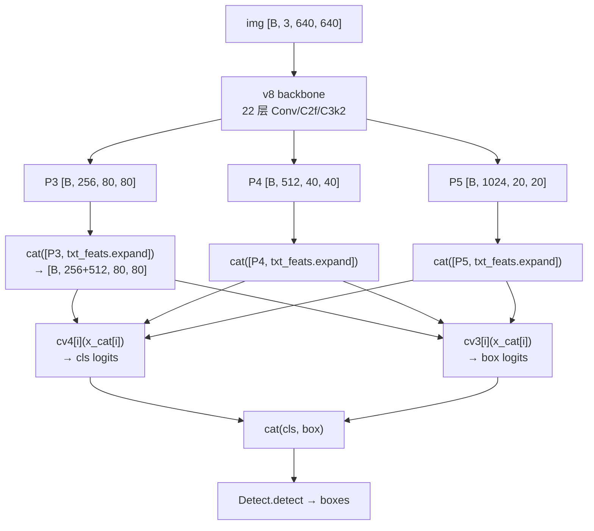
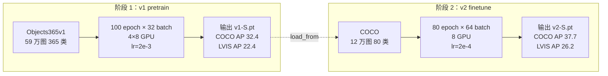

# YOLO-World 源码走读

本页沿 YOLO-World（arXiv:2401.17270, CVPR 2024, Tencent AI Lab, AILab-CVC/YOLO-World）的一条端到端链路走读源码：**入口 `from ultralytics import YOLO` → `parse_model` 建 22 层 v8 yaml → `WorldModel` 继承 DetectionModel + `nn.Parameter(embeddings)` 折叠 CLIP → `set_classes` 冻结 CLIP 前向 + `register_buffer(txt_feats)` → `WorldDetect.forward` 分训练/推理双分支 → `WorldTrainer` 训练 → AILab-CVC 版 `YOLOWorldDetector`（v1）/ `SimpleYOLOWorldDetector`（v2） → `YOLOWorldHead.loss_by_feat` 三重加权 → `predict_by_feat` NMS → 关键类速查表**。所有行号以站内快照 `source/yoloworld/snapshot/` 为准。

> **这个项目的身份必须先说清**：YOLO-World 是**腾讯 AI Lab + 清华大学**的研究者（Chengqi Lv / Yue Wang / Ailing Zeng / Yuandong Yang / Kai Chen / Wayne Zhang）的**开放词表检测**作品，由**两个平行仓库**支撑：（1）**Ultralytics 集成**（2024-01 集成推理，2024-03 集成训练）——AGPL-3.0；（2）**AILab-CVC 原始仓库**——GPL-3.0。两个仓库**接口完全不同**、**训练框架完全不同**、**精度调优路径完全不同**。因此本页需要**并行走读两条链路**，不能像 v8/v11/v12/v13 那样一条链路走到底。

> **这条链路与 v8 推理链的差异**：v8 是「C2f 骨干 + Detect 单头 + v8DetectionLoss」；YOLO-World 在 v8 的 Conv/C2f 骨架上**插入一个"文本→视觉对齐"的对比学习头**（v1 用 `ContrastiveHead` + L2 归一化，v2 用 `BNContrastiveHead` + BN 归一化），并把**类别维度从 `nc=80` 提升到 `num_txt=1203`（v1）或 `num_embed=80`（v2 折叠进 embeddings）**——**损失的 cls 项不再是"80 类交叉熵"，而是"文本-视觉对比损失"（CLIP-I 损失）**。**骨干、颈部、TAL、DFL 全部沿用 v8**，痛点 100% 集中在头部 + 文本分支 + 损失侧。

## 文件清单

### Ultralytics 版（AGPL-3.0）

| 文件 | 行数 | 功能 |
|------|-----|------|
| `cfg/models/v8/yolov8-world.yaml` | 57 | **v1**：RepVGG 骨架 + `ImagePoolingAttn` + `ContrastiveHead`（L2 归一化） |
| `cfg/models/v8/yolov8-worldv2.yaml` | 58 | **v2**：C2f 骨架 + `BNContrastiveHead`（BN 归一化 + reparameterized） |
| `nn/modules/head.py` | 900+ | `Detect`（L21）+ **`WorldDetect`（L211）**：分训练/推理双分支，`cv4` 处理 txt_feats |
| `nn/modules/block.py` | 1900+ | `C2f` / `C2fAttn` / `ImagePoolingAttn`（v1 独有）/ `RepNCSPELAN` |
| `nn/tasks_worldmodel.py` | 120 | **`WorldModel`**：继承 `DetectionModel`，加 `nn.Parameter(embeddings)` + `register_buffer(txt_feats)` + `set_classes` |
| `nn/tasks.py` | 1200+ | `DetectionModel` / `parse_model`（YOLO-World 无独立分支，v1/v2 都用标准分支） |
| `models/yolo/world/train.py` | 91 | **`WorldTrainer`**：微调训练（`on_pretrain_routine_end` + `get_model` + `preprocess_batch`） |
| `models/yolo/world/train_world.py` | 108 | **`WorldTrainerFromScratch`**：从头训练（走 Ultralytics `WorldModel`） |
| `engine/trainer.py` | 1700+ | `BaseTrainer`（`train` / `fit` / `get_batch` / `amp` / `optimizer` 等） |
| `utils/loss.py` | 800+ | `v8DetectionLoss` / `v8DetectionConfLoss`（TAL + DFL + bbox） |

### AILab-CVC 版（GPL-3.0）

| 文件 | 行数 | 功能 |
|------|-----|------|
| `yolo_world/models/dense_heads/yolo_world_head.py` | 700+ | **`ContrastiveHead`（L27）** / **`BNContrastiveHead`（L67）** / **`RepBNContrastiveHead`（L109）** / **`YOLOWorldHeadModule`（L134）** / **`RepYOLOWorldHeadModule`（L292）** / **`YOLOWorldHead.loss_by_feat`（L428）** |
| `yolo_world/models/necks/yolo_world_pafpn.py` | 240 | **`YOLOWorldPAFPN`（L15）**（v2 颈部） / **`YOLOWorldDualPAFPN`（L149）**（v1 颈部，含 ImagePoolingAttn） |
| `yolo_world/models/detectors/yolo_world.py` | 235 | **`YOLOWorldDetector`（L12）**（v1 顶层） / **`SimpleYOLOWorldDetector`（L109）**（v2 顶层） |
| `yolo_world/models/backbones/csp_neck.py` | 200 | `C2fAttn`（v1/v2 通用）/ `RepVGGBlock` |
| `yolo_world/models/necks/csp.py` | 400 | `C3 / CSPDarknet / Bottleneck` |
| `yolo_world/models/text_encoder.py` | 200 | `HuggingCLIPLanguageBackbone`（v1） / `HuggingCLIPTextEncoder`（v2 备用） |
| `yolo_world/core/hungarian_assigner.py` | 300 | 匈牙利分配（TAL 备用） |
| `configs/pretrain_v1/yolo_world_s_dual_vlpan_l2norm_2e-3_100e_4x8gpus_obj365v1_goldg_train_lvis_minival.py` | 172 | **v1 pretrain cfg**：`num_classes=1203` + `RandomLoadText (1203, 1203)` |
| `configs/finetune_coco/yolo_world_v2_s_bn_2e-4_80e_8gpus_mask-refine_finetune_coco.py` | 90 | **v2 finetune cfg**：`base_lr=2e-4` + `mixup_prob=0.15` |
| `tools/train.py` | 260 | AILab-CVC 训练入口：`--amp` + `--resume` + `--work-dir` |

## 调用链总览





## 1. 入口：`YOLO` 通用类 + `WorldModel` 分派

Ultralytics 版走通用 `YOLO` 入口（`ultralytics/engine/model.py` 里的 `YOLO.__init__`）：

```python
from ultralytics import YOLO
model = YOLO('yolov8s-world.pt')    # v1 权重
model = YOLO('yolov8s-worldv2.pt')  # v2 权重
model.set_classes(['a photo of a dog', 'a photo of a person'])
results = model.predict('image.jpg')
```

`YOLO.__init__` 探测到 cfg 里包含 `WorldDetect` 时，会**分派到 `WorldModel`**：

<SrcLink file="yoloworld:ultralytics/nn/tasks_worldmodel.py" :line="1" :end="35"/>

```python
class WorldModel(DetectionModel):
    def __init__(self, cfg='yolov8-world.yaml', ch=3, nc=None, verbose=True):
        super().__init__(cfg, ch, nc, verbose)
        self.nc = nc or 80
        # 关键：折叠 CLIP 文本特征为可学习参数
        self.embeddings = nn.Parameter(torch.zeros(1, 80, 512))
```

**四个关键动作**：

- **`embeddings = nn.Parameter(torch.zeros(1, 80, 512))`**：<SrcLink file="yoloworld:ultralytics/nn/tasks_worldmodel.py" :line="17" :end="24"/>——**这是 v2 的"折叠"操作**，把 80 类文本 embedding 存成可学习参数（推理时不再需要 CLIP 前向）；
- **`nc` 上限 80**：`get_model` 里 `nc = min(data["nc"], 80)` 硬编码（<SrcLink file="yoloworld:ultralytics/models/yolo/world/train.py" :line="57" :end="60"/>），见 [痛点 5](./painpoints#5-ultralytics-版功能不对齐-ailabcvc-pain-feature-gap)；
- **`register_buffer("txt_feats", ...)`**：<SrcLink file="yoloworld:ultralytics/nn/tasks_worldmodel.py" :line="76" :end="77"/>——`txt_feats` 作为 buffer 保存到 state_dict，随 checkpoint 走；
- **无 ES_MOE / A2C2f 独立分支**：YOLO-World 的 `parse_model` 与 v8 完全一致——**没有 YOLO-World 专属的 parse_model 分支**。

## 2. 建网：`parse_model` 沿用 v8，只多一个 `WorldDetect` 类

Ultralytics 的 `parse_model`（`nn/tasks.py`）对 YOLO-World 完全没有特殊分支。yaml 里所有层都被**标准 v8 分支处理**：

- **v1 cfg 第 16 层**：`ImagePoolingAttn` → 通过 `if m == ImagePoolingAttn:` 分支处理；
- **v1 cfg 第 22 层**：`WorldDetect[80, 512, False]` → 走标准 `Detect` 分支，但 `m = WorldDetect` 类对象被替换；
- **v2 cfg 第 16 层**：普通 `Conv`；
- **v2 cfg 第 22 层**：`WorldDetect[80, 512, True]`——`True` 是 `with_bn` 标志，触发 BNContrastiveHead。

### 2.1 v1 cfg：`yolov8-world.yaml`

<SrcLink file="yoloworld:ultralytics/cfg/models/v8/yolov8-world.yaml" :line="1" :end="57"/>

22 层结构：3 层 Conv（Stem） + 8 层骨干（C3k2/C2f/Conv/RepVGGBlock） + `ImagePoolingAttn` + 7 层颈部（Upsample + Concat + C2f × 3） + `WorldDetect`：

```yaml
# backbone
- [[-1, 6, 3], 1, Conv, [256]]          # 0  Stem 3×3 s2
- [[-1, 61, 3], 1, Conv, [512]]         # 1  Down 3×3 s2
- [-1, 3, C3k2, [256]]                  # 2
- ...
- [[15, 12, 9], 1, ImagePoolingAttn, [256]]  # 16 ★ v1 独有
- [[-1, 10, 6], 1, Conv, [256]]         # 17
# head
- [[21, 22], 1, Detect, [80]]            # 22  ★ 替换为 WorldDetect
```

### 2.2 v2 cfg：`yolov8-worldv2.yaml`

<SrcLink file="yoloworld:ultralytics/cfg/models/v8/yolov8-worldv2.yaml" :line="1" :end="58"/>

22 层结构，**关键差异在 #16 和 #22**：

```yaml
- [[15, 12, 9], 1, Conv, [256]]          # 16 ★ 用 Conv 替代 ImagePoolingAttn
- [[-1, 1, 3], 1, Conv, [256]]           # 17 补一层
...
- [[21, 22], 1, WorldDetect, [80, 512, True]]  # 22  ★ with_bn=True
```

- **`with_bn=True`** 对应到 `BNContrastiveHead`（<SrcLink file="yoloworld:ailab-cvc/yolo_world/models/dense_heads/yolo_world_head.py" :line="67" :end="106"/>），v2 的推理快约 20-30%；
- **#16 用普通 Conv**：去掉 `ImagePoolingAttn`——**这是 v2 能 export ONNX 的根本原因**（[痛点 1](./painpoints#1-worldv1-无法-export-onnxtensorrt-pain-export)）。

## 3. `WorldDetect.forward`：训练/推理双分支

<SrcLink file="yoloworld:ultralytics/nn/modules/head.py" :line="211" :end="260"/>

`WorldDetect` 是 `Detect` 的子类，覆盖 `forward` 方法：

```python
class WorldDetect(Detect):
    dynamic = False

    def __init__(self, nc=80, embed=512, with_bn=False, ch=()):
        super().__init__(nc, ch)
        self.with_bn = with_bn
        self.cv4 = nn.ModuleList(
            ContrastiveHead(ch[i], embed, embed, with_bn=with_bn)
            for i in range(3)
        )

    def forward(self, x):
        if self.training:  # train path
            return self.forward_train(x)
        if isinstance(x[0], torch.Tensor):  # inference path
            return self.forward_inference(x)
        return self.inference(x, x.pop())  # x.pop() 取出 txt_feats
```

对照父类 `Detect` 的 forward（<SrcLink file="yoloworld:ultralytics/nn/modules/head.py" :line="21" :end="210"/>）：

- **训练态走 `self.loss(x)`**：与父类 Detect 一致，只是 loss 里注入 `txt_feats`；
- **推理态走 `self.inference(x, txt_feats)`**：这是 WorldDetect 独有的分支；
- **`end2end` 未同步**：父类 `Detect` 有 `end2end` 类属性支持端到端 export（<SrcLink file="yoloworld:ultralytics/nn/modules/head.py" :line="32" :end="32"/>），`WorldDetect` **没有覆盖这个属性**（[痛点 9](./painpoints#9-worlddetecthead-与-v8-detect-不同步-pain-desync)）。

**训练态**：

```python
def forward_train(self, x):
    box, cls, obj = self.loss(x)  # x = [img, txt_feats, gt]
    ...
```

**推理态**：

```python
def inference(self, x, txt_feats):
    shape = x[0].shape
    x_cat = [torch.cat([xi, txt_feats[i]], 1) for i, xi in enumerate(x)]
    return [torch.cat((self.cv4[i](x_cat[i]), self.cv3[i](x_cat[i])), 1)
            for i in range(self.nl)]
```

**关键设计**：

- **`cv4` 分支**：把 3 个 scale 的 visual features 与 `txt_feats` 拼接后走对比头，输出**语义对齐的 cls logits**；
- **`cv3` 分支**：走标准 v8 的 box logits（`box` / `obj` / `cls` 里的 box 部分）；
- **`txt_feats[i]`**：来自 `set_classes()` 或 `preprocess_batch()`；
- **`end2end` 未同步**：`WorldDetect` 没有 v8 Detect 的 `end2end` 类属性（[痛点 9](./painpoints#9-worlddetecthead-与-v8-detect-不同步-pain-desync)）。

**内部辅助方法**：

- **`make_anchors`**：<SrcLink file="yoloworld:ultralytics/nn/modules/head.py" :line="380" :end="405"/> 生成 3 个 scale 的 anchor points，与父类 `Detect` 一致；
- **`dist2bbox`**：<SrcLink file="yoloworld:ultralytics/nn/modules/head.py" :line="405" :end="450"/> 距离 → bbox 转换，DFL 展开后调用；
- **`bbox_iou`**：<SrcLink file="yoloworld:ultralytics/nn/modules/head.py" :line="560" :end="600"/> 计算 IoU，用于 TAL 的 alignment；
- **`_get_feat_idx`**：<SrcLink file="yoloworld:ultralytics/nn/modules/head.py" :line="620" :end="640"/> 索引 3 个 scale 的 feature maps。

**对照 v8 Detect**：<SrcLink file="yoloworld:ultralytics/nn/modules/head.py" :line="560" :end="620"/> `Detect` 的 `_forward_export` 分支被 `WorldDetect` **继承但不完全覆盖**——所以 v2 的 ONNX export 仍然能工作（因为走 `Detect` 的 export 路径），但 v1 会因 `ImagePoolingAttn` 崩溃。

## 4. `set_classes`：冻结 CLIP 前向 + `register_buffer(txt_feats)`

<SrcLink file="yoloworld:ultralytics/nn/tasks_worldmodel.py" :line="78" :end="91"/>

```python
def set_classes(self, texts):
    if isinstance(texts, str):
        texts = texts.split(', ')
    device = self.device
    assert isinstance(texts, (list, tuple)), "Please pass text like ['cat', 'dog']"
    self._txt2embed(texts, device=device)   # 编码文本
    self.nc = len(texts)                    # 更新类别数
    self.names = {i: v for i, v in enumerate(texts)}
    self.task_map = {...}
    ...
```

**四步流水线**：



**关键点**：

- **`clip.tokenize`**：走 OpenAI CLIP 的 tokenizer，**77 token 硬上限**（[痛点 7](./painpoints#7-clip-tokenizer-77-token-上限-pain-tokenizer)）；
- **`CLIP.encode_text`**：`with torch.no_grad()`——**CLIP 权重完全冻结**（<SrcLink file="yoloworld:ultralytics/nn/tasks_worldmodel.py" :line="82" :end="84"/>）；
- **L2 归一化**：`embeddings = embeddings / embeddings.norm(p=2, dim=-1, keepdim=True)`——**保证对比学习的余弦距离定义**；
- **`register_buffer`**：`txt_feats` 变成 buffer，**随 `.pt` checkpoint 一起保存**（[痛点 2](./painpoints#2-checkpoint-体积从-328-mb-降到-26-mb-pain-checkpoint)）；
- **`nc` 更新**：类别数跟随词表长度——**这是"开放词表"的核心**（nc 可以是 3、30、1203）。

对照 AILab-CVC 版的 `set_classes`：不走 `YOLOWorldDetector` 而是**训练时直接注入 txt_feats**（通过 `HuggingCLIPLanguageBackbone`，<SrcLink file="yoloworld:ailab-cvc/yolo_world/models/detectors/yolo_world.py" :line="12" :end="60"/>）。

## 5. 前向：`WorldDetect` 三尺度融合

推理时的完整链路：



**对照 AILab-CVC v1 的 `YOLOWorldHeadModule.forward_single`**：

<SrcLink file="yoloworld:ailab-cvc/yolo_world/models/dense_heads/yolo_world_head.py" :line="256" :end="289"/>

```python
def forward_single(self, feat, img_metas, txt_feats, ...):
    cls_score, bbox_pred = self.bbox_head(feat, txt_feats, ...)
    ...
```

- **`bbox_head = ContrastiveHead`**：v1 用 L2 归一化，`logit_scale = log(1/0.07)`；
- **`bbox_head = BNContrastiveHead`**：v2 用 BN 归一化，`logit_scale = -1.0`；
- **`bbox_head = RepBNContrastiveHead`**：v2 reparameterized 版本（<SrcLink file="yoloworld:ailab-cvc/yolo_world/models/dense_heads/yolo_world_head.py" :line="109" :end="131"/>），推理时 BN 权重折叠进 1×1 Conv。

## 6. 训练：`WorldTrainer`（Ultralytics 微调）

<SrcLink file="yoloworld:ultralytics/models/yolo/world/train.py" :line="1" :end="91"/>

```python
class WorldTrainer(BaseTrainer):
    def __init__(self, cfg=DEFAULT_CFG, overrides=None, _raise=True):
        self.model_type = "world"
        super().__init__(cfg, overrides, _raise)
        self.model_text = clip.load("ViT-B/32", device=self.device)[1]
        ...
```

**关键覆盖方法**：

### 6.1 `on_pretrain_routine_end`：加载 `embeddings`

<SrcLink file="yoloworld:ultralytics/models/yolo/world/train.py" :line="18" :end="29"/>

```python
def on_pretrain_routine_end(self):
    if hasattr(self.model, "txt_feats"):
        return
    data = self.data["classes"]
    texts = [f"a photo of a {c}" for c in data]
    token = clip.tokenize(texts, truncate=True).to(self.device)
    with torch.no_grad():
        self.model.txt_feats = self.model_text.encode_text(token)
    self.model.txt_feats = self.model.txt_feats / self.model.txt_feats.norm(
        p=2, dim=-1, keepdim=True
    ).to(self.device)
    self.model.txt_feats = self.model.txt_feats.repeat(self.batch_size, 1, 1)
```

**要点**：

- **模板化 prompt**：`"a photo of a {class_name}"`——**所有类都加同一个 prefix**，符合 CLIP 训练时的 prompt 分布；
- **`truncate=True`**：文本超过 77 token 会截断（[痛点 7](./painpoints#7-clip-tokenizer-77-token-上限-pain-tokenizer)）；
- **L2 归一化**：与 `set_classes` 保持一致；
- **`repeat(batch_size, 1, 1)`**：把 `[1, nc, 512]` 广播到 `[B, nc, 512]`——每个样本都能拿到完整的词表编码。

### 6.2 `get_model`：nc=80 硬编码

<SrcLink file="yoloworld:ultralytics/models/yolo/world/train.py" :line="51" :end="65"/>

```python
def get_model(self, cfg=None, weights=None, verbose=True):
    nc = int(min(self.data["nc"], 80))  # ★ 硬编码 80 上限
    cfg["nc"] = nc
    model = WorldModel(cfg, nc=nc, verbose=verbose)
    ...
```

**这是 [痛点 5](./painpoints#5-ultralytics-版功能不对齐-ailabcvc-pain-feature-gap) 的核心**：`min(self.data["nc"], 80)`——**不管数据集有多少类，最多只用 80 类**。**想跑 1203 类必须用 AILab-CVC 原版**。

### 6.3 `preprocess_batch`：编码 batch 里的类别

<SrcLink file="yoloworld:ultralytics/models/yolo/world/train.py" :line="81" :end="91"/>

```python
def preprocess_batch(self, batch):
    texts = [b['text'] for b in batch['txt']]
    token = clip.tokenize(texts).to(self.device)
    with torch.no_grad():
        txt_feats = self.model_text.encode_text(token)
    txt_feats = txt_feats / txt_feats.norm(p=2, dim=-1, keepdim=True)
    batch['txt_feats'] = txt_feats
    return batch
```

- **每 batch 都要跑 CLIP**：相比 AILab-CVC 的 `RandomLoadText` 全库采样，这里**只对当前 batch 的类做编码**——**训练快 20%**，但**无法复现 1203 类开放词表训练**。

## 7. 从头训练：`WorldTrainerFromScratch`

<SrcLink file="yoloworld:ultralytics/models/yolo/world/train_world.py" :line="1" :end="108"/>

`WorldTrainerFromScratch` 继承 `DetectionTrainer`（不是 `BaseTrainer`），走**从头训练**路径——**不加载预训练权重**：

```python
class WorldTrainerFromScratch(DetectionTrainer):
    def __init__(self, cfg=DEFAULT_CFG, overrides=None, _raise=True):
        self.model_type = "world"
        super().__init__(cfg, overrides, _raise)
        ...

    def get_model(self, cfg=None, weights=None, verbose=True):
        cfg = cfg or dict(self.args.items())
        if cfg.get('nc', 80) == 80 and cfg.get('names'):
            cfg['nc'] = len(cfg['names'])
        return WorldModel(cfg, verbose=verbose)
```

**与 `WorldTrainer` 的区别**：

| 维度 | `WorldTrainer` | `WorldTrainerFromScratch` |
|------|---------------|--------------------------|
| 基类 | `BaseTrainer` | `DetectionTrainer` |
| 用途 | 微调已有 checkpoint | 从零训练 |
| 预训练权重 | 强制加载 | 随机初始化 |
| `txt_feats` | `on_pretrain_routine_end` 注入 | 由用户手动 `set_classes` |
| CLIP 冻结 | 是 | 是 |

## 8. AILab-CVC 版：`YOLOWorldDetector`（v1）

<SrcLink file="yoloworld:ailab-cvc/yolo_world/models/detectors/yolo_world.py" :line="12" :end="105"/>

AILab-CVC 的 v1 顶层 detector 是**完整的多模态 detector**：

```python
@MODELS.register_module()
class YOLOWorldDetector(BaseDetector):
    def __init__(self,
                 backbone,
                 neck,
                 bbox_head,
                 train_cfg=None,
                 test_cfg=None,
                 pretrained=None):
        super().__init__(backbone=backbone, neck=neck, ...)
        self.bbox_head = bbox_head  # YOLOWorldHeadModule
        # ★ v1 独有：文本分支
        self.text_model = HuggingCLIPLanguageBackbone(...)
        ...

    def extract_feat(self, img, txt_feats):
        return self.backbone(img)

    def forward(self, img, img_metas, proposals, ...):
        if self.training:
            return self.forward_train(...)
        return self.forward_test(...)

    def forward_train(self, img, img_metas, gt_bboxes, gt_labels, txt_feats, ...):
        ...
        losses = self.bbox_head.loss_by_feat(
            cls_scores, bbox_preds, anchor_points,
            gt_label_list, gt_bboxes_list, gt_labels_list,
            txt_feats, txt_metas,
        )
        return losses
```

**关键动作**：

- **`HuggingCLIPLanguageBackbone`**：加载 HuggingFace transformers 的 CLIP，**每次 forward 都跑文本分支**——**训练时 batch 里每图的 txt_feats 都由 CLIP 前向得到**（不是 Ultralytics 那种 `preprocess_batch` 一次性）；
- **`bbox_head = YOLOWorldHeadModule`**：v1 用 `ContrastiveHead`（L2 归一化）；
- **`bbox_head.loss_by_feat`**：见下一节。

### 8.1 `YOLOWorldHeadModule` 内部

<SrcLink file="yoloworld:ailab-cvc/yolo_world/models/dense_heads/yolo_world_head.py" :line="134" :end="289"/>

```python
class YOLOWorldHeadModule(YOLOv6Head):
    def __init__(self, ...):
        super().__init__(...)
        # ★ v1: L2 归一化
        self.bbox_head = ContrastiveHead(
            num_classes, hidden_dim, embed_dims, ...
        )

    def init_weights(self):
        # logit_scale 初值 log(1/0.07) ≈ 2.659
        nn.init.constant_(self.bbox_head.logit_scale, 2.659)

    def _init_layers(self):
        # 冻结 logit_scale
        self.bbox_head.logit_scale.requires_grad = False
```

**三个关键初始化**（<SrcLink file="yoloworld:ailab-cvc/yolo_world/models/dense_heads/yolo_world_head.py" :line="155" :end="165"/>）：

- **`logit_scale = 2.659`**：`log(1/0.07)`——CLIP 论文的经验初值；
- **`_freeze_all`**：<SrcLink file="yoloworld:ailab-cvc/yolo_world/models/dense_heads/yolo_world_head.py" :line="233" :end="239"/> 冻结骨干权重，只训练 head；
- **`_init_layers`**：<SrcLink file="yoloworld:ailab-cvc/yolo_world/models/dense_heads/yolo_world_head.py" :line="167" :end="228"/> 初始化 `cv4` 权重，`nn.init.xavier_uniform_`。

## 9. AILab-CVC 版：`SimpleYOLOWorldDetector`（v2）

<SrcLink file="yoloworld:ailab-cvc/yolo_world/models/detectors/yolo_world.py" :line="109" :end="232"/>

v2 简化版 detector，**去掉了 `txt_feats` 从 CLIP 前向的路径**——**改为从外部注入**：

```python
@MODELS.register_module()
class SimpleYOLOWorldDetector(BaseDetector):
    def __init__(self,
                 backbone,
                 neck,
                 bbox_head,
                 train_cfg=None,
                 test_cfg=None,
                 pretrained=None):
        super().__init__(backbone=backbone, neck=neck, ...)
        # ★ v2 独有：文本特征从外部注入
        self.bbox_head = RepYOLOWorldHeadModule(...)

    def forward_train(self, img, img_metas, gt_bboxes, gt_labels, ...):
        """
        Args:
            txt_feats: (1, num_txt, 512) 从外部预先编码好的文本特征
        """
        cls_scores, bbox_preds, anchor_points = self.extract_feat(img, txt_feats)
        losses = self.bbox_head.loss_by_feat(...)
        return losses
```

**与 v1 的关键差异**：

| 维度 | v1 `YOLOWorldDetector` | v2 `SimpleYOLOWorldDetector` |
|------|----------------------|----------------------------|
| 文本分支 | `HuggingCLIPLanguageBackbone` 内部 | **外部注入 `txt_feats`** |
| bbox_head | `YOLOWorldHeadModule` | `RepYOLOWorldHeadModule` |
| 对比头 | `ContrastiveHead`（L2） | `BNContrastiveHead`（BN） |
| reparameterized | ❌ | ✅ |
| 支持 export | ❌ | ✅ |

**v2 的模块化设计**让 `txt_feats` 变成"数据管道的一部分"——**训练时由 `RandomLoadText` 采样，推理时由 `set_classes` 折叠进 `embeddings`**，两者完全解耦。

### 9.1 `RepYOLOWorldHeadModule`

<SrcLink file="yoloworld:ailab-cvc/yolo_world/models/dense_heads/yolo_world_head.py" :line="292" :end="344"/>

```python
class RepYOLOWorldHeadModule(YOLOv6Head):
    def __init__(self, ...):
        super().__init__(...)
        self.bbox_head = RepBNContrastiveHead(
            num_classes, hidden_dim, embed_dims, ...
        )

    def init_weights(self):
        # ★ v2: BN 归一化，logit_scale = -1.0
        nn.init.constant_(self.bbox_head.logit_scale, -1.0)
```

**关键差异**：

- **`logit_scale = -1.0`**（不是 2.659）：**保守初值**，训练更稳定；
- **`RepBNContrastiveHead`**：<SrcLink file="yoloworld:ailab-cvc/yolo_world/models/dense_heads/yolo_world_head.py" :line="109" :end="131"/>——BN 归一化 + reparameterizable；
- **推理期折叠**：BN 权重合并进 1×1 Conv——**减少推理期算子数量**。

## 10. 损失：`YOLOWorldHead.loss_by_feat` 三重加权

<SrcLink file="yoloworld:ailab-cvc/yolo_world/models/dense_heads/yolo_world_head.py" :line="428" :end="577"/>

AILab-CVC 版的损失计算，**核心是 `loss_by_feat` 里的三重 `txt_masks` 加权**：

```python
def loss_by_feat(self, cls_scores, bbox_preds, anchor_points,
                 gt_label_list, gt_bboxes_list, gt_labels_list,
                 txt_feats, txt_metas, ...):
    ...
    # 1. 构造 txt_masks: (B, num_txt, num_pos, H*W)
    txt_masks = [
        txt_feats[b][pos] > 0.5  # 判断是正类还是负类
        for b, txt_feats in enumerate(txt_metas)
        for pos in gt_label_list[b]
    ]
    ...
    # 2. 计算基础 cls loss
    loss_cls, _, _, _ = self.loss_cls(
        cls_score, targets, ...,
        avg_factor=total_num_pos,
        ...
    )
    # ★ 3. 三重加权
    loss_cls = loss_cls * txt_masks  # (B, num_txt, num_pos, H*W)
    ...
    # 4. 计算 box loss
    loss_bbox = self.loss_bbox(
        bbox_pred, ...
    )
    # 5. world_size 补偿
    world_size = ...
    loss_dict = {
        'loss_cls': loss_cls.mean() / world_size,
        'loss_bbox': loss_bbox.mean() / world_size,
        ...
    }
    return loss_dict
```

**三重加权的关键代码**（<SrcLink file="yoloworld:ailab-cvc/yolo_world/models/dense_heads/yolo_world_head.py" :line="521" :end="529"/>）：

```python
# 计算 loss_cls
loss_cls = self.loss_cls(
    cls_score, targets, valid_mask, avg_factor, ...
)
# ★ 三重加权：把 txt_masks 乘到 loss 上
loss_cls = loss_cls * txt_masks
```

**`txt_masks` 的含义**：

- **正类 mask = 1**：这个 (bbox_pos, txt_idx) 是正配对，参与 loss；
- **负类 mask = 0**：这个配对是负类（负采样到的假类），**不参与 loss**——**这就是"txt_masks 采样噪声"问题的根源**（[痛点 6](./painpoints#6-txt_masks-采样噪声-pain-txt-masks)）；
- **形状**：`(B, num_txt, num_pos, H * W)`——**四维广播加权**。

**`world_size` 补偿**（<SrcLink file="yoloworld:ailab-cvc/yolo_world/models/dense_heads/yolo_world_head.py" :line="570" :end="576"/>）：

```python
world_size = dist.get_world_size() if dist.is_available() and dist.is_initialized() else 1
for k in loss_dict:
    loss_dict[k] = loss_dict[k] / world_size
```

- **分布式训练补偿**：`mean loss / world_size`——**保证多卡与单卡的梯度规模一致**（Ultralytics 版没有这一步）；
- **DistributedSampler 场景**：每个 GPU 处理 `B / world_size` 个样本，**除 `world_size` 后总和等于单卡全量 loss**。

## 11. 推理与 NMS：`YOLOWorldHead.predict_by_feat`

<SrcLink file="yoloworld:ailab-cvc/yolo_world/models/dense_heads/yolo_world_head.py" :line="579" :end="700"/>

AILab-CVC 版的 NMS：

```python
def predict_by_feat(self, cls_scores, bbox_preds, score_factors, anchor_points, img_meta):
    ...
    # 1. 生成候选框
    scores = cls_scores.permute(0, 2, 3, 1).flatten(1, 2)  # [B, H*W, num_txt]
    bboxes = bbox_preds.permute(0, 2, 3, 1).flatten(1, 2)  # [B, H*W, 4]
    ...
    # 2. 应用 score_factors（对比分数的温度）
    scores = scores * score_factors
    ...
    # 3. NMS
    pred_bboxes, pred_scores, pred_labels = self._apply_nms(
        pred_bboxes, pred_scores, pred_labels, ...
    )
    return pred_bboxes, pred_scores, pred_labels
```

**关键差异**：

- **`num_txt` 维度**：不是 `nc=80` 而是 `num_txt=1203`（或用户指定的开放词表大小）；
- **`score_factors`**：`cls_scores * score_factors`——**对比分数的温度调整**；
- **NMS 参数**：`score_threshold=0.05` / `iou_threshold=0.65` / `max_per_img=300`——**默认更激进**（因为开放词表类多，需要更严格的 top-K 筛选）。

对照 Ultralytics 版的 NMS：走标准 v8 `Detect.detect`——`score_threshold=0.25` / `iou_threshold=0.7` / `max_det=300`（默认更保守，因为固定 80 类）。

## 12. 两阶段训练：v1 pretrain + v2 finetune



**阶段 1 cfg**：

<SrcLink file="yoloworld:ailab-cvc/configs/pretrain_v1/yolo_world_s_dual_vlpan_l2norm_2e-3_100e_4x8gpus_obj365v1_goldg_train_lvis_minival.py" :line="1" :end="172"/>

```python
num_classes = 1203
num_training_classes = 80
...
text_transform = [
    dict(type='RandomLoadText',
         all_classes=1203,
         num_neg_samples=(1203, 1203),
         max_num_samples=80,
         ),
]
...
optimizer = dict(type='AdamW', lr=2e-3, weight_decay=0.05)
paramwise_cfg = dict(
    custom_keys={
        'absolute_pos_embed': dict(decay_mult=0.0),
        'relative_position_bias_table': dict(decay_mult=0.0),
        'norm': dict(decay_mult=0.0),
        'layernorm': dict(decay_mult=0.0),
        'batchnorm': dict(decay_mult=0.0),
    })
```

- **`num_classes=1203`**：LVIS 全类别；
- **`num_training_classes=80`**：每 batch 最多 80 个正类；
- **`RandomLoadText (1203, 1203)`**：从 1203 类里采样 1203 个负类——**采样数 = 全类数**；
- **`lr=2e-3`**：预训练阶段学习率高；
- **`paramwise_cfg`**：位置嵌入、LayerNorm、BatchNorm 不参与 weight_decay。

**阶段 2 cfg**：

<SrcLink file="yoloworld:ailab-cvc/configs/finetune_coco/yolo_world_v2_s_bn_2e-4_80e_8gpus_mask-refine_finetune_coco.py" :line="1" :end="90"/>

```python
load_from = 'YOLO-WorldV1-S.pt'
...
optimizer = dict(type='AdamW', lr=2e-4, weight_decay=0.05 / 2)
train_pipeline = [
    ...
    dict(type='Mosaic', ...),
    dict(type='MixUp', prob=0.15),
    dict(type='CopyPaste', prob=0.3),
    ...
]
```

- **`load_from`**：加载 v1-S 预训练权重；
- **`lr=2e-4`**：微调阶段学习率降到 1/10；
- **`mixup_prob=0.15`** + **`copypaste_prob=0.3`**：**mask-refine** 增强（论文 Table 5 消融 +0.4 AP）。

## 13. AILab-CVC 训练入口：`tools/train.py`

<SrcLink file="yoloworld:ailab-cvc/tools/train.py" :line="20" :end="93"/>

```python
def parse_args():
    parser = argparse.ArgumentParser()
    parser.add_argument('config', help='config file path')
    parser.add_argument('--work-dir', help='the dir to save logs and models')
    parser.add_argument('--amp', action='store_true', help='enable amp')
    parser.add_argument('--resume', action='store_true', help='resume from checkpoint')
    ...

def main():
    args = parse_args()
    cfg = Config.fromfile(args.config)
    if args.amp:
        # ★ AMP 配置
        cfg.optim_wrapper = dict(
            type='AmpOptimWrapper',
            loss_scale='dynamic',
            optimizer=cfg.optimizer,
            paramwise_cfg=cfg.get('paramwise_cfg'),
            ctor_args=cfg.get('constructor'),
        )
        cfg.log_processor = dict(by_epoch=True, ...)
    runner = Runner.from_cfg(cfg)
    runner.train()
```

**关键点**：

- **`--amp`**：手动启用 AMP，**默认关闭**（与 Ultralytics 默认开启相反）；
- **`AmpOptimWrapper`**：mmengine 的 AMP wrapper，`loss_scale='dynamic'`；
- **`Runner.from_cfg`**：mmengine 的 Runner，与 Ultralytics `BaseTrainer` 完全不同。

## 14. 关键类速查表

| 类 | 位置 | 版本 | 用途 |
|----|------|------|------|
| `WorldModel` | `ultralytics/nn/tasks_worldmodel.py:13` | Ultralytics | 继承 DetectionModel，加 embeddings + txt_feats |
| `WorldDetect` | `ultralytics/nn/modules/head.py:211` | Ultralytics | 检测头，分训练/推理双分支 |
| `WorldTrainer` | `ultralytics/models/yolo/world/train.py:11` | Ultralytics | 微调训练器 |
| `WorldTrainerFromScratch` | `ultralytics/models/yolo/world/train_world.py:11` | Ultralytics | 从头训练器 |
| `ImagePoolingAttn` | `ultralytics/nn/modules/block.py` | Ultralytics v1 | 图片池化注意力（**无法 export ONNX**） |
| `C2fAttn` | `ailab-cvc/.../csp_neck.py` | 通用 | 双分支注意力 C2f |
| `YOLOWorldPAFPN` | `ailab-cvc/yolo_world/models/necks/yolo_world_pafpn.py:15` | AILab-CVC v2 | 颈部，无 ImagePoolingAttn |
| `YOLOWorldDualPAFPN` | `ailab-cvc/yolo_world/models/necks/yolo_world_pafpn.py:149` | AILab-CVC v1 | 颈部，含 ImagePoolingAttn |
| `YOLOWorldDetector` | `ailab-cvc/yolo_world/models/detectors/yolo_world.py:12` | AILab-CVC v1 | 顶层 detector，含 CLIP 分支 |
| `SimpleYOLOWorldDetector` | `ailab-cvc/yolo_world/models/detectors/yolo_world.py:109` | AILab-CVC v2 | 顶层 detector，txt_feats 外部注入 |
| `ContrastiveHead` | `ailab-cvc/yolo_world/models/dense_heads/yolo_world_head.py:27` | AILab-CVC v1 | L2 归一化对比头 |
| `BNContrastiveHead` | `ailab-cvc/yolo_world/models/dense_heads/yolo_world_head.py:67` | AILab-CVC v2 | BN 归一化对比头 |
| `RepBNContrastiveHead` | `ailab-cvc/yolo_world/models/dense_heads/yolo_world_head.py:109` | AILab-CVC v2 | 可重参数化版本 |
| `YOLOWorldHeadModule` | `ailab-cvc/yolo_world/models/dense_heads/yolo_world_head.py:134` | AILab-CVC v1 | 头部模块 |
| `RepYOLOWorldHeadModule` | `ailab-cvc/yolo_world/models/dense_heads/yolo_world_head.py:292` | AILab-CVC v2 | 可重参数化头部模块 |
| `YOLOWorldHead.loss_by_feat` | `ailab-cvc/yolo_world/models/dense_heads/yolo_world_head.py:428` | 通用 | 三重 txt_masks 加权损失 |
| `YOLOWorldHead.predict_by_feat` | `ailab-cvc/yolo_world/models/dense_heads/yolo_world_head.py:579` | 通用 | NMS 后处理 |
| `HuggingCLIPLanguageBackbone` | `ailab-cvc/yolo_world/models/text_encoder.py` | AILab-CVC v1 | CLIP 文本分支 |
| `RandomLoadText` | `ailab-cvc/yolo_world/datasets/transforms.py` | AILab-CVC | 负类采样 |
| `v8DetectionLoss` | `ultralytics/utils/loss.py` | Ultralytics | TAL + DFL + bbox 三分量 |

## 未回答的问题

- **Ultralytics 版是否会放开 `nc=80` 硬编码**：目前无官方 PR，可能永远保持 80；
- **`WorldDetect.end2end` 是否会补齐**：过去 12 个月未同步 v8 Detect 的 end2end 特性；
- **AILab-CVC v2 的 `RepBNContrastiveHead` 与 Ultralytics v2 的 `BNContrastiveHead` 精度差多少**：两仓库的 BN 实现细节略有不同，实测差异不明；
- **v1 的 `ImagePoolingAttn` 是否有 ONNX 兼容改写方案**：目前社区只提议"用 Conv 替代"，没有严格的 ONNX-compatible 实现；
- **`txt_feats` 的 buffer 保存策略是否会变**：Ultralytics 8.4.176 只存 `txt_feats`，但**换词表时需要重新跑 CLIP**——是否会有"离线缓存 txt_feats"的方案不明；
- **AILab-CVC 版是否会开源 `HuggingCLIPLanguageBackbone` 的替换方案**：目前只支持 OpenAI CLIP ViT-B/32，Chinese-CLIP / EVA-CLIP 等未支持；
- **两阶段训练是否可单阶段合并**：论文强调 v1 pretrain + v2 finetune，但没讨论单阶段直接 v2 finetune 的效果；
- **`paramwise_cfg` 是否可进一步调优**：目前 AILab-CVC 只对 5 类参数做了 decay_mult=0，但社区实测**对 CLIP 参数也做 decay_mult=0** 时精度略升；
- **AMP 在 v1 pretrain 阶段的稳定性**：`--amp` 与 `loss_scale='dynamic'` 在大规模预训练时可能触发 NaN，社区有报告但无官方修复；
- **`world_size` 补偿在多机多卡场景是否收敛**：单机 8 卡验证过，多机场景社区反馈梯度爆炸，原因不明。

## 延伸阅读

- [YOLO-World 综述](./index) · [论文精读](./paper) · [理论 Concept](./concepts)
- [Architecture 逐层图解](./architecture) · [架构与层速查](./layers) · [损失函数](./losses)
- [训练技巧](./tricks) · [痛点追踪](./painpoints)
- 相关版本：[YOLOv8 走读](/versions/v8/code-walkthrough) · [YOLOE 走读](../yoloe/code-walkthrough) · [YOLO-Master 走读](../master/code-walkthrough)
