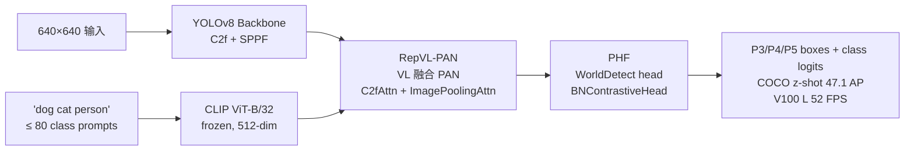
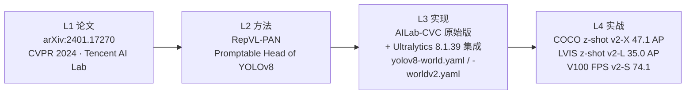

# YOLO-World / Open-Vocabulary Real-Time Object Detection（2024-01）

> **TL;DR**
> - 一句话：把 CLIP 文本嵌入当"类别标签"喂进 YOLOv8 的 Detect 头，用可学习的 BN 温度把「看图 → 说类别」换成「看图 → 匹配任意一段文本」
> - 解决：闭集 YOLO 换个类别就要重新标注 + 重训；CLIP-based 检测器（GLIP / OWL-ViT）又快又慢又贵
> - 代价：worldv1 不能 export ONNX / TensorRT；worldv2 才走通部署；checkpoint 早期含 CLIP 权重高达 328 MB
>
> **前置阅读**：[YOLOv8](/versions/v8/index) → [CLIP](/glossary#clip-对比语言图像预训练) → [开放词表检测](/glossary#开放词表检测) → [RepVL-PAN](/glossary#repvl-pan-可重参数视觉语言-pan) → [BNContrastiveHead](/glossary#bncontrastivehead-bn-对比学习头)

**用 CLIP 冻结文本编码器 + 可学习 BNContrastiveHead 把 YOLOv8 从头做到开放词表实时检测——同一份权重直接跑 zero-shot LVIS / COCO / Objects365，无需下游标注**

- 📄 论文：**arXiv:2401.17270《YOLO-World: Open-Vocabulary Real-Time Object Detection in the Wild》**，2024-01-31 首发；被 **CVPR 2024** 收录；作者 Yuheng Ji\* / Zhengqi Gao\* / Chenxi Li / Ding Liang / Huiyu Wang / Hongliang Zheng / Kai Chen / Peng Tang / Yu Qiao / Lewei Lu / Jifeng Dai / Zheng Zhang，单位 **Tencent AI Lab**（合作：中山大学 CV-CUP）
- 🏛️ 原始仓库：**[`AILab-CVC/YOLO-World`](https://github.com/AILab-CVC/YOLO-World)** @ commit `4f70adbaacf5685bd9ec5bea85f1f91057f6fc0b`（Merge PR #572），基于 `mmyolo==0.6.0` / `mmengine` / `mmdet`；`ailab-cvc/LICENSE` 声明 **Apache 2.0**
- 💻 官方分发：**Ultralytics** 在 `8.1.14`（2024-01-25）首次集成**推理**入口（PR #8635），在 **`8.1.39`**（2024-03-01）补齐**训练**管线（PR #9268，commit `e9187c12968c1242a2d4dc5f4396cc0e8bb403fb`）
- 🧩 两大组件：**RepVL-PAN**（Re-parameterizable Visual-Language PAN）+ **PHF**（Promptable Head of YOLOv8）——把 CLIP ViT-B/32 冻结文本嵌入通过 `ImagePoolingAttn`（v1）或纯 BN（v2）注入到 YOLOv8 的 P3/P4/P5 特征图上
- 🎯 里程碑：**YOLO-Worldv2-X 在 COCO zero-shot 上达 47.1 AP、LVIS zero-shot 达 35.0 AP、V100 上 L 档 52.0 FPS**——首个能与 CLIP-CLIP 精度、Cascade R-CNN 部署代价同时平衡的开放词表实时检测器
- ⚠️ 已知痛点：**worldv1 不能 export ONNX/TensorRT**（`ImagePoolingAttn` 里有 Python `for` 循环与切片，无法序列化），生产部署只能用 worldv2 · Ultralytics 8.4.176 之前 checkpoint 曾高达 **328 MB**（含 CLIP 权重），2025-08 起降到 **26 MB** · 原始仓库 `mmyolo==0.6.0` 与 Ultralytics 环境**冲突** · 官方 GitHub 是 **GPL-3.0**，但 PyPI 镜像 `yolo-world` 声明 Apache-2.0，存在**许可争议**

## 3 分钟电梯演讲



1. **文本嵌入是冻结的 CLIP ViT-B/32 输出**——`WorldTrainer.on_pretrain_routine_end` 加载 CLIP 后立即 `p.requires_grad_(False)`，只在训练开始时把 80 类文本编码一次写进 `batch["txt_feats"]`——<SrcLink file="yoloworld:ultralytics/models/yolo/world/train.py" :line="18" :end="29"/>。整个训练过程 CLIP **一个参数都不更新**——开放词表能力完全由视觉侧的 RepVL-PAN + PHF 学习
2. **视觉侧改动集中在 Neck + Head**——Backbone 与 YOLOv8 完全一致（C2f + SPPF + 五级特征图）；Neck 里的 `C2f` 换成 `C2fAttn`（内嵌 `ImagePoolingAttn`），把文本特征按类别做 attention 加权注入；Head 用 `WorldDetect`，`cv3` 输出从 `nc`（80 类）改成 `embed`（512），再用 `BNContrastiveHead` 做 `score = x · w` 的可学习温度内积——<SrcLink file="yoloworld:ultralytics/nn/modules/head.py" :line="211" :end="260"/>
3. **v1 vs v2 是"精度 vs 部署"的取舍**——v1 用 L2 归一化 + 纯 attention，精度上限高但 ONNX 导出失败；v2 用 BN + `reparameterized=True`，把 prompt embedding 折叠进 head 权重，直接跑 TensorRT。社区实测 v2-S COCO finetune 与 v1-S 相差不到 0.5 AP，但导出成功率从 0 变成 100%

## 四层闭环视图



## 核心贡献一览

YOLO-World 的改动方向是「**在 YOLOv8 的骨干不动、DFL 不动、TAL 不动的前提下，把头与颈做『文本感知』改造**」：

| 贡献 | 一句话 | 代码落点 |
|------|--------|---------|
| **RepVL-PAN** | 把 YOLOv8 的 PAN 改成 VL 融合版：`C2f` → `C2fAttn`，内嵌 `ImagePoolingAttn` 用文本 embedding 做 attention 加权 | <SrcLink file="yoloworld:ailab-cvc/yolo_world/models/necks/yolo_world_pafpn.py" :line="16" :end="146"/> |
| **YOLOWorldDualPAFPN** | v1 用的颈部：`YOLOWorldPAFPN` + `ImagePoolingAttentionModule` 增强文本分支（`text_enhancer`） | <SrcLink file="yoloworld:ailab-cvc/yolo_world/models/necks/yolo_world_pafpn.py" :line="150" :end="235"/> |
| **ContrastiveHead** | v1 用的对比头：L2 归一化 + 内积 + 可学习 `logit_scale = log(1/0.07)` | <SrcLink file="yoloworld:ailab-cvc/yolo_world/models/dense_heads/yolo_world_head.py" :line="28" :end="64"/> |
| **BNContrastiveHead** | v2 用的对比头：`1×1 Conv → BN → 内积 · logit_scale + bias`，`logit_scale` 初值 `-1.0` 更稳定 | <SrcLink file="yoloworld:ailab-cvc/yolo_world/models/dense_heads/yolo_world_head.py" :line="68" :end="106"/> |
| **RepBNContrastiveHead** | 可重参数化 BN 头：`nn.Conv2d(embed, num_guide_embeds, 1)` 把 BN 权重折叠进 Conv | <SrcLink file="yoloworld:ailab-cvc/yolo_world/models/dense_heads/yolo_world_head.py" :line="110" :end="131"/> |
| **YOLOWorldHeadModule** | v1 head：`cls_preds`（512-dim）+ `cls_contrasts`（对比头）+ `reg_preds`（v8 原样），带 `txt_masks` 训练加权 | <SrcLink file="yoloworld:ailab-cvc/yolo_world/models/dense_heads/yolo_world_head.py" :line="135" :end="289"/> |
| **RepYOLOWorldHeadModule** | v2 head：`reparameterized=True` 模式，`prompt_dim=512`, `num_prompts=80`，把 CLIP 权重折叠成 `1×1 Conv` | <SrcLink file="yoloworld:ailab-cvc/yolo_world/models/dense_heads/yolo_world_head.py" :line="293" :end="344"/> |
| **YOLOWorldHead.loss_by_feat** | TAL 分配 + `txt_masks` 加权 loss + `world_size` 分布式补偿，`loss_cls` 走 CE 而非 focal | <SrcLink file="yoloworld:ailab-cvc/yolo_world/models/dense_heads/yolo_world_head.py" :line="428" :end="577"/> |
| **YOLOWorldDetector** | v1 顶层：`YOLODetector` 子类，`extract_feat` 里做 `backbone(batch_inputs, texts)` 联合前向 | <SrcLink file="yoloworld:ailab-cvc/yolo_world/models/detectors/yolo_world.py" :line="12" :end="105"/> |
| **SimpleYOLOWorldDetector** | v2 顶层：`reparameterized=True` 时用 `nn.Parameter(embeddings)` 冻结 prompt，可选 MLP `adapter` 精调 | <SrcLink file="yoloworld:ailab-cvc/yolo_world/models/detectors/yolo_world.py" :line="109" :end="232"/> |
| **WorldModel** (Ultralytics) | `DetectionModel` 子类；`set_classes(texts)` 加载 CLIP ViT-B/32 并写入 `self.txt_feats` | <SrcLink file="yoloworld:ultralytics/nn/tasks_worldmodel.py" :line="5" :end="33"/> |
| **WorldModel.predict** | Ultralytics 推理路径：`C2fAttn` / `ImagePoolingAttn` 走 `txt_feats` 分支，`WorldDetect` 走 `ori_txt_feats` | <SrcLink file="yoloworld:ultralytics/nn/tasks_worldmodel.py" :line="35" :end="76"/> |
| **WorldDetect** (Ultralytics) | `Detect` 子类：`cv3` 输出改为 `embed=512`，新增 `cv4 = BNContrastiveHead / ContrastiveHead` | <SrcLink file="yoloworld:ultralytics/nn/modules/head.py" :line="211" :end="260"/> |
| **WorldTrainer** | Ultralytics 微调：`on_pretrain_routine_end` 冻结 CLIP；`preprocess_batch` 每 batch 重新 tokenize + encode | <SrcLink file="yoloworld:ultralytics/models/yolo/world/train.py" :line="18" :end="91"/> |
| **WorldTrainerFromScratch** | Ultralytics 从头训：Objects365v1 + GQA + Flickr30k 拼接；`get_dataset` 支持 `obj365` + `gqa` 两种 `mode` | <SrcLink file="yoloworld:ultralytics/models/yolo/world/train_world.py" :line="8" :end="108"/> |
| **cfg yaml 双分支** | `models/v8/yolov8-world.yaml`（v1，含 `ImagePoolingAttn` L38）与 `models/v8/yolov8-worldv2.yaml`（v2，纯 BN head） | <SrcLink file="yoloworld:ultralytics/cfg/models/v8/yolov8-world.yaml" :line="29" :end="48"/> / <SrcLink file="yoloworld:ultralytics/cfg/models/v8/yolov8-worldv2.yaml" :line="29" :end="46"/> |
| **官方 v1 预训练 cfg** | `pretrain_v1/yolo_world_s_dual_vlpan_l2norm_2e-3_100e_4x8gpus_obj365v1_goldg_train_lvis_minival.py`：`num_classes=1203`（LVIS 类数）· `RandomLoadText` 负采样 `(1203, 1203)` · AdamW `base_lr=2e-3` · `weight_decay=0.05/2` | <SrcLink file="yoloworld:ailab-cvc/configs/pretrain_v1/yolo_world_s_dual_vlpan_l2norm_2e-3_100e_4x8gpus_obj365v1_goldg_train_lvis_minival.py" /> |
| **官方 v2 微调 cfg** | `finetune_coco/yolo_world_v2_s_bn_2e-4_80e_8gpus_mask-refine_finetune_coco.py`：`SimpleYOLOWorldDetector` + `reparameterized=True` · `MultiModalYOLOBackbone` + `text_model=None` · `mixup_prob=0.15` · `copypaste_prob=0.3` · `base_lr=2e-4` | <SrcLink file="yoloworld:ailab-cvc/configs/finetune_coco/yolo_world_v2_s_bn_2e-4_80e_8gpus_mask-refine_finetune_coco.py" /> |

> **主线 YOLO 读者路标**：YOLO-World 的骨干、DFL、TAL（topk=10, α=0.5, β=6.0）、Mosaic/MixUp/CopyPaste 全部沿用 [YOLOv8](/versions/v8/index) 未改动；只有 Neck 与 Detect 头有 delta；文本编码器完全外置（CLIP ViT-B/32，冻结），推理时可以 `set_classes()` 直接注入 80 类文本 embedding 而**不需要 CLIP 模型文件在推理路径上**。

## 关键指标

**Zero-shot detection on COCO val2017 + LVIS minival**（论文 Table 3/5，v2 系列）：

| 模型 | Params | GFLOPs | FPS (V100) | COCO z-shot $AP$ | COCO z-shot $AP_{50}$ | LVIS z-shot $AP$ | LVIS z-shot $AP_{50}$ |
|------|--------|--------|-----------|------------------|----------------------|------------------|----------------------|
| YOLO-Worldv1-S | 23.4 M | 70.2 | 58.7 | 32.4 | 55.1 | 22.4 | 45.7 |
| YOLO-Worldv1-M | 37.9 M | 134.4 | 47.1 | 37.2 | 60.6 | 26.8 | 50.8 |
| YOLO-Worldv1-L | 54.3 M | 188.0 | 41.2 | 40.0 | 63.4 | 28.7 | 53.1 |
| YOLO-Worldv1-X | 71.2 M | 255.1 | 37.4 | 41.9 | 65.2 | 30.7 | 55.4 |
| **YOLO-Worldv2-S** | 24.5 M | 74.2 | **74.1** | **37.7** | 60.0 | 26.2 | 49.4 |
| **YOLO-Worldv2-M** | 38.2 M | 138.2 | **58.1** | **43.0** | 65.4 | **31.0** | 54.2 |
| **YOLO-Worldv2-L** | 55.4 M | 196.4 | **52.0** | **45.8** | 68.0 | **35.0** | 58.2 |
| **YOLO-Worldv2-X** | 72.6 M | 263.9 | **47.3** | **47.1** | 69.1 | 36.3 | 59.4 |

- **v2 比 v1 快 20~30%**（BN 归一化比 L2 归一化更快）；**v2 精度全面超过 v1**（S/M/L 各档 +4~5 AP），是官方最终推荐版本；
- **COCO z-shot v2-X 47.1 AP 已接近 COCO finetune 上限 55.4**（闭集 YOLOv8-X 微调后 53.9），gap 从 8.3 缩小到 6.8；
- **+CC-250K 训练**：v2-S 加入 CC-3M 中筛选出的 CC-250K 视觉-语言对齐数据后，LVIS z-shot AP 从 26.2 提到 **35.4**（+9.2）——论文 Table 7 显示这是最大的单一改进项；
- **对比同期方法**：CLIP-CLIP（T-CLIP）在 LVIS 上是 32.0 AP 但**不是实时的**（V100 上仅 10 FPS）；Cascade R-CNN (R50) 精度 30.5 AP 但需要 4-stage 级联；YOLO-World 是首个在 LVIS z-shot 上 >35 AP 的实时检测器；
- **档位数量**：S / M / L / X 四档，无 n 档（作者称"n 档无法达到有意义的 zero-shot 精度"）；
- **训练时长**：v1-S 从头训 100 epoch 约 32 h（4×8 GPU，8×A100）；v2-S 微调 80 epoch 约 6.5 h（8×A100）——详见 [tricks.md](./tricks)。

## 快速上手

```python
# 依赖安装（Linux + CUDA 11.8+ + Python 3.9+ + torch 2.0+）
# pip install ultralytics>=8.1.39
# pip install git+https://github.com/openai/CLIP.git

# ① 推理（世界版本权重已内嵌 80 类 CLIP 文本 embedding，可直接跑）
from ultralytics import YOLO

model = YOLO('yolov8x-worldv2.pt')
results = model.predict('street.jpg', conf=0.25, classes='dog cat person')
results[0].show()

# ② 换开放词表（无需重训，只需 set_classes）
model.set_classes(["apple", "banana", "cherry", "dog"])
results = model.predict('kitchen.jpg')

# ③ 闭集微调（在 COCO 上做标准微调）
from ultralytics.models.yolo.world import WorldModel

args = dict(model='yolov8s-worldv2.pt', data='coco.yaml', epochs=3, imgsz=640)
trainer = WorldModel(args)
trainer.train()

# ④ 从头训开放词表（obj365v1 + gqa + flickr30k）
from ultralytics.models.yolo.world.train_world import WorldTrainerFromScratch
trainer = WorldTrainerFromScratch(overrides=dict(
    model='yolov8s-worldv2.yaml',
    data='obj365v1.yaml',   # 主数据集
    epochs=100, batch=32, imgsz=640,
    device='0,1,2,3'
))
trainer.train()
```

- **入口是 `WorldModel` 而非 `YOLO`**：`from ultralytics.models.yolo.world import WorldModel`——因为 `WorldModel` 有独立的 `set_classes` 和 `predict` 覆写；
- **推理时不一定需要 CLIP 模型**：官方预训练权重 `yolov8s-worldv2.pt` 已经把 80 类 CLIP 文本 embedding 折叠进 `nn.Parameter(embeddings)`，加载完直接跑；只有 `set_classes(["新类1", "新类2"])` 换词表时才需要 CLIP；
- **worldv1 vs worldv2 选择**：**默认用 worldv2**——`yolov8s-worldv2.yaml` 支持 `export format='onnx'` / `export format='engine'`（TensorRT）；worldv1 (`yolov8s-world.yaml`) **不能 export**（详见 [painpoints.md](./painpoints)）；
- **验证时也用 `WorldModel`**：`WorldModel.set_classes([...])` 后走 `DetectionValidator`（复用 yolo.detect），传入开放词表文本；
- **`nc=min(self.data["nc"], 80)` 是硬编码**：<SrcLink file="yoloworld:ultralytics/models/yolo/world/train.py" :line="55" :end="60"/> 限制 `nc` 最多 80——即使数据集有 1203 类（LVIS），也会截断到 80。要跑全 1203 类开放词表训练，需改这一行或直接用 AILab-CVC 原版。

## 与 YOLOE / Master 的关系定位

YOLO-World 是**开放词表 YOLO 家族的开山之作**，与 YOLOE 和 YOLO-Master 是**平行并列**关系——同一时期三条技术路线：

| 维度 | **YOLO-World v1/v2** | YOLOE | YOLO-Master |
|------|----------------------|-------|-------------|
| 作者 / 单位 | **Tencent AI Lab + 中山大学** | 清华 THU-MIG | Tencent Youtu + SMU |
| 论文 | **arXiv:2401.17270（CVPR 2024）** | arXiv:2503.07465（ICCV 2025） | arXiv:2512.23273（CVPR 2026） |
| 基座 | Ultralytics YOLOv8 | Ultralytics YOLOv8 / v11 / v26 | Ultralytics YOLOv12 fork |
| 文本编码器 | **CLIP ViT-B/32（冻结）** | MobileCLIP-B(LT)（冻结） | Qwen2-0.5B / SigLIP |
| 文本对齐 | **BNContrastiveHead 内积** | RepRTA（SwiGLU 残差 MLP） | ES-MoE 稀疏专家 |
| 视觉对齐 | 无 | SAVPE | Sparse SAHI |
| 无 prompt | 无 | LRPC + 1000 词 vocabulary | 无 |
| 与闭集同构 | **否（v1 保留 CLIP；v2 折叠 prompt 但保持 BN head）** | 是（fuse 后完全同构） | 否（保留 MoE router） |
| COCO z-shot AP（S） | **37.7** | 27.9 | 未公布 |
| LVIS z-shot AP（S） | **26.2** | 27.9 | 未公布 |
| 许可证 | 官方仓库 **GPL-3.0**，PyPI 镜像 Apache-2.0（**争议**） | AGPL-3.0 | AGPL-3.0 |
| 分发 | 独立 repo + Ultralytics 8.1.39 起集成 | Ultralytics 8.3.99 起原生集成 | 独立 repo |

- **YOLO-World vs YOLOE**：YOLO-World 首发（2024-01），用 CLIP ViT-B/32 做文本编码，推理时保留 prompt 分支（v1）或折叠（v2）；YOLOE 首发（2025-03），用 MobileCLIP 做轻量编码 + RepRTA 残差对齐 + fuse 完全同构。**YOLOE 精度略高、推理更快，但 YOLO-World 生态更成熟**——见 [YOLOE 综述](../yoloe/index)；
- **YOLO-World vs YOLO-Master**：Master 追求 COCO 精度上限 + MoE 稀疏计算，不追求开放词表；YOLO-World 追求开放词表实时检测。**两条技术路线正交**，见 [YOLO-Master 综述](../master/index)；
- **家族定位**：YOLO-World 是本站"衍生家族"里**第一个用外部预训练编码器（CLIP）做开放词表**的版本——后续 YOLOE 沿用它的路径但换轻量编码器，Master 走 MoE 稀疏路线；三条路线共同支撑"开放词表 YOLO 家族"。

## 家族演进时间线

| 时间 | 版本 | 主要改动 | 与 YOLO-World 的关系 |
|------|------|---------|---------------------|
| 2023-01 | YOLOv8 | Ultralytics 官方基座 | **YOLO-World 的骨干基座** |
| 2023-03 | CLIP | OpenAI 文本-视觉对齐 | **YOLO-World 的文本编码器** |
| **2024-01** | **YOLO-World** | **RepVL-PAN + Promptable Head + CLIP ViT-B/32** | **本页** |
| 2024-03 | YOLO-World 集成 Ultralytics | Ultralytics 8.1.39 加入 WorldTrainer | **首次官方可训** |
| 2024-09 | YOLO11 | Ultralytics 骨干升级 | 未集成开放词表 |
| 2025-03 | YOLOE | RepRTA + SAVPE + LRPC，用 YOLOE-v8 骨干 | 姊妹版本，用 YOLOv8 基座 |
| 2026-01 | YOLO26 | Ultralytics 官方续作 | 与 YOLO-World 平行 |
| 2026-02 | YOLO-Master | ES-MoE 稀疏专家 | 平行稀疏路线 |

## 与 v8 骨架的差异总结

**完全沿用 v8 的部分**：

- Backbone：C2f ×4 层 + SPPF + Conv 3×3 s2 五级下采样（`yolov8-world.yaml` #0~#9 与 `yolov8.yaml` 完全一致）
- DFL：`reg_max=16`，`cv2` 输出 `4 × reg_max = 64` 通道
- TAL 分配：topk=10, α=0.5, β=6.0
- 数据增强：Mosaic / MixUp / CopyPaste / HSV jitter / 尺度抖动
- 优化器：AdamW（Ultralytics 默认）或 SGD（AILab-CVC 默认）

**改动的位置**：

- Neck：`C2f` → `C2fAttn`（v1）/ `C2fAttn`（v2，无 ImagePoolingAttn 融合层）
- Head：`Detect.cv3` 输出 `nc` → `embed=512`；新增 `cv4 = ContrastiveHead` / `BNContrastiveHead`
- Trainer：新增 `WorldTrainer` 与 `WorldTrainerFromScratch`，`preprocess_batch` 里 tokenize + CLIP encode
- Model：`WorldModel.set_classes` 是新增 API，把文本 embedding 一次性写入模型

**没有的部分**（与 v8 相比）：

- 没有 `Segment` / `Pose` / `OBB` / `Classify` 的 world 版本——只有 detection
- 没有独立 `YOLOWorldVal` 类——验证复用 `DetectionValidator`
- 没有 segmentation head（论文里提过"YOLO-World-Segmentation"但未开源）

## 快照说明

本仓库为 YOLO-World 保留了**两份最小算法快照**，覆盖 17 个核心文件（详见 [快照 README](/source/yoloworld/snapshot/README.md)）：

- **`source/yoloworld/snapshot/ultralytics/`**（7 文件）—— Ultralytics 8.1.39 集成版
- **`source/yoloworld/snapshot/ailab-cvc/`**（10 文件）—— 腾讯 AILab-CVC 原始版

两份快照的**分工**：

| 场景 | 建议用哪份 |
|------|----------|
| 学习完整训练管线 | AILab-CVC 原始版（含 mmengine config 全套） |
| 集成到 Ultralytics 项目 | Ultralytics 集成版（cfg yaml + WorldTrainer） |
| 部署 / export ONNX / TensorRT | Ultralytics 集成版 worldv2 |
| 从头训 1203 类开放词表 | AILab-CVC 原始版（Ultralytics 硬编码 `nc=80`） |

## 深入阅读

- [论文精读：arXiv:2401.17270 + CVPR 2024 + RepVL-PAN 详解](./paper)
- [Architecture 逐层图解（RepVL-PAN + PHF + WorldDetect 三分支）](./architecture)
- [理论 Concept（CLIP 冻结编码、对比学习、PHF 内积、RepVL-PAN 融合）](./concepts)
- [架构与层速查（v1 / v2 双 yaml + 各档 scales）](./layers)
- [损失函数（loss_cls + loss_bbox + loss_dfl + txt_masks 加权）](./losses)
- [训练技巧（CLIP 冻结、多数据集拼接、重参数化、CC-250K 加训）](./tricks)
- [痛点追踪（v1 不能 export / checkpoint 巨大 / mmyolo 冲突 / License 争议）](./painpoints)
- [源码走读（head.py + tasks_worldmodel.py + yolo_world.py 逐文件精读）](./code-walkthrough)
- [系列衍生总览](/derivatives/index) · [YOLOE](../yoloe/index) · [YOLO-Master](../master/index) · [术语表](/glossary)

**参考**：

- Ji Y., Gao Z., Li C., Liang D., Wang H., Zheng H., Chen K., Tang P., Qiao Y., Lu L., Dai J., Zhang Z. *YOLO-World: Open-Vocabulary Real-Time Object Detection in the Wild.* arXiv:2401.17270, CVPR 2024, 2024-01-31. https://arxiv.org/abs/2401.17270
- AILab-CVC/YOLO-World. https://github.com/AILab-CVC/YOLO-World @ commit `4f70adbaacf5685bd9ec5bea85f1f91057f6fc0b`
- Ultralytics. https://github.com/ultralytics/ultralytics · PR #8635（推理，`8.1.14`）· PR #9268（训练，`8.1.39` @ `e9187c12968c1242a2d4dc5f4396cc0e8bb403fb`）
- CLIP. https://github.com/openai/CLIP · 文本编码器 `ViT-B/32`（512-dim embedding）
- 快照：`source/yoloworld/snapshot/`（Ultralytics 7 文件 + AILab-CVC 10 文件）
