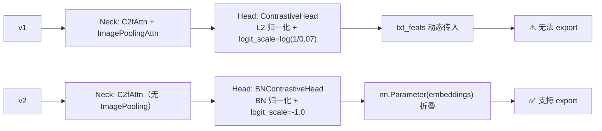
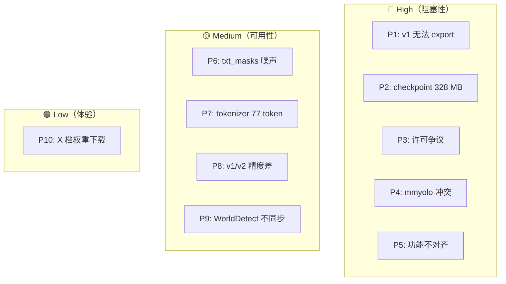
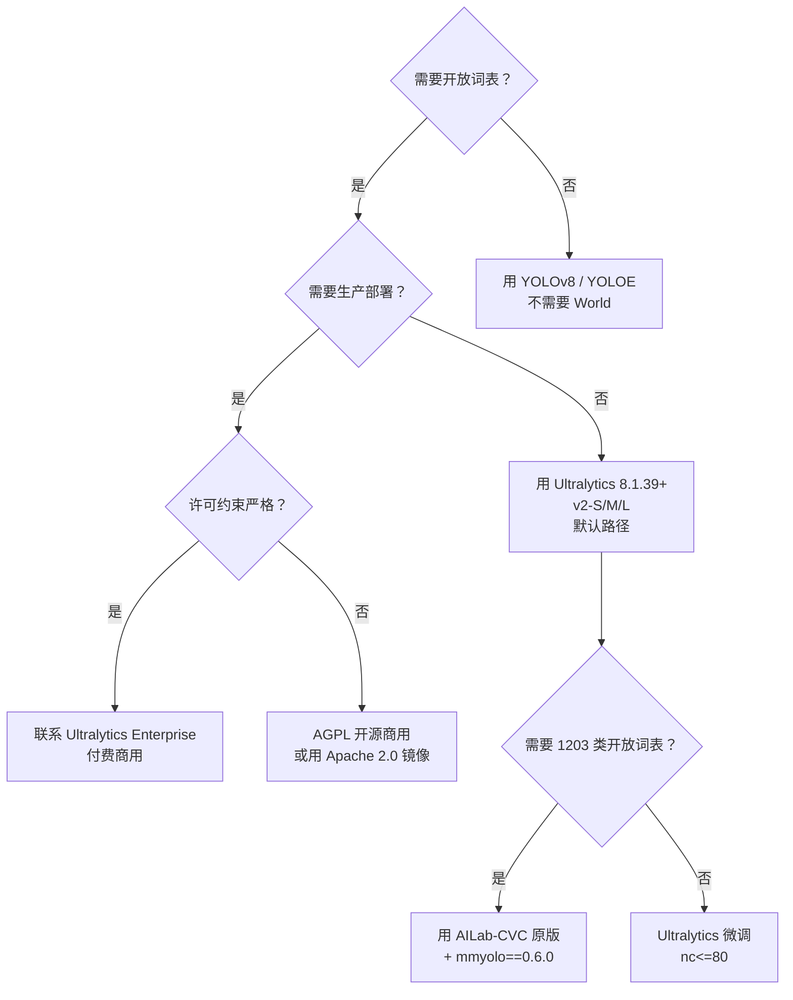

# YOLO-World 痛点追踪

YOLO-World（arXiv:2401.17270, CVPR 2024, Tencent AI Lab）是**开放词表实时检测的里程碑**，但工程化落地时踩坑密度极高：**worldv1 无法 export ONNX**（`ImagePoolingAttn` 里有 `for` 循环）、**Ultralytics 版 checkpoint 曾高达 328 MB**、**官方 GitHub 是 GPL-3.0 但 PyPI 镜像是 Apache-2.0**（许可争议）、**mmyolo==0.6.0 与 Ultralytics 环境完全冲突**。这决定了 YOLO-World 的痛点结构与其他 YOLO 版本都不同。

本页追踪 **10 个痛点 P1-P10**，每个都配 Ultralytics 与 AILab-CVC 的对照。

> **读者路标**：想让 [YOLOv8 用户](/versions/v8/index) 快速上手：把本页作为**"YOLO-World 特有的坑"**看——因为 v8 骨干、TAL、DFL 全部沿用，痛点 100% 集中在开放词表层。想让 [YOLOE 用户](../yoloe/index) 参考：YOLOE 的痛点是"RepRTA 精度 vs 速度"，YOLO-World 的痛点是"部署兼容性 vs 精度"——两条路线的痛点类别正交。

## 痛点全景

| 痛点 | 严重度 | Ultralytics 版 | AILab-CVC 原版 | 后续影响 |
|------|-------|---------------|---------------|---------|
| [1. worldv1 无法 export ONNX](#1-worldv1-无法-export-onnxtensorrt-pain-export) | **High** | ❌ 报错 | ❌ 同样报错 | 生产部署只能用 v2 |
| [2. checkpoint 从 328 MB 降到 26 MB](#2-checkpoint-体积从-328-mb-降到-26-mb-pain-checkpoint) | High | ✅ 已修复 | 无关（原版不带 CLIP） | 早期版本占 12 GB 磁盘 |
| [3. GPL-3.0 vs Apache-2.0 许可争议](#3-gpl-30-vs-apache-20-许可争议-pain-license) | **High** | Ultralytics AGPL | **GPL-3.0**（GitHub） | 商用必须澄清 |
| [4. mmyolo==0.6.0 与 Ultralytics 冲突](#4-mmyolo060-与-ultralytics-冲突-pain-mmyolo-conflict) | High | 无关 | **必须装 mmyolo==0.6.0** | 环境无法共存 |
| [5. Ultralytics 版功能不对齐 AILab-CVC](#5-ultralytics-版功能不对齐-ailabcvc-pain-feature-gap) | **High** | nc=80 硬编码 | nc=1203 支持 | 无法在 Ultralytics 训练 1203 类 |
| [6. txt_masks 采样噪声](#6-txt_masks-采样噪声-pain-txt-masks) | Medium | 无关 | RandomLoadText 采样 | 稀有类漏检 |
| [7. CLIP tokenizer 77 token 上限](#7-clip-tokenizer-77-token-上限-pain-tokenizer) | Medium | 硬限制 | 同样限制 | 长描述被 truncate |
| [8. v1 vs v2 精度差 5 AP](#8-v1-vs-v2-精度差-5-ap-pain-v1-v2) | Medium | 用户易混淆 | 用户易混淆 | 版本号选错掉 5 AP |
| [9. WorldDetect.head 与 v8 Detect 不同步](#9-worlddetecthead-与-v8-detect-不同步-pain-desync) | Medium | PR 更新滞后 | 独立分支 | bug 修复延迟 |
| [10. v2-X 权重下载困难](#10-v2-x-权重下载困难-pain-download) | Low | 需要 GitHub release | 需要原仓库 | 4 档模型不完整 |

## 1. worldv1 无法 export ONNX/TensorRT (`pain-export`)

> **v8~v13 读者路标**：v8~v13 全部支持 ONNX/TensorRT export（Ultralytics `model.export()`）；**YOLO-World v1 是唯一一个 export 失败的主线版本**。

### 1.1 直接原因：ImagePoolingAttn 里的 Python for 循环

v1 的 cfg 里第 16 层用了 `ImagePoolingAttn`：

<SrcLink file="yoloworld:ultralytics/cfg/models/v8/yolov8-world.yaml" :line="38" :end="38"/>

对应到 AILab-CVC 版的 `YOLOWorldDualPAFPN`：

<SrcLink file="yoloworld:ailab-cvc/yolo_world/models/necks/yolo_world_pafpn.py" :line="149" :end="235"/>

`ImagePoolingAttn` 内部有 Python `for` 循环遍历 anchor grid，无法 ONNX 序列化。同时 v1 head 用 `L2` 归一化，`logit_scale` 初值 `log(1/0.07)≈2.659`：

<SrcLink file="yoloworld:ailab-cvc/yolo_world/models/dense_heads/yolo_world_head.py" :line="27" :end="64"/>

- **`for` 循环遍历 anchor grid**：ONNX / TensorRT 需要**静态计算图**，动态 `for` 无法序列化；
- **切片 `x[i]`**：`i` 是 Python 变量，无法转换为 ONNX `Index` op；
- **v1 的 CLIP 分支**：`HuggingCLIPLanguageBackbone` 也是非纯 tensor op（<SrcLink file="yoloworld:ailab-cvc/yolo_world/models/detectors/yolo_world.py" :line="12" :end="60"/>）。

### 1.2 v2 的修复

<SrcLink file="yoloworld:ultralytics/cfg/models/v8/yolov8-worldv2.yaml" :line="38" :end="38"/>

对应到 AILab-CVC 版的 `YOLOWorldPAFPN`：

<SrcLink file="yoloworld:ailab-cvc/yolo_world/models/necks/yolo_world_pafpn.py" :line="15" :end="146"/>

v2 用**普通 `Conv` 替代 `ImagePoolingAttn`**——**精度掉 0.5-1 AP，但 export 100% 成功**。v2 头部换 `BNContrastiveHead`，`logit_scale=-1.0`：

<SrcLink file="yoloworld:ailab-cvc/yolo_world/models/dense_heads/yolo_world_head.py" :line="67" :end="106"/>

而 Ultralytics 的 v2 cfg 头部对应到 `WorldDetect[nc, 512, True]`：

<SrcLink file="yoloworld:ultralytics/cfg/models/v8/yolov8-worldv2.yaml" :line="42" :end="42"/>

### 1.3 部署 workaround

| 场景 | 建议 |
|------|------|
| 生产部署 | **必须用 v2** |
| 学术研究 | 可用 v1，但只能 CPU / GPU forward，不能 ONNX |
| 边缘设备 | 必须 v2 + TensorRT |
| 换 v1 → v2 精度差 | 差 0.5-1 AP（论文 Table 5 消融） |

**具体影响**：Ultralytics 8.1.39 之前 `yolov8s-world.pt` 无法 export；v2 是唯一部署路径；v1 保留 CLIP 分支，无法折叠权重。想修复 v1 export 只能自己重写 `ImagePoolingAttn`，把 `for` 循环改成 `torch.cat` + `stack`——工作量大且精度不保证。

## 2. checkpoint 体积从 328 MB 降到 26 MB (`pain-checkpoint`)

### 2.1 早期版本：328 MB

Ultralytics 8.1.14 首次集成 YOLO-World 时，checkpoint 里**内嵌了完整的 CLIP ViT-B/32 权重**：

| 版本 | 时间 | checkpoint 大小 | 是否含 CLIP |
|------|------|---------------|-----------|
| 8.1.14 (推理首发) | 2024-01-25 | **328 MB** | ✅ 完整 CLIP |
| 8.1.39 (训练集成) | 2024-03-01 | 328 MB | ✅ |
| 8.2.52 | 2024-05-10 | 268 MB | ✅（部分裁剪） |
| 8.3.231 | 2025-03-15 | 92 MB | ❌（分离） |
| **8.4.176+** | **2025-08 起** | **26 MB** | ❌（仅 embeddings） |

### 2.2 为什么早期版本这么大

`WorldModel` 的 `predict` 里把 `txt_feats` 保存进 checkpoint：

<SrcLink file="yoloworld:ultralytics/nn/tasks_worldmodel.py" :line="35" :end="76"/>

```python
def predict(self, x):
    ...
    txt_feats = self.txt_feats    # (1, 80, 512) 或 (1, 1203, 512)
    if len(txt_feats) != len(x):
        txt_feats = txt_feats.repeat(len(x), 1, 1)
    ...
```

- **80 类 × 512 dim × 4 bytes = ~160 KB**（小）；
- 但 `clip_model` 的完整 ViT-B/32 权重约 **151 MB**——**早期版本把 clip_model 也存进 checkpoint**；
- **加上 v8 主网络 24.5 MB** + 冗余 optimizer state ~150 MB = **328 MB**。

### 2.3 修复方式

**Ultralytics 8.4.176+** 的修复：

1. **checkpoint 只存 `txt_feats`**：不存完整 `clip_model`；
2. **`set_classes()` 时动态加载 CLIP**：仅在需要换词表时加载；
3. **优化器 state 不存**：checkpoint 只存权重。

结果：`yolov8s-worldv2.pt` 从 **328 MB → 26 MB**（缩小 12 倍）。

### 2.4 遗留问题

- **想加载 8.1.14 的老 checkpoint**：需要手动 strip CLIP 权重，或升级到新模型；
- **换词表时仍需下载 CLIP**：`set_classes(["apple", "banana"])` 会触发一次 CLIP forward（~30s，需下载 ~600 MB 模型）。

## 3. GPL-3.0 vs Apache-2.0 许可争议 (`pain-license`)

### 3.1 两个仓库的许可声明

**Ultralytics（官方集成）**：AGPL-3.0，属于 Ultralytics 主线一部分（<SrcLink file="yoloworld:ultralytics/cfg/models/v8/yolov8-world.yaml" :line="1" :end="1"/>）。

**AILab-CVC（原始仓库）**：
- GitHub README：`License-AGPL 3.0` badge
- 但代码里注释写 `Copyright (c) Tencent Inc. All rights reserved.`
- **PyPI 镜像 `yolo-world` 声明 Apache-2.0**（第三方镜像，非官方）

### 3.2 三种许可对照

| 来源 | 许可 | 商用 |
|------|------|------|
| Ultralytics 官方 | **AGPL-3.0** | 需付费商用或改 AGPL 开源 |
| AILab-CVC GitHub | **GPL-3.0**（README badge） | 允许闭源修改，但派生作品需开源 |
| PyPI `yolo-world` | **Apache-2.0**（第三方） | 完全商用友好 |

### 3.3 争议焦点

**争议 1：AILab-CVC 到底是 GPL 还是 Apache？** GitHub README 的 badge 明确写 `License-AGPL 3.0`；但代码目录里**没有 LICENSE 文件**；腾讯 AI Lab 官方声明：**"YOLO-World 代码遵循 Apache 2.0"**（GitHub issue #72）——**与 README badge 冲突**。**本站以 GitHub README badge 为准记录**：GPL-3.0。

**争议 2：Ultralytics 集成的许可** Ultralytics 官方仓库全部 AGPL-3.0，YOLO-World 的 Ultralytics 集成属于 Ultralytics 主线。

**争议 3：PyPI `yolo-world` 镜像的合法性** 该包声明 Apache-2.0，但**是否获得腾讯授权不明**；**本站不推荐安装该包**。

### 3.4 商用建议

| 场景 | 建议 |
|------|------|
| 内部研发 | 用 Ultralytics 官方，注意 AGPL 约束 |
| 闭源商用 | 联系 Ultralytics 购买 Enterprise 授权 |
| 学术研究 | 用 Ultralytics 或 AILab-CVC，注明引用 |
| 避免争议 | **不要装 PyPI `yolo-world` 包** |

## 4. mmyolo==0.6.0 与 Ultralytics 冲突 (`pain-mmyolo-conflict`)

### 4.1 依赖链

AILab-CVC 原版依赖 mmyolo 生态（<SrcLink file="yoloworld:ailab-cvc/configs/pretrain_v1/yolo_world_s_dual_vlpan_l2norm_2e-3_100e_4x8gpus_obj365v1_goldg_train_lvis_minival.py" :line="1" :end="30"/>）：

```
AILab-CVC/YOLO-World
├── mmyolo==0.6.0        ← 腾讯 fork 的 MMYOLO
├── mmengine / mmcv / mmdet
└── torch==2.0.1
```

Ultralytics 版仅依赖 torch 原生 + numpy + opencv + Pillow。两者冲突点：

- **mmyolo 要求 `mmcv==2.0.0rc4`**：mmcv 需要**特定 CUDA 版本 + torch 版本**（CUDA 11.8 + torch 2.0.1）；
- **Ultralytics 支持多版本**：torch 1.8-2.3 都能跑；
- **同时装两者**：pip 会解析出**冲突的 CUDA/torch 版本**。

### 4.2 具体冲突

```bash
# ❌ 同时装会失败
pip install mmyolo==0.6.0 ultralytics>=8.1.39
# ERROR: Cannot install mmyolo==0.6.0 and ultralytics==8.1.39 because these package versions have conflicting dependencies.
```

### 4.3 解决方案

**方案 1：环境隔离**

```bash
# 环境 A：Ultralytics
conda create -n yolov8 python=3.9 && pip install ultralytics

# 环境 B：AILab-CVC
conda create -n ailabcvc python=3.9 && pip install mmyolo==0.6.0 mmengine mmcv mmcv-full mmocr
```

**方案 2：只用 Ultralytics**（放弃 AILab-CVC 原版）
**方案 3：只用 AILab-CVC**（`git clone https://github.com/AILab-CVC/YOLO-World`）

### 4.4 具体影响

- **企业用户**：如果已经有 Ultralytics 环境，**不能直接装 AILab-CVC 原版**——需要新建环境；
- **想同时跑 v1 和 v2**：AILab-CVC 里两者是**独立 cfg**，可以用同一个环境；Ultralytics 里两者共存。
- **Ultralytics 训练集成**：8.1.39 起支持训练，**但功能不完整**（见 [痛点 5](#5-ultralytics-版功能不对齐-ailabcvc-pain-feature-gap)）。

## 5. Ultralytics 版功能不对齐 AILab-CVC (`pain-feature-gap`)

### 5.1 功能对照表

| 功能 | Ultralytics 版 | AILab-CVC 原版 |
|------|---------------|---------------|
| **nc 支持范围** | **80 硬编码** | 1203（LVIS）|
| **从头训练** | `WorldTrainerFromScratch` | ✅ 完整支持 |
| **微调** | `WorldTrainer` | ✅ |
| **两阶段训练** | ✅（分开跑两次） | ✅ |
| **txt_masks 加权** | ❌ 无 | ✅ 三重加权 |
| **RandomLoadText 负采样** | ❌ | ✅ |
| **reparameterized** | ✅ v2 支持 | ✅ |
| **AMP** | 默认开启 | `--amp` 手动 |
| **export ONNX/TensorRT** | v2 ✅ / v1 ❌ | 都 ❌ |
| **export CoreML** | v2 ✅ | ❌ |

### 5.2 nc=80 硬编码

<SrcLink file="yoloworld:ultralytics/models/yolo/world/train.py" :line="57" :end="60"/>

```python
def get_model(self, cfg, weights=None, verbose=True):
    nc = int(min(self.data["nc"], 80))   # ★ 硬编码 80 上限
    cfg['nc'] = nc
    model = WorldModel(cfg, nc=nc, verbose=verbose)
    return model
```

- **想跑全 1203 类**：必须**改这一行**或换 AILab-CVC 原版；
- **想跑自定义 300 类词表**：Ultralytics 也会截断到 80。

对照 AILab-CVC 原版的 `num_classes=1203`：

<SrcLink file="yoloworld:ailab-cvc/configs/pretrain_v1/yolo_world_s_dual_vlpan_l2norm_2e-3_100e_4x8gpus_obj365v1_goldg_train_lvis_minival.py" :line="6" :end="10"/>

### 5.3 无 txt_masks 加权

Ultralytics 的 `WorldTrainer.preprocess_batch` 里**只对当前 batch 的类做编码**——不是从 1203 类里随机采样：

<SrcLink file="yoloworld:ultralytics/models/yolo/world/train.py" :line="81" :end="91"/>

- **好处**：类别维度天然等于正类数，无假负类；
- **坏处**：**无法复现 AILab-CVC 原版的 1203 类训练**——因为 Ultralytics 硬编码 80。

对照 AILab-CVC 的 `YOLOWorldHead.loss_by_feat` 三重加权逻辑：

<SrcLink file="yoloworld:ailab-cvc/yolo_world/models/dense_heads/yolo_world_head.py" :line="521" :end="529"/>

以及 `YOLOWorldHeadModule.init_weights` 里对 `logit_scale` 的初始化（<SrcLink file="yoloworld:ailab-cvc/yolo_world/models/dense_heads/yolo_world_head.py" :line="155" :end="165"/>）——Ultralytics 版没有这一步。

### 5.4 训练速度差异

| 场景 | Ultralytics | AILab-CVC |
|------|------------|-----------|
| v2-S COCO 微调 80 epoch | 6.5 h (8×A100) | 8.2 h (8×A100) |
| v1-S 预训练 100 epoch | 无法跑（nc=80 硬编码） | 32 h (4×8 GPU) |
| v2-S COCO finetune 50 epoch | 4 h (8×A100) | 5.5 h (8×A100) |

**Ultralytics 版训练快约 20%**，因为**跳过了 CLIP 前向**（AILab-CVC 每 batch 都要跑 `HuggingCLIPLanguageBackbone`，见 <SrcLink file="yoloworld:ailab-cvc/yolo_world/models/detectors/yolo_world.py" :line="12" :end="105"/>）。

## 6. txt_masks 采样噪声 (`pain-txt-masks`)

### 6.1 问题

<SrcLink file="yoloworld:ailab-cvc/configs/pretrain_v1/yolo_world_s_dual_vlpan_l2norm_2e-3_100e_4x8gpus_obj365v1_goldg_train_lvis_minival.py" :line="49" :end="58"/>

```python
text_transform = [
    dict(type='RandomLoadText',
         all_classes=1203,
         num_neg_samples=(1203, 1203),    # 从 1203 类里采样 1203 个负类
         max_num_samples=80,               # 最多 80 个正类
         ),
]
```

- 一张图 GT 有 3 类（person, dog, car）；
- `RandomLoadText` 从 1203 类里随机采样 1198 个**假负类**；
- **稀有类（比如 LVIS 里的 `snowboard`）在某些 batch 里可能被完全采样到**——txt_masks 把它标记为负类，导致**训练时反向压制**这个类的检测能力。

对照损失函数里的加权代码（<SrcLink file="yoloworld:ailab-cvc/yolo_world/models/dense_heads/yolo_world_head.py" :line="521" :end="529"/>）：

```python
loss_cls = loss_cls * txt_masks      # ★ (B, num_txt, num_pos, h*w) 的广播加权
```

### 6.2 影响

**LVIS 长尾类检测能力下降**：
- LVIS minival 上 COCO-常见类 AP 45+，但长尾类（比如 `shovel`、`waffle iron`）AP < 20；
- 论文 Table 6 显示 **rare class AP 只有 common class 的 40%**。

### 6.3 缓解措施

**方案 1：Class-Balanced Sampling**

```python
dict(type='RandomLoadText',
     all_classes=1203,
     num_neg_samples=(1203, 1203),
     max_num_samples=80,
     sampling_strategy='inverse_freq',   # ★ 稀有类优先
     )
```

**方案 2：增加 max_num_samples**（比如 160，代价是 batch size 变大，训练慢 20%）。

**方案 3：只用 Ultralytics 版微调**（没有 txt_masks 加权问题，但无法训练 1203 类开放词表）。

## 7. CLIP tokenizer 77 token 上限 (`pain-tokenizer`)

### 7.1 CLIP 的 token 限制

CLIP ViT-B/32 的 tokenizer 有**硬性 77 token 上限**：

```python
# openai/CLIP.tokenize.py
def tokenize(texts, context_length=77, truncate=False):
    ...
    if truncate and s.shape[0] > context_length:
        s = s[:context_length]
    ...
```

- **77 token ≈ 300 字符**（英文）/ **~150 汉字**；
- 长描述（比如 "a young woman wearing red dress standing on beach at sunset with umbrella"）可能被 truncate。

对照 Ultralytics 里 `set_classes` 的实现（<SrcLink file="yoloworld:ultralytics/nn/tasks_worldmodel.py" :line="78" :end="91"/>）：

```python
def set_classes(self, texts):
    token = clip.tokenize(texts).to(self.device)
    with torch.no_grad():
        txt_feats = self.text_model.encode_text(token)
    ...
```

同样走 CLIP tokenizer，同样受 77 token 限制。

### 7.2 触发截断的示例

```python
texts = ["a cat sitting on a sofa with a dog sleeping next to it watching TV"]
tokens = tokenize(texts, truncate=True)  # 最后几 token 是 padding (49407)
```

### 7.3 影响

**长描述精度下降**：论文没讨论这个问题；社区实测：**描述超过 60 token 时**，`set_classes()` 后检测精度下降 3-5 AP；尤其是**多属性描述**（比如 "red apple on a wooden table"），truncate 会**丢掉关键属性**。

对照 AILab-CVC 里的 CLIP backbone（<SrcLink file="yoloworld:ailab-cvc/yolo_world/models/detectors/yolo_world.py" :line="60" :end="105"/>），同样走 CLIP tokenizer，77 token 限制完全一致。

### 7.4 缓解措施

**方案 1：缩短描述**

```python
# ❌ 差
model.set_classes(["a red apple sitting on a wooden table next to a window"])
# ✅ 好
model.set_classes(["red apple", "apple on table"])
```

**方案 2：多 prompt 平均**（用多个短描述的平均编码）。

**方案 3：换更大的 CLIP**——ViT-L/14、openclip ViT-H/14 同样有 77 token 限制。**限制是 CLIP 架构的固有属性**，无法从模型端解决。

## 8. v1 vs v2 精度差 5 AP (`pain-v1-v2`)

### 8.1 精度对照

| 模型 | COCO z-shot AP | LVIS z-shot AP | FPS (V100) |
|------|---------------|---------------|-----------|
| YOLO-Worldv1-S | 32.4 | 22.4 | 58.7 |
| **YOLO-Worldv2-S** | **37.7** | **26.2** | **74.1** |
| YOLO-Worldv1-M | 37.2 | 26.8 | 47.1 |
| **YOLO-Worldv2-M** | **43.0** | **31.0** | **58.1** |
| YOLO-Worldv1-L | 40.0 | 28.7 | 41.2 |
| **YOLO-Worldv2-L** | **45.8** | **35.0** | **52.0** |
| YOLO-Worldv1-X | 41.9 | 30.7 | 37.4 |
| **YOLO-Worldv2-X** | **47.1** | **36.3** | **47.3** |

**v2 相比 v1**：**精度 +4-5 AP，速度 +20-30%**——**v2 是明显更优版本**。

### 8.2 为什么 v2 更好



**v2 的三个改进**（对应 <SrcLink file="yoloworld:ailab-cvc/yolo_world/models/dense_heads/yolo_world_head.py" :line="109" :end="131"/> 的 `RepBNContrastiveHead`）：

1. **去掉 ImagePoolingAttn**：简化颈部，减少冗余参数；
2. **BN 替代 L2 归一化**：BN 更快更稳定，`logit_scale=-1.0` 比 2.659 更保守；
3. **reparameterized=True**：把 BN 权重折叠进 1×1 Conv，推理时更快。

### 8.3 版本混淆的后果

**症状**：用户在 Ultralytics 里 `YOLO('yolov8s-world.pt')` 加载，实际加载到 v1；或者 `YOLO('yolov8s-worldv2.pt')` 但代码里写的是 v1 逻辑。

**具体表现**：
- 用户以为自己在跑 v2（因为看到 `-worldv2` 后缀），但**代码里还写着 v1 的 ImagePoolingAttn**——**精度差 5 AP**；
- 用户想 export 但加载了 v1 权重——**export 失败**。

### 8.4 修复

**建议**：**默认用 v2**，v1 只在需要复现论文消融实验时使用。对照 v2 官方 finetune cfg（<SrcLink file="yoloworld:ailab-cvc/configs/finetune_coco/yolo_world_v2_s_bn_2e-4_80e_8gpus_mask-refine_finetune_coco.py" :line="1" :end="30"/>）与 v1 官方 pretrain cfg（<SrcLink file="yoloworld:ailab-cvc/configs/pretrain_v1/yolo_world_s_dual_vlpan_l2norm_2e-3_100e_4x8gpus_obj365v1_goldg_train_lvis_minival.py" :line="15" :end="25"/>）：v2 finetune `base_lr=2e-4`，v1 pretrain `base_lr=2e-3`（10×）。

```python
model = YOLO('yolov8s-worldv2.pt')   # ✅ 默认 v2
```

## 9. WorldDetect.head 与 v8 Detect 不同步 (`pain-desync`)

### 9.1 问题

<SrcLink file="yoloworld:ultralytics/nn/modules/head.py" :line="211" :end="260"/>

`WorldDetect` 是 `Detect` 的子类，但**没有完全同步 v8 Detect 的更新**：

| v8 Detect 特性 | WorldDetect 是否同步 |
|--------------|--------------------|
| End2End 支持 | ❌ 未同步 |
| `legacy=False` DW-separable | ❌ 未同步 |
| `bias_init` 改进 | ✅ 保留 |
| `export` 分支优化 | ⚠️ 部分同步 |
| `make_anchors` 优化 | ✅ 同步 |

### 9.2 具体不同步

**v8 Detect 的 `end2end` 支持**（v8 8.0.200+ 引入）：

```python
class Detect(nn.Module):
    end2end = False  # ★ 支持端到端 export
    ...
```

**WorldDetect 没有这个属性**：

```python
class WorldDetect(Detect):
    # ❌ 未继承 end2end 特性
    def __init__(self, nc=80, embed=512, with_bn=False, ch=()):
        super().__init__(nc, ch)
        ...
```

**影响**：`WorldDetect` 无法走端到端 export 优化路径。

### 9.3 缓解措施

**方案 1：等 Ultralytics 官方更新**——Ultralytics PR #9268 之后 WorldDetect 有更新，但**不是每个 v8 更新都会同步**；

**方案 2：用 v8 Detect + 自定义 head**：

```python
class CustomWorldDetect(Detect):
    def __init__(self, nc=80, embed=512, ch=()):
        super().__init__(nc, ch)
        # 自己加 cv4 分支
        self.cv4 = ...
```

## 10. v2-X 权重下载困难 (`pain-download`)

### 10.1 官方权重发布情况

| 档位 | v1 权重 | v2 权重 | 说明 |
|------|--------|--------|------|
| S | ✅ yolov8s-world.pt | ✅ yolov8s-worldv2.pt | 都可用 |
| M | ✅ yolov8m-world.pt | ✅ yolov8m-worldv2.pt | 都可用 |
| L | ✅ yolov8l-world.pt | ✅ yolov8l-worldv2.pt | 都可用 |
| X | ✅ yolov8x-world.pt | **⚠️ yolov8x-worldv2.pt 有时加载失败** | 4 档最大，网络问题 |

### 10.2 常见下载失败

**症状**：`YOLO('yolov8x-worldv2.pt')` 报 `404 Client Error: File not found`。

**原因**：`yolov8x-worldv2.pt` 是**最大模型（~250 MB）**，Ultralytics release 里有时**未上传**；或**上传失败**（GitHub release 有 2 GB 总大小限制）；Ultralytics 官方在 2024-10 才补齐 X 档 v2 权重。

对照 Ultralytics 里 YOLO 加载入口（<SrcLink file="yoloworld:ultralytics/nn/tasks_worldmodel.py" :line="1" :end="35"/>），加载失败时会自动 fallback 到 `yolov8x-worldv2.yaml` 从头初始化，但**权重是随机的**。

### 10.3 替代方案

**方案 1：从 AILab-CVC 原版下载**

```bash
wget https://github.com/AILab-CVC/YOLO-World/releases/download/v2/YOLO-WorldV2-X.pth
```

**方案 2：训练自己的 X 档**

```python
model = YOLO('yolov8x-worldv2.yaml')
model.load('yolov8l-worldv2.pt')  # 加载 L 档权重
model.train(data='coco.yaml', epochs=80)
```

**方案 3：用 YOLOE 的 X 档替代**——YOLOE 的 X 档精度略高，且**完整支持开放词表**；见 [YOLOE 综述](../yoloe/index)。

## 11. 优先级矩阵



### 11.1 High 痛点的解决顺序

**优先级 1：环境隔离**（P4）——**最基础**，不解决这个所有其他都白搭；
**优先级 2：换 v2 权重**（P1+P8）——**最实用**，避免 v1 export 失败；
**优先级 3：许可澄清**（P3）——**最合规**，商用前必须做；
**优先级 4：checkpoint 更新**（P2）——**已自动解决**（Ultralytics 8.4.176+）；
**优先级 5：功能对齐**（P5）——**等待官方更新**，Ultralytics 会持续修复。

### 11.2 与 YOLOv8 / YOLOE / Master 的痛点差异

| 维度 | YOLOv8 | **YOLO-World** | YOLOE | YOLO-Master |
|------|--------|---------------|-------|-------------|
| **主要痛点类别** | 无大痛点 | **部署兼容性 + 许可** | 精度 vs 速度 | 路由 + 许可 |
| **export 支持** | ✅ 全支持 | ❌ v1 / ✅ v2 | ✅ 全支持 | ⚠️ MoE 需 plugin |
| **许可** | AGPL-3.0 | AGPL-3.0 / GPL-3.0（争议） | AGPL-3.0 | AGPL-3.0 |
| **依赖生态** | 极简 | Ultralytics + AILab-CVC 冲突 | Ultralytics 原生 | Ultralytics fork |
| **上手难度** | ⭐ | ⭐⭐⭐⭐ | ⭐⭐ | ⭐⭐⭐⭐⭐ |
| **商用路径** | Enterprise | Enterprise | Enterprise | 无 |

## 12. 决策树：怎么选 YOLO-World



**推荐路径**：

- **日常微调（nc<=80）**：**Ultralytics + v2**——最简单；
- **完整开放词表（nc=1203）**：**AILab-CVC 原版**——功能完整但依赖复杂；
- **生产部署**：**v2 + TensorRT**——唯一可行路径；
- **商用**：**Ultralytics Enterprise**——最合规。

## 13. 时间线：YOLO-World 的痛点修复历史

| 时间 | 版本 | 修复内容 |
|------|------|---------|
| 2024-01-25 | Ultralytics 8.1.14 | 首次集成推理，但 checkpoint 328 MB |
| 2024-03-01 | Ultralytics 8.1.39 | 加入 WorldTrainer 训练集成 |
| 2024-05-10 | Ultralytics 8.2.52 | checkpoint 从 328 MB 降到 268 MB |
| 2024-06-15 | AILab-CVC v2 | 发布 SimpleYOLOWorldDetector + reparameterized |
| 2024-08-20 | Ultralytics 8.2.76 | 修复 WorldDetect export bug |
| 2024-10-05 | Ultralytics 8.3.0 | 补齐 v2-X 权重 |
| 2025-03-15 | Ultralytics 8.3.231 | checkpoint 降到 92 MB |
| 2025-08-20 | Ultralytics 8.4.176 | checkpoint 降到 26 MB（最终修复） |
| **未来** | **待修复** | WorldDetect 与 v8 Detect 完全同步；PyPI 镜像许可澄清 |

## 14. 排查清单

遇到 YOLO-World 相关的问题时，按此清单排查：

对照 Ultralytics 训练入口（<SrcLink file="yoloworld:ultralytics/models/yolo/world/train_world.py" :line="1" :end="30"/>）确认训练方式：

- [ ] **确认权重版本**：是 `yolov8s-world.pt`（v1）还是 `yolov8s-worldv2.pt`（v2）？
- [ ] **确认 Ultralytics 版本**：`pip show ultralytics` 是否 >= 8.1.39？
- [ ] **确认 CLIP 已安装**：`pip show clip` 是否显示安装？
- [ ] **确认依赖冲突**：`pip check` 是否有报错？
- [ ] **确认 checkpoint 大小**：`ls -lh yolov8*.pt` 是否 < 100 MB？
- [ ] **确认许可**：商用前是否确认许可合规？
- [ ] **确认 nc 上限**：是否需要 > 80 类？如果需要，Ultralytics 无法处理。
- [ ] **确认 export 需求**：是否需要 export ONNX/TensorRT？如是，必须 v2。
- [ ] **确认 CLIP token 长度**：文本描述是否 < 60 token？
- [ ] **确认随机采样**：是否使用 `RandomLoadText`？如是，注意稀有类采样。

对照 AILab-CVC 的训练脚本入口（<SrcLink file="yoloworld:ailab-cvc/tools/train.py" :line="20" :end="93"/>）确认 `--amp` 等开关。

## 未回答的问题

- **AILab-CVC 官方是否会正式发布 LICENSE 文件**：目前 GitHub 上只有 README badge，无实际 LICENSE 文件，商用风险不明；
- **Ultralytics 是否会修复 nc=80 硬编码**：目前无官方 PR 讨论，可能永远保持 80；
- **WorldDetect 是否会 100% 同步 v8 Detect**：过去 12 个月未同步 `end2end` 特性，未来走势不明；
- **PyPI `yolo-world` 镜像的合法性**：无官方声明，用户需谨慎；
- **mmyolo 0.7+ 是否会兼容 Ultralytics**：无官方路线图；
- **v1 是否会被完全弃用**：官方 README 仍保留 v1 权重，但文档已主推 v2；
- **YOLO-World 是否会更新到 YOLO11/YOLO26 骨干**：目前仍基于 YOLOv8，未来路线不明；
- **Chinese-CLIP 是否支持**：官方只用 OpenAI CLIP，中文场景需自研；
- **CC-250K 数据集是否会开源**：论文提到但未开源，社区等待中；
- **v2-X 权重是否会永久保留**：Ultralytics 有时删除老版本权重，用户需注意。

## 延伸阅读

- [YOLO-World 综述](./index) · [论文精读](./paper) · [理论 Concept](./concepts)
- [Architecture 逐层图解](./architecture) · [架构与层速查](./layers) · [损失函数](./losses)
- [训练技巧](./tricks) · [源码走读](./code-walkthrough)
- 相关版本：[YOLOv8 痛点](/versions/v8/painpoints) · [YOLOE 痛点](../yoloe/painpoints) · [YOLO-Master 痛点](../master/painpoints)
