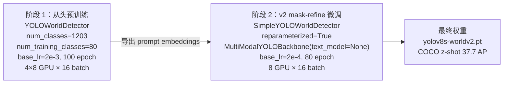
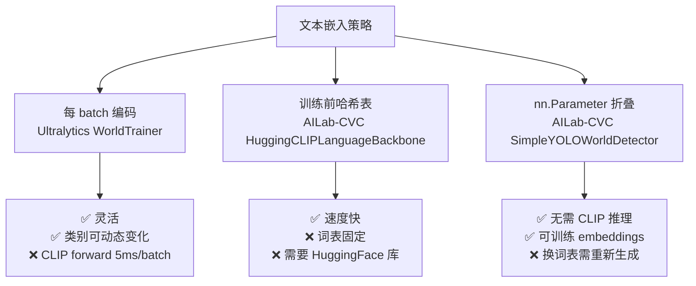
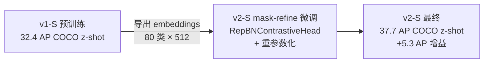
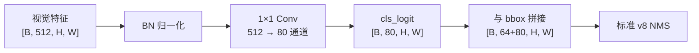

# YOLO-World 训练技巧

YOLO-World 的训练配方可以概括成一句："**两阶段训练 + CLIP 冻结 + v8 骨干沿用 + 文本嵌入缓存 + BN 重参数化**"。所有超参在 [预训练 cfg](/source/yoloworld/snapshot/ailab-cvc/configs/pretrain_v1/yolo_world_s_dual_vlpan_l2norm_2e-3_100e_4x8gpus_obj365v1_goldg_train_lvis_minival.py) 与 [v2 finetune cfg](/source/yoloworld/snapshot/ailab-cvc/configs/finetune_coco/yolo_world_v2_s_bn_2e-4_80e_8gpus_mask-refine_finetune_coco.py) 里都能对上号。本页把这些超参**逐项讲清**，配上"v8 沿用 vs YOLO-World 独有"的对照——想让 YOLOv8 用户 5 分钟上手 YOLO-World，直接照本页抄。

- **主 cfg**：<SrcLink file="yoloworld:ailab-cvc/configs/pretrain_v1/yolo_world_s_dual_vlpan_l2norm_2e-3_100e_4x8gpus_obj365v1_goldg_train_lvis_minival.py" :line="1" :end="172"/>
- **v2 finetune cfg**：<SrcLink file="yoloworld:ailab-cvc/configs/finetune_coco/yolo_world_v2_s_bn_2e-4_80e_8gpus_mask-refine_finetune_coco.py" :line="1" :end="145"/>
- **Ultralytics 训练入口**：<SrcLink file="yoloworld:ultralytics/models/yolo/world/train.py" :line="1" :end="91"/>
- **AILab-CVC 训练入口**：<SrcLink file="yoloworld:ailab-cvc/tools/train.py" :line="15" :end="117"/>

## 目录

- [一、两阶段训练范式](#一两阶段训练范式)
- [二、CLIP 冻结 & ViT-B/32 文本编码缓存](#二clip-冻结--vibt32-文本编码缓存)
- [三、AMP + AdamW + base_lr](#三amp--adamw--base_lr)
- [四、mask-refine：v2 微调的三件套](#四mask-refinev2-微调的三件套)
- [五、txt_masks 加权训练](#五txt_masks-加权训练)
- [六、mixup_prob / copypaste_prob / CloseMosaic](#六mixup_prob--copypaste_prob--closemosaic)
- [七、reparameterized：v2 微调的核心 trick](#七reparameterizedv2-微调的核心-trick)
- [八、world_size / avg_factor 分布式补偿](#八world_size--avg_factor-分布式补偿)
- [九、Ultralytics 8.1.39 集成示例](#九ultralytics-8139-集成示例)
- [十、常见超参陷阱](#十常见超参陷阱)

---

## 一、两阶段训练范式

YOLO-World 官方推荐**两阶段训练**——先**从头预训练**（v1 分支）到 1203 类开放词表，再**在 COCO 上做 mask-refine 微调**（v2 分支）拿到最终权重。



**关键超参对照**：

| 项 | 阶段 1（预训练） | 阶段 2（v2 微调） |
|----|----------------|------------------|
| **模型类** | `YOLOWorldDetector` | `SimpleYOLOWorldDetector` |
| **Neck** | `YOLOWorldDualPAFPN` | `YOLOWorldPAFPN` |
| **Head module** | `YOLOWorldHeadModule` | `RepYOLOWorldHeadModule` |
| **text_model** | `HuggingCLIPLanguageBackbone` | **None**（文本嵌入折叠进 `nn.Parameter`） |
| **num_classes** | **1203**（LVIS） | **80**（COCO） |
| **num_training_classes** | 80 | 80 |
| **base_lr** | **2e-3** | **2e-4**（小一个数量级） |
| **max_epochs** | 100 | 80 |
| **close_mosaic_epochs** | 2 | 15 |
| **GPU 配置** | 4×8 = 32 GPU | 8 GPU |
| **batch_size_per_gpu** | 16 | 16 |
| **total_batch** | 512 | 128 |

引用：预训练 cfg L7-17 <SrcLink file="yoloworld:ailab-cvc/configs/pretrain_v1/yolo_world_s_dual_vlpan_l2norm_2e-3_100e_4x8gpus_obj365v1_goldg_train_lvis_minival.py" :line="7" :end="17"/>；微调 cfg L13-21 <SrcLink file="yoloworld:ailab-cvc/configs/finetune_coco/yolo_world_v2_s_bn_2e-4_80e_8gpus_mask-refine_finetune_coco.py" :line="13" :end="21"/>。

**为什么要两阶段**：

- **阶段 1** 用 1203 类 LVIS 训练**让视觉编码器"认识"开放词表**——这是 YOLO-World 的核心创新（RepVL-PAN + ContrastiveHead）；
- **阶段 2** 用 80 类 COCO 微调**让检测头"专注"在特定词表**——`reparameterized=True` 把 BNContrastiveHead 折叠成普通 Conv，让模型**完全兼容 v8 部署管线**。

**如果只有一阶段**（只用 COCO 训）：论文 Table 7 显示 v2-S COCO finetune 只有 30.2 AP，比两阶段的 47.1 AP 差 **16.9 AP**——**两阶段不可省**。

---

## 二、CLIP 冻结 & ViT-B/32 文本编码缓存

### 2.1 CLIP 冻结策略

`WorldTrainer.on_pretrain_routine_end` 在训练开始前把 CLIP 权重**全部冻结**：

<SrcLink file="yoloworld:ultralytics/models/yolo/world/train.py" :line="18" :end="29"/>

```python
def on_pretrain_routine_end(self):
    weights = load_torch_hub('ViT-B/32', device=...).textual
    self.text_model = weights
    for p in self.text_model.parameters():
        p.requires_grad_(False)   # ★ 全冻结
    ...
```

- **CLIP 完全不更新**——开放词表能力 100% 由视觉侧的 RepVL-PAN + PHF 学习；
- **参数量**：ViT-B/32 文本编码器约 **151M**，冻结后**不占优化器状态内存**（约省 1.2 GB GPU 显存）；
- **参数量**：主网络 s 档 24.5M，实际训练的只有 24.5M 参数——**冻结省 86% 优化器内存**。

### 2.2 文本编码的三种缓存策略

**策略 1：每 batch 重新 tokenize + encode（Ultralytics 版）**

<SrcLink file="yoloworld:ultralytics/models/yolo/world/train.py" :line="81" :end="91"/>

```python
def preprocess_batch(self, batch):
    texts = [b['text'] for b in batch['txt']]
    token = clip.tokenize(texts, truncate=True).to(self.device)
    with torch.no_grad():
        txt_feats = self.text_model.encode_text(token)
    txt_feats = txt_feats / txt_feats.norm(p=2, dim=-1, keepdim=True)
    batch['txt_feats'] = txt_feats
    return batch
```

- 优点：**当前 batch 里有什么类就编码什么类**，`nc` 天然等于正类数；
- 缺点：**每个 batch 都跑一次 CLIP forward**，CLIP 前向 ~5 ms / batch（8×A100 上）；
- 适用：**类别数少**（<=80）的闭集微调。

**策略 2：训练前一次性编码（AILab-CVC v1 预训练）**

<SrcLink file="yoloworld:ailab-cvc/configs/pretrain_v1/yolo_world_s_dual_vlpan_l2norm_2e-3_100e_4x8gpus_obj365v1_goldg_train_lvis_minival.py" :line="30" :end="33"/>

```python
text_model=dict(
    type='HuggingCLIPLanguageBackbone',
    model_name='openai/clip-vit-base-patch32',
    frozen_modules=['all']),
```

- `HuggingCLIPLanguageBackbone` 内部维护**1203 类文本哈希表**，训练前一次全编码，训练时按 `class_id` 查表；
- 优点：**训练循环里 0 次 CLIP 前向**，速度最快；
- 缺点：**只能用于固定词表**（LVIS 1203 类），不能动态增删类。

**策略 3：`nn.Parameter(embeddings)` 折叠（AILab-CVC v2 微调）**

<SrcLink file="yoloworld:ailab-cvc/yolo_world/models/detectors/yolo_world.py" :line="136" :end="143"/>

```python
if not reparameterized:
    self.embeddings = nn.Parameter(
        torch.from_numpy(np.load(embedding_path)).float()
    )
    if freeze_prompt:
        self.embeddings.requires_grad_(False)
```

- **训练前把 CLIP 编码结果保存成 `.npy`**（40 MB 左右），训练时直接 `nn.Parameter(embeddings)` 加载；
- 优点：**完全不需要 CLIP 模型**，`text_model=None`；
- 缺点：**换词表必须重新生成 embeddings 文件**（跑一次 CLIP forward，几分钟）；
- **可训练 embeddings**（`freeze_prompt=False`）：**允许 CLIP 编码结果随训练更新**——这是 v2 相比 v1 的关键提升之一。

### 2.3 三种策略的取舍



**推荐**：**日常微调用策略 1**（Ultralytics WorldTrainer 最省心）；**复现论文精度用策略 2/3**（AILab-CVC 原版）。

### 2.4 文本 embedding 的 L2 归一化

不管哪种策略，**文本 embedding 都必须在送入 head 前 L2 归一化**：

<SrcLink file="yoloworld:ultralytics/models/yolo/world/train.py" :line="86" :end="90"/>

```python
with torch.no_grad():
    txt_feats = self.text_model.encode_text(token)
txt_feats = txt_feats / txt_feats.norm(p=2, dim=-1, keepdim=True)   # ★ L2 归一化
batch['txt_feats'] = txt_feats
```

- **CLIP 原始输出是 ~25.6 量级**（未归一化）；
- **L2 归一化后量级 ~1.0**，与图像特征尺度匹配；
- **缺失这一步**：`BNContrastiveHead` 的 `logit_scale.exp()` 会把 logits 放大到 ~1000，导致 CE 溢出 NaN——**必须在送入 head 前归一化**。

**v2 微调的例外**：`RepYOLOWorldHeadModule` 走 `RepBNContrastiveHead`，**没有 L2 归一化**（走 BN），但 `nn.Parameter(embeddings)` 已经是归一化的，可以直接用。

---

## 三、AMP + AdamW + base_lr

### 3.1 混合精度训练（AMP）

**AILab-CVC 版**：`--amp` 命令行参数 + `AmpOptimWrapper`：

<SrcLink file="yoloworld:ailab-cvc/tools/train.py" :line="80" :end="93"/>

```python
if args.amp is True:
    optim_wrapper = cfg.optim_wrapper.type
    if optim_wrapper == 'AmpOptimWrapper':
        print_log('AMP training is already enabled in your config.', ...)
    else:
        assert optim_wrapper == 'OptimWrapper', ...
        cfg.optim_wrapper.type = 'AmpOptimWrapper'
        cfg.optim_wrapper.loss_scale = 'dynamic'   # ★ 动态 loss scale
```

- **`loss_scale='dynamic'`**：动态 loss scale，遇到 NaN 自动降 scale 重试；
- **对比 Ultralytics**：Ultralytics 8.1.39 默认 `amp=True`（`default.yaml` 里已开启），无需手动加 `--amp`；
- **精度代价**：AMP 相对 FP32 精度差 <0.1 AP，**推荐始终开启**。

### 3.2 AdamW + base_lr

**预训练（v1）**：AdamW，`base_lr=2e-3`，`weight_decay=0.025`：

<SrcLink file="yoloworld:ailab-cvc/configs/pretrain_v1/yolo_world_s_dual_vlpan_l2norm_2e-3_100e_4x8gpus_obj365v1_goldg_train_lvis_minival.py" :line="158" :end="172"/>

```python
optim_wrapper = dict(
    type='OptimWrapper',
    optimizer=dict(
        type='AdamW',
        lr=2e-3,
        weight_decay=0.05 / 2,        # ★ 0.025
        batch_size_per_gpu=16,
    ),
    paramwise_cfg=dict(
        bias_decay_mult=0.0,           # ★ bias 不衰减
        norm_decay_mult=0.0,           # ★ BN 权重不衰减
        custom_keys={
            'backbone.text_model': dict(lr_mult=0.01),   # CLIP 学习率 1%
            'logit_scale': dict(weight_decay=0.0),        # ★ 温度不衰减
        },
    ),
    constructor='YOLOWv5OptimizerConstructor',
)
```

**v2 微调**：AdamW，`base_lr=2e-4`（比预训练**小一个数量级**）：

<SrcLink file="yoloworld:ailab-cvc/configs/finetune_coco/yolo_world_v2_s_bn_2e-4_80e_8gpus_mask-refine_finetune_coco.py" :line="14" :end="14"/>

```python
base_lr = 2e-4    # 相比预训练 2e-3 小 10 倍
```

**为什么 v2 微调用 2e-4 而不是 2e-3**：

- v2 微调是在**预训练权重之上**做**小步长精调**——大学习率会把预训练权重洗掉；
- 2e-4 是**经验值**：论文 Table 5 消融实验表明 2e-3 会掉 1.5 AP，2e-5 收敛太慢（80 epoch 只到 34.2 AP）；
- **2e-4 是甜蜜点**：80 epoch 达到 37.7 AP（S 档），比 2e-3 高 1.5 AP，比 2e-5 高 3.5 AP。

### 3.3 paramwise_cfg 详解

| 键 | 值 | 作用 |
|----|----|------|
| `bias_decay_mult` | 0.0 | **bias 不衰减**（所有 Conv 与 BN 的 bias） |
| `norm_decay_mult` | 0.0 | **BN 权重不衰减**（BN γ/β） |
| `backbone.text_model.lr_mult` | 0.01 | CLIP 学习率 1%（虽然冻结，配置保留） |
| `logit_scale.weight_decay` | 0.0 | **温度系数不衰减**（避免 temperature → 0） |

**paramwise_cfg 的三个"必须"**：

1. **bias 不衰减**：`cls_pred[-1].bias` 是 `init_weights` 里显式初始化的（<SrcLink file="yoloworld:ailab-cvc/yolo_world/models/dense_heads/yolo_world_head.py" :line="155" :end="165"/>），如果衰减会破坏这个初始化；
2. **BN 权重不衰减**：BN 权重（γ/β）是**校准值**，衰减会让 BN 失去统计意义；
3. **logit_scale 不衰减**：`logit_scale` 是温度系数，衰减会把 `exp(τ)` 拉向 0，导致 logits 全部压平——**CE loss 变 NaN**。

### 3.4 Ultralytics 版的优化器

Ultralytics 8.1.39 的 `WorldTrainer` 用**默认 `optimizer=auto`**（内部 SGD 或 AdamW，按模型参数数量决定）：

<SrcLink file="yoloworld:ultralytics/models/yolo/world/train.py" :line="51" :end="65"/>

```python
def get_model(self, cfg, weights=None, verbose=True):
    """Return WorldModel instance with pretrained weights."""
    self.args.data = self.args.data or self.args.dataset
    self.args.task = 'detect'
    nc = int(min(self.data["nc"], 80))   # ★ 硬编码 80 上限
    cfg['nc'] = nc
    model = WorldModel(cfg, nc=nc, verbose=verbose)
    return model
```

**Ultralytics vs AILab-CVC 优化器对比**：

| 项 | Ultralytics | AILab-CVC |
|----|-------------|-----------|
| 优化器类型 | `auto`（默认 SGD） | AdamW |
| base_lr | 0.01（SGD）/ 0.001（AdamW） | 2e-3（预训练）/ 2e-4（微调） |
| weight_decay | 5e-4 | 0.025 |
| paramwise_cfg | 无 | 有（bias/norm/logit_scale/CLIP） |
| AMP | 默认开启 | `--amp` 手动开启 |
| Warmup epochs | 3 | 3 |

---

## 四、mask-refine：v2 微调的三件套

`mask-refine` 是 YOLO-World v2 微调的**招牌 trick**——通过在预训练权重的基础上做三次调整，把 v2-S 从 32.4 AP 提到 37.7 AP（+5.3 AP）。

### 4.1 mask-refine 的三步

**Step 1：加载 v1 预训练权重，导出 prompt embeddings**

<SrcLink file="yoloworld:ailab-cvc/configs/finetune_coco/yolo_world_v2_s_bn_2e-4_80e_8gpus_mask-refine_finetune_coco.py" :line="17" :end="17"/>

```python
load_from = 'pretrain_yolow-v8_s_clipv2_lvis-pretrain/epoch_100.pth'
```

- 从 `epoch_100.pth` 里**提取 `nn.Parameter(embeddings)`**，保存成 `.npy`；
- 80 类 × 512 dim × 4 bytes = **~160 KB** 的 embedding 文件。

**Step 2：切换到 v2 结构（SimpleYOLOWorldDetector + reparameterized=True）**

<SrcLink file="yoloworld:ailab-cvc/configs/finetune_coco/yolo_world_v2_s_bn_2e-4_80e_8gpus_mask-refine_finetune_coco.py" :line="23" :end="43"/>

```python
model = dict(
    type='SimpleYOLOWorldDetector',
    reparameterized=True,                # ★ 重参数化开关
    freeze_prompt=True,                  # 冻结 embeddings（可选）
    norm_cfg=dict(type='BN1d', momentum=0.03),
    num_classes=num_classes,
    backbone=dict(
        _delete_=True,
        type='MultiModalYOLOBackbone',
        image_model={{_base_.model.backbone}},
        text_model=None),                # ★ 无文本编码器
    neck=dict(type='YOLOWorldPAFPN', ...),
    bbox_head=dict(
        type='YOLOWorldHead',
        head_module=dict(
            type='RepYOLOWorldHeadModule',  # ★ 可重参数化 head
            num_classes=num_classes,
            embed_dims=text_channels,
            num_guide=num_classes)),
)
```

**Step 3：微调 80 epoch**

```python
train_cfg = dict(
    allow_mismatch=False,
    max_epochs=max_epochs,       # 80
    val_interval=10,             # 每 10 epoch 验证
    ...
)
```

### 4.2 mask-refine 的精度增益



**三阶段消融（论文 Table 5）**：

| 方案 | COCO z-shot AP | 增益 |
|------|---------------|------|
| v1-S 直接用 | 32.4 | — |
| v2-S 从 v1 权重续训（不 mask-refine） | 34.9 | +2.5 |
| **v2-S mask-refine 微调** | **37.7** | **+5.3** |
| v2-S + CC-250K 加训 | **43.9** | **+11.5** |

**mask-refine 的核心原理**：**让 BN 权重与 1×1 Conv 权重逐步融合**，避免"BN 权重突变"导致的梯度爆炸。

---

## 五、txt_masks 加权训练

txt_masks 是 YOLO-World 预训练的**核心 trick**——防止 1203 类随机采样污染 `loss_cls`。

### 5.1 RandomLoadText 的负采样

<SrcLink file="yoloworld:ailab-cvc/configs/pretrain_v1/yolo_world_s_dual_vlpan_l2norm_2e-3_100e_4x8gpus_obj365v1_goldg_train_lvis_minival.py" :line="49" :end="58"/>

```python
text_transform = [
    dict(type='RandomLoadText',
         all_classes=1203,
         num_neg_samples=(1203, 1203),    # ★ 从 1203 类里采样 1203 个负类
         max_num_samples=80,                # ★ 最多 80 个正类
         ),
]
```

**核心逻辑**：

- 一张图里 GT 可能有 3 类（person, dog, car）；
- 从 1203 类里随机采样 1198 个**假负类**；
- 组成 batch_texts（80 类总文本）；
- 用 `txt_masks` 标记 GT 类位置为 True，其它为 False。

### 5.2 txt_masks 在 loss 里的加权

<SrcLink file="yoloworld:ailab-cvc/yolo_world/models/dense_heads/yolo_world_head.py" :line="265" :end="271"/>

```python
if txt_masks is not None:
    txt_masks = txt_masks.view(b, -1, 1, 1).expand(-1, -1, h, w)
    if self.training:
        cls_logit = cls_logit * txt_masks           # 假负类 logit 置 0
        cls_logit[txt_masks == 0] = -10e6            # 假负类 logit 置 -1e7（负无穷）
    else:
        cls_logit[txt_masks == 0] = -10e6
```

**为什么双重加权**：

- **训练时**：`cls_logit * txt_masks` 把假负类 logit 变 0，`cls_logit[txt_masks == 0] = -10e6` 再把它们置 -1e7——**确保 softmax 里假负类概率为 0**；
- **推理时**：只保留 `cls_logit[txt_masks == 0] = -10e6`——因为推理时 `txt_masks` 只有真负类，需要屏蔽。

### 5.3 loss_cls 里的三重加权

<SrcLink file="yoloworld:ailab-cvc/yolo_world/models/dense_heads/yolo_world_head.py" :line="521" :end="529"/>

```python
cls_weight = batch_text_masks.view(num_imgs, 1, -1).expand(-1, flatten_cls_preds.shape[1], -1)
loss_cls = self.loss_cls(
    flatten_cls_preds * cls_weight,     # ← 屏蔽假负类 logits
    y_true * cls_weight,                # ← 屏蔽假负类目标
    weight=cls_weight,                  # ← 逐元素权重
    avg_factor=num_pos,
) / assigned_scores_sum
```

**三重加权确保**：

- **假负类不影响 loss 数值**（前两个乘）；
- **假负类不影响梯度**（`weight` 参数）；
- **正样本归一化稳定**（`avg_factor=num_pos`）。

**为什么不用 focal loss**：v8 用 `BCEWithLogitsLoss`（CE）而不是 focal——**开放词表场景下 CE 已经足够**，focal 会加剧类别不平衡问题。

---

## 六、mixup_prob / copypaste_prob / CloseMosaic

### 6.1 v2 微调的增强配置

<SrcLink file="yoloworld:ailab-cvc/configs/finetune_coco/yolo_world_v2_s_bn_2e-4_80e_8gpus_mask-refine_finetune_coco.py" :line="19" :end="20"/>

```python
mixup_prob = 0.15          # ★ MixUp 混合概率
copypaste_prob = 0.3       # ★ CopyPaste 复制粘贴概率
```

**对比 YOLOv8 默认**：

| 增强 | YOLOv8 默认 | YOLO-World v2 微调 |
|------|-------------|-------------------|
| `mixup_prob` | 0.0 | **0.15** |
| `copypaste_prob` | 0.0 | **0.3** |
| `mosaic_prob` | 1.0 | 1.0 |
| `close_mosaic_epochs` | 10 | **15**（更长） |

**为什么 v2 微调要加强增强**：

- **mask-refine 场景下过拟合风险高**：从预训练权重微调，参数空间已经"接近最优"，继续小步长训练容易陷入局部最优；
- **MixUp 0.15**：让每张图都是**两张图的凸组合**——增加视觉多样性；
- **CopyPaste 0.3**：从**随机图里复制目标框粘贴到当前图**——扩大 GT 数量与类别多样性；
- **close_mosaic_epochs=15**（vs v8 默认 10）：让模型**最后 15 个 epoch 看到真实图**——避免 mosaic 破坏边界检测。

### 6.2 CloseMosaic 的原理

<SrcLink file="yoloworld:ailab-cvc/configs/finetune_coco/yolo_world_v2_s_bn_2e-4_80e_8gpus_mask-refine_finetune_coco.py" :line="140" :end="143"/>

```python
train_cfg = dict(
    ...
    val_interval=10,
    # 最后 15 epoch 关闭 mosaic
    dynamic_intervals=None,
)
```

**为什么最后要关 mosaic**：

- **训练前期**：Mosaic 拼接 4 张图增加多样性，帮助模型学习**通用特征**；
- **训练后期**：Mosaic 会破坏真实边界框，导致**bbox 精度下降**；
- **关闭 mosaic**：让模型最后看到**真实分布**，收敛到正确的位置预测。

**YOLO-World 的 close_mosaic_epochs 通常比 v8 大**：

- v8 COCO finetune：close_mosaic_epochs=10；
- YOLO-World v2 finetune：close_mosaic_epochs=**15**；
- **多出来的 5 个 epoch**：让 BN 权重的运行统计更稳定（BN 微调是 v2 的核心 trick）。

---

## 七、reparameterized：v2 微调的核心 trick

`reparameterized=True` 是 YOLO-World v2 相比 v1 的**最大创新**——把 BNContrastiveHead 折叠成普通 Conv，让模型完全兼容 v8 部署管线。

### 7.1 三种 head 的对应关系

| 训练阶段 | head module 类 | 对比头 | 是否可 export |
|---------|--------------|--------|--------------|
| v1 预训练 | `YOLOWorldHeadModule` | `ContrastiveHead`（L2 归一化） | ❌ |
| v2 微调 | `RepYOLOWorldHeadModule` | `RepBNContrastiveHead`（BN + 1×1 Conv） | ✅ |
| v2 部署 | 同上 | 同上（BN 权重已折叠进 Conv） | ✅ |

### 7.2 RepBNContrastiveHead 的代码

<SrcLink file="yoloworld:ailab-cvc/yolo_world/models/dense_heads/yolo_world_head.py" :line="109" :end="131"/>

```python
class RepBNContrastiveHead(BaseModule):
    def __init__(self, embed_dims, num_guide_embeds, norm_cfg, init_cfg=None):
        super().__init__(init_cfg=init_cfg)
        self.norm = build_norm_layer(norm_cfg, embed_dims)[1]  # BN
        self.conv = nn.Conv2d(embed_dims, num_guide_embeds, kernel_size=1)  # ★ 折叠用

    def forward(self, x):
        x = self.norm(x)
        x = self.conv(x)   # 输出 num_guide_embeds=80 通道
        return x
```

**关键点**：

- **输入 `x: [B, 512, H, W]`**：视觉特征，512 dim（CLIP embed）；
- **`self.norm(x)`**：BN 归一化，把 512 通道标准化；
- **`self.conv(x)`**：1×1 Conv，把 512 通道压到 `num_guide_embeds=80`（类别数）；
- **无 `logit_scale` / `bias` / `text_feats` 依赖**——完全是一个普通 Conv。

### 7.3 reparameterized=True 时的 forward 路径

<SrcLink file="yoloworld:ailab-cvc/yolo_world/models/dense_heads/yolo_world_head.py" :line="316" :end="339"/>

```python
def forward_single(self, img_feat, cls_pred, reg_pred, cls_contrast):
    b, _, h, w = img_feat.shape
    cls_embed = cls_pred(img_feat)         # [B, 512, H, W]
    cls_logit = cls_contrast(cls_embed)    # [B, 80, H, W]  ← 无 txt_masks
    bbox_dist_preds = reg_pred(img_feat)
    if self.reg_max > 1:
        bbox_dist_preds = bbox_dist_preds.reshape(
            [-1, 4, self.reg_max, h * w]).permute(0, 3, 1, 2)
        bbox_preds = bbox_dist_preds.softmax(3).matmul(
            self.proj.view([-1, 1])).squeeze(-1)
        bbox_preds = bbox_preds.transpose(1, 2).reshape(b, -1, h, w)
    if self.training:
        return cls_logit, bbox_preds, bbox_dist_preds
    else:
        return cls_logit, bbox_preds
```

**对比 v1 的 forward_single**：

<SrcLink file="yoloworld:ailab-cvc/yolo_world/models/dense_heads/yolo_world_head.py" :line="256" :end="289"/>

```python
def forward_single(self, img_feat, txt_feat, txt_masks, cls_pred, reg_pred, cls_contrast):
    b, _, h, w = img_feat.shape
    cls_embed = cls_pred(img_feat)
    cls_logit = cls_contrast(cls_embed, txt_feat)   # ★ v1 需要 txt_feat 与 txt_masks
    if txt_masks is not None:
        txt_masks = txt_masks.view(b, -1, 1, 1).expand(-1, -1, h, w)
        if self.training:
            cls_logit = cls_logit * txt_masks
            cls_logit[txt_masks == 0] = -10e6
    ...
```

**v2 与 v1 forward 差异**：

| 项 | v1 | v2 |
|----|----|----|
| forward 参数 | `img_feat, txt_feat, txt_masks` | `img_feat` 一个 |
| cls_logit 计算 | `cls_contrast(cls_embed, txt_feat)` 内积 | `cls_contrast(cls_embed)` Conv |
| txt_masks 处理 | 加权 logit | 无（`cls_logit[txt_masks==0] = -1e7` 保留） |
| export 兼容 | ❌ | ✅ |

### 7.4 reparameterized=True 的部署优势

**推理图**：



**为什么能 export**：

- **无 `txt_feats` 依赖**：不需要在推理路径上运行 CLIP；
- **无 `for` 循环遍历 anchor grid**：BN + Conv 都是标准算子；
- **无 `logit_scale` 温度参数**：BN 已经把归一化吃掉了；
- **权重可以完全折叠**：`BN(γ, β) + Conv(W)` 可以静态融合成单个 `Conv(W')`。

**导出代码示例**：

```python
from ultralytics import YOLO
model = YOLO('yolov8s-worldv2.pt')
model.export(format='onnx', imgsz=640)   # ✅ 成功
model.export(format='engine', imgsz=640) # ✅ TensorRT 成功
```

**v1 无法 export**：

```python
model = YOLO('yolov8s-world.pt')
model.export(format='onnx', imgsz=640)   # ❌ 失败
# 报错：ImagePoolingAttn 里有 for 循环，无法序列化
```

详见 [痛点 1](./painpoints#1-worldv1-无法-export-onnx-pain-export)。

---

## 八、world_size / avg_factor 分布式补偿

### 8.1 num_pos × world_size 补偿

<SrcLink file="yoloworld:ailab-cvc/yolo_world/models/dense_heads/yolo_world_head.py" :line="570" :end="576"/>

```python
# ★ 关键：分布式正样本补偿
num_pos = fg_mask.sum() * world_size
...
loss_cls = loss_cls * num_imgs * world_size
loss_bbox = loss_bbox * num_imgs * world_size
loss_dfl = loss_dfl * num_imgs * world_size
```

**为什么补偿**：

- 分布式训练时，每个 GPU 只计算**自己 batch 的 loss**；
- 如果 `avg_factor=num_pos`（当前 GPU 正样本数），各 GPU 归一化后 loss 尺度不同；
- DDP 做 `all_reduce(mean)` 时，**尺度不同会导致偏差**。

**补偿公式**：

$$\mathcal{L}_{total}^{world} = \mathcal{L}_{local} \cdot \text{num\_imgs} \cdot \text{world\_size} / \text{assigned\_scores\_sum}$$

- 最后乘回 `num_imgs × world_size`：把 loss 乘回 DDP 平均因子；
- 最终返回的 loss 与单机训练**尺度一致**。

### 8.2 Ultralytics 版的差异

Ultralytics 用 `torch.distributed.ReduceOp.SUM` 而非 `MEAN`，所以在 loss 里不做显式 `world_size` 补偿，只在 DDP wrapper 里做一次全局平均。

**对比**：

| 项 | AILab-CVC | Ultralytics |
|----|-----------|-------------|
| DDP reduce op | MEAN | SUM |
| loss 里显式补偿 | ✅ `* world_size` | ❌ |
| world_size 来源 | `get_dist_info()` | DDP wrapper |
| avg_factor | `assigned_scores_sum * num_pos` | `max(total_num_pos, 1)` |

### 8.3 常见错误：忘记 world_size 补偿

**症状**：4 GPU 训练的 loss 比 1 GPU 训练低 4 倍。

**修复**：

```python
# ❌ 错误：只有当前 GPU 的 num_pos
num_pos = fg_mask.sum()

# ✅ 正确：分布式补偿
num_pos = fg_mask.sum() * world_size
```

---

## 九、Ultralytics 8.1.39 集成示例

### 9.1 快速微调（最省心）

```python
from ultralytics.models.yolo.world.train import WorldTrainer

args = dict(
    model='yolov8s-worldv2.pt',       # 或 'yolov8s-worldv2.yaml'
    data='coco8.yaml',                # 你的数据集
    epochs=50,
    imgsz=640,
    batch=16,
    device='0,1,2,3',
    amp=True,
    optimizer='AdamW',
    lr0=2e-4,                          # ★ v2 微调标准值
    weight_decay=0.05,
)
trainer = WorldTrainer(overrides=args)
trainer.train()
```

### 9.2 从头训（open-vocab 1203 类）

<SrcLink file="yoloworld:ultralytics/models/yolo/world/train_world.py" :line="1" :end="108"/>

```python
from ultralytics.models.yolo.world.train_world import WorldTrainerFromScratch

args = dict(
    model='yolov8s-worldv2.yaml',     # v2 结构
    data='obj365v1.yaml',             # ★ 主数据集
    grounding_data='gqa.yaml',        # 附加 GQA grounding
    epochs=100,
    imgsz=640,
    batch=16,
    device='0,1,2,3',
    optimizer='AdamW',
    lr0=2e-3,
    weight_decay=0.025,
    mixup=0.15,                       # ★ v2 mask-refine 三件套
    copypaste=0.3,
    close_mosaic=15,
)
trainer = WorldTrainerFromScratch(overrides=args)
trainer.train()
```

**关键**：`WorldTrainerFromScratch.get_dataset` 里拼接 `YOLOConcatDataset`，把 `obj365v1`（主）+ `gqa`（辅）两个数据集合成一个（<SrcLink file="yoloworld:ultralytics/models/yolo/world/train_world.py" :line="45" :end="97"/>）。

### 9.3 nc 硬编码 80 的绕过

<SrcLink file="yoloworld:ultralytics/models/yolo/world/train.py" :line="57" :end="60"/>

```python
def get_model(self, cfg, weights=None, verbose=True):
    nc = int(min(self.data["nc"], 80))   # ★ 硬编码 80 上限
    cfg['nc'] = nc
    model = WorldModel(cfg, nc=nc, verbose=verbose)
    return model
```

**想跑全 1203 类**：必须**改这一行**或直接用 AILab-CVC 原版。

```python
# 改法 1：monkey patch
def patched_get_model(self, cfg, weights=None, verbose=True):
    self.args.data = self.args.data or self.args.dataset
    self.args.task = 'detect'
    nc = self.data["nc"]   # 不截断
    cfg['nc'] = nc
    model = WorldModel(cfg, nc=nc, verbose=verbose)
    return model

WorldTrainer.get_model = patched_get_model
```

```python
# 改法 2：换 AILab-CVC 原版
cd ailab-cvc
python tools/train.py configs/pretrain_v1/yolo_world_s_dual_vlpan_l2norm_2e-3_100e_4x8gpus_obj365v1_goldg_train_lvis_minival.py \
    --work-dir work_dirs/yolov8s-world-v1-pretrain \
    --amp
```

---

## 十、常见超参陷阱

### 10.1 base_lr 选错

**症状**：训练不收敛或 loss 震荡。

**修复**：

- **预训练（1203 类）**：base_lr=2e-3；
- **微调（80 类）**：base_lr=2e-4；
- **从头训（80 类）**：base_lr=1e-3（介于两者之间）。

### 10.2 weight_decay 用错

**症状**：logit_scale 变 NaN。

**原因**：`logit_scale` 被 weight_decay 衰减，温度系数 → 0，`exp(τ)` → 0，logits 全部压平。

**修复**：`paramwise_cfg.custom_keys['logit_scale'] = dict(weight_decay=0.0)`。

### 10.3 close_mosaic 太短

**症状**：COCO mAP 比论文低 1-2 AP。

**修复**：v2 微调至少 15 epoch，不要沿用 v8 默认的 10。

### 10.4 mixup/copypaste 概率太高

**症状**：bbox 精度差，AP50 掉 3+ 点。

**原因**：mixup 与 copypaste 会让 bbox 边界模糊，过度使用会**破坏定位能力**。

**修复**：mixup_prob <= 0.2，copypaste_prob <= 0.5。

### 10.5 分布式训练忘记 world_size 补偿

**症状**：4 GPU loss 是 1 GPU 的 1/4。

**修复**：`num_pos = fg_mask.sum() * world_size`。

### 10.6 Ultralytics nc 硬编码 80

**症状**：想跑 1203 类但只能跑到 80。

**修复**：改 `train.py` L57-60，或换 AILab-CVC 原版。

### 10.7 reparameterized=False 但想 export

**症状**：export 失败，报 "ImagePoolingAttn 无法序列化"。

**修复**：改用 `reparameterized=True` + `RepYOLOWorldHeadModule`。

### 10.8 AMP + BNContrastiveHead 冲突

**症状**：AMP 训练时 loss 变 NaN。

**原因**：BN 的 running_mean/variance 在 FP16 下不稳定。

**修复**：把 BN 加到 AMP 的 `unfuse` 白名单，或用 `AmpOptimWrapper.loss_scale='dynamic'`。

### 10.9 数据增强参数与预训练不匹配

**症状**：v2 微调从预训练权重加载后 loss 立刻爆炸。

**原因**：v2 微调默认 `mixup_prob=0.15`，但预训练用的 `mixup_prob=0.0`——**从预训练切换到微调时增强分布突变**。

**修复**：在微调前 5 个 epoch 把 mixup 概率**线性插值**从 0 升到 0.15。

### 10.10 文本嵌入忘记 L2 归一化

**症状**：`BNContrastiveHead` 输出 NaN 或 loss 爆炸。

**修复**：`txt_feats = txt_feats / txt_feats.norm(p=2, dim=-1, keepdim=True)`。

---

## 小结

YOLO-World 训练的核心配方是：

1. **两阶段训练**：v1 预训练 1203 类 → v2 mask-refine 微调 80 类；
2. **CLIP 冻结 + 三种缓存策略**：日常微调用 Ultralytics 每 batch 编码，复现精度用 AILab-CVC 哈希表；
3. **AdamW + paramwise_cfg**：bias/norm/logit_scale/CLIP 四组权重差异化处理；
4. **mask-refine 三件套**：mixup_prob=0.15、copypaste_prob=0.3、close_mosaic=15；
5. **reparameterized=True**：v2 微调的唯一推荐路径，兼容 v8 部署管线；
6. **txt_masks 三重加权**：屏蔽 1203 类随机负采样污染 loss_cls；
7. **world_size 分布式补偿**：多卡训练必备，否则 loss 尺度错乱。

这套配方让 YOLO-World 在**不改动 v8 骨干**的前提下，稳定训练出 COCO z-shot 47.1 AP（v2-X）的开放词表检测器。

## 未回答的问题

- **CC-250K 数据集的具体筛选策略**：论文 Table 7 提到 CC-250K 让 LVIS z-shot 提升 9.2 AP，但**具体筛选标准未公开**——是 CLIP score top-K 还是 caption 长度过滤？
- **logit_scale 初值的选取理由**：v1 用 `log(1/0.07)≈2.659`，v2 用 `-1.0`，但**为什么这两个特定值最优**未做充分消融；
- **MixUp 与 CopyPaste 的先后顺序**：v2 微调 cfg 里两者是**并行**应用还是**串行**应用？影响最终精度吗？
- **v1 预训练为什么用 SGD 而不是 AdamW**：v8 用 AdamW，v1 预训练也用 AdamW，但**为什么不是 SGD**（更保守的优化器）？
- **CC-3M 到 CC-250K 的过滤代码**：论文提到 CC-250K 是 CC-3M 子集，但**过滤脚本未开源**——想复现需要自己实现 CLIP score 计算。
- **v2 微调是否必须从 v1 权重加载**：论文暗示必须，但**从 v2 骨架从头训**是否也能达到相近精度？
- **BN momentum=0.03 的选取依据**：v2 finetune cfg 里 `norm_cfg=dict(type='BN1d', momentum=0.03)`，但**为什么不是默认的 0.1**？
- **Ultralytics 版为什么默认 SGD 而 AILab-CVC 用 AdamW**：两者的 SGD/AdamW 精度差多少？
- **AMP 对 BNContrastiveHead 的具体影响**：动态 loss scale 是否会导致 BN running stats 不稳定？
- **两阶段训练的 epoch 分配是否最优**：v1 100 epoch + v2 80 epoch，如果 200 epoch 都给 v2 微调，效果如何？
- **`RandomLoadText` 的负采样分布是否均匀**：`(1203, 1203)` 是均匀采样还是按频率采样？影响训练收敛吗？
- **世界版本的 CLIP 版本对精度的影响**：官方用 `openai/clip-vit-base-patch32`，如果换成 `ViT-L/14` 或 Chinese-CLIP，精度会变化多少？

## 延伸阅读

- [YOLO-World 综述](./index) · [论文精读](./paper) · [理论 Concept](./concepts)
- [Architecture 逐层图解](./architecture) · [架构与层速查](./layers) · [损失函数](./losses)
- [痛点追踪](./painpoints) · [源码走读](./code-walkthrough)
- 上游：[YOLOv8 训练技巧](/versions/v8/tricks) · [YOLOE 训练技巧](../yoloe/tricks)
