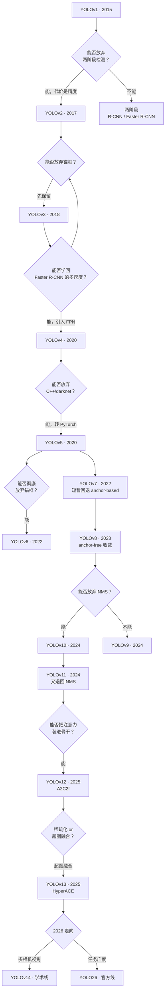
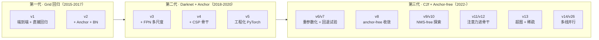

# 从 v1 到 v26 · 一条线看 YOLO 演进

前面 [global/family.md](/global/family) 是一张**技术对照表**，[global/timeline.md](/global/timeline) 是一张**时间线**——但都没有回答一个问题：**为什么这一代会这么改，而不是那么改？**

这一页讲**决策故事**。不是"v1 → v2 → v3"式平铺，而是围绕 YOLO 家族**几个真正改变方向的决策点**讲：谁否定了谁、谁学到了什么、哪些代价被付出去了、哪些弯路被证明是必要的。

> **读完这页你能带走什么**：一张"演化决策图"，能解释每一代 YOLO 的立场。以后遇到"为什么 v11 又退回 NMS"、"为什么 v13 用超图不用注意力"、"为什么 v26 走独立线"这类问题，你能给出有依据的回答。

## 全局视角：一张决策树

**这张图是本页的骨架**——每个决策点后面都有一个真实故事。下面按决策点展开。

---

## 决策 1 · 2015：YOLOv1 能否放弃两阶段检测

**背景**：2015 年，两阶段检测器（Faster R-CNN 尚未发布，但 R-CNN / Fast R-CNN 已是主流）占据了 COCO 精度榜首。它们的做法是**先提候选区域，再分类**——两步走。

**v1 的赌注**：YOLOv1 提出一个极端观点——**为什么不让网络一次前向就输出所有框？**

代价：
- **精度大幅下降**：v1 在 COCO 上的 AP 只有 49.7，比同时期的 Faster R-CNN 低约 10 个点
- **小目标几乎无法检测**：7×7 网格设计意味着每格只能有一个物体
- **单类检测的边界框质量差**：直接回归 5 个参数（x, y, w, h, obj_conf），梯度不稳定

收益：
- **推理速度是碾压式的**：45 FPS vs R-CNN 系列的 < 6 FPS
- **端到端可训练**：一次反向传播即可完成所有优化

**教训**：v1 用**精度换了速度**，但这个"交换"在当时是激进到被同行质疑的。**"端到端"这个想法被记住，但"直接回归"这个具体做法被 v2 立刻修正**。

## 决策 2 · 2017：YOLOv2 能否放弃锚框

**v1 最大的弱点**是"每格只能有一个物体"。v2 的解法是——**借 Faster R-CNN 的锚框**。

具体做法：
- 从 7×7 网格 → 13×13 网格
- 每格预测 5 个 anchor，而不是 1 个
- 加 Batch Normalization（这个 trick 后来被证明是 YOLO 家族**最划算的一笔投资**）
- 加 log-space 回归（预测 log(w), log(h) 而不是 w, h）

**为什么这一步至关重要**：v2 实际上**主动"承认"了 Faster R-CNN 的一些核心思想**——锚框、BatchNorm、多尺度。**YOLO 家族的演进不是"反 R-CNN"，而是"吸收 R-CNN 的思想但用单阶段实现"**。这个姿态在 v3 会更明显。

## 决策 3 · 2018：YOLOv3 能否学回多尺度

**v2 到 v3 之间的 1 年半**是 YOLO 家族最长的一次停滞。这段时间 Faster R-CNN 已经发布，DETR 尚未出现，检测界的主流方向是"更好的骨干 + 更好的多尺度融合"。

v3 的解法是**把 Faster R-CNN 的多尺度机制完整搬过来**：
- 从"单头"→"三头"（P3/P4/P5 三个尺度）
- 类别从 softmax → **logistic 独立二分类**（多标签）
- Darknet-19 → Darknet-53（引入残差）

**关键转折**：v3 之后，YOLO 家族在骨干、多尺度、类别分支上**几乎完全对齐了 Faster R-CNN 的设计**。剩下的问题不再是"如何跟两阶段对齐"，而是"如何超越两阶段"。

## 决策 4 · 2020：YOLOv4 能否做 CSP

**v3 到 v4 之间没有官方 v4 论文，AlexeyAB 独立维护**了一个社区版"YOLOv4"（后被称为 YOLOv4-tricks）。它是**第一个真正意义上把 backbone 换成 CSPDarknet 的版本**。

CSP（Cross Stage Partial）的核心思想是——**梯度分流**：不是让所有特征都流过整个网络，而是把特征分成两路，一路"骨干"、一路"短路"，最后再合并。**减少了 60% 的计算量同时提升 2% 精度**。

CSP 之后 YOLO 家族再无回头。v5 沿用 CSPDarknet，v8 演化出 C2f，v11 演化出 C3k2——**CSP 是 YOLO 骨干的基因**。

## 决策 5 · 2020：YOLOv5 能否放弃 C++/darknet

**这是 YOLO 家族最成功的一次工程决策**。

**背景**：v1-v4 全部基于 darknet（C++ 手写网络）。darknet 的问题不是"不好用"，而是——
- 训练速度慢（相比 PyTorch 差 3-5 倍）
- 模型结构硬编码，扩展困难
- 没有成熟的社区生态（PyTorch 已经在深度学习界胜出）

Ultralytics 团队做了一次大胆的"重写"——**把整个 YOLO 用 PyTorch 重写**，并引入 `yaml` 配置文件驱动。

**代价**：
- 失去了 darknet 的一些手写优化（比如 autoanchor 需要重新实现）
- 短期内精度略低于 v4（v5s 46.5 vs v4 54.0）

**收益**（巨大）：
- **推理速度大幅提升**（PyTorch + TensorRT 生态）
- **yaml 驱动**让模型结构可快速迭代——这是后续 v8/v11/v26 频繁迭代的基础
- **社区接管**：GitHub star 数从几千涨到 40k+

**教训**：**技术架构的选择不是技术决定的，而是工程生态决定的**。PyTorch 不是比 darknet 更好，而是**PyTorch 的生态比 darknet 强 100 倍**。

## 决策 6 · 2022：能否彻底放弃锚框

**v6（Megvii）的赌注**：anchor 是历史包袱，能不能完全去掉？

v6 的做法：
- 直接预测 ltrb（left/top/right/bottom）而不是 center + size
- 用 TAL（Task-Aligned Assigner）做标签分配
- VFL（VariFocal Loss）+ DFL（Distribution Focal Loss）

**这一步的历史意义**：**v6 是第一个真正意义上 anchor-free 的 YOLO**。

**但 v6 有个问题**：它太新，社区接受度低（GitHub star 只有 v5 的 1/3）。

**v7 短暂回退**：v7 是 v5 的直接继承者（作者也是 WongKinYiu 团队），继续使用 anchor-based。这个回退是有意的——**当时 anchor-based 的成熟度和生态远好于 anchor-free**。

**v8 最终收敛**：v8 是 Ultralytics 官方的 anchor-free 版本。它把 v6 的 anchor-free 思想吸收进来，但用**更工程化的方式**实现：
- TAL 从 v6 的 topk=10 → 简化到 topk=10（沿用）
- DFL 内建在 head，而不是作为单独模块
- 保持 v5 的 yaml 驱动 + PyTorch 生态

**教训**：**"最好的技术"和"最佳实践"不是一回事**。v6 的技术比 v8 早，但 v8 的工程化做得更好。v8 是"技术 + 工程"的合璧。

## 决策 7 · 2024：能否放弃 NMS

**v10（清华 THU-MIG）的野心**：NMS 是 YOLO 家族最后一步非端到端的操作。能不能把它也吃掉？

**做法**：
- 训练时用**双分配器**：one2many（topk=10，类似 TAL）+ one2one（topk=1，硬分配）
- 推理时**完全去掉 NMS**，用 topk 直接选框
- 用一致性损失（consistency loss）让两个分支学到一致的结果

**短期效果**：v10 在 COCO 上以 n 档达到 41.2 AP，比 v8n 略高，**推理速度更快**。

**但 v11 立刻回归 NMS**：
- Ultralytics 认为 v10 的 one2one 分支让训练稳定性变差
- 工程上，one2one 分支的 topk=1 在少数场景下会漏检
- NMS 是成熟、稳定、可调（IoU 阈值可微调）

**v11 的选择**：**保留 v10 的一致性思想（用 C3k2/C2PSA 简化结构），但把 NMS 加回来**。

**教训**：**NMS 是"丑陋但实用"的工程组件**。它丑，但它的可调性（IoU 阈值、置信度阈值）是模型本身提供不了的。工业界很难完全放弃它。v26 在 2026 年再次尝试 NMS-free（`end2end=True`），但保留 NMS 作为兼容模式。

## 决策 8 · 2024-2025：能否把注意力装进骨干

**v9 是第一次尝试在骨干里加"辅助"分支**（PGI 可逆分支）。但 PGI 本质是梯度辅助，不是注意力。

**v11 首次真正把注意力装进骨干**——C2PSA 里的 PSABlock（Position-Sensitive Attention Block）。但 PSA 是"位置敏感"的，本质上还是卷积的变体，不是自注意力。

**v12 是真正把自注意力装进骨干的版本**——A2C2f（AAttn-embedded C2f），P4/P5 里嵌入 **AAttn（Area Attention，基于 FlashAttention）**。

**代价**：
- 训练显存上升 30%
- 必须依赖 FlashAttention（cu118+ 强绑定）
- INT8 部署不可用（FlashAttention 不支持 INT8）

**收益**：
- mAP 提升 1-2 个点
- 对复杂场景（密集小目标、多类别）显著改善

**教训**：**注意力是"精度换算力"的又一次升级**。对边缘部署（[edge-deployment](/cases/edge-deployment)）来说，v11 是最后一代友好版本；对服务器部署（[medical-lesion](/cases/medical-lesion)）来说，v12+ 是主流。

## 决策 9 · 2025：v13 为什么用超图而不是更强的注意力

**v13（iMoonLab）在 v12 的注意力基础上，又做了一次选择**——**不再继续加强注意力**，而是引入**HyperACE 超图融合**。

**为什么这么选**：
- AAttn 在 v12 已经证明"能提升精度"，但边际收益递减
- 骨干的**特征融合方式**（P3/P4/P5 之间怎么交互）才是瓶颈
- 超图可以让"多组特征一起融合"，而不是"P3 融合到 P4，再融合到 P5"的顺序合并

**同时**：v13 引入**深度可分离卷积**（DSC3k2）——**在保持精度不掉的前提下把参数量降低 20%**。

**教训**：**当"注意力"和"融合结构"两条路线都能提升精度时，选"更工程化"的那条**。超图 + 深度可分离都是**推理侧友好**的结构，而 FlashAttention 是训练侧友好、推理侧不友好的结构。v13 的选择是"为部署而优化"。

## 决策 10 · 2026：为什么 v14 和 v26 分叉

**这是 YOLO 家族首次出现"同一父版本，两条独立路线"**。

**v13 是共同父版本**（iMoonLab 的 fork），但 v14 和 v26 分别来自不同的团队：

**v14（学术线，zhangcbb）**：
- 目标：多相机/多视角感知（自动驾驶、机器人）
- 引入 CircularConv（旋转不变卷积）、ViewEmbedding、DeformableA2C2f
- 论文路线，arXiv 2608.04720v3
- **不参与 Ultralytics 官方生态**

**v26（官方线，Ultralytics）**：
- 目标：任务广度统一（Detect + Segment + Pose + OBB + Classify + Depth + Semantic + YOLOE）
- 引入 End2End 双分支头，reg_max=1 让 DFL 退化为 Identity
- GitHub 官方主线，tag `2e241d0`
- **面向"一套模型多任务"的工业场景**

**为什么分叉**：
- v13 之后的 YOLO 家族**同时面临两个方向的挑战**——"更强的感知"和"更广的任务"
- Ultralytics 作为商业方，更关心后者（任务广度 = 商业价值）
- zhangcbb 作为学术团队，更关心前者（多相机 = 前沿论文）
- 两个方向需要**不同的骨干设计**——多相机要"视角嵌入"，任务广度要"任务解耦"

**教训**：**YOLO 家族的"单线演进"时代结束了**。v1-v13 是一条线，v14 之后是**多线并行**。以后讨论"最新的 YOLO"必须说清"哪条线的最新"。

---

## 全局时间线：决策点 × 时间轴

**每代 YOLO 的"核心决策数"**（1 个 = 单点改进，2 个 = 双重变革）：

| 版本 | 核心决策 | 决策数 |
|------|---------|-------|
| v1 | 端到端 | 1 |
| v2 | + BN / + Anchor | 2 |
| v3 | + FPN 多尺度 / + Logistic | 2 |
| v4 | + CSP | 1 |
| v5 | + PyTorch / + yaml | 2 |
| v6 | + Anchor-free / + RepVGG | 2 |
| v7 | 回退 anchor-based（无新增） | 0 |
| v8 | Anchor-free 收敛 / + C2f | 2 |
| v9 | PGI 梯度路径 | 1 |
| v10 | NMS-free | 1 |
| v11 | C3k2 / C2PSA | 2 |
| v12 | A2C2f 注意力骨干 | 1 |
| v13 | HyperACE / DS 稀疏 | 2 |
| v14 | 多相机 CircularConv | 1 |
| v26 | 六任务统一 backbone | 2 |

**读法**：
- 2015-2018 是**奠基期**，年均 1-2 个决策
- 2020 是**爆发点**（CSP + 工程化 PyTorch）
- 2022 是**范式转变**（anchor-free + 重参数化）
- 2024-2026 是**多线并行期**，v13 一次做两件事（超图 + 稀疏），v26 也是双重变革

---

## 一张图看完：三代 YOLO

**如果把 YOLO 家族压成三代**：

- **第一代**：**证明"单阶段检测可行"**——牺牲精度换速度
- **第二代**：**吸收两阶段检测的思想**——多尺度、CSP、多标签
- **第三代**：**超越两阶段检测**——anchor-free、NMS-free、注意力、多任务

**这三代之间的分界线不是版本号，而是"设计哲学"**：
- 一代→二代：**"承认 R-CNN 是对的"**
- 二代→三代：**"我们能做得更好"**

---

## 决策失败的清单

**这些尝试失败了，但为什么它们必须存在**：

| 版本 | 决策 | 为什么失败 | 教训 |
|-----|------|-----------|------|
| v6 | 太激进的 anchor-free | 生态不成熟，PyTorch 支持不友好 | **新技术需要工程铺垫** |
| v7 | 短暂回退 anchor-based | 方向错误，被 v8 否定 | **回退是必要的探索** |
| v9 | DualDDetect 双头 | 训练复杂，收益不明显 | **复杂度不是目的** |
| v10 | NMS-free | 稳定性问题，工程接受度低 | **丑陋但实用的组件不能省** |
| v12 | AAttn 骨干注意力 | INT8 部署不友好 | **训练性能 ≠ 部署性能** |

---

## 决策成功的清单

**这些决策被证明是正确的**：

| 版本 | 决策 | 为什么成功 | 影响 |
|-----|------|-----------|------|
| v2 | 引入 BatchNorm | 训练速度提升 40%，梯度稳定 | 至今未变 |
| v3 | 多尺度 FPN | 小目标检测能力质变 | 至今未变 |
| v4 | CSP 骨干 | 梯度分流，减少 60% 计算 | 演化出 C2f/C3k2 |
| v5 | PyTorch + yaml | 工程生态胜利 | 40k+ stars |
| v8 | anchor-free + DFL | 精度+速度双提升 | 三代起点 |
| v11 | C3k2 + C2PSA | 参数减半，精度持平 | 主流选择 |
| v26 | 六任务统一 backbone | 一套模型多任务 | 商业化方向 |

---

## 与其他页面的关系

- **[global/family.md](/global/family)**：技术对照表（横向对齐，无叙事）
- **[global/timeline.md](/global/timeline)**：时间线（时间为主轴）
- **[global/evolutions.md](/global/evolutions)**：演化事件（技术术语为主轴）
- **[compare-matrix.md](/compare-matrix)**：技术维度对比（骨干、头、损失、任务广度）
- **[for-beginners.md](/for-beginners)**：小白入门路线
- **各版本页**（v1→v26）：具体版本的技术细节

**本页的独特定位**：讲**"为什么"**——每个版本存在的历史理由，而不只是"是什么"和"什么时候"。

---

## 最后：如果只记住一句话

**YOLO 家族的演进，不是"每代都比上一代更好"，而是"每代都解决了特定的历史问题"**。

v1 解决了"检测能不能单阶段"，v3 解决了"小目标能不能检测"，v5 解决了"工程生态能不能接管"，v8 解决了"锚框能不能去掉"，v11 解决了"参数量能不能减半"，v26 解决了"多任务能不能统一"。

**这些问题的答案一旦被解决，就永远不会再被重新讨论**。这是 YOLO 家族 10 年演化最本质的收获。
