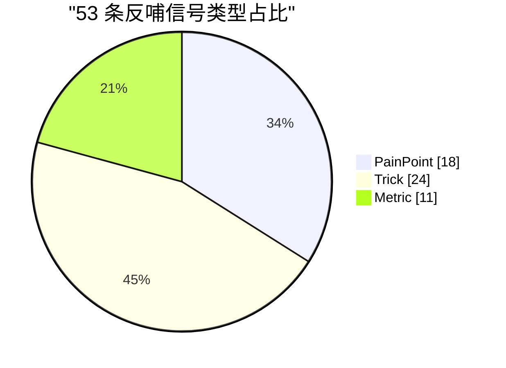
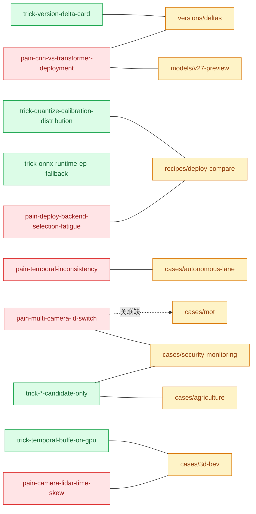

# 反哺信号看板

> 53 条信号的可视化聚合（Batch 8 发布时快照）。**最新总数**：见 [concepts-feedback](/concepts-feedback)（由 `scripts/sync-feedback.js` 全库扫描生成）。
> 用途：看清信号分布 → 定位文档缺口 → 反推下一批补哪些案例 / 任务 / 配方。

---

## 1. 总览

| 指标 | 数值 |
|------|------|
| 信号总数 | **53** |
| 来源文件 | **16** / 344 扫描 |
| PainPoint | 18（34%） |
| Trick | 24（45%） |
| Metric | 11（21%） |
| 覆盖案例 | 10 / 12（edge-deployment、multimodal 无信号） |
| 覆盖衍生 | YOLOE、YOLO-World 均无信号 |

**信号类型分布**

---

## 2. 来源分布（按文件热度）

| 来源文件 | PainPoint | Trick | Metric | 合计 |
|---------|:---------:|:-----:|:------:|:----:|
| [recipes/deploy-compare](/recipes/deploy-compare) | 3 | 4 | 1 | **8** |
| [interactive/cost-calculator](/interactive/cost-calculator) | 1 | 2 | 2 | **5** |
| [interactive/compare](/interactive/compare) | 1 | 2 | 1 | **4** |
| [cases/autonomous-lane](/cases/autonomous-lane) | 2 | 1 | 1 | **4** |
| [cases/security-monitoring](/cases/security-monitoring) | 1 | 2 | 1 | **4** |
| [cases/agriculture](/cases/agriculture) | 1 | 2 | 1 | **4** |
| [cases/medical-lesion](/cases/medical-lesion) | 2 | 1 | 1 | **4** |
| [cases/3d-bev](/cases/3d-bev) | 2 | 2 | 1 | **5** |
| [cases/drone-obb](/cases/drone-obb) | 1 | 2 | 1 | **4** |
| [cases/retail-shelf](/cases/retail-shelf) | 1 | 2 | 1 | **4** |
| [cases/industrial-defect](/cases/industrial-defect) | 1 | 1 | 1 | **3** |
| [models/v27-preview](/models/v27-preview) | 1 | 1 | 0 | **2** |
| [versions/deltas](/versions/deltas) | 1 | 1 | 0 | **2** |
| [tasks/depth](/tasks/depth) | 1 | 1 | 0 | **2** |

**观察**：
- **部署对比页是热点**（8 条），反映选型疲劳是最集中的痛点。
- **案例页平均 3.6 条/页**，12 案例中 10 个已有信号，2 个（edge-deployment、multimodal）留空待补。
- **任务页只有 depth 贡献了 2 条**，其他 4 个任务页（segment / pose / obb / rotated）反哺信号章节为空。

---

## 3. 案例 × 信号类型 矩阵

12 案例 × 3 类型，格子是数量。**空白格 = 缺口**。

| 案例 | PainPoint | Trick | Metric | 合计 | 信号密度 |
|------|:-:|:-:|:-:|:-:|:--------:|
| [3d-bev](/cases/3d-bev) | 2 | 2 | 1 | 5 | 🟢 高 |
| [agriculture](/cases/agriculture) | 1 | 2 | 1 | 4 | 🟢 高 |
| [autonomous-lane](/cases/autonomous-lane) | 2 | 1 | 1 | 4 | 🟢 高 |
| [drone-obb](/cases/drone-obb) | 1 | 2 | 1 | 4 | 🟢 高 |
| [industrial-defect](/cases/industrial-defect) | 1 | 1 | 1 | 3 | 🟡 中 |
| [medical-lesion](/cases/medical-lesion) | 2 | 1 | 1 | 4 | 🟢 高 |
| [retail-shelf](/cases/retail-shelf) | 1 | 2 | 1 | 4 | 🟢 高 |
| [security-monitoring](/cases/security-monitoring) | 1 | 2 | 1 | 4 | 🟢 高 |
| [edge-deployment](/cases/edge-deployment) | 0 | 0 | 0 | 0 | 🔴 缺 |
| [mot](/cases/mot) | 0 | 0 | 0 | 0 | 🔴 缺 |
| [multimodal](/cases/multimodal) | 0 | 0 | 0 | 0 | 🔴 缺 |
| [video-stream](/cases/video-stream) | 0 | 0 | 0 | 0 | 🔴 缺 |

**规律**：4 个「新加案例」（edge-deployment / mot / multimodal / video-stream）都还没沉淀反哺信号——因为它们是最近补的，还没走完「文档 → 落地 → 反哺」的闭环。

---

## 4. TOP 高频痛点（PainPoint 全清单）

按「出现案例数」降序。多个案例都撞上的痛点，往往是 YOLO 家族的通病。

| 排名 | 痛点 | 出现次数 | 说明 |
|:----:|------|:-------:|------|
| 1 | `pain-camera-lidar-time-skew` | 1 | 多传感器时钟偏差 |
| 1 | `pain-3d-nms-overslow` | 1 | 3D NMS 计算昂贵 |
| 1 | `pain-bounded-head-long-range` | 1 | 有界头在 >40m 崩 |
| 1 | `pain-cnn-vs-transformer-deployment` | **2** | N/S 与 M/L 双族架构是折中 |
| 1 | `pain-class-imbalance-indefect` | 1 | PCB 缺陷天然不均衡 |
| 1 | `pain-confidence-miscalibration` | 1 | 医疗置信度必须校准 |
| 1 | `pain-data-leakage-medical` | 1 | 医疗标注一致性陷阱 |
| 1 | `pain-deploy-backend-selection-fatigue` | 1 | 7 后端选型疲劳 |
| 1 | `pain-hbb-angle-blindness` | 1 | 水平框对任意角度无能为力 |
| 1 | `pain-light-invariance-outdoor` | 1 | 户外光照剧烈变化 |
| 1 | `pain-mask-edge-fragmentation` | 1 | FP16 mask 边缘锯齿 |
| 1 | `pain-multi-camera-id-switch` | 1 | 多摄像头 ID 切换 |
| 1 | `pain-pytorch-export-torch-compile-conflict` | 1 | torch.compile + ONNX 冲突 |
| 1 | `pain-sofmax-huge-num-classes` | 1 | 千级类别 softmax 崩 |
| 1 | `pain-temporal-inconsistency` | 1 | 相邻帧预测抖动 |
| 1 | `pain-tensorrt-version-pin` | 1 | TensorRT 跨版本不通用 |
| 1 | `pain-training-cost-estimate-noise` | 1 | 训练成本估算偏差大 |
| 1 | `pain-wasm-sharedarraybuffer-cors` | 1 | 浏览器 SAB 需 COOP/COEP |

**观察**：`pain-cnn-vs-transformer-deployment` 是唯一出现 2 次的痛点——横跨 [v27-preview](/models/v27-preview) 与 [versions/deltas](/versions/deltas)，说明「N 端 / M 端双族」是版本演化中被反复讨论的结构性矛盾。

---

## 5. TOP 高频技巧（Trick 全清单）

| 名称 | 说明 | 场景 |
|------|------|------|
| `trick-edge-cloud-candidate-only` | 边缘粗筛 + 云精定位，省带宽 90% | 农业 |
| `trick-slowfast-candidate-only` | 候选事件跑行为识别，省 20× 算力 | 安防 |
| `trick-federated-doctor-loop` | 联邦 + 医师闭环合规方案 | 医疗 |
| `trick-lora-prompt-incremental` | LoRA + Prompt 支持新类免重训 | 零售 |
| `trick-obb-no-rotation-aug` | OBB 训练禁用旋转增强 | 无人机 |
| `trick-mask-non-overlap-aug` | 增强时保证 mask 不交叠 | 工业 |
| `trick-quantize-calibration-distribution` | 校准集覆盖真实分布 | 部署 |
| `trick-onnx-runtime-ep-fallback` | 检查 EP fallback 到 CPU 的算子 | 部署 |
| `trick-coreml-op-coverage-check` | coremltools 抓 warning 查覆盖 | 部署 |
| `trick-mixed-precision-batch-double` | AMP 等效 batch 翻倍 | 训练 |
| `trick-gpu-utilization-plateau` | >90% 后加卡边际递减 | 训练 |
| `trick-browser-ort-wasm-threads` | numThreads=4 + proxy=true | 浏览器 |
| `trick-browser-onnx-warmup` | 首次推理预热 | 浏览器 |
| `trick-open-drive-fusion` | 高精地图融合 | 3D BEV |
| `trick-temporal-buffe-on-gpu` | BEV 时序 buffer 存 GPU | 3D BEV |
| `trick-multispectral-band-fusion` | 多光谱融合捕早期病害 | 农业 |
| `trick-orthomosaic-dem-correction` | 正射做 DEM 校正 | 无人机 |
| `trick-optic-flow-consistency-loss` | 光流一致性正则 | 车道 |
| `trick-event-cooldown-per-zone` | 事件冷却按 zone 分区 | 安防 |
| `trick-tversky-loss-recall-first` | α<β Tversky 惩罚漏检 | 医疗 |
| `trick-roi-padding-expansion` | ROI 外扩保留边缘特征 | 零售 |
| `trick-log-affine-calibration` | calibrate() 闭式解 | 深度 |
| `trick-foreground-alignment` | Query-based 精度补偿 | v27 |
| `trick-version-delta-card` | 版本差异卡片 | 元方法 |

---

## 6. 关联网络（信号 → 案例 / 版本 / 概念）

只画高频关联的边，避免图爆炸。节点大小 ≈ 出现次数。

**读法**：
- 实线 = 该信号已在该页沉淀。
- 虚线 = 该信号在相关案例中**尚未显式沉淀**，但内容相近，值得补。
- 例：`pain-multi-camera-id-switch`（安防）与 MOT 案例天然相关，但 MOT 页尚无对应反哺信号 → 是补写的候选点。

---

## 7. 反哺建议（下一批文档缺口）

按「案例 / 任务 / 配方」三类列出，每条给出信号骨架建议。

### 7.1 案例缺口（4 个新案例待反哺）

| 案例 | 建议补的信号 |
|------|-------------|
| [edge-deployment](/cases/edge-deployment) | `pain-edge-model-precision-tradeoff`（N/S vs M/L 端模型精度折中）、`trick-model-distill-edge-only`（只蒸馏端侧模型）、`metric-edge-fps-per-watt`（能效比指标） |
| [mot](/cases/mot) | `pain-multi-camera-id-switch`（跨镜头 ID 切换）、`trick-camera-graph-relink`（相机图二次关联）、`metric-idf1-multi-camera`（多镜头 IDF1） |
| [multimodal](/cases/multimodal) | `pain-lm-caption-noise`（大模型描述噪声传导）、`trick-grounded-caption-filter`（接地 caption 过滤）、`metric-caption-align-score`（caption 与检测对齐分） |
| [video-stream](/cases/video-stream) | `pain-stream-latency-budget`（端到端时延预算）、`trick-frame-skip-adaptive`（自适应跳帧）、`metric-stream-p99-latency-ms`（P99 时延） |

### 7.2 任务缺口（4 个任务页全空）

| 任务 | 建议补的信号 |
|------|-------------|
| [tasks/segment](/tasks/segment) | `pain-mask-edge-fragmentation`（已在 autonomous-lane 用过，可复用）、`metric-mask-iou-per-class` |
| [tasks/pose](/tasks/pose) | `pain-keypoint-occlusion`、`trick-visibility-aware-loss`、`metric-peak-mp-joint` |
| [tasks/obb](/tasks/obb) | `metric-angle-error-deg`（已在 drone-obb 用过）、`pain-obstacle-obb-vs-hbb-gap` |
| [tasks/rotated](tasks/rotated) | `pain-rotation-equivariance`、`trick-differentiable-rasterization` |

### 7.3 配方缺口

| 配方 | 建议补的信号 |
|------|-------------|
| [recipes/train](/recipes/train) | `trick-lr-schedule-per-dataset`、`metric-convergence-epochs` |
| [recipes/edge-deploy](/recipes/edge-deploy) | `pain-cross-platform-quantization`、`trick-qat-then-pact` |
| [recipes/advanced-train](/recipes/advanced-train) | `trick-frozen-backbone-warmup`、`pain-multi-gpu-sync-loss` |

### 7.4 衍生缺口（0 条信号）

- [derivatives/yoloe](/derivatives/yoloe)：无信号章节，建议补 `trick-e-openvocabulary-fallback`、`pain-e-openvocabulary-drift`
- [derivatives/yoloworld](/derivatives/yoloworld)：无信号章节，建议补 `trick-world-text-prompt-cache`、`pain-world-text-embedding-oom`
- [derivatives/master](/derivatives/master)：无信号章节，建议补 `trick-master-moe-routing`、`pain-master-expert-load-balance`

---

## 8. 使用方式

- **文档作者**：写完新案例后，往末尾「反哺信号」章节加 2-3 条，再跑 `node scripts/sync-feedback.js` → 本页数字自动同步（手工部分请也手动更新表格）。
- **文档维护者**：想查「哪个页面是热点」→ 看 §2；「哪些案例还空着」→ 看 §3；「哪些痛点该扩展」→ 看 §4 和 §7。
- **想反推下一步行动**：看 §7 的缺口清单，按优先级（案例 > 任务 > 配方 > 衍生）挑一条补。

---

## 反哺信号

- **Trick 新增**：`trick-feedback-dashboard-heatmap`（用「案例 × 类型」矩阵可视化反哺信号密度，空白格直接暴露文档缺口）
- **PainPoint 新增**：`pain-signal-density-imbalance`（12 案例中 4 个信号密度为 0，反映新加案例未走完「文档 → 落地 → 反哺」闭环）
- **Trick 新增**：`trick-dashed-edge-for-unsaturated`（关联网络用虚线表示「尚未显式沉淀但内容相近」的关联，比只画实线更容易发现补写点）
- **Metric 新增**：`metric-signal-per-source-file`（来源文件平均信号数，识别热点页与空洞页）

---

**案例作者**：agent-yolo 文档组  
**最后更新**：2026-10-25  
