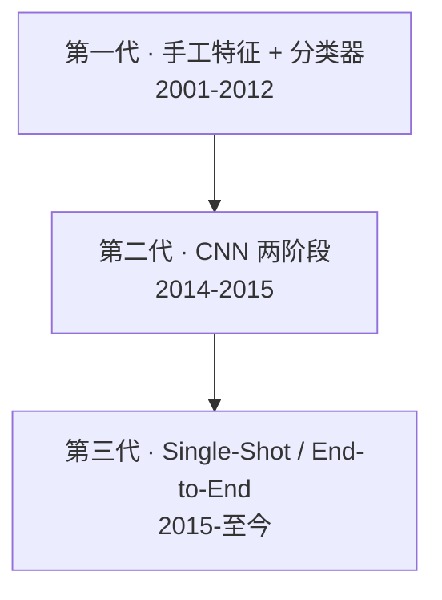
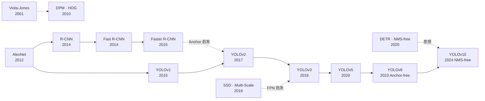

# 传统 CV 谱系：YOLO 继承了什么、改造了什么、抛弃了什么

YOLO 不是凭空发明，而是把经典 CV 的碎片在 CNN 时代重新组合。**理解 YOLO 的位置，需要把它放回整个 CV 检测方法的谱系里。**

## 三代检测方法的对比

| 代 | 代表 | 特征提取 | 区域提议 | 分类 | 定位 |
|----|------|---------|---------|------|------|
| 一 | Viola-Jones, DPM, HOG+SVM | 手工 (Haar/HOG) | 滑窗 | SVM | DPM 部件 |
| 二 | R-CNN, Fast R-CNN, Faster R-CNN | CNN | Selective Search / RPN | Region-wise Softmax | RoI Pooling |
| 三 | YOLO, SSD, DETR | CNN | 内置 (grid / anchor / attention) | 网络输出直接 | 网络输出直接 |

## YOLO 与传统 CV 技术的关系

### 继承 (inheritsFrom)

- **NMS 非极大值抑制**（Jain 1987）：至今仍是 YOLO 推理的标准后处理（v10+ 开始探索去掉）
- **Anchor 网格**（Faster R-CNN 2015）：v2 起正式引入，v8 之前长期主导
- **RoI Pooling 思想**（Fast R-CNN）：转化为 grid cell 的隐式 RoI

### 改造 (generalizes / extended)

- **R-CNN 候选框 + 分类回归**：YOLO 保留这个建模，但把候选框生成合并进 grid cell
- **AlexNet 22 层 backbone**：YOLOv1 的 24 层 backbone 是 AlexNet 变体
- **滑窗检测**：从 O(N) 窗口遍历变成为一次卷积的并行扫描

### 抛弃 (rejected / replaced)

- **Selective Search / RPN 外部区域提议**：v1 完全抛弃，让网络同时学 proposal + classification
- **手工特征**（HOG、Haar）：从 v1 起全部用 CNN 端到端学特征
- **DPM 部件模型**：CNN 卷积特征取代部件组合

## YOLO 解决的痛点

| 传统痛点 | YOLO 的解法 | 首引入版本 |
|---------|------------|-----------|
| 两阶段太慢 (R-CNN 47s/img) | Single-shot 端到端 | v1 |
| 手工特征泛化差 | CNN 端到端 | v1 |
| 无全局上下文 | 整图一次前向 | v1 |
| 小目标召回差 | 多尺度 FPN | v3 |
| Anchor 敏感 | Anchor-free | v8 |
| NMS 阈值敏感 | NMS-free 端到端 | v10 |

## 一张图看 YOLO 在 CV 谱系中的位置

