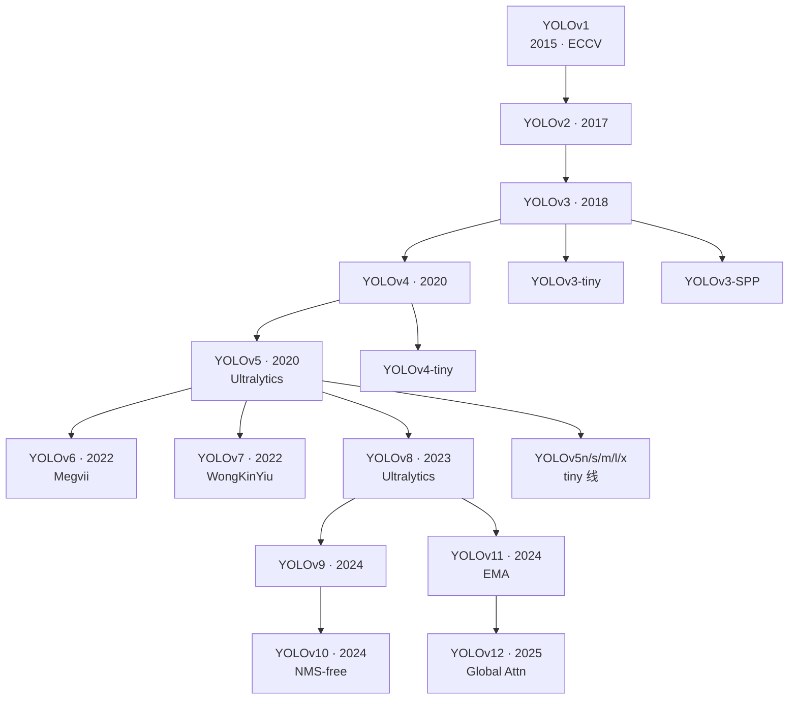
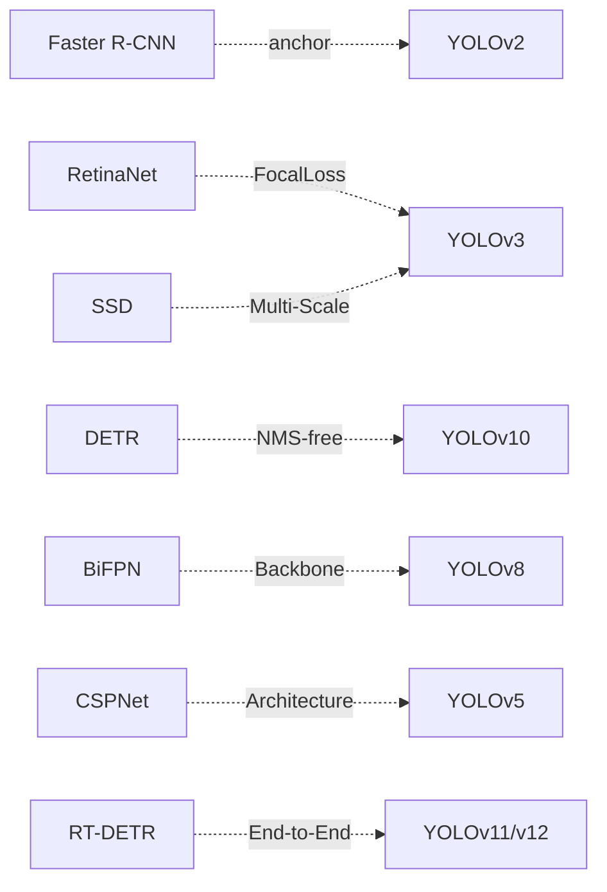

# YOLO 系列家族

YOLO 家族从 2015 年 v1 开始，迄今已超过 10 年。整个家族不是单一演进线，而是**主线 + tiny 线 + enterprise 线 + 若干分叉**并存。

## 分支谱系

## 四条主线

| 分支 | 代表版本 | 目标 | 主导 |
|------|---------|------|------|
| 主线 | v1→v2→v3→v4→v8→v9→v10→v11→v12 | 精度优先 | 学术界 + Ultralytics |
| Tiny 线 | v2-tiny→v3-tiny→v4-tiny→v5n→v8n→v11n | 参数量最小 | Ultralytics |
| Enterprise 线 | v9, v10 | 推理延迟优化 | CWI / THU-MIG |
| 分叉实验 | v6 (Megvii), v7 (WongKinYiu) | 特定改进 | 独立团队 |

## 贯穿家族的关键主题

- **Single-shot**：v1 定调，至今未变
- **Anchor vs Anchor-free**：v2 起用 anchor，v8 起默认 anchor-free
- **多尺度 Neck**：v3 首次 FPN，v4 PAFPN，v8 BiFPN
- **CSP 结构**：v5 起 CSPNet，v8 起 C2f
- **Decoupled Head**：v7 实验，v8 正式
- **Attention 引入**：v7 EVA、v10 全注意力、v11 SPPCSPC、v12 Global Attention
- **NMS-free**：v10 端到端消 NMS

## 与外部检测家族的收敛

详见 [演化事件](/global/evolutions) 与 [时间线](/global/timeline)。
