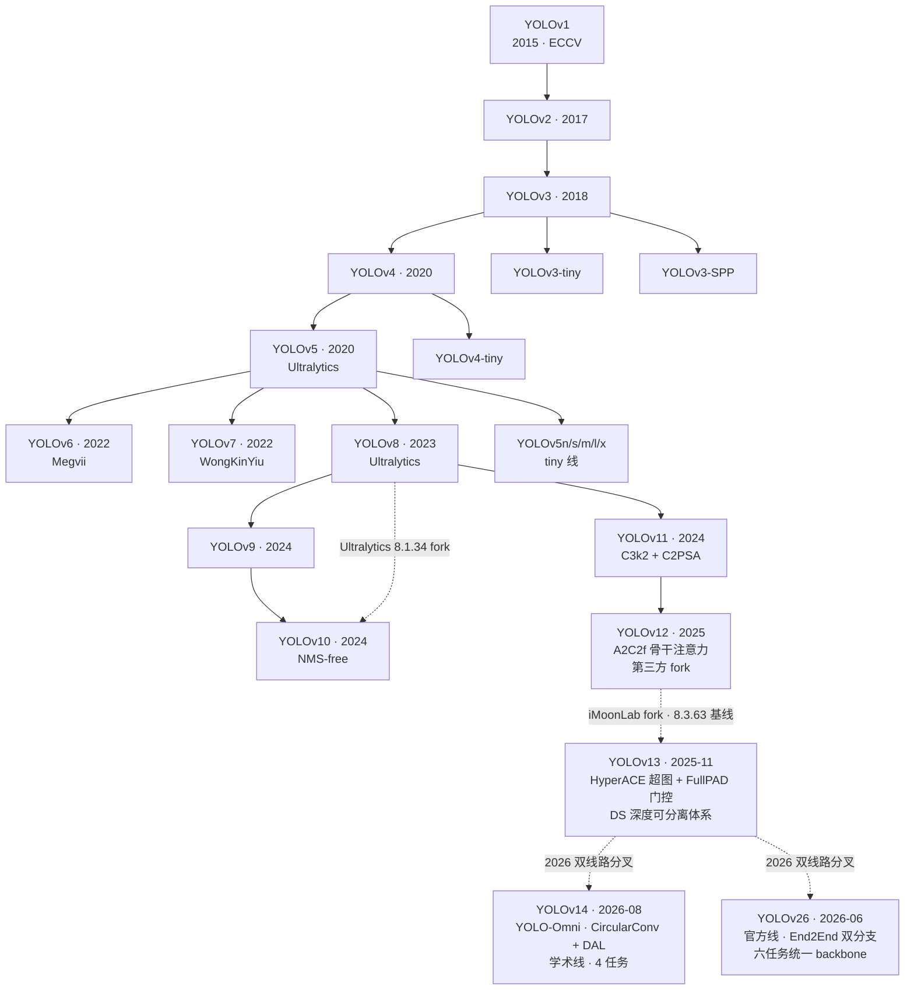
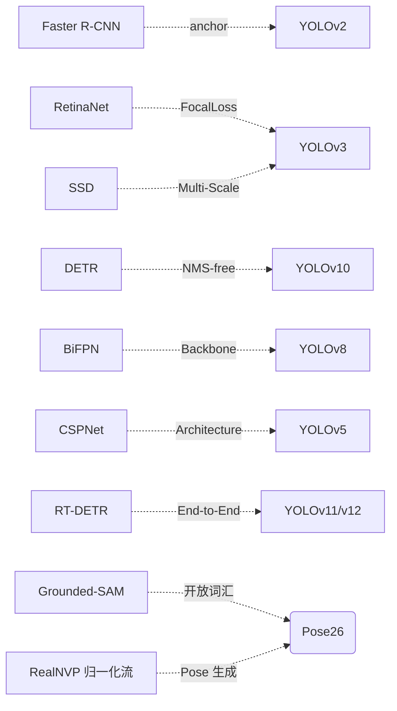
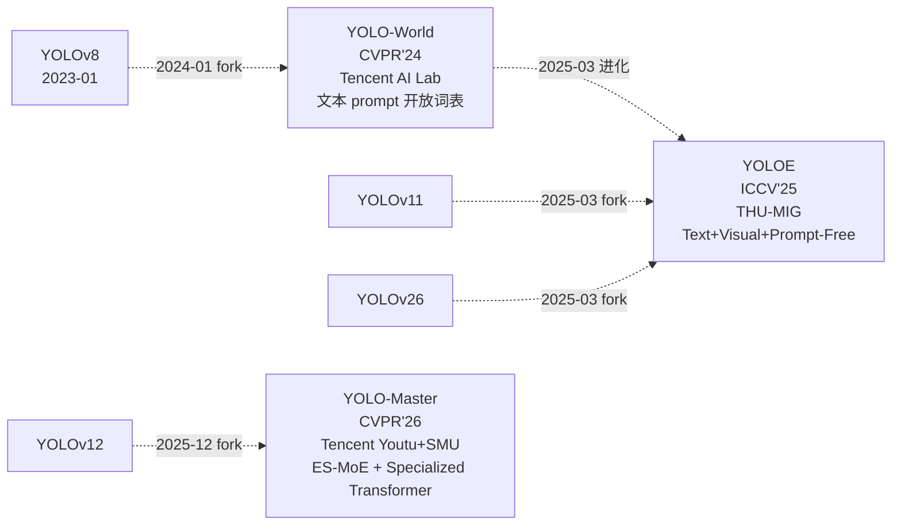

# YOLO 系列家族

YOLO 家族从 2015 年 v1 开始，迄今已超过 10 年。整个家族不是单一演进线，而是**主线 + 官方线 + 学术线 + tiny 线 + enterprise 线 + 若干分叉**并存。**2026 年从 v13 起，家族第一次出现「同一父版本、两条独立路线」的分叉**——v14（学术线，YOLO-Omni）与 v26（官方线，Ultralytics End2End）并行推进。

## 分支谱系

> **v26 是双线路的第一个「官方线」版本**（Ultralytics 官方 @ 2e241d0），**v14 是学术线**（zhangcbb/yolov14 @ 0b8610d，arXiv 2608.04720v3）。v14 与 v26 均以上游 `cfg/models/v13/` fork 为起点，但走了两条独立路线：v14 把 backbone 换成 CircularConv + ViewEmbedding + DAL + DeformableA2C2f 的"多相机/多视角感知"结构；v26 把 Detect 换成 end2end 双分支 + reg_max=1 的极简 anchor-free 头，并把 Depth/Semantic/OBB/CLS/YOLOE 全部塞进同一 backbone。

## 六条主线

| 分支 | 代表版本 | 目标 | 主导 |
|------|---------|------|------|
| 主线 | v1→v2→v3→v4→v8→v9→v10→v11→v12→v13 | 精度优先 | 学术界 + Ultralytics |
| **官方线** | v13 → v26 | **六任务统一 backbone + End2End 双分支** | Ultralytics 官方 |
| **学术线** | v13 → v14 | **多相机 / 多视角感知（YOLO-Omni）** | zhangcbb（AGPL-3.0 fork） |
| Tiny 线 | v2-tiny→v3-tiny→v4-tiny→v5n→v8n→v11n | 参数量最小 | Ultralytics |
| Enterprise 线 | v9, v10 | 推理延迟优化 | CWI / THU-MIG |
| 分叉实验 | v6 (Megvii), v7 (WongKinYiu), v12 (UB SUNY + UCAS), v13 (iMoonLab) | 特定改进 | 独立团队 |

## 贯穿家族的关键主题

- **Single-shot**：v1 定调，至今未变
- **Anchor vs Anchor-free**：v2 起用 anchor，v8 起默认 anchor-free；**v26 `reg_max=1` 让 DFL 退化为 Identity，直接输出 4 维 ltrb**
- **多尺度 Neck**：v3 首次 FPN，v4 PAFPN，v8 BiFPN
- **CSP 结构**：v5 起 CSPNet，v8 起 C2f
- **Decoupled Head**：v7 实验，v8 正式
- **Attention 引入**：v7 EVA、v10 部分自注意力（PSA，全网仅一处）、v11 C2PSA（骨干尾一体化 PSABlock）、v12 **A2C2f 骨干 P4/P5 内嵌 AAttn（Area Attention）**、v13 **A2C2f 沿用 + HyperACE 超图融合**、**v14 DeformableA2C2f 变形注意力进骨干**、**v26 C2PSA 回归 v11 一体化（去 A2C2f）**
- **NMS-free**：v10 端到端消 NMS；v11 又回归 NMS；v12 继续 NMS；v13 继续 NMS；**v14 继续 NMS**；**v26 用 `end2end=True` 再次无 NMS**（`postprocess` 走 `_grouped_topk` 无 IoU 计算）
- **cfg 命名**：v8/v9/v10 用 `models/v8|v9|v10/`；**v11 首次去掉 v 前缀**，落 `models/11/`；**v12/v13 回归 `models/v12/`/`models/v13/`**（带 v）；**v14 用顶层独立目录 `cfg_models_v14/`**（与 v8~v13 的 `cfg/models/...` 相反）；**v26 用顶层独立目录 `cfg_models_26/`**（沿用 v14 破例）
- **档位收敛**：v8/v9/v10/v11/v12 都有五档（n/s/m/l/x），**v13 缩到四档（n/s/l/x，无 m）**，**v14/v26 都回归五档（n/s/m/l/x）**
- **任务广度**：v1~v13 单任务（detect 为主 + segment/pose/obb/classify 可选）；**v26 首次把 Depth / SemanticSeg / OBB / CLS / YOLOE 全部塞进同一 backbone**，达 9 种模式（六任务 + RTDETR/World/YOLOE 模型变体）

## 与外部检测家族的收敛

## v1→v13 精读版本逐项对照

本站已完成 v1–v13 的快照级精读（论文 + cfg/yaml/Python dict + 源码）。下表是十三代的逐项差异一览，每项都可在对应版本页找到出处。**v14（学术线）与 v26（官方线）另见表尾双线路对照表**。

| 维度 | [v1](/versions/v1/index) | [v2](/versions/v2/index) | [v3](/versions/v3/index) | [v4](/versions/v4/index) | [v5](/versions/v5/index) | [v6](/versions/v6/index) | [v7](/versions/v7/index) | [v8](/versions/v8/index) | [v9](/versions/v9/index) | [v10](/versions/v10/index) | [v11](/versions/v11/index) | [v12](/versions/v12/index) | [v13](/versions/v13/index) |
|------|------|------|------|------|------|------|------|------|------|------|------|------|------|
| 发布 | 2015 arXiv / ECCV 2016 | 2016 arXiv / CVPR 2017 | 2018 arXiv | 2020 arXiv / CVPR 2020 | 2021 GitHub（无论文） | 2022 GitHub / 2022-09 arXiv 报告 | 2022-07 arXiv（2207.02696） | 2023-01 GitHub 首发（**无论文**） | 2024-02 arXiv（**2402.13616**，WongKinYiu——v4/v7 团队） | 2024-05 arXiv（**2405.14447**，清华 THU-MIG） | 2024-09 ultralytics 官方博客（**无论文**）+ tag `v8.3.0` | 2025-02 arXiv（**2502.12524**）+ tag `v1.0` | 2025-06 arXiv（**2506.17733v2**）+ commit `73289949` |
| 代码快照 | pjreddie · `8322a58` | pjreddie · `c6afc7f` | pjreddie · `e84933b` | AlexeyAB · `4131ae1` | ultralytics · `f5b8f7d` | meituan · main 分支 | WongKinYiu · main @ `a207844` | ultralytics/ultralytics · `v8.0.100` @ `dce4efc` | WongKinYiu · main @ `7d639b1` | THU-MIG · main @ `8d9f45a` | ultralytics/ultralytics · `v8.3.0` @ `6e43d1e1` | **sunsmarterjie/yolov12 · `v1.0` @ `b1035f8f`**（fork `8.3.63`） | **iMoonLab/yolov13 · `73289949`**（fork `8.3.63`） |
| 归属 | Ultralytics | Ultralytics | Ultralytics | Ultralytics | Ultralytics | Ultralytics | Ultralytics | Ultralytics | Ultralytics | Ultralytics | Ultralytics | 第三方（UB SUNY + UCAS） | 第三方（UCAS + 中科院自动化所） |
| 许可证 | GPL | GPL | GPL | GPL | AGPL-3.0 | Apache-2.0 | GPL-3.0 | AGPL-3.0 | 无 LICENSE | AGPL-3.0 | AGPL-3.0 | AGPL-3.0 | **Apache-2.0** |
| cfg 目录 | cfg/ | cfg/ | cfg/ | cfg/cfg.yaml | models/ | Python dict | cfg/training/ | cfg/models/v8/ | cfg/models/detect/ | cfg/models/v10/ | **cfg/models/11/**（首次去 v） | cfg/models/v12/（回归带 v） | cfg/models/v13/（带 v） |
| 档位 | 单档 | 单档 | 单档 | 单档 | n/s/m/l/x | n/s/m/l/x | n/s/m/l/x | n/s/m/l/x | n/s/m/l/x | n/s/m/l/x + B | n/s/m/l/x | n/s/m/l/x | **n/s/l/x（无 m）** |
| 骨干 | 24 conv 自研 | Darknet-19 | Darknet-53 | CSPDarknet53 | CSPDarknet53 | **EfficientRep** | **ELAN** | **C2f** | **GELAN** | C2f + SCDown + C2fCIB | **C3k2** | C3k2 ×3 + **A2C2f** ×6 | **DSC3k2 ×7 + A2C2f ×2** |
| 检测头 | 单头 7×7 | 单头 13×13，5 anchor | 三头 13/26/52，9 anchor | 三头 76/38/19，18 anchor | 三头 80/40/20，9 anchor | **anchor-free 解耦** | 三头 anchor-based | **anchor-free 解耦** | anchor-free + DualDDetect | anchor-free + **v10Detect 双头** | anchor-free **Detect 单头** | anchor-free Detect + `legacy=False` | anchor-free Detect（沿用） |
| NMS | 有 | 有 | 有 | 有 | 有 | 有 | 有 | 有 | 有 | **无（NMS-free）** | 有 | 有 | 有 |
| 特色 trick | 无 | bias_match warmup | FPN 多尺度 | Mosaic/CIoU/DPN/Mish | autoanchor / EMA / AMP | RepVGG 重参数化 / TAL | trainable BoF / E-ELAN | TAL topk=10 / DFL | PGI / GELAN / DualDDetect | **NMS-free / 一致性双分配** | **C3k2 / C2PSA** | **A2C2f(R-ELAN) / AAttn** | **HyperACE / FullPAD / DS 体系** |

## v12 增补对照（相对 v11）

v12 不是 ultralytics 官方发布，而是第三方 fork（`sunsmarterjie/yolov12` @ tag `v1.0`，基线 `8.3.63`）。下表只列**与 v11 不同**的项，其余全部沿用：

| 维度 | [v11](/versions/v11/index) | [v12](/versions/v12/index) |
|------|------|------|
| 发布 | ultralytics 官方博客（无论文）+ tag `v8.3.0` | **arXiv:2502.12524**（2025-02-18）+ tag `v1.0` |
| 代码快照 | ultralytics/ultralytics · `v8.3.0` @ `6e43d1e1` | **sunsmarterjie/yolov12 · `v1.0` @ `b1035f8f`**，fork 自 `8.3.63` |
| 归属 | Ultralytics 官方主线 | **第三方（UB SUNY + UCAS）** |
| 配置 | 单 `yolo11.yaml`（`cfg/models/11/`，**不带 v**） | 单 `yolov12.yaml`（`cfg/models/v12/`，**带 v**） |
| 骨干 | C3k2 ×8 + SPPF + C2PSA 尾端 | **C3k2 ×3（浅层/P5-large）+ A2C2f ×6（P4/P5 `a2=True`）+ 无 SPPF** |
| 注意力 | C2PSA（psablock，纯 PyTorch） | **AAttn（Area Attention，FlashAttention 硬依赖）** |
| 检测头 | Detect 单头，全卷积 | **Detect 单头，`legacy=False` → DW-separable cv3** |
| 损失 | v8DetectionLoss（类默认 topk=13 α=1.0） | **v8DetectionLoss（显式 topk=10 α=0.5 β=6.0）** |
| 训练配方 | 与 v8 完全一致 | **600 epoch / batch 256 + 分档 mixup/copy_paste** |
| 参数量 | 2.62M（n）~56.97M（x） | **2.60M（n）~59.22M（x）** |
| 特色 trick | C3k2 / C2PSA / TAL topk=13 | **A2C2f(R-ELAN) / AAttn / 分档增强 / layer-scale 仅 L/X 档** |
| 指标 | COCO AP 39.5~54.7 | **COCO AP 40.6~55.2** |

## v13 增补对照（相对 v12）

v13 也不是 ultralytics 官方发布，而是第三方 fork（`iMoonLab/yolov13` @ `73289949`，2025-11-18，基线 `8.3.63`，Apache-2.0，[arXiv:2506.17733v2](https://arxiv.org/abs/2506.17733)）。下表只列**与 v12 不同**的项，其余全部沿用：

| 维度 | [v12](/versions/v12/index) | [v13](/versions/v13/index) |
|------|------|------|
| 发布 | arXiv:2502.12524（2025-02-18）+ tag `v1.0` | **arXiv:2506.17733v2**（2025-06-21）+ commit `73289949` |
| 代码快照 | sunsmarterjie/yolov12 · `v1.0` @ `b1035f8f` | **iMoonLab/yolov13 · `73289949`**（2025-11-18），fork 自 `8.3.63` |
| 归属 | 第三方（UB SUNY + UCAS） | **第三方（UCAS & 中科院自动化所）** |
| 许可证 | AGPL-3.0 | **Apache-2.0** |
| 配置 | 单 `yolov12.yaml`（`cfg/models/v12/`，带 v） | 单 `yolov13.yaml`（`cfg/models/v13/`，**带 v**） |
| 档位 | 五档 n/s/m/l/x | **四档 n/s/l/x（无 m）** |
| 骨干 | C3k2 ×3 + A2C2f ×6 + 无 SPPF | **DSC3k2 ×7 + A2C2f ×2 + DSConv 下采样 ×2 + 无 SPPF** |
| Head 首层 | Concat → C2f | **HyperACE（超图融合 P3/P4/P5）** |
| Head 门控 | 无 | **7×FullPAD_Tunnel**（gate 从 0 学起） |
| 指标 | COCO AP 40.6~55.2 | **COCO AP 41.6/48.0/53.4/54.8（TABLE I，N/S/L/X）** |

## v1→v13 继承谱系

```mermaid
flowchart LR
subgraph V1[v1 定调]
        A1[single-shot 端到端]
        A2[网格 + 直接回归]
        A3[SSE 全家桶]
    end
subgraph V2[v2 继承 + 修正]
        B1[继承网格回归]
        B2[+ anchor / BN / log 回归]
        B3[+ passthrough 浅层融合]
    end
subgraph V3[v3 继承 + 放大]
        C1[继承 anchor + BN]
        C2[+ Darknet-53 残差]
        C3[+ 三头 FPN 多尺度]
        C4[类别 softmax→logistic]
    end
subgraph V4[v4 继承 + 重构]
        D1[继承三头 + logistic]
        D2[+ CSP 骨干 / SPP / PANet]
        D3[坐标 SSE→CIoU]
        D4[+ Mosaic / multi-positive]
    end
subgraph V5[v5 继承 + 工程化]
        E1[继承 CIoU / CSP / SPP / PANet]
        E2[+ PyTorch 化 / yaml 驱动]
        E3[+ Focus / SiLU / autoanchor]
        E4[+ EMA / AMP / 多正样本]
    end
subgraph V6[v6 继承 + 重参数化]
        F1[继承三头 + PAN 双向 + SPP]
        F2[+ RepVGG 重参数化骨干与 Neck]
        F3[anchor-free 解耦头 · 无 objectness]
        F4[+ TAL 分配 / VFL / DFL 蒸馏]
    end
subgraph V7[v7 继承 + trainable BoF]
        G1[继承 v5 PyTorch + CIoU + anchor]
        G2[+ ELAN / E-ELAN 聚合]
        G3[+ planned re-param RepConv]
        G4[+ coarse-to-fine 双头标签分配]
    end
subgraph V8[v8 继承 + anchor-free 收敛]
        H1[继承 v5 yaml 驱动 + CIoU + SiLU]
        H2[+ C2f 取代 C3 梯度分流]
        H3[anchor-free 解耦头 · 无 objectness]
        H4[+ TAL topk=10 / DFL 内建 / 软标签]
    end
subgraph V9[v9 继承 + 梯度路径规划]
        I1[回归 v7 代码库结构 + CIoU + TAL]
        I2[+ GELAN 两级级联取代 C2f]
        I3[+ PGI 辅助可逆分支 CBLinear/CBFuse]
        I4[+ DualDDetect 双头与双 assigner]
    end
subgraph V10["v10 继承 + NMS-free 收口"]
        J1[继承 v8 yaml 驱动 + CIoU + SiLU]
        J2[+ 一致性双分配 one2many topk=10 + one2one topk=1]
        J3[+ v10postprocess 纯 topk 推理去 NMS]
        J4[+ SCDown / CIB 大核 / PSA / 轻量分类头]
    end
subgraph V11["v11 继承 + 结构性减法"]
        K1[继承 v8 yaml 驱动 + CIoU + SiLU + Detect 单头 + NMS]
        K2[+ C3k2 骨干内瓶取代 C2f（8 处）]
        K3[+ C2PSA 收骨干尾（一体化 PSABlock）]
        K4[+ TAL topk=13 α=1.0（类默认）/ 单 yolo11.yaml 五档]
    end
subgraph V12["v12 继承 + 注意力进骨干"]
        L1[继承 v8 yaml 驱动 + CIoU + SiLU + Detect 单头 + NMS]
        L2[+ A2C2f（R-ELAN）取代 P4/P5 主通路]
        L3[+ AAttn（Area Attention）/ FlashAttention 硬依赖]
        L4[+ 去 SPPF / DW-separable cv3 / 分档配方]
    end
subgraph V13["v13 继承 + 超图融合 + 深度可分离"]
        M1[继承 v8 yaml 驱动 + CIoU + SiLU + Detect 单头 + NMS]
        M2[+ HyperACE（超图）骨干后首层做 P3/P4/P5 融合]
        M3[+ 7×FullPAD_Tunnel 门控连接（gate 从 0 学起）]
        M4[+ DS 深度可分离体系（DSConv + DSC3k2）/ 缩到四档无 m]
    end
subgraph V14["v14 · 学术线 · YOLO-Omni"]
        N1[fork 自 iMoonLab/yolov13 · 8.3.63 基线 · AGPL-3.0]
        N2[骨干 CircularConv + ViewEmbedding + DAL 多视角感知]
        N3[DeformableA2C2f 变形注意力进骨干]
        N4[Detect + v14DetectionLoss · GRL 域对抗 · 4 条 schedule]
    end
subgraph V26["v26 · 官方线 · End2End 双分支"]
        O1[Ultralytics 官方 @ 2e241d0 · AGPL-3.0 + Enterprise 双许可]
        O2[骨干 Conv-C3k2×4-SPPF-C2PSA · 回归 v8/v10/v11 家族]
        O3[Detect end2end=True · reg_max=1 · copy.deepcopy 双分支]
        O4[Depth/Semantic/OBB/CLS/YOLOE 六任务同 backbone]
    end
V1 --> V2 --> V3 --> V4 --> V5 --> V6 ; V4 -.BoF 路线延续.-> V7 ; V5 -.Ultralytics 产品线延续.-> V8 ; V6 -.anchor-free 与 TAL 收敛.-> V8 ; V7 -.ELAN 思想轻量化.-> V8 ; V8 --> V9 ; V7 -.v9 回归 v7 代码库 + Elan 拓扑化.-> V9
V8 -.->|"Ultralytics 8.1.34 fork"| V10 ; V9 --> V10 ; V8 -.->|"8.3.0 官方回归 + C3k2/C2PSA 增补"| V11 ; V11 --> V12 ; V8 -.->|"8.3.63 fork · 注意力进骨干"| V12 ; V12 -.->|"8.3.63 fork · 超图融合 + DS 体系"| V13 ; V13 -.->|"学术线：多相机感知"| V14 ; V13 -.->|"官方线：六任务统一 backbone + End2End"| V26
```

每条继承线的细节：[v2 痛点追踪](/versions/v2/painpoints)、[v3 痛点追踪](/versions/v3/painpoints)、[v4 痛点追踪](/versions/v4/painpoints)、[v5 痛点追踪](/versions/v5/painpoints)、[v6 痛点追踪](/versions/v6/painpoints)、[v7 痛点追踪](/versions/v7/painpoints)、[v8 痛点追踪](/versions/v8/painpoints)、[v9 痛点追踪](/versions/v9/painpoints)、[v10 痛点追踪](/versions/v10/painpoints)（NMS 外挂这条全系列最持久的痛点在此收口）、[v11 痛点追踪](/versions/v11/painpoints)、[v12 痛点追踪](/versions/v12/painpoints)、[v13 痛点追踪](/versions/v13/painpoints)、[v14 痛点追踪](/versions/v14/painpoints)、[v26 痛点追踪](/versions/v26/painpoints)。

## 双线路对照（v14 学术线 vs v26 官方线）

v14 与 v26 是 YOLO 家族**第一次出现「同一起点、两条独立路线」**——都从 v13 fork 出发，但作者、目标、结构、损失都完全不同。下表并排对照：

| 维度 | [v14](/versions/v14/index) · 学术线 | [v26](/versions/v26/index) · 官方线 |
|------|-------------------------------------|-------------------------------------|
| 发布 | 2026-08（arXiv 2608.04720v3，YOLO-Omni） | 2026-06（arXiv 2606.03748，Ultralytics 官方） |
| 代码快照 | zhangcbb/yolov14 @ `0b8610d`（AGPL-3.0 fork） | Ultralytics/ultralytics @ `2e241d0`（AGPL-3.0 + Enterprise 双许可） |
| 归属 | 学术 fork（YOLO-Omni 团队） | **Ultralytics 官方主线** |
| cfg 目录 | `cfg_models_v14/`（**顶层独立目录**） | `cfg_models_26/`（**顶层独立目录**） |
| 档位 | 五档 n/s/m/l/x | 五档 n/s/m/l/x（回归 v11/v12/v13 前的五档） |
| 骨干 | **CircularConv + ViewEmbedding + DomainAdaptiveLayer + DeformableA2C2f** | **Conv-C3k2×4-SPPF-C2PSA**（回归 v8/v10/v11 家族） |
| Head 首层 | DeformableA2C2f（P4/P5 内嵌变形注意力） | **C2PSA**（沿用 v11 一体化注意力） |
| 检测头 | Detect + **v14DetectionLoss（三分量 + GRL 域对抗 + 4 条 schedule）** | **Detect(end2end=True, reg_max=1)** — 双分支 `copy.deepcopy(cv2/cv3)` |
| 损失 | v14DetectionLoss（三分量 + GRL 域对抗） | **E2ELoss**（one2many + one2one + decay 退火：`0.8→0.1`） |
| reg_max | 16（沿用 v8/v11 默认） | **1**（DFL 退化为 Identity） |
| NMS | 保留 | **无 NMS**（`end2end=True` 下直接 topk） |
| 任务数 | 4（Detect + Segment + Pose + OBB） | **9 种模式**（Detect / Segment / Pose / OBB / Depth / SemanticSeg / CLS / RTDETR / YOLOE / World） |
| 特色模块 | CircularConv / ViewEmbedding / DomainAdaptiveLayer / DeformableA2C2f / GRL | **SAVPE / Proto26 / RealNVP / BNContrastiveHead / _grouped_topk** |
| 定位 | 多相机/多视角感知（自动驾驶场景） | **端到端极简头 + 多任务统一**（生产部署导向） |

详见 [v14 首页](/versions/v14/index)、[v26 首页](/versions/v26/index)、[演化事件](/global/evolutions) 与 [时间线](/global/timeline)。

## 衍生分支：主线之外的三条并行研究路径

主线编号序列 v1→v26 是 Ultralytics 官方 + 学术 fork 的**编号演进**，从 2024 年起重，独立团队开始从主线某个版本 fork 出**并行研究路径**——**没有编号**、走**能力方向**（开放词表 / MoE 加速 / 部署特化）。三条衍生分支跨越 v8/v11/v12/v26 四个主线基座，形成独立于主线编号的**衍生家族**（详见 [derivatives/index](/derivatives/index)）：

### 三条衍生分支速览

| 分支 | 出品方 | 论文 | 基座 | 能力方向 | 目录 |
|------|--------|------|------|----------|------|
| **YOLO-World** | Tencent AI Lab | [arXiv:2401.17270](https://arxiv.org/abs/2401.17270) CVPR'24 | v8 | **文本 prompt 开放词表** | [/derivatives/yoloworld](/derivatives/yoloworld/index) |
| **YOLOE** | 清华 THU-MIG | [arXiv:2503.07465](https://arxiv.org/abs/2503.07465) ICCV'25 | v8/v11/v26 | **Text + Visual + Prompt-Free 三合一** | [/derivatives/yoloe](/derivatives/yoloe/index) |
| **YOLO-Master** | Tencent Youtu + SMU | [arXiv:2512.23273](https://arxiv.org/abs/2512.23273) CVPR'26 | v12 | **ES-MoE + Specialized Transformer** | [/derivatives/master](/derivatives/master/index) |

### 衍生 vs 主线：两个层次的分叉

- **主线内部分叉（双线路）**：v13 → v14（学术线，YOLO-Omni 多相机）与 v13 → v26（官方线，End2End 六任务），都走**主线编号序列**（v14、v26 都有明确编号），仍归入 `docs/versions/`；
- **主线外部分叉（衍生家族）**：v8 → YOLO-World、v8/v11/v26 → YOLOE、v12 → YOLO-Master，都**没有编号**、走**能力方向**，归入 `docs/derivatives/`。

**准入判定**：进入 `docs/versions/` 或 `docs/derivatives/` 的判据是「是否进入主线编号序列」——YOLO-World/YOLOE/YOLO-Master 都没有「v 号」，它们的身份来自能力方向；v14 有 v14 编号，即便也是第三方 fork，也归入主线目录。详细准入标准见 [derivatives/index#准入标准](/derivatives/index#准入标准什么算衍生分支)。

### 衍生家族 vs 主线：并行不取代

衍生分支不是主线的"下一代"或"下一代候选"——它们是**并行存在**的研究路径：

- **v26 官方线**已经**内建** `YOLOEDetect` head（[cfg/26/yoloe-26.yaml](/derivatives/yoloe/source/yoloe-26-yaml)），把 YOLOE 的开放词表能力收编为一种"任务模式"；
- **v12 A2C2f 骨干**既是主线 v12/v13/v14 的核心，也是 YOLO-Master 的 fork 基座——MoE 加速与主线注意力骨干在同一个基座上共存；
- **v8 基座**同时承载主线 v8 官方权重、YOLO-World 与 YOLOE 三条独立路线。

**衍生不是主线的"下一版"，而是主线某个版本的"能力扩展方向"**——主线继续按编号演进（v26 → v27 → ...），衍生继续在能力方向纵深（YOLO-World → YOLOE → 未来 YOLOE-27，YOLO-Master → Master-X / Master-Mobile）。完整路线见 [derivatives/roadmap](/derivatives/roadmap)。
